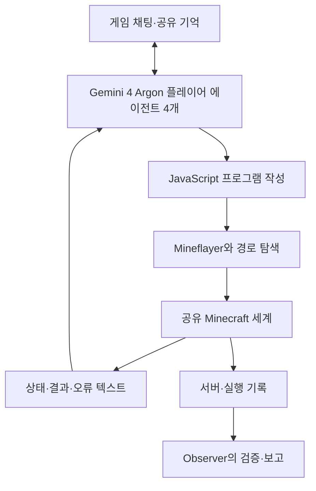

# A team of Gemini 4 Argon agents beats Minecraft

**핵심 판단:** 이 논문은 범용 코딩 에이전트 4개가 주어진 조건에서 Minecraft의 최종 목표를 자율적으로 완수한 사례를 제시합니다.  
다만 **단 한 번의 실행을 보고하므로, 반복 성공률·다중 에이전트의 우월성·모델의 일반화 성능 향상을 입증한 연구로 해석할 수는 없습니다.** 이 구분은 저자들이 명시한 한계와도 일치합니다. **[원문 p.15, §8]**

> **용어 — 에이전트:** 목표를 받아 상황을 관찰하고, 도구를 사용해 행동하며, 결과에 따라 다음 행동을 정하는 AI 시스템입니다.  
> **용어 — 일반화:** 이미 경험한 조건에서 얻은 능력을 새로운 환경·과제·조건에서도 유효하게 사용하는 능력입니다.

**분석 대상:** Maxence Faldor, Satinder Singh, Roberta Raileanu, Google DeepMind, 2026년 10월 15일 공개된 arXiv v1입니다. 아래의 페이지 번호는 첨부 PDF 기준입니다. [arxiv.org](https://arxiv.org/abs/2610.22319v1?utm_source=chatgpt.com)

분석 원문: 2610.22319v1.pdf

**표기 원칙**

- **[저자 보고]**: 논문에 직접 제시된 설정·관측·결과입니다.
- **[해석]**: 원문 증거가 허용하는 범위에서의 분석입니다.
- **[직접 계산]**: 원문 수치를 이용한 산술 계산입니다.
- **[후속 연구 제안]**: 요청에 따라 제안하는 검증 방법이며, 논문이 입증한 성과가 아닙니다.

원문에는 **Figure 1–14가 있으며, 번호가 붙은 Table은 없습니다.** 아래의 표들은 분석을 위해 재구성했습니다.

---

## 1. Executive summary — 9문장

1. 이 연구는 기존 게임 지식을 가진 범용 코딩 에이전트들이, 미리 작성된 게임별 공략이나 역할 배정 없이 하루 이상 지속되는 공동 목표를 완수할 수 있는지 시험했습니다. **[pp.2–4, 15]**
2. Gemini 4 Argon 에이전트 4개는 각각 Minecraft 플레이어를 제어했으며, 별도의 다섯 번째 에이전트인 Observer는 기록을 확인하고 진행 상황을 보고했습니다. **[pp.3–4, Fig.2]**
3. 플레이어들은 화면과 키보드 대신 JavaScript 프로그램과 Mineflayer를 통해 행동하고, 위치·체력·소지품·실행 오류 등의 정보를 텍스트로 받았습니다. **[pp.2–3, Fig.2]**
4. 무작위로 생성된 Easy 난이도 세계에서 팀은 연구자의 플레이 개입 없이 **27시간 14분 만에 Ender Dragon을 처치**했으며, 그때까지 프로그램 2,783개를 실행하고 채팅 229개를 교환하면서 605회 사망했습니다. **[pp.3–4, 14]**
5. 실행 중 역할 분담, 공유 기록, 재사용 도구, 동료가 떨어뜨린 아이템의 회수, 잘못된 성공 보고의 정정이 관찰됐습니다. **[pp.12–13, Figs.13–14]**
6. 구체적인 문제 해결 사례로는 두 방향 관측을 이용한 요새 위치 추정과, 네 에이전트의 655개 프로그램에 나타난 제작 오류 수정용 보조 함수가 제시됩니다. **[pp.7–9, Fig.7; p.13]**
7. 승리까지의 네 플레이어 비용은 논문 당시 API 도입기 정가 기준 약 **520달러**, 표준 정가 기준 약 **1,040달러**로 추정됐습니다. **[p.14, §6]**
8. 논문은 새로운 신경망 구조나 학습 손실함수를 제안하지 않으며, 기존 코딩 에이전트의 실행 구조와 한 차례의 장시간 수행 기록을 분석합니다. **[pp.2–4, 14–15]**
9. 단일 실행, Easy 난이도, 사전학습된 게임 지식, 사람이 직접 볼 수 없는 상태정보와 경로 탐색 도구의 사용 때문에, 결과를 새로운 게임에 대한 일반화나 사람 수준의 시각적 게임 수행 능력으로 확대할 수 없습니다. **[p.15, §8]**

> **용어 — Mineflayer:** Minecraft 플레이어를 프로그램으로 제어할 수 있는 JavaScript 라이브러리입니다.  
> **용어 — API:** 프로그램이 다른 시스템의 정보와 기능을 이용하는 연결 방식입니다.  
> **용어 — 사전학습:** 현재 과제를 수행하기 전에 대규모 데이터로 모델의 능력을 형성하는 과정입니다.

---

## 2. 연구 배경·문제·목표·필요성

### 2.1 해결하려는 문제

**[저자 보고]** 연구의 중심 질문은 다음과 같습니다.

> 범용 코딩 에이전트 팀이 수천 번의 프로그램 실행과 수백 번의 실패를 거치면서도, 하루 이상 하나의 목표를 유지하고 필요한 작업을 서로 조정할 수 있는가?

Minecraft의 Ender Dragon 처치는 하나의 행동으로 해결되지 않습니다. 자원 수집과 도구 제작, Nether 진입, 필요한 재료 확보, 요새 탐색, End 진입, 회복 크리스털 제거, 최종 전투가 연결되어 있습니다. 앞 단계의 산출물을 잃으면 이후 계획도 영향을 받습니다. **[p.2, §1; p.5, Fig.4]**

> **용어 — 장기 과제·장기 계획, long-horizon:** 많은 중간 단계를 거쳐야 최종 목표를 달성할 수 있는 과제입니다. 중요한 것은 시간의 길이뿐 아니라, 앞선 결정과 실패가 나중 단계에 미치는 영향입니다.

### 2.2 연구의 목적

**[저자 보고]** 저자들은 Minecraft 전용으로 설계된 계획기나 사전에 제공된 기술 저장소 없이, 범용 코딩 에이전트가 이미 가진 지식을 실제 프로그램과 팀 협력으로 연결할 수 있는지 확인하려 했습니다. **[pp.2–4, 14]**

여기서 “범용”이라는 표현은 **Minecraft를 처음 접한다는 뜻이 아닙니다.** 저자는 Gemini 4 Argon이 학습 데이터에서 Minecraft와 Mineflayer에 관해 상당한 지식을 습득했다고 명시합니다. **[p.15, Prior knowledge]**

### 2.3 연구의 필요성

**[저자 보고]** 복잡한 소프트웨어 개발과 기업 업무에도 장기간의 목표 유지, 코드 작성, 작업 분담, 실패 복구가 필요하다는 것이 연구의 동기입니다. Minecraft는 이러한 과정을 실행 로그와 게임 상태로 관찰할 수 있는 환경을 제공합니다. **[p.1; p.15, §9]**

**[해석]** 이 연구의 의미는 개별 질문에 답하는 능력보다 **관찰·실행·실패·수정·협업이 누적되는 전체 수행 과정**을 살펴본 데 있습니다. 다만 실제 소프트웨어 개발이나 기업 업무로의 성능 전이는 이 논문에서 평가하지 않았습니다. **[근거: pp.2–4, 14–15]**

---

## 3. 핵심 주장과 근거

| 핵심 주장 | 저자가 제시한 근거 | 증거가 뒷받침하는 범위와 주의점 | 원문 위치 |
|---|---|---|---|
| 팀이 최종 목표를 달성했다 | 서버 로그의 `Free the End` 달성 기록, 프로그램·출력·채팅 기록 | 해당 실행에서의 목표 달성 근거이며, 반복 성공률은 아님 | p.14, §5; p.12, Fig.12 |
| 연구자가 역할과 공략을 미리 지정하지 않았다 | 목표 지시문과 일반 지침, 초반 역할 협상 채팅 | 구체적 역할은 스스로 정했지만, 공유 기억과 도구 재사용은 일반 지침에 포함 | pp.3–4; p.6, Fig.5 |
| 장시간 프로그램 실행을 통해 진행을 유지했다 | 승리까지 2,783개 프로그램, 63,313개의 서로 다른 JavaScript 코드 줄 | 장기 수행의 사례이며, 코드 품질이나 계산 효율의 우월성을 뜻하지 않음 | pp.2, 4 |
| 팀 내부에서 지식과 도구가 재사용됐다 | 제작 문제 수정용 함수가 네 에이전트의 655개 프로그램에 등장 | 재사용은 관찰됐으나, 공유가 오류율을 얼마나 줄였는지는 미측정 | p.13, §4 |
| 실패 후 협력적으로 복구했다 | 익사로 떨어진 Eyes of Ender 12개를 동료가 회수 | 복구 능력의 구체적 사례이며, 전체 구조 요청의 성공률은 미제시 | pp.9–10, Fig.8 |
| 실제 관측을 이용해 계산 프로그램을 만들었다 | Eye of Ender의 이동 방향 두 개를 측정하고 교차점 계산 | 한 위치 추정 사례이며, 일반적인 탐색 정확도나 평균 오차는 아님 | pp.7–9, Fig.7 및 코드 |
| 잘못된 성공 보고를 수정했다 | 실제로 보관하지 못한 아이템을 보관했다고 알린 뒤 약 2분 후 정정 | 자기 수정 사례이며, 모든 잘못된 보고의 탐지 능력을 입증하지 않음 | p.13, Fig.14 |
| 관련 능력은 실제 업무에도 중요하다 | 장기 목표 유지·협업·실패 복구와 업무 수행의 공통점에 대한 논의 | 저자의 시사점이며, 실제 업무에서 검증된 결과는 아님 | p.1; p.15, §9 |

**“최초” 주장도 조건을 붙여 읽어야 합니다.** 초록의 최초 주장은 저자들이 아는 범위에서, 사전 탐색한 시드나 추가적인 인간 작성 게임 전용 도구 없이 표준 Mineflayer를 사용한 완수라는 조건을 포함합니다. 논문 자체가 앞선 커뮤니티의 드래곤 처치 사례 두 개를 소개하므로, 이를 무조건적인 “AI 최초 Minecraft 완수”로 요약하면 부정확합니다. **[pp.1, 14]**

> **용어 — 시드, seed:** Minecraft 세계를 생성하는 데 사용하는 초기 값입니다. 다른 시드는 지형과 자원 배치가 다른 세계를 만들 수 있습니다.

---

## 4. 방법론과 시스템 구조

### 4.1 실험 설계와 주요 데이터 소스

**이 연구는 대조군을 둔 성능 비교 실험보다, 최초 실행 한 번을 자세히 기록한 사례 연구에 해당합니다.** **[해석; 근거: p.15, A single run]**

| 항목 | 원문에 제시된 설정 | 근거 |
|---|---|---|
| 게임 | Minecraft Java Edition 1.20.4 | p.3 |
| 환경 | Survival 모드, Easy 난이도, 무작위 생성 세계, 치트 명령 비활성화 | p.3 |
| 목표 | 초기 출발 위치에서 시작해 Ender Dragon 처치 | p.3 |
| 플레이어 | 동일한 범용 코딩 에이전트의 독립 인스턴스 4개 | pp.2–3 |
| 관찰자 | 같은 모델 기반 Observer 1개, 게임에는 참여하지 않음 | pp.3–4 |
| 게임 조작 | JavaScript 프로그램, Mineflayer, 표준 경로 탐색 플러그인 | pp.2–3 |
| 주요 분석 자료 | 프로그램과 출력, 게임 채팅, 서버의 사망·발전 기록, 저장된 세계, Observer 보고 | pp.3–4, 14 |
| 최종 성공 판정 | 서버 로그의 `Free the End` 달성 | p.14 |
| 반복 횟수 | 최초로 시작한 실행 1회 | p.15 |

**데이터의 성격을 구분해야 합니다.** 이 논문의 핵심 데이터는 새 모델을 훈련하기 위한 데이터셋이 아니라 **이미 구축된 에이전트들이 과제를 수행하면서 만든 실행 기록**입니다. Gemini 4 Argon의 학습 데이터 구성과 Minecraft 관련 데이터 비중은 제시되지 않습니다. **[pp.3–4, 14–15]**

### 4.2 모델 내부 구조와 에이전트 시스템 구조의 구분

**[저자 보고]** 논문이 설명하는 구조는 다음과 같습니다. **[pp.2–4, Fig.2]**



각 에이전트는 프로그램을 작성하고, 실행 결과를 읽고, 다음 프로그램을 작성합니다. 따라서 수행 단위는 개별 키 입력보다 길고, 걷기·채굴·제작·전투 같은 여러 행동을 하나의 코드로 묶을 수 있습니다. **[pp.2–3]**

> **용어 — 경로 탐색:** 목표 위치까지 이동할 수 있는 경로를 장애물 등을 고려해 계산하는 기능입니다.  
> **용어 — 폐루프:** 행동 결과를 다시 관찰해 다음 행동을 수정하는 방식입니다. 위 구조를 설명하는 용어이며, 논문이 새로운 제어 이론을 제안했다는 뜻은 아닙니다.

**원문이 제공하지 않는 내부 정보**는 다음과 같습니다.

- Gemini 4 Argon의 파라미터 수와 신경망 계층 구성
- 학습 손실함수와 학습 데이터의 세부 구성
- Minecraft를 위한 추가 학습 절차
- 실행 중 모델 가중치 갱신 방법

따라서 이 논문만으로 새로운 신경망 설계나 강화학습 알고리즘을 설명할 수 없습니다. **[문서 범위 확인: pp.2–4, 14–15]**

> **용어 — 가중치·파라미터:** 학습을 통해 정해지는 모델 내부의 수치입니다.  
> **용어 — 손실함수:** 학습 과정에서 모델의 오류를 수치화하는 기준입니다.  
> **용어 — 강화학습:** 행동 결과에 주어지는 보상 등을 이용해 행동 방식을 개선하는 학습 방법입니다.

### 4.3 실행 환경과 도구

에이전트 각각은 독립된 클라우드 머신에서 실행되며, 코드 작업 공간, 버전 관리, 셸, 파일 편집, 웹 검색, 지속 기억을 사용할 수 있습니다. 반면 **게임 서버에서 실행되는 JavaScript 프로그램**에는 프로세스 시작과 파일 쓰기 제한이 있습니다. 이 두 실행 범위를 혼동하면 안 됩니다. **[pp.3–4, 15]**

게임 프로그램은 Mineflayer 봇을 전달받는 비동기 함수의 본문으로 실행됩니다. 명령줄 클라이언트의 기본 대기 제한은 60초이고, 에이전트가 이를 선택할 수 있습니다. `global` 객체에 저장한 값은 프로그램 사이에 유지됩니다. **[pp.3–4]**

> **용어 — 비동기 실행:** 이동이나 외부 작업이 끝나기를 기다리는 동안 실행 흐름을 조정할 수 있는 방식입니다.  
> **용어 — 지속 상태:** 한 프로그램이 끝나도 다음 프로그램이 사용할 수 있도록 남겨두는 값이나 코드입니다.

프로그램 실행시간의 **중앙값은 33.5초**였으며, 각 플레이어가 프로그램을 실행 중인 시간은 전체의 약 40%였습니다. 나머지 시간에는 결과 읽기, 추론, 다음 코드 작성이 포함되므로 이를 모두 유휴시간이나 낭비로 볼 수는 없습니다. **[p.2]**

> **용어 — 중앙값:** 관측값을 크기순으로 정렬했을 때 가운데에 오는 값입니다. 평균과는 다릅니다.

### 4.4 기억·통신·협업

**기억:** 각 에이전트는 개인 기억과 팀 공유 기억을 갖습니다. 대화 문맥이 길어지면 압축하며, 압축 후에도 필요한 진행 상황과 다음 단계를 기억에 남기도록 지시받습니다. **[p.3]**

> **용어 — 문맥 압축, context compaction:** 모델이 한 번에 유지할 수 있는 정보량을 관리하기 위해 이전 내용을 줄여 정리하는 과정입니다.

**통신:** 게임 채팅은 모든 봇에 전달되고, 각 플레이어의 다음 프로그램 출력에 나타납니다. 따라서 채팅이 전달되는 방식도 실행 루프와 연결되어 있습니다. **[p.4]**

**역할 분담:** 실행 결과를 보면 janesick은 도구 제작과 요새 탐색, gyldenia는 보급과 크리스털 제거, auratian은 포털과 크리스털 접근 전략, bulicame은 보호 구조물과 최종 공격 등에 기여했습니다. 이 역할은 미리 고정해 배정한 것이 아닙니다. **[p.13, §4]**

**도구 재사용:** 프로그램 사이에 유지된 상태·코드 조각은 146개였고, 그중 42개는 보조 함수였습니다. 시간 제한을 넘긴 이전 코드가 계속 작동하지 않도록 하는 중단용 카운터는 1,519개 프로그램에서 참조됐습니다. **[p.13]**

> **용어 — 보조 함수, helper function:** 반복되는 작업이나 오류 처리를 재사용하기 쉽도록 묶어놓은 작은 프로그램입니다.

**[해석]** 역할과 문제 해결 내용은 실행 중 형성됐지만, 공유 기억·도구 재사용·결과 검증 자체는 일반 지침에 들어 있었습니다. 따라서 “협업의 모든 요소가 아무 지시 없이 생겼다”는 설명은 원문보다 강한 주장입니다. **[pp.3–4, 12–13]**

---

## 5. 수식으로 설명할 수 있는 실제 방법: 요새 위치 추정

### 5.1 원문 수식의 존재 여부

**논문에는 번호가 붙은 학습 수식이나 새 최적화 목적함수가 없습니다.** 다만 p.9에 실제 실행한 JavaScript 코드 일부가 있으며, 이 코드는 두 방향선의 교차점을 계산합니다.

아래 수식은 **원문 코드의 수학적 재표현**입니다. 논문에 없는 학습 알고리즘을 추가한 것이 아닙니다. **[pp.7–9, Fig.7 및 p.9 코드]**

### 5.2 관측 방법

janesick은 서로 다른 위치에서 Eye of Ender를 두 번 던지고, 이동 위치를 약 50밀리초 간격으로 기록했습니다. 이후 두 비행 방향을 이용해 요새가 있을 위치를 계산했습니다. 제시된 코드는 약 4.5초 동안 위치를 수집하도록 작성되어 있습니다. **[pp.7, 9]**

> **용어 — Eye of Ender:** 요새 방향으로 이동하는 게임 아이템입니다. 이 연구에서는 그 이동 방향을 위치 추정에 이용했습니다.  
> **용어 — 삼각측량:** 서로 다른 위치에서 관측한 방향을 이용해 목표 위치를 추정하는 방법입니다. 여기서는 수평면에서 두 방향선의 교차를 계산합니다.

### 5.3 두 방향선의 교차

두 투척의 수평 위치와 방향을 다음과 같이 놓습니다.

$$
\mathbf{p}_i=
\begin{bmatrix}
x_i\\
z_i
\end{bmatrix},
\qquad
\mathbf{u}_i=
\begin{bmatrix}
u_{xi}\\
u_{zi}
\end{bmatrix},
\qquad i\in\{1,2\}.
$$

**기호 설명**

- $i$: 첫 번째 또는 두 번째 투척
- $x_i,z_i$: 투척 위치의 수평 좌표
- $\mathbf{p}_i$: 투척 위치 벡터
- $u_{xi},u_{zi}$: 관측한 비행 방향의 수평 성분
- $\mathbf{u}_i$: 방향 벡터

> **용어 — 벡터:** 여러 수치를 순서대로 묶어 위치나 방향을 나타내는 표현입니다. Minecraft에서 $y$는 높이이며, 여기서는 $x,z$만 사용합니다.

교차점은 다음 관계를 만족합니다.

```math
\mathbf{p}_1+s_1\mathbf{u}_1
=
\mathbf{p}_2+s_2\mathbf{u}_2.
```

여기서 $s_1,s_2$는 각 방향선을 얼마나 연장하는지 나타내는 매개변수이며, **경과시간이 아닙니다.**

이를 연립방정식으로 쓰면 다음과 같습니다.

```math
\begin{bmatrix}
u_{x1} & -u_{x2}\\
u_{z1} & -u_{z2}
\end{bmatrix}
\begin{bmatrix}
s_1\\
s_2
\end{bmatrix}
=
\begin{bmatrix}
x_2-x_1\\
z_2-z_1
\end{bmatrix}.
```

원문 코드의 두 번째 위치 변수는 `x0`, `z0`이지만, 설명에서는 표기를 통일해 $x_2,z_2$로 옮겼습니다. **[p.9]**

### 5.4 원문 코드가 사용하는 해

먼저 다음 값을 계산합니다.

```math
\Delta
=
u_{x1}(-u_{z2})-u_{z1}(-u_{x2}).
```

이때 해는 다음과 같습니다.

```math
s_1
=
\frac{
(x_2-x_1)(-u_{z2})
-
(z_2-z_1)(-u_{x2})
}{\Delta},
```

```math
s_2
=
\frac{
u_{x1}(z_2-z_1)
-
u_{z1}(x_2-x_1)
}{\Delta}.
```

추정 위치는 다음과 같습니다.

```math
\hat{\mathbf{p}}
=
\mathbf{p}_1+s_1\mathbf{u}_1.
```

**기호 설명**

- $\Delta$: 위 연립방정식의 행렬식
- $\hat{\mathbf{p}}$: 계산된 목표의 수평 위치
- $\hat{\ }$: 관측값으로부터 얻은 추정치임을 나타내는 표시

원문 코드는 다음 조건에서만 교차점을 계산합니다.

$$
|\Delta| > 10^{-6}.
$$

**[원문 코드의 재표현: p.9]**

> **용어 — 행렬식:** 여기서는 두 방향이 서로 평행한지 판단하는 데 쓰이는 값입니다.  
> **[수학적 해석]** 두 방향이 거의 평행하면 작은 방향 오차가 교차점의 큰 위치 오차로 이어질 수 있습니다. 이 민감도에 대한 실험 결과는 논문에 없습니다.

### 5.5 보고된 43m 오차의 의미

Figure 7의 추정 수평 좌표는 $(432,-1376)$이고, 실제 포털 방 좌표는 $(463,-30,-1406)$입니다. 수평 거리만 계산하면 다음과 같습니다.

```math
e_{\text{horizontal}}
=
\sqrt{
(463-432)^2+
\left[-1406-(-1376)\right]^2
}
=
\sqrt{1861}
\approx43.14\text{ m}.
```

- $e_{\text{horizontal}}$: 수평면에서의 위치 차이
- 실제 포털의 높이 $y=-30$은 이 계산에 포함하지 않음

**[직접 계산]** 이 값은 저자가 보고한 약 43m와 일치합니다. 그러나 **한 번의 위치 추정 결과**이며, 여러 세계에서의 평균 탐색 정확도는 아닙니다. **[p.8, Fig.7]**

또한 발췌 코드에는 두 번째 투척의 전체 수치와 방향 추정 과정이 생략되어 있어, 첨부 문서만으로 계산 전체를 완전히 재현할 수는 없습니다.  
발췌 부분에는 $s_1,s_2\ge0$ 검사도 보이지 않으므로, 엄밀하게는 두 **직선**의 교차 계산으로 설명하는 것이 적절합니다. **[p.9]**

---

## 6. 주요 결과와 중요한 데이터 포인트

### 6.1 수행 규모와 실패

| 지표 | 저자 보고 값 | 정확한 해석 | 근거 |
|---|---:|---|---|
| 완수 시간 | 27시간 14분 | 첫 프로그램부터 드래곤 처치까지의 경과시간 | pp.4, 14 |
| 승리까지 프로그램 | 2,783개 | 플레이어 4명의 합계 | pp.2, 4 |
| 전체 세션 프로그램 | 2,839개 | 승리 이후 실행까지 포함 | p.3 |
| 서로 다른 JavaScript 코드 줄 | 63,313줄 | 전체 작성 줄 수나 독립적인 기술 수와는 다름 | p.2 |
| 게임 채팅 | 229개 | 공유 기억의 편집량까지 포함하는 수치는 아님 | pp.4, 12–13 |
| 사망 | 605회 | 팀 전체의 게임 내 사망 | pp.4, 13 |
| 오류로 종료된 프로그램 | 22% | 정확한 오류 정의와 집계 분모는 별도 명시되지 않음 | p.15 |
| 프로그램 실행시간 중앙값 | 33.5초 | 평균이 아님 | p.2 |
| 프로그램 실행 중인 시간 비중 | 플레이어별 약 40% | 나머지에는 읽기·추론·코드 작성 포함 | p.2 |
| 서버 재시작 | 6회 | 총 약 20분의 중단이 완수 시간에 포함 | p.4 |
| 유지된 상태·코드 조각 | 146개 | 그중 보조 함수 42개 | p.13 |

### 6.2 주요 진행 시점

| 단계 | 첫 프로그램 이후 시각 | 근거 |
|---|---:|---|
| Nether 포털 | 1시간 42분 | p.5, Fig.4 |
| Nether 요새 | 2시간 57분 | p.5, Fig.4 |
| Blaze rods | 4시간 17분 | p.5, Fig.4 |
| Eyes of Ender | 10시간 43분 | p.5, Fig.4 |
| 요새 단계 달성 | 13시간 17분 | p.5, Fig.4 |
| End 진입 | 13시간 33분 | p.5, Fig.4 |
| 마지막 크리스털 제거 | 26시간 34분 55초 | p.12, Fig.12 |
| `Free the End` 달성 | 27시간 14분 12초 | p.12, Fig.12 |

**[직접 계산]** 분 단위 기록을 기준으로 End 진입부터 완료까지는 약 **13시간 41분**, 전체의 약 **50.2%**입니다. 마지막 크리스털 제거부터 완료까지는 **39분 17초**입니다. **[계산 근거: Figs.4, 12]**

**[해석]** 이 실행의 중요한 병목은 최종 전투 단계였습니다. 다만 이것이 다른 시드에서도 항상 가장 큰 병목이라는 증거는 없습니다.

### 6.3 비용과 토큰

| 집계 범위 | 토큰·호출 | 도입기 정가 추정 | 표준 정가 추정 |
|---|---|---:|---:|
| 승리까지 플레이어 4개 | 입력 약 13.5억 토큰, 91% 캐시 처리; 출력 약 1,600만 토큰, 그중 사고 토큰 약 400만; 모델 호출 약 24,000회 | 약 520달러 | 약 1,040달러 |
| Observer와 승리 후 하루 활동을 포함한 전체 세션 | 세부 분해 미제시 | 약 810달러 | 약 1,620달러 |

**[저자 보고: p.14, §6]**

> **용어 — 토큰:** 모델이 입력과 출력을 처리하는 텍스트 단위입니다. 단어나 글자 수와 정확히 같지는 않습니다.  
> **용어 — 문맥 캐시:** 반복되는 입력 문맥의 처리 결과를 재사용하는 방식입니다.  
> **용어 — 사고 토큰:** 논문이 모델의 추론 과정에 해당한다고 집계한 출력 토큰입니다. 위 400만은 1,600만에 포함됩니다.

비용은 **논문 당시 정가와 토큰 카운터에 따른 추정치**이며, 실제 모델 운영 원가가 아닙니다. 또한 입력 13.5억 토큰은 반복 문맥을 포함하므로 학습 데이터 규모나 서로 다른 정보량으로 해석할 수 없습니다. 전체 세션 비용과 승리까지 비용의 차이를 Observer만의 비용으로 계산하는 것도 부정확합니다. **[p.14]**

---

## 7. 저자가 보고한 결과와 분석자의 해석: 일반화 성능을 중심으로

### 7.1 무엇이 관찰됐고, 무엇이 검증되지 않았는가?

| 구분 | 저자가 직접 보고한 내용 | 허용되는 해석 | 아직 검증되지 않은 주장 |
|---|---|---|---|
| 연구 주제 | 범용 코딩 에이전트 팀이 장시간 목표를 수행 | 기존 능력을 긴 실행 과정에 적용한 사례 | 처음 접한 게임에서도 같은 능력이 작동 |
| 실행 중 적응 | 코드 수정, 규칙 기록, 전략 변경 | 피드백에 따라 수행 방식을 바꿨음 | 모델 내부의 일반적 추론 능력이 학습으로 향상 |
| 팀 내부 지식 공유 | 제작 수정 함수가 네 에이전트의 프로그램에 등장 | 같은 세션 안에서 해결책을 재사용 | 다른 세계나 다른 과제에서도 같은 효과 |
| 역할 분담 | 작업별 기여가 분화 | 자율적인 협업 방식이 관찰됨 | 4명이 1명보다 동일 비용에서 우수 |
| 세계 변화 대응 | 무작위 세계 하나에서 완수 | 사전 탐색한 고정 경로 없이 진행 | 여러 시드에서 높은 성공률 |
| 현실 적용 | 협업·복구·장기 목표 유지의 중요성을 논의 | 실제 업무 연구에 참고할 구성 요소 | 기업 업무·소프트웨어 개발 성능 향상 |

**[근거: pp.2–4, 12–15]**

### 7.2 일반화 가능성과 관련해 가장 유망한 부분

**[해석]** 일반화 연구로 연결할 가치가 있는 요소는 세 가지입니다.

**첫째, 경험을 다시 실행할 수 있는 코드로 남긴다는 점입니다.** 제작 문제 수정 함수가 여러 프로그램에서 반복 사용된 사실은, 해결책을 일회성 답변에 머물지 않고 행동 수단으로 저장할 수 있음을 보여줍니다. 다만 다른 과제에서도 작동하는지는 별도 평가가 필요합니다. **[p.13]**

**둘째, 경험을 팀이 읽을 수 있는 기억으로 남긴다는 점입니다.** 좌표, 위험, 도구의 특성, 복구 방법을 공유하는 방식은 다음 행동을 준비하는 데 활용됐습니다. 그러나 좌표처럼 특정 세계에만 유효한 정보와, 제작 API 사용법처럼 재사용 가능한 정보를 분리해 평가하지는 않았습니다. **[pp.7, 12–13]**

**셋째, 관측을 통해 자체 도구를 만든다는 점입니다.** 요새 위치 계산 사례는 주어진 상태정보를 일반적인 수학과 코드로 연결한 예입니다. 하지만 이 사례 하나로 새로운 유형의 문제에 대한 도구 생성 능력을 정량화할 수는 없습니다. **[pp.7–9]**

### 7.3 “일반화 성능이 향상됐다”는 결론에 필요한 증거

**[후속 연구 제안]** 최소한 다음을 분리해야 합니다.

1. 같은 실행 안에서 이전 실패를 더 잘 피하는가?
2. 이전에 사용하지 않은 시드에서도 기록과 도구가 도움이 되는가?
3. 익숙한 작업을 새로운 순서로 조합한 과제에서도 도움이 되는가?
4. 게임 규칙이나 관측 방식이 달라져도 효과가 유지되는가?
5. 다른 게임이나 실제 업무에서도 효과가 유지되는가?

현재 논문은 주로 **첫 번째 항목과 관련된 행동 사례**를 보여줍니다. 첫 번째 효과의 크기조차 대조 실험으로 추정하지 않았으므로, 나머지 일반화 단계가 달성됐다고 주장할 수 없습니다. **[근거: pp.13, 15]**

> **용어 — 전이:** 한 환경에서 얻은 지식이나 기술을 다른 환경·과제로 옮겨 사용하는 것입니다.  
> **용어 — 대조 실험:** 비교할 조건을 정하고 특정 요소만 바꾸어, 관찰된 차이의 원인을 확인하는 실험입니다.

---

## 8. 제한사항·통계적으로 취약한 부분·비교 불가능한 수치

### 8.1 저자가 명시한 제한사항

논문의 §8에는 다음 여섯 가지가 명시되어 있습니다. **[모두 p.15]**

1. **관측과 이동을 코드가 지원합니다.** 벽 뒤의 블록, 드래곤의 내부 상태 등 사람에게 직접 보이지 않는 정보를 읽고, 경로 탐색 플러그인을 사용합니다.
2. **Easy 난이도입니다.** 적의 피해가 더 작고, 굶주림으로 죽지 않습니다.
3. **게임 사전 지식이 있습니다.** 처음 접한 게임에서의 학습을 시험한 것이 아닙니다.
4. **실패가 많았습니다.** 사망 605회, 프로그램 오류 22%, End 구간에 거의 14시간이 걸렸습니다.
5. **인프라 중단이 있었습니다.** 서버가 6회 재시작했습니다.
6. **단일 실행입니다.** 최초 실행 한 번의 성공으로 신뢰성을 판단할 수 없습니다.

### 8.2 추가적인 통계·측정상의 취약점

| 표시 | 문제 | 잘못 해석하기 쉬운 내용 | 정확한 판단 |
|---|---|---|---|
| **통계 취약** | 독립 실행 수가 1 | 프로그램 2,783개를 2,783번의 성능 실험으로 취급 | 하나의 세계에서 이어진 상호의존적 실행들임 **[pp.4, 15]** |
| **인과 미검증** | 단독 에이전트·기억 제거 조건 없음 | 협업이나 기억 때문에 성공했다고 단정 | 성공과 함께 관찰됐지만 기여량은 분리되지 않음 **[pp.12–15]** |
| **정의 불충분** | 프로그램 오류율 22% | 정확히 몇 개 프로그램이 어떤 오류를 냈는지 산출 | 오류 정의와 2,783/2,839 중 분모가 명확하지 않음 **[pp.3, 15]** |
| **분류 주의** | 사망 605회 | 모두 예기치 않은 실패로 취급 | 귀환·드래곤 리셋을 위한 의도적 사망도 존재 **[p.11, Fig.10]** |
| **중복 집계** | 채팅 패턴 분류 | 범주별 수치를 합해 메시지 수나 행동 성공 수로 사용 | 한 메시지가 여러 범주에 포함될 수 있음 **[p.13, Fig.13]** |
| **관측 한계** | 드래곤 체력은 프로그램이 읽은 값 | 모든 순간의 체력이 완전히 관측됐다고 가정 | 측정 사이 구간은 알 수 없음 **[p.12, Fig.12]** |
| **효과량 부재** | 재사용 함수의 등장 횟수 | 655회 사용을 그만큼의 오류 예방으로 환산 | 참조·사용의 빈도이며 예방 효과는 미측정 **[p.13]** |
| **감사 범위 한계** | Observer와 수동 로그 검토 | 부정확한 보고나 문제 행동을 모두 탐지한다고 주장 | 문제를 발견하지 않았다는 보고이며, 수동 검토는 로그 표본 대상 **[pp.4, 15]** |

> **용어 — 독립 표본:** 다른 관측의 결과에 직접 종속되지 않는 별도의 관측 단위입니다. 같은 실행의 연속 프로그램은 서로 의존합니다.  
> **용어 — 인과적 효과:** 어떤 요소를 바꿨기 때문에 결과가 얼마나 달라졌는지를 뜻합니다. 함께 나타났다는 사실만으로 확인되지 않습니다.  
> **용어 — 요소 제거 실험, ablation:** 공유 기억처럼 특정 기능을 제거해 그 기능의 기여를 비교하는 실험입니다.

### 8.3 직접 비교하면 안 되는 수치

**① 사람의 완료 시간과의 비교**

논문은 인간 플레이어의 메인 스토리 중앙값 45시간과 무작위 시드 스피드런 기록 7분 미만을 언급합니다. 그러나 AI는 4인 팀, Easy 난이도, 구조화된 상태정보, 코드 실행, 경로 탐색을 사용했습니다. 따라서 **27시간 14분과 이 수치들을 나누어 사람 대비 속도나 우월성을 계산하면 안 됩니다.** 여기서 인간 기록은 논문이 제시한 맥락 정보입니다. **[p.4; p.15]**

**② 프로그램·모델 호출·학습 스텝**

프로그램 2,783개, 모델 호출 약 24,000회, 다른 강화학습 연구의 환경 스텝은 서로 다른 단위입니다. 특히 사전학습이 끝난 모델의 실행 시간과, 다른 모델이 능력을 배우는 데 쓴 학습 시간을 직접 비교할 수 없습니다. **[본 논문 pp.2, 14; 관련 연구는 §11 참조]**

**③ 다른 Minecraft 연구의 성공률**

다이아몬드 획득, 짧은 지시 수행, 구조물 제작, Ender Dragon 처치는 성공 조건이 다릅니다. 관측 정보, 사망 처리, 행동 도구, 제한시간까지 맞추지 않으면 공통 성공률 순위표를 만들 수 없습니다.

예를 들어 Voyager는 사망 후 인벤토리를 보존하고 가까운 지면에서 부활하도록 설정했습니다. 이 논문의 아이템 손실·구조 문제와 조건이 다릅니다. **[Voyager, Appendix B.1]** [arxiv.org](https://arxiv.org/html/2305.16291?utm_source=chatgpt.com)

**④ 비용 범위**

520달러와 810달러는 집계 범위가 다르고, 520달러와 1,040달러는 적용 가격이 다릅니다. 다른 시스템과 비교하려면 모델 호출 비용, 캐시 정책, 실행 인원, 과제, 가격 시점, 인프라 비용 포함 여부를 맞춰야 합니다. **[p.14]**

---

## 9. 문서가 답하지 않는 질문

다음 질문들은 원문의 결과만으로 답할 수 없습니다.

| 미해결 질문 | 답이 필요한 이유 | 관련 원문 |
|---|---|---|
| 여러 새로운 시드에서 성공률과 소요시간 분포는 어떠한가? | 한 번의 성공과 안정적인 능력을 구분하기 위해 | p.15 |
| 같은 총 토큰 예산으로 1명·2명·4명을 비교하면 어떻게 되는가? | 협업의 효과와 계산량 증가를 구분하기 위해 | pp.3, 14–15 |
| 공유 기억, 채팅, 보조 함수가 각각 얼마나 기여했는가? | 어떤 요소를 재사용해야 하는지 판단하기 위해 | pp.12–13 |
| 같은 오류의 재발률이 실제로 줄었는가? | 기억의 존재와 효과적인 학습을 구분하기 위해 | pp.4, 13 |
| 기존 기록·도구를 다른 시드와 새 목표에 옮길 수 있는가? | 일반화와 전이의 핵심을 검증하기 위해 | pp.13, 15 |
| 내부 상태정보를 제한하거나 화면 입력으로 바꾸면 어떻게 되는가? | 관측·경로 탐색 지원의 기여를 분리하기 위해 | p.15 |
| 시간·비용·사망 횟수에 제한을 두어도 완료하는가? | 충분히 오래 시도한 성공과 효율적인 수행을 구분하기 위해 | pp.4, 14–15 |
| 문맥 압축 과정에서 어떤 정보가 사라졌는가? | 장기 기억의 정확성과 안정성을 평가하기 위해 | p.3 |
| 잘못된 보고를 동료와 Observer가 얼마나 놓쳤는가? | 자기 수정 사례와 검증 체계의 신뢰성을 구분하기 위해 | pp.4, 13, 15 |
| 모델 설정·전체 지시문·환경 시드·원시 로그로 독립 재현이 가능한가? | 재현성과 감사 가능성을 평가하기 위해 | pp.3–4, 14–15 |
| 실제 소프트웨어 개발이나 기업 업무에도 효과가 있는가? | 저자의 실용적 시사점을 검증하기 위해 | pp.1, 15 |

원문에는 기록을 남겼다는 설명이 있지만, 첨부 문서만으로 전체 실행 자료와 설정을 확보해 재현하는 절차가 충분히 제시되지는 않습니다.

---

## 10. 가장 중요한 그림의 선정과 해석

### 10.1 Figure 2, p.3 — 시스템을 해석하는 출발점

**그림이 보여주는 것:** 에이전트가 JavaScript를 작성하고, Mineflayer가 실행하며, 텍스트 결과가 돌아오는 구조입니다. 공유 기억과 채팅, 플레이하지 않는 Observer도 분리되어 있습니다.

**[해석]** 이 그림은 평가 대상이 무엇인지 규정합니다. 성과의 중심은 구조화된 게임 정보를 활용한 장기 코드 실행과 협업입니다. 시각 인식과 손 수준의 조작 능력까지 포함한 결과로 읽어서는 안 됩니다. **[Fig.2; p.15]**

### 10.2 Figures 3–4, p.5 — 전체 시간과 의존 단계

**그림이 보여주는 것:** Figure 3은 플레이어별 메시지·발전·사망과 서버 재시작, 프로그램 실행 빈도를 시간축에 배치합니다. Figure 4는 주요 단계의 최초 달성 시각을 나타냅니다.

**[해석]** 중간 목표 달성과 실패가 동시에 이어지는 과정을 볼 수 있습니다. 특히 End 진입 후 약 절반의 시간이 소요됐다는 점은 해당 실행의 병목을 보여줍니다.

**주의:** Figure 4의 색은 **그 단계에 처음 도달한 플레이어**입니다. 그 플레이어가 해당 단계의 모든 작업을 혼자 수행했다는 뜻은 아닙니다. **[Fig.4 캡션]**

### 10.3 Figure 7, p.8 및 p.9 코드 — 관측을 계산으로 연결

**그림이 보여주는 것:** 두 번 던진 Eye of Ender의 방향선, 계산한 교점, 실제 포털 위치입니다. 마을에서 교점까지 약 1.3km이고, 교점과 포털의 수평 거리는 약 43m입니다.

**[해석]** 이 그림은 “언어로 계획을 말하는 능력”을 넘어, 관측값을 수집하고 계산 프로그램을 실행한 사례를 보여줍니다. 다만 정확도는 단일 사례이며, 반복 검증이나 불확실성 구간이 없습니다. **[pp.7–9]**

### 10.4 Figure 12, p.12 — 최종 전투의 진행

**그림이 보여주는 것:** 왼쪽은 10개 크리스털의 파괴 시각과 담당자, 오른쪽은 드래곤의 체력 관측값입니다. 파괴 수는 gyldenia 6개, auratian 3개, bulicame 1개입니다.

**[해석]** 크리스털 제거 전략과 최종 체력 감소의 시간적 연결을 보여줍니다. 마지막 크리스털 제거 후 39분 17초에 완료했다는 점이 확인됩니다.

**주의:** 그림의 문구는 마지막 크리스털 제거 이전에 **관측한 체력 중 198.5보다 낮은 값이 없었다**는 뜻입니다. 모든 순간의 실제 체력이 그 이상이었다는 뜻은 아닙니다. 점선은 멀리 떨어진 관측값을 연결합니다. **[Fig.12]**

### 10.5 Figure 13, p.13 — 협업 내용과 실패 양상

채팅 패턴은 좌표 173개, 공유 상자 64개, 경고 24개, 아이템 구조 20개, 교훈·팁 11개입니다. 하나의 메시지가 여러 패턴에 해당할 수 있습니다.

사망 원인은 몬스터 351회, 드래곤 69회, 익사 67회, 낙하·공허 57회, 용암·불 47회, 기타 14회이며 합계는 605회입니다. **[Fig.13]**

**[해석]** 협업에 공간 정보가 자주 사용됐고, 최종 보스 외의 생존 문제도 큰 부담이었다고 읽을 수 있습니다. 그러나 “아이템 구조 관련 메시지 20개”를 “구조 성공 20회”로 바꾸어 표현하면 안 됩니다.

### 10.6 Figure 14, p.13 — 보고와 실제 상태의 불일치

**그림이 보여주는 것:** auratian이 아이템을 상자에 보관했다고 알린 뒤, 약 2분 후 실제 상태와 다르다고 정정한 사례입니다.

**[해석]** 장기 에이전트에서 행동 결과와 자연어 보고를 구분해 검증할 필요성을 보여줍니다. 동시에 모든 허위 성공 보고가 자동으로 해결된다는 증거는 아닙니다. **[Fig.14]**

---

## 11. 2020년 이후 관련 연구 비교 분석

아래는 **2026년 10월 22일까지 확인한 1차 자료를 바탕으로 선별한 비교**입니다. 2026년 연구 중 일부는 첨부 논문의 참고문헌 밖에서 보완한 자료입니다. 서로 다른 평가 조건을 유지한 채 방법과 일반화 검증 방식을 비교합니다.

### 11.1 주요 연구 비교

| 연구 | 방법과 직접 보고된 결과 | 이 논문과의 관계·비교 한계 | 원자료 위치 |
|---|---|---|---|
| **VPT, 2022** | 소량의 행동 표시 데이터로 영상 속 행동을 추정하고, 대규모 영상으로 행동을 학습한 뒤 추가 학습을 수행; 실제 마우스·키보드 인터페이스로 다이아몬드 도구 제작 보고 | 저수준 조작을 배우는 연구로, Mineflayer 프로그램 실행과 입력·행동 조건이 다름 | VPT p.1, Figs.1–2, §3–4 [arxiv.org](https://arxiv.org/abs/2206.11795?utm_source=chatgpt.com) |
| **MineDojo, 2022** | 다양한 과제와 인터넷 지식 기반을 제공하고, 영상과 언어의 관계를 학습한 모델을 보상에 활용; 새로운 두 과제에서는 즉시 수행 성능이 낮았지만 추가 학습 후 개선 | 다양한 과제와 전이 평가를 제공한다는 점이 중요; Ender Dragon 완주 한 사례와 성공률을 직접 비교할 수 없음 | MineDojo Fig.1, §4–5, Table 5 [arxiv.org](https://arxiv.org/html/2206.08853v2?utm_source=chatgpt.com) |
| **Voyager, 2023 공개·2024 게재** | 다음 과제를 자동 선택하고, Mineflayer 코드 기술 저장소와 실행 피드백으로 코드를 개선; 새 월드와 미관측 과제를 별도 평가 | 코드 작성·재사용 측면에서 직접적인 선행연구; 일반화 Table 2는 과제별 3회 시도이며, 사망 시 인벤토리 보존 설정이 다름 | Voyager §2, Table 2, Fig.8, Appendix B.1 [arxiv.org](https://arxiv.org/html/2305.16291?utm_source=chatgpt.com) |
| **Optimus-1, 2024** | 지식의 관계 구조와 성공·실패 경험 기억을 결합하고 STEVE-1로 행동; 과제마다 다른 시드로 최소 30회 평가하고 기억 구성 요소를 제거해 비교 | 기억의 효과를 평가하는 설계가 참고할 만함; §3.4의 일반화는 다른 기반 모델에서도 기억이 유효한지를 포함하며, 새 게임 전이와는 다름 | Optimus-1 §2–3, Tables 2–3, Fig.5 [arxiv.org](https://arxiv.org/html/2408.03615v2?utm_source=chatgpt.com) |
| **Project Sid, 2024** | 기억·목표·사회 정보 등의 기능을 병렬로 운영하며 집단 행동을 연구; 역할 분화 실험에서는 30명·20분 조건과 사회 인식 기능 제거 조건 비교 | 역할 분화와 집단 협력 자체는 선행연구에서도 관찰됨; 사회 시뮬레이션과 단일 완수 목표의 평가를 구분해야 함 | Project Sid Fig.3, Fig.8, §5.1 [arxiv.org](https://arxiv.org/html/2411.00114v1?utm_source=chatgpt.com) |
| **DreamerV3, Nature 2025** | 환경의 변화를 예측하는 모델을 학습하고 그 안에서 미래 행동을 연습; 동일 설정으로 다양한 과제를 학습하고 Minecraft 다이아몬드 획득 보고 | 알고리즘을 여러 과제에 적용하는 범용성과, 하나의 에이전트가 미지의 게임으로 전이하는 능력은 다름; Minecraft 입력에는 영상 외 구조화된 상태가 포함 | 선행 논문 p.1, Fig.1; 저자 공식 설명·환경 명세 [arxiv.org](https://arxiv.org/pdf/2301.04104?utm_source=chatgpt.com) |
| **SIMA 2, 2025** | 화면과 지시를 받아 키보드·마우스로 행동; 플레이 학습에서 제외한 ASKA와 Minecraft를 평가하고, Minecraft는 50개 과제에 각 15개 시드 사용 | 새로운 게임 환경으로의 전이를 별도로 평가했다는 점에서 중요한 비교 대상; Minecraft 사전 지식의 가능성은 저자도 인정하며, 드래곤 완주 평가는 아님 | SIMA 2 §3.1.1, §3.2–3.3, Fig.10 [arxiv.org](https://arxiv.org/html/2512.04797v1?utm_source=chatgpt.com) |
| **SciCrafter, 2026** | Minecraft의 회로 과제로 지식 발견·정리·적용을 평가; Table 1은 25개 과제와 8회 실행을 집계하며 최고 기본 설정은 26.0% | 익숙한 게임 지식을 실행하는 것과, 모르는 규칙을 발견해 적용하는 것을 분리하는 데 유용; 다른 모델·과제·지원 조건의 수치이므로 본 논문과 직접 비교 불가 | SciCrafter p.2, Fig.1; p.8, Tables 1–2 [arxiv.org](https://arxiv.org/pdf/2604.24697?utm_source=chatgpt.com) |
| **TickingCollabBench, 2026** | 능력이 다른 에이전트가 변화하는 환경에서 시간제한 안에 협력하도록 설계; 추론 중 세계를 멈추는 조건과 계속 진행하는 조건을 분리해 평가 | “오랫동안 수행했다”와 “시간제한 아래 효율적으로 협업했다”를 구분하는 데 유용; 팀 규모 확대의 효과도 과제에 따라 달라짐 | 해당 PDF pp.8–9, Figs.4–6 [arxiv.org](https://arxiv.org/pdf/2606.15684?utm_source=chatgpt.com) |

> **용어 — 기술 저장소:** 실행에 사용할 수 있는 코드나 행동 절차를 모아두는 저장 공간입니다.  
> **용어 — 세계 모델:** 행동에 따라 환경이 어떻게 변할지 예측하는 모델입니다. 이를 이용하면 실제 환경에서 매번 실행하지 않고도 행동을 연습할 수 있습니다.  
> **용어 — 학습에서 제외한 환경, held-out environment:** 학습용 게임 수행 데이터에 넣지 않고 평가에 사용하는 환경입니다. 기반 모델이 그 게임에 관한 일반 지식을 전혀 모른다는 뜻과는 구분해야 합니다.

추가로 **Dreamer 4의 「Training Agents Inside of Scalable World Models」, 2025**는 오프라인 데이터로 학습한 세계 모델 내부에서 행동을 학습해 다이아몬드를 획득하는 경로를 제시합니다. 실시간 코드 작성과 팀 협력을 사용하는 본 논문과는 다른 접근이며, 복잡한 모델을 바로 구현하기보다 핵심 아이디어부터 검증하려는 목적에서는 우선 비교 기준으로 활용하는 편이 적절합니다. **[해당 논문 §3, §4.1, Fig.3]** [arxiv.org](https://arxiv.org/html/2509.24527v1?utm_source=chatgpt.com)

> **용어 — 오프라인 학습:** 미리 확보한 데이터로 학습하는 방식입니다. 여기서 실제 환경과 상호작용하지 않는다는 설명은 학습 조건에 관한 것이며, 평가 실행을 하지 않았다는 뜻은 아닙니다.

### 11.2 앞선 드래곤 처치 사례와의 차이

첨부 논문은 다음 두 커뮤니티 프로젝트를 비교 대상으로 제시합니다. **[본 논문 p.14]**

- **Mine AI MCP:** 논문은 단일 Claude Opus 5 에이전트가 37개 고수준 도구를 호출하고 Normal 난이도에서 수행한 사례로 설명합니다. 프로젝트 원저자의 저장소도 완수 실행과 기록 자료를 안내합니다. [GitHub](https://github.com/aibengineering/mine-ai-mcp?utm_source=chatgpt.com)
- **Astra and JEV Minecraft agent:** 논문은 고정된 스피드런 시드와 Peaceful 난이도에서 계획 모델과 행동 선택 모델을 결합한 사례로 설명합니다. 원저자 문서에는 사전에 조사한 경로와 알려진 좌표의 사용도 명시되어 있습니다. [GitHub](https://github.com/rmalde/minecraft-agent?utm_source=chatgpt.com)

따라서 첨부 논문의 차별점은 **범용 코딩 에이전트 팀이 추가적인 사전 공략·고수준 게임 도구 없이 프로그램을 만들어 전체 목표를 수행한 구성**에 있습니다. 서로 다른 난이도·시드·도구 조건의 기록으로 모델의 상대적 우열을 정할 수는 없습니다. **[해석; 근거: 본 논문 pp.14–15 및 위 프로젝트 문서]**

### 11.3 앞으로의 연구에 주는 의미

**[비교 분석]** 코드 생성, 기억, 역할 분화 각각에는 이미 선행연구가 있습니다. 이 논문이 더하는 것은 그 요소들이 범용 코딩 팀의 장시간 전체 과제 수행에서 어떻게 함께 나타났는지에 대한 기록입니다. **[본 논문 pp.12–15; 위 비교 문헌]**

일반화 연구에서는 다음 구분이 특히 중요합니다.

- **Voyager:** 새 월드·새 과제로 코드 기술을 재사용하는 평가
- **Optimus-1:** 기억 체계를 다른 기반 모델에 적용하는 평가
- **SIMA 2:** 플레이 학습에서 제외한 게임으로의 전이 평가
- **본 논문:** 하나의 장시간 세션 내부에서의 적응과 목표 완수

이 평가들을 동일한 “일반화”라는 이름으로 묶으면 증거의 강도가 흐려집니다. 후속 연구는 **어떤 조건이 새롭고, 어떤 지식과 도구가 그대로 제공되며, 무엇이 실제로 향상됐는지**를 분명히 해야 합니다.

---

## 12. 결론·시사점·후속 연구 방향

### 12.1 저자가 제시한 시사점

**[저자 보고]** 장기 목표 추구, 협업, 실패 복구는 사람과 함께 일하는 에이전트에도 필요한 능력입니다.  
저자는 모든 단계를 기록할 수 있는 게임 환경에서 이런 시스템을 연구하는 것이 실제 업무에 사용하기 전에 시스템을 이해하는 데 도움이 된다고 설명합니다. **[p.15, §9]**

**[해석]** 학술적으로는 단순한 최종 성공 여부 외에, 프로그램 실행·메모리 사용·메시지·복구·오류 보고를 함께 분석할 필요성을 보여줍니다.  
실용적으로는 공유 기록, 재사용 도구, 결과 검증을 장기 에이전트 설계의 후보 요소로 살펴볼 근거가 됩니다. 이 요소들의 실제 업무 효과는 아직 별도 검증이 필요합니다. **[근거: pp.3–4, 12–15]**

### 12.2 저자가 명시한 후속 연구 계획

첨부 논문에는 구체적인 후속 실험 목록이나 일정이 제시된 별도의 Future Work 절이 없습니다.  
확인되는 방향성은 **관찰 가능한 환경에서 에이전트 팀의 협업과 복구를 연구해 실제 사용 전 이해를 높인다**는 것입니다. **[p.15, §9]**

따라서 “다음에는 특정 모델을 훈련한다”거나 “새 게임 전이를 검증할 계획이다” 같은 내용을 저자의 계획으로 덧붙이면 안 됩니다.

### 12.3 가장 유망한 접근법과 빠른 검증 방법

아래는 **분석자의 후속 연구 제안**입니다. 원문에서 관찰한 접근을 작은 실험으로 분리하는 데 초점을 둡니다.

| 우선 검증 후보 | 원문에서 유망한 이유 | 간단한 검증 설계 | 확인할 지표 |
|---|---|---|---|
| **공유된 오류 수정 기록과 보조 함수** | 제작 수정 함수가 네 에이전트의 655개 프로그램에 등장 **[p.13]** | 짧은 제작 과제에서 개인 기억만 사용하는 조건과 해결책을 공유하는 조건 비교 | 같은 오류의 재발률, 수정 시간, 성공률, 토큰 사용 |
| **실행 결과 확인과 이전 코드의 중단** | 잘못된 성공 보고와 정정, 시간 초과 후 중단 카운터가 관찰됨 **[p.13, Fig.14]** | 짧은 이동·수집 과제에서 상태 확인과 중단 장치를 각각 켜고 끄기 | 허위 성공 보고, 중복 행동, 오래된 명령의 잔존 |
| **좌표·마감시간이 포함된 협력 요청** | 떨어진 Eyes of Ender 12개를 만료 전에 회수 **[pp.9–10, Fig.8]** | 제한시간 내 아이템 회수에서 자유형 메시지와 구조화된 요청 비교 | 회수 성공률, 응답 지연, 불필요한 이동 |
| **관측값을 이용한 자체 계산 도구** | 두 방향으로 목표 위치를 추정 **[pp.7–9]** | 여러 위치와 관측 오차 조건에서 같은 계산을 반복 | 위치 오차 분포, 거의 평행한 방향에서의 실패율 |
| **문맥 압축 이후의 작업 복원** | 진행 상태를 기억에 남기도록 설계 **[p.3]** | 짧은 다단계 과제 중간에 압축을 적용하고 기록 형식을 비교 | 단계 누락, 이미 끝낸 작업의 반복, 복구 시간 |

**우선순위 판단:** 가장 먼저 검증할 것은 **공유 오류 기록·보조 함수 재사용**과 **실제 상태에 근거한 결과 확인**입니다. 원문에 구체적인 사용 사례가 있고, 전체 게임을 27시간씩 실행하지 않아도 짧은 과제에서 효과를 분리할 수 있기 때문입니다. 이는 효과가 이미 입증됐다는 의미가 아니라, 검증 비용 대비 얻을 수 있는 정보가 명확하다는 판단입니다.

### 12.4 일반화 향상 주장을 위한 후속 평가 설계

**[후속 연구 제안]**

1. **개발 조건과 평가 조건을 분리합니다.** 도구와 기억을 만드는 데 사용한 시드와 최종 평가 시드를 구분합니다.
2. **이전 지식의 재사용 효과를 분리합니다.** 기억 없음, 개인 기억, 공유 기억, 공유 기억과 코드 재사용 조건을 비교합니다.
3. **총 계산 예산을 맞춥니다.** 에이전트 수가 늘면서 단순히 더 많은 토큰을 사용한 효과를 구분합니다.
4. **환경 특수 정보와 일반 규칙을 나눕니다.** 특정 좌표의 재사용과 제작 API 사용법의 재사용을 별도로 평가합니다.
5. **더 강한 변화는 단계적으로 적용합니다.** 새 시드 다음에 새 목표, 규칙 변경, 관측 제한, 다른 환경으로 평가를 확대합니다.
6. **성공 사례뿐 아니라 실패와 비용 분포를 보고합니다.** 성공률, 제한시간 초과, 완료 시간, 비용, 반복 오류를 함께 공개합니다.
7. **재현 자료를 고정합니다.** 모델 설정, 지시문, 환경 버전, 시드, 프로그램과 로그를 연결해 검토할 수 있게 합니다.

이 연구의 가장 확실한 성과는 **명시된 조건에서 범용 코딩 에이전트 팀의 장시간 자율 완수가 가능했음을 기록한 것**입니다. 일반화 성능 향상의 다음 근거는, 그 실행에서 만든 기억과 도구가 **보류한 새로운 조건에서도 동일 예산의 비교 대상보다 일관되게 도움이 되는지**에서 나와야 합니다.

---

## 참고자료

아래는 본문 분석과 비교에 사용한 원자료의 제목과 출처입니다.

1. **Maxence Faldor, Satinder Singh, Roberta Raileanu.**  
   *A team of Gemini 4 Argon agents beats Minecraft.* 2026, arXiv:2610.22319v1. 첨부 PDF를 기준으로 분석.  
   [arXiv 원문 정보](https://arxiv.org/abs/2610.22319v1)

2. **Bowen Baker 외.**  
   *Video PreTraining (VPT): Learning to Act by Watching Unlabeled Online Videos.* 2022.  
   [논문 원문](https://arxiv.org/abs/2206.11795)

3. **Linxi Fan 외.**  
   *MineDojo: Building Open-Ended Embodied Agents with Internet-Scale Knowledge.* 2022.  
   [논문 원문](https://arxiv.org/abs/2206.08853)

4. **Guanzhi Wang 외.**  
   *Voyager: An Open-Ended Embodied Agent with Large Language Models.* 2023 공개, 첨부 논문 참고문헌상 TMLR 2024.  
   [논문 원문](https://arxiv.org/abs/2305.16291)

5. **Zaijing Li 외.**  
   *Optimus-1: Hybrid Multimodal Memory Empowered Agents Excel in Long-Horizon Tasks.* 2024.  
   [논문 원문](https://arxiv.org/abs/2408.03615)

6. **Altera.AL 외.**  
   *Project Sid: Many-agent simulations toward AI civilization.* 2024.  
   [논문 원문](https://arxiv.org/abs/2411.00114)

7. **Danijar Hafner, Jurgis Pasukonis, Jimmy Ba, Timothy Lillicrap.**  
   *Mastering diverse control tasks through world models.* Nature, 2025.  
   [저자 공식 연구 페이지](https://danijar.com/project/dreamerv3/)  
   선행 원문: *Mastering Diverse Domains through World Models.* [arXiv](https://arxiv.org/abs/2301.04104)  
   환경 명세: *Standardized Minecraft Diamond Environment for Reinforcement Learning.* [저자 공식 저장소](https://github.com/danijar/diamond_env)

8. **SIMA Team.**  
   *SIMA 2: A Generalist Embodied Agent for Virtual Worlds.* 2025.  
   [논문 원문](https://arxiv.org/abs/2512.04797)

9. **Danijar Hafner, Wilson Yan, Timothy Lillicrap.**  
   *Training Agents Inside of Scalable World Models.* 2025, Dreamer 4.  
   [논문 원문](https://arxiv.org/abs/2509.24527)

10. **Zhou Ziheng 외.**  
    *Can Current Agents Close the Discovery-to-Application Gap? A Case Study in Minecraft.* 2026, SciCrafter. 비교에는 v2 사용.  
    [논문 원문](https://arxiv.org/abs/2604.24697)

11. **Juheon Yi, Jinglu Wang, Xiaoyi Zhang, Yan Lu.**  
    *Multi-agent Framework for Time-Sensitive Complementary Collaboration in Minecraft.* 2026, TickingCollabBench.  
    [논문 원문](https://arxiv.org/abs/2606.15684)

12. **AI Bengineering.**  
    *Mine AI MCP: beating Minecraft with an LLM agent.*  
    [원저자 프로젝트 저장소](https://github.com/aibengineering/mine-ai-mcp)

13. **R. Malde.**  
    *Astra and JEV Minecraft agent.*  
    [원저자 프로젝트 저장소](https://github.com/rmalde/minecraft-agent)
