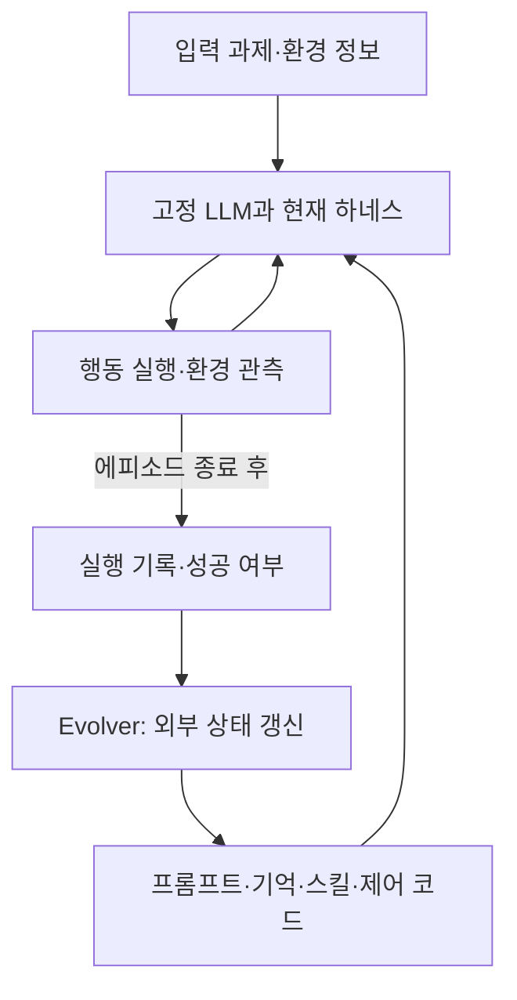

# Are Self-Evolving Agents Continual Learners?

**핵심 판단:** 이 논문은 자기진화 에이전트의 평균 성능 향상이 곧 지속학습의 성공을 의미하지는 않음을 보여줍니다.  
특히 **가중치를 고정하더라도 프롬프트·기억·제어 코드가 바뀌면서 이전 과제의 수행 능력이 저하될 수 있다**는 점을 실험적으로 분석합니다.  
다만 그 결론은 논문에서 평가한 모델·방법·과제 구성의 범위 안에서 해석해야 합니다. **[원문 pp.2, 6–12]**

**분석 기준:** 첨부된 arXiv v1, 총 24쪽을 기준으로 하며, 아래 페이지는 PDF의 페이지 번호입니다. 관련 연구는 2026년 10월 27일 기준으로 확인한 1차 자료를 사용했습니다.

**주 분석 원문:** 2610.25858v1.pdf

아래에서 **‘저자 보고’는 논문에 제시된 내용**, **‘분석’은 그 근거의 해석과 평가**, **‘후속 제안’은 아직 이 논문에서 검증되지 않은 실험 아이디어**를 뜻합니다.

---

## 1. Executive summary — 8문장

1. 이 논문은 모델 가중치를 고정한 채 프롬프트·기억·스킬·제어 코드를 갱신하는 자기진화 에이전트가, 새로운 과제를 배우면서 이전 능력을 유지하는 지속학습자로 작동하는지 평가합니다. **[pp.1–4]**
2. 연구진은 Gemini 3.6 Flash를 공통 기반 모델로 사용하고, ReasoningBank·GEPA·Meta-Harness를 BIRD·BFCL·ScienceWorld에서 구성한 네 가지 변화 스트림에 적용했습니다. **[pp.5–6]**
3. 네 스트림 평균에서 초기 하네스 대비 최종 성능 이득은 GEPA **+3.7pp**, ReasoningBank **+2.5pp**, Meta-Harness **+1.4pp**로, 자기진화는 대체로 평균 성능을 개선했습니다. **[p.7, Table 1]**
4. 그러나 GEPA는 평균 가소성이 가장 높은 **+6.2pp**인 동시에 안정성 손실도 가장 큰 **−4.3pp**였고, ReasoningBank는 가소성 **+3.3pp**, 안정성 **−1.9pp**로 상대적으로 보수적인 양상을 보였습니다. **[p.7, Table 1]**
5. 공유 프롬프트나 작업공간을 수정하는 방법에서는 특정 과제에 맞춘 규칙이 아직 학습하지 않은 과제에 잘못 적용되고, 이후 수정 과정에서 이전 규칙이 압축되거나 덮어써지는 현상이 관찰되었습니다. **[pp.8–10, Figures 3·6·7]**
6. 검색 기반 ReasoningBank는 서로 다른 도메인 사이에서는 학습 후 망각을 억제했지만, 같은 API를 사용하면서 서로 다른 실행 절차를 요구하는 BFCL 과제 사이에서는 기억 검색 충돌을 보였습니다. **[pp.10–11, Figure 4]**
7. 따라서 저자의 결론은 평가한 방법들이 아직 불완전한 지속학습자라는 것이며, 모든 자기진화 방식에 대한 불가능성 증명으로 확장할 수는 없습니다. **[pp.6, 12; 분석]**
8. 일반화 관점의 핵심 과제는 경험을 축적하는 것에 더해 그 경험이 적용될 조건을 구분하고, 새로운 적응이 기존 과제와 아직 경험하지 않은 과제에 미치는 영향을 함께 관리하는 것입니다. **[p.2, pp.10–12; 저자 제언 및 분석]**

> **용어 설명**
>
> - **하네스(harness):** LLM을 둘러싼 시스템 프롬프트, 기억 저장소, 스킬 파일, 실행 제어 코드의 묶음.
> - **지속학습(continual learning):** 새로운 과제를 순차적으로 배우면서 이전에 익힌 능력을 유지하는 학습.
> - **가소성(plasticity):** 새로운 과제에 적응하는 정도.
> - **안정성(stability):** 다른 과제의 성능을 유지하는 정도.
> - **pp, 퍼센트포인트:** 두 백분율의 차이로, 예를 들어 50%에서 55%로 상승하면 +5pp.

---

## 2. 연구 배경·목표·필요성

### 2.1. 연구가 해결하려는 문제

**저자 보고:** 실제 배포된 에이전트는 새로운 도구, 데이터베이스, 업무 절차를 계속 만나게 됩니다.  
매 상호작용 이후 모델을 재학습하는 것은 비용 부담이 크며, 최근 경험만을 이용한 미세조정은 기존 능력을 저하시킬 수 있습니다.  
이에 따라 가중치를 바꾸지 않고 외부 상태를 갱신하는 **비모수적 자기진화**가 대안으로 제시됩니다. **[pp.1–2]**

> **비모수적 자기진화:** 이 논문에서는 신경망 가중치를 학습하지 않고, 모델에 제공되는 지침·기억·실행 구조를 바꾸어 행동을 개선하는 방식.

그러나 한 종류의 과제에서 반복적으로 개선되는 것과, 서로 다른 과제가 이어지는 환경에서 능력을 누적하는 것은 다른 문제입니다.  
예를 들어 데이터베이스 질의에 유용했던 “먼저 자료를 탐색하고 실행 결과를 검증하라”는 규칙이, 필수 인수가 빠져 사용자에게 먼저 질문해야 하는 API 과제에서는 잘못된 행동을 유도할 수 있습니다. **[p.2, p.8, Figure 6]**

### 2.2. 연구 목적

논문의 목적은 다음 세 질문을 분리해 평가하는 것입니다. **[pp.2–5]**

| 질문 | 평가하려는 능력 |
|---|---|
| 자기진화가 초기 에이전트보다 성능을 높이는가? | 전체 성능 이득 |
| 현재 등장한 과제를 얼마나 잘 배우는가? | 가소성 |
| 그 과정에서 과거 과제와 아직 등장하지 않은 과제의 성능을 유지하는가? | 안정성·간섭·망각 |

**분석:** 이 연구의 가치는 최종 평균 점수 하나에 가려지는 실패를 드러내는 데 있습니다.  
현재 과제에서 크게 개선되더라도, 이전 과제의 능력을 잃거나 다른 과제에 잘못된 지침을 적용한다면 장기 배포 관점의 개선은 제한적입니다. **[근거: p.5, Table 1, Figure 1]**

### 2.3. 논문의 기여를 정확히 규정하면

이 논문은 **새로운 신경망 구조나 망각 방지 알고리즘을 제안한 연구가 아닙니다.** 주요 기여는 다음과 같습니다. **[pp.2–6]**

- 자기진화 에이전트를 지속학습 문제로 정식화합니다.
- 주제·실행 절차·도메인이 달라지는 과제 스트림을 구성합니다.
- 성능 이득을 가소성, 학습 전 간섭, 학습 후 망각으로 분해합니다.
- 프롬프트 변화와 기억 검색을 추적하여 실패 기전을 분석합니다.

---

## 3. 핵심 주장과 근거

| 핵심 주장 — 저자 보고 | 주요 근거 | 근거 위치 | 분석상 해석 범위 |
|---|---|---|---|
| 자기진화는 대체로 평균 성능을 개선한다. | 네 스트림 평균 최종 이득: GEPA +3.7pp, ReasoningBank +2.5pp, Meta-Harness +1.4pp | p.7, Table 1 | 모든 과제군이 개선된다는 뜻은 아님 |
| 새로운 과제 적응과 다른 과제의 성능 유지 사이에 상충이 있다. | 3개 방법×4개 시나리오의 12개 점에서 $r=-0.72$, $p=0.008$ | p.9, Figure 2 | 관찰된 상관이며 보편적 인과 법칙은 아님 |
| 공유 규칙 수정은 아직 학습하지 않은 과제에 간섭한다. | ScienceWorld 학습 후 BFCL-Base 성능이 GEPA에서 −5.5pp, Meta-Harness에서 −1.5pp | p.8; p.18, Table 3 | 해당 순서와 설정에서 관찰된 결과 |
| 후속 프롬프트 수정은 이전 과제의 규칙과 성능을 약화시킨다. | Topic drift에서 GEPA의 BIRD-F1 이득이 +7.5→+3.5→−2.0pp로 변화 | p.9; p.10, Figure 3a | 규칙 압축과 성능 하락의 동반 관찰이며, 개별 규칙의 인과 효과는 별도 검증 필요 |
| 상충하는 실행 절차는 행동을 역전시킬 수 있다. | GEPA의 BFCL-Miss 확인 질문 비율 29.8%→11.2%, 정확도 13.0pp 하락 | p.10, Figure 3c; Table 3 | 확인 질문 비율과 정확도는 서로 다른 지표 |
| 검색 기반 기억은 먼 도메인 사이의 망각을 줄인다. | Domain drift의 ReasoningBank에서 자기 그룹 학습 후 타 도메인 기억 검색 0%, 평균 학습 후 망각 0.0pp | pp.10–11; pp.20–21, Figures 4·9 | 학습 전 간섭까지 없다는 뜻은 아님 |
| 질의 유사도만으로 실행 절차의 적합성을 판별하기 어렵다. | 최종 BFCL-Miss 평가의 52%가 BFCL-Base 기억을, BFCL-Base 평가의 46%가 BFCL-Miss 기억을 검색 | p.11, Figure 4; p.21, Figure 9 | 특정 임베딩·top-1 검색 설정에서 확인된 충돌 |
| 과제 순서를 단순히 섞는 것으로 문제가 해결되지는 않는다. | GEPA의 Compound 최종 이득: 블록형 +5.8pp, 혼합형 +0.9pp | p.17, Table 2 | 모든 재현 학습 방법의 실패를 의미하지 않음 |

> **간섭(interference):** 한 과제에서 얻은 변경 사항이 다른 과제의 수행을 방해하는 현상.
>
> **검색 충돌(retrieval collision):** 문장이나 주제가 비슷하다는 이유로, 현재 과제에는 맞지 않는 행동 지침을 가져오는 현상.

---

## 4. 방법론과 모델·하네스 구조

### 4.1. 주요 데이터 소스

**저자 보고:** 세 가지 에이전트 벤치마크에서 과제군을 구성합니다. **[pp.5–6]**

| 데이터 소스 | 과제 내용 | 이 연구에서의 역할 |
|---|---|---|
| **BIRD** | 자연어 질문에 답하는 SQL 작성 | 데이터베이스 주제·스키마 변화 |
| **BFCL** | 상태를 가진 API를 이용한 여러 차례의 사용자 요청 처리 | 필수 인수의 유무에 따른 실행 절차 변화 |
| **ScienceWorld** | 텍스트 환경에서 과학 실험 수행 | 환경·관측·행동 공간 변화 |

> **스키마(schema):** 데이터베이스의 테이블·열·관계에 관한 구조 정보.
>
> **상태를 가진 API:** 호출 결과가 이후 호출에 영향을 주는 API로, 파일 생성 후 조회하거나 계좌 상태를 변경하는 경우 등이 해당.

### 4.2. 네 가지 과제 스트림

각 그룹의 학습 과제는 **50개**이며, 한 그룹의 과제를 연속 수행한 뒤 다음 그룹으로 이동합니다. **[pp.5–6]**

| 시나리오 | 과제군 순서 | 그룹 수 $K$ | 전체 학습 과제 수 $T$ | 주요 변화 |
|---|---|---:|---:|---|
| **Topic drift** | BIRD-F1 → BIRD-Code → BIRD-TP | 3 | 150 | 같은 SQL 작업에서 주제·스키마 변경 |
| **Workflow drift** | BFCL-Miss → BFCL-Base | 2 | 100 | 같은 API에서 올바른 실행 절차 변경 |
| **Domain drift** | ScienceWorld → BFCL-Base → BIRD-F1 | 3 | 150 | 환경·도구·행동 공간 변경 |
| **Compound drift** | BIRD-Code → BIRD-F1 → BFCL-Miss → BFCL-Base | 4 | 200 | 주제·도메인·실행 절차 변화의 결합 |

BIRD-F1, BIRD-Code, BIRD-TP의 실제 데이터베이스명은 각각 `formula_1`, `codebase_community`, `thrombosis_prediction`입니다. **[p.6]**

가장 중요한 대조는 BFCL 두 그룹입니다.

- **BFCL-Miss:** 필수 인수가 빠져 있어 사용자에게 확인해야 합니다.
- **BFCL-Base:** 필요한 인수가 이미 제공되며, 불필요한 확인 질문은 불이익을 받습니다.

따라서 두 그룹은 **같은 도구와 비슷한 표현을 사용하면서도 적절한 행동은 달라지는 상황**을 만듭니다. **[p.6]**

> **드리프트(drift):** 시간에 따라 입력이나 정답을 결정하는 조건이 달라지는 현상.
>
> **워크플로(workflow):** 과제를 해결하기 위해 따라야 하는 행동 순서와 조건.

### 4.3. 공통 실행 구조

기반 모델은 **Gemini 3.6 Flash**이며, 환경 관측과 행동을 번갈아 수행하는 ReAct 방식으로 실행됩니다. 모델 가중치는 고정됩니다. **[p.6]**



*위 도식은 원문의 공통 구조를 재구성한 것입니다. [pp.3–6, pp.21–24]*

> **ReAct:** 추론과 환경에 대한 행동을 연결하여 문제를 해결하는 실행 방식.
>
> **에피소드·실행 궤적:** 과제 하나를 시작한 뒤 종료할 때까지의 관측·행동 기록 전체.
>
> **Evolver:** 실행 경험과 피드백을 받아 에이전트의 지속 상태를 갱신하는 함수 또는 절차.

### 4.4. 세 방법의 차이

| 방법 | 갱신하는 대상 | 다음 과제에서 사용하는 방식 | 핵심 특성 |
|---|---|---|---|
| **ReasoningBank** | 에피소드별 기억 항목을 외부 저장소에 추가 | 현재 질의와 가장 유사한 기억 **1개**를 문맥에 삽입 | 업데이트의 적용 범위가 검색 결과에 따라 제한됨 |
| **GEPA** | 공유 시스템 프롬프트의 전략 부분 | 변경된 전략을 이후 모든 과제에 제공 | 새로운 규칙이 넓게 적용되지만 다른 과제로 번질 수 있음 |
| **Meta-Harness** | 프롬프트, 기억·스킬 파일, `harness.py` | 갱신된 공유 작업공간으로 실행 | 수정 범위가 가장 넓으며 검증 성능이 개선되는 편집만 채택 |

**근거:** p.6, p.7, pp.21–22, Appendix D–E.

구현상 중요한 세부사항은 다음과 같습니다.

- ReasoningBank는 `gemini-embedding-2`와 코사인 유사도를 사용하며, 유사도 임계값 없이 가장 가까운 항목을 검색합니다. **[p.10, p.22]**
- GEPA는 실행 기록을 자연어로 분석하여 공유 전략을 수정합니다. **[p.6]**
- Meta-Harness의 편집 제안자는 코드 편집이 가능한 `opencode`에서 실행되며, 기반 LLM은 동일하게 유지합니다. **[p.22]**
- 모든 방법은 같은 초기 하네스와 빈 상태에서 시작하고, 학습 과제마다 이진 성공 피드백을 받습니다. **[p.6]**

> **임베딩(embedding):** 문장 등을 수치 벡터로 표현한 것.
>
> **코사인 유사도:** 두 벡터의 방향이 얼마나 비슷한지를 나타내는 값으로, 여기서는 질의 간 유사성의 기준.
>
> **검증 게이트(validation gate):** 새 편집을 실제로 적용하기 전에 별도 검증 성능으로 채택 여부를 결정하는 절차.

### 4.5. 평가 프로토콜

**저자 보고:** 각 그룹에서 학습과 분리된 평가 과제 **50개**를 사용하며, ScienceWorld만 **90개**입니다. 초기 상태와 매 **50개 학습 과제** 종료 시점에서 하네스를 동결하고, 해당 스트림의 모든 그룹을 평가합니다. 평가 과제당 **8회 실행**을 평균합니다. **[pp.5–6]**

생성 설정은 `temperature=1.0`, `max_output_tokens=8192`, `thinking_level=MEDIUM`입니다. 환경별 실행 한도는 BIRD 20회 모델 호출, BFCL 사용자 턴당 20단계, ScienceWorld 100회 모델 호출입니다. **[p.22, Table 5; pp.23–24]**

에이전트에는 그룹 라벨이나 블록 경계를 알려주지 않습니다. 다만 환경별 행동 인터페이스와 API 스키마는 제공하므로, **환경 식별에 도움이 되는 모든 정보가 숨겨진 실험은 아닙니다.** **[p.4, pp.23–24]**

> **홀드아웃 평가(hold-out evaluation):** 학습이나 편집 선택에 사용하지 않은 문제로 성능을 측정하는 방식.
>
> **롤아웃(rollout):** 현재 에이전트로 과제 하나를 실제 실행해 얻는 궤적.

---

## 5. 핵심 수식과 기호 설명

이 절은 원문 식 번호를 유지합니다. 이 수식들은 새로운 신경망의 학습 손실을 제안하기보다, **과제 스트림·하네스 갱신·평가 지표를 정의**합니다.

### 5.1. 과제군과 시간에 따른 입력 분포

과제군은 다음과 같이 정의됩니다. **[p.3, §2.1]**

$$
\mathcal F=(\mathcal X,\mathcal D,\mathcal Y,R)
$$

- $\mathcal X$: 입력 공간.
- $\mathcal D$: 입력을 생성하는 분포.
- $\mathcal Y$: 출력 공간이며, 여기서는 전체 실행 궤적.
- $R$: 입력과 실행 궤적의 품질을 평가하는 보상 함수.
- 본 실험에서는 $R(x,y)\in\{0,1\}$로 성공 여부를 나타냅니다.

시간별 과제 분포는 다음과 같습니다.

$$
x_t\sim P_t:=
\sum_{k=1}^{K}w_{t,k}\mathcal D_k,
\qquad
t\in\{0,\ldots,T-1\}
$$

**기호:** $x_t$는 시점 $t$의 과제, $K$는 과제군 수, $T$는 전체 스트림 길이, $w_{t,k}$는 시점 $t$에 과제군 $k$가 선택되는 비중이며 $\sum_k w_{t,k}=1$입니다.

**의미:** 일반적으로는 여러 과제군이 섞일 수 있지만, 본문의 블록형 실험에서는 한 시점에 한 그룹만 선택되고 그 그룹이 50개 과제 동안 유지됩니다. **[p.4]**

### 5.2. 모든 과제군에서의 성능 목표

$$
J(\pi)=\frac{1}{K}\sum_{k=1}^{K}J_k(\pi),
\qquad
J_k(\pi)=
\mathbb E_{x\sim\mathcal D_k,\;y\sim\pi(\cdot\mid x)}
\left[R_k(x,y)\right]
$$

**기호:** $\pi$는 입력에 대해 실행 궤적을 생성하는 확률적 정책, $J_k(\pi)$는 그룹 $k$의 기대 성공률, $J(\pi)$는 모든 그룹의 동일 가중 평균입니다.

$$
\bar J_w=
\mathbb E_{S_w}
\left[
\frac{1}{T}\sum_{t=1}^{T}
J\!\left(\pi^{(t)}\right)
\right]
$$

**기호:** $S_w$는 스케줄 $w$로 생성한 과제 스트림, $\pi^{(t)}$는 $t$번 갱신한 이후의 정책, $\mathbb E$는 확률적 결과의 평균을 뜻합니다.

**의미:** 마지막 점수뿐 아니라 **학습 과정 전체에서 모든 과제군에 얼마나 잘 대응하는가**가 목표입니다. 현재 학습 중인 그룹만 평가하는 목적과 다릅니다. **[p.3]**

> **정책(policy):** 주어진 입력과 상황에서 어떤 행동을 할지 결정하는 규칙 또는 확률분포.
>
> **기대값:** 같은 확률적 절차를 반복했을 때 얻는 평균값.

### 5.3. Evolver와 하네스 갱신

현재까지의 경험은 다음과 같습니다.

$$
\mathcal H_t=
\{(x_\tau,y_\tau,r_\tau)\}_{\tau=0}^{t}
$$

이를 이용한 일반적인 정책 갱신은 다음과 같습니다.

```math
\pi^{(t+1)}
=
f\!\left(\pi^{(t)},\mathcal H_t\right)
```

**기호:** $y_\tau$는 실행 궤적, $r_\tau$는 보상, $\mathcal H_t$는 누적 경험, $f$는 evolver입니다. 실제 방법은 이력 전체가 아닌 일부만 사용할 수 있습니다. **[p.3]**

이 연구에서는 모델 가중치 $\theta$가 고정되므로 갱신 대상은 하네스 $c_t$입니다.

$$
c_{t+1}=f(c_t,\mathcal H_t),
\qquad
\pi^{(t)}=\pi_{\theta,c_t}
$$

**기호:** $c_t$는 현재 하네스, $c_0$는 초기 하네스입니다.

**분석:** $\theta$가 바뀌지 않아도 $c_t$가 바뀌면 실행 정책은 달라집니다.  
따라서 이 연구에서 관찰되는 망각은 **기반 모델의 가중치가 손상되었다는 의미가 아니라, 전체 에이전트의 행동 성능이 저하되었다는 의미**입니다. **[근거: p.4]**

Evolver의 성능은 그 함수가 만들어낸 정책 연속열로 평가합니다.

$$
\bar J_w(f)=
\mathbb E_{S_w,f}
\left[
\frac{1}{T}\sum_{t=1}^{T}
J\!\left(\pi^{(t)}\right)
\right]
$$

$\mathbb E_{S_w,f}$는 스트림과 evolver의 확률성을 고려한 평균입니다. **[p.4]**

### 5.4. 평가 정확도와 초기 성능

$$
A[t,k]=
\frac{1}{|\mathcal D_k^{\text{eval}}|}
\sum_{x\in\mathcal D_k^{\text{eval}}}
\mathbb E_{y\sim\pi_{\theta,c_t}(\cdot\mid x)}
\left[R_k(x,y)\right]
$$

**기호:** $\mathcal D_k^{\text{eval}}$은 그룹 $k$의 평가 문제 집합, $A[t,k]$는 시점 $t$의 하네스를 동결해 측정한 성능입니다.

초기 성능은 다음과 같습니다.

$$
B_k:=A[0,k]
$$

**원문 표기 주의:** 식 (7)은 수학적으로 0과 1 사이의 성공률을 나타내지만, 본문은 이를 정확도(%)로 부르고 표에서는 백분율을 사용합니다. 식에는 $100$을 곱하는 항이 생략되어 있습니다. 이하 표의 차이는 원문에 따라 **pp 단위**로 읽습니다. **[pp.4–5]**

### 5.5. 평균 이득과 최종 이득

$$
\bar\Delta=
\frac{1}{MK}
\sum_{m=1}^{M}\sum_{k=1}^{K}
\left(A[t_m,k]-B_k\right)
$$

$$
\text{Term.}=
\frac{1}{K}\sum_{k=1}^{K}
\left(A[T,k]-B_k\right)
$$

**기호:** $t_1,\ldots,t_M$은 초기 상태 이후의 평가 시점, $M$은 그 수입니다.

- $\bar\Delta$: 모든 평가 시점과 그룹에서의 초기 성능 대비 평균 이득.
- $\text{Term.}$: 스트림 종료 시점의 평균 이득.

이 두 값은 전체 개선의 크기를 보여주지만, 어느 그룹의 이득이 어느 그룹의 손실과 함께 발생했는지는 설명하지 못합니다. **[p.5]**

### 5.6. 가소성

그룹 $k$의 학습 블록을 $\sigma_k<t\le\tau_k$라고 하면,

$$
P=
\frac{1}{K}\sum_{k=1}^{K}
\left(A[\tau_k,k]-B_k\right)
$$

**기호:** $\sigma_k$는 블록 시작 전 시점, $\tau_k$는 블록 종료 시점입니다.

**중요한 해석:** 이 가소성은 **해당 블록 직전 성능 대비 향상량이 아니라 초기 하네스 대비 블록 종료 성능**입니다. 따라서 앞선 블록에서 이미 받은 긍정적·부정적 영향이 포함될 수 있습니다. **[p.5; 분석]**

### 5.7. 학습 전 간섭과 학습 후 망각

$$
I_k=
\frac{1}{M_k}
\sum_{0 < t_m\le\sigma_k}
\max\!\left(0,B_k-A[t_m,k]\right)
$$

$$
F_k=
\max\!\left(0,A[\tau_k,k]-A[T,k]\right)
$$

**기호와 의미:**

- $I_k$: 자기 그룹을 학습하기 전, 초기 성능보다 나빠진 양의 평균.
- $M_k$: 자기 블록 시작 전 평가 시점 수.
- $F_k$: 자기 블록 종료 시점보다 최종 시점에서 나빠진 양.
- 평가 시점이 없으면 $I_k=0$, 마지막 그룹이면 $F_k=0$입니다.

$\max(0,\cdot)$ 때문에 개선은 손실을 상쇄하지 않습니다. **[p.5]**

### 5.8. 안정성

```math
S=
-\frac{1}{K}\sum_{k=1}^{K}(I_k+F_k)
=
-(\bar I+\bar F)
```

여기서 $\bar I$와 $\bar F$는 각각 그룹 평균 간섭과 망각입니다.

**$S\le0$이며, 0에 가까울수록 안정적입니다.** 그러나 $S=0$만으로 새로운 과제를 잘 배웠다고 판단할 수는 없습니다.  
업데이트를 거의 하지 않아도 안정적으로 보일 수 있기 때문입니다. **[p.5, pp.7–8; 분석]**

---

## 6. 주요 결과와 중요한 데이터 포인트

### 6.1. 네 시나리오 전체 평균

아래 값은 원문의 **네 스트림 평균**이며, 전체 문제를 하나로 합쳐 계산한 평균은 아닙니다. 모든 값의 단위는 pp입니다. **[p.7, Table 1]**

| 방법 | 최종 이득 $\text{Term.}$ | 평균 이득 $\bar\Delta$ | 가소성 $P$ | 안정성 $S$ |
|---|---:|---:|---:|---:|
| ReasoningBank | +2.5 | +2.0 | +3.3 | **−1.9** |
| GEPA | **+3.7** | **+3.1** | **+6.2** | −4.3 |
| Meta-Harness | +1.4 | +1.8 | +2.2 | −2.1 |

**저자 보고:** GEPA는 네 시나리오 모두에서 가장 높은 가소성을 보입니다. ReasoningBank는 평균 안정성이 가장 높습니다. **[p.7]**

**분석:** 수정 가능한 범위가 커질수록 가소성이 단조롭게 증가한다고 해석하면 안 됩니다.  
가장 넓은 수정 범위를 가진 Meta-Harness의 평균 가소성은 오히려 가장 낮습니다. 저자는 검증 게이트가 많은 후보를 거절한 점을 그 이유로 설명합니다. **[pp.7–8]**

### 6.2. 시나리오별 최종 이득

| 시나리오 | ReasoningBank | GEPA | Meta-Harness |
|---|---:|---:|---:|
| Topic drift | +0.3 | −1.7 | −1.5 |
| Workflow drift | +4.5 | +4.5 | +4.8 |
| Domain drift | +2.6 | +6.2 | +1.6 |
| Compound drift | +2.8 | +5.8 | +0.8 |

**출처:** p.7, Table 1. 단위: pp.

**분석:** Topic drift에서는 세 방법 모두 최종 개선이 거의 없거나 음수입니다. 따라서 “자기진화는 같은 종류의 과제 안에서라면 안정적으로 도움이 된다”는 결론도 이 결과에서는 지지되지 않습니다. 다만 작은 차이에 대한 통계적 유의성은 보고되지 않았습니다.

### 6.3. 가장 명확한 행동 역전 사례

**저자 보고:** Workflow drift에서 GEPA는 BFCL-Miss 학습 후 확인 질문을 하는 비율이 **29.8%**까지 높아졌지만, BFCL-Base를 학습한 뒤 **11.2%**로 낮아졌습니다.  
같은 시기에 BFCL-Miss 정확도 이득은 **+15.5pp에서 +2.5pp**로 떨어졌습니다. **[p.10, Figure 3c; p.18, Table 3]**

**분석:** 이 사례는 같은 API에 대해 “필수값이 없으면 먼저 질문한다”와 “불필요하게 질문하지 않고 실행한다”를 조건부 규칙으로 함께 유지하지 못하고, 나중에 유용했던 행동으로 이전 행동을 대체한 경우로 해석할 수 있습니다.

### 6.4. Meta-Harness의 안정성에는 업데이트 억제가 기여

**저자 보고:** Topic·Workflow 조건에서는 후보 수정의 절반 이상이 거절됩니다. 검증 게이트를 제거하면 안정성은 다음과 같이 악화됩니다. **[pp.7–8]**

| 시나리오 | 원래 게이트 사용 | 게이트 제거 |
|---|---:|---:|
| Topic drift | −0.3 | −3.1 |
| Workflow drift | −0.5 | −5.5 |

**분석:** 안정성 지표가 좋다는 사실만으로 효율적인 지속학습을 입증할 수 없습니다. **무엇을 배웠는지와 얼마나 보존했는지를 함께 봐야 합니다.**

### 6.5. 단순 혼합의 효과도 방법마다 다름

Compound의 네 그룹을 균일하게 섞은 추가 실험에서 최종 이득은 다음과 같습니다. **[p.17, Table 2]**

| 방법 | 블록형 순서 | 혼합형 순서 |
|---|---:|---:|
| ReasoningBank | +2.8 | +2.3 |
| GEPA | +5.8 | +0.9 |
| Meta-Harness | +0.8 | +1.9 |

따라서 “섞으면 항상 나빠진다”는 결론도 맞지 않습니다. 이 실험은 **과제 도착 순서를 섞은 조건**이며, 과거 경험을 선택적으로 재사용하는 모든 재현 학습 알고리즘을 시험한 것은 아닙니다. **[p.17; 분석]**

---

## 7. 일반화 성능 향상 가능성: 저자 보고와 분석의 구분

### 7.1. 이 논문이 실제로 평가한 일반화의 범위

| 평가 대상 | 원문에서 확인되는 것 | 확인되지 않는 것 |
|---|---|---|
| **같은 그룹의 새로운 문제** | 학습과 분리된 홀드아웃 문제 성능 | 해당 분포 밖의 모든 문제로의 확장 |
| **아직 스트림에 등장하지 않은 그룹** | 앞선 학습이 그 그룹에 미치는 간섭 | 기반 모델의 사전학습에도 없었던 완전히 새로운 과제라는 보장 |
| **과거에 학습한 그룹** | 자기 블록 종료 대비 최종 성능 유지 | 모든 중간 시점에서의 무손실 유지 |
| **하네스를 포함한 시스템** | 프롬프트·기억·코드 변경에 따른 성능 변화 | 기반 모델 가중치 자체의 일반화 능력 향상 |
| **장기적 범용성** | 최대 200개 학습 과제로 구성된 스트림 | 장기간 운영·수천 과제·다수 모델에서의 안정성 |

**근거:** pp.3–6, pp.10–12.

> **분포 밖 일반화, OOD generalization:** 학습이나 탐색에 사용한 데이터와 다른 분포에서도 잘 작동하는 능력.
>
> **전이(transfer):** 한 과제에서 얻은 경험이 다른 과제의 수행에 영향을 주는 것.

### 7.2. 저자가 직접 제시한 방향

저자는 다음 두 가지가 필요하다고 제언합니다. **[p.2]**

1. 과제별 업데이트를 분리하여 다른 과제에 무조건 영향을 주지 않도록 하는 기전.
2. 표면적인 질의 유사도를 넘어, 경험의 적용 조건을 반영하는 검색.

또한 유사도 임계값은 관련 없는 기억을 무조건 검색하는 문제를 완화할 수 있다고 언급합니다. 다만 같은 API와 유사한 표현을 사용하는 상충 워크플로에서는 단순 유사도만으로 충분하지 않다고 봅니다. **[p.11]**

### 7.3. 일반화 가능성에 대한 분석

**첫째, 경험을 보존하는 것과 적절하게 사용하는 것은 별개입니다.**  
ReasoningBank는 과거 기억을 삭제하지 않아도 다른 기억이 검색되면서 이전 행동을 재현하지 못합니다.  
일반화에는 저장 용량뿐 아니라 **현재 상황에 맞는 경험을 선택하는 능력**이 필요하다는 해석이 가능합니다. **[근거: pp.10–11, Figure 4]**

**둘째, 더 일반적인 표현으로 압축했다고 해서 더 잘 일반화하는 것은 아닙니다.**  
Compound drift에서 GEPA는 기존 BIRD의 여러 규칙을 짧은 일반 지침으로 압축했지만, BIRD-F1의 성능 이득은 사라졌습니다.  
무엇을 생략해도 되는지 검증하지 않은 요약은 유용한 조건을 제거할 수 있습니다. **[근거: p.9, Figure 7]**

**셋째, 적용 범위가 명확한 지식의 추가는 유망한 관찰입니다.**  
Domain drift에서 GEPA는 ScienceWorld의 여섯 절을 그대로 유지하면서 BFCL·BIRD 절을 추가했고, 평균 학습 후 망각은 0.0pp였습니다.  
그러나 다른 스트림에서는 같은 보존 방식이 나타나지 않았습니다. 따라서 이는 **가능성을 보여주는 사례**이지, 검증된 일반적 해결책은 아닙니다. **[p.9, p.19, Figure 7; p.18, Table 3]**

**넷째, 이번 결과는 선행 연구의 일반화 성과를 부정하지 않습니다.**  
ReasoningBank 원논문은 Mind2Web의 과제·웹사이트·도메인 간 일반화를 평가했고, Meta-Harness 원논문은 탐색에 사용하지 않은 9개 분류 데이터셋에서 평균 정확도 73.1%를 보고했습니다.  
이번 논문이 추가로 묻는 것은 **그러한 하네스를 계속 수정하는 동안 여러 과제의 성능을 유지할 수 있는가**입니다. [arxiv.org](https://arxiv.org/html/2509.25140v1?utm_source=chatgpt.com)

---

## 8. 통계적으로 취약한 부분과 직접 비교할 수 없는 수치

### 8.1. 통계·보고상의 취약점

아래는 **분석자가 원문의 설계와 보고 범위에서 확인한 한계**입니다.

| 항목 | 원문에서 확인되는 내용 | 해석 시 주의 |
|---|---|---|
| **독립 학습 반복** | 문제당 8회 평가 실행은 명시 | 독립적인 학습 스트림·랜덤시드 8회가 아님 |
| **방법별 불확실성** | Tables 1–3에 점추정치 제시 | 표준오차·신뢰구간이 없어 작은 차이의 확정적 순위 판단 불가 |
| **상관분석 표본** | Figure 2의 $n=12$는 3방법×4시나리오 | 방법·시나리오를 공유하여 12개 독립 반복 실험과 다름 |
| **과제 순서** | 각 블록형 시나리오의 특정 순서 사용 | 역순·여러 순열에 대한 결과 미보고 |
| **모델 범위** | Gemini 3.6 Flash 하나로 비교 | 다른 모델·크기에서 동일한 결과인지 미확인 |
| **계산 예산** | 공통 모델·초기 하네스 사용 | 후보 수·총 토큰·호출 수·비용이 동일한지는 확인 불가 |
| **기전 분석** | 규칙 변화, 검색, 성능을 함께 관찰 | 규칙 제거·복원과 같은 충분한 인과 대조 실험은 미보고 |

**근거:** p.6, Tables 1–3, Figure 2, Appendix D.

특히 BFCL의 **400회 실행은 50개 문제×8회 반복**입니다. 이를 서로 독립적인 400개 문제로 간주하여 통계 검정을 하면 문제별 특성이 반복되는 구조를 놓칠 수 있습니다. **[p.6, p.10; 분석]**

> **신뢰구간:** 데이터의 불확실성을 반영하여 추정값의 범위를 나타낸 것.
>
> **랜덤시드:** 무작위 선택을 결정하는 초기값으로, 독립 반복은 학습 결과의 변동성을 확인하는 데 사용.

### 8.2. 지표 정의가 만드는 주의점

1. **$P$는 순수한 블록 내 학습량이 아닙니다.**  
   블록 시작 직전이 아니라 초기 상태 $B_k$를 기준으로 하므로, 이전 블록의 영향도 포함됩니다. **[식 (9)]**

2. **$S$는 긍정적 전이를 보상하지 않습니다.**  
   $I_k$와 $F_k$는 손실만 계산합니다. 따라서 안정성과 총 전이 효과는 같은 개념이 아닙니다. **[식 (10)–(11)]**

3. **$F_k=0$은 전 과정에서 망각이 없었다는 뜻이 아닙니다.**  
   중간에 크게 하락했다가 마지막에 회복하면 이 지표에서는 망각이 0으로 나타날 수 있습니다. **[식 (10)]**

4. **가소성과 망각은 같은 블록 종료 성능을 공유합니다.**  
   $P_k$와 $F_k$ 모두 $A[\tau_k,k]$를 포함하므로, $P$ – $S$ 상관에는 지표 정의의 구조적 연관이 영향을 줄 수 있습니다. 따라서 $r=-0.72$만으로 근본적인 상충 법칙을 입증했다고 볼 수 없습니다. **[식 (9)–(11), Figure 2; 분석]**

5. **작은 손실은 평가 잡음의 영향을 받을 수 있습니다.**  
   $\max(0,\cdot)$는 음의 변화만 손실로 남기므로, 실제 변화가 작을 때 반복 측정의 불확실성을 함께 봐야 합니다. **[식 (10); 분석]**

### 8.3. 비교 불가능하거나 조건부로만 비교 가능한 수치

| 비교 | 판정 | 이유 |
|---|---|---|
| 정확도 이득 pp ↔ 상대 개선율 % | 직접 비교 불가 | 절대 차이와 상대 비율은 다른 양 |
| 확인 질문 비율 ↔ 정확도 | 직접 비교 불가 | 행동 빈도와 과제 성공률은 다름 |
| 타 그룹 기억 검색률 ↔ 오류율 | 직접 비교 불가 | 다른 그룹의 기억이 항상 해로운 것은 아님 |
| 코사인 유사도 ↔ 성공률 | 직접 비교 불가 | 벡터 공간의 유사성과 행동 정확도는 다름 |
| 서로 다른 스트림의 동일한 +pp | 제한적 비교 | 초기 성능·그룹 수·과제 구성·길이가 다름 |
| 블록형 ↔ 혼합형의 $I,F,S$ | 원문상 비교하지 않음 | 혼합형에는 해당 블록 경계가 없음 |
| 기존 GEPA·ReasoningBank·Meta-Harness 원논문 점수 ↔ 이번 점수 | 직접 순위 비교 불가 | 모델·데이터·피드백·탐색 예산·실행 인터페이스가 다름 |

### 8.4. 저자의 강한 표현과 증거의 차이

**유사도 임계값의 한계:** 저자는 두 BFCL 그룹을 어떤 유사도 임계값으로도 구분할 수 없다고 설명합니다. 그러나 Table 4는 주로 **평균 유사도**를 보여주며 전체 분포나 임계값별 오류율은 제시하지 않습니다. 따라서 안전한 결론은 **현재 검색 표현이 두 워크플로를 충분히 구분하지 못한다는 강한 경험적 증거가 있다**는 수준입니다. **[p.11, p.21, Table 4; 분석]**

**수치의 작은 불일치:** Meta-Harness의 Compound BFCL-Miss 하락은 본문과 Table 3에서 10.2pp로 보고되지만, 표시된 이득 +13.8과 +3.5를 빼면 10.3pp입니다. 반올림 가능성이 있으나 원자료로 확인할 수 없어, 여기서는 저자가 명시한 하락량을 따릅니다. **[p.10, pp.7·18]**

---

## 9. 문서가 답하지 않는 질문

| 미해결 질문 | 왜 중요한가? | 현재 문서의 범위 |
|---|---|---|
| 다른 기반 모델에서도 같은 상충이 나타나는가? | 모델별 지침 준수·추론·코드 편집 능력이 다를 수 있음 | 한 모델만 평가 |
| 과제 순서를 바꾸면 방법 순위가 유지되는가? | 먼저 배운 규칙이 이후 적응에 미치는 영향 확인 | 여러 순열 실험 미보고 |
| 과거 과제를 재방문하면 회복이 가능한가? | 실제 업무는 동일 업무가 반복 등장 | 블록형 재방문 조건 미보고 |
| 점진적 변화와 장기 배포에서도 결과가 유지되는가? | 현실의 변화가 항상 뚜렷한 블록 형태는 아님 | 100–200개 과제 스트림 중심 |
| 규칙 삭제가 성능 하락의 직접 원인인가? | 해결책의 표적을 정확히 정해야 함 | 삭제 규칙 복원 실험 미보고 |
| 기억의 적용 조건을 저장하면 충돌이 줄어드는가? | 검색 실패를 직접 해결할 후보 | 필요성 제언, 실험 없음 |
| 동일 비용에서 어떤 방법이 가장 효율적인가? | 실용적인 방법 선택에 필요 | 비용·지연·총 호출량 비교 없음 |
| 새 도메인에 대한 긍정적 전이를 늘릴 수 있는가? | 간섭 억제와 일반화 향상을 함께 달성해야 함 | 손실 중심 지표, 전이 향상 방법 미제안 |
| 사용자 피드백이 부정확한 경우에도 유지되는가? | 실제 환경의 피드백은 이진 정답보다 불완전할 수 있음 | 이진 과제 성공 피드백 사용 |

**근거:** §§3–4 및 Appendix A–E의 실험·보고 범위에 대한 분석.

---

## 10. 가장 중요한 그림 선정과 해석

### Figure 1 — 평균 점수가 숨기는 학습 궤적  
**위치: p.8**

열은 네 변화 시나리오, 행은 세 방법이며, 각 곡선은 그룹별 초기 성능 대비 이득입니다. 배경색은 현재 학습하는 그룹을 나타냅니다.

**핵심 해석:** 자기 그룹을 학습할 때 상승한 곡선이 이후 블록에서 다시 하락하는지를 보면, 최종 평균 점수만으로는 파악하기 어려운 망각을 확인할 수 있습니다.  
GEPA의 Workflow 조건이 대표적입니다.

**주의:** 선으로 연결된 점들은 체크포인트 평가입니다. 그 사이 모든 에피소드의 성능을 측정한 것은 아닙니다.

### Figure 2 — 가소성·안정성의 관계  
**위치: p.9**

가로축은 $P$, 세로축은 $S$입니다. 오른쪽 산점도는 12개 방법·시나리오 조합에서 음의 상관을 보여줍니다.

**핵심 해석:** 평가한 조합에서는 높은 적응 이득이 다른 과제의 성능 손실과 함께 나타나는 경향이 있습니다.

**주의:** 음영은 **회귀선의 95% 신뢰구간**입니다. 각 방법 점수의 신뢰구간이나 반복 실험 오차막대가 아닙니다.

### Figure 3 — 규칙 압축과 행동 역전  
**위치: p.10**

(a), (b)는 GEPA 프롬프트의 문자를 최초 작성 그룹에 귀속한 비중이고, (c)는 BFCL-Miss에서 확인 질문을 하는 비율입니다.

**핵심 해석:** 학습한 정보가 단순히 점수로만 변하는 것이 아니라, 프롬프트 구성과 행동 선택의 변화로 드러납니다.

**주의:** 문자 비중 감소 자체는 정보 삭제의 완전한 증거가 아닙니다. 전체 길이가 증가해도 상대 비중은 줄 수 있으므로 실제 축약 내용을 보여주는 Figure 7과 함께 읽어야 합니다.

### Figure 4 — 기억 검색의 두 가지 실패  
**위치: p.11**

(a)는 다른 그룹에서 생성한 기억을 검색한 비율, (b)는 그룹 사이의 최근접 질의 유사도입니다.

**핵심 해석:** 아직 자기 그룹의 기억이 없을 때는 다른 그룹 기억이 무조건 주입되고, 자기 그룹 기억이 생긴 뒤에도 BFCL 두 워크플로는 서로 혼동됩니다. 이는 **주제의 유사성과 실행 절차의 적합성이 다르다**는 점을 보여줍니다.

**주의:** 검색률 52%는 실패율 52%가 아닙니다.

### Figure 7 — 지식 보존·추가 방식의 가능성과 불안정성  
**위치: p.19**

Domain 조건에서는 ScienceWorld 규칙 여섯 절을 그대로 보존하면서 전체 전략이 **4,372→7,621자**로 늘어납니다. 반면 Compound 조건에서는 BIRD 규칙 일곱 절 **3,386자**가 한 절 **1,034자**로 압축됩니다.

**핵심 해석:** 과제별 규칙을 유지하면서 추가하는 방식이 가능한 사례와, 실제로는 그 방식이 일관되게 유지되지 않는 사례를 대비합니다.

**주의:** 논문은 기존 규칙을 수정하지 않는 방식을 독립 알고리즘으로 구현해 효과를 검증하지 않았습니다.

---

## 11. 2020년 이후 관련 연구 비교

직접 관련성이 높은 연구를 **학습이 일어나는 위치, 일반화 증거, 지속학습 검증 범위**로 비교했습니다. 서로 다른 벤치마크 점수를 한 순위표로 합치지는 않았습니다.

| 연구 | 방법과 저자 보고 | 이 논문과의 관계 — 분석 |
|---|---|---|
| **Dark Experience Replay, 2020** | 과거 입력과 당시 출력 점수를 저장하고 재사용하여, 가중치 갱신 중 과거 행동과의 일관성을 유지합니다. 과제 경계가 흐려지는 지속학습 조건을 평가합니다. [proceedings.neurips.cc](https://proceedings.neurips.cc/paper/2020/hash/b704ea2c39778f07c617f6b7ce480e9e-Abstract.html?utm_source=chatgpt.com) | 과거 정보를 저장하는 것뿐 아니라 과거 행동을 보존하도록 학습해야 한다는 비교점이며, 대상 논문은 그 문제를 하네스 변경으로 옮겨 분석합니다. |
| **Reflexion, 2023** | 성공·실패 피드백을 자연어 반성으로 정리해 기억에 남기고 후속 시도를 개선합니다. 가중치를 갱신하지 않습니다. [arxiv.org](https://arxiv.org/abs/2303.11366?utm_source=chatgpt.com) | 피드백을 통한 재시도 개선과, 상충 과제군을 순차적으로 학습한 뒤 전체 능력을 유지하는 것은 구분해야 합니다. |
| **Voyager, 2024** | Minecraft에서 자동 과제 생성, 실행 가능한 코드 스킬 저장소, 환경 피드백을 통한 개선을 결합합니다. 새로운 세계의 새로운 과제에 배운 스킬을 사용하는 전이 실험이 있습니다. [voyager.minedojo.org](https://voyager.minedojo.org/?utm_source=chatgpt.com) | 재사용 가능한 스킬의 분리를 보여주지만, 서로 다른 환경과 상충 워크플로 사이의 보존까지 입증하지는 않습니다. |
| **ExpeL, 2024** | 여러 성공·실패 경험에서 지침을 추출하고, 과거 사례와 함께 사용합니다. 과제 간 전이 실험도 포함합니다. [arxiv.org](https://arxiv.org/html/2308.10144v3?utm_source=chatgpt.com) | 경험의 추상화와 재사용을 진전시켰으며, 대상 논문은 그 지침이 이후 업데이트와 과제 변화 속에서도 유지되는지를 추가로 묻습니다. |
| **GEPA, 2025 / ICLR 2026** | 실행 궤적을 자연어로 분석해 프롬프트 후보를 수정·평가하고, 상보적인 후보의 장점을 결합합니다. 여러 과제에서 성능과 실행 표본 효율을 평가합니다. [proceedings.iclr.cc](https://proceedings.iclr.cc/paper_files/paper/2026/hash/0e9e708b6f48e14fd0ac29e167413f76-Abstract-Conference.html?utm_source=chatgpt.com) | 좋은 프롬프트를 찾는 능력과, 공유 프롬프트를 계속 수정하면서 과거 지식을 유지하는 능력은 별개입니다. |
| **ReasoningBank, 2025** | 성공과 실패에서 재사용 가능한 추론 지침을 추출합니다. Mind2Web에서 과제·웹사이트·도메인 간 일반화를 평가합니다. [arxiv.org](https://arxiv.org/html/2509.25140v1?utm_source=chatgpt.com) | 대상 논문은 기억의 유용성을 부정하기보다, 비슷한 질의에 다른 절차가 필요한 경우의 검색 한계를 드러냅니다. |
| **Meta-Harness, 2026** | 과거 후보의 코드·점수·실행 기록을 조사하여 하네스 전체를 최적화합니다. 미사용 분류 데이터셋 9개의 평균 정확도는 73.1%로 ACE의 70.2%보다 높았습니다. [arxiv.org](https://arxiv.org/html/2603.28052v1?utm_source=chatgpt.com) | 한 번 발견한 하네스의 OOD 전이와, 계속 수정되는 공유 하네스의 장기 안정성을 구분해야 합니다. |
| **Self-Distillation Enables Continual Learning, 2026** | 시범을 문맥으로 받은 모델을 교사로 삼아, 현재 모델이 생성하는 궤적에서 가중치를 갱신합니다. 순차 학습에서 기존 능력을 유지하며 스킬을 누적하는 실험을 보고합니다. [proceedings.mlr.press](https://proceedings.mlr.press/v306/shenfeld26a.html?utm_source=chatgpt.com) | 대상 논문의 결론을 가중치 갱신을 포함한 모든 지속학습 방식의 한계로 확장할 수 없음을 보여주는 비교축입니다. |

> **재현 학습(replay):** 새 데이터를 배우는 동안 저장한 과거 경험도 다시 사용하는 방식.
>
> **출력 점수·로짓(logit):** 확률로 변환하기 전 모델의 점수.
>
> **증류(distillation):** 교사의 출력이나 확률분포를 학생 모델이 따라 배우는 방식.
>
> **On-policy 학습:** 현재 학습 중인 모델이 실제로 생성하는 행동·응답을 이용하는 학습.

### 11.1. 평가 방법 측면의 중요한 선행 연구

**「Continual Evaluation for Lifelong Learning: Identifying the Stability Gap」, ICLR 2023**은 과제 종료 시점만 평가하면, 새로운 과제를 배우는 중 성능이 일시적으로 크게 떨어졌다가 회복되는 현상을 놓칠 수 있음을 지적합니다. [arxiv.org](https://arxiv.org/abs/2205.13452?utm_source=chatgpt.com)

**분석:** 대상 논문도 중간 체크포인트를 사용하지만 기본 간격은 50개 과제입니다. 따라서 후속 연구에서는 블록 경계뿐 아니라 **업데이트 직후의 최저 성능과 회복 과정**을 함께 측정할 필요가 있습니다. 이는 대상 논문의 최종 망각 지표가 놓칠 수 있는 부분을 보완합니다. **[대상 논문 p.6, 식 (10)]**

### 11.2. 앞으로의 연구에 미치는 영향

**분석:** 이 연구가 후속 연구에 주는 가장 중요한 평가 기준은 다음과 같습니다.

- 새 과제 점수뿐 아니라 과거·현재·미래 그룹에 미치는 영향을 함께 보고해야 합니다.
- 기억의 존재 여부뿐 아니라 실제 검색·활성화되는 경로를 평가해야 합니다.
- 한 번의 OOD 전이 성과와 반복 수정 이후의 성능 보존을 별도 항목으로 측정해야 합니다.
- 공통 모델만 맞추는 데 그치지 않고, 수정 후보 수·호출 수·문맥 길이·지연을 함께 비교해야 합니다.

이 기준은 논문의 관찰과 비교 연구에서 도출한 연구 설계상의 제안이며, 특정 방법의 성능 개선이 이미 입증되었다는 뜻은 아닙니다.

---

## 12. 결론·시사점·한계와 우선 검증할 접근법

### 12.1. 저자가 제시한 결론과 시사점

**저자 보고:** 평가한 자기진화 방법은 대체로 성능을 높였지만, 새로운 과제를 강하게 학습하면서 다른 과제의 성능도 충분히 유지하는 데에는 한계를 보였습니다.  
공유 프롬프트·작업공간의 전역적 수정과, 유사도 중심 기억 검색의 부적합성이 주요 실패 기전으로 제시됩니다. **[p.12]**

학계 관점에서는 지속학습의 분석 대상을 **모델 가중치뿐 아니라 프롬프트·기억·스킬·제어 코드까지 포함하는 전체 에이전트**로 확장할 근거를 제공합니다.  
실용적 관점에서는 업데이트 후 현재 업무 점수만 확인하지 말고, 기존 업무와 다른 업무에 대한 회귀 평가를 함께 수행해야 한다는 시사점을 줍니다. **[근거: pp.4–5, 8–12; 분석]**

> **회귀 평가:** 새 변경 이후 이전에 잘되던 기능이나 과제의 성능이 나빠지지 않았는지 다시 확인하는 평가.

### 12.2. 논문에서 언급한 한계와 문서 자체의 한계

구분이 필요합니다.

**저자가 직접 밝힌 방법의 한계**

- 공유 규칙이 과제별 적용 범위를 충분히 구분하지 못합니다.
- 후속 수정이 이전 규칙을 압축하거나 덮어씁니다.
- 유사도 검색은 상충하는 실행 절차를 구분하지 못할 수 있습니다. **[pp.8–12]**

**분석자가 확인한 연구 범위·보고의 한계**

- 단일 기반 모델, 세 방법, 짧은 블록형 스트림 중심입니다.
- 독립 학습 반복과 방법별 불확실성 보고가 부족합니다.
- 비용을 맞춘 비교와 여러 과제 순서에 대한 검증이 없습니다.
- 제안된 개선 방향을 실제 알고리즘으로 구현해 시험하지 않았습니다. **[§§3–4, Appendix A–E]**

**문서에는 별도의 ‘Limitations’ 절이나 구체적인 후속 실험 일정·계획이 없습니다.** 저자가 제시한 방향은 과제별 업데이트 분리와 유사도 이상의 조건부 검색 필요성입니다. **[p.2, p.12]**

### 12.3. 빠르게 핵심 아이디어를 검증할 유망한 접근법

아래는 **논문의 관찰에서 출발한 분석자의 후속 제안**입니다. 효과는 아직 검증되지 않았습니다.

| 우선 검증할 접근법 | 원문에서의 동기 | 최소 구현·실험 | 확인할 결과 |
|---|---|---|---|
| **실행 조건을 붙인 기억 검색** | BFCL 두 그룹의 검색 충돌 | 기억에 필수 인수 충족 여부·도구 상태 등 적용 조건을 붙이고, 호환되는 기억 안에서 검색 | 교차 워크플로 검색률, BFCL-Miss 망각, BFCL-Base 성능 |
| **기억을 사용하지 않는 선택지** | 자기 그룹 학습 전 외부 기억 검색 100% | 낮은 유사도나 조건 불일치 시 기억 없이 실행 | 학습 전 간섭 감소와 유용한 전이 손실의 균형 |
| **과제별 지침 보존과 선택적 적용** | Figure 7의 규칙 보존 사례 | 기존 절을 보존하며 새 절을 추가하고, 환경·조건에 맞는 절만 활성화 | $P$, $\bar I$, $\bar F$, 문맥 길이 |
| **과거 과제를 포함한 수정 검증** | Meta-Harness 게이트의 안정성·가소성 상충 | 현재 과제 검증에 소규모 과거 과제 검증을 추가 | 기존 성능 손실 감소와 새 과제 학습량의 변화 |
| **삭제 규칙 복원 실험** | 프롬프트 압축과 성능 저하의 동반 관찰 | 같은 체크포인트에서 삭제된 규칙을 복원한 조건과 원래 조건 비교 | 압축·삭제가 성능 저하에 기여한 정도 |

**빠른 검증을 위한 추천 순서 — 분석**

먼저 **BFCL-Miss → BFCL-Base**의 두 그룹 조건에서, 기존 top-1 검색과 실행 조건을 반영한 검색을 비교하는 것이 적절합니다.  
환경과 API를 유지하면서 요구 절차가 달라지므로, 검색의 주제 적합성과 행동 적합성을 분리해 보기 좋습니다. **[근거: p.6, Figure 4]**

그다음 **ScienceWorld → BFCL-Base → BIRD-F1**에서 지침 보존·선택적 적용을 시험하면, 도메인 분리가 학습 전 간섭과 학습 후 망각에 각각 어떤 영향을 주는지 확인할 수 있습니다. **[근거: p.9, Figure 7]**

평가 문제를 수정 선택에 사용하지 않고, 복수의 독립 스트림과 순서 반전을 추가해야 합니다.  
새 방법은 최종 점수뿐 아니라 가소성·간섭·망각·문맥 비용을 함께 보고해야 합니다.

### 12.4. 일반화 향상을 위한 최종 판단

이 논문에서 직접 확인되는 것은 **하네스 갱신이 새로운 평가 문제의 성능을 높일 수 있지만, 그 개선을 여러 과제에 걸쳐 안정적으로 유지하지는 못한다**는 점입니다. **[Tables 1–3]**

가장 우선적으로 검증할 방향은 **경험과 규칙의 적용 조건을 명시하고, 현재 과제에 맞는 부분만 사용하도록 만드는 것**입니다. 그 근거는 도메인이 분리되면 검색 충돌과 망각이 줄어드는 반면, 같은 주제에서 실행 절차가 충돌하면 문제가 커진다는 관찰입니다. 다만 실제 일반화 개선 여부는 위의 대조 실험으로 확인해야 합니다. **[pp.10–11, Figure 4; 분석·후속 제안]**

---

## 참고자료 및 원문 출처

### 주 분석 논문

1. **Chen, X. et al. (2026). _Are Self-Evolving Agents Continual Learners?_** arXiv:2610.25858v1. 첨부 PDF 전체, 특히 §§2–4와 Appendices A–E.  
   [arXiv 논문 페이지](https://arxiv.org/abs/2610.25858)

### 직접 비교에 사용한 관련 연구

2. **Buzzega, P. et al. (2020). _Dark Experience for General Continual Learning: a Strong, Simple Baseline._** NeurIPS 2020.  
   [학회 공식 페이지](https://proceedings.neurips.cc/paper/2020/hash/b704ea2c39778f07c617f6b7ce480e9e-Abstract.html)

3. **Shinn, N. et al. (2023). _Reflexion: Language Agents with Verbal Reinforcement Learning._**  
   [arXiv 원문](https://arxiv.org/abs/2303.11366)

4. **Wang, G. et al. (2024). _Voyager: An Open-Ended Embodied Agent with Large Language Models._** TMLR.  
   [저자 공식 프로젝트·연구 설명](https://voyager.minedojo.org/)

5. **Zhao, A. et al. (2024). _ExpeL: LLM Agents Are Experiential Learners._** AAAI 2024.  
   [arXiv 원문](https://arxiv.org/html/2308.10144v3)

6. **Agrawal, L. A. et al. (2025/2026). _GEPA: Reflective Prompt Evolution Can Outperform Reinforcement Learning._** ICLR 2026 학회판 참조.  
   [학회 공식 페이지](https://proceedings.iclr.cc/paper_files/paper/2026/hash/0e9e708b6f48e14fd0ac29e167413f76-Abstract-Conference.html)

7. **Ouyang, S. et al. (2025). _ReasoningBank: Scaling Agent Self-Evolving with Reasoning Memory._** 특히 §4.2, Table 3.  
   [arXiv v1 원문](https://arxiv.org/html/2509.25140v1)

8. **Lee, Y. et al. (2026). _Meta-Harness: End-to-End Optimization of Model Harnesses._** 특히 §4.1, Table 5.  
   [arXiv v1 원문](https://arxiv.org/html/2603.28052v1)

9. **Shenfeld, I. et al. (2026). _Self-Distillation Enables Continual Learning._** ICML 2026.  
   [PMLR 공식 논문 페이지](https://proceedings.mlr.press/v306/shenfeld26a.html)

10. **De Lange, M., van de Ven, G. M., & Tuytelaars, T. (2023). _Continual Evaluation for Lifelong Learning: Identifying the Stability Gap._** ICLR 2023.  
    [arXiv 원문](https://arxiv.org/abs/2205.13452)
