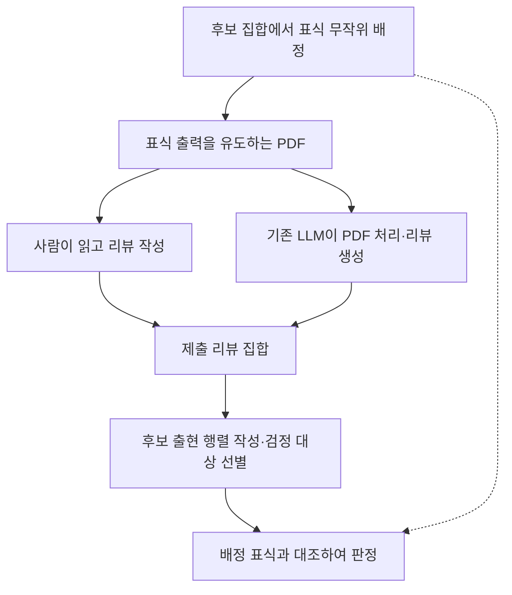

# Detecting LLM-generated peer reviews

---

## 1. Executive summary — 10문장

1. 이 논문은 대규모 언어모델이 작성한 동료심사 리뷰를 찾아내면서, 사람이 작성한 리뷰를 잘못 지목할 위험을 통제하는 문제를 다룹니다. **[pp.1–3]**
2. 제안 방법은 학회·저널 운영자가 논문 PDF에 숨은 지시를 넣어 LLM이 특정 표식인 **워터마크**를 리뷰에 출력하도록 유도하고, 이후 그 표식의 존재를 통계적으로 검사하는 구조입니다. **[pp.2–4, Fig.1]**
3. 핵심 기여는 새로운 신경망 분류기보다, 인간의 문체를 모델링하지 않고 **외생적인 무작위 표식 배정**을 이용해 오탐 확률을 제한하는 검정 설계에 있습니다. **[pp.5, 8–13]**
4. 저자는 단일 리뷰의 오탐 확률 상한과 다수 리뷰 중 하나라도 잘못 지목할 확률의 상한을 제시하지만, 다중 검정의 명시적 증명은 모든 리뷰가 인간 작성이라는 귀무가설에서 전개됩니다. **[Proposition 1, pp.10–13]**
5. 주요 실험에서 **흰색 글씨 주입과 무작위 인용 표식의 조합**은 다섯 모델·사용 환경의 평균 삽입 성공률로 약 **98.6%**를 기록했으며, 이 수치를 모든 주입 방식의 평균으로 해석해서는 안 됩니다. **[p.14, Table 3]**
6. 이미 인용 표식이 삽입된 리뷰를 다른 LLM으로 재서술했을 때 표식 유지율은 **94–100%**였지만, 특정 시작 문구를 사용하는 표식의 유지율은 **0%**였습니다. **[p.15, Table 4a]**
7. 워터마크를 이미 포함한 양성 리뷰 100개를 기존 리뷰 집합에 추가한 검정에서는, 무작위 인용 방식이 전체 오탐 확률의 목표 상한을 **0.001**로 설정한 조건에서 **92%의 검출률과 관측 오탐 0건**을 보였습니다. **[pp.17–19, Table 9]**
8. 기울기를 이용해 숨은 문자열을 최적화하는 방법도 효과를 보였지만, 모델 내부에 접근할 수 있는 Llama 2와 Vicuna 1.5에서 각각 최적화한 결과이며 미관측 상용 모델로의 이전은 입증되지 않았습니다. **[pp.16–17, Table 5]**
9. PDF 처리 방식에 따른 성능 차이, 작은 실험 표본, 조건부 성공률, 허위 인용의 제거 가능성, 인간 작성 후 AI로 다듬은 리뷰에 대한 직접 검증 부족이 실용적 해석의 주요 제한입니다. **[pp.6–7, 14–19]**
10. 따라서 이 연구의 가장 강한 성과는 **무작위 표식과 다중 검정을 결합한 탐지 설계**이며, 미래 모델·새 분야·다양한 인간–AI 협업 방식에 대한 일반화는 추가 검증 과제로 남아 있습니다. **[pp.17, 19–20; 분석자의 종합 해석]**

---

## 2. 연구 배경·목표와 핵심 주장

### 2.1 연구가 해결하려는 문제

**저자 보고**

동료심사는 전문가가 논문의 타당성, 기여, 한계를 직접 판단한다는 전제에 의존합니다. 저자들은 심사자가 논문을 LLM에 전달하고 생성된 리뷰를 제출할 경우, 이러한 전문가 판단이 충분히 이루어졌는지 확인하기 어렵다는 점을 문제로 삼습니다. **[pp.1–2]**

기존 AI 텍스트 탐지기는 문체, 단어 빈도, 모델이 부여하는 확률 등의 특징을 활용합니다. 그러나 이 논문은 다음 세 가지 어려움을 지적합니다. **[pp.2–3, 5]**

- **문체의 개인차:** 특정 인간 심사자의 문체가 탐지기가 학습한 AI 문체와 비슷하면 같은 사람이 반복적으로 오탐될 수 있습니다.
- **작성 방식의 변화:** 사람이 쓴 글을 AI로 다듬거나, 인간의 표현 습관이 변하면 과거 인간 리뷰를 기준으로 만든 탐지 규칙이 흔들릴 수 있습니다.
- **대규모 판정의 오류 누적:** 개별 리뷰의 오탐률이 낮더라도 수천·수만 개를 검사하면 적어도 한 명을 잘못 지목할 위험이 커질 수 있습니다.

> **용어 설명 — 오탐:** 실제로는 탐지 대상이 아닌 사례를 탐지 대상으로 잘못 판정하는 것. 여기서는 인간 작성 리뷰를 LLM 작성으로 지목하는 오류입니다.

### 2.2 연구의 목적과 필요성

이 연구는 탐지 문제를 **“리뷰의 문체가 AI처럼 보이는가?”**에서 **“이 리뷰에 사전에 무작위 배정한 표식이 나타났는가?”**로 바꿉니다. 학회·저널 운영자가 심사자에게 전달하는 PDF를 관리할 수 있다는 점을 이용한 설계입니다. **[pp.2–5]**

저자가 요구하는 워터마크의 조건은 다음과 같습니다. **[pp.4–5, §2.1.1]**

1. 우연한 일치를 통계적으로 검정할 수 있어야 합니다.
2. 인간 문체의 다양성에 오탐 보장이 의존하지 않아야 합니다.
3. LLM이 실제로 표식을 출력해야 합니다.
4. 사람이 쉽게 알아차리거나 제거하기 어려워야 합니다.
5. 재서술 후에도 표식이 유지되어야 합니다.

**분석자의 해석**

이 설계의 장점은 오탐 통제의 근거를 인간 문체의 경험적 분포에서 **연구자가 통제하는 무작위화 절차**로 옮겼다는 것입니다. 예컨대 어떤 표현을 사람이 얼마나 자주 쓰는지 정확히 몰라도, 충분히 큰 후보 집합에서 표식을 독립적으로 선택했다면 특정 인간 리뷰와 우연히 일치할 확률을 제한할 수 있습니다. 다만 표식이 사람에게 노출되거나 작성 과정에 영향을 주면 독립성 조건을 다시 검토해야 합니다. **[pp.5, 8, 12–13에 근거한 해석]**

또한 이 방법은 **PDF를 전달하기 전에 개입할 수 있는 환경**을 전제로 합니다. 이미 작성된 임의의 리뷰에 곧바로 적용하는 일반 탐지기와 적용 범위가 다릅니다. 표식이 없다는 사실만으로 인간 작성임을 확정할 수도 없습니다. PDF 처리 단계에서 지시문이 사라졌거나, 모델이 지시를 따르지 않았거나, 후속 편집에서 표식이 제거되었을 수 있기 때문입니다. **[pp.7–8, 14–17에 근거한 해석]**

마지막으로, 표식의 검출은 특정 문서 처리 경로의 흔적을 보여주지만, **리뷰의 모든 판단이 AI에서 비롯되었는지, 사람이 어느 정도 기여했는지**까지 직접 측정하지는 않습니다. 논문이 제기한 ‘완전 생성과 문장 다듬기의 구분’이라는 목표를 실용적으로 달성했는지 판단하려면 인간–AI 공동 작성 조건을 별도로 실험해야 합니다. **[pp.1–3의 문제 설정과 §3의 평가 범위를 비교한 해석]**

### 2.3 핵심 주장과 근거

| 핵심 주장 | 저자가 제시한 근거 | 분석자의 해석·주의점 | 원문 위치 |
|---|---|---|---|
| 인간 문체를 모델링하지 않고 오탐 상한을 설정할 수 있다 | 균등 무작위 표식과 인간 리뷰의 독립성을 이용한 확률 상한 | 인간 문체에 대한 가정은 줄지만 무작위화·독립성 조건은 필요함 | pp.5, 8–13, Proposition 1 |
| 다중 리뷰 검정에서 Bonferroni보다 유리한 판정이 가능하다 | 후보 출현 행렬을 이용해 리뷰·후보를 선별하는 Algorithm 2–3 | 모든 상황에서 탐욕 알고리즘의 검정력이 더 높다는 보편적 정리는 아님 | pp.9–13 |
| 무작위 인용이 효과적인 워터마크다 | 흰색 글씨 조건에서 약 98.6%의 평균 삽입률 | 후보 공간, 표현 형태, 삽입 위치의 효과가 분리되지 않음 | p.14, Table 3 |
| 일부 표식은 재서술에도 남는다 | 인용 94–100%, 기술 용어 81–95% 유지 | 초기 삽입 성공을 조건으로 한 유지율이며 시작구는 0% | p.15, Table 4a |
| 난해한 문자열 최적화로도 표식을 유도할 수 있다 | Llama 2·Vicuna 1.5의 GCG 실험 | 모델별 최적화이며 미지 모델로의 이전 실험이 아님 | pp.16–17, Table 5 |
| 연구비 제안서에도 적용 가능성을 보인다 | NSF 제안서 52개에서 인용 삽입률 89% | GPT-4o API와 흰색 글씨 조건으로 제한됨 | p.17, Table 6 |
| 엄격한 다중 검정에서도 인용 방식의 검출력이 높다 | $\alpha=0.001$에서 조건부 TPR 92%, 관측 FPR 0 | 전체 생성 과정의 최종 탐지율이나 오탐 가능성 0의 증명은 아님 | p.19, Table 9 |

> **용어 설명 — 검정력:** 실제 탐지 대상인 사례를 찾아낼 확률. 오탐 확률을 작게 통제하는 것과 별개의 성질입니다.

---

## 3. 연구 설계·데이터·제안 방법과 수식

### 3.1 주요 데이터와 실험 구성

| 실험 | 데이터·규모 | 모델·조건 | 근거 |
|---|---|---|---|
| 기본 워터마크 삽입 | ICLR 2024 제출 논문, 흰색 글씨·프랑스어 API 조건별 100편 | GPT-4o, o1-mini, Gemini 2.0 Flash, Claude 3.5 Sonnet | pp.13–14 |
| 웹 서비스 및 폰트 예비 실험 | 조건별 30편 | GPT-4o WebApp 및 폰트 주입 조건 | p.14 |
| 숨은 지시 식별 방어 | 무작위 ICLR 논문 100편 | GPT-4o API | p.15 |
| 문서 중간 위치 주입 | 50편을 사용한 실험 | GPT-4o API, 11쪽 폰트 주입과 별도 7쪽 흰색 글씨 조건 | pp.15–16 |
| 난해한 문자열 주입 | PRC 2022 초록 20개, PeerRead 논문 20개 | Llama 2·Vicuna 1.5, 문서별 리뷰 10회 생성 | pp.16–17 |
| 연구비 제안서 | Open Grants에서 얻은 NSF 제안서 52개 | GPT-4o API, 흰색 글씨 | p.17 |
| 통계 검정 대조 실험 | ICLR 2021 리뷰 10,022개, ICLR 2024 리뷰 28,028개 | 각 집합·표식 유형에 표식 포함 LLM 리뷰 100개 추가 | pp.17–19 |

**중요:** GPT-4o의 WebApp과 API는 같은 모델의 서로 다른 사용 환경입니다. 따라서 Table 3의 다섯 결과를 ‘서로 다른 다섯 모델 계열’로 부르면 부정확합니다. **[p.14, Table 3]**

### 3.2 모델 구조: 기존 LLM을 포함하는 시스템

이 논문은 새로운 Transformer 구조나 학습된 분류 헤드를 제안하지 않습니다. 제안하는 것은 **워터마크 배정–PDF 주입–기존 LLM–통계 검정**으로 이어지는 시스템입니다. 아래는 Fig.1의 관계를 정리한 도식입니다. **[pp.3–4, Fig.1]**



**분석자의 해석:** 생성 모델의 구조를 바꾸는 대신, 입력 문서와 출력 판정 절차를 설계합니다. 따라서 일반화 성능은 LLM 자체뿐 아니라 **PDF 파서, 지시문 준수, 후속 편집, 검정 규칙**의 영향을 함께 받습니다.

> **용어 설명 — 파서:** PDF 같은 파일에서 텍스트와 구조를 추출하는 프로그램. 같은 PDF라도 파서에 따라 모델에 전달되는 텍스트가 달라질 수 있습니다.

### 3.3 세 가지 워터마크

| 유형 | 설계 | 후보 수 | 근거 |
|---|---|---:|---|
| 무작위 시작구 | 다섯 선택 슬롯에서 표현을 조합해 리뷰 첫머리에 배치 | $2\times5\times5\times4\times6=1{,}200$ | pp.5–6, Table 1 |
| 무작위 기술 용어 | ICLR 2024 키워드 9,482개 중 빈도가 가장 낮은 1,000개에서 선택 | $1{,}000$ | p.6 |
| 무작위 인용 | 성씨 9,999개와 2014–2024년의 11개 연도를 조합 | $9{,}999\times11=109{,}989$ | p.6 |

무작위 인용은 성씨와 연도를 조합한 인용 형식의 문자열을 리뷰 시작에 넣게 합니다. 기술 용어는 따옴표와 함께 넣도록 하여 재서술 과정에서 보존되도록 유도합니다. **[p.6]**

**표기 주의:** 저자는 시작구를 ‘처음 다섯 단어’라고 표현하지만, Table 1에는 여러 단어로 구성된 선택지도 있으므로 정확히는 **다섯 개의 선택 슬롯**입니다.

### 3.4 간접 프롬프트 주입

> **용어 설명 — 간접 프롬프트 주입:** 사용자가 직접 내린 요청이 아니라, 모델이 읽는 문서 안에 들어 있는 지시가 모델의 행동을 바꾸는 현상입니다.

| 방식 | 작동 원리 | 평가 범위·제약 |
|---|---|---|
| 흰색 글씨 | 흰 배경의 PDF 끝에 흰색 지시문 삽입 | 텍스트 추출 과정에서 지시문이 전달되어야 함 |
| 폰트 임베딩 | 내부 문자와 화면에 보이는 글자 모양을 다르게 구성 | Fig.2는 맞춤 폰트 사례, 주 실험은 Wingdings 사용 |
| 다른 언어 | 작은 글씨의 프랑스어 지시문 삽입 | 실제로 검증한 것은 프랑스어이며 다국어 리뷰 일반화는 아님 |
| 난해한 문자열 | 겉으로 무의미해 보이는 토큰열을 최적화해 표식 출력 유도 | GCG를 적용할 모델의 기울기에 접근해야 함 |

**근거:** pp.7–8, 16–17.

> **용어 설명 — 폰트 임베딩:** 여기서는 PDF에 글꼴 정보를 넣어 문자 표시 방식을 조작하는 기술입니다. 신경망의 의미 벡터인 ‘임베딩’과는 다른 뜻입니다.  
> **용어 설명 — OCR:** 문서의 시각적 이미지를 보고 글자를 인식하는 기술. 저자는 OCR 기반 처리에서는 흰색 글씨·폰트 방식이 작동하지 않을 수 있다고 설명합니다. **[p.7]**

#### GCG의 목표함수

출판본은 세부 수식을 S2 Appendix로 안내합니다. 아래 수식은 직접 확인 가능한 **동일 저자 사전공개본 arXiv:2503.15772v2, Appendix B**에서 확인했습니다. 출판본 S2와 완전히 동일한지는 확인하지 못했으므로 판본을 구분합니다. [arxiv.org](https://arxiv.org/html/2503.15772v2?utm_source=chatgpt.com)

목표는 접미 문자열 $\text{OPT}$를 바꾸어, 모델이 응답을 목표 워터마크 토큰열로 시작할 확률을 최대화하는 것입니다.

$$
\max_{o_1,\ldots,o_t}
P\!\left(
w_1,\ldots,w_n
\mid
\text{SYS},\text{USR},\text{ABS}+\text{OPT}
\right)
$$

이는 다음 음의 로그우도 최소화와 같습니다.

$$
\min_{o_1,\ldots,o_t}
-\sum_{j=1}^{n}
\log P\!\left(
w_j
\mid
\text{SYS},\text{USR},\text{ABS}+\text{OPT},
w_1,\ldots,w_{j-1}
\right)
$$

**기호 설명**

- $\text{SYS}$: 시스템 프롬프트.
- $\text{USR}$: 리뷰 작성 요청.
- $\text{ABS}$: 검토할 초록 텍스트.
- $\text{OPT}=(o_1,\ldots,o_t)$: 최적화할 접미 토큰열.
- $t$: 최적화 가능한 토큰 수.
- $(w_1,\ldots,w_n)$: 목표 워터마크의 토큰열.
- $P$: 기존 LLM의 조건부 생성 확률.
- $+$: 문자열 연결.

> **용어 설명 — 토큰:** 모델이 텍스트를 처리하는 기본 단위로, 단어 전체 또는 단어의 일부일 수 있습니다.  
> **용어 설명 — 음의 로그우도:** 목표 문자열에 높은 확률을 부여할수록 작아지는 손실값입니다.  
> **용어 설명 — GCG:** 기울기를 이용해 토큰 교체 후보를 고른 뒤, 실제 손실이 작은 문자열을 반복적으로 선택하는 탐색 방법입니다.

사전공개본은 토큰 교체 후보 수를 **256**, 반복당 평가할 후보 문자열을 **512개**로 설명합니다. 출판본 실험은 **30개 토큰**, **6,000회 반복**, **2,000토큰 입력 제한**, **A100/H100 80GB GPU**를 사용했습니다. 최적화 대상은 LLM의 가중치가 아니라 입력 문자열입니다. **[출판본 p.16; 사전공개본 Appendix B]** [arxiv.org](https://arxiv.org/html/2503.15772v2?utm_source=chatgpt.com)

### 3.5 통계 검정: 핵심 수식

#### ① 기호

| 기호 | 의미 |
|---|---|
| $\mathcal W$ | 후보 워터마크 집합 |
| $M=\lvert\mathcal W\rvert$ | 후보 수 |
| $\mathcal R$ | 검사할 리뷰 집합 |
| $N=\lvert\mathcal R\rvert$ | 리뷰 수 |
| $w_i^*$ | 리뷰 $i$에 균등 무작위로 배정한 표식 |
| $k$ | 한 리뷰에서 허용할 후보 워터마크 출현 개수 |
| $\alpha$ | 목표 오류 확률 상한 |
| $X_{ij}$ | 리뷰 $i$에 후보 $j$가 있으면 1, 없으면 0 |
| $I,\ J$ | 각각 검정에서 제외할 리뷰 집합과 후보 집합 |
| $\rho,\ \Omega$ | 각각 제외 가능한 리뷰 수와 후보 수의 상한 |

**$k$는 워터마크의 단어 수가 아닙니다.** 서로 다른 후보 표식이 리뷰에 몇 개 나타나는지를 제한하는 값입니다. **[pp.8–11]**

#### ② 단일 리뷰: Algorithm 1

배정 표식이 없으면 지목하지 않습니다. 전체 리뷰를 검색하는 경우에는 후보 표식이 너무 많이 들어 있는 리뷰도 지목하지 않습니다. **[p.9, Algorithm 1]**

$V$를 인간 리뷰에 나타난 후보들의 집합, $W^*$를 무작위 배정 표식이라고 하면:

```math
P(\text{false alarm})
=
P(W^*\in V,\ \lvert V\rvert\le k)
\le
\frac{k}{M}.
```

시작 위치처럼 한 후보만 일치할 수 있는 고정 위치를 검사하면:

$$
P(\text{false alarm})\le \frac{1}{M}.
$$

**기호 설명:** $\text{false alarm}$은 인간 리뷰를 잘못 지목하는 사건입니다. 위 상한은 $W^*$가 인간 리뷰와 독립이고 $\mathcal W$에서 균등하게 선택된다는 조건에 근거합니다. **[Proposition 1(a), pp.10, 12]**

**핵심 해석:** 확률적 근거는 인간 문체의 희귀성 자체보다 **표식 배정의 무작위성**에 있습니다.

#### ③ Bonferroni·Holm 보정의 어려움

$N$개 리뷰에 Bonferroni 보정을 적용하면 각 리뷰에 허용되는 오류 예산은 $\alpha/N$이 됩니다. 논문은 이에 따른 문턱을 다음과 같이 설명합니다.

$$
k=\frac{\alpha M}{N}.
$$

따라서:

$$
\frac{\alpha M}{N} < 1
$$

이면 후보 하나가 나타난 리뷰도 지목하기 어려워집니다. Holm 방식 역시 최소 가능한 개별 $p$값인 $1/M$이 $\alpha/N$보다 크면 첫 기각을 진행할 수 없습니다. **[p.9]**

> **용어 설명 — Bonferroni 보정:** 여러 검정을 함께 할 때 전체 오류 예산을 검정 수로 나누는 방법입니다.  
> **용어 설명 — $p$값:** 귀무가설하에서 관측 결과와 같거나 더 극단적인 결과가 나타날 가능성을 나타내는 값으로, ‘AI가 작성했을 확률’과는 다릅니다.

#### ④ 다중 리뷰: Algorithm 2의 최적화 문제

저자는 후보 출현 행렬 $X$를 만들고 다음 문제를 풉니다. 아래는 원문 식 (1a)–(1c)입니다. **[p.11]**

$$
\min_{I\subseteq\mathcal R,\ J\subseteq\mathcal W}
\quad
\lvert I\rvert+
\frac{\lvert J\rvert\,\lvert\mathcal R\setminus I\rvert}
{\lvert\mathcal W\rvert}
$$

$$
\text{subject to}\quad
\sum_{\substack{i\in\mathcal R\setminus I\\j\in\mathcal W\setminus J}}
X_{ij}
\le
\alpha\lvert\mathcal W\rvert,
$$

$$
\lvert I\rvert\le\rho,\qquad
\lvert J\rvert\le\Omega.
$$

**각 식의 의미**

- **(1a):** 리뷰·후보를 제외하면서 잃는 검정 기회를 작게 유지하려는 목적함수입니다.
- **(1b):** 남은 리뷰–후보의 일치 총량을 오류 예산 안으로 제한합니다.
- **(1c):** 사용자가 정한 제외 한도를 지킵니다.

제외되지 않은 리뷰에 배정 표식이 있고, 그 표식도 제외되지 않았으면 최종적으로 지목합니다. 여기서 ‘제외’는 해당 검정에서 지목하지 않는다는 뜻입니다.

중요한 설계는 **마지막 대조 단계 전까지 실제 배정 표식 $w_i^*$를 보지 않고** 후보 전체의 출현 행렬로 선별한다는 점입니다. **[pp.10–11]**

#### ⑤ Algorithm 3: 탐욕적 해법

Algorithm 3은 후보가 가장 많이 들어 있는 리뷰와 가장 자주 등장하는 후보를 찾아, 제거 비용 대비 일치 총량 감소가 유리한 쪽을 반복적으로 제외합니다. 식 (1b)가 충족되면 멈춥니다. **[pp.11–12]**

> **용어 설명 — 탐욕적 휴리스틱:** 각 단계에서 유리해 보이는 선택을 하는 계산 방법. 이 논문은 이 절차가 항상 전역 최적해를 찾는다는 보장은 제시하지 않습니다.

#### ⑥ FWER 보장과 증명의 범위

> **용어 설명 — FWER:** 여러 리뷰 가운데 **하나라도 잘못 지목할 확률**입니다. 개별 인간 리뷰의 오탐률인 FPR와 다릅니다.

모든 리뷰가 인간 작성이라는 귀무가설하에서, 원문의 증명은 다음과 같습니다.

$$
\begin{aligned}
\text{FWER}
&=
P\!\left(
\bigcup_{i\in\mathcal R}
\{\text{review }i\text{ flagged}\}
\right)\\
&\le
\sum_{i\in\mathcal R\setminus I}
P(\text{review }i\text{ flagged})\\
&=
\frac{1}{M}
\sum_{\substack{i\in\mathcal R\setminus I\\j\in\mathcal W\setminus J}}
X_{ij}\\
&\le\alpha.
\end{aligned}
$$

전체 귀무가설에서 기대되는 지목 비율도 다음 상한을 갖습니다.

$$
\frac{1}{N}\sum_{i\in\mathcal R}
P(\text{review }i\text{ flagged})
\le \frac{\alpha}{N}.
$$

**기호 설명:** $\bigcup$는 ‘하나 이상의 사건 발생’, $\setminus$는 집합에서 원소를 제외하는 연산입니다. **[p.13]**

**분석자의 주의:** 원문은 모든 리뷰가 인간 작성인 경우를 명시적으로 증명합니다. 인간·AI 혼합 집합의 모든 상황에서 성립하는 **강한 FWER 통제**를 별도로 정식화하지는 않습니다. 혼합 상황으로 확장하려면 인간 리뷰에 배정한 표식이 전체 자료를 이용한 선별 과정과 계속 독립인지 확인해야 합니다. 이것이 곧 혼합 상황에서 정리가 틀렸다는 뜻은 아닙니다.

---

## 4. 주요 결과: 무엇이 실제로 확인되었는가?

### 4.1 무작위 인용의 삽입 성공률

다음은 Table 3의 무작위 인용 결과입니다. 단위는 %이며, `±`는 저자가 보고한 **95% 신뢰구간 표기**를 그대로 백분율로 옮긴 것입니다. **[p.14]**

| 모델·환경 | 흰색 글씨 | 프랑스어 | 폰트 임베딩 |
|---|---:|---:|---:|
| GPT-4o WebApp | 100 ± 0 | 97 ± 3 | 100 ± 0 |
| GPT-4o API | 98 ± 2 | 96 ± 4 | 87 ± 13 |
| o1-mini | 100 ± 0 | 92 ± 6 | 100 ± 0 |
| Gemini 2.0 Flash | 100 ± 0 | 93 ± 5 | **3 ± 3** |
| Claude 3.5 Sonnet | 95 ± 5 | 96 ± 4 | 57 ± 17 |

> **용어 설명 — 부트스트랩:** 관측한 표본에서 다시 표본을 뽑는 작업을 반복하여 통계량의 불확실성을 추정하는 방법입니다. 저자는 10,000회 재표집했습니다.

**저자 보고:** 흰색 글씨와 무작위 인용 조합의 평균 성공률을 약 $0.986\pm0.012$로 제시합니다. **[p.14]**

**분석자의 재계산·해석:** 해당 다섯 값의 단순평균은 실제로 다음과 같습니다.

$$
\frac{1.00+0.98+1.00+1.00+0.95}{5}=0.986.
$$

따라서 **98.6%는 흰색 글씨 조건의 평균과 일치**합니다. 반면 p.3의 “모델과 주입 기법 전반”이라는 요약은 범위를 넓게 표현했습니다. 또한 조건별 표본 수가 30편 또는 100편으로 다르므로, 이 평균을 모든 리뷰를 합친 가중 성공률로 해석해서도 안 됩니다.

일반화 관점에서 중요한 결과는 **Gemini의 폰트 조건 3%**입니다. 일부 조건의 높은 성공률과 함께, 입력 표현 방식에 따라 성능이 크게 달라진다는 증거입니다.

### 4.2 재서술 후 유지율과 방어 실험

| 재서술 모델 | 무작위 인용 유지율 | 시작구 유지율 | 기술 용어 유지율 |
|---|---:|---:|---:|
| Gemini 2.0 Flash | 94 ± 5% | 0 ± 0% | 81 ± 8% |
| GPT-4o | 100 ± 0% | 0 ± 0% | 87 ± 7% |
| Claude 3.5 Sonnet | 98 ± 2% | 0 ± 0% | 95 ± 5% |

**근거:** p.15, Table 4a.

**해석의 조건은 두 가지입니다.**

첫째, 분모는 **처음부터 표식 삽입에 성공한 리뷰**입니다. 둘째, 인용·기술 용어는 재서술 후 **어느 위치에든 남으면 성공**으로 간주합니다. 따라서 시작 위치 고정 검정과 전체 문장 검색 검정의 조건을 구분해야 합니다.

다른 방어 실험에서는 다음 결과를 보고합니다.

- GPT-4o가 숨은 지시를 찾아낸 비율: 인용 **19%**, 시작구 **3%**, 기술 용어 **9%**. 여기서는 낮을수록 주입이 덜 드러난 것입니다. **[Table 4b, p.15]**
- 중간 페이지에 주입했을 때: 폰트·인용 조합 **46%**, 흰색 글씨·시작구 조합 **21%**. **[Table 4c, pp.15–16]**

**분석자의 해석:** 마지막 페이지를 피하도록 위치를 바꾸는 것만으로 높은 성능이 유지된다고 할 수 없습니다. 다만 이 두 실험은 표식 종류와 위치도 다르므로, 주입 기법 하나의 인과적 효과를 비교하는 실험도 아닙니다.

### 4.3 난해한 문자열 주입의 결과

6,000회 최적화 시점의 결과는 다음과 같습니다. **[p.17, Table 5]**

| 모델 | 자료 | HPSR | OSR |
|---|---|---:|---:|
| Llama 2 | PRC 초록 | 19/20 | 91% |
| Llama 2 | PeerRead 논문 | 19/20 | 95% |
| Vicuna 1.5 | PRC 초록 | 17/20 | 85% |
| Vicuna 1.5 | PeerRead 논문 | 20/20 | 100% |

> **용어 설명 — HPSR:** 문서별 10회 생성 중 8회 이상 표식이 나온 문서의 비율.  
> **용어 설명 — OSR:** 모든 생성 리뷰에서 표식이 나온 비율.

원문 정의를 수식으로 옮기면 다음과 같습니다. 아래 식은 원문의 산문 정의를 설명용으로 표현한 것입니다.

```math
\text{HPSR}
=
\frac{1}{20}
\sum_{d=1}^{20}
\mathbf 1\!\left\{
\sum_{t=1}^{10}s_{dt}\ge8
\right\},
```

```math
\text{OSR}
=
\frac{1}{200}
\sum_{d=1}^{20}\sum_{t=1}^{10}s_{dt}.
```

**기호 설명:** $s_{dt}=1$은 문서 $d$의 $t$번째 리뷰에 표식이 존재한다는 뜻이며, $\mathbf1$은 조건이 참이면 1인 지시함수입니다.

**주의:** HPSR이라는 이름이 참 성공확률 80% 이상을 통계적으로 보증한다는 뜻은 아닙니다. 10회 생성의 경험적 횟수 기준입니다.

또한 Vicuna의 PRC 결과는 4,000회에서 OSR 95%였으나 6,000회에서는 85%로 낮아졌습니다. 최적화 반복을 늘리는 것이 항상 성능 향상으로 이어지지는 않았습니다. **[pp.16–17]**

### 4.4 연구비 제안서와 다중 검정

**NSF 제안서 52개:** 인용 89%, 시작구 77%, 기술 용어 81%의 삽입률을 보고합니다. 다른 문서 유형에서의 가능성을 보여주지만, GPT-4o API 한 모델과 흰색 글씨 방식으로 제한됩니다. **[p.17, Table 6]**

**다중 검정:** 아래 양성 사례는 **이미 워터마크가 포함된 LLM 리뷰 100개**입니다. 따라서 TPR는 이 조건에서의 검출률입니다. **[pp.17–19]**

| 표식 | 목표 FWER 상한 $\alpha$ | ICLR 2021의 TPR | ICLR 2024의 TPR |
|---|---:|---:|---:|
| 무작위 인용 | 0.01 | 100% | 100% |
| 무작위 인용 | 0.001 | **92%** | **92%** |
| 시작구 | 0.01 | 6% | 4% |
| 시작구 | 0.05 | 44% | 24% |
| 기술 용어 | 0.01 | 0% | 0% |
| 기술 용어 | 0.05 | 4% | 1% |

모든 Table 9 조건에서 관측 FPR는 0입니다. 인용의 $\alpha=0.001$ 조건에서는 리뷰를 제외하지 않고, 후보를 각각 22개와 37개 제외했습니다. **[p.19, Table 9]**

> **용어 설명 — TPR:** 실제 양성 사례 가운데 찾아낸 비율입니다. 이 실험에서는 ‘이미 표식을 포함한 100개 리뷰’가 양성 사례입니다.

**분석자의 해석:** 표식을 출력하게 하는 능력과 통계적으로 지목할 수 있는 능력은 다릅니다. 기술 용어는 일부 삽입 실험에서 성공률이 높지만, 엄격한 다중 검정에서는 검출력이 매우 낮습니다.

이 차이는 Table 7에서도 이해할 수 있습니다. 주입하지 않은 기존 리뷰에서 기술 용어 후보 중 하나 이상이 나타나는 비율은 **99.8–99.9%**였습니다. ‘희귀 후보를 모았다’는 것과 ‘그 후보 집합이 리뷰에서 거의 나타나지 않는다’는 것은 다릅니다. **[p.18, Table 7]**

---

## 5. 가장 중요한 그림의 선정과 해석

본문의 Figure는 두 개이며, 둘 다 방법 이해에 중요합니다. 성능 비교의 핵심 근거는 그림보다 **Table 3과 Table 9**에 있습니다.

| 그림 | 저자가 보여주는 내용 | 분석자의 해석 | 오해하면 안 되는 부분 |
|---|---|---|---|
| **Figure 1, p.4** | 표식 무작위 선택 → PDF 주입 → 리뷰 생성 → 통계 검정 | 입력 문서에 사전 개입하는 탐지 체계라는 점을 보여줌 | 기존 리뷰만 보고 판단하는 일반 분류기의 구조도가 아님 |
| **Figure 2, p.7** | 사람에게 보이는 문구와 PDF 내부 지시문이 다르게 구성된 사례 | 시각적 문서와 기계가 읽는 문서의 차이가 주입 경로가 됨을 보여줌 | 그림 속 KL 곡선은 주입 대상 논문의 일부로, 이 연구의 성능 그래프가 아님 |

### Figure 2에서 특히 중요한 구분

Fig.2는 수작업으로 만든 맞춤 폰트를 사용한 사례입니다. 반면 Table 3의 폰트 실험은 **Wingdings**를 사용했습니다. 따라서 Fig.2의 반복 생성 성공과 Table 3의 Gemini 실패를 동일 조건의 모순으로 해석하면 안 됩니다. **[p.7 및 Table 3]**

**분석자의 판단:** 이 그림은 메커니즘의 개념증명으로 유용하지만, 다양한 PDF와 서비스에 자동 적용되는 운영 시스템을 검증한 결과는 아닙니다.

---

## 6. 통계적 취약점·제한사항·문서가 답하지 않는 질문

### 6.1 통계적으로 취약하거나 해석에 주의해야 할 부분

| 항목 | 확인된 사실 | 정확한 해석 |
|---|---|---|
| **보장 범위** | FWER 증명은 모든 리뷰가 인간 작성인 귀무가설에서 전개 | 혼합 집합의 모든 의존 구조까지 보장했다고 확대하면 안 됨 |
| **관측 오탐 0** | Table 9에서 FPR 0 | 오탐 확률 자체가 0이라는 뜻도, 반복 집합 단위 FWER를 직접 추정했다는 뜻도 아님 |
| **조건부 검출률** | 양성 리뷰는 이미 표식을 포함한 100개 | 삽입 실패까지 포함한 최종 탐지율이 아님 |
| **경계값 신뢰구간** | 100% ± 0%, 0% ± 0% 보고 | 모두 성공·실패한 표본의 부트스트랩 구간은 불확실성을 충분히 드러내지 못할 수 있음 |
| **작은 표본** | 일부 조건 30편, GCG 자료별 20개 | 미지 모델·새 분야에 대한 안정성을 판단하기에는 제한적 |
| **ICLR 2024 대조군** | 워터마크를 주입하지 않은 기존 리뷰 | 모두 인간 작성임이 확인된 정답 집합은 아님 |
| **비교 대상** | 핵심 통계 비교는 Bonferroni·Holm | 일반 탐지기 전체보다 우수한 분류 정확도를 입증한 실험은 아님 |
| **유사도 판정** | 일부 시작구에서 80% 유사도 기준 추가 | 정확 일치 기반 오류 보장이 자동으로 유지되는 것은 아님 |

**근거:** pp.9–19, Tables 3–9. 표의 마지막 열은 분석자의 해석입니다.

> **용어 설명 — 강한 FWER 통제:** 모든 검정 대상이 음성일 때뿐 아니라, 실제 양성과 음성이 섞인 구성에서도 전체 오탐 확률을 제한하는 보장입니다.

### 6.2 원문 내부에서 확인된 불일치

**① 98.6%의 범위**

p.3은 모델과 주입 기법 전반으로 표현하지만, p.14와 Table 3에서 확인되는 98.6%는 **흰색 글씨·무작위 인용 조건의 다섯 값 평균**입니다.

**② 시작구 지시 식별률**

p.15의 서술은 시작구 지시를 전혀 식별하지 못했다고 하지만, **Table 4b는 3% ± 3%**를 보고합니다. 본 보고서는 표 값을 사용했습니다.

**③ Bonferroni의 $\alpha=0.32$ 서술**

p.18은 시작구·기술 용어에 대해 $\alpha=0.32$를 언급하지만, p.9의 식에 시작구 후보 수와 ICLR 2021 리뷰 수를 넣으면:

$$
k=\frac{0.32\times1{,}200}{10{,}022}
\approx0.038 < 1.
$$

앞서 설명한 ‘ $k<1$이면 지목할 수 없다’는 논리와 맞지 않습니다. **분석자의 계산상 불일치**이며, 어떤 수치나 표식 유형의 오기인지는 정정 자료 없이 확정할 수 없습니다.

**④ Algorithm 3의 사용자 지정 한도**

p.12의 11행은 마지막 조건이 `or` $\lvert J\rvert\ge\Omega$로 되어 있습니다. 원문 의사코드 그대로라면 다음 입력에서 어느 제거 분기도 실행되지 않습니다.

$$
X=
\begin{pmatrix}
1&1\\
0&0
\end{pmatrix},
\qquad
\rho=0,\quad\Omega=2,\quad\alpha=0.05.
$$

초기 상태에서 행 제거 비용 비율은 1, 열 제거 비용 비율은 2이지만, 행 제거는 $\rho=0$ 때문에 금지되고 열 제거 분기도 성립하지 않습니다. 후보 두 개를 모두 제외하는 실행 가능한 해는 존재하므로, 이는 **특정 경계조건에서 진행이 멈추는 의사코드 문제**입니다.

이 반례는 **분석자가 확인한 구현상 지적**입니다. Table 9는 기본 한도를 사용하므로, 이 사실만으로 보고된 실험 결과나 식 (1b)의 확률 논증까지 잘못되었다고 판단할 수는 없습니다.

### 6.3 저자가 명시적으로 인정한 한계

- 꼼꼼한 심사자는 가짜 인용을 발견해 삭제할 수 있습니다. **[p.6]**
- 자연스러운 맞춤 폰트의 자동 생성 방법을 만들지 않았습니다. **[p.7]**
- OCR 기반 처리에서는 기존 숨김 방식이 작동하지 않을 수 있습니다. **[p.7]**
- GCG 실험은 메모리 제약으로 입력을 2,000토큰으로 제한했습니다. **[p.16]**
- GCG는 모델 내부 기울기에 접근하는 조건에서 평가되었으며, 상용 블랙박스 모델의 효과는 미해결입니다. **[p.17]**
- 저자가 같은 주입 기법을 이용해 AI 심사 점수를 유리하게 조작할 가능성도 있습니다. **[pp.19–20, S3 언급]**

> **용어 설명 — 화이트박스·블랙박스:** 화이트박스는 모델 내부 가중치나 기울기에 접근할 수 있는 환경, 블랙박스는 주로 입력과 출력만 이용하는 환경입니다.

### 6.4 문서가 답하지 않는 질문

다음은 결과가 없거나 충분히 검증되지 않은 질문입니다.

1. **인간 작성 후 AI 윤문, 부분 생성, 완전 생성**을 같은 평가 집합에서 얼마나 잘 구별하는가?
2. 새로운 모델·업데이트된 PDF 파서에서도 설계를 바꾸지 않고 성능이 유지되는가?
3. 한 모델에서 최적화한 난해한 문자열이 다른 모델로 이전되는가?
4. 영어 이외의 실제 심사문과 컴퓨터과학에서 먼 학문 분야에서도 작동하는가?
5. 숨은 텍스트를 사람이 접하거나 심사자들이 리뷰를 공유할 때 무작위화의 독립성이 유지되는가?
6. 인용 확인·삭제, PDF 재생성, OCR 처리, 반복 재서술에 대한 성능은 어떠한가?
7. 표식 삽입이 리뷰의 내용·평가 점수·유용성을 얼마나 바꾸는가?
8. 문서별·모델별 GCG 최적화에 필요한 실제 시간과 비용은 얼마인가?
9. 한 논문에 여러 심사자가 배정될 때 서로 다른 표식 PDF를 어떻게 관리할 것인가?
10. 탐지 후의 사람 검토 절차와 최종 판단 기준은 어떻게 설계할 것인가?

---

## 7. 2020년 이후 관련 연구 비교와 일반화 성능 분석

### 7.1 관련 연구 비교

2020년 이후 문헌 가운데 이 논문의 접근과 직접 연결되는 **2023–2026년 대표 연구 10편**을 선정했습니다. 표의 ‘의미’ 열은 분석자의 비교 해석입니다.

| 연구 | 저자가 보고한 핵심 접근·결과 | 대상 논문과의 차이 및 일반화 연구에 주는 의미 |
|---|---|---|
| **A Watermark for Large Language Models — ICML 2023** | 무작위로 지정한 토큰의 생성 확률을 높이고 통계적으로 검출 | 생성 과정 제어가 필요함; Rao는 PDF 입력을 통해 표식을 유도함. [proceedings.mlr.press](https://proceedings.mlr.press/v202/kirchenbauer23a.html?utm_source=chatgpt.com) |
| **DetectGPT — ICML 2023** | 글을 조금 변형했을 때 모델의 로그확률 변화로 생성 여부 판단 | 사전 문서 개입 없이 적용하지만, 확률을 평가하는 모델에 의존함. [proceedings.mlr.press](https://proceedings.mlr.press/v202/mitchell23a.html?utm_source=chatgpt.com) |
| **Binoculars — ICML 2024** | 관련된 두 사전학습 LLM의 예측을 대비하는 탐지 점수 | 별도 검출기 학습 없이 적용하는 비교 대상; 일반 문서 성능을 심사문 성능으로 대입할 수 없음. [proceedings.mlr.press](https://proceedings.mlr.press/v235/hans24a.html?utm_source=chatgpt.com) |
| **Monitoring AI-Modified Content at Scale — ICML 2024** | 인간·AI 참조 텍스트로 집단 내 AI 수정·생성 텍스트 비중 추정 | 집단 비율 추정과 개별 리뷰 지목은 다른 문제임. [proceedings.mlr.press](https://proceedings.mlr.press/v235/liang24b.html?utm_source=chatgpt.com) |
| **RAID — ACL 2024** | 11개 모델, 8개 도메인, 11개 공격, 4개 생성 전략을 포함한 평가 | 새 모델·분야·공격을 분리하는 일반화 평가 설계의 참고 기준임. [ACL Anthology](https://aclanthology.org/2024.acl-long.674/?utm_source=chatgpt.com) |
| **Who will watch the watchmen? — EMNLP 2024** | 단어 반복 빈도와 동일 논문의 리뷰 재생성 특성을 활용 | 심사문 특화 사후 탐지의 비교 대상이며, 재서술에 대한 방어도 평가함. [ACL Anthology](https://aclanthology.org/2024.emnlp-main.1262/?utm_source=chatgpt.com) |
| **In-Context Watermarks — 2025 초고, ICLR 2026** | 프롬프트로 문자·단어 등 여러 수준의 표식 유도 | 가장 직접적인 능동 탐지 비교 대상; 최신판에는 일부 방식의 단일 텍스트 오탐 분석도 존재함. [proceedings.iclr.cc](https://proceedings.iclr.cc/paper_files/paper/2026/hash/571082ea18d30060177dfcaf662ff0e5-Abstract-Conference.html?utm_source=chatgpt.com) |
| **Is Your Paper Being Reviewed by an LLM? / Anchor — 2025 초고, ICLR 2026** | 18개 탐지기를 평가하고, 같은 논문의 참조 AI 리뷰와 의미 유사도 비교 | PDF를 바꾸지 못하는 조건에서도 적용 가능하며, 문서 맥락 활용의 비교 대상임. [proceedings.iclr.cc](https://proceedings.iclr.cc/paper_files/paper/2026/hash/64592277a1cbb02ed6e26b6e9e5f458c-Abstract-Conference.html?utm_source=chatgpt.com) |
| **Policies Permitting LLM Use for Polishing Peer Reviews Are Currently Not Enforceable — ICML 2026** | 여러 인간–AI 협업 수준에서 다섯 탐지기를 평가하여 윤문 리뷰의 오분류 확인 | 완전 인간·완전 AI만 비교해서는 실제 작성 정책 구분을 검증할 수 없음을 보여줌. [proceedings.mlr.press](https://proceedings.mlr.press/v306/saha26b.html?utm_source=chatgpt.com) |
| **Sem-Detect — ICML 2026** | 문체와 주장 수준의 의미 정보를 결합해 인간 작성·AI 윤문·완전 생성을 구별 | 일반화 향상을 위해 표면 표현 외에 판단 내용도 평가할 필요를 보여줌. [proceedings.mlr.press](https://proceedings.mlr.press/v306/duarte26a.html?utm_source=chatgpt.com) |

> **용어 설명 — 사후 탐지:** 작성된 글의 특징을 보고 생성 여부를 판단하는 방식.  
> **용어 설명 — 능동 탐지:** 생성 이전 또는 생성 과정에 식별 신호를 넣고 나중에 확인하는 방식.  
> **용어 설명 — 의미 유사도:** 단어가 같은지를 넘어 두 글이 전달하는 내용이 얼마나 비슷한지 측정한 값입니다.

### 7.2 최신판을 반영하면 달라지는 해석

#### A. ICW에 대한 2025년 평가를 현재의 사실로 옮기면 안 됩니다

대상 논문은 당시 ICW 연구에 이론적 오탐 보장이 부족하다고 설명합니다. 그러나 **2026년 ICW 판본의 Appendix B**에는 Lexical·Initials 방식의 오탐 분석이 있습니다. 이것은 단일 텍스트에 대한 분석으로, 대상 논문의 다중 리뷰 FWER 설계와 동일하지는 않습니다. [arxiv.org](https://arxiv.org/html/2505.16934v2?utm_source=chatgpt.com)

또한 ICW의 Table 2에서 간접 주입 Lexical 방식의 TPR@1% FPR는 GPT-4o-mini에서 **5.4%**, o3-mini에서 **97.4%**입니다. 같은 표식 원리도 모델에 따라 결과가 크게 달랐습니다. [arxiv.org](https://arxiv.org/html/2505.16934v2?utm_source=chatgpt.com)

> **용어 설명 — TPR@1% FPR:** 인간 사례의 오탐률을 1% 수준으로 설정했을 때의 양성 검출률. 전체 리뷰 집합의 FWER 1%와는 다른 조건입니다.

#### B. Sem-Detect는 일반화 향상과 오탐 위험의 교환관계를 보여줍니다

정식 학회판은 의미 정보를 이용한 개선을 보고합니다. 상세 일반화 수치를 확인한 **arXiv v1의 Table 2**에서는 다음 결과가 나옵니다.

| 평가 조건 | AI 판정 정밀도 | AI 검출 재현율 |
|---|---:|---:|
| 학습과 같은 모델·프롬프트 조건 | 0.93 | 0.91 |
| 미관측 모델 | 0.97 | 0.67 |
| 미관측 모델과 새 프롬프트 | 0.96 | 0.65 |

생성 모델 종류를 늘린 Appendix D.5에서는 재현율이 **0.65→0.73**으로 높아졌지만 정밀도는 **0.96→0.88**로 낮아졌습니다. 따라서 모델 다양성 확대가 모든 성능 지표를 동시에 개선한다고 할 수 없습니다. [arxiv.org](https://arxiv.org/html/2605.21713v1?utm_source=chatgpt.com)

> **용어 설명 — 정밀도:** AI라고 지목한 리뷰 중 실제 AI 리뷰의 비율.  
> **용어 설명 — 재현율:** 실제 AI 리뷰 중 탐지한 비율로, 이 설정에서는 TPR와 같습니다.

**분석자의 해석:** 대상 논문의 후속 연구에서도 검출률 향상만으로 일반화 개선을 판단해서는 안 됩니다. 동일한 오탐 제약과 판정 대상 비율을 유지한 상태에서 개선되는지 확인해야 합니다.

#### C. 논문들 사이의 숫자를 성능 순위로 합치면 안 됩니다

| 수치 | 직접 비교할 수 없는 이유 |
|---|---|
| 대상 논문의 98.6% | 표식 **삽입률** |
| 대상 논문의 94–100% | 초기 삽입 성공을 조건으로 한 **재서술 유지율** |
| 대상 논문의 92% | 이미 표식이 있는 양성 100개에 대한 **검출률** |
| 다른 탐지기의 TPR@특정 FPR | 인간·AI 구분 임계값에 따른 **분류 성능** |
| Liang 등의 AI 수정 비중 | 문서 집단 내 **추정 사용 비율** |
| FWER $\alpha$ | 전체 집합에서 한 번이라도 오탐할 **확률 상한** |

### 7.3 대상 논문의 일반화 성능: 입증된 것과 남은 것

| 일반화 축 | 저자가 보여준 범위 | 남은 검증 |
|---|---|---|
| 인간 문체 | 무작위화 조건하의 오류 상한 | 표식 노출·공유·혼합 작성에서도 독립성이 유지되는가 |
| 생성 모델 | 여러 상용 LLM에서 기본 주입 실험 | 설계에 사용하지 않은 모델과 이후 버전 |
| 문서 분야 | ICLR 논문, NSF 제안서, PRC·PeerRead | 더 먼 학문 분야와 새로운 리뷰 양식 |
| 언어 | 프랑스어 지시문 실험 | 다국어 리뷰·번역·다국어 인간 작성 |
| 문서 처리 | 흰색 글씨·폰트 등 특정 방식 | OCR·보안 필터·새 파서 |
| 후처리 | 다른 LLM에 의한 재서술 | 사람의 편집, 반복 재서술, 의도적 표식 제거 |
| GCG 이전 | 모델별·입력별 최적화 | 재최적화 없는 모델 간 이전 |

**근거:** pp.6–8, 14–19. 마지막 열은 분석자가 정리한 미해결 범위입니다.

**중심 판단:** 이 연구의 **오탐 통제 원리**와 **표식이 살아남는 능력**은 구분해야 합니다. 전자는 무작위화와 검정 조건에 관한 문제이고, 후자는 모델·파서·편집 환경에 관한 경험적 문제입니다. 한쪽의 보장이 다른 쪽의 일반화를 자동으로 보장하지 않습니다.

---

## 8. 결론·시사점과 후속 연구 방향

### 8.1 저자가 제시한 시사점과 후속 계획

저자들은 간접 프롬프트 주입을 탐지 목적에 활용하고, 인간 문체를 모델링하지 않는 통계적 절차를 결합할 수 있음을 보여주었다고 평가합니다. 후속 방향으로는 다음을 제시합니다. **[pp.17, 19–20]**

- 여러 화이트박스 모델에 걸쳐 난해한 문자열을 최적화하여 일반화 가능성 탐색.
- 일반 텍스트 생성 환경으로 워터마킹·검정 원리 확장.
- 실제 무작위 표식 선택과 독립인 전처리를 활용한 다중 문서 오류 통제.
- 탐지 회피에 대한 강건성 개선.
- 논문 저자가 AI 심사 결과를 조작하는 주입에 대한 보호 장치 마련.

**학문적 시사점:** 탐지 성능뿐 아니라 **대규모 판정에서 발생하는 잘못된 지목을 어떻게 통제할 것인가**를 연구의 중심으로 가져왔다는 점이 중요합니다.

**실용적 시사점에 대한 분석자의 해석:** 운영자가 문서 전달 과정을 통제할 수 있는 환경에서는 검토할 가치가 있습니다. 다만 표식 검출을 사람의 기여 정도나 정책 위반의 확정 판단으로 연결하려면 별도의 검증과 판단 절차가 필요합니다.

### 8.2 빠르게 검증할 가치가 큰 접근 세 가지

| 우선순위 | 접근 | 선정 이유 | 최초 검증 방법 |
|---|---|---|---|
| 1 | **큰 후보 공간의 무작위 표식 + Algorithm 2** | 논문의 통계적 핵심을 가장 직접적으로 확인 가능 | 생성 모델 없이 후보 출현 행렬과 무작위 배정으로 오류·검출률 재현 |
| 2 | **흰색 글씨 + 무작위 인용** | 시험한 기본 조합 중 높은 삽입률 | 동일 문서의 원본·주입본을 짝지어 처리 단계와 삽입률 비교 |
| 3 | **모델 여러 개에 대한 GCG 최적화** | 저자가 직접 제시한 일반화 방향 | 소수 문서로 단일 모델 최적화와 다중 모델 최적화의 미관측 모델 이전 비교 |

세 번째 접근은 계산 비용이 커서, 첫 두 접근의 재현과 PDF 처리 실패 원인 분석 뒤에 진행하는 편이 타당합니다. **이 우선순위는 분석자의 제안이며, 추가 실험으로 입증된 결과가 아닙니다.**

### 8.3 일반화 향상을 위한 후속 실험 제안 10가지

아래는 원문의 결과를 외삽한 성능 예측이 아니라, 확인된 한계에서 출발한 **검증 계획**입니다. 표본 수·배치 구성 등은 연구 설계를 위한 제안값입니다.

**1. 모델을 호출하기 전에 통계 검정부터 재현하기**

인간 리뷰와 인위적으로 표식을 넣은 리뷰로 작은 검정 집합을 만들고 Algorithm 1–3을 구현합니다. 먼저 원문 Table 8–9의 오류 예산과 제외 규칙을 재현한 뒤, 표식 배정만 여러 번 다시 수행하여 집합 단위 오탐을 측정합니다. 실제 생성 비용 없이 검정 로직을 확인할 수 있으며, Algorithm 3의 사용자 지정 한도도 함께 점검할 수 있습니다. 결과가 맞지 않으면 생성 모델을 확대하기 전에 원인을 해결해야 합니다. **[출발 근거: pp.9–13, Tables 8–9]**

**2. PDF 처리와 LLM의 지시 수행을 분리하기**

동일한 공개 논문을 원본, 흰색 글씨, 폰트, 시각 이미지 형태로 준비하고 각 환경에서 추출되는 텍스트를 먼저 확인합니다. 이후 같은 리뷰 요청으로 생성해 ‘지시가 전달되지 않은 실패’와 ‘전달되었지만 따르지 않은 실패’를 구분합니다. 소수 문서를 이용한 짝 비교만으로도 수정해야 할 부분이 파서인지 프롬프트인지 판단할 수 있습니다. 최종 삽입률 하나만 비교하면 이 원인 구분이 사라집니다. **[출발 근거: p.7, Table 3]**

**3. 미관측 모델을 마지막까지 남겨 두기**

설계와 조정에 사용할 모델, 최종 평가에만 사용할 모델을 처음부터 나눕니다. 프롬프트·표식 후보·판정 규칙을 확정한 다음 남겨 둔 모델을 평가하고, 결과를 본 뒤에는 해당 모델에 맞춰 다시 조정하지 않습니다. 이 절차는 여러 모델에서 각각 최적화한 성능과 실제 모델 간 일반화를 구분합니다. 초기 검증은 소수 문서로 시작하되 모델별 평균뿐 아니라 가장 낮은 조건의 성능도 기록하는 편이 유용합니다. **[출발 근거: pp.16–17]**

**4. 인간–AI 협업 수준을 단계별 대조군으로 만들기**

같은 인간 리뷰에서 원문 그대로, 문법 교정, 표현 재서술, 일부 주장 추가, 전체 생성의 조건을 구성합니다. 특히 PDF를 함께 제공한 윤문과 리뷰만 제공한 윤문을 나눠야 표식이 어떤 경로로 들어왔는지 알 수 있습니다. 목표는 완전 생성의 검출률과 인간 판단을 보존한 글의 오탐을 동시에 측정하는 것입니다. 이 대조군 없이 ‘허용되는 도움과 대필을 구별한다’고 결론내리기는 어렵습니다. **[출발 근거: pp.1–3; Saha 등의 평가 문제 설정]**

**5. 후보 공간 크기의 효과만 따로 측정하기**

현재 세 표식은 후보 수뿐 아니라 형식·위치·자연스러움도 다릅니다. 후속 실험에서는 하나의 표식 형식과 동일한 지시문을 유지한 채 후보 수만 단계적으로 바꾸어야 합니다. 삽입률, 기존 리뷰와의 우연한 일치, 제외 후보 수, 최종 검출률을 함께 비교하면 큰 후보 공간의 이론적 이득이 실제로 유지되는지 확인할 수 있습니다. 후보를 늘리면서 문장이 부자연스러워지는 비용도 별도로 기록해야 합니다. **[출발 근거: Table 1, pp.6, 18–19]**

**6. 재서술의 강도와 횟수를 나누어 평가하기**

한 번의 일반적인 재서술뿐 아니라 요약, 문단 재배치, 반복 재서술, 인용 확인 후 수정 같은 조건을 구분합니다. 각 단계에서 정확 일치 표식이 남는지와 최종 통계 검정이 지목하는지를 따로 기록합니다. 시작 위치가 바뀌어 전체 리뷰 검색으로 전환한다면 그 검색 규칙에 맞춰 오류 상한을 다시 적용해야 합니다. 이 실험은 높은 조건부 유지율이 실제 제출 과정에서도 유효한지 확인하는 데 직접적입니다. **[출발 근거: p.15, Table 4a]**

**7. 언어 변경과 분야 변경을 한 번에 섞지 않기**

영어 컴퓨터과학 리뷰에서 다른 언어의 다른 분야로 한꺼번에 이동하면 실패 원인을 해석하기 어렵습니다. 먼저 분야를 고정한 언어 변화, 다음으로 언어를 고정한 분야 변화를 평가하는 것이 좋습니다. 표식 번역, 표기 변형, 자연스러운 용어 출현을 각각 기록하면 후보 집합을 바꿔야 하는지 판단할 수 있습니다. 프랑스어 지시문 실험을 실제 다국어 심사 환경의 성능으로 간주하지 않는 것이 출발점입니다. **[출발 근거: pp.7–8, 14–15]**

**8. 다중 모델 GCG가 실제 이전을 개선하는지 확인하기**

저자가 제안한 방향을 따라 두 개 이상의 화이트박스 모델에서 같은 목표 표식을 유도하도록 문자열을 최적화합니다. 비교군은 각 모델에 따로 최적화한 문자열이며, 평가는 최적화에 참여하지 않은 모델에서 실시합니다. 동일한 최적화 예산을 사용하고 표식 길이도 맞춰야 모델 다양성의 효과를 구분할 수 있습니다. 첫 실험은 소수 문서로 시작해 이전 가능성이 보이는 경우에만 긴 문서와 더 많은 모델로 확대합니다. **[출발 근거: p.17]**

**9. 의미 기반 탐지와 결합할 때 오류 보장을 다시 설계하기**

Anchor나 Sem-Detect의 의미 비교를 표식 검정과 함께 쓰는 방안을 탐색할 수 있습니다. 다만 두 방법 중 하나가 양성이면 지목하는 규칙은 원래의 FWER 보장을 자동으로 보존하지 않습니다. 먼저 각 방법의 출력을 분리해 기록하고, 의미 점수를 보조 검토 순서에만 사용할지 별도의 통계 검정으로 사용할지 결정해야 합니다. 작은 검증에서는 검출률 증가량뿐 아니라 인간 윤문 리뷰의 오탐 변화가 핵심 판단 기준입니다. **[출발 근거: Algorithm 2의 조건; Anchor·Sem-Detect]**

**10. 탐지 성능과 리뷰 품질을 함께 검증하기**

동일 논문에 대해 주입 전후 리뷰를 생성하고, 표식 유무를 모르는 평가자가 내용의 정확성·유용성·평가 점수 변화를 비교하도록 설계합니다. 특히 허위 인용이 실제 비판이나 권고를 바꾸는지 확인해야 합니다. 탐지가 잘되더라도 심사 내용을 왜곡한다면 적용 가치는 달라집니다. 이 검증을 통해 가장 잘 탐지되는 표식과 심사 과정에 가장 적게 영향을 주는 표식 사이의 균형을 판단할 수 있습니다. **[출발 근거: p.6, pp.19–20]**

### 8.4 최종 평가

이 논문에서 가장 유망한 부분은 **무작위로 배정한 신호와 다중 검정의 연결**입니다. 입력 문서를 통제할 수 있는 환경에서 인간 문체의 복잡한 분포를 직접 학습하지 않고도 오류 상한을 설계한다는 점이 핵심입니다.

현재 근거로 가장 강하게 말할 수 있는 실험적 결론은 **“흰색 글씨·무작위 인용 조합이 시험한 여러 환경에서 높은 삽입률을 보였고, 큰 후보 공간을 가진 인용 표식은 다중 검정에서도 높은 조건부 검출률을 유지했다”**는 것입니다. **[Tables 3, 9]**

일반화 성능을 높이기 위한 연구에서는 **미관측 모델, 문서 처리 방식, 인간–AI 협업 수준, 후속 편집**을 분리해 평가해야 합니다. 특히 검출률을 높이는 변경이 무작위화의 독립성이나 오탐 통제를 약화시키지 않는지 확인하는 것이 이 논문의 기여를 이어가는 가장 중요한 기준입니다.

---

## 참고문헌 및 확인한 주요 1차 자료

1. **Rao, V. S., Kumar, A., Lakkaraju, H., & Shah, N. B. (2025).** [*Detecting LLM-generated peer reviews*](https://doi.org/10.1371/journal.pone.0331871). *PLOS ONE*, 20(9), e0331871. 분석의 기본 자료는 첨부 출판본입니다.

2. **Rao et al. (2025), arXiv v2.** [*Detecting LLM-Generated Peer Reviews*](https://arxiv.org/html/2503.15772v2). Appendix B의 GCG 수식과 설정을 보충 확인했습니다.

3. **저자 공개 저장소.** [*Detecting LLM-Generated Peer Reviews — code and evaluation results*](https://github.com/Vishisht-rao/detecting-llm-written-reviews).

4. **Kirchenbauer et al. (2023).** [*A Watermark for Large Language Models*](https://proceedings.mlr.press/v202/kirchenbauer23a.html). ICML 2023.

5. **Mitchell et al. (2023).** [*DetectGPT: Zero-Shot Machine-Generated Text Detection using Probability Curvature*](https://proceedings.mlr.press/v202/mitchell23a.html). ICML 2023.

6. **Hans et al. (2024).** [*Spotting LLMs With Binoculars: Zero-Shot Detection of Machine-Generated Text*](https://proceedings.mlr.press/v235/hans24a.html). ICML 2024.

7. **Liang et al. (2024).** [*Monitoring AI-Modified Content at Scale: A Case Study on the Impact of ChatGPT on AI Conference Peer Reviews*](https://proceedings.mlr.press/v235/liang24b.html). ICML 2024.

8. **Dugan et al. (2024).** [*RAID: A Shared Benchmark for Robust Evaluation of Machine-Generated Text Detectors*](https://aclanthology.org/2024.acl-long.674/). ACL 2024.

9. **Kumar et al. (2024).** [*‘Quis custodiet ipsos custodes?’ Who will watch the watchmen? On Detecting AI-generated peer-reviews*](https://aclanthology.org/2024.emnlp-main.1262/). EMNLP 2024.

10. **Liu et al. (2026).** [*In-Context Watermarks for Large Language Models*](https://proceedings.iclr.cc/paper_files/paper/2026/hash/571082ea18d30060177dfcaf662ff0e5-Abstract-Conference.html). ICLR 2026. 세부 이론·표는 [2026년 4월 arXiv v2](https://arxiv.org/html/2505.16934v2)를 함께 확인했습니다.

11. **Yu et al. (2026).** [*Is Your Paper Being Reviewed by an LLM? Benchmarking AI Text Detection in Peer Review*](https://proceedings.iclr.cc/paper_files/paper/2026/hash/64592277a1cbb02ed6e26b6e9e5f458c-Abstract-Conference.html). ICLR 2026.

12. **Saha et al. (2026).** [*Policies Permitting LLM Use for Polishing Peer Reviews Are Currently Not Enforceable*](https://proceedings.mlr.press/v306/saha26b.html). ICML 2026.

13. **Duarte et al. (2026).** [*Sem-Detect: Semantic Level Detection of AI Generated Peer-Reviews*](https://proceedings.mlr.press/v306/duarte26a.html). ICML 2026. 상세 일반화 수치는 별도로 명시한 [arXiv v1의 Table 2 및 Appendix D.5](https://arxiv.org/html/2605.21713v1)를 기준으로 했습니다.
