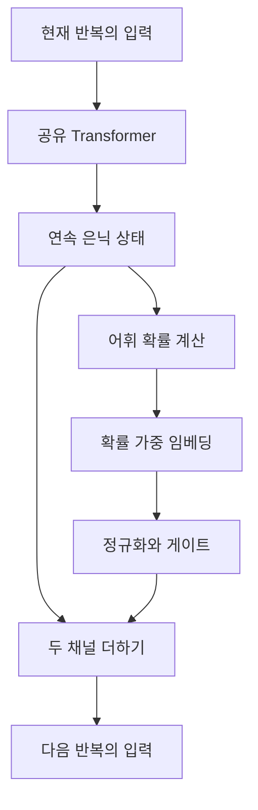

# DiscoLoop: Looping Discrete Embeddings and Continuous Hidden States for Multi-hop Reasoning

**분석 대상:** *DiscoLoop: Looping Discrete Embeddings and Continuous Hidden States for Multi-hop Reasoning*, Hengyu Fu 외, arXiv v2, 2026년 7월 27일.

**분석 원문:** 2607.00341v2.pdf

아래 페이지는 **첨부 PDF의 인쇄 페이지 번호**입니다. **[저자 보고]**는 논문의 주장·실험 결과, **[분석]**은 그 증거에 대한 제 평가, **[검증 제안]**은 아직 수행되지 않은 후속 실험을 뜻합니다. 표에 실린 수치는 그대로 옮기고, 그래프·본문의 대략적인 수치는 ‘약’ 또는 ‘거의’로 표시했습니다. 외부 문헌 비교는 별도 절에 두었으며, 이를 DiscoLoop 자체의 실험 결과로 취급하지 않았습니다.

---

## 1. Executive summary — 9문장

1. DiscoLoop는 모델이 따로 학습한 사실들을 결합하여, 중간 추론을 문장으로 출력하지 않고 다단계 질문에 답하도록 만드는 연구입니다. **[pp.1–4]**
2. 저자들은 동일한 Transformer를 반복 사용하는 구조가 지식의 재사용을 가능하게 하더라도, 반복 사이에 전달되는 내부 표현의 불일치 때문에 새로운 사실 조합에 대한 일반화가 실패할 수 있다고 주장합니다. **[pp.2, 4–6]**
3. 실제로 기본 반복 모델은 첫 번째 반복에서 중간 연결 개체를 거의 완벽하게 해독하면서도, 최종 OOD 정확도는 8.3%에 그쳤습니다. **[p.6, Table 1]**
4. 모델이 스스로 예측한 중간 개체의 임베딩을 내부 상태에 섞는 학습 없는 개입은 정확도를 크게 개선했지만, 특정 개입 강도의 수치에는 본문과 Figure 2 사이의 불일치가 있습니다. **[p.5, Figure 2]**
5. 제안 모델은 기존 은닉 상태를 유지하면서, 예측한 어휘 확률로 가중평균한 임베딩을 다음 반복에 추가합니다. **[pp.6–7, Eqs.4–6]**
6. 학습된 DiscoLoop는 기호형 2-hop 과제에서 ID·OOD 모두 거의 100%, 합성 영어 과제에서는 ID 거의 100%와 OOD 약 95%를 기록했습니다. **[pp.7–9, Figures 3–4]**
7. 3-hop 과제의 OOD 정확도는 약 65%였으며, 해당 학습에 3-hop 예제가 포함되어 있으므로 학습보다 긴 추론으로의 일반화를 입증한 결과는 아닙니다. **[pp.13–14, Figure 5]**
8. 4억 4천만 파라미터 모델을 200억 토큰으로 사전학습한 비교에서는 일곱 벤치마크 평균이 기본 반복 모델의 49.3에서 50.5로, PonderLM의 49.8에서 50.5로 상승했습니다. **[p.9, Table 2]**
9. 가장 설득력 있는 기여는 **반복 사이에 전달되는 표현을 개선하여 이미 학습한 사실의 새로운 조합에 대한 일반화를 높인 것**이며, 통계적 안정성·대규모 적용·길이 일반화는 추가 검증이 필요합니다. **[분석: pp.5–10, 13–16]**

> **용어 설명**
>
> - **은닉 상태(hidden state):** 모델이 계산 도중 사용하는 내부 벡터.
> - **임베딩(embedding):** 토큰을 모델이 처리할 수 있는 숫자 벡터로 나타낸 표현.
> - **hop:** 사실이나 관계를 한 번 따라가는 추론 단계.
> - **ID / OOD:** 학습 분포 안 / 밖의 평가 조건이며, 이 논문에서는 특히 ‘어떤 사실들이 조합 학습에 사용되었는가’로 구분.

---

## 2. 연구 배경과 목표

### 2.1 해결하려는 문제

다음 두 사실을 각각 학습했다고 가정합니다.

- Alice의 아들은 Bob이다.
- Bob의 아내는 Carol이다.

모델이 “Alice의 아들의 아내는 누구인가?”에 답하려면, 먼저 Bob을 구한 뒤 Bob의 아내를 찾아야 합니다. 논문의 목표는 이 과정을 **중간 답 Bob을 출력하지 않고, 모델 내부 계산으로 수행**하게 하는 것입니다. **[저자 보고: pp.1–3]**

> **용어 설명**
>
> - **원자적 사실(atomic fact):** 한 관계로 표현되는 기본 사실.
> - **연결 개체(bridge entity):** 두 사실을 이어주는 중간 개체이며, 위 예에서는 Bob.
> - **암묵적 추론(implicit reasoning):** 중간 추론 내용을 출력하지 않고 내부 계산으로 답을 도출하는 방식.
> - **매개변수 지식(parametric knowledge):** 질문과 함께 제공된 문서가 아니라, 학습을 통해 모델 가중치에 저장된 지식.

저자들이 구분하는 장애물은 두 가지입니다.

| 장애물 | 논문이 제시하는 설명 | 대응 방향 |
|---|---|---|
| **깊이별 지식 저장 문제** | 앞쪽 층이 중간 개체를 찾은 뒤, 뒤쪽 층에서 두 번째 사실을 이용해야 하는데 필요한 지식이 그 위치에 충분히 저장되어 있지 않을 수 있음 | 같은 층들을 반복하여 지식을 다시 사용 |
| **반복 사이의 표현 불일치** | 첫 반복의 은닉 상태에서 중간 개체를 읽을 수 있어도, 그 상태가 다음 반복이 처리하기 좋은 임베딩 형태와 다를 수 있음 | 은닉 상태에 임베딩 기반 표현을 함께 전달 |

**근거:** pp.2–3, Figure 1; pp.5–6, Table 1.

### 2.2 목적과 필요성

**[저자 보고]** 연구의 목적은 다음 세 가지입니다.

1. 반복 구조를 사용해도 사실 조합에 실패하는 이유를 내부 표현 수준에서 설명한다.
2. 그 설명에 근거한 간단한 구조 변경으로 일반화와 학습 효율을 높인다.
3. 효과가 통제된 기호 과제를 넘어 합성 자연어와 실제 언어모델 사전학습에서도 유지되는지 확인한다. **[pp.2, 7–9]**

**[분석]** 이 문제의 중요성은 **개별 사실의 기억 능력과 사실을 결합하는 능력을 분리해서 평가한다는 점**에 있습니다. 원자적 사실을 정확히 기억하면서도 새로운 조합에 실패한다면, 추가 지식을 저장하는 것만으로는 문제가 해결되지 않습니다. 이 논문은 일반화를 개선할 대상으로 ‘저장된 지식에 대한 접근’과 ‘다음 계산이 사용할 표현’을 함께 제시합니다. **[근거: pp.4–6, Table 1]**

---

## 3. 핵심 주장과 근거

| 핵심 주장 | 저자가 직접 제시한 근거 | 분석 및 해석 범위 | 위치 |
|---|---|---|---|
| 반복만으로는 조합 일반화가 충분하지 않다 | 기본 반복 모델은 학습 정확도 100%지만 최종 ID 71.1%, OOD 8.3% | 학습한 사실의 회수와 새로운 조합의 성공을 구분하는 결과 | p.6, Table 1(a) |
| 중간 개체의 해독 가능성과 후속 계산에서의 활용 가능성은 다르다 | 연결 개체에 부여한 확률은 ID·OOD 모두 표에서 1.000이지만, 임베딩과의 코사인 유사도는 각각 0.327, 0.266 | 해독 성공만으로 추론 성공을 판단할 수 없음을 뒷받침 | p.6, Table 1(b) |
| 내부 표현을 임베딩 방향으로 바꾸면 성능이 개선된다 | 첫 반복 뒤 한 위치에만 개입해 ID·OOD 정확도가 크게 상승 | 표현 변경의 효과를 직접 시험한 강한 증거이나, 특정 $\alpha$ 수치는 불일치 | p.5, Eq.3, Figure 2 |
| 연속 상태와 임베딩 채널의 결합이 학습된 모델에도 효과적이다 | DiscoLoop가 기호형 2-hop에서 거의 완벽한 ID·OOD 정확도 달성 | 해당 통제 과제에서 설득력 있는 개선 | pp.6–8, Eqs.4–6, Figure 3 |
| 효과가 기호 토큰에만 한정되지 않는다 | 두 가지 합성 영어 형식에서 OOD 약 95% | 자연어 형태에서도 작동하지만, 개방형 언어 일반화나 미학습 문장 형식으로의 전이는 별도 문제 | pp.8–9, Figure 4 |
| 더 깊은 과제에도 이점이 있다 | 3-hop OOD 약 65%, 비교 모델들은 거의 0% | 3-hop 학습을 포함한 결과이며 길이 외삽의 증거는 아님 | pp.13–14, Figure 5 |
| 일반 언어모델 학습에도 이득이 있다 | 일곱 벤치마크 평균 50.5로 두 비교 모델보다 높음 | 실용적 전이의 초기 근거이나, 작은 점수 차이의 통계적 유의성은 확인 불가 | p.9, Table 2 |

> **용어 설명**
>
> - **해독 가능성(decodability):** 내부 벡터에 출력 변환을 적용했을 때 해당 개체를 알아낼 수 있는 정도.
> - **코사인 유사도:** 두 벡터가 같은 방향을 가리키는 정도이며, 벡터의 크기보다 방향을 비교하는 지표.
> - **길이 외삽(length extrapolation):** 학습에서 경험한 최대 추론 단계보다 더 긴 문제를 해결하는 능력.

---

## 4. 방법론과 데이터 소스

### 4.1 실험 절차

연구는 **기본 반복 모델의 실패 진단 → 학습 없는 내부 개입 → 구조 설계 → 세 종류의 평가** 순서로 진행됩니다.  
먼저 학습된 모델이 무엇을 기억하고 어느 위치에서 실패하는지 확인한 다음, 그 실패를 겨냥한 개입을 구조에 반영합니다. **[pp.4–9]**

### 4.2 기호형 데이터와 ID/OOD 분할

두 지식 그래프 $G_A$와 $G_B$는 **개체 집합이 서로 겹치지 않고, 관계 어휘는 공유**합니다. **[pp.3–4]**

| 항목 | 설정 |
|---|---|
| 개체 수 | 그래프별 500개 |
| 관계 종류 | 공유 관계 50개 |
| 개체당 나가는 간선 | 서로 다른 관계로 연결된 10개 |
| 원자적 사실 | 그래프별 5,000개, 총 10,000개 |
| 가능한 2-hop 경로 | 그래프별 50,000개 |
| 학습 데이터 | 두 그래프의 모든 원자적 사실 + $G_A$의 2-hop 질문 10,000개 |
| ID 시험 | 학습에 사용하지 않은 $G_A$의 2-hop 질문 2,000개 |
| OOD 시험 | $G_B$의 2-hop 질문 2,000개 |
| 반복 횟수 | $K=2$ |
| 학습 기간 | 3,000 epoch |

**출처:** p.4, §3.1; p.7, §5.1.

> **용어 설명**
>
> - **지식 그래프:** 개체를 점으로, 사실의 관계를 연결선으로 표현한 구조.
> - **epoch:** 전체 학습 데이터를 한 차례 사용하는 학습 단위.

**[분석 — 일반화 해석에서 가장 중요한 구분]**  
OOD 그래프의 **개체와 원자적 사실은 이미 학습했습니다**. 학습하지 않은 것은 그 사실들의 **2-hop 조합**입니다. 따라서 이 결과는 ‘전혀 모르는 사실을 알아내는 능력’이 아니라, **개별적으로 배운 사실에 조합 규칙을 적용하는 능력**의 증거입니다. 또한 보고된 OOD 정확도는 가능한 경로 전체가 아닌 2,000개 표본에 대한 값입니다. **[pp.3–4]**

### 4.3 합성 자연어 데이터

동일한 종류의 사실과 질문을 영어로 표현합니다.

- **Direct:** “Finley’s teacher’s wife is Charlie.”
- **Reverse:** “Who is the wife of the teacher of Finley? Answer: Charlie.”

Reverse에서는 입력 문장에 나타난 관계 순서와 실제 적용해야 할 관계 순서가 다릅니다. 두 형식 모두 $K=2$, 5,000 epoch로 학습하며, DiscoLoop에는 학습 가능한 게이트를 사용합니다. **[p.8, §5.2]**

**[분석]** 두 형식은 각각 학습·평가한 실험입니다. Direct만 학습한 모델이 처음 보는 Reverse 형식에 전이한 결과로 해석해서는 안 됩니다. **[p.8, Figure 4]**

### 4.4 실제 언어모델 사전학습

| 항목 | 논문 설정 |
|---|---|
| 비교 모델 | Vanilla loop, PonderLM, DiscoLoop |
| 모델 규모 | 440M, 약 4억 4천만 파라미터 |
| 학습량 | 약 20B, 200억 토큰 |
| 데이터 구성 | FineWeb-Edu 60% + FineMath-4plus 40% |
| 기본 구조 | Ouro 기반, 은닉 차원 1,024, 24개 층, 16개 attention head |
| 반복 계산 | 세 모델 모두 기본 모델을 총 4회 적용 |
| 입력·출력 임베딩 | 가중치 공유 |
| 토크나이저 | DeepSeek-V3-0324 |
| 문맥 길이 | 8,192 토큰 |
| 임베딩 혼합 근사 | 확률 상위 128개 토큰 |
| 평가 | lm-evaluation-harness, zero-shot |

**출처:** p.9, §5.3; pp.14–15, Appendix B.

학습 설정에는 AdamW와 Muon 사용, 학습률 $3\times10^{-3}$, 유효 배치 크기 128, 1,000단계 준비 구간, 최종 학습률 $10^{-5}$가 기재되어 있습니다.  
기본 반복 모델의 기록된 실행 설정은 19,074번의 최적화 단계를 사용합니다. **[p.15]**

> **용어 설명**
>
> - **기본 모델(backbone):** 비교 모델들이 공통으로 사용하는 핵심 신경망.
> - **토크나이저:** 문자열을 모델 입력 단위인 토큰으로 나누는 도구.
> - **zero-shot 평가:** 평가 프롬프트에 해당 과제의 풀이 예시를 제공하지 않는 방식.
> - **AdamW·Muon:** 학습 중 모델 파라미터를 갱신하는 최적화 알고리즘.

---

## 5. 제안 방법과 모델 구조 — 수식 중심 설명

### 5.1 추론 과제의 정의

지식 그래프를 다음처럼 정의합니다.

$$
\mathcal G=(\mathcal E,\mathcal R,\mathcal F),
\qquad
\mathcal F\subseteq\mathcal E\times\mathcal R\times\mathcal E.
$$

2-hop 추론 규칙은 다음과 같습니다.

$$
(a,r_1,b)\in\mathcal F
\;\land\;
(b,r_2,c)\in\mathcal F
\quad\Longrightarrow\quad
(a,r_1,r_2,c).
$$

**기호 설명**

- $\mathcal E$: 개체 집합.
- $\mathcal R$: 관계 집합.
- $\mathcal F$: 원자적 사실의 집합.
- $a$: 출발 개체.
- $b$: 중간 연결 개체.
- $c$: 최종 정답.
- $r_1,r_2$: 순서대로 적용할 관계.

모델은 $(a,r_1,r_2)$를 입력받아 $c$를 예측합니다. 그래프는 학습 데이터를 구성하는 장치이며, 모델은 추론할 때 가중치에 학습된 사실을 결합해야 합니다. **[p.3, 원문 Eq.1]**

### 5.2 기본 반복 Transformer

입력 토큰열을 임베딩으로 바꾸고, 같은 Transformer를 반복 적용합니다.

$$
H^{(0)}=W[x]\in\mathbb R^{T\times d},
$$

$$
H^{(k+1)}=f_\theta\!\left(H^{(k)}\right),
\qquad k=0,\ldots,K-1.
$$

최종 출력 점수는 다음과 같습니다.

$$
\ell=H^{(K)}W^\top.
$$

**기호 설명**

- $x=(x_0,\ldots,x_{T-1})$: 입력 토큰열.
- $T$: 입력 길이.
- $V$: 어휘 크기.
- $d$: 은닉 차원.
- $W\in\mathbb R^{V\times d}$: 입력 임베딩과 출력 변환이 공유하는 행렬.
- $W[x]$: 입력 토큰에 해당하는 임베딩들을 모은 행렬.
- $f_\theta$: 파라미터 $\theta$를 공유하는 Transformer 층들의 묶음.
- $H^{(k)}$: $k$회 반복 후의 은닉 상태.
- $K$: 총 반복 횟수.
- $\ell$: 각 토큰 후보에 대한 출력 점수.

**출처:** p.4, 원문 Eq.2 및 다음 문장.

> **용어 설명**
>
> - **가중치 공유:** 반복마다 새로운 모델을 사용하는 대신 같은 파라미터를 재사용하는 것.
> - **LM head:** 은닉 상태를 어휘별 점수로 변환하는 출력 부분.
> - **logit:** 확률로 변환하기 전의 출력 점수.
> - **tied embedding:** 입력 임베딩 행렬과 출력 변환 행렬의 가중치를 공유하는 방식.

논문의 ‘단일 forward pass 안에서 추론’은 **답을 생성하기 전 하나의 전체 모델 계산 안에서 추론한다는 뜻**입니다. 내부적으로는 $f_\theta$를 $K$회 적용하므로, 계산을 한 번만 수행한다는 뜻은 아닙니다. **[분석: p.4, Eq.2]**

### 5.3 진단 실험: 학습 없이 중간 표현 바꾸기

첫 번째 반복이 끝난 뒤, 입력의 위치 1, 즉 $r_1$ 위치에 있는 벡터를 바꿉니다. 해당 위치의 벡터를 $h$라고 쓰면 원문 Eq.3은 다음과 같습니다.

$$
b_{\max}=\text{argmax}_{v}(Wh)_v,
$$

$$
h\leftarrow
(1-\alpha)h+
\alpha\,\text{Norm}\!\left(W[b_{\max}]\right),
\qquad \alpha\in[0,1].
$$

**기호 설명**

- $h$: 첫 반복 뒤 $r_1$ 위치의 은닉 벡터.
- $b_{\max}$: 모델이 가장 높은 점수를 부여한 토큰.
- $W[b_{\max}]$: 그 토큰의 임베딩.
- $\alpha$: 기존 상태와 임베딩을 섞는 비율.
- $\text{Norm}$: 임베딩을 정규화하는 연산.

이 개입에는 **모델 자신의 예측 토큰**을 사용합니다. 정답 연결 개체를 외부에서 알려주는 실험은 아닙니다. 참 연결 개체는 별도의 분석에서 해독 확률과 유사도를 측정할 때 사용됩니다. **[p.5, Eq.3, Figure 2]**

정규화의 세부 구현은 충분히 명시되어 있지 않습니다. Figure 2 범례에는 ‘Layer norm’이 쓰여 있고, 이후 제안 구조에는 RMSNorm이 명시되어 있으므로, 두 연산을 같다고 단정해서는 안 됩니다. **[pp.5–6]**

### 5.4 핵심 연산: 확률로 해독하고 임베딩으로 다시 구성하기

DiscoLoop는 가장 유력한 토큰 하나를 고르는 대신, 어휘 전체의 확률을 사용합니다.

$$
p_v(h)=
\frac{\exp\!\left((Wh)_v/\tau\right)}
{\sum_{v'=1}^{V}\exp\!\left((Wh)_{v'}/\tau\right)},
$$

$$
\Phi(h)=\sum_{v=1}^{V}p_v(h)W[v].
$$

**기호 설명**

- $h\in\mathbb R^d$: 한 위치의 은닉 벡터.
- $(Wh)_v$: 후보 토큰 $v$의 출력 점수.
- $\tau>0$: 확률분포의 집중 정도를 조절하는 온도.
- $p_v(h)$: 토큰 $v$의 확률.
- $W[v]$: 토큰 $v$의 임베딩.
- $\Phi(h)$: 토큰 확률로 가중평균한 임베딩.

**출처:** p.6, 원문 Eq.5.

예를 들어 Bob의 확률이 거의 1이면 $\Phi(h)$는 Bob의 임베딩에 가까워집니다. 여러 후보의 확률이 높다면 그 후보들의 임베딩을 섞은 벡터가 됩니다.

> **용어 설명**
>
> - **softmax:** 여러 점수를 합이 1인 확률분포로 바꾸는 함수.
> - **온도(temperature):** 낮을수록 높은 점수의 후보에 확률이 더 집중되도록 하는 값.
> - **soft decode–encode:** 토큰 하나를 확정하는 대신 확률분포를 이용해 임베딩을 다시 만드는 과정.

**[분석 — 명칭을 정확히 이해해야 하는 부분]**  
논문은 이를 ‘이산 임베딩 채널’이라고 부르지만, 실제 $\Phi(h)$는 **이산 어휘의 임베딩으로 구성한 연속적 가중평균**입니다. 제안 모델의 기본식에는 토큰 샘플링이나 hard argmax가 없습니다. **[p.6, Eq.5]**

### 5.5 두 채널을 함께 전달하는 반복 구조

DiscoLoop의 갱신식은 다음과 같습니다.

$$
\widetilde H^{(0)}=W[x],
$$

$$
H^{(k+1)}=f_\theta\!\left(\widetilde H^{(k)}\right),
$$

```math
\widetilde H^{(k+1)}
=
H^{(k+1)}
+
\alpha^{(k)}\odot
\text{RMSNorm}\!\left(\Phi\!\left(H^{(k+1)}\right)\right).
```

**기호 설명**

- $\widetilde H^{(k)}$: 두 채널을 결합하여 다음 반복에 입력하는 상태.
- $H^{(k+1)}$: Transformer가 계산한 연속 은닉 상태.
- $\Phi(H^{(k+1)})$: 각 위치에 독립적으로 적용한 임베딩 재구성.
- $\text{RMSNorm}$: 벡터의 제곱평균제곱근을 기준으로 크기를 정규화하는 연산.
- $\alpha^{(k)}$: 각 위치에서 임베딩을 얼마나 추가할지 정하는 계수.
- $\odot$: 위치별 계수를 해당 행의 모든 차원에 곱하는 연산.

**출처:** p.6, 원문 Eq.4.



*원문 Eq.4–6을 설명하기 위해 재구성한 구조도입니다.*

> **용어 설명**
>
> - **잔차 연결(residual connection):** 기존 표현을 유지하면서 새 표현을 더하는 방식.
> - **게이트(gate):** 어떤 정보를 얼마만큼 전달할지 조절하는 계수.

**진단 개입과 실제 모델은 수식이 다릅니다.**

- 진단 개입은 $(1-\alpha)h+\alpha e$라는 **비율 혼합**입니다.
- DiscoLoop는 $h+\alpha e$라는 **추가 방식**입니다.

따라서 DiscoLoop에서 $\alpha=1$이라고 해서 기존 은닉 상태가 없어지는 것은 아닙니다. 기존 상태와 임베딩 채널이 함께 남습니다. **[분석: pp.5–6, Eqs.3–4]**

### 5.6 게이트의 고정형과 학습형

고정형은 모든 위치와 반복에서 같은 값을 사용합니다.

$$
\alpha^{(k)}=\alpha_\star\mathbf 1_T,
\qquad \alpha_\star>0.
$$

학습형은 다음과 같습니다.

```math
\alpha_t^{(k)}
=
\sigma\!\left(
\left\langle
w_\alpha,\Phi\!\left(H_t^{(k+1)}\right)
\right\rangle+b_\alpha
\right).
```

**기호 설명**

- $\alpha_t^{(k)}$: 반복 $k$에서 위치 $t$의 주입 강도.
- $\mathbf 1_T$: 길이 $T$의 모든 원소가 1인 벡터.
- $\sigma$: 값을 0과 1 사이로 바꾸는 sigmoid 함수.
- $\langle\cdot,\cdot\rangle$: 두 벡터의 내적.
- $w_\alpha\in\mathbb R^d$, $b_\alpha\in\mathbb R$: 학습되는 게이트 파라미터.

게이트 파라미터는 위치와 반복 사이에서 공유하므로 **학습형 게이트가 추가하는 파라미터는 $d+1$개**입니다. 마지막 단계는 다음처럼 설정합니다.

$$
\alpha^{(K-1)}=\mathbf 0_T.
$$

여기서 $\mathbf 0_T$는 길이 $T$의 영벡터이며, 최종 예측은 추가 임베딩 주입 없이 $H^{(K)}$에서 읽습니다. **[pp.6–7, 원문 Eq.6]**

기호형 2-hop 실험은 $\alpha_\star=1$, $\tau=1$을 사용하고, 합성 자연어 실험은 학습형 게이트를 사용합니다. 게이트는 재구성된 임베딩에 조건화되며, **정답 여부나 불확실성을 직접 입력받는 구조로 제시되지는 않습니다**. **[pp.6–8]**

### 5.7 사전학습의 상위 토큰 근사

큰 어휘에 대한 임베딩 혼합 비용을 줄이기 위해, 상위 확률 토큰만 사용합니다. 반복 인덱스와 구분하기 위해 여기서는 선택 개수를 $m$으로 표기하겠습니다.

$$
\mathcal T_m(h)=\text{TopK}\!\left(p(h),m\right),
$$

$$
\Phi_m(h)=
\sum_{v\in\mathcal T_m(h)}p_v(h)W[v].
$$

**기호 설명**

- $\mathcal T_m(h)$: 확률이 높은 $m$개 토큰의 인덱스 집합.
- $p(h)$: 전체 어휘의 확률 벡터.
- $\Phi_m(h)$: 선택된 토큰들만 사용한 임베딩 혼합.
- 실제 사전학습 설정: $m=128$.

**출처:** pp.14–15, Appendix B.

**[분석]** 원문 수식은 기존 $p_v(h)$를 그대로 더하지만, 설명은 상위 집합 밖의 logit을 마스킹한다고 되어 있습니다. 잘린 집합에서 확률을 다시 정규화하는지 구현이 명확하지 않습니다. 또한 상위 토큰을 사용한다고 해서 전체 어휘 점수를 계산하는 비용까지 없어지는 것은 아닙니다.

---

## 6. 주요 결과와 일반화 성능의 정확한 범위

### 6.1 기본 반복 모델: 무엇을 알고도 실패하는가?

**Table 1(a)의 정확한 값**은 다음과 같습니다.

| 판독 단계 | 원자 사실 학습 | 2-hop 학습 | ID 시험 | OOD 시험 |
|---|---:|---:|---:|---:|
| 첫 반복 뒤, Stage 1 | 100.0% | 8.8% | 0.9% | 0.0% |
| 두 반복 뒤, Stage 2 | 100.0% | 100.0% | 71.1% | 8.3% |

**출처:** p.6, Table 1(a).

별도로 연결 개체가 나타날 것으로 예상되는 위치를 조사하면 다음과 같습니다.

| 진단 지표 | ID | OOD |
|---|---:|---:|
| 정답 연결 개체에 부여한 확률 | 1.000 | 1.000 |
| 은닉 상태와 연결 개체 임베딩의 코사인 유사도 | 0.327 | 0.266 |

**출처:** p.6, Table 1(b). 확률 1.000은 표의 표시 정밀도이며, 모든 예제에서 수학적으로 정확히 1이라는 의미로 확대하면 안 됩니다.

**[저자 해석]** 지식 자체는 회수 가능하지만, 다음 반복에 전달되는 표현이 적절하지 않다는 설명입니다.

**[분석]** Table 1은 ‘해독 가능’과 ‘사용 가능’의 분리를 보여줍니다. 인과적 해석을 더 강하게 뒷받침하는 부분은 그다음의 표현 개입입니다. 다만 코사인 유사도가 낮다는 사실만으로 모든 오류의 원인이 특정한 종류의 ‘노이즈’라고 확정할 수는 없습니다. **[pp.5–6]**

> **용어 설명**
>
> **logit lens:** 최종 출력 변환을 중간 은닉 상태에도 적용하여, 그 상태에서 어떤 토큰을 읽을 수 있는지 조사하는 분석 방법.

### 6.2 학습된 DiscoLoop의 합성 과제 성능

| 실험 | DiscoLoop | 기본 반복 모델 | 비반복 모델 | 근거 |
|---|---|---|---|---|
| 기호형 2-hop | ID·OOD 거의 100% | ID 약 70%, OOD 10% 미만 | ID 20% 미만, OOD 거의 0% | pp.7–8, Figure 3 |
| 합성 영어 Direct | ID 거의 100%, OOD 약 95% | ID 약 90%, OOD 매우 낮음 | ID 약 40%, OOD 거의 0% | pp.8–9, Figure 4 |
| 합성 영어 Reverse | ID 거의 100%, OOD 약 95% | ID 약 90%, OOD 거의 실패 | ID 약 20%, OOD 거의 0% | pp.8–9, Figure 4 |
| 3-hop 실험의 2-hop 평가 | ID 거의 100%, OOD 약 90% | ID 약 40%, OOD 약 5% | 양쪽 모두 매우 낮음 | p.13, Figure 5 |
| 3-hop 실험의 3-hop 평가 | ID 거의 100%, OOD 약 65% | OOD 거의 0% | OOD 거의 0% | pp.13–14, Figure 5 |

위 표는 본문·곡선에 따른 근사치입니다.

기호형 실험에서는 약 500 epoch 부근에 일반화 성능이 급격히 상승하며, 첫 반복만으로 학습 질문의 최종 답을 맞히던 정확도는 낮아집니다. 저자들은 이를 한 번의 반복 안에서 답을 암기하는 전략에서, 반복을 사용해 사실을 조합하는 전략으로 전환한 증거로 해석합니다. **[pp.7–8, Figure 3]**

**[분석]** 이 해석은 결과와 부합하지만, 중간 출력 변환에서 최종 정답이 잘 읽히지 않는다는 사실만으로 모든 종류의 내부 암기나 우회 전략이 제거되었다고 증명한 것은 아닙니다.

> **용어 설명**
>
> - **grokking:** 학습 데이터에는 이미 잘 맞는 상태에서 학습을 오래 진행한 뒤 시험 성능이 뒤늦게 크게 좋아지는 현상.
> - **귀납적 편향(inductive bias):** 모델 구조나 학습 방식이 특정 종류의 해법을 더 쉽게 배우도록 만드는 성향.

### 6.3 실제 언어모델 벤치마크

아래 수치는 **Table 2의 원문 값**입니다. 마지막 열만 두 값의 차이를 계산했습니다.

| 벤치마크 | Vanilla loop | PonderLM | DiscoLoop | DiscoLoop − Vanilla |
|---|---:|---:|---:|---:|
| ARC-C | 30.5 | 31.7 | **32.6** | +2.1%p |
| ARC-E | 57.2 | 55.6 | **57.6** | +0.4%p |
| HellaSwag | **44.2** | 43.9 | **44.2** | 0.0%p |
| LAMBADA | 35.1 | **38.0** | 37.6 | +2.5%p |
| PIQA | 67.4 | 67.7 | **68.4** | +1.0%p |
| RACE | 31.0 | 31.2 | **31.3** | +0.3%p |
| SciQ | 79.5 | 80.5 | **81.5** | +2.0%p |
| **평균** | **49.3** | **49.8** | **50.5** | **+1.2%p** |

**출처:** p.9, Table 2.

**[저자 보고]** DiscoLoop는 일곱 평가 중 여섯 개에서 최고 또는 공동 최고입니다. PonderLM 대비 평균 차이는 **+0.7%p**이며, LAMBADA에서는 PonderLM이 더 높습니다.

**[분석]** 여러 과제에서 개선 방향이 나타난다는 점은 긍정적입니다. 다만 이러한 개선만으로 실제 언어모델의 다단계 추론이 동일한 표현 정렬 기제로 향상되었다고 확정할 수는 없습니다. 해당 사전학습 모델에 대해 Figure 2와 같은 연결 개체 개입 분석은 제시되지 않았습니다. **[p.9; pp.14–16]**

### 6.4 일반화에 대해 어디까지 말할 수 있는가?

| 일반화 유형 | 이 논문이 제공하는 증거 | 판단 |
|---|---|---|
| 같은 그래프의 미학습 조합 | ID 시험에서 높은 정확도 | 직접 검증됨 |
| 조합 학습에서 제외한 그래프의 사실 결합 | OOD 시험에서 큰 개선 | 이 논문의 가장 강한 결과 |
| 기호 표현을 영어 문장으로 바꾼 과제 | Direct·Reverse 각각에서 개선 | 합성 언어 설정에서 검증됨 |
| 학습한 최대 깊이 안의 3-hop | OOD 약 65% | 효과는 있지만 잔여 실패가 큼 |
| 학습 최대 깊이를 넘는 추론 | 해당 실험 없음 | 미검증 |
| 새로운 관계·다른 그래프 구조·미학습 문장 형식 | 해당 전이 실험 없음 | 미검증 |
| 일반 언어 과제의 성능 | 일곱 벤치마크 평균 개선 | 초기 전이 근거, 원인과 안정성은 추가 검증 필요 |

**근거:** pp.3–4, 7–10, 13–16.

---

## 7. 통계적으로 취약한 부분과 직접 비교할 수 없는 수치

### 7.1 본문과 Figure 2의 수치 불일치

가장 명확한 내부 불일치는 개입 강도 $\alpha$에 대한 설명입니다.

| 항목 | p.5 본문 서술 | Figure 2를 직접 판독한 모습 |
|---|---|---|
| $\alpha=0.1$의 OOD 정확도 | 25.9% | 약 15% 수준 |
| OOD 약 26%에 해당하는 위치 | $\alpha=0.1$로 서술 | $\alpha=0.2$ 부근 |
| $\alpha\approx0.5$ | ID·OOD 모두 거의 100% | ID는 거의 100%, OOD는 약 87% |
| OOD가 거의 포화되는 구간 | 약 0.5로 설명 | 대략 0.7–0.9 |

**[분석]** 오른쪽 값은 그림의 근사 판독이며 정정된 확정값이 아닙니다. **표현 개입이 크게 도움이 된다는 결론은 유지되지만, 특정 $\alpha$와 정확도의 정확한 대응은 원자료 확인 전까지 보류해야 합니다.** **[p.5, Figure 2]**

### 7.2 통계·재현성의 취약점

| 항목 | 논문에 보고된 상태 | 해석에 미치는 영향 |
|---|---|---|
| 반복 실험·무작위 시드 | 개수와 집계 방식 미기재 | 결과의 재현성과 실행 간 변동을 판단하기 어려움 |
| 오차막대·신뢰구간 | 제시되지 않음 | 평균 성능 차이의 불확실성을 알 수 없음 |
| 통계적 검정 | 유의성 검정 미제시 | Table 2의 작은 차이를 통계적으로 유의하다고 말할 수 없음 |
| 평가 표본의 독립성 | 같은 그래프의 사실을 여러 질문이 공유 | 문항 수만으로 독립 표본을 가정한 신뢰구간을 계산하기 어려움 |
| 합성 실험 설정 | 기본 모델 차원·층수, 학습률·배치 크기 등 구체값 누락 | 원문만으로 정확한 재현이 어려움 |
| 구성요소 분리 실험 | 정규화·게이트·온도·상위 토큰 수의 체계적 비교 부족 | 어떤 요소가 얼마만큼 기여했는지 분리하기 어려움 |
| 개입 강도 선택 | 시험 집합에 대한 $\alpha$ 변화 곡선 제시 | 다른 데이터에도 고정 적용할 최적값은 확인되지 않음 |
| 코드·체크포인트 안내 | PDF 안에 해당 저장소 URL 없음 | 원문만으로 구현 세부를 확인하기 어려움 |

**근거:** Table 1–2, Figures 2–7, pp.4–9, 13–16. 합성 실험 부록 A.1은 사용 프레임워크와 장비 정보를 제공하지만 누락된 설정값들을 보완하지는 않습니다.

> **용어 설명**
>
> - **무작위 시드:** 모델 초기화나 데이터 생성에 사용되는 난수의 시작값.
> - **신뢰구간:** 표본과 반복 실험의 불확실성을 고려해 추정값의 범위를 나타낸 것.
> - **절제 실험(ablation):** 특정 구성요소를 제거하거나 바꿔 그 요소의 효과를 분리하는 실험.

### 7.3 직접 비교하면 안 되는 항목

**① epoch 감소와 실제 시간 감소**

논문은 더 적은 epoch에서 높은 정확도에 도달함을 보여줍니다. 그러나 DiscoLoop는 중간 어휘 점수 계산과 임베딩 혼합을 추가합니다. 따라서 **학습 횟수의 감소를 실제 학습 시간·추론 지연·전력 감소와 동일시할 수 없습니다**. 게이트 파라미터가 $d+1$개라는 사실도 전체 추가 연산량이 작다는 증거는 아닙니다. **[pp.6–8, 14–15]**

**② 계산량을 맞춘 기본 구조와 전체 실행 비용**

저자들은 비반복 비교 모델이 반복 모델의 FLOPs를 맞춘다고 설명합니다. 다만 추가 decode–encode를 포함한 총 연산량과 실제 실행 시간을 측정한 표는 없습니다. 따라서 공정성이 없다고 단정하기보다, **총비용의 동등성이 실측으로 확인되지 않았다**고 평가하는 것이 정확합니다. **[p.7]**

**③ 서로 다른 벤치마크의 평균**

ARC-C·ARC-E·HellaSwag·PIQA·SciQ는 길이 정규화 정확도를, LAMBADA·RACE는 일반 정확도를 사용합니다. 평균 50.5는 이질적인 평가 점수들의 평균이며, 전체 문항을 합친 하나의 정확도가 아닙니다. 같은 벤치마크 안의 모델 비교에는 유용하지만 과제별 숫자의 의미를 모두 같게 취급해서는 안 됩니다. **[p.9, Table 2; p.15]**

> **용어 설명**
>
> **길이 정규화 정확도:** 선택지 점수를 계산할 때 선택지 길이에 따른 영향을 보정한 뒤 정답 선택 여부를 평가하는 방식.

**④ 주된 2-hop OOD와 별도 3-hop OOD**

거의 100%와 약 65%의 차이는 주목할 만하지만, 두 실험은 학습 질문의 구성, 반복 횟수, 평가 표본 수가 다릅니다. 이를 추론 깊이만 바꾸었을 때의 순수한 성능 감소량으로 계산해서는 안 됩니다. **[pp.4, 13]**

**⑤ 훈련 손실과 일반화 성능**

Figure 7은 평활화된 **훈련 손실**입니다. 후반부 최대 차이가 약 $10^{-2}$라는 관측은 최적화 결과이며, 그 자체가 시험 데이터 일반화의 측정치는 아닙니다. **[pp.15–16, Figure 7]**

---

## 8. 가장 중요한 그림 선정과 해석

### Figure 1 — 논문의 문제 구조  
**위치: p.3**

이 그림은 연구 논리를 가장 잘 요약합니다. 비반복 모델에는 필요한 지식을 적절한 깊이에서 사용하는 문제가 있고, 반복 모델에는 같은 지식을 재사용하더라도 전달 표현이 맞지 않는 문제가 남습니다. DiscoLoop는 후자에 대응하는 임베딩 경로를 추가합니다.

**[분석]** 연구 질문을 이해하는 데 유용한 개념도입니다. 성능이나 인과관계를 검증하는 증거는 뒤의 실험에서 찾아야 합니다.

### Figure 2 — 가장 중요한 개입 실험  
**위치: p.5**

학습을 다시 하지 않고 첫 반복 뒤 한 위치의 표현만 바꾸어 성능을 회복시킵니다. 연결 개체는 모델 자체의 예측에서 얻습니다.

**[분석]** 새로운 사실을 학습시키지 않고도 실패를 크게 줄였다는 점에서, 전달 표현이 병목이라는 설명을 강하게 뒷받침합니다. 다만 앞서 지적한 수치 불일치와 정규화·벡터 크기만의 효과를 분리하는 대조 실험 부족을 함께 읽어야 합니다.

### Figure 3 — 학습 과정에서 계산 전략이 달라지는 모습  
**위치: p.7**

왼쪽은 최종 ID·OOD 정확도, 오른쪽은 첫 반복 뒤의 2-hop 학습 정확도입니다. DiscoLoop에서는 첫 반복만으로 답을 내던 성향이 더 빨리 약해지고 최종 일반화가 상승합니다.

**[저자 해석]** 반복을 통한 사실 조합을 더 쉽게 배우도록 만드는 귀납적 편향입니다.

**[분석]** 최종 정확도만 보는 것보다 학습 과정을 잘 설명하지만, 특정 내부 알고리즘을 유일하게 확정하는 관측은 아닙니다.

### Figure 5 — 일반화의 성과와 남은 실패를 함께 보여주는 그림  
**위치: p.13**

3-hop OOD에서 비교 모델들은 거의 실패하지만 DiscoLoop는 약 65%를 달성합니다.

**[분석]** 더 깊은 과제에서도 효과가 유지되면서 완전한 일반화에는 도달하지 못했다는 사실이 중요합니다. 학습에 3-hop이 포함되어 있으므로, 이 그림을 길이 외삽의 증거로 제시하면 안 됩니다.

### Figure 7 — 실제 사전학습으로의 전이  
**위치: p.16**

초기에는 기본 반복 모델의 손실이 낮고, 후반에는 DiscoLoop가 앞섭니다. 저자는 약 130억 토큰 이후의 개선을 강조합니다.

**[분석]** 이 그림은 학습 예산에 따라 모델 간 우열이 달라질 수 있음을 보여줍니다. 짧은 사전학습에서도 항상 유리하다는 결론이나, 손실 차이만으로 광범위한 추론 능력을 확보했다는 결론은 도출할 수 없습니다.

---

## 9. 2020년 이후 관련 연구 비교

아래는 이 논문과 직접 연결되는 연구를 선별한 비교입니다. 연도는 최초 공개 기준이며, **2026년 후속 개정판과 2026년 9월 공개 연구까지 확인**했습니다. 외부 논문의 원래 점수를 DiscoLoop의 점수와 나란히 놓아 성능 순위를 만들지는 않았습니다. 모델·데이터·감독 방식·계산 예산이 다르기 때문입니다.

### 9.1 주요 연구의 방법과 차이

| 연구 | 원문에서 확인되는 핵심 | DiscoLoop와의 관계 및 일반화 관점 |
|---|---|---|
| **Wei et al., 2022 — Chain-of-Thought Prompting** | 풀이 과정을 포함한 예시로 자연어 중간 추론 생성을 유도함. **원 논문 Figure 1, §2** | 중간 토큰 생성에 계산을 배분하는 접근. DiscoLoop는 내부 반복에서 사실을 조합하며, 두 방식의 동일 예산 직접 비교는 없음. [arxiv.org](https://arxiv.org/html/2201.11903v6?utm_source=chatgpt.com) |
| **Wang et al., 2024 — Grokked Transformers are Implicit Reasoners** | 장기 학습 후 암묵적 추론이 나타나지만 조합 과제의 체계적 일반화는 실패할 수 있음. 층별 조합 회로 분석. **Figure 4, §3** | 두 그래프 평가와 층별 지식 접근 문제의 직접적인 선행 연구. DiscoLoop는 반복 간 전달 표현을 추가 설계 대상으로 삼음. [arxiv.org](https://arxiv.org/abs/2405.15071?utm_source=chatgpt.com) |
| **Biran et al., 2024 — Hopping Too Late** | 중간 개체가 해소된 뒤 최종 답을 뒤쪽 층에서 구하며, 늦은 상태를 앞층으로 되돌리는 개입을 분석. **Tables 2–3, §6** | 같은 지식 처리 기능에 다시 접근하도록 한다는 점에서 반복 구조와 연결됨. 선택 가능한 개입의 성공률과 일반 모델 정확도는 다른 수치임. [arxiv.org](https://arxiv.org/abs/2406.12775?utm_source=chatgpt.com) |
| **Hao et al., 2024 — Coconut** | 마지막 은닉 상태를 다음 입력 임베딩으로 직접 전달하고, CoT를 이용한 단계적 학습을 사용. **Figures 1–2, §3** | Coconut은 다음 잠재 위치로 진행하고, DiscoLoop는 같은 시퀀스의 반복 깊이를 갱신함. 연속 상태 활용은 공유하지만 계산 배치와 학습 방식이 다름. [arxiv.org](https://arxiv.org/html/2412.06769v1?utm_source=chatgpt.com) |
| **Ye et al., 2025 — How do Transformers Learn Implicit Reasoning?** | 중간 개체가 해독 가능해도 실제 추론에 사용되지 않을 수 있음을 분석. **Table 1, §3.2–3.3** | ‘해독 가능성과 사용 가능성의 차이’는 선행 통찰임. DiscoLoop는 반복 모델의 임베딩 정렬 개입과 구조 변경으로 발전시킴. [arxiv.org](https://arxiv.org/html/2505.23653v2?utm_source=chatgpt.com) |
| **Zeng et al., 2025/2026 — PonderLM** | 예측 분포로 임베딩을 가중합하고 입력 임베딩에 잔차 누적하여 반복 사용. **v3 Figure 2, §2** | 가장 직접적인 구조 비교. DiscoLoop는 방금 계산한 은닉 상태 자체를 보존한 채 임베딩 채널을 추가함. PonderLM에도 잔차 연결은 존재함. [arxiv.org](https://arxiv.org/html/2505.20674v3?utm_source=chatgpt.com) |
| **Zhang et al., 2025 — Soft Thinking** | 학습 없이 확률 가중 임베딩을 다음 concept token으로 사용하며 표현 공간 정렬 문제도 논의. **Figure 2, §2–3.2** | 확률 가중 임베딩과 표현 정렬 자체를 DiscoLoop의 최초 발명으로 볼 수 없음. 생성 순서의 잠재 토큰과 내부 반복 구조의 차이가 중요함. [arxiv.org](https://arxiv.org/html/2505.15778v1?utm_source=chatgpt.com) |
| **Zhu et al., 2025 — Ouro / Scaling Latent Reasoning via Looped Language Models** | 공유 층의 반복과 종료 게이트로 계산 깊이를 조절. **Figure 3, §3.1–3.3** | DiscoLoop 사전학습의 기본 구조 출처. Ouro의 게이트는 종료 시점, DiscoLoop의 게이트는 임베딩 주입량을 제어함. [arxiv.org](https://arxiv.org/html/2510.25741v1?utm_source=chatgpt.com) |
| **Kohli et al., 2026 — Loop, Think, & Generalize** | 반복 구조의 체계적 일반화·깊이 외삽과 과도한 반복에 따른 성능 저하를 분석. **Figures 3, 5, 7–10, §5–6** | 단일 그래프 사실의 5%를 조합 학습에서 제외하는 설정으로, DiscoLoop의 개체 집합이 분리된 두 그래프와 다름. 깊이 외삽은 DiscoLoop가 아직 검증하지 않은 중요한 비교축. [arxiv.org](https://arxiv.org/abs/2604.07822?utm_source=chatgpt.com) |
| **Liang et al., 2026년 9월 — Beyond the Training Horizon** | 반복 상태의 내용뿐 아니라 후속 계산에 사용 가능한 상태인지가 중요함을 인과개입으로 분석. **Figure 2, §4.3–6** | 임베딩 정렬에 더해 계산 진행 상태의 보존을 검사해야 한다는 후속 질문을 제공. DiscoLoop가 이 연구에 영향을 주었다고 확인된 것은 아님. [arxiv.org](https://arxiv.org/abs/2609.33144?utm_source=chatgpt.com) |

> **용어 설명**
>
> - **CoT:** 중간 추론을 자연어 토큰으로 생성하는 방식.
> - **잠재 위치:** 실제 단어 대신 내부 벡터를 입력으로 사용하는 시퀀스상의 위치.
> - **과도한 반복에 따른 성능 저하(overthinking):** 계산을 더 반복했는데 이미 얻은 올바른 상태가 흐트러져 정확도가 낮아지는 현상.
> - **계산 진행 상태:** 어떤 내용을 담고 있는지와 별개로, 그 내용이 다음 연산에 사용될 준비가 되어 있는지 나타내는 내부 특성.

### 9.2 독창성을 어디에 두어야 하는가?

**[분석]** 선행 연구와 대조했을 때 DiscoLoop의 기여는 다음의 **결합**으로 보는 것이 정확합니다.

1. 메모리를 재사용하는 반복 모델에도 표현 문제가 남는다는 진단.
2. 모델 자신의 예측 임베딩을 이용한 학습 없는 개입.
3. 연속 은닉 상태와 정규화된 임베딩 채널을 함께 전달하는 구조.
4. 두 그래프의 조합 일반화, 합성 자연어, 소규모 실제 사전학습을 연결한 실험.

확률 가중 임베딩 피드백은 PonderLM과 Soft Thinking에도 있고, 해독 가능성과 실제 활용의 차이는 Ye 등의 연구에서도 제시되었습니다. 따라서 **‘soft embedding 최초 제안’보다 ‘반복 구조에서 두 채널을 결합하고 엄격한 사실 조합 평가로 검증한 설계’**에 차별성을 두어야 합니다. **[DiscoLoop pp.5–9; 위 선행 원문]** [arxiv.org](https://arxiv.org/html/2505.20674v3?utm_source=chatgpt.com)

### 9.3 앞으로 연구할 때 고려할 점

**[분석]** 최신 관련 연구는 다음 두 가지를 특히 강조하게 합니다.

- **반복 횟수의 증가와 일반화는 별개로 측정해야 합니다.** Kohli 등의 연구는 추가 반복의 이점과 성능 저하를 함께 다루므로, DiscoLoop도 반복을 늘렸을 때 정답이 유지되는지 검사해야 합니다. **[Kohli et al., §6, Figures 7–10]** [arxiv.org](https://arxiv.org/html/2604.07822v2?utm_source=chatgpt.com)
- **개체의 의미와 계산 진행 정보가 함께 보존되는지 확인해야 합니다.** Liang 등의 결과를 고려하면, 연결 개체를 잘 해독하거나 임베딩에 가깝게 만든 것만으로 긴 추론에서 필요한 상태가 모두 유지된다고 가정할 수 없습니다. **[Liang et al., Figure 2, §4.3]** [arxiv.org](https://arxiv.org/html/2609.33144v1?utm_source=chatgpt.com)

이는 DiscoLoop의 실험 결과를 확장한 사실 진술이 아니라, 외부 연구와 비교하여 도출한 **추가 검증 과제**입니다.

---

## 10. 제한사항과 문서가 답하지 않는 질문

### 10.1 저자들이 명시한 한계와 후속 계획

저자들은 결론에서 다음을 제시합니다.

1. **길이 일반화:** 최대 $k$단계로 학습한 뒤 $k$를 넘는 추론을 수행할 수 있는지.
2. **대규모 검증:** 계산 자원 제약으로 제한된 모델 규모에서 얻은 결과가 더 큰 모델에서도 유지되는지.
3. **기존 모델에 도입:** 대형 사전학습 모델을 처음부터 다시 학습하지 않고 계속 사전학습하여 이 반복 구조를 도입할 수 있는지. **[p.10, §6]**

> **용어 설명**
>
> **계속 사전학습(continual pretraining):** 이미 학습된 모델을 출발점으로 추가 데이터와 학습 과정을 통해 능력이나 구조의 사용 방식을 확장하는 것.

### 10.2 추가로 남는 질문

아래는 **[분석]**에 따른 미해결 질문입니다.

| 질문 | 문서에서 답이 부족한 이유 |
|---|---|
| 첫 반복이 연결 개체를 틀리게 예측하면 임베딩 주입이 오류를 강화하는가? | 개입의 핵심 사례는 연결 개체가 거의 완벽하게 해독되는 상황임 — pp.5–6 |
| 여러 연결 경로나 정답이 가능한 관계에서도 작동하는가? | 과제는 유일한 연결을 갖는 통제된 구성 — p.3 |
| 더 큰 그래프, 새로운 관계, 다른 연결 구조에서도 유지되는가? | 해당 변화에 대한 체계적 평가 없음 — pp.4, 13 |
| 미학습 표현·동의어·다언어로 일반화하는가? | 두 영어 형식을 각각 학습·평가 — p.8 |
| 여러 토큰으로 이루어진 실제 개체를 어떻게 전달하는가? | 주된 기제 분석은 개체별 전용 기호 토큰을 사용 — p.4 |
| 게이트가 어떤 위치에서 켜지고 실제 오류와 어떤 관계가 있는가? | 게이트 동작의 상세 분석 미제시 — pp.6–8 |
| 정규화, 온도, 두 채널, 상위 토큰 근사 중 무엇이 핵심인가? | 구성요소별 효과를 분리한 실험 부족 — pp.6–9, 14–15 |
| 사전학습 점수 개선이 같은 연결 개체 정렬 기제에서 발생하는가? | 실제 언어모델 내부에 대한 대응 진단 없음 — p.9 |
| 총 계산량·실제 시간·메모리를 고려해도 이득인가? | 종합적인 비용 측정 미제시 — pp.7, 14–16 |

---

## 11. 가장 유망한 접근과 빠른 핵심 검증 계획

아래는 모두 **[검증 제안]**입니다. 논문에서 수행된 결과가 아니며, 성공을 전제하지 않습니다.

### 11.1 우선순위가 높은 접근

| 우선순위 | 유망한 접근 | 최소 검증 방법 | 판단할 질문 |
|---|---|---|---|
| **1** | 학습 없는 임베딩 재정렬 | 학습된 기본 반복 모델이 있다면 Eq.3만 적용하고 $\alpha$별 결과·정규화 구현을 기록 | 추가 학습 없이 표현 변경만으로 성능이 회복되는가? |
| **2** | 고정 게이트의 두 채널 반복 | 작은 기호 과제에서 $\alpha=1$, $\tau=1$, $K=2$로 시작 | 복잡한 게이트 없이도 핵심 효과가 재현되는가? |
| **3** | 두 채널의 역할 분리 | 은닉 상태만, 임베딩 중심 전달, 두 채널 전달을 같은 설정에서 비교 | 은닉 상태 보존과 임베딩 주입 각각이 필요한가? |
| **4** | 표현 정렬의 대조 실험 | 정규화만 적용, 크기를 맞춘 무작위 벡터 주입, 예측 임베딩 주입을 비교 | 개선 원인이 의미 있는 정렬인지 단순한 크기 변화인지? |
| **5** | 학습 깊이를 넘는 평가 | 최대 2-hop으로만 학습하고 3-hop 이상을 평가하며 반복 수를 변화 | 조합 절차가 학습한 깊이 밖으로 전이하는가? |

**제안의 출발 근거:** p.5, Eq.3; pp.6–8, Eqs.4–6; p.10; pp.13–14.

### 11.2 무엇을 함께 측정해야 하는가?

최종 정확도와 함께 다음을 기록하는 것이 좋습니다.

- 원자적 사실 회수 정확도.
- 반복별 연결 개체 해독 성능.
- 연결 개체 임베딩과의 정렬 정도.
- 첫 연결 개체를 맞힌 경우와 틀린 경우의 최종 정확도.
- 실제 학습 시간, 추론 시간, 최대 메모리.
- 여러 모델 초기화와 그래프 생성 시드에서의 변동.

**[분석]** 가장 먼저 확인할 가설은 **‘이미 알고 있는 중간 답을 다음 계산이 사용할 수 있는 표현으로 전달하면 조합 오류가 줄어드는가’**입니다. 이 가설이 작은 통제 과제에서 재현된 뒤 게이트, 상위 토큰 근사, 대형 모델 도입으로 범위를 넓히는 순서가 논문의 핵심 아이디어를 가장 직접적으로 검증합니다.

---

## 12. 결론 및 시사점

### 저자들이 제시한 시사점

DiscoLoop는 암묵적 다단계 추론의 실패를 설명할 때 **지식의 재사용과 표현의 재사용을 함께 고려해야 한다**고 제안합니다. 같은 신경망을 반복 적용하는 것만으로는 충분하지 않을 수 있으며, 다음 반복이 처리하기 쉬운 임베딩 표현을 연속 상태와 함께 전달하는 설계가 도움이 된다는 것입니다. 이를 기호형·합성 자연어 과제와 실제 언어모델 사전학습에서 평가했습니다. **[pp.9–10, §6]**

후속 연구 계획은 **학습보다 긴 추론, 더 큰 모델, 기존 모델의 계속 사전학습을 통한 도입**입니다. **[p.10]**

### 학계와 실용적 활용에 대한 평가

**[분석 — 학술적 영향]** 가장 중요한 기여는 내부에서 어떤 개체를 ‘알아낼 수 있는가’와 그 표현을 ‘다음 연산에 사용할 수 있는가’를 분리하여, 후자를 구조 설계의 대상으로 삼은 점입니다. 향후 일반화 연구에서는 최종 정답률과 중간 개체 해독률뿐 아니라, 그 중간 표현이 실제 후속 계산을 지원하는지도 검증해야 한다는 연구 방향을 제공합니다. **[근거: pp.5–7, Table 1, Figure 2]**

**[분석 — 실용적 영향]** 동일한 규모와 데이터 조건의 반복 모델들 사이에서 여러 벤치마크의 점수가 개선된 것은 적용 가능성을 보여줍니다. 다만 실제 활용 가치를 결정하려면 평균 +1.2%p의 개선이 반복 실험에서도 유지되는지, 추가 어휘 투영 비용을 고려해도 유리한지, 기존 모델에 도입할 수 있는지를 확인해야 합니다. **[근거: p.9, Table 2; p.10; pp.14–16]**

**일반화 성능에 관한 최종 평가는 명확합니다.** DiscoLoop는 **개별적으로 학습한 사실을 처음 보는 조합으로 연결하는 능력**을 크게 개선했습니다. 그러나 학습하지 않은 관계·문장 형식·더 긴 추론·대형 실제 모델까지 포괄하는 일반화는 아직 입증되지 않았습니다. 이 구분을 유지할 때, 논문의 성과와 다음 연구의 목표가 가장 정확하게 드러납니다. **[pp.3–4, 8–10, 13–14]**

---

## 참고문헌 및 확인한 원문

아래는 이 보고서의 설명과 비교에 실제 사용한 원문입니다. 관련 연구 표의 Figure·Table 번호는 확인한 판본을 기준으로 했습니다.

1. **Fu, H., et al. (2026). _DiscoLoop: Looping Discrete Embeddings and Continuous Hidden States for Multi-hop Reasoning._** 첨부 PDF v2, 2026-07-27. [arXiv 원문 정보](https://arxiv.org/abs/2607.00341v2)
2. **Wei, J., et al. (2022). _Chain-of-Thought Prompting Elicits Reasoning in Large Language Models._** [확인 원문 v6](https://arxiv.org/html/2201.11903v6)
3. **Wang, B., Yue, X., Su, Y., & Sun, H. (2024). _Grokked Transformers are Implicit Reasoners: A Mechanistic Journey to the Edge of Generalization._** [구조 분석에 사용한 원문 v2](https://arxiv.org/html/2405.15071v2)
4. **Biran, E., et al. (2024). _Hopping Too Late: Exploring the Limitations of Large Language Models on Multi-Hop Queries._** [확인 원문 v2](https://arxiv.org/html/2406.12775v2)
5. **Hao, S., et al. (2024). _Training Large Language Models to Reason in a Continuous Latent Space._** Coconut. [방법 비교에 사용한 원문 v1](https://arxiv.org/html/2412.06769v1)
6. **Ye, J., et al. (2025). _How do Transformers Learn Implicit Reasoning?_** [확인 원문 v2](https://arxiv.org/html/2505.23653v2)
7. **Zeng, B., et al. (2025; 2026 개정). _PonderLM: Pretraining Language Models to Ponder in Continuous Space._** [확인 원문 v3](https://arxiv.org/html/2505.20674v3)
8. **Zhang, Z., et al. (2025). _Soft Thinking: Unlocking the Reasoning Potential of LLMs in Continuous Concept Space._** [방법 비교에 사용한 원문 v1](https://arxiv.org/html/2505.15778v1)
9. **Zhu, R.-J., et al. (2025). _Scaling Latent Reasoning via Looped Language Models._** Ouro. [구조 비교에 사용한 원문 v1](https://arxiv.org/html/2510.25741v1)
10. **Kohli, H., Parthasarathy, S., Sun, H., & Yao, Y. (2026). _Loop, Think, & Generalize: Implicit Reasoning in Recurrent-Depth Transformers._** [확인 원문 v2, 2026-08-11](https://arxiv.org/html/2604.07822v2)
11. **Liang, J., Jin, X., & Pan, L. (2026). _Beyond the Training Horizon: Mechanisms and Limits of Length Generalization in Looped Transformers._** [확인 원문 v1, 2026-09-27](https://arxiv.org/html/2609.33144v1)
