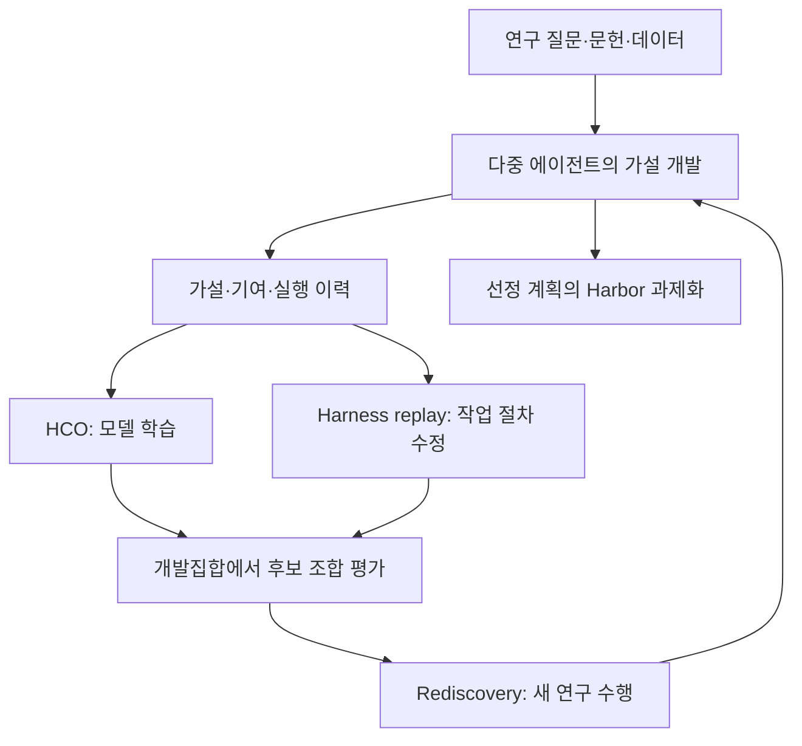

# DiscoveryRSI: Recursively Learning to Discover Valuable Hypotheses

**핵심 판단:** 이 논문이 가장 분명하게 보여 주는 성과는 **연구 가설을 검증 가능한 조사계획으로 발전시키는 능력의 개선**입니다.  
실제 과학적 발견의 성공률, 전반적인 창의성 향상, 새로운 분야에서의 모델 일반화 향상까지 입증한 것으로 해석하기에는 근거가 부족합니다.  
특히 자동 평가에서 **검증 설계 관련 점수는 상승했지만 중요성과 참신성은 하락**했고, 배터리 분야에서는 학습 전 모델과의 대조 결과가 제시되지 않았습니다. **[pp.13–19, Figures 6–10]**

**분석 기준:** 첨부된 *DiscoveryRSI: Recursively Learning to Discover Valuable Hypotheses* v2의 본문과 부록 전체 40쪽을 기준으로 작성했습니다. 아래 페이지 번호는 PDF에 인쇄된 번호와 같습니다. **‘저자 보고’**, **‘분석자 해석’**, **‘후속 검증 제안’**을 구분했으며, 제안한 실험의 효과를 이미 확인된 결과처럼 서술하지 않았습니다. 관련 연구 비교는 2026년 10월 27일까지 확인한 2020년 이후의 주요 원 논문을 대상으로 합니다.

:chatgpt-content-reference{index="15"}

---

## 1. Executive summary — 10문장

1. DiscoveryRSI는 한 연구에서 축적한 가설·수정·기여 기록을 학습 자료로 바꾸어 다음 연구를 수행하는 모델과 작업 절차를 개선하는 프레임워크입니다. **[pp.2–4]**
2. 저자는 좋은 연구 가설을 단순한 주장으로 보지 않고, **근거가 있는 주장·조사계획·판정 기준·대안 설명**을 함께 갖춘 대상으로 정의합니다. **[pp.5–6, 식 (1)]**
3. 여러 에이전트가 가설을 생성·수정·결합하고, 선정된 조사계획을 입력·환경·출력·검증 조건이 명시된 실행 과제로 변환합니다. **[pp.6–8, Figure 2]**
4. 자기개선은 기록된 기여에 따른 모델 학습, 실패 이력에 따른 작업 절차 개선, 개선된 시스템으로 새 연구를 수행하는 세 과정으로 구성됩니다. **[pp.8–10]**
5. DiscoveryRSI-27B는 Qwen3.8-27B를 초기 모델로 사용하며, 선별된 2,397개 에이전트 이력에서 근거가 확인되는 출력만을 대상으로 가중 지도 미세조정을 수행합니다. **[p.13; pp.32–33, Table 4]**
6. 네 생명과학 분야의 자동 평가에서 평균 가설 품질은 초기 모델의 4.86점에서 첫 번째 개선 후 5.18점, 두 번째 개선 후 5.39점으로 상승했습니다. **[pp.13, 15, Figure 6]**
7. 개선은 검증계획의 구체화에 집중되었으며, 중요성은 6.48점에서 6.04점으로, 참신성은 4.87점에서 4.58점으로 낮아졌습니다. **[p.15, Figure 6]**
8. 인간 평가에서 수정당 평균 점수 변화는 DiscoveryRSI가 +0.07, GPT-5.6 Sol이 +0.03, GPT-6 Luna가 −0.01이었지만, 개별 가설의 절대 품질에서는 평가 항목별 우열이 혼재했습니다. **[pp.14–16, Figure 8]**
9. 대표 수치인 6.3%는 생성 가설과 기준일 이후 문헌 사이의 구체적인 연결을 자동 판정한 회고적 비율이며, 실제 발견 성공률이나 연구자 채택률을 뜻하지 않습니다. **[pp.16–18; pp.39–40]**
10. 배터리 분야에도 동일한 연구 절차를 적용했지만, 학습 전후 대조와 실제 실험 검증이 충분하지 않아 자기개선에 따른 분야 밖 일반화 향상은 후속 검증 과제로 남습니다. **[pp.18–19]**

---

## 2. 연구 배경·목표·필요성

### 2.1 해결하려는 문제

**저자 보고**

논문의 중심 질문은 다음과 같습니다.

> 연구 에이전트가 가설을 발전시키고 조사하는 과정에서 얻은 경험을, 이후 연구 능력을 개선하는 학습 과정으로 어떻게 전환할 수 있는가?

이는 다음 세 문제로 나뉩니다. **[pp.2–4]**

1. **아이디어와 실행 가능한 연구 사이의 간극**  
   그럴듯한 주장이 있어도 사용할 데이터, 비교군, 측정값, 판정 기준이 불분명하면 실제 조사로 이어지기 어렵습니다.

2. **최종 가설의 평가와 개별 행동의 기여 사이의 간극**  
   좋은 가설이 만들어졌더라도 누가 어떤 설명을 제안했는지, 어떤 통제 비교를 추가했는지, 어떤 오류를 수정했는지를 알아야 해당 행동을 학습시킬 수 있습니다.

3. **현재 연구의 개선과 다음 연구 능력의 개선 사이의 간극**  
   같은 가설을 여러 번 수정하는 것과, 그 경험으로 모델이나 작업 절차를 바꾸어 새로운 연구를 더 잘 수행하는 것은 서로 다른 문제입니다.

### 2.2 연구의 목적

저자는 이 간극을 연결하기 위해 다음을 제안합니다. **[pp.4–5]**

- 가치 있고 검증 가능한 가설의 공통 표현.
- 가설의 발전 과정과 기여 행동을 보존하는 기록 체계.
- 평가 결과를 모델 학습 대상으로 연결하는 **Hypothesis Credit Optimization, HCO**.
- 실패 이력을 이용한 작업 절차 개선.
- 가설뿐 아니라 수정·발전 경로·전체 연구 실행·과학적 기여까지 평가하는 **DFM-Bench**.

> **용어 설명 — 기여도 귀속:** 최종 결과에 대한 평가를 그 결과를 만드는 데 기여한 행동이나 작업 이력에 배분하는 과정입니다. 이 논문의 배분 규칙은 기록에 근거한 책임 배분이며, 각 행동의 인과적 효과를 직접 측정한 것은 아닙니다.

### 2.3 왜 필요한가

**분석자 해석**

이 연구의 필요성은 “좋은 최종 답변을 모방한다”는 학습 단위를 넘어, **좋은 연구 설계에 도움이 된 행동을 학습 대상으로 삼으려는 데** 있습니다.  
예를 들어 데이터에 없는 변수를 제거하거나, 비교군을 추가하거나, 부정적인 결과도 해석할 수 있도록 판정 기준을 명시하는 행동을 재사용하려는 것입니다.  
이러한 해석은 가설 정의, 기여 기록, 지원되는 출력에만 손실을 부여하는 학습 설계에 근거합니다. **[pp.5–9; pp.25–33]**

다만 논문은 이 설계의 각 구성요소가 얼마나 효과적인지를 분해해서 입증하지는 않습니다.

---

## 3. 핵심 주장과 근거

| 핵심 주장 | 저자가 제시한 근거 | 분석자 해석 및 판단 범위 | 위치 |
|---|---|---|---|
| 가설과 조사계획을 함께 다루면 연구 기회를 더 명시적으로 평가할 수 있다 | 주장·계획·판정 기준·대안 설명의 공동 정의와 MIMIC-IV 사례 | 유용한 표현·평가 체계를 제안하지만, 정의 자체가 가설의 진실성을 보장하지는 않음 | pp.5–7, 식 (1), Figure 3 |
| 연구 이력을 통한 반복 개선이 가설 품질을 높인다 | 자동 종합 점수 4.86 → 5.18 → 5.39 | 보고된 평가 조건에서 개선되었지만 모델 학습과 작업 절차 개선의 효과가 분리되지 않음 | pp.13–15, Figure 6 |
| 개선은 검증 가능한 연구 설계에 집중된다 | 반증 가능성 +2.20, 대안 설명 +1.54, 데이터 판별 가능성 +1.26 | 참신성·중요성 전반의 향상으로 확대 해석할 수 없음 | p.15, Figure 6 |
| 연구 전략이 재시작보다 기존 가설 발전에 집중된다 | 발전·수리 비율 77.5% → 91.7% | 지속적인 수정이 늘었으나 탐색 폭과 예산 효율의 개선은 제한적 | pp.14–15, Figure 7 |
| 인간 평가에서도 유용한 수정이 관찰된다 | 수정당 평균 변화 +0.07, 악화 비율 12% | 수정 과정에서는 유리하지만 개별 가설 품질의 전면적 우월성은 확인되지 않음 | pp.14–17, Figures 8–9 |
| 생성 가설이 후속 문헌의 구체적 연구 내용과 연결된다 | 74/1,176개 가설 버전, 6.3% | 회고적 문헌 연결률이며 검색 범위·문서 형식·기준일 차이에 영향을 받음 | pp.16–18; pp.39–40, Figure 10, Table 6 |
| 생명과학 밖에도 동일한 절차를 적용할 수 있다 | 배터리 200개 에피소드, 351개 가설, 완전 평가 165개의 평균 5.61 | 적용 가능성을 보여 주지만, 학습이 분야 밖 성능을 높였다는 대조 근거는 부족함 | p.18, §7.5 |

> **용어 설명 — 반증 가능성:** 어떤 관찰이나 실험 결과가 나오면 가설이 틀렸거나 적용 범위가 제한된다고 판단할 수 있는 정도입니다. “좋아 보인다”는 설명보다, 무엇이 나오면 주장을 철회해야 하는지가 명확할수록 높습니다.

---

## 4. 방법론과 모델 구조

### 4.1 연구 수행 방식과 주요 데이터 소스

연구는 **생명과학 연구 경험 수집 → 기여 기록에 따른 모델 학습 → 반복 평가 → 인간 검토 및 문헌 비교 → 배터리 분야 적용**으로 구성됩니다. **[pp.12–18]**

| 구분 | 자료·대상 | 사용 목적 |
|---|---|---|
| 임상·인구집단 자료 | HCC 임상 코호트, MIMIC-IV, eICU, UK Biobank | 임상·인구집단 관련 가설과 조사계획 개발 |
| 분자 수준 자료 | GEO, ArrayExpress의 분자 연구 자료 | 치료 표적, 질병 메커니즘 등 생명과학 가설 개발 |
| 에이전트 연구 기록 | 수집 이력 15,792개, 최종 학습 이력 2,397개 | HCO 학습 자료 |
| 인간 평가 자료 | 6개 데이터셋 그룹의 제안 292개 | 연구 가치와 설계 품질 검토 |
| 문헌 비교 자료 | 확인된 출판물 16,440개 | 기준일 이후 문헌과 가설의 연결 평가 |
| 배터리 자료 | 용량·임피던스 노화 측정, 상태 예측, 열화 모드, 사용 이력 관련 근거 묶음 | 생명과학 밖 적용 평가 |

**근거: pp.11–13, 18; pp.32, 38–40.**

여기서 **292개는 연구 제안 수**, **2,397개는 에이전트 호출 이력 수**입니다. 환자 수나 독립적인 실험 수와 혼동하면 안 됩니다.

> **용어 설명 — 임피던스:** 교류 신호에 대한 전기적 저항과 위상 반응을 함께 나타내는 값입니다. 배터리 내부 상태를 조사하는 측정 신호로 사용됩니다.  
> **용어 설명 — 에이전트 이력:** 에이전트가 한 번 호출되는 동안 받은 지시, 수행한 행동, 관찰한 결과의 기록입니다. 여러 가설 버전으로 이루어진 연구 발전 경로와는 다릅니다.

### 4.2 모델 구조: 신경망 내부보다 역할과 학습 절차가 핵심

DiscoveryRSI-27B는 **Qwen3.8-27B를 초기 모델로 한 전체 파라미터 미세조정 모델**입니다. 논문은 새로운 attention 블록이나 신경망 층 구조를 제안하지 않습니다. 구조적 기여는 언어모델을 둘러싼 역할 분담, 기록 체계, 평가, 학습 과정에 있습니다. **[p.13; pp.25–33]**

> **용어 설명 — 27B:** 모델의 파라미터 규모가 약 270억 개임을 나타내는 표기입니다.  
> **용어 설명 — 전체 파라미터 미세조정:** 사전학습된 모델의 일부 부가 모듈만 학습하는 것이 아니라 모델 전체의 학습 가능한 가중치를 조정하는 방식입니다.

| 역할 | 기능 | 이번 학습 자료에서 직접 지도하는 출력 |
|---|---|---|
| **Lead** | 연구 방향·부모 가설·연산·작업 배정·선택 결정 | 기여가 확인되는 출력 |
| **Generation** | 새로운 가설 생성 | 기여가 확인되는 출력 |
| **Evolution** | 기존 가설 발전 및 결함 수정 | 기여가 확인되는 출력 |
| **Critique** | 작성자 정보 등을 가린 상대적 과학 품질 평가 | 없음 |
| **Progress** | 실제 이전 가설 대비 진전·수리·반복·증거 부족 판정 | 없음 |
| **Compiler** | 선정된 계획을 Harbor 과제로 변환 | 없음 |

**근거: pp.7–8; p.25; p.32, Table 4.**

이 역할들을 여섯 개의 독립적인 신경망으로 해석할 근거는 없습니다. 또한 직접 학습 대상이 아닌 역할도 평가와 문맥 제공에 사용됩니다.

다음은 Figure 2를 재구성한 흐름입니다.



**근거: p.3, Figure 2; pp.8–10.**

가설 발전에는 네 연산이 있습니다. **발전(evolve)**은 기존 방향을 구체화하고, **수리(repair)**는 확인된 결함을 고치며, **결합(crossover)**은 여러 가설의 기여를 합칩니다. **재시작(restart)**은 새로운 질문을 엽니다. 여러 부모가 있는 결합 때문에 연구 계보는 엄밀히는 단순한 나무보다 일반적인 **방향 비순환 그래프**입니다. **[pp.6–8, 25]**

> **용어 설명 — 방향 비순환 그래프, DAG:** 연결에 방향이 있고, 화살표를 따라가다가 출발점으로 돌아오는 순환이 없는 구조입니다. 두 아이디어를 결합한 가설은 부모를 둘 가질 수 있습니다.

### 4.3 가설의 공동 표현 — 원문 식 (1)

$$
H=(c,\pi,d,a)
$$

- $H$: 평가하고 수정할 수 있는 연구 가설 객체.
- $c$: 근거에 기반한 주장.
- $\pi$: 조사·실험 계획.
- $d$: 결과를 해석하기 위한 판정 기준.
- $a$: 관련 대안 설명.
- $\mathcal E$: 문서화된 기존 근거.
- $\mathcal B$: 데이터·실험·자원 제약.

**가치 있음**은 $c$의 불확실성을 해결했을 때 기존 이해나 정당한 연구 의사결정이 의미 있게 달라질 수 있다는 뜻입니다.  
**검증 가능함**은 $\mathcal B$ 아래 수행 가능한 $\pi$의 결과를 $d$와 $a$에 따라 해석하여 주장을 지지·약화하거나 범위를 제한할 수 있다는 뜻입니다. **[pp.5–6]**

중요한 점은 **유익한 재현, 측정 점검, 부정적인 결과도 가치 있는 연구가 될 수 있다**는 것입니다. 정의를 만족한다고 해서 주장이 참으로 확인된 것은 아닙니다.

Figure 3의 MIMIC-IV 사례는 이 표현을 구체화합니다. 반복적인 크레아티닌–소변량 불일치가 중환자실 퇴실 후 위험에 추가 정보를 주는지 묻고, 단순한 비교모형부터 더 복잡한 모형까지 같은 환자 분할에서 평가하도록 계획합니다.  
그림의 HMM은 **이 제안을 조사하기 위한 분석모형 후보**이지 DiscoveryRSI 자체의 신경망 구조가 아닙니다. **[pp.6–7, Figure 3]**

> **용어 설명 — HMM, 은닉 마르코프 모형:** 직접 관찰되지 않는 상태가 시간에 따라 바뀐다고 가정하고, 관찰된 측정값으로 그 상태를 추정하는 모형입니다.

### 4.4 가설을 실행 과제로 변환하는 단계

Compiler는 선정된 계산 연구 계획을 **Harbor 과제**로 변환합니다. 여기에는 입력, 실행 환경, 요구 출력, 검증 조건이 들어갑니다.  
대상 집단이나 생물학적 시스템, 비교, 판별 결과, 해석 기준을 보존해야 합니다. **[p.8; p.26]**

> **용어 설명 — Harbor 과제:** 어떤 입력과 환경에서 무엇을 수행하고 어떤 출력·검사를 충족해야 하는지를 명시한 실행 과제 형식입니다.

접근할 수 없는 데이터나 실제 실험실에서 수행해야 할 실험은 미해결 의존 조건으로 남습니다. **코드 실행이나 형식 검사 통과는 과학적 가설의 검증과 별도로 평가**합니다. 논문은 완전한 실험이 끝나기 전에도 가설 개발 과정에서 학습 경험을 얻을 수 있다고 설명합니다. **[p.8; p.26]**

---

### 4.5 HCO: 평가를 학습 가능한 행동에 연결하는 방법

HCO는 다음 순서로 작동합니다.

**가설의 상대 평가 → 신뢰도를 반영한 가설 가중치 → 기록된 기여자에게 배분 → 중복 연구 계열의 과대 대표 제한 → 분야·공유기억 그룹 균형화 → 지원되는 출력만 학습.**

#### ① TrueSkill로 상대 선호와 불확실성 추정 — 식 (2)

$$
z_h\sim\mathcal N(\mu_{h,0},\sigma_{h,0}^{2}),
\qquad
t_{h,e}\mid z_h\sim\mathcal N(z_h,\beta^{2})
$$

```math
P(a\succ b\mid z_a,z_b)
=
\Phi\!\left(
\frac{z_a-z_b-\varepsilon}{\sqrt{2}\beta}
\right)
```

$$
p(z_h\mid\mathcal D_{\text{cmp}})
\approx
\mathcal N(\mu_h,\sigma_h^{2})
$$

**기호 설명**

- $h$: 가설 버전.
- $z_h$: 정해진 평가 기준에서의 잠재적인 상대 선호강도.
- $t_{h,e}$: 비교 $e$에서 잡음이 포함된 성과.
- $\mu_{h,0},\sigma_{h,0}$: 사전분포의 평균과 표준편차.
- $\mu_h,\sigma_h$: 평가 후 근사분포의 평균과 표준편차.
- $\beta$: 비교 잡음의 크기.
- $\varepsilon$: 무승부를 구분하는 경계.
- $\Phi$: 표준정규분포의 누적분포함수.
- $\mathcal D_{\text{cmp}}$: 비교 평가 기록.
- $a\succ b$: 가설 $a$를 $b$보다 선호한다는 판정.

**근거: p.8; pp.27–28, 부록 B.1.**

> **용어 설명 — TrueSkill:** 여러 대상의 승리·패배·무승부와 같은 비교 결과를 이용하여 상대적 수준과 추정의 불확실성을 갱신하는 방법입니다.  
> **용어 설명 — 사후분포:** 관찰된 평가 결과를 반영하고 난 뒤의 추정 분포입니다. 누적분포함수는 특정 값 이하에 놓일 확률을 나타냅니다.

여기서 $\mu_h$는 **가설이 참일 확률이 아닙니다**. $\sigma_h$ 역시 평가자 편향, 실제 과학적 불확실성, 반복 평가의 의존성을 모두 반영하지 않습니다. 증거가 부족한 비교는 기권으로 처리하며 선호를 업데이트하지 않습니다. **[pp.8, 27–28]**

#### ② 상대 평가를 가설 가중치로 변환 — 식 (14)–(17)

먼저 보수적인 선호 통계량과 비교 집단 내 순위를 계산합니다.

$$
s_h=\mu_h-\kappa\sigma_h
$$

$$
r_h=
\frac{
\sum_{k\in S}\mathbf1[s_k < s_h]
+
\frac12\sum_{k\in S}\mathbf1[s_k=s_h]
}{
|S|
}
$$

평가가 적거나 불확실하면 가중치를 낮춥니다.

$$
\rho_h^{\text{cov}}=\frac{n_h}{n_h+\nu},
\qquad
\rho_h^{\text{unc}}=
\frac{1}{1+\sigma_h/\sigma_{\text{ref}}}
$$

최종 가설 가중치는 다음과 같습니다.

```math
q_h
=
v_h
\min\!\left\{
q_{\max},
q_{\min}
+
(q_{\max}-q_{\min})
r_h\rho_h^{\text{cov}}\rho_h^{\text{unc}}
+
\lambda_p p_h
\right\}
```

**기호 설명**

- $s_h$: 불확실성에 벌점을 준 선호 통계량.
- $\kappa$: 불확실성 벌점 계수.
- $S$: 자료·평가 기준·비교 조건이 호환되는 비교 집단.
- $r_h$: 동점을 고려한 집단 내 상대 순위.
- $\mathbf1[\cdot]$: 조건이 참이면 1, 아니면 0.
- $n_h$: 유효 비교 횟수.
- $\nu$: 적은 비교 횟수의 영향을 줄이는 상수.
- $\rho_h^{\text{cov}}$: 평가량에 대한 신뢰도 계수.
- $\rho_h^{\text{unc}}$: 추정 불확실성에 대한 신뢰도 계수.
- $\sigma_{\text{ref}}$: 불확실성의 고정 기준값.
- $v_h$: 유효한 평가와 최소 한 번의 유효 비교가 있고, 단순 반복 판정이 없을 때 적격성을 부여하는 변수.
- $p_h$: 실질적 진전 또는 필요한 수리라는 기록이 있으면 1.
- $q_{\min},q_{\max}$: 적격 가설 가중치의 하한과 상한.
- $\lambda_p$: 진전 보너스.
- $q_h$: 가설에서 배분할 학습 가중치.

구현값은 $\kappa=2$, $\nu=2$, $\sigma_{\text{ref}}=8.3333$, $[q_{\min},q_{\max}]=[0.5,2]$, $\lambda_p=0.25$입니다. **[pp.28–31]**

**해석상 주의:** 이 가중치 변환은 저자가 정한 규칙이며 TrueSkill이 직접 추론한 값이 아닙니다. 불확실성은 순위 계산과 신뢰도 계수에서 모두 반영됩니다. 저자는 각 항의 효과를 구분하는 추가 실험이 필요하다고 명시합니다. **[p.29]**

#### ③ 기록된 기여에 따라 배분 — 식 (18)

```math
\alpha_{ih}
=
\begin{cases}
\gamma/|L_h|, & i\in L_h,\\
(1-\gamma)/|P_h|, & i\in P_h,\\
0, & \text{otherwise},
\end{cases}
\qquad
\sum_i\alpha_{ih}\leq1
```

- $i$: 특정 에이전트 호출 이력.
- $L_h$: 조정·배정 기여가 확인된 이력 집합.
- $P_h$: 직접 작성 또는 지원 기여가 문서로 확인된 이력 집합.
- $\gamma$: 조정 기여에 배정하는 비율.
- $\alpha_{ih}$: 가설 $h$의 가중치 중 이력 $i$가 받는 몫.

구현에서는 $\gamma=0.2$입니다. 조정 역할 하나, 작성 역할 하나, 지원 역할 하나가 있으면 예시 배분은 **0.2, 0.4, 0.4**입니다. 확인되지 않은 기여 몫은 다른 이력에 넘기지 않고 미배분 상태로 둡니다. **[p.29]**

**저자가 명시한 한계:** 이 비율은 고정된 책임 배분 규칙입니다. 해당 행동을 제거했을 때 결과가 얼마나 달라지는지를 측정한 인과적 기여도는 아닙니다. 단순히 같은 에피소드에 참여했거나 조상 가설에 등장했다는 이유만으로는 점수를 받지 않습니다. **[pp.26, 29]**

#### ④ 같은 연구 계열의 중복 가중치 제한 — 식 (19)–(20), (3)

```math
\widetilde q_h
=
q_h
\min\!\left\{
1,
\frac{C_{\text{loc}}}
{\sum_{k\in F_{\text{loc}}(h)}q_k}
\right\},
\qquad
u_{ih}=\alpha_{ih}\widetilde q_h
```

```math
d_F
=
\min\!\left\{
1,
\frac{C_{\text{glob}}}
{\sum_{h\in F}\sum_i u_{ih}}
\right\}
```

```math
b_{ih}=d_{F_{\text{glob}}(h)}u_{ih},
\qquad
w_i=
\min\!\left\{
W_{\max},
\sum_h b_{ih}
\right\}
```

- $F_{\text{loc}}(h)$: 가설 $h$가 속한 국소 계보 집합.
- $F_{\text{glob}}(h)$: 여러 기록 시점에 걸쳐 연결된 과학적 연구 계열.
- $C_{\text{loc}},C_{\text{glob}}$: 각 계열의 가중치 예산.
- $\widetilde q_h$: 국소 계열 제한을 적용한 가설 가중치.
- $u_{ih}$: 전체 계열 제한 전 배분량.
- $d_F$: 연구 계열 $F$의 축소 계수.
- $b_{ih}$: 가설 $h$에서 이력 $i$로 가는 최종 배분량.
- $W_{\max}$: 이력 하나의 가중치 상한.
- $w_i$: 여러 가설의 기여를 합친 이력별 가중치.

두 계열 예산과 이력 상한은 모두 2입니다. 분모의 총량이 0이면 제한 계수는 1로 정의하고 배분량은 0으로 유지합니다. **[pp.8, 30–31]**

> **용어 설명 — 연구 계열:** 같은 과학적 질문에서 파생된 여러 가설 버전을 묶은 집합입니다. 비슷한 질문을 반복해서 작성했다는 이유만으로 학습 영향력이 계속 증가하는 것을 제한하려는 장치입니다.

정확히 중복된 기록은 억제하지만, 표현만 다른 의미상 중복을 완전히 해결한 것은 아닙니다. **[p.30]**

#### ⑤ 분야와 공유기억 그룹의 균형화 — 식 (21)

```math
\omega_i
=
\frac{\eta_{d_i}}{|\mathcal G_{d_i}|}
\frac{w_i}
{\sum_{k:\,d_k=d_i,\,g_k=g_i}w_k},
\qquad
\sum_d\eta_d=1
```

- $d_i$: 이력 $i$의 분야.
- $g_i$: 이력 $i$가 속한 공유기억 그룹.
- $\mathcal G_d$: 분야 $d$에서 학습 대상이 남아 있는 그룹 집합.
- $\eta_d$: 분야 $d$에 배정한 목적함수 비중.
- $\omega_i$: 최종 학습 손실의 이력별 계수.

공유기억 그룹은 캠페인 기억, 계보, 재개된 상호작용, 회수된 중복을 묶습니다. 앞의 과학적 연구 계열과는 다른 집합입니다. 계수와 분모는 학습 전에 고정하며, 미니배치마다 다시 정규화하지 않습니다. 구체적인 분야별 $\eta_d$ 값은 이 설명에 제시되지 않습니다. **[p.30]**

이 설계는 긴 대화나 특정 기억 그룹이 학습 비중을 독점하는 것을 제한합니다. 다만 저자도 **손실 비중이 실제 기울기 크기의 비중을 보장하지는 않는다**고 명시합니다. **[pp.30–31]**

#### ⑥ 지원되는 출력만 학습 — 핵심 식 (4)

```math
\mathcal L(\theta)
=
-\sum_i
\frac{\omega_i}{|U_i|}
\sum_{u\in U_i}
\log\pi_\theta(a_{iu}\mid x_{iu})
```

- $\theta$: 학습 모델의 파라미터.
- $\pi_\theta$: 문맥에 따라 다음 토큰을 출력하는 모델 확률.
- $U_i$: 기록된 기여가 뒷받침하는 assistant 출력의 적격 토큰 위치.
- $a_{iu}$: 학습 대상 토큰.
- $x_{iu}$: 그 시점에 제공된 문맥.
- $\omega_i$: 기여 배분과 균형화를 거친 이력별 가중치.
- $|U_i|$: 적격 토큰 수.

식 (1)의 $\pi$는 조사계획이고, 여기의 $\pi_\theta$는 언어모델의 출력 확률입니다. **[p.9]**

> **용어 설명 — 토큰과 손실 마스킹:** 토큰은 모델이 처리하는 텍스트 단위입니다. 손실 마스킹은 어떤 토큰을 직접 맞히도록 학습하고 어떤 토큰은 문맥으로만 사용할지 지정하는 방법입니다.

학습 대상은 기여가 확인되는 응답과 도구 호출 인자입니다. 도구 관측, 실패한 행동, 반복 문맥, 지원되지 않는 출력 등에는 직접 손실을 주지 않습니다. **문맥으로 사용한다는 것과 직접 모방할 정답으로 사용한다는 것을 구분**합니다. **[pp.32–33]**

부록 구현식은 다음과 같습니다.

```math
\mathcal L_{\text{credit}}(\theta)
=
-\sum_i\frac{\omega_i}{M_i}
\sum_t c_{it}\log\pi_\theta(a_{it}\mid x_{it}),
\qquad
M_i=\sum_t c_{it}
```

여기서 $t$는 토큰 위치, $c_{it}$는 토큰별 지도 가중치이며, 적격 토큰에는 0.5, 나머지에는 0을 부여합니다.  
$M_i$는 이력의 총 지도 가중치입니다. 0.5는 분자와 분모에서 소거되므로 식 (4)와 같은 적격 토큰 평균이 됩니다. **[pp.32–33, 식 (24)]**

**방법론 분류:** 논문은 이를 **오프라인 가중 지도학습**이라고 명시합니다. 현재 모델이 새 행동을 생성하면서 온라인 정책 최적화를 수행하는 절차로 설명하면 부정확합니다. **[p.32, C.2]**

---

### 4.6 Harness replay와 Rediscovery

#### Harness replay — 식 (5)

```math
\Psi_k^{\text{cand}}
=
\text{Propose}(\psi_k;\mathcal H_k)
```

```math
\psi_k^+
=
\text{Select}_{\text{dev}}
\left(
\{\psi_k\}\cup\Psi_k^{\text{cand}}
\mid\theta_k,B
\right)
```

- $k$: 자기개선 라운드.
- $\psi_k$: 현재 작업 실행 체계.
- $\theta_k$: 비교 중 고정한 모델.
- $\mathcal H_k$: 수집된 연구 이력.
- $\Psi_k^{\text{cand}}$: 작업 절차 변경 후보 집합.
- $B$: 동일하게 맞춘 자원 한도.
- $\psi_k^+$: 개발 평가에서 선택된 작업 절차.

> **용어 설명 — 하네스, harness:** 모델이 도구를 사용하고, 문맥과 파일을 관리하며, 여러 역할 사이에 일을 배분하도록 구성한 실행 체계입니다.

반복 탐색, 도구 사용 실패, 산출물 손실, 조기 종료를 진단한 뒤 근거 접근·작업 전달·재시도·완료 확인 절차 등을 수정합니다.  
짧은 진단 실행은 후보를 찾는 데 사용하고, 채택은 동일 조건의 개발 평가에서 결정합니다. 기존 하네스도 후보로 남습니다. **[p.9; p.26]**

기록에 없는 대안을 “재생”만으로 평가할 수 있는 것은 아닙니다. 기록된 후속 행동이 없으면 호환되는 상태를 복원하여 새로 실행해야 합니다. **[p.26]**

#### Rediscovery — 식 (6)

```math
(\theta_{k+1},\psi_{k+1})
=
\text{Accept}_{\text{dev}}
\left(
\{\theta_k,\theta_k^+\}
\times
\{\psi_k,\psi_k^+\}
\right)
```

$$
\mathcal H_{k+1}
\sim
\text{Research}
\left(
\theta_{k+1},\psi_{k+1};
\mathcal Q_{k+1}^{\text{fresh}},B
\right)
$$

- $\theta_k^+$: HCO로 학습한 모델 후보.
- $\mathcal Q_{k+1}^{\text{fresh}}$: 다음 라운드의 새 연구 질문 집합.
- $\text{Accept}_{\text{dev}}$: 기존·새 모델과 하네스의 조합을 개발집합에서 평가하는 절차.
- $\mathcal H_{k+1}$: 채택된 시스템으로 새로 수집하는 연구 이력.

모델만, 하네스만, 둘 다, 또는 둘 다 바꾸지 않는 선택이 가능합니다. **재시작은 현재 연구 안에서 방향을 바꾸는 것이고, Rediscovery는 다음 연구를 수행할 시스템을 바꾸어 새 경험을 수집하는 것**입니다. **[pp.9–10, Algorithm 1]**

### 4.7 학습 규모와 구현

저자가 보고한 주요 설정은 다음과 같습니다. **[p.13; pp.32–33]**

- 수집 이력: **15,792개**.
- 최종 학습 이력: **2,397개**.
- 역할별 학습 이력: Lead **634개**, Generation **861개**, Evolution **902개**.
- 최종 학습 시퀀스: **291,121,000토큰**.
- 직접 지도 토큰: **6,177,605토큰**, 전체의 약 **2.12%**.
- 최대 문맥 길이: **262,144토큰**.
- 학습: **1 epoch, 150 optimizer steps**.
- 최적화: Adam, 학습률 $5\times10^{-6}$, 전역 배치 크기 16, BF16.
- 분산 학습: GPU **64개**.

직접 지도 토큰이 적다는 사실만으로 학습 계산비용이 낮다고 결론 내릴 수는 없습니다. 긴 문맥을 처리하는 계산이 필요하기 때문입니다.

또한 부록의 두 수학적 명제는 각각 **정규화 전 기여 가중치의 상한**과 **조건 문맥이 동일하게 유지될 때의 분할 학습 목적함수 보존**을 다룹니다.  
일반화 오차 감소나 성능의 지속적인 상승을 증명하는 정리는 아닙니다. 실제 긴 이력의 분할에서는 이전 문맥 일부가 생략될 수 있어 완전한 이력과 같은 기울기를 항상 보장하지 않습니다. **[pp.31, 34]**

---

## 5. 평가 체계와 주요 결과

### 5.1 DFM-Bench는 무엇을 평가하는가

| 평가 수준 | 평가 대상 | 핵심 질문 |
|---|---|---|
| 가설 | 하나의 고정된 제안과 근거 | 가치 있고 검증 가능한 연구인가? |
| 수정 | 실제 부모–자식 가설 쌍 | 의미 있는 진전인가, 필요한 수리인가, 반복인가? |
| 발전 경로 | 순서가 있는 가설 계보 | 근거를 축적하며 일관되게 연구를 발전시키는가? |
| 전체 연구 실행 | 전체 그래프와 선택·중단 결정 | 탐색 방향과 자원을 생산적으로 배분하는가? |
| 과학적 기여 | 중복을 정리한 연구 계열 | 기존 근거에 비해 무엇을 새롭게 추가했는가? |

**근거: pp.10–11; pp.34–37, Table 5.**

가설 품질은 중요성, 참신성, 근거 정합성, 반증 가능성, 데이터 판별 가능성, 실행 가능성, 대안 설명, 실행에 옮길 수 있는 정도의 여덟 축으로 평가합니다.

부록 D.1의 설명을 수식으로 옮기면 다음과 같습니다. 아래는 원문의 평가 설명을 재표현한 식입니다.

$$
Q_h=\sum_{j=1}^{8}\lambda_j m_{hj},
\qquad
\boldsymbol\lambda=
(0.20,0.20,0.15,0.10,0.10,0.10,0.10,0.05)
$$

- $Q_h$: 가설 $h$의 종합 품질 점수.
- $j$: 위 순서에 따른 평가 차원.
- $m_{hj}$: 해당 차원의 알려진 평가 점수 중앙값.
- $\lambda_j$: 차원별 가중치.

각 차원은 1–10점 척도입니다. 완전한 종합 점수에는 세 리뷰, 다수의 적격 판정, 여덟 차원의 중앙값이 모두 필요합니다. 모르는 점수를 0으로 대체하지 않습니다. **[p.34]**

**평가 독립성 주의:** 세 AI 평가자는 서로의 점수를 보지 않지만 **같은 모델 계열에 다른 역할 프롬프트를 준 것**입니다. 저자는 이를 독립된 전문가 세 명의 판단이 아니라 상관된 AI 관점이라고 명시합니다. **[p.34]**

### 5.2 자동 가설 품질: 상승한 항목과 하락한 항목

평가 대상은 네 생명과학 분야의 **241개 연구 질문**, 자동 평가자는 **GPT-5.6 Sol**입니다. **[p.13]**

| 평가 항목, 1–10점 | 초기 모델 R0 | R1 | R2 | R2−R0 |
|---|---:|---:|---:|---:|
| **종합 품질** | **4.86** | **5.18*** | **5.39*** | **+0.53** |
| 중요성 | 6.48 | 6.21 | 6.04 | −0.44 |
| 참신성 | 4.87 | 4.94 | 4.58 | −0.29 |
| 근거 정합성 | 4.24 | 4.97* | 4.56* | +0.32 |
| 반증 가능성 | 4.00 | 5.24* | 6.20* | +2.20 |
| 데이터 판별 가능성 | 3.73 | 4.33* | 4.99* | +1.26 |
| 실행 가능성 | 4.79 | 4.21 | 5.87* | +1.08 |
| 대안 설명 | 4.44 | 5.64* | 5.98* | +1.54 |
| 실행에 옮길 수 있는 정도 | 5.20 | 5.30 | 5.47* | +0.27 |

**출처: p.15, Figure 6. 차이 열은 보고값에서 계산했습니다.**

별표는 원문에서 **R0보다 유의하게 높음**을 뜻하며, 순열검정과 FDR 보정 후 $q<0.05$를 적용했습니다. R2가 R1보다 유의하게 높다는 표시가 아닙니다.  
중요성과 참신성의 하락에 대해서는 별도의 유의성 결론을 제시하지 않습니다.

> **용어 설명 — 순열검정:** 비교 대상의 라벨을 바꾸어 얻는 차이들과 실제 관찰 차이를 비교하는 통계 방법입니다.  
> **용어 설명 — FDR 보정:** 여러 항목을 동시에 검정할 때 우연히 유의하다고 판정되는 결과가 과도하게 늘어나지 않도록 조정하는 방법입니다.

**저자 보고:** R2는 네 분야 모두에서 초기 모델보다 높았으며, 분야별 증가폭은 질병 메커니즘의 **+0.28점**부터 인구집단 멀티오믹스의 **+0.94점**까지였습니다. **[p.13]**

**분석자 해석:** 개선의 중심은 “더 중요한 질문을 찾는 능력”보다 **질문을 검증 가능한 형태로 정교화하는 능력**입니다.  
종합 점수의 +0.53점을 정확도나 일반 지능의 향상률로 바꾸는 것은 적절하지 않습니다.

### 5.3 행동 변화: 더 많이 다듬지만 탐색의 모든 측면이 좋아지지는 않음

모델 변형별 **6개 캠페인 × 20개 에피소드**를 분석했습니다. **[p.13]**

- 발전·수리 비율: **77.5% → 90.0% → 91.7%**.
- 재시작 비율: **21.7% → 5.8% → 5.0%**.
- 후반부 에피소드 11–20의 재시작: 초기 약 **32%**, R2 약 **3%**.  
  **[pp.13–15, Figure 7]**

발전 경로 평가에서는 증거·추론 규율이 **+1.25점**으로 가장 크게 상승했습니다. 반면 예산 효율은 **+0.08**, 계속·중단 결정은 **+0.03**에 그쳤고, 학문 간 연결은 **−0.28**이었습니다. **[p.15, Figure 7c]**

**분석자 해석:** 기존 방향을 지속적으로 수정하는 전략으로 이동했습니다. 그러나 이 변화가 탐색 다양성이나 자원 배분의 전반적인 개선을 의미하지는 않습니다.

### 5.4 인간 평가: 수정 결과는 유리하지만 절대 품질은 혼합

인간 평가는 의사·의대생·생명과학 박사과정생 **27명**이 세 명의 선임 감독자 아래 **292개 제안**을 검토했습니다. 모델명, 실행 출처, AI 점수는 숨겼고 제안 순서는 무작위화했습니다. 평가자에게 수정 이력을 보지 않고 제안 자체를 평가하도록 했습니다. **[pp.11–12, 38]**

| 인간 평가 기준, 1–4점 | DiscoveryRSI-27B | GPT-6 Luna |
|---|---:|---:|
| 중요성 | **3.10** | 2.94 |
| 기존 연구 대비 진전 | 2.31 | 2.31 |
| 타당하고 근거 범위 안에 있는 주장 | **3.37** | 3.16 |
| 데이터 적합성 | 2.54 | **2.78** |
| 대안 설명 | 2.64 | **3.12** |
| 유익한 결과를 낼 수 있는 정도 | 2.50 | **2.84** |

**출처: p.16, Figure 8a. 굵은 표시는 수치가 높은 쪽이며 통계적 유의성을 뜻하지 않습니다.**

수정 결과는 다음과 같습니다.

| 모델 | 수정당 평균 인간 점수 변화 | 개선 | 불변 | 악화 |
|---|---:|---:|---:|---:|
| DiscoveryRSI-27B | **+0.07** | 41% | 47% | 12% |
| GPT-5.6 Sol | +0.03 | 31% | 37% | 32% |
| GPT-6 Luna | −0.01 | 25% | 44% | 31% |

**출처: pp.14, 16, Figure 8b–c.**

여기에는 두 가지 제한이 있습니다.

- 수정당 변화는 **같은 연구 계보의 부모–자식 제안 사이의 차이**입니다. 새로운 독립 연구에서 모델 업데이트가 낳은 효과와는 다릅니다. **[pp.38–39]**
- Figure 8b의 수정 점수 집계 방식은 “인간 점수”로 설명되며, 여섯 기준 평균인지가 명시적으로 확정되지 않습니다. 따라서 +0.07을 특정 1–4점 평균 척도의 변화라고 단정하지 않습니다. **[pp.14, 16, 38–39]**

### 5.5 문헌 연결률 6.3%의 정확한 의미

원문 식 (7)은 다음과 같습니다.

```math
R_{\text{insp}}
=
\frac{\sum_{h\in\mathcal H}a_h}{|\mathcal H|}
```

- $\mathcal H$: 해당 모델군이 생성한 모든 가설 버전.
- $a_h$: 기준일 이후 문헌과의 구체적인 연결이 긍정 판정을 받으면 1.
- $R_{\text{insp}}$: 저자가 ‘inspiration rate’라고 부르는 비율.

**근거: p.18; pp.39–40.**

긍정 판정은 문헌에 가설을 발전·검증하는 데 유용한 **실험설계, 비교대상, 측정, 검증 가능한 증거 공백**이 있다는 뜻입니다.  
**문헌 저자가 해당 가설을 보았거나 그 영향을 받아 연구했다는 뜻이 아닙니다.** 또한 ‘후속’의 기준은 모델군별 운영상 기준일이며, 가설을 먼저 공개하고 실제 미래 연구를 추적한 실험이 아닙니다. **[p.39]**

| 모델군 | 긍정 판정 / 전체 가설 버전 | 보고 비율 | 주요 해석상 주의 |
|---|---:|---:|---|
| DiscoveryRSI-27B | 74 / 1,176 | **6.3%** | 두 생산 실행을 합산 |
| DeepSeek | 14 / 257 | 5.4% | 표본·영역 구성·기준일이 다름 |
| GLM | 1 / 36 | 2.8% | 작은 표본과 양성 1건 |
| GPT | 59 / 2,341 | 2.5% | 상세 표기는 GPT 모델군 |
| Claude | 3 / 131 | 2.3% | 검색 통과율과 문서 형식에 민감 |

**출처: pp.16, 40.**

DiscoveryRSI의 분야별 결과는 다음과 같습니다. **[p.40, Table 6]**

- 임상·인구집단 건강: **13/557, 2.3%**.
- 치료 표적 우선순위: **30/178, 16.9%**.
- 질병 메커니즘: **17/251, 6.8%**.
- 인구집단 멀티오믹스: **14/190, 7.4%**.

모든 분야에서 DiscoveryRSI가 가장 높은 것은 아닙니다. Figure 10에서는 임상·인구집단 건강 및 질병 메커니즘에서 더 높은 비율을 보인 다른 모델군이 있습니다. **[p.17]**

**검색과 기준일의 영향이 큽니다.** 공통 문헌 집합은 16,440개 출판물이며 기간은 2025년 4월 1일부터 2026년 10월 14일까지입니다. 그러나 모델별 필터 기준이 다르고, Qwen의 2025년 4월은 잠정적인 계열 대리 기준, DeepSeek와 GLM의 기준은 출시 월의 대리 기준입니다. 저자는 이 날짜들이 실제 내부 지식 마감일을 식별하는 것은 아니라고 명시합니다. **[p.39]**

Claude 비교는 특히 주의해야 합니다.

- 검색 조건 통과: Claude **11.5%**, DiscoveryRSI **30.2%**.
- 통과한 제안 중 긍정 비율: 각각 **20.0%**, **20.8%**.
- 검색은 문서 앞 **6,000자**, 의미 평가는 앞 **2,500자**를 사용.
- Claude 제안 길이 중앙값은 **41,134자**.
- 제목을 검색어로 사용하는 진단에서는 Claude의 통과 수가 **15개에서 95개**로 증가.  
  **[pp.18, 40]**

따라서 전체 비율 차이의 일부에는 검색 범위와 문서 표현 방식이 작용합니다. 제목 검색의 개선이 추가적인 의미 연결의 성공을 입증한 것은 아닙니다.

### 5.6 배터리 분야 결과

저자는 전기적 진단, 상태 예측, 열화 메커니즘, 사용 이력과 노화의 네 방향을 평가했습니다. **[pp.13–14, 18, Figure 5]**

보고된 결과는 다음과 같습니다. **[p.18, §7.5]**

- **200개 에피소드**, **351개 생성 가설**.
- 가설당 **3개 AI 리뷰**.
- 완전한 품질 점수를 얻은 **165개 가설의 평균 5.61/10**.
- 실질적 진전: **214/366개 전이, 58.47%**.
- 완전한 발전 경로 **152개**의 평균 점수: **81.52/100**.
- 전체 연구 라운드 점수: **71.25/100**.
- 과학적 기여 계열 **20개**, 이 중 **7개**에 진단 또는 연구 증거 존재.

**분석자 계산:** 완전한 품질 점수의 평가 범위는 $165/351\approx47.0\%$입니다. 따라서 5.61점을 전체 351개 가설의 평균으로 표현해서는 안 됩니다.

**분석자 해석:** 동일한 연구 절차를 다른 분야에 적용할 수 있다는 사례입니다. 학습 전 모델과의 같은 조건 비교가 없어 **학습에 따른 분야 밖 성능 증가량**은 추정할 수 없습니다.

---

## 6. 통계적으로 취약한 부분과 비교 불가능한 수치

### 6.1 통계·평가상의 취약점

| 항목 | 원문에서 확인되는 사실 또는 보고 부족 | 해석에 미치는 영향 |
|---|---|---|
| **AI 평가의 상관성** | 같은 모델 계열에 세 역할 프롬프트 사용 **[p.34]** | 세 독립 전문가의 합의로 볼 수 없음 |
| **평가기의 검증 상태** | 독립 전문가 판정과 미공개 사례를 이용한 인간 보정은 미완료 **[p.36]** | 높은 자동 점수를 실제 연구 가치와 동일시하기 어려움 |
| **반복 관측의 의존성** | 가설·수정·경로가 조상과 근거를 공유 **[pp.35, 39]** | 각 버전을 독립 표본으로 취급하면 불확실성을 과소평가할 수 있음 |
| **자동 평가 검정의 재현 세부** | 95% 신뢰구간, 순열검정, FDR는 표시하지만 신뢰구간 구성법·순열 단위·정확한 p/q 값 등의 상세가 충분하지 않음 **[p.15, Figure 6; 부록 D]** | 계열·캠페인 의존성을 어떻게 반영했는지 확인하기 어려움 |
| **인간 평가의 정밀도** | 모델별 제안 수, 부모–자식 쌍 수, 제안당 평가자 수, 평가자 간 일치도, 불확실성 구간이 충분히 보고되지 않음 **[pp.11–16; pp.38–39]** | 평균 차이와 개선 비율의 안정성을 판단하기 어려움 |
| **문헌 비교의 불균형** | 집단 크기·영역 구성·기준일·검색 범위가 다름 **[pp.18, 39–40]** | 비율 순위를 모델 자체의 우열로 해석할 수 없음 |
| **문헌 판정의 재사용** | 149개 표본 기록 중 145개 판정 성공, 중복 입력의 판정을 903개 버전에 전파 **[p.39]** | 많은 버전 수가 같은 수의 독립 판정을 뜻하지 않음 |
| **배터리 평가의 누락** | 351개 중 165개에 완전한 품질 점수 **[p.18]** | 미완전 평가가 특정 난도나 유형에 집중되면 평균이 편향될 수 있음 |
| **구성요소 효과 미분리** | HCO와 하네스의 개별·공동 채택 절차는 있으나 효과를 분해한 결과는 없음 **[pp.9–10, 26]** | 어떤 구성요소가 개선의 원인인지 식별하기 어려움 |
| **학습·평가 분리의 공개 세부** | 개발·최종 평가 계열 분리 원칙은 명시하지만 실제 분할 목록·규모·누수 감사는 충분히 제시되지 않음 **[pp.9–10, 33]** | 엄격한 미학습 문제 일반화의 범위를 외부에서 확인하기 어려움 |

이 표의 마지막 몇 항목은 **원문에 보고되지 않은 내용을 확인한 분석자의 지적**입니다. 데이터 누수나 통계 오류가 실제 발생했다고 단정하는 것은 아닙니다.

> **용어 설명 — 평가자 간 일치도:** 여러 평가자가 같은 제안을 비슷하게 판단하는 정도입니다.  
> **용어 설명 — 데이터 누수:** 평가에만 사용해야 할 문제나 관련 정보가 학습·선택 과정으로 들어가 성능이 실제보다 높게 보이는 현상입니다.  
> **용어 설명 — 구성요소 제거 실험, ablation:** 특정 구성요소만 제거하거나 교체하여 그 요소가 결과에 기여하는 정도를 확인하는 실험입니다.

### 6.2 직접 비교하면 안 되는 수치

다음은 **비교 불가 또는 제한적 비교**에 해당합니다.

1. **자동 점수 5.39와 인간 중요도 3.10**  
   각각 1–10점 종합 평가와 1–4점 단일 항목 평가입니다.

2. **배터리 5.61과 생명과학 5.39**  
   질문, 자료, 분야별 기준, 완전 평가 범위가 다릅니다.

3. **경로 81.52와 전체 연구 71.25**  
   둘 다 100점 환산이지만 평가 객체와 가중치가 다릅니다.

4. **수정당 인간 점수 +0.07과 라운드 간 자동 점수 +0.53**  
   연구 계보 안의 변화와 시스템 변경 후 평가 차이를 측정합니다.

5. **문헌 연결률 6.3%와 실제 실험 성공률·논문 채택률**  
   서로 다른 사건과 분모를 사용합니다.

**근거: pp.14–18; pp.34–40.**

---

## 7. 가장 중요한 그림의 선정과 해석

| 선정 그림 | 무엇을 보여 주는가 | 핵심 해석 | 주의점 |
|---|---|---|---|
| **Figure 2, p.3** | 가설 개발과 모델·하네스의 두 개선 경로 | 현재 연구를 수정하는 과정과 다음 연구의 시스템을 개선하는 과정을 연결한 구조가 논문의 중심 | 두 경로가 그림에 있다고 해서 각각의 효과가 실험적으로 분리된 것은 아님 |
| **Figure 6, p.15** | 라운드별 종합 품질과 여덟 세부 항목 | 개선은 검증 설계에 집중되고 중요성·참신성은 하락 | 상단의 예시 트리 노드 수를 평균 규모나 동일 비용의 비교로 해석하면 안 됨 |
| **Figure 7, p.15** | 연산 선택과 발전 경로 평가 변화 | 재시작을 줄이고 기존 가설을 다듬는 전략으로 이동 | 반복 수정 증가 자체가 더 좋은 탐색을 뜻하지 않음 |
| **Figure 8, p.16** | 인간 평가의 절대 품질과 수정 결과 | 낮은 악화 비율과 양의 수정 변화가 관찰되지만 항목별 우열은 혼합 | “인간 전문가가 전면적 우월성을 입증했다”는 요약은 부정확 |
| **Figure 9, p.17** | MIMIC-IV의 구체적인 수정 경로 | 시간 기준, 데이터 변수 연결, 진단 기준의 명시가 설계 품질을 높이는 사례 | 선택된 한 경로이며 다른 가지에는 치명적인 결함이 남음 |
| **Figure 10, p.17** | 전체·분야별 회고적 문헌 연결률 | 후속 문헌과 연구 내용이 연결되는 정도를 보여 주는 진단 지표 | 검색 형식과 기준일 차이 때문에 과학적 발견 능력의 직접 순위로 사용할 수 없음 |

### Figure 9가 특히 유용한 이유

강조된 경로의 여섯 기준 평균은 **2.83 → 3.00 → 3.17 → 3.50**으로 상승합니다. 수정 내용은 다음과 같습니다. **[pp.16–17]**

1. 시간 기준과 48시간 시점을 명확히 정의.
2. 변수를 MIMIC-IV의 실제 데이터 구조에 연결.
3. 급성 신손상 판정 기준을 명시.

이 경로에서 데이터 적합성은 **1 → 3**, 유익한 결과 항목은 **2 → 4**로 개선되지만, 중요성은 **4 → 3**, 기존 연구 대비 진전은 **3 → 3**입니다.

따라서 이 그림은 **주제의 중요도가 커지는 것과 연구 설계가 더 명확해지는 것이 서로 다른 개선**임을 잘 보여 줍니다. 같은 깊이의 다른 가설에는 급성 신손상 기준을 지정하지 않은 치명적인 설계 결함이 남습니다. **[p.17, Figure 9]**

> **용어 설명 — 데이터 스키마:** 데이터에 어떤 표와 변수, 형식, 관계가 존재하는지를 정한 구조입니다. 연구 계획의 변수가 실제 데이터에서 측정 가능한지 연결하는 데 필요합니다.

---

## 8. 모델의 일반화 성능 향상 가능성

### 8.1 현재 증거가 뒷받침하는 범위

**저자 보고와 분석자의 판단을 분리하면 다음과 같습니다.**

- **네 생명과학 평가 분야에서의 품질 개선:** 보고되어 있습니다. **[p.13, Figure 6]**
- **생명과학 밖 배터리 분야에 동일한 절차 적용:** 보고되어 있습니다. **[p.18]**
- **생명과학 경험으로 학습한 모델이 초기 모델보다 배터리에서 더 우수함:** 같은 조건의 대조 결과가 제시되지 않았습니다.
- **실제 실험 성공·독립 재현·일반 추론 능력의 향상:** 이 논문의 결과로 입증되지 않았습니다. **[pp.18–19, 36]**

> **용어 설명 — 일반화:** 학습이나 선택 과정에서 직접 사용하지 않은 문제에서도 성능이 유지되거나 향상되는 성질입니다. 같은 분야의 새 질문, 새로운 데이터셋, 전혀 다른 과학 분야는 서로 다른 강도의 일반화 주장입니다.

### 8.2 일반화 관점에서 주목할 설계 — 분석자 해석

다음은 **가능한 작동 원리에 대한 해석**이며, 이미 확인된 인과적 결과는 아닙니다.

**첫째, 가설의 공통 표현이 분야를 넘어 재사용될 수 있습니다.**  
주장·계획·판정 기준·대안 설명이라는 구조는 특정 질병이나 데이터셋에만 묶여 있지 않습니다. 배터리 평가에서 같은 역할 구조를 사용한 것은 이 표현과 절차의 적용 범위를 보여 줍니다. 다만 분야별 물리적 타당성·측정·조건 점검은 추가되었습니다. **[pp.5, 18]**

**둘째, 최종 결론보다 연구 행동을 학습합니다.**  
학습 대상에 근거 조사, 계획 수정, 도구 호출, 조정 행동이 포함됩니다. 이는 특정 정답 문장의 재현보다 새로운 질문에 필요한 절차를 학습하려는 설계로 읽을 수 있습니다. 실제 전이 효과를 확인하려면 같은 자료에서 최종 가설만 학습한 조건과 비교해야 합니다. **[pp.8–9, 26, 32–33]**

**셋째, 중복 계열 제한과 그룹 균형화가 경험의 편중을 줄이려 합니다.**  
동일한 질문의 많은 변형이나 긴 상호작용 하나가 학습을 지배하지 않도록 설계했습니다. 그러나 이 장치가 새 분야 성능을 높였다는 구성요소별 결과는 없습니다. **[pp.30–31]**

**넷째, 모델과 작업 절차의 적응을 분리할 수 있는 구조입니다.**  
다른 분야에서는 모델 지식뿐 아니라 데이터 접근, 도구 사용, 산출물 전달 방식이 달라집니다. 고정된 모델 아래 하네스를 개선하는 절차는 이런 실행 차이를 다룰 수 있는 설계입니다. 실제 일반화의 어느 부분이 모델 학습이고 어느 부분이 절차 수정인지는 추가 실험이 필요합니다. **[pp.9–10, 26]**

### 8.3 일반화 개선을 확인하기 위한 최소 대조 실험 — 제안

가장 먼저 다음 네 조건을 같은 질문·자료·도구·예산에서 비교하는 것이 적절합니다.

| 조건 | 모델 가중치 | 하네스 | 확인하려는 효과 |
|---|---|---|---|
| A | 초기 | 초기 | 기준 성능 |
| B | HCO 학습 후 | 초기 | 모델 학습의 효과 |
| C | 초기 | 개선 후 | 작업 절차의 효과 |
| D | HCO 학습 후 | 개선 후 | 결합 효과와 상호작용 |

이후 평가를 세 층으로 나누는 것을 제안합니다.

1. **같은 분야의 새로운 연구 계열:** 기존 가설의 표현 변형이 아닌 새로운 질문.
2. **새로운 데이터셋·기관·시기:** 같은 문제 유형에서 자료가 달라지는 조건.
3. **학습과 개발 평가에서 제외한 과학 분야:** 예를 들어 배터리 문제를 최종 평가용으로 유지하는 조건.

공통 조상과 공유기억을 가진 기록은 같은 분할에 묶어야 합니다. 평가자는 학습 신호를 만든 모델과 다른 계열 및 독립 인간 평가를 포함하고, 완전·부분·판정 불가 평가의 비율을 함께 보고해야 합니다. 이러한 제안은 논문의 분리 원칙과 현재의 평가 한계에 근거합니다. **[pp.9–10, 30, 34–39]**

통계 분석도 가설 버전 하나씩보다 **연구 계열이나 캠페인을 단위로 한 불확실성 추정**을 우선 검토할 필요가 있습니다.

> **용어 설명 — 군집 단위 불확실성 추정:** 같은 연구 계보처럼 서로 연관된 관측치를 한 묶음으로 취급하여 신뢰구간을 계산하는 방식입니다. 독립 정보량을 과대평가하는 것을 줄이려는 목적입니다.

---

## 9. 문서가 답하지 않는 질문

다음 질문에는 원문만으로 확정적인 답을 제시할 수 없습니다.

1. **개선의 얼마가 HCO 때문이고 얼마가 하네스 수정 때문인가?**  
   개별·공동 채택 절차는 있지만 결과를 분해한 대조 실험은 없습니다. **[pp.9–10, 26]**

2. **단순한 네 요소 가설 양식이나 더 좋은 프롬프트만으로 어느 정도의 개선을 얻는가?**  
   전체 시스템 대비 단순한 구성의 효과가 충분히 제시되지 않습니다. **[pp.5–9, 13–15]**

3. **고정된 기여 배분 비율과 가중치 상수가 최선인가?**  
   저자는 이 값들이 인과적 기여의 추정치나 경험적으로 최적인 값이 아니라고 명시합니다. **[pp.29–31]**

4. **두 번보다 많은 자기개선에서도 성능이 유지되는가?**  
   장기적인 포화, 과적합, 다양성 감소를 판단할 반복 결과가 없습니다. **[pp.13–15]**

5. **자동 평가기가 바뀌어도 개선이 유지되는가?**  
   독립적인 인간 보정은 미완료이며, 평가자 계열을 바꾼 견고성 결과가 충분하지 않습니다. **[pp.34–36]**

6. **생성된 계획 중 실제 실행·연구 완료·독립 검증까지 도달하는 비율은 얼마인가?**  
   단계 구분은 정의되어 있지만 전체 성과를 이러한 완료율로 보고하지 않습니다. **[pp.19, 36–37]**

7. **배터리 평가에서 완전한 점수를 받지 못한 가설은 어떤 유형인가?**  
   누락의 원인과 편향 크기를 판단할 정보가 부족합니다. **[p.18]**

8. **실제 연구자가 가설을 채택하고 후속 실험을 수행하는가?**  
   현재 문헌 비교는 회고적 연결이며, 저자도 전향적 추적이 필요하다고 설명합니다. **[pp.39–40]**

9. **같은 비용에서 다른 방법보다 더 많은 유용한 연구를 만드는가?**  
   학습 설정은 공개하지만 모델 비교 전체의 토큰·도구 호출·시간·인간 검토 비용을 맞춘 생산성 비교는 충분하지 않습니다. **[pp.13, 33]**

> **용어 설명 — 전향적 평가:** 가설과 평가 계획을 먼저 고정한 뒤, 이후 실제로 일어나는 검토·실험·결과를 추적하는 평가입니다. 이미 나온 문헌과 나중에 대응시키는 회고적 평가와 구별됩니다.

---

## 10. 2020년 이후 관련 최신 연구 비교

아래 비교는 **방법의 차이와 검증 범위**를 비교한 것입니다. 서로 다른 논문의 점수를 하나의 성능 순위로 만들지 않았습니다. 완전한 제목과 원문 링크는 마지막 참고자료에 정리했습니다.

### 10.1 주요 연구와의 비교

| 연구·연도 | 학습 또는 개선 방식 | 해당 연구가 검증한 범위 | DiscoveryRSI와의 차이 |
|---|---|---|---|
| **RAFT, 2023** | 보상모델로 좋은 생성물을 선별한 뒤 미세조정 | 언어·확산모델의 정렬과 자동 평가 지표 | 평가된 생성물로 학습한다는 점을 공유하며, HCO는 여러 기여 이력과 지원되는 행동까지 연결하려 함. [arxiv.org](https://arxiv.org/abs/2304.06767?utm_source=chatgpt.com) |
| **Reflexion, 2023** | 실행 피드백을 자연어 반성으로 저장해 후속 시도에 사용; 모델 가중치 업데이트 없음 | 의사결정·코딩·언어 추론 과제 | 경험 활용은 공통이지만 DiscoveryRSI는 모델 가중치 학습까지 포함. [arxiv.org](https://arxiv.org/abs/2303.11366?utm_source=chatgpt.com) |
| **ReST $^{\text{EM}}$ , 2024** | 생성 → 이진 피드백 필터링 → 지도 미세조정 반복 | 수학·코딩 및 관련 보류 벤치마크 전이 | 정답 검증이 가능한 문제와 개방형 연구 가치 평가는 다르며, HCO는 기여 귀속을 추가로 다룸. [arxiv.org](https://arxiv.org/html/2312.06585v4?utm_source=chatgpt.com) |
| **Co-Scientist, 2025 최초 공개·2026 논문** | 다중 에이전트의 생성·비판·순위화·진화와 추론 시 계산 확대 | 세 생의학 응용과 실험실 검증 사례 | 가설의 반복 발전이 공통이며, DiscoveryRSI는 그 이력을 후속 모델 학습에 연결하는 데 초점. 실제 실험 검증 측면에서는 Co-Scientist가 별도의 근거를 제공. [Nature](https://www.nature.com/articles/s41586-026-10644-y?utm_source=chatgpt.com) |
| **The AI Scientist-v2, 2025** | 트리 탐색으로 실험 설계·실행·분석·논문 작성 연결 | 여러 ML 연구 주제와 워크숍 논문 심사 사례 | 연구를 실행하고 원고로 완성하는 범위가 중심이며, 연구용 모델 자체의 기여 기반 학습과는 초점이 다름. [arxiv.org](https://arxiv.org/abs/2504.08066?utm_source=chatgpt.com) |
| **GEPA, 2025 최초 공개·ICLR 2026** | 실행 이력을 자연어로 진단하여 프롬프트를 진화 | 여섯 과제와 코드 최적화 실험 | 가중치를 고정한 절차·프롬프트 개선의 중요한 비교군이 될 수 있음. [arxiv.org](https://arxiv.org/abs/2507.19457?utm_source=chatgpt.com) |
| **SimpleTES, 2026** | 탐색·수정·선택·기록 재사용을 구조화하고, 좋은 궤적의 최종 성과를 그 궤적의 시도들에 배분하여 학습 | 폭넓은 탐색 적용과 별도로, 수학 4문제 학습·4문제 보류 전이 평가 | 좋은 궤적 전체에 성과를 귀속하는 방식과, 기록된 기여만 제한적으로 학습하는 HCO를 직접 비교할 가치가 있음. [arxiv.org](https://arxiv.org/html/2604.19341v2?utm_source=chatgpt.com) |
| **ScienceIDE, 2026** | 과학 코드와 검증 조건을 실행 환경으로 만들고 지도학습·강화학습 수행 | 보류 코드 수리와 일부 일반 코드·추론·지식 벤치마크 | 실행 가능한 검증 신호가 중심이며, 저자도 새로운 코드베이스 전이는 입증하지 않았다고 제한함. [arxiv.org](https://arxiv.org/html/2609.19134?utm_source=chatgpt.com) |
| **ScienceBuddy, 2026** | 모델을 고정한 하네스 개선과 개선된 하네스 아래 모델 강화학습을 결합 | 문헌 읽기·DB 판단·프로토콜 문제 해결·유전자 및 변이 평가 | 연구자 상호작용에서 과제를 얻는 ScienceBuddy와, 에이전트가 발전시킨 가설·기여 기록을 중심으로 삼는 DiscoveryRSI의 차이가 핵심. [arxiv.org](https://arxiv.org/html/2609.17523v1?utm_source=chatgpt.com) |
| **MASS, 2026** | 다중 에이전트 작업 구조의 진화적 최적화와 자체 생성 이력의 지도 미세조정을 교대 | 네 개 개방형 공개 벤치마크 | 작업 구조와 모델 학습의 결합 자체가 DiscoveryRSI에만 있는 것은 아니며, DiscoveryRSI의 구체적 차별점은 과학 가설의 기여 기록과 학습 대상 연결에 있음. [arxiv.org](https://arxiv.org/abs/2610.12176?utm_source=chatgpt.com) |

> **용어 설명 — 추론 시 계산 확대:** 모델 가중치를 다시 학습하지 않고, 실제 문제를 풀 때 더 많은 후보·비판·수정·탐색을 수행하는 방식입니다.  
> **용어 설명 — 보류 문제:** 학습이나 모델 선택에 사용하지 않고 평가를 위해 남겨 둔 문제입니다.

### 10.2 비교에서 도출되는 핵심 해석

**첫째, DiscoveryRSI의 차별성을 좁고 정확하게 정의해야 합니다.**  
기존 연구에도 평가된 생성물 학습, 자연어 기억, 프롬프트 진화, 모델과 하네스의 공동 개선이 있습니다. 따라서 차별성은 **과학 가설에 대한 평가를 그 가설을 만든 기록된 기여와 특정 학습 행동에 연결하는 방식**으로 설명하는 것이 적절합니다. 이는 원문의 관련 연구 논의와도 일치합니다. **[p.19]** [arxiv.org](https://arxiv.org/abs/2304.06767?utm_source=chatgpt.com)

**둘째, ‘절차의 범용성’과 ‘학습된 모델의 전이’를 나누어 측정해야 합니다.**  
SimpleTES는 여러 분야에 같은 탐색 틀을 적용한 결과와, 모델을 학습한 뒤 보류 수학 문제로 전이한 결과를 구분합니다. DiscoveryRSI의 배터리 결과에도 이 구분을 적용하면, 현재 보고는 동일 절차의 분야 확장에 더 직접적인 근거를 제공합니다. **[DiscoveryRSI p.18]** [arxiv.org](https://arxiv.org/html/2604.19341v2?utm_source=chatgpt.com)

**셋째, 실행과 독립 검증의 수준이 중요합니다.**  
Co-Scientist의 실험 검증, ScienceIDE의 실행 기반 검증, DiscoveryRSI의 가설·계획 평가를 같은 성과로 취급하면 안 됩니다. DiscoveryRSI의 후속 연구는 좋은 계획이 실제 검증 가능한 결과로 이어지는지를 측정해야 합니다. **[DiscoveryRSI pp.19, 36]** [Nature](https://www.nature.com/articles/s41586-026-10644-y?utm_source=chatgpt.com)

**넷째, 반복 자기학습의 장기 안정성은 별도 연구 문제입니다.**  
ReST $^{\text{EM}}$ 은 반복이 늘어날 때 개선이 줄어들고 작은 문제 집합에 대한 과적합 가능성이 있음을 보고합니다. 이것이 DiscoveryRSI에서도 발생한다고 단정할 수는 없지만, 두 라운드의 상승만으로 장기적인 개선을 가정해서는 안 된다는 비교 관점을 제공합니다. [arxiv.org](https://arxiv.org/html/2312.06585v4?utm_source=chatgpt.com)

---

## 11. 가장 유망한 접근법과 빠른 검증 방안

아래는 **분석자의 후속 검증 제안**입니다. 논문이 이미 확인한 실험 결과가 아닙니다.

| 우선순위 | 검증할 핵심 아이디어 | 작은 규모의 검증 방법 | 확인할 지표 |
|---|---|---|---|
| **1** | 네 요소 가설 표현 | 같은 모델·같은 질문에서 일반 제안과 $c,\pi,d,a$를 명시한 제안을 비교 | 반증 가능성, 데이터 적합성, 치명적 설계 결함, 중요성·참신성의 변화 |
| **2** | 부모 대비 수정과 기여 기록 | 초기 제안과 수정본을 보존하고, 어떤 근거·비교·판정 기준을 바꿨는지 연결 | 블라인드 인간 평가의 개선·악화 비율, 실질적 수정과 반복의 구분 |
| **3** | 모델 고정 하네스 개선 | 반복되는 실패 한 종류를 선정하여 절차 하나만 수정하고 같은 예산으로 재평가 | 실행 실패, 근거 재사용, 산출물 보존, 품질 및 비용 |
| **4** | 지원되는 출력만 학습 | 같은 연구 기록에서 전체 출력 학습, 좋은 최종 가설 학습, 지원되는 행동만 학습을 비교 | 새로운 연구 계열 성능, 잘못된 행동 재현, 데이터 효율 |
| **5** | 연구 계열 상한과 그룹 균형화 | 작은 학습 자료에서 중복 계열 제한·균형화의 유무를 비교 | 특정 질문 편중, 새 질문 성능, 다양성, 평가 계열별 편차 |

**근거가 되는 원문 구성요소: 식 (1), (3)–(5); pp.25–34.**

실행 순서는 **학습 없이 가설 표현·수정 기록·하네스 변경부터 검증하고, 효과가 확인된 뒤 작은 학습 비교로 넘어가는 방식**이 적절합니다. 이렇게 하면 27B 전체 파라미터 학습의 비용을 들이기 전에 어떤 부분이 실제 개선을 만드는지 확인할 수 있습니다.

특히 HCO의 효과를 검증할 때에는 단순히 “좋은 이력만 선별했다”는 효과와 “기여를 세밀하게 연결했다”는 효과를 분리해야 합니다. 동일한 기록과 학습 예산 아래에서 비교해야 HCO의 추가 가치가 드러납니다.

---

## 12. 결론·시사점·후속 연구 방향

### 12.1 저자가 제시한 결론과 계획

저자는 현재 연구가 도달한 단계를 **구체적인 가설과 실행 과제로 변환된 조사계획**이라고 설명합니다. 이후에는 어떤 제안을 실제로 조사할 가치가 있는지 판단하고, 실행·평가·수정하는 단계가 필요하다고 봅니다. **[p.19]**

명시된 후속 방향은 다음과 같습니다.

- 조사계획의 실제 실행과 평가.
- 실제 실험실 검증.
- 지지 결과, 부정 결과, 불확정 결과를 모두 다음 연구 의사결정에 반영.
- 더 많은 과학 분야로 가설 발견과 DFM-Bench 확장.
- 생성 가설을 먼저 고정한 뒤 연구자의 검토·조사계획·실험·출판을 추적하는 전향적 평가.  
  **[pp.19, 40]**

> **용어 설명 — 실제 실험실 검증, wet-lab validation:** 코드 실행이나 문헌 검토를 넘어 생물학적 시료·세포·물질 등을 이용하여 가설을 직접 시험하는 과정입니다.

### 12.2 학술적·실용적 시사점 — 분석자 해석

**학술적으로는 연구 과정 자체를 학습 자료로 다루는 구체적인 설계를 제시합니다.**  
최종 가설 점수와 실제 기여 행동 사이에 기록 계층을 두고, 기여 배분·중복 제한·학습 대상 선택을 명시했습니다. 이 점은 연구 에이전트의 성능을 평가할 때 최종 산출물뿐 아니라 수정 과정과 전체 연구 배분을 함께 살펴보게 한다는 의미가 있습니다. **[pp.8–11, 25–37]**

**실용적으로는 연구 제안의 검토와 정교화를 지원하는 접근법으로 평가할 수 있습니다.**  
Figure 9의 사례처럼 시간 기준, 실제 데이터 필드, 진단·판정 기준을 구체화하는 작업이 개선의 중심입니다. 이를 실제 연구 생산성의 향상으로 연결하려면, 수정된 제안이 조사 비용을 줄이거나 더 유익한 결과를 만드는지를 별도로 확인해야 합니다. **[pp.16–19]**

**일반화에 관한 현재의 가장 중요한 구분은 ‘적용할 수 있다’와 ‘학습 덕분에 더 잘한다’ 사이에 있습니다.**  
배터리 사례는 전자에 대한 근거를 제공하지만, 후자를 확인하려면 초기 모델과 학습 모델의 엄격한 분야 밖 대조가 필요합니다. **[p.18]**

### 12.3 추가 후속 연구에서 우선할 사항 — 제안

후속 연구의 우선순위는 다음 세 가지가 적절합니다.

1. **모델 학습·하네스 개선·평가자 효과를 분리하기**  
   네 조건 대조와 다른 평가자 계열을 사용하여, 실제 연구 능력 개선과 특정 평가 형식에 대한 적응을 구별해야 합니다.

2. **검증 가능성과 탐색 다양성을 함께 추적하기**  
   현재 중요성·참신성·학문 간 연결의 하락이 관찰되므로, 더 명확한 연구 설계를 만드는 동안 새로운 방향을 찾는 능력이 유지되는지 확인해야 합니다. **[Figures 6–7]**

3. **계획 품질에서 실제 증거 생성까지 연결하기**  
   제안·선정·과제화·실행·독립 검증의 단계별 도달률과 비용을 보고하고, 긍정 결과뿐 아니라 유익한 부정·불확정 결과도 평가해야 합니다. **[pp.19, 36–40]**

이 세 검증을 통해야 DiscoveryRSI의 기여가 **가설 작성과 수정의 개선**을 넘어 **새로운 분야에서 실제로 더 유익한 연구를 수행하는 능력의 향상**으로 이어지는지 판단할 수 있습니다.

---

## 참고자료

아래는 본 보고서에서 실제 분석·비교에 사용한 자료입니다. DiscoveryRSI의 세부 수식과 수치는 첨부 PDF를 기준으로 했으며, 다른 연구는 원 논문이나 출판사 원문을 확인했습니다.

1. **Zhong et al. — *DiscoveryRSI: Recursively Learning to Discover Valuable Hypotheses*.** 2026, arXiv:2610.23839v2. 첨부 PDF 본문 및 부록, pp.1–40.  
   [arXiv 원문 페이지](https://arxiv.org/abs/2610.23839v2)

2. **Dong et al. — *RAFT: Reward rAnked FineTuning for Generative Foundation Model Alignment*.** 2023, Transactions on Machine Learning Research.  
   [원 논문](https://arxiv.org/abs/2304.06767)

3. **Shinn et al. — *Reflexion: Language Agents with Verbal Reinforcement Learning*.** 2023, NeurIPS.  
   [원 논문](https://arxiv.org/abs/2303.11366)

4. **Singh et al. — *Beyond Human Data: Scaling Self-Training for Problem-Solving with Language Models*.** 2024, Transactions on Machine Learning Research; ReST $^{\text{EM}}$ .  
   [원문 전체](https://arxiv.org/html/2312.06585v4)

5. **Gottweis et al. — *Accelerating scientific discovery with Co-Scientist*.** Nature, 2026; 최초 arXiv 공개는 2025.  
   [Nature 원문](https://www.nature.com/articles/s41586-026-10644-y)

6. **Yamada et al. — *The AI Scientist-v2: Workshop-Level Automated Scientific Discovery via Agentic Tree Search*.** 2025.  
   [원 논문](https://arxiv.org/abs/2504.08066)

7. **Agrawal et al. — *GEPA: Reflective Prompt Evolution Can Outperform Reinforcement Learning*.** 최초 공개 2025, ICLR 2026.  
   [원 논문](https://arxiv.org/abs/2507.19457)

8. **Ye et al. — *Structured Scaling of AI Discovery Across Diverse Scientific Domains*.** 2026, arXiv:2604.19341v2; SimpleTES.  
   [원문 전체](https://arxiv.org/html/2604.19341v2)

9. **Geng et al. — *ScienceIDE: Turning World’s Scientific Codebase into Agent Learnable Environments*.** 2026.  
   [원문 전체](https://arxiv.org/html/2609.19134)

10. **Xue et al. — *ScienceBuddy: Recursive-in-Recursive Self-Improvement for Interactive Scientific Agents*.** 2026.  
    [원문 전체](https://arxiv.org/html/2609.17523v1)

11. **Lee et al. — *Recursive Self-Improvement through Multi-Agent Self-Supervision*.** 2026; MASS.  
    [원 논문](https://arxiv.org/abs/2610.12176)
