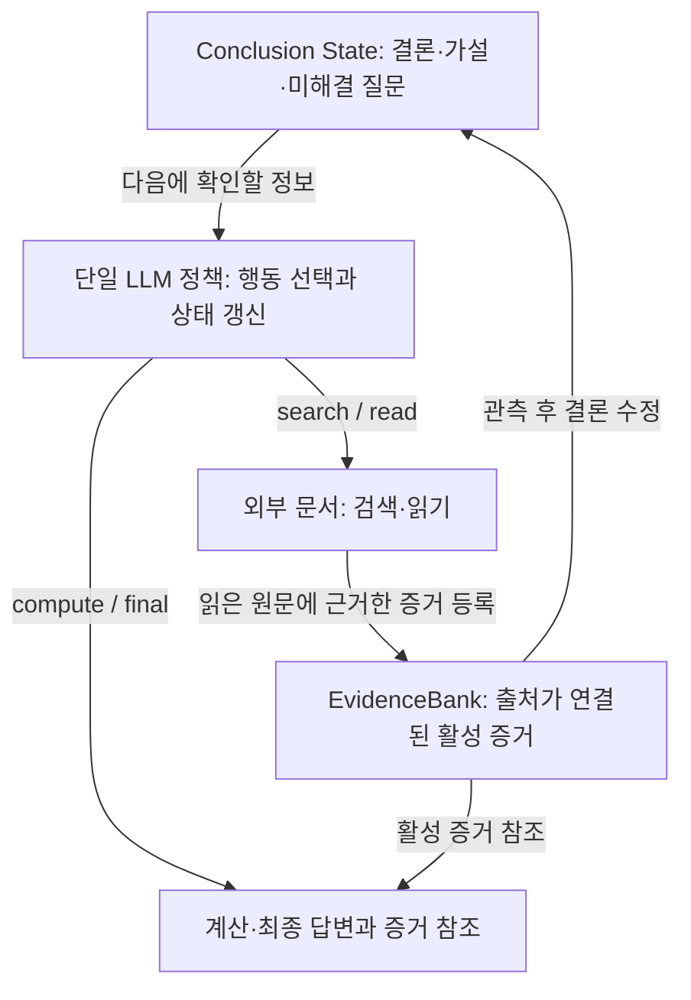

# LongHarness: Advancing Agentic Reasoning over 100M-Token Corpora via Stateful Evidence Management

**분석 대상:** Songtao Huang 외, *LongHarness: Advancing Agentic Reasoning over 100M-Token Corpora via Stateful Evidence Management*, arXiv:2610.13075v1, 2026년 10월 9일.

:chatgpt-content-reference{index="31"}

아래의 **페이지 번호는 첨부 PDF에 인쇄된 페이지 번호**이며, PDF 페이지와 일치합니다. **[저자 보고]**는 논문에 직접 제시된 내용, **[해석]**은 그 근거에 대한 분석, **[검증 제안]**은 아직 실험되지 않은 후속 연구 제안을 뜻합니다. 미측정 성능이나 저자가 밝히지 않은 연구 계획은 사실로 제시하지 않습니다.

---

## 1. Executive summary — 10문장

1. LongHarness는 LLM의 컨텍스트 창을 넘는 문서 집합에서, 검색한 **증거와 그 증거로 도출한 결론을 별도의 지속 상태로 관리**하는 단일 에이전트 실행 체계다. **[pp.1–4, Figure 2]**
2. 연구가 겨냥하는 실패는 필요한 정보의 공백을 해소하지 못한 채 검색을 반복하는 **무제한 탐색**과, 이미 발견한 증거나 정정 사항이 최종 판단에 반영되지 않는 **증거 상태 이탈**이다. **[p.2]**
3. 핵심 기법인 Evidence–Conclusion Coevolution은 미해결 결론이 다음 검색을 유도하고, 새 증거가 다시 결론을 수정하도록 연결한다. **[pp.3–4, 식 (3)–(4)]**
4. Evidence Lifecycle Management는 증거에 출처와 식별자를 부여하고, 수정·대체·철회를 기록하여 현재 사용할 수 있는 증거를 구분한다. **[pp.4–5, 14]**
5. 이 연구는 새로운 신경망이나 추가 학습법을 제안하지 않으며, 제목의 **100M 토큰은 한 번에 입력하는 길이가 아니라 접근 가능한 외부 코퍼스의 규모**다. **[pp.5, 9, 13, 15]**
6. GLM-5.3-Flash에서 OfficeQA Pro 정확 일치율은 직접 추론 대비 V1에서 15.8%→60.2%, V2에서 4.4%→61.1%로 상승했다. **[p.6, Table 1]**
7. 동일 기반 모델의 가장 강한 경쟁 하네스 대비 개선은 GLM에서 V1 +12.0%p·V2 +18.9%p였지만, Qwen3.8-Flash에서는 V1 +8.3%p·V2 +1.1%p로 모델과 평가 조건에 따라 달랐다. **[p.6, Table 1]**
8. 구성요소 제거 실험과 GLM의 3회 반복실험은 전체 설계의 유용성을 뒷받침하지만, 주 비교는 설정당 1회 실행이며 신뢰구간과 유의성 검정은 제시되지 않았다. **[pp.5–7, 19, Tables 2·9]**
9. 일반화와 관련해 확인된 것은 두 기반 모델과 네 평가 설정에서의 적용 가능성이며, 미지 도메인·언어로의 전이나 모델 가중치 수준의 일반화 향상은 검증되지 않았다. **[해석: pp.5–8, 13–19]**
10. 가장 중요한 기여는 **증거를 찾은 뒤 결론까지 일관되게 반영하는 과정을 명시적으로 관리한 설계와 실증 결과**이며, 동일 비용 비교·의미적 근거 검증·더 넓은 일반화 평가는 후속 검증 과제로 남는다. **[해석: pp.3–9, 14–19]**

> **용어 풀이**
>
> - **하네스(harness):** LLM 바깥에서 도구 호출, 상태 저장, 실행 순서, 자원 한도를 관리하는 체계.
> - **코퍼스(corpus):** 분석 대상 문서 전체의 집합.
> - **컨텍스트 창:** 모델이 한 번의 요청에서 참고할 수 있는 입력 범위.
> - **기반 모델·백본(backbone):** 하네스 안에서 실제 언어 이해와 행동 선택을 담당하는 LLM.
> - **%p:** 두 백분율의 차이로, 40%에서 50%로 상승하면 10%p 증가.

---

## 2. 연구 배경·목표와 핵심 주장

### 2.1. 해결하려는 문제

**[저자 보고]** 실제 문서 질문은 여러 문서·표·발행 시점에 흩어진 정보를 결합해야 한다. 컨텍스트 창을 늘려도 관련 증거의 위치, 방해 정보, 반복 상호작용 중의 정보 손실 때문에 정확한 답을 만들기 어렵다. 저자들은 문제를 다음 세 단계로 나눈다. **[p.2]**

| 단계 | 해야 하는 일 | 대표적인 실패 |
|---|---|---|
| L1: 증거 검색 | 필요한 문서와 구간을 찾는다 | 결정에 필요한 자료를 찾지 못함 |
| L2: 증거 편집 | 찾은 정보를 선택·조정·수정하여 유지한다 | 정정 사항을 잊거나 서로 충돌하는 값을 잘못 채택함 |
| L3: 증거 변환 | 유지한 증거로 답을 계산·추론한다 | 올바른 자료를 가지고도 계산이나 최종 결론을 틀림 |

여기서 **증거 편집**은 원문 문서를 고친다는 뜻이 아니다. 에이전트가 보관하는 증거의 채택·수정·철회와, 서로 다른 출처의 조정을 뜻한다.

저자들이 지적하는 두 실패는 서로 악화시킬 수 있다. 어떤 정보가 이미 확인됐는지 잊으면 같은 내용을 다시 검색하게 되고, 검색 이력이 길어질수록 중요한 정정 사항을 다시 찾기 어려워진다. **[p.2]**

### 2.2. 연구의 목적과 필요성

**[저자 보고]** 연구의 목적은 검색 결과를 단순히 축적하는 대신, **현재 결론을 바꿀 수 있는 미해결 정보가 무엇인지 명시하고 그 정보를 중심으로 검색을 지속하는 것**이다. 이를 위해 다음 두 표현을 분리한다. **[pp.2–4]**

- **EvidenceBank:** 문서에서 확인한 사실과 그 출처.
- **Conclusion State:** 그 사실로부터 도출한 결론, 근거가 있는 가설, 아직 해결하지 못한 질문.

**[해석]** 이 분리의 실질적인 가치는 “문서에 무엇이 쓰여 있는가”와 “그 사실이 질문의 답에 어떤 의미인가”를 구별하는 데 있다. 특히 수치 자료의 판본 차이, 정정, 누락된 전제처럼 **새 자료 때문에 이전 결론을 바꿔야 하는 문제**에서 설계의 필요성이 분명하다. 다만 이 구분만으로 올바른 해석이 보장되는 것은 아니며, 실제 의미 판단은 여전히 LLM에 맡겨져 있다. **[근거: pp.4–5, 14]**

### 2.3. 핵심 주장과 근거

| 핵심 주장 | 저자가 제시한 근거 | 근거 위치 | 해석 및 주의점 |
|---|---|---|---|
| 증거와 결론을 명시적으로 유지하면 성능이 개선된다 | 두 지속 상태 제거 시 V1 −4.5%p, V2 −7.8%p | p.7, Table 2 | 전체 이력은 유지한 비교이므로 별도 상태 표현의 추가 가치를 시사 |
| 결론의 미해결 공백이 검색을 유도하는 것이 유용하다 | 명시적 결론 기반 탐색 지시 제거 시 V1 −4.5%p, V2 −7.8%p | p.7, Table 2 | 상태의 존재뿐 아니라 상태를 이용하도록 하는 지시도 영향을 줌 |
| 증거를 계속 추가하는 것만으로는 충분하지 않다 | 추가만 허용하면 V1 −3.8%p, V2 −10.0%p | p.7, Table 2 | 수정·철회 기능의 유용성과 일치하지만 반복 분산은 미보고 |
| 동일 기반 모델에서 경쟁 하네스보다 높은 정확도를 보인다 | 두 기반 모델에서 네 평가 설정의 최고 하네스 점수 달성 | p.6, Table 1 | 동일 비용·동일 도구 조건의 비교는 아님 |
| 더 어려운 V2에서 탐색 길이 증가가 작다 | 중앙 모델 턴 수: LongHarness 22→30, Claude Code 21→116, Codex 19→43 | pp.8–9, Figure 3 | 턴 수는 시간·비용·전체 토큰 사용량과 다름 |
| 알려진 정정을 최종 계산에 반영할 수 있다 | 월별 지출 기하평균 사례에서 수정된 증거를 반영해 정답 제출 | pp.8, 19, Figure 4 | 실패 사례 중 선택된 단일 사례로, 평균적 효과의 증거와 구별해야 함 |

> **용어 풀이 — 제거 실험(ablation):** 시스템의 일부 기능을 빼거나 바꿔 성능이 어떻게 달라지는지 확인하는 실험. 구성요소의 유용성을 살펴볼 수 있지만, 여러 조건이 동시에 달라지면 기여도를 완전히 독립적으로 분리하기는 어렵다.

---

## 3. 방법론: 시스템 구조와 수식

### 3.1. ‘모델 구조’의 정확한 의미

**[저자 보고]** LongHarness는 **단일 LLM 에이전트**, 외부 문서 환경, EvidenceBank, Conclusion State, 검증용 제어기로 구성된다. 추가 정책 학습 없이 실행 시점에 작동한다. 따라서 이 논문에서 설명해야 할 구조는 신경망 층 구성이 아니라 **모델과 도구·상태 저장소를 연결하는 시스템 구조**다. **[pp.3–5, Figure 2; p.9 §4.1]**

다음은 Figure 2의 핵심 관계를 설명용으로 재구성한 것이다.

**Conclusion State의 세 목록**은 다음과 같다. **[pp.14–15, 18]**

| 목록 | 의미 |
|---|---|
| `established` | 활성 증거로 뒷받침되는 결론 |
| `hypotheses` | 근거는 있지만 아직 확정되지 않은 해석 |
| `open` | 답을 바꿀 수 있어 추가 확인이 필요한 정보 |

> **용어 풀이**
>
> - **지속 상태(persistent state):** 여러 턴에 걸쳐 보존하는 기록으로, 여기서는 한 질문을 해결하는 동안의 지속성을 뜻한다.
> - **정보 공백(gap):** 결론을 확정하거나 수정하기 위해 추가로 알아야 하는 구체적인 정보.
> - **제어기(controller):** 행동 형식, 출처 식별자, 예산 제한 등을 검사하는 프로그램.

### 3.2. 상태 정의

원문은 질문을 $q$, 외부 문서 집합을 $D$로 두고 정책이 참고하는 상태를 다음과 같이 정의한다. **[p.3, §2.1]**

$$
D=\{d_1,\ldots,d_n\},
\qquad
S_t=(E_t,C_t,H_t).
$$

- $d_i$: $i$번째 문서.
- $n$: 문서 수.
- $t$: 상호작용 턴.
- $E_t$: 현재 활성 상태인 증거.
- $C_t$: 현재 결론·가설·미해결 정보.
- $H_t$: 지금까지의 추론, 행동, 관측 이력.
- $S_t$: 위 세 요소로 구성한 정책의 상태.

**중요한 구현 특성:** EvidenceBank와 Conclusion State는 기존 이력을 대체하지 않는다. 전체 이력과 함께 모델에 제공된다. **[pp.14–15, 18]**

### 3.3. 식 (1): 행동과 선택적 결론 갱신

$$
(a_t,\widehat{C}_t)
\sim
\pi_\theta(\cdot\mid q,M_D,S_t,B_t).
$$

**기호 설명**

- $a_t$: 이번 턴에 선택하는 행동.
- $\widehat{C}_t$: 선택적으로 제안하는 결론 상태 갱신.
- $\pi_\theta$: 매개변수 $\theta$를 가진 LLM 정책.
- $M_D$: 문서 식별자·제목·섹션 구조를 담은 문서 지도.
- $B_t$: 남은 자원 예산.
- $\sim$: 해당 정책에 따라 출력을 선택한다는 표기.
- $\cdot$: 정책이 출력할 수 있는 값의 자리를 나타낸다.
- $q,S_t$: 각각 질문과 현재 정책 상태.

**[해석]** 에이전트는 질문만 보고 다음 검색을 결정하지 않는다. 이미 확보한 증거, 현재 판단, 남은 의문, 이력, 남은 예산을 함께 참고한다. 다만 식 자체가 최적 행동을 보장하거나 별도의 학습 알고리즘을 정의하는 것은 아니다. **[p.3]**

> **용어 풀이 — 정책(policy):** 현재 상황을 입력받아 다음 행동을 선택하는 규칙 또는 모델.

### 3.4. 식 (2): 환경의 실행과 관측

$$
(x_{t+1},o_{t+1})
\sim
\mathcal{P}_D(\cdot,\cdot\mid x_t,a_t).
$$

**기호 설명**

- $x_t$: 문서 환경의 내부 상태.
- $x_{t+1}$: 행동 실행 후 내부 상태.
- $o_{t+1}$: 반환되는 원문, 계산 결과, 검증 피드백 등의 관측.
- $\mathcal{P}_D$: 문서 환경의 상태 전이 및 관측 규칙.
- $a_t$: 정책이 선택한 행동.
- $x_t$에는 등록된 원문 구간, 증거와 그 상태, 자원 계수 등이 포함된다.

**[저자 보고]** 제어기는 행동 구조, 출처 등록 여부, 예산 제약을 검사한다. 유효하지 않은 행동은 지속 상태를 변경하지 않고 검증 피드백을 반환한다. **[pp.3, 14, 16, Algorithm 1]**

### 3.5. 식 (3)–(4): 증거–결론 공진화

$$
E^{+}=\mathcal{A}_\theta(q,D,E,C).
$$

$$
C^{+}=\mathcal{R}_\theta(q,E^{+},C).
$$

**기호 설명**

- $E,C$: 갱신 전 증거와 결론 상태.
- $E^{+},C^{+}$: 갱신 후 증거와 결론 상태.
- $\mathcal{A}_\theta$: 현재 결론에 필요한 정보를 탐색하고 증거로 등록하는 과정.
- $\mathcal{R}_\theta$: 활성 증거를 바탕으로 결론과 남은 공백을 수정하는 과정.
- $q,D$: 질문과 문서 집합.
- $\theta$: 두 과정을 수행하는 동일한 에이전트 정책의 매개변수.

**[저자 보고]** 두 연산은 같은 정책이 하나 이상의 상호작용을 통해 수행하며, 탐색과 수정은 상황에 따라 섞일 수 있다. **[p.3]**

**[해석]** 두 개의 별도 신경망을 학습했다는 뜻이 아니다. 식은 **현재 결론이 증거 수집에 영향을 주고, 수집된 증거가 결론 수정에 영향을 준다는 의존관계**를 표현한다. 논문에는 이를 최적화하는 별도 손실함수, 정보 이득 목적함수, 수렴 보장이 제시되지 않는다.

> **용어 풀이 — 공진화(coevolution):** 이 논문에서는 두 상태가 서로 영향을 주며 갱신되는 과정으로, 진화 알고리즘을 사용한다는 뜻은 아니다.

### 3.6. 증거 수명주기와 도구의 동작

| 행동 | 기능 | 핵심 제약 |
|---|---|---|
| `search` | 문서·구간 후보를 찾는다 | 검색 결과의 짧은 발췌문은 탐색 안내이며 바로 인용할 수 없음 |
| `read` | 선택한 원문을 읽는다 | 읽은 구간의 출처 참조를 등록 |
| `upsert` | 출처가 연결된 증거를 등록한다 | 앞선 `read`에서 등록한 출처가 필요하며, 배치 일부만 승인될 수 있음 |
| `revise` | 증거를 수정하거나 철회한다 | 수정 시 새 ID를 만들고 이전 증거를 비활성화 |
| `compute` | 정책이 제시한 수치 표현식을 계산한다 | 요청에 명시한 증거 ID의 유효성 검사 |
| `final` | 답과 근거를 제출한다 | 정해진 형식과 활성 증거·원문 참조 검사 |

**근거: pp.5, 13–14, Tables 5·6; p.18.**

증거 수정의 세부 동작은 다음과 같다.

- 승인된 증거는 **불변 식별자**를 가진다.
- 대체 증거를 제시하면 새로운 활성 항목을 만들고, 이전 항목은 `superseded`로 기록한다.
- 대체 없이 철회하면 이전 항목은 `retracted`가 된다.
- 대체·철회된 항목은 이력에 남지만 `compute`나 `final`의 근거로 사용할 수 없다.
- 새 증거는 승인 결과를 관측한 **다음 턴부터** 인용할 수 있다. **[pp.14, 18]**

> **용어 풀이**
>
> - **원문 구간(source span):** 특정 문서 안의 정확한 텍스트 범위.
> - **활성(active):** 현재 판단과 계산의 근거로 사용할 수 있는 상태.
> - **대체됨(superseded):** 새로운 증거로 교체된 상태.
> - **철회됨(retracted):** 대체 증거 없이 사용을 중단한 상태.

### 3.7. Algorithm 1이 규정하는 실행 순서

**[저자 보고]** 매 문제에서 증거·결론·이력을 비우고 시작한 뒤 다음 과정을 반복한다. **[p.16, Algorithm 1]**

1. 현재 상태와 예산을 바탕으로 행동 하나와 선택적 결론 갱신을 생성한다.
2. 행동의 형식·출처·예산 조건을 검사한다.
3. 증거 등록·수정 행동이면 먼저 실행 결과를 관측하고, 결론은 이후 턴에 갱신한다.
4. 그 외 행동이면 제안된 결론 갱신을 먼저 반영하고 행동을 실행한다.
5. 활성 증거, 이력, 잔여 예산을 갱신한다.
6. 유효한 최종 제출이 승인되면 종료한다.

결론의 부분 갱신은 `established`, `hypotheses`, `open` 중 **제공한 목록을 교체하고 생략한 목록은 유지**하는 방식이다. 예산 소진이나 실행 실패로 승인된 최종 답을 얻지 못하면 실패로 종료하며, 평가에서는 오답으로 센다. **[pp.14–16]**

### 3.8. 시스템이 자동으로 보장하지 않는 것

이 부분은 설계의 실용성을 판단할 때 특히 중요하다.

| 실제 검사·동작 | 자동으로 보장하지 않는 내용 |
|---|---|
| 출처 참조가 이전 읽기에서 등록됐는지 검사 | 증거 문장이 원문의 의미를 충실하게 옮겼는지 |
| 활성 증거 ID인지 검사 | 그 증거가 결론을 논리적으로 뒷받침하는지 |
| 증거 변경 시 영향받는 결론 참조를 표시 | 종속 결론을 자동으로 삭제하거나 올바르게 수정하는 것 |
| 계산 표현식을 실행 | 식에 넣은 숫자가 인용한 원문 값과 일치하는지 |
| `compute`·`final` 요청의 증거 ID 검사 | Conclusion State 전체에 남은 오래된 참조를 모두 검사하는 것 |

**[저자 보고: p.14, §B.2–B.3; p.5]**

**[해석]** LongHarness는 출처와 상태를 추적할 수 있게 하지만, 의미적 정확성까지 완전히 검증하는 체계는 아니다. 특히 **계산식이 정확하게 실행됐다는 사실과 올바른 숫자를 식에 넣었다는 사실은 별개**다.

---

## 4. 실험 방법과 주요 데이터 소스

### 4.1. 평가 데이터

아래 수량과 조건은 LongHarness가 실제 사용했다고 보고한 평가 설정을 따른다. **[p.13, Table 4·Appendix A]**

| 평가 | 문항 수 | 자료와 접근 방식 | 평가 지표 |
|---|---:|---|---|
| OfficeQA Pro V1 | 133 | 미국 재무부 문서 697개, 약 100M 토큰의 전체 코퍼스에서 자료 탐색 | 정확 일치율, 상대오차 5% 이내 정확도 |
| OfficeQA Pro V2 | 90 | 문서 1,435개, 서로 다른 자료의 수치를 결합하는 복합 질문 강화 | 동일 |
| AA-LCR-1.1 | 100 | 30개 문서 묶음, 총 234개 문서, 묶음당 평균 99,325토큰 | LLM 판정 기반 정확도 |
| LongBench v2 Long | 108 | 질문별 제공 문맥, 약 132K–1.38M **단어**, 중앙값 204K단어 | 4지선다 정답률 |

AA-LCR에는 기업·산업 보고서, 정부 협의 문서, 학술 논문, 법률·마케팅 자료, 설문 보고서 등이 포함된다. LongBench v2 Long에는 코드 저장소 이해 29문항, 긴 문맥 내 학습 26문항, 단일 문서 QA 24문항, 다중 문서 QA 23문항, 구조화 데이터 6문항이 포함된다. **[p.13]**

**규모 해석의 주의점**

- V2의 문서 수가 증가했다고 해서 **정확히 200M 토큰**이라고 쓰면 안 된다. 논문은 V2의 정확한 전체 토큰 수를 제시하지 않는다.
- LongBench의 길이는 **단어 수**다. 토큰 수로 바꾸어 표기하면 안 된다.
- OfficeQA는 관련 자료의 발견 자체가 과제지만, AA-LCR와 LongBench는 질문별 관련 문서 묶음 또는 문맥이 제공된다. **[pp.13, 15–16]**

데이터셋의 원 출처는 *OfficeQA Pro: An Enterprise Benchmark for End-to-End Grounded Reasoning*, Artificial Analysis의 AA-LCR 데이터셋, *LongBench v2: Towards Deeper Understanding and Reasoning on Realistic Long-context Multitasks*다. [arxiv.org](https://arxiv.org/abs/2603.08655?utm_source=chatgpt.com)

> **용어 풀이**
>
> - **정확 일치율(Exact match, Ex.):** 요구한 답의 값·형식에 맞게 정확히 답한 비율.
> - **@5%:** 수치 답의 상대오차가 5% 이내인 경우를 정답으로 인정하는 지표.
> - **문맥 내 학습(in-context learning):** 모델 가중치를 바꾸지 않고 입력에 제공된 예시나 규칙을 이용해 문제를 푸는 방식.

### 4.2. 검색·문서 처리

**[저자 보고]** OfficeQA에서는 벤치마크 제공자가 파싱한 문서를 사용한다. 문서의 문자 위치를 보존하며, 기존 섹션 정보 또는 Markdown 제목으로 구조를 만든다. 긴 문단은 최대 1,024개의 **추정 토큰**으로 이루어진 겹치지 않는 블록으로 분할한다. 어휘 검색에는 BM25 방식의 순위화를 사용하고 정규식 검색도 지원한다. **[pp.16–17]**

> **용어 풀이**
>
> - **파싱된 문서:** 원본의 텍스트·표·구조를 프로그램이 읽을 수 있게 변환한 자료.
> - **BM25:** 질문과 문서에 등장한 단어의 빈도 등을 이용해 관련 문서를 정렬하는 검색 방식.
> - **정규식:** 특정 문자 패턴을 지정하여 텍스트를 찾는 표현법.

### 4.3. 비교 조건과 자원 예산

| 시스템 | 자료 활용 방식 | 주요 제한 |
|---|---|---|
| 직접 추론 | OfficeQA에서 BM25로 검색한 구간을 프롬프트에 제공 | 256K토큰 문맥, 도구 상호작용 없음 |
| Codex·Claude Code | 파일 탐색·읽기, 로컬 명령 실행, 파일 수정 | 모델 턴 200회, 도구 호출 200회 |
| RLM | 지속 Python 실행 환경, 프로그램적 문서 접근, 모델 하위 호출 | 루트 반복 30회, 최대 재귀 깊이 1 |
| LongHarness | 검색·제한된 읽기·증거 관리·계산·최종 제출 | 200턴, 검색 60회, 누적 읽기 1M토큰, 읽기당 최대 16,384토큰 |

**근거: pp.5, 15, 17, Tables 7·8.**

두 비교 백본은 **GLM-5.3-Flash와 Qwen3.8-Flash**다. 동일 백본 비교에서는 질문과 문서 코퍼스를 고정하지만, 도구 인터페이스와 실행 규약은 하네스마다 다르다. 모델 설정은 temperature 1, top-p 0.95, 최대 reasoning effort, 요청당 출력 한도 32,768토큰이다. 하네스 평가 중 도구의 네트워크 접근은 차단하고, 정답·정답 근거 표시는 에이전트에 제공하지 않는다. **[pp.5, 15, 17]**

> **용어 풀이**
>
> - **Temperature·top-p:** 모델 출력의 무작위성과 후보 선택 범위를 조절하는 설정.
> - **REPL:** 실행한 변수와 결과를 유지하며 코드를 반복 실행하는 환경.
> - **재귀 호출:** 작업 일부를 같은 종류의 처리 과정에 다시 맡기는 방식.

**중요:** LongHarness의 1M토큰은 `read`가 반환한 원문 텍스트의 누적 한도다. 전체 모델 입출력 토큰 예산이 아니다. 전체 이력을 자동으로 압축하거나 잘라내지 않으므로, 요청이 모델의 컨텍스트 한도를 넘어서 계속 실패하면 해당 문제는 종료된다. **[p.15]**

---

## 5. 주요 결과와 근거의 강도

### 5.1. 동일 백본의 가장 강한 경쟁 하네스와 비교

모든 값은 정확도이며, 아래는 **Table 1의 단일 실행 결과**다. **[p.6]**

| 기반 모델 | 평가 | LongHarness | 가장 높은 경쟁 하네스 | 개선 폭 |
|---|---|---:|---:|---:|
| GLM-5.3-Flash | OfficeQA V1 | **60.2%** | Claude Code 48.1% | **+12.0%p** |
| GLM-5.3-Flash | OfficeQA V2 | **61.1%** | Codex 42.2% | **+18.9%p** |
| GLM-5.3-Flash | AA-LCR | **84.0%** | Claude Code 79.0% | +5.0%p |
| GLM-5.3-Flash | LongBench v2 Long | **75.9%** | Codex 69.4% | +6.5%p |
| Qwen3.8-Flash | OfficeQA V1 | **61.7%** | Claude Code 53.4% | +8.3%p |
| Qwen3.8-Flash | OfficeQA V2 | **51.1%** | Codex 50.0% | **+1.1%p** |
| Qwen3.8-Flash | AA-LCR | **87.0%** | Claude Code 83.0% | +4.0%p |
| Qwen3.8-Flash | LongBench v2 Long | **76.9%** | Codex·RLM 69.4% | +7.4%p |

**반올림 주의:** GLM V1의 표시 점수만 빼면 12.1%p지만, 반올림 전 점수 차이는 약 12.03%p다. 저자의 +12.0%p 보고는 이와 일치한다. **[Tables 1·4·9를 이용한 산술 확인]**

**[해석]**

- 가장 설득력 있는 큰 차이는 GLM의 OfficeQA V2 +18.9%p다.
- 반면 Qwen V2의 +1.1%p는 **90문항 중 1문항 차이**여서, 반복실험 없이 강한 우위를 주장하기 어렵다.
- 두 백본 모두 성능이 개선됐지만, 개선 폭이 동일하거나 모델과 무관하다고 볼 수는 없다. **[pp.6, 13]**

### 5.2. 직접 추론 대비 개선과 구성요소 효과는 구분해야 한다

**[저자 보고]** GLM의 직접 추론 대비 개선은 V1 약 +44.4%p, V2 약 +56.7%p다. **[p.6, Table 1]**

**[해석]** 이 차이에는 반복 검색, 추가 읽기, 계산 도구, 상태 관리 등 전체 실행 체계의 효과가 함께 들어간다. **증거 관리만으로 56.7%p가 개선됐다고 해석할 수 없다.** 특정 구성요소의 추가 가치는 다음 제거 실험으로 보는 것이 적절하다.

또한 “모든 모델보다 최고”라는 표현도 피해야 한다. 예를 들어 Table 1의 AA-LCR 직접 추론 Kimi-K3 점수는 88.7%로 기재되어 있다. 다만 이 직접 추론 점수는 외부 발표값이므로 본 연구의 하네스 평가와 완전히 통제된 비교는 아니다. **[p.6, Table 1 주석]**

### 5.3. 허용오차를 적용했을 때

| 기반 모델·평가 | LongHarness Ex. | LongHarness @5% | 최고 경쟁 하네스 @5% |
|---|---:|---:|---:|
| GLM·V1 | 60.2 | 76.7 | Claude Code 67.7 |
| GLM·V2 | 61.1 | 74.4 | Codex 62.2 |
| Qwen·V1 | 61.7 | 75.9 | Claude Code 72.9 |
| Qwen·V2 | 51.1 | 71.1 | Codex 70.0 |

**[저자 보고: p.6, Table 1; 단위 %]**

**[해석]** 엄격한 수치 일치와 허용오차를 둔 정답은 서로 다른 요구를 측정한다. Qwen V1의 개선은 Ex.에서 +8.3%p지만 @5%에서는 +3.0%p다. 실제 적용에서는 요구 정밀도에 맞는 지표를 함께 봐야 한다.

### 5.4. 구성요소 제거 실험

| 구성 | V1 Ex. | 전체 대비 감소 | V2 Ex. | 전체 대비 감소 |
|---|---:|---:|---:|---:|
| 전체 LongHarness | 60.2 | — | 61.1 | — |
| 두 지속 상태 제거 | 55.6 | 4.5%p | 53.3 | 7.8%p |
| 증거–결론 공진화 제거 | 54.9 | 5.3%p | **51.7†** | **9.4%p†** |
| 증거를 추가만 허용 | 56.4 | 3.8%p | 51.1 | 10.0%p |
| 명시적 결론 기반 탐색 지시 제거 | 55.6 | 4.5%p | 53.3 | 7.8%p |
| 구조화 결론을 자유형 메모로 대체 | 53.4 | 6.8%p | 53.3 | 7.8%p |

**[저자 보고: p.7, Table 2; 감소 폭은 반올림 전 계산]**

**[해석]** 전체 설계가 모든 축소판보다 높다는 방향성은 일관된다. 특히 V2에서 추가만 허용한 증거 저장의 손실이 10.0%p라는 점은, 복합 수치 문제에서 **정보를 기억하는 것과 잘못된 정보를 수정하는 것이 별개의 요구**임을 뒷받침한다.

**† 집계 확인 필요:** V2가 90문항의 단일 실행·동일 가중치 정확도라면 51.7%는 정수 정답 수와 맞지 않는다.

$$
\frac{46}{90}\times100\approx51.1\%,
\qquad
\frac{47}{90}\times100\approx52.2\%.
$$

여기서 46·47은 가능한 정답 문항 수, 90은 평가 문항 수다. **51.7%는 PDF에도 실제 표기되어 있으며**, 반복 평균·별도 집계·오기 중 무엇인지 설명이 필요하다. 임의로 다른 값으로 수정하지 않았다. **[해석·산술 검토: Tables 2·4]**

### 5.5. 식 (5): 검색·편집·변환 단계의 진단

$$
r_1=P(E_1),
\qquad
r_2=P(E_2\mid E_1),
\qquad
r_3=P(E_3\mid E_1,E_2).
$$

**기호 설명**

- $E_1$: 필요한 증거가 상호작용 기록에 존재하는 사건.
- $E_2$: 그 증거가 최종 판단에 쓰이도록 보존·조정된 사건.
- $E_3$: 최종 답이 정확 일치 기준으로 정답인 사건.
- $r_1$: 전체 문제에서의 검색 성공률.
- $r_2$: 검색에 성공한 문제에서의 증거 편집 성공률.
- $r_3$: 앞의 두 단계를 통과한 문제에서의 정답 변환 성공률.
- $P$: 평가 표본에서 추정한 사건의 비율.

**이 식의 $E_1,E_2,E_3$는 성공 사건이며, 앞의 활성 증거 상태 $E_t$와 다른 표기다.** **[p.8, 식 (5)]**

| 단계 | LongHarness V1 | LongHarness V2 | V2 최고 경쟁값 |
|---|---:|---:|---:|
| 검색 $r_1$ | 85.0% | 87.8% | Codex 76.7% |
| 증거 편집 $r_2$ | 87.6% | 87.3% | Claude Code 84.6% |
| 답 변환 $r_3$ | 80.8% | 79.7% | Codex 70.4% |

**[저자 보고: p.7, Table 3]**

진단은 GPT-5.6-Luna가 temperature 0으로 오답 실행을 평가하는 방식이다. 정답 실행은 규약상 앞의 두 단계도 통과한 것으로 간주한다. **[pp.8, 17]**

**[해석]** V1→V2에서 LongHarness의 조건부 증거 활용률이 비슷하게 유지된 것은 긍정적 관찰이다. 그러나 하네스마다 앞 단계를 통과한 문항 집합이 달라지므로, 같은 문제에서 독립적으로 측정한 세 능력 점수로 해석해서는 안 된다. 이 규약 아래 세 비율의 곱은 최종 정확도를 거의 복원하므로, 세 수치는 주로 **실패가 어느 단계에 배분되는지를 설명하는 진단**이다.

> **용어 풀이 — 조건부 성공률:** 어떤 조건을 먼저 만족한 사례만 분모로 삼아 계산한 성공률. 조건을 통과한 사례가 다르면 비율의 직접 비교에 주의해야 한다.

### 5.6. 3회 반복실험

GLM-5.3-Flash의 반복실험에서는 평균 성능 우위가 유지된다. **[p.19, Table 9]**

| 평가 | LongHarness 평균 ± 표준편차 | 최고 경쟁 하네스 평균 ± 표준편차 | 평균 차이 |
|---|---|---|---:|
| OfficeQA V1 | **59.90 ± 0.43** | Claude Code 49.37 ± 1.57 | +10.53%p |
| OfficeQA V2 | **59.63 ± 1.28** | Codex 41.11 ± 4.00 | +18.52%p |
| AA-LCR | **84.00 ± 2.00** | Claude Code 80.33 ± 2.31 | +3.67%p |
| LongBench v2 Long | **75.31 ± 1.93** | Codex 69.13 ± 0.53 | +6.18%p |

평균과 표준편차는 저자 보고값이며, 마지막 열은 그 값의 차이를 계산한 것이다.

**[해석]** 세 번의 평균에서도 우위가 유지된다는 결론은 지지된다. 다만 반복 횟수가 작고, Qwen에는 같은 반복 결과가 없다. 또한 LongBench에서는 LongHarness의 표준편차가 Codex보다 크므로 “모든 조건에서 더 안정적”이라고 할 수 없다.

> **용어 풀이**
>
> - **표준편차:** 실행 점수가 얼마나 흩어져 있는지를 나타내는 값.
> - **신뢰구간:** 평균이나 성능 차이의 추정 불확실성을 나타내는 구간으로, 위의 ‘평균 ± 표준편차’와 다르다.
> - **통계적 유의성:** 관찰한 차이가 우연한 변동으로 설명될 가능성을 특정 검정 아래 평가한 결과로, 점수가 더 높다는 사실만으로 성립하지 않는다.

---

## 6. 통계적으로 취약한 부분과 직접 비교할 수 없는 수치

| 표시 | 항목 | 문제와 정확한 해석 | 근거 |
|---|---|---|---|
| **통계 취약** | 주 비교 1회 실행 | 모델 출력 변동을 충분히 평가하지 못함 | pp.5–6 |
| **통계 취약** | GLM 반복 3회, Qwen 반복 미보고 | 다른 모델까지 재현성을 확대 해석하기 어려움 | p.19, Table 9 |
| **통계 취약** | 제거 실험의 분산·신뢰구간 미보고 | 작은 차이와 구성요소 순위를 확정하기 어려움 | p.7, Table 2 |
| **작은 차이** | Qwen V2 +1.1%p | 90문항 중 1문항 차이 | Tables 1·4 |
| **평가 의존** | LLM의 실행 경로 판정 | 인간 검증·평가자 간 일치도 미보고, 정답은 앞 단계 자동 통과 | pp.8, 17 |
| **불완전 비교** | 직접 추론 vs 하네스 | 정적 문맥과 반복 탐색·계산을 포함한 전체 시스템의 차이 | pp.5, 17 |
| **불완전 비교** | 하네스 간 자원 제한 | RLM 반복·하위 호출과 다른 하네스 턴 수가 동일 연산량을 뜻하지 않음 | p.17, Table 8 |
| **평가 조건 상이** | AA-LCR 직접 추론 vs 하네스 | 직접 추론은 Artificial Analysis 발표값, 하네스는 본 연구의 평가 | p.6, Table 1 주석 |
| **규모 효과 분리 불가** | OfficeQA V1 vs V2 | 문서 규모와 문항 구성·난도가 동시에 달라짐 | pp.5, 13 |
| **단위 상이** | Figure 4의 170 vs 10 | Codex는 셸 명령 호출 수, LongHarness는 정책 행동 수 | p.19 |
| **해석 주의** | 네 설정 평균 70.3·69.2 | 서로 다른 정답 판정 방식의 단순 평균이며 전체 문항을 합친 정답률이 아님 | p.6 |
| **집계 확인 필요** | V2 제거 실험 51.7% | 90문항 단일 동일 가중치 점수로 재현되지 않음 | Tables 2·4 |

추가로 Table 1의 Kimi-K3 V2 4.8% 등 일부 직접 추론 점수도 단일 90문항 점수와 맞지 않는다. 다만 직접 추론의 반복·집계 방식이 하네스만큼 명확하지 않으므로, 오류라고 확정하기보다 **집계 방법의 설명이 필요하다**고 보는 것이 정확하다.

주표와 부록의 실행 대응도 명확하지 않다. 예를 들어 Table 1의 V2 점수는 Table 9에서 Codex의 Run 2, Claude Code의 Run 3, LongHarness의 Run 1과 대응한다. 보고할 실행의 선정 규칙이나 난수 시드 대응은 제시되지 않는다. **선택적 보고라고 단정할 근거는 부족하며**, 반복 평균을 함께 보는 것이 적절하다. **[Tables 1·9 대조]**

---

## 7. 가장 중요한 그림의 선정과 해석

### 7.1. Figure 2 — 핵심 설계도

**위치: p.4. 중요도: 가장 높음.**

**[저자 보고]** EvidenceBank와 Conclusion State의 분리, 양방향 갱신, 증거 등록·수정·철회, 출처 검증과 도구 상호작용을 한 그림에 제시한다.

**[해석]** 이 그림에서 가장 중요한 부분은 두 저장소 사이의 연결이다. 저장된 사실이 결론을 바꾸는 것뿐 아니라, **현재 결론의 미해결 부분이 다음에 읽을 자료를 결정**한다. 증거 변경 결과를 먼저 관측하고 이후 결론을 갱신한다는 순서도 핵심이다.

그림의 검증 상자를 모든 의미 오류를 차단하는 장치로 읽어서는 안 된다. 실제 보장 범위는 출처·상태·프로토콜 검사이며, 의미 판단의 상당 부분은 모델에 남는다. **[p.14]**

### 7.2. Figure 3 — 탐색 길이의 변화

**위치: p.8; 중앙값 설명은 p.9.**

| 하네스 | V1 중앙 모델 턴 수 | V2 중앙 모델 턴 수 |
|---|---:|---:|
| Claude Code | 21 | 116 |
| Codex | 19 | 43 |
| LongHarness | 22 | 30 |

**[해석]** V2에서 LongHarness의 탐색 길이가 상대적으로 덜 증가한다는 관찰은, 미해결 정보 중심의 탐색과 기존 증거 재사용이라는 설명에 부합한다. 다만 V1에서는 LongHarness의 중앙 턴 수가 두 비교군보다 많다. 따라서 “항상 더 적은 단계로 해결한다”는 결론은 맞지 않는다.

그림은 **커널 밀도 추정 곡선**이므로, 특정 지점의 높이를 그 턴 수에서의 정확한 문항 비율로 읽을 수도 없다. 시간·비용 절감은 별도 측정이 필요하다.

> **용어 풀이 — 커널 밀도 추정(KDE):** 관측값이 어느 구간에 많이 모이는지 부드러운 곡선으로 표현하는 방법.

### 7.3. Figure 4 — 정정을 발견하고도 반영하지 못하는 실패

**위치: p.8; 상세 사례는 p.19, Appendix E.**

문제는 1942년 3월부터 1948년 10월까지 80개 월별 지출의 기하평균을 계산하는 것이다.

- **Codex:** 1942년 5월 값으로 4100을 사용해 4958.09를 계산한 뒤, 4400으로 수정해야 함을 인식했지만 최종 답에는 이전 계산을 유지했다.
- **LongHarness:** 4400의 근거를 유지하고 다른 두 항목도 수정한 뒤, 기준 정답인 **4962.46백만 달러**를 제출했다.
- Codex 경로에서는 **103회 연속 읽기**가 관찰됐다. **[Figure 4, Appendix E]**

> **용어 풀이 — 기하평균:** 여러 양수의 곱에 대해 값의 개수만큼의 제곱근을 취한 평균으로, 산술평균과 다른 집계 방식.

**해석 시 반드시 붙여야 하는 제한**

1. 이 사례는 **Codex의 정확 일치 실패 경로 중에서** 무작위 선택됐다.
2. 170회와 10회는 서로 다른 행동 단위이므로 “17배 빠르다”라고 계산할 수 없다.
3. Codex 답의 상대오차는 약 **0.088%**로 @5% 기준에서는 정답이다.

따라서 이 그림의 핵심은 **정정된 증거가 최종 계산까지 전달되는가**이며, 모든 실용적 상황에서 두 답의 차이가 크다는 주장은 아니다.

### 7.4. Figure 1 — 문제의 직관과 대표 결과

**위치: p.1.**

공급업체 A·B 예시는 “금요일 납품”이라는 조건을 잊지 않고, 남아 있는 질문인 B의 도착일을 확인하여 결론을 갱신하는 과정을 설명한다. 실제 벤치마크 사례로 제시된 것은 아니다. 오른쪽 막대그래프는 Table 1의 일부 결과를 재시각화한 것으로, 별도의 독립 실험이 아니다.

---

## 8. 모델의 일반화 성능 향상 가능성

### 8.1. 현재 증거가 지지하는 범위

**[해석]** 이 논문은 **학습된 모델 자체의 일반화 향상**보다 **추론 시 실행 체계를 다른 모델과 작업에 적용할 수 있는가**에 대한 증거를 제공한다.

| 일반화의 측면 | 실제로 확인된 것 | 아직 확인되지 않은 것 |
|---|---|---|
| 기반 모델 간 적용 | GLM·Qwen 두 백본에서 개선 | 광범위한 모델군·소형 모델에서 같은 효과 |
| 작업 간 적용 | 코퍼스 탐색과 제공 문맥 추론에 동일 상태·행동 규약 사용 | 새로운 도메인에서 조정 없이 유지되는 효과 |
| 규모 변화 | OfficeQA V1·V2에서 평가 | 같은 문항을 고정하고 코퍼스 크기만 늘렸을 때의 성능 |
| 장기 기억 | 한 문제의 여러 턴에 걸쳐 증거 유지 | 문제·세션 사이 지식의 축적과 전이 |
| 모델 능력 변화 | 추가 정책 학습 없이 시스템 점수 개선 | 가중치 수준의 지식·추론 능력 향상 |

**근거: pp.5–9, 13–16.**

> **용어 풀이**
>
> - **일반화:** 평가 조건이 달라져도 배운 방법이나 설계가 유효하게 작동하는 성질.
> - **분포 밖 일반화(OOD):** 기존 평가·개발 조건과 다른 도메인, 언어, 형식 등에서의 성능 유지.
> - **전이:** 한 조건에서 유용했던 능력이나 절차가 다른 조건에서도 활용되는 것.

### 8.2. 일반화와 관련해 유망한 이유

**[해석]** 증거와 결론을 구분하고, 출처를 유지하며, 새 관측으로 이전 판단을 수정하는 절차는 특정 질문 유형에만 필요한 기능은 아니다. 실제로 같은 규약이 OfficeQA, AA-LCR, LongBench에 적용됐다는 점은 **방법의 적용 범위**에 대한 제한적 근거가 된다. **[pp.13–15]**

그러나 다음 세 구분을 유지해야 한다.

- **다양한 벤치마크에서 개선된 사실**과 **미지 도메인으로의 전이가 입증된 사실**은 다르다.
- **모델에 의존하지 않는 인터페이스 설계**와 **모든 모델에서 동일한 이득**은 다르다.
- **출처를 추적할 수 있는 답**과 **출처가 실제로 지지하는 정확한 답**은 다르다.

일반화의 강한 증거를 얻으려면 하네스를 고정한 상태에서 새로운 도메인·언어·문서 형식·모델군을 평가해야 한다. 이는 본 논문의 결과가 아니라 **후속 검증 조건**이다.

---

## 9. 2020년 이후 관련 연구 비교 분석

아래는 핵심 비교축을 대표하는 연구들이다. **외부 연구의 방법은 각 원문에 근거하며, LongHarness와의 차이 평가는 분석자의 해석**이다.

| 연구·연도 | 원논문의 핵심 접근 | LongHarness와의 비교 |
|---|---|---|
| **RAG, 2020** | 생성 모델과 외부 검색 메모리를 결합하고 검색·생성 체계를 미세조정 | LongHarness는 여러 상호작용 동안 증거와 결론을 어떻게 유지·수정할지에 초점; 본 논문의 BM25 직접 추론을 원형 RAG의 재현으로 볼 수는 없음. [arxiv.org](https://arxiv.org/abs/2005.11401?utm_source=chatgpt.com) |
| **ReAct, 2022/2023** | 추론과 행동을 교차 생성하며 도구 관측을 다음 행동에 반영 | LongHarness는 이 흐름에 증거·결론의 명시적 상태와 수명주기 규약을 추가하며, 실제 프롬프트도 ReAct 에이전트로 규정됨. [arxiv.org](https://arxiv.org/abs/2210.03629?utm_source=chatgpt.com) **[LongHarness p.18]** |
| **MemGPT, 2023/2024** | 컨텍스트와 외부 기억 사이를 이동시키는 계층적 메모리 관리 | MemGPT는 메모리 계층과 장기 대화를 다루고, LongHarness는 질문 해결 중 출처·증거·결론의 연결을 관리. [arxiv.org](https://arxiv.org/abs/2310.08560?utm_source=chatgpt.com) |
| **ReadAgent, 2024** | 긴 문서를 짧은 요지 기억으로 압축하고 필요할 때 원문을 재열람 | 선택적 원문 접근이라는 공통점이 있지만, LongHarness는 증거의 활성 상태와 결론 수정을 중심으로 설계. [arxiv.org](https://arxiv.org/abs/2402.09727?utm_source=chatgpt.com) |
| **GraphReader, 2024** | 문서를 그래프로 조직하고 노드와 이웃을 탐색하며 발견을 기록 | GraphReader의 주요 축은 문서 구조 탐색, LongHarness의 주요 축은 확보한 증거와 현재 결론의 연결·수정. [ACL Anthology](https://aclanthology.org/2024.findings-emnlp.746/?utm_source=chatgpt.com) |
| **RLM, 2025/2026** | 긴 입력을 외부 환경으로 두고 프로그램적으로 분해·조회하며 모델 하위 호출 수행 | LongHarness는 단일 에이전트의 증거–결론 상태에 집중; 원 RLM의 최신 개정에는 후속 학습 실험도 포함됨. [arxiv.org](https://arxiv.org/abs/2512.24601?utm_source=chatgpt.com) |
| **LongRLVR, 2026** | 최종 답 보상에 검증 가능한 근거 선택 보상을 더해 모델 학습 | 가중치를 바꾸는 학습 접근과, 실행 시 상태를 관리하는 LongHarness의 차이를 보여줌; 결합 효과는 미검증. [arxiv.org](https://arxiv.org/abs/2603.02146?utm_source=chatgpt.com) |
| **MAVEN, 2026** | 편집 가능한 증거 기억에서 추가·연결·삭제의 상태 변화를 강화학습 보상에 반영 | 증거 상태를 중요하게 본다는 공통점이 있으나, LongHarness에는 그러한 학습 보상이나 정책 갱신이 없음. [arxiv.org](https://arxiv.org/abs/2607.02073?utm_source=chatgpt.com) |
| **ReContext, 2026** | 모델 내부 관련도 신호로 근거를 골라 답 생성 전에 재제시하고 원래 문맥 유지 | 이미 문맥 안에 있는 근거의 재활용에 초점; LongHarness는 외부 코퍼스에서 부족한 근거를 찾고 지속 상태를 수정. [arxiv.org](https://arxiv.org/html/2607.02509v1?utm_source=chatgpt.com) |
| **LedgerMind, 2026** | 구조화 증거 장부, 활성 상태, 주장 의존성, 검증과 상태 기반 수정 | 증거 장부·수명주기 자체에는 선행 요소가 존재하며, LongHarness의 차별점은 미해결 결론이 후속 코퍼스 탐색을 유도하는 결합에 있음. [arxiv.org](https://arxiv.org/abs/2607.28374?utm_source=chatgpt.com) |

> **용어 풀이**
>
> - **RAG:** 외부에서 검색한 자료를 생성 모델의 답변에 결합하는 방식.
> - **요지 기억(gist memory):** 원문의 핵심을 짧게 압축한 기억.
> - **강화학습:** 행동 결과에 부여한 보상을 이용해 정책을 개선하는 학습.
> - **근거 연결(grounding):** 생성한 주장이나 답을 실제 입력 자료에 연결하는 것.
> - **의존성 그래프:** 어떤 결론이 어떤 증거에 의존하는지 연결해 표시한 구조.

### 9.1. 독창성에 대한 판단

**[해석]** LongHarness를 “최초로 증거 장부를 만든 연구” 또는 “최초로 증거를 수정하는 에이전트”라고 설명할 근거는 부족하다. LedgerMind의 Appendix B.2–B.3에는 증거 상태 변경, 대체·삭제, 관련 주장 재검증과 무효화 전파가 이미 제시되어 있다. [arxiv.org](https://arxiv.org/html/2607.28374v1?utm_source=chatgpt.com)

이 논문이 강조하는 차별점은 다음과 같이 좁혀 설명하는 것이 정확하다.

> **대규모 문서 집합의 질문 해결에서, 출처가 있는 증거와 미해결 정보 요구를 포함한 결론 상태를 함께 유지하여 검색·수정·최종 답변을 연결한 실행 설계와 그 평가.**  
> **[LongHarness pp.2–5, 9]**

### 9.2. 논문 간 수치를 직접 비교하면 안 되는 사례

- **LongRLVR의 LongBench v2 46.5%와 LongHarness의 75.9%를 직접 비교할 수 없다.** 전자는 해당 논문의 `Overall` 점수이고, 후자는 108문항의 `Long` 부분집합 점수이며 모델과 문맥 조건도 다르다. [arxiv.org](https://arxiv.org/html/2603.02146v1?utm_source=chatgpt.com) **[LongHarness pp.6, 13]**
- **ReadAgent의 유효 문맥 확장 배수와 LongHarness의 100M토큰 코퍼스 규모는 다른 측정량이다.** 전자는 실험에서의 문맥 활용 확장, 후자는 접근 가능한 문서 전체 규모다. [arxiv.org](https://arxiv.org/abs/2402.09727?utm_source=chatgpt.com) **[LongHarness p.13]**
- 이 비교 목록에서 LongHarness 논문 안에 동일 백본으로 재평가된 대상은 **RLM**이다. 그 결과도 논문이 선택한 반복·재귀 제한을 적용한 구현의 성적이며, RLM의 모든 설정을 대표하지 않는다. **[LongHarness pp.6, 17]**

---

## 10. 제한사항과 문서가 답하지 않는 질문

### 10.1. 저자가 직접 명시한 제약

논문에는 별도의 **Limitations 절이 없다.** 다음은 본문과 부록에서 직접 밝힌 평가·구현 제약이다.

1. 계산 자원 제약으로 주 비교는 설정당 1회 실행이다. **[pp.5–6]**
2. 백본과 평가 조건에 따라 개선 폭이 달라진다. **[p.6]**
3. 증거의 원문 충실성과 결론의 지지 여부는 모델이 판단한다. **[pp.5, 14]**
4. 증거를 대체·철회해도 종속 결론을 자동 수정하지 않는다. **[p.14]**
5. 계산의 입력 숫자가 인용된 원문 값과 일치하는지 자동으로 확인하지 않는다. **[p.14]**
6. 이력을 자동 압축하지 않으며 컨텍스트 초과를 포함한 지속적 요청 실패는 종료·오답 처리한다. **[p.15]**

### 10.2. 분석자가 지적하는 연구 설계상 한계

**[해석]** 동일 비용 비교, 광범위한 모델·언어·도메인 전이, 인간이 검증한 실행 경로 평가, 수정 오류율, 증거와 결론의 장기 증가에 따른 확장성 분석이 충분하지 않다. OfficeQA V1·V2는 모두 재무부 문서 계열이며, 두 설정의 차이만으로 광범위한 도메인 일반화를 평가할 수는 없다. **[검토 범위: pp.5–9, 13–19]**

### 10.3. 문서가 답하지 않는 핵심 질문

| 미해결 질문 | 필요한 추가 증거 |
|---|---|
| 같은 총 토큰·비용·시간 예산에서도 우위가 유지되는가? | 예산을 맞춘 정확도–비용 비교 |
| Qwen V2의 1문항 이득이 반복해서 나타나는가? | 여러 실행의 문항별 정오답과 불확실성 |
| 잘못 만든 증거를 수정하지 못하거나 올바른 증거를 오수정하는 비율은 얼마인가? | 증거 편집 자체의 정확도와 오류 유형 |
| 증거가 바뀐 뒤 오래된 결론이 남아 최종 답을 오염시키는가? | 증거 변경부터 최종 답까지의 의존성 감사 |
| 중요한 정보 공백을 누락하거나 너무 일찍 종료하는 경우는 얼마나 되는가? | 정보 공백의 완전성·종료 판단 평가 |
| 문서 크기만 늘리면 성능과 비용은 어떻게 변하는가? | 동일 질문·동일 근거에 방해 문서만 추가한 통제 실험 |
| 새 언어·도메인·문서 형식에서도 작동하는가? | 하네스를 고정한 미사용 평가 집합 |
| 제시된 일부 점수의 집계 방식과 주 실행 선정 규칙은 무엇인가? | 실행 시드, 집계 코드, 문항별 결과, 전체 실행 기록 |

---

## 11. 결론·시사점과 빠른 후속 검증 방향

### 11.1. 저자가 제시한 결론과 후속 계획

**[저자 보고]** 저자들은 증거 검색·편집·변환을 하나의 지속적 관리 과정으로 묶는 관점을 제안하고, 증거–결론 공진화와 증거 수명주기 관리의 결합이 두 백본에서 성능을 개선한다고 결론 내린다. 제거 실험과 실행 경로 분석은 지속 상태, 결론 기반 탐색, 증거 수정의 역할을 뒷받침하는 근거로 사용된다. **[pp.9–10]**

**구체적인 후속 연구 계획이나 일정은 결론에 제시되지 않는다.** 따라서 아래 내용은 저자의 계획이 아니라 분석자의 검증 제안이다.

### 11.2. 학계와 실무에 대한 시사점

**[해석 — 학계]** 연구의 의미는 긴 문맥 문제를 입력 길이나 검색 성공률만으로 평가하지 않고, **찾은 증거가 수정 과정을 거쳐 최종 판단까지 유지되는가**라는 평가 축을 구체화한 데 있다. Table 3과 Figure 4는 검색 이후의 실패를 분리해 살펴볼 필요성을 보여준다. **[pp.7–9, 19]**

**[해석 — 실무]** 숫자·판본·정정이 중요한 문서 분석에서는 다음 세 기록이 설계상 유용한 출발점이다.

- 어떤 원문에서 어떤 사실을 가져왔는가.
- 그 사실을 어떤 결론에 사용했는가.
- 사실이 바뀌었을 때 어떤 결론을 다시 확인해야 하는가.

실용적 신뢰성을 높이려면 여기에 **원문 값과 계산 입력의 연결**, **변경된 증거에 의존하는 결론의 재검증**, **전체 비용 측정**을 추가로 검증해야 한다. 이는 본 논문의 명시적 구현 한계에서 도출되는 요구다. **[pp.14–15, 17]**

### 11.3. 우선 검증할 가장 유망한 접근

복잡한 새 모델을 구현하기 전에, 같은 모델과 검색기를 고정하고 아래 기능의 효과를 확인하는 것이 적절하다.

| 우선 검증 대상 | 선정 근거 | 작은 검증 실험 | 주요 관측값 |
|---|---|---|---|
| **증거의 수정·철회와 활성 상태 관리** | 추가만 허용할 때 V2 −10.0%p | 정정·판본 충돌이 있는 문서에서 추가 전용 저장과 수정 가능한 저장 비교 | 정정 반영률, 폐기 증거 재사용률, 최종 정확도 |
| **결론·가설·미해결 질문의 분리** | 자유형 메모 대비 전체 설계가 우세 | 동일 증거를 주고 자유형 메모와 세 목록 구조 비교 | 누락 전제, 오래된 결론, 최종 정확도 |
| **미해결 질문에 따른 검색** | 명시적 지시 제거 시 V2 −7.8%p | 질문 주제 중심 검색과 남은 전제 중심 검색 비교 | 불필요한 재검색, 정보 공백 해소, 읽은 토큰 |
| **읽은 원문만 증거로 등록하는 규약** | 검색 발췌와 인용 가능한 원문을 구별하는 핵심 인터페이스 | 출처 등록 규약을 적용하고 증거 문장을 사람이 확인 | 유효 출처율과 실제 의미적 지지율 |

**선정 근거: pp.7, 13–14, 18. 실험 내용은 [검증 제안].**

첫 성능 검증에서는 **결론 기반 탐색의 사용 여부 × 증거 수정의 허용 여부**를 조합한 네 조건을 비교하면, 두 기능의 개별 효과와 결합 효과를 함께 살펴볼 수 있다. 작은 문서 묶음으로 기능이 의도대로 작동하는지 확인한 뒤, 전체 평가와 반복실험으로 성능 결론을 검증하는 순서가 적절하다.

### 11.4. 일반화를 중심으로 한 추가 후속 연구

**[검증 제안]**

1. **도메인·언어·모델을 분리한 평가**  
   하네스와 프롬프트를 먼저 고정하고, 개발에 사용하지 않은 도메인·언어·모델에서 평가한다. 이를 통해 구현의 이식성과 실제 성능 전이를 구분한다.

2. **코퍼스 규모와 문제 난도를 분리**  
   같은 질문과 정답 근거를 유지한 채 방해 문서만 늘린다. V1·V2 비교에 섞여 있는 규모와 문항 난도 효과를 분리할 수 있다.

3. **증거–결론 의존성 검증 강화**  
   증거가 바뀌면 관련 결론을 재검증하도록 하고, 계산 입력을 증거의 구조화된 값·단위와 연결한다. 효과는 오류 감소와 추가 비용을 함께 측정해야 한다.

4. **이력 압축과 증거 보존의 결합**  
   전체 이력을 유지하는 현재 구현에서 어떤 부분을 줄여도 출처와 정정 이력을 보존할 수 있는지 평가한다. 압축 후 정확도뿐 아니라 수정 누락률도 측정해야 한다.

5. **학습 기법과 실행 체계의 분리·결합 실험**  
   LongRLVR·MAVEN과 같은 근거 중심 학습과 LongHarness를 각각 적용하고 함께 적용하여 효과를 구분한다. 결합이 추가 개선을 준다는 결과는 아직 없다. [arxiv.org](https://arxiv.org/abs/2603.02146?utm_source=chatgpt.com)

6. **여러 세션에 걸친 지식 갱신 평가**  
   LongMemEval이 다루는 시간 추론·지식 갱신·답변 보류 평가를 참고해, 한 문제 안의 증거 수정이 여러 세션의 기억 관리로 이어질 수 있는지 별도 실험을 설계한다. LongHarness는 현재 문제마다 상태를 초기화하므로 이 확장은 새 검증이 필요하다. [arxiv.org](https://arxiv.org/abs/2410.10813?utm_source=chatgpt.com) **[LongHarness p.16]**

7. **평가의 불확실성과 비용을 함께 공개**  
   문항별 정오답, 반복 실행, 총 입출력 토큰, 실제 시간, 실패 유형을 공개하고, 같은 문항끼리 비교하는 통계 분석과 인간 검증을 추가한다.

**최종 판단:** LongHarness는 **외부 증거를 수집하고 수정하여 결론에 반영하는 실행 구조의 유용성**을 보여주는 연구다. 두 백본과 여러 설정의 결과는 이 접근을 추가 검증할 충분한 근거를 제공한다. 일반화 성능에 대한 더 강한 결론은 새로운 조건에서의 전이, 의미적 근거 검증, 동일 비용 비교가 확보된 뒤 내려야 한다.

---

## 12. 참고한 원문·데이터셋·사이트

아래는 보고서에 사용한 자료의 전체 제목과 출처다. 본 논문의 세부 실험 수치와 구현 설명은 **첨부 v1 PDF**를 기준으로 했다.

### 주논문과 데이터셋

1. Huang et al. (2026). **LongHarness: Advancing Agentic Reasoning over 100M-Token Corpora via Stateful Evidence Management.** 첨부 PDF, pp.1–19. [arXiv](https://arxiv.org/abs/2610.13075v1).
2. Opsahl-Ong et al. (2026). **OfficeQA Pro: An Enterprise Benchmark for End-to-End Grounded Reasoning.** [arXiv](https://arxiv.org/abs/2603.08655). [arxiv.org](https://arxiv.org/abs/2603.08655?utm_source=chatgpt.com)
3. Artificial Analysis. **Artificial Analysis Long Context Reasoning — AA-LCR Dataset.** [공식 Hugging Face 데이터셋](https://huggingface.co/datasets/ArtificialAnalysis/AA-LCR). [Datasets at Hugging Face](https://huggingface.co/datasets/ArtificialAnalysis/AA-LCR?utm_source=chatgpt.com)
4. Bai et al. (2024/2025). **LongBench v2: Towards Deeper Understanding and Reasoning on Realistic Long-context Multitasks.** [arXiv](https://arxiv.org/abs/2412.15204). [arxiv.org](https://arxiv.org/abs/2412.15204?utm_source=chatgpt.com)

### 비교 연구와 후속 평가 참고문헌

5. Lewis et al. (2020). **Retrieval-Augmented Generation for Knowledge-Intensive NLP Tasks.** [arXiv](https://arxiv.org/abs/2005.11401). [arxiv.org](https://arxiv.org/abs/2005.11401?utm_source=chatgpt.com)
6. Yao et al. (2022/2023). **ReAct: Synergizing Reasoning and Acting in Language Models.** [arXiv](https://arxiv.org/abs/2210.03629). [arxiv.org](https://arxiv.org/abs/2210.03629?utm_source=chatgpt.com)
7. Packer et al. (2023/2024). **MemGPT: Towards LLMs as Operating Systems.** [arXiv](https://arxiv.org/abs/2310.08560). [arxiv.org](https://arxiv.org/abs/2310.08560?utm_source=chatgpt.com)
8. Lee et al. (2024). **A Human-Inspired Reading Agent with Gist Memory of Very Long Contexts.** [arXiv](https://arxiv.org/abs/2402.09727). [arxiv.org](https://arxiv.org/abs/2402.09727?utm_source=chatgpt.com)
9. Li et al. (2024). **GraphReader: Building Graph-based Agent to Enhance Long-Context Abilities of Large Language Models.** [ACL Anthology](https://aclanthology.org/2024.findings-emnlp.746/). [ACL Anthology](https://aclanthology.org/2024.findings-emnlp.746/?utm_source=chatgpt.com)
10. Zhang, Kraska, and Khattab (2025/2026). **Recursive Language Models.** [arXiv](https://arxiv.org/abs/2512.24601). [arxiv.org](https://arxiv.org/abs/2512.24601?utm_source=chatgpt.com)
11. Chen, Shieh, and Bing (2026). **LongRLVR: Long-Context Reinforcement Learning Requires Verifiable Context Rewards.** [arXiv](https://arxiv.org/abs/2603.02146). [arxiv.org](https://arxiv.org/abs/2603.02146?utm_source=chatgpt.com)
12. Gao and Marttinen (2026). **Evidence-State Rewards for Long-Context Reasoning.** MAVEN. [arXiv](https://arxiv.org/abs/2607.02073). [arxiv.org](https://arxiv.org/abs/2607.02073?utm_source=chatgpt.com)
13. Zhao et al. (2026). **ReContext: Recursive Evidence Replay as LLM Harness for Long-Context Reasoning.** [arXiv](https://arxiv.org/abs/2607.02509). [arxiv.org](https://arxiv.org/html/2607.02509v1?utm_source=chatgpt.com)
14. Du et al. (2026). **LEDGERMIND: Provenance-Constrained Multimodal Agentic Reasoning with a Structured Evidence Ledger.** [arXiv 서지 페이지](https://arxiv.org/abs/2607.28374). 세부 방법을 확인한 [HTML 본문](https://arxiv.org/html/2607.28374v1)의 제목은 **LedgerMind: A Structured Evidence Runtime for Auditable Multimodal Agent Trajectories**로 표시되어 있다. [arxiv.org](https://arxiv.org/abs/2607.28374?utm_source=chatgpt.com)
15. Wu et al. (2024/2025). **LongMemEval: Benchmarking Chat Assistants on Long-Term Interactive Memory.** [arXiv](https://arxiv.org/abs/2410.10813). [arxiv.org](https://arxiv.org/abs/2410.10813?utm_source=chatgpt.com)
