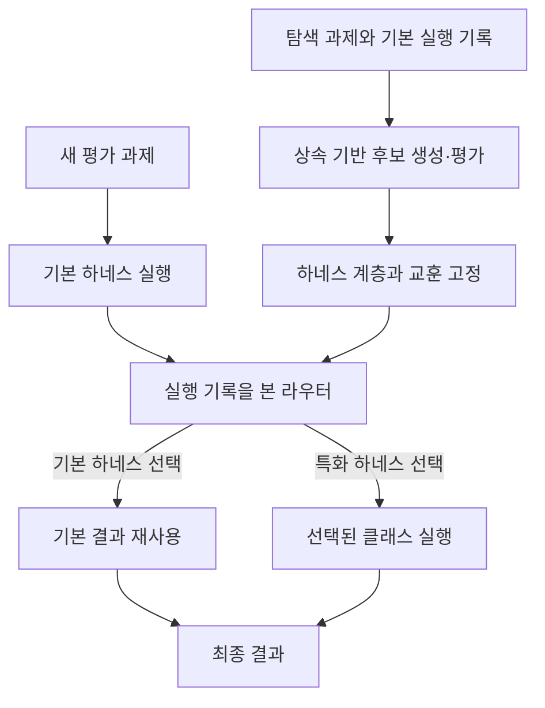

# Object-Oriented Harness: Evolving Agent Harnesses through Object-Oriented Design

**분석 대상:** Gaotang Li 외, *Object-Oriented Harness: Evolving Agent Harnesses through Object-Oriented Design*, arXiv:2610.28380v1, 첨부된 20쪽 판본.

**분석 원문:** 2610.28380v1.pdf

쪽수는 첨부 PDF의 페이지 순서와 일치합니다. 아래에서는 **[저자 보고]**, **[해석]**, **[후속 연구 제안]**을 구분합니다.  
개선폭의 **%p는 퍼센트포인트**이며, 상대 증가율과 다릅니다. 관련 연구 비교는 2026년 10월 29일에 확인한 1차 자료를 기준으로 합니다.

---

## 1. Executive summary — 8문장

1. **[저자 보고]** OO-Harness는 서로 다른 작업에 하나의 실행 전략을 일괄 적용하는 문제를 해결하기 위해, 언어모델 주변의 실행 코드인 하네스를 객체지향 상속 구조로 자동 진화시키는 프레임워크다. **(pp.1–3, Figure 1)**
2. **[저자 보고]** 학습 단계에서는 기본 하네스의 실행 기록으로 작업들을 묶고, 진화 에이전트가 기존 하네스를 상속한 특화 클래스를 작성하여 해당 작업 묶음에서 평가한다. **(pp.3–5, Figure 3, Algorithm 1)**
3. **[저자 보고]** 평가 단계에서는 작업 정보와 기본 실행 기록을 본 라우터가 특화 하네스를 선택하거나 기본 결과를 재사용하며, 실행 모델의 가중치와 학습된 하네스·교훈은 고정된다. **(pp.3–5, §3.5)**
4. **[저자 보고]** 세 벤치마크의 주지표에서 OO-Harness가 비교 방법 중 가장 높은 평균을 기록했고, 기본 하네스 대비 개선폭은 AutomationBench **15.79%p**, Workspace-Bench **14.03%p**, Toolathlon-GYM **6.30%p**다. **(p.7, Table 1; 개선폭은 표의 값으로 계산)**
5. **[저자 보고]** 구성요소 비교에서는 Workspace-Bench의 상속 방식이 코드 복사 방식보다 **4.96%p** 높았고, 기본 실행 기록을 라우팅에 추가한 효과는 벤치마크에 따라 **0.53–12.64%p**로 달랐다. **(pp.7–8, Table 2, Figure 5)**
6. **[저자 보고]** 학습과 평가의 응용 프로그램군이 겹치지 않는 별도 실험에서는 OO-Harness가 49개 평가 과제 모두에서 기본 하네스를 선택해 성공률 **59.18%**를 유지했으며, Meta-Harness는 **44.90%**를 기록했다. **(p.9, Figure 7; p.18, A.7)**
7. **[해석]** 따라서 이 논문이 뒷받침하는 일반화 성과는 미사용 과제에서의 시스템 성능 개선과 낯선 환경에서의 성능 보존이며, 신경망 자체의 능력 향상이나 새로운 응용 프로그램으로의 특화 기능 전이를 입증한 것은 아니다. **(pp.3, 7, 9)**
8. **[해석]** 주실험의 반복은 실행 모델의 3회 실행이고 주요 구성요소 실험은 단일 실행이므로, 작은 비교우위의 통계적 확실성·진화 과정의 재현성·전체 비용 대비 이점은 추가 검증이 필요하다. **(pp.6–8, Table 1–2, Figure 5)**

> **용어 풀이**  
> **하네스(harness):** 모델이 사용할 프롬프트, 도구, 문맥 관리, 반복·종료 규칙 등을 구현한 실행 코드  
> **상속(inheritance):** 기존 클래스의 기능을 물려받아 필요한 부분만 추가·변경하는 프로그래밍 방식  
> **라우터(router):** 주어진 작업에 사용할 하네스를 선택하는 구성요소  
> **실행 궤적(trajectory):** 작업 수행 중 발생한 모델 응답, 도구 호출, 도구 결과 등의 실행 기록

---

## 2. 연구 배경·문제·목표

### 2.1 해결하려는 문제

**[저자 보고]** 에이전트가 수행하는 작업은 필요한 도구, 문맥 처리, 완료 확인 방식이 서로 다르다.  
문서를 작성하는 작업과 여러 업무용 API를 호출하여 실제 데이터를 갱신하는 작업에는 서로 다른 실행 전략이 필요하다.  
그러나 하나의 전역 하네스를 모든 작업에 적용하면, 특정 작업에서 도움이 된 변경이 다른 작업에는 불필요하거나 해로울 수 있다. **(pp.1–2, Introduction)**

논문은 이를 다음 세 가지 구성의 차이로 설명한다.

| 구성 | 작동 방식 | 연구가 주목하는 문제 |
|---|---|---|
| 단일 전역 하네스 | 모든 작업에 같은 실행 코드를 적용 | 작업별 요구 차이를 충분히 반영하기 어려움 |
| 독립적인 특화 하네스 집합 | 라우터가 서로 독립된 구현 중 하나를 선택 | 공통 기능을 여러 구현에서 중복 관리하게 됨 |
| OO-Harness | 특화 하네스들이 상속으로 코드를 공유하고, 라우터가 선택 | 공통 기능 재사용과 작업별 특화를 함께 지원 |

**근거:** p.2, Figure 1.

> **용어 풀이 — 전역 하네스:** 여러 작업에 공통으로 적용하는 하나의 실행 구현. 여기서 ‘전역’은 모든 환경에 보편적으로 통한다는 뜻이 아니다.

### 2.2 연구 목적

**[저자 보고]** 연구 목적은 다음 세 요소를 결합하는 것이다.

- **표현 방식:** 하네스를 상속 가능한 실행 클래스 계층으로 표현한다.
- **자동 개선:** 실행 기록에서 공통 문제를 찾아 특화 클래스를 생성·평가한다.
- **작업별 적용:** 새로운 작업에 적절한 특화 하네스를 선택하고, 적절한 것이 없으면 기본 결과를 유지한다.

이때 실제 작업을 수행하는 언어모델은 고정한다. 연구의 최적화 대상은 모델의 가중치가 아니라 **모델 주변의 코드와 선택에 사용되는 증거**다. **(pp.2–5, §3)**

> **용어 풀이 — 가중치:** 신경망 내부 계산에 사용되는 수치 매개변수. 이 논문에서는 하네스를 진화시키는 동안 실행 모델의 가중치를 업데이트하지 않는다.

### 2.3 연구의 필요성에 대한 해석

**[해석]** 이 연구가 다루는 핵심 질문은 “좋은 실행 코드를 발견할 수 있는가?”에 더해, **“발견한 변경을 어느 작업에 적용해야 하는가?”**다. 유용한 변경을 보관하는 능력과 적절한 변경을 선택하는 능력이 함께 필요하다는 문제 설정이다. **(pp.1–5, Figure 1, Figure 3)**

또한 탐색에 사용한 과제와 평가 과제를 분리한다는 점이 중요하다. 동일 과제에 반복적으로 맞춘 개선과 새로운 과제에도 통하는 개선을 구분하려는 설계다. 다만 이 분리만으로 모든 종류의 분포 변화에 대한 일반화가 확인되는 것은 아니다. **(p.3, Figure 2; p.9, §5.3)**

> **용어 풀이 — 분포 변화:** 학습·개선에 사용한 작업과 실제 평가 작업의 성격, 도구, 환경 등이 달라지는 현상.

---

## 3. 핵심 주장과 근거

| 핵심 주장 | 저자가 제시한 근거 | 해석 가능한 범위와 주의점 | 원문 위치 |
|---|---|---|---|
| 특화 하네스 계층이 기존 비교 방법보다 높은 성능을 낸다 | 세 벤치마크 주지표에서 최고 평균 | 평가한 설정에서의 평균 우위이며, 모든 차이에 대한 통계적 유의성은 미보고 | p.7, Table 1 |
| 상속을 이용한 코드 재사용이 유용하다 | Workspace에서 OO 40.56, Flat 35.60, Base-reset 29.39 | 서로 다른 탐색 과정의 최종 결과를 비교하므로 상속 문법만의 효과로 분리할 수 없음 | p.8, Figure 5; pp.17–18, A.6.2 |
| 실행 기록을 활용한 라우팅이 도움이 된다 | 작업 정보만 사용할 때보다 실행 기록을 추가한 점수가 높음 | 효과 크기는 환경에 따라 크게 다름; 독립 반복은 없음 | p.7, Table 2 |
| 목표 작업 묶음만 평가하면 탐색이 빨라진다 | 기록된 평균 탐색시간 109.1시간 대 29.0시간 | 해당 실행에서의 시간 비교이며, 총 API 비용 절감률을 측정한 것은 아님 | p.6, Figure 4 |
| 기본 하네스를 남겨두면 낯선 작업에서 성능 저하를 피할 수 있다 | 별도 OOD 평가에서 모든 과제를 Base로 보내 기존 성공률 유지 | 특화 하네스가 새로운 앱으로 전이되어 성능을 높인 증거는 아님 | p.9, Figure 7 |
| 라우팅 교훈이 실행 문제와 적절한 하네스를 연결한다 | 질의 오류→오류 정규화 하네스, 정상 실행→Base 재사용 사례 | 교훈만 제거한 별도 실험이 없어 그 기여도를 독립적으로 정량화하기 어려움 | p.9, Figure 6c; p.20, Table 4 |

> **용어 풀이 — 구성요소 제거·변형 실험(ablation):** 특정 구성요소를 없애거나 바꾸어 성능에 미치는 영향을 비교하는 실험. 여러 조건이 함께 달라지면 한 구성요소만의 효과로 해석하기 어렵다.

---

## 4. 방법론: 데이터, 시스템 구조, 수식, 실행 절차

### 4.1 연구 수행 방식과 주요 데이터 소스

**[저자 보고]** 세 벤치마크에서 하네스 탐색용 과제와 미사용 평가 과제를 분리하고, 각 벤치마크의 실행 환경과 평가 방식을 유지했다. **(pp.5–6, §4.1; p.13, A.1–A.3)**

| 데이터 소스 | 작업 성격 | 탐색용 / 평가용 과제 수 | 평가 방식 | 주지표 |
|---|---|---:|---|---|
| **AutomationBench** | 시뮬레이션된 업무용 앱에서 API로 상태를 조회·변경 | 300 / 300 | 최종 상태에 대한 결정론적 검사 | Mean: 평균 부분점수 |
| **Workspace-Bench** | 문서·스프레드시트·발표자료·코드 등 파일 작업 | 288 / 100, Lite-100 | 에이전트 평가자가 작업별 평가 항목을 판정 | Mean: 전체 평가 항목의 통과율 |
| **Toolathlon-GYM** | 여러 도구·응용 프로그램을 연결하는 장기 작업 | 251 / 252 | 작업별 완료 검사 | PASS: 엄격한 과제 성공률 |

**근거:** p.5, §4.1; p.7, Table 1; p.13, A.3.

세 벤치마크 모두 Mean과 PASS를 보고하지만 의미가 동일하지 않다.

- AutomationBench와 Toolathlon-GYM의 PASS는 **보상점수 0.999 이상**을 요구한다.
- Workspace-Bench의 PASS는 **해당 과제의 모든 평가 항목 충족**을 요구한다.
- Workspace-Bench의 Mean은 모든 평가 항목을 합쳐 계산하는 **micro-average**다. **(p.5; p.7, Table 1)**

> **용어 풀이**  
> **Discovery set:** 하네스를 탐색하고 수정하는 데 사용하는 과제 집합  
> **Held-out set:** 탐색에 사용하지 않고 최종 평가를 위해 남겨 둔 과제 집합  
> **Rubric:** 결과물이 충족해야 할 구체적인 평가 항목  
> **Micro-average:** 모든 평가 항목을 합쳐 통과율을 계산하는 방식; 평가 항목이 많은 과제가 결과에 더 큰 비중을 가질 수 있음  
> **결정론적 검사:** 동일한 최종 상태에 대해 정해진 규칙으로 같은 판정을 내리는 검사

### 4.2 모델과 시스템 구성

**[저자 보고]** 주요 비교실험의 모델 구성은 다음과 같다.

| 역할 | 원문 기호 | 모델·설정 | 수행하는 일 |
|---|---|---|---|
| 작업 실행 모델 | $M$ | `gemini-3.5-flash`, 가중치 고정 | 선택된 하네스 아래에서 실제 작업 수행 |
| 진화 에이전트 | $\pi$ | Claude Opus 4.8 | 기록 분석, 부모 선택, 후보 하네스 코드 작성 |
| 하네스 라우터 | $\rho$ | 주요 비교실험에서 Claude Sonnet 5 | 기본 결과 재사용 또는 특화 하네스 선택 |

하네스 최적화 방법들은 벤치마크별로 **최대 40회 진화 반복**을 사용한다. **(p.6; p.13, A.1–A.2; p.14, A.4.2)**

**설정 구분:** 부록에는 코드 기본값과 일부 사례에서 다른 라우터 모델을 사용한 설정도 있다. 예를 들어 Table 3의 사례는 검색·선택 모두 Opus 4.8을 사용한다. 따라서 모든 표와 사례를 동일한 라우터 구성으로 설명하면 안 된다. **(p.15, Router settings)**

이 논문에서 ‘모델 구조’는 새로운 신경망 층의 설계가 아니라 다음과 같은 **에이전트 시스템 구조**를 뜻한다.



*원문 Figure 3의 구조를 재정리한 설명도. 근거: p.4.*

### 4.3 하네스 계층의 표현

**[저자 보고]** 기본 하네스와 특화 하네스는 완전한 실행 클래스로 저장된다. 자식 클래스는 부모의 메서드를 물려받고, 필요한 메서드를 재정의하거나 새 메서드를 추가한다. 재정의한 메서드에서 `super()`를 호출하여 부모의 동작을 유지할 수도 있다. **(pp.3–4, §3.2)**

변경 가능한 부분은 다음과 같다.

- 프롬프트와 도구
- 문맥 관리
- 실행·종료 제어
- 실행 틀이 지원하는 경우 미들웨어, 파일 백엔드, 하위 에이전트 구성

다만 생성된 클래스는 해당 실행 틀의 인터페이스와 호환되어야 한다. **(p.3, §3.2; p.13, A.4.1)**

**중요한 구조적 구분:** 라우터가 자식 클래스를 선택했다고 해서 부모·조부모 에이전트를 차례로 별도 실행하는 것은 아니다. **선택된 하나의 클래스 인스턴스 안에서 상속된 기능과 새 기능이 함께 실행된다.** **(p.4, Execution within one instance)**

> **용어 풀이**  
> **클래스 / 인스턴스:** 기능을 정의한 코드 설계도 / 그 설계도로 실제 실행되는 객체  
> **메서드:** 클래스 안에 정의된 기능 또는 함수  
> **재정의(override):** 부모가 제공한 기능의 동작을 자식 클래스에서 변경하는 것  
> **`super()`:** 부모 클래스가 제공한 구현을 호출하는 방법  
> **백엔드:** 파일 저장 등 실제 처리를 담당하는 구현 부분  
> **미들웨어:** 모델·도구 호출 사이에서 검사, 변환, 제어 등을 수행하는 코드

### 4.4 원문 수식과 기호

**원문에는 번호가 붙은 수식이 없다.** 아래는 원문에 실제로 제시된 초기조건, 승인 조건, 라우팅 식을 구분해 설명한 것이다. 새로운 손실함수나 일반화 보장식을 추가하지 않았다.

#### A. 초기조건

$$
H_c = H_0,
\qquad
\mathcal{T}_H = \{H_0\}.
$$

**기호 설명**

- $H_0$: 진화 전 기본 하네스.
- $c$: 하나의 작업 클러스터.
- $H_c$: 현재 클러스터 $c$에 선택된 하네스.
- $\mathcal{T}_H$: 하네스 클래스들의 상속 계층.

각 작업 묶음은 처음에는 기본 하네스를 사용하며, 계층 역시 기본 하네스 하나로 시작한다. **(p.4, §3.3)**

> **용어 풀이 — 클러스터:** 공통된 실행상의 필요나 실패 양상을 가진 작업 묶음. 이 논문에서는 반드시 동일한 업무 분야에 속하는 작업끼리 묶는 것은 아니다.

#### B. 후보 하네스의 승인 조건

$$
S_c(H') > S_c^{\text{current}}.
$$

**기호 설명**

- $H'$: 새로 만든 후보 하네스 클래스.
- $S_c(H')$: 후보를 클러스터 $c$의 과제들에서 실행하여 얻은 점수.
- $S_c^{\text{current}}$: 현재 하네스 할당으로 얻어 저장해 둔 클러스터 점수.

이 부등식과 함께 **벤치마크별 추가 승인 검사도 통과해야 한다**. 추가 검사는 과제별 결과와 실행 피드백을 고려하며, 설정에 따라 모호한 사례에 판단 에이전트를 사용한다. **(pp.4–5, §3.4)**

여기서 요구하는 개선은 **대상 클러스터에서의 개선**이다. 모든 탐색 과제에서 동시에 개선될 필요는 없다. 또한 후보가 상속하는 부모가 반드시 현재의 $H_c$일 필요도 없다. **(pp.4–5)**

**[해석]** 이 조건은 탐색 절차의 승인 규칙이지, 새로운 작업에서 성능이 개선된다는 수학적 보장은 아니다. 원문은 클러스터 점수의 일반적인 폐쇄형 수식이나 일반화 오차 상한을 제시하지 않는다. **(§3, pp.3–5)**

#### C. 평가 시 하네스 선택

```math
H^\star
=
\rho\left(
t,\,
\omega(t),\,
\{H_0\}\cup\{H_c\}_{c\in\mathcal{C}},\,
\mathcal{L}_{\rho}
\right).
```

**기호 설명**

| 기호 | 의미 |
|---|---|
| $t$ | 새롭게 주어진 평가 과제 |
| $\omega(t)$ | 과제 $t$를 기본 하네스로 실행했을 때 관측 가능한 실행 궤적 |
| $\mathcal{C}$ | 작업 클러스터들의 집합 |
| $\{H_0\}\cup\{H_c\}_{c\in\mathcal{C}}$ | 기본 하네스와 현재 클러스터별 선택 하네스로 구성된 선택지 |
| $\mathcal{L}_{\rho}$ | 탐색 단계에서 축적하고 평가 전에 고정한 라우팅 교훈 |
| $\rho$ | 하네스 선택 함수, 실제 구현에서는 언어모델 라우터 |
| $H^\star$ | 라우터가 선택한 하네스 |

**근거:** p.5, §3.5.

선택 이후의 동작은 명확하다.

- $H^\star=H_0$이면 이미 얻은 기본 실행 결과를 재사용한다.
- 특화 하네스를 선택하면 해당 클래스의 인스턴스를 실행한다.
- 평가 중에는 계층과 저장된 교훈을 갱신하지 않는다.
- 평가용 채점 결과, 판정, 숨겨진 정답은 라우터와 실행 모델에 제공하지 않는다. **(pp.5–6)**

### 4.5 학습 절차 상세

**[저자 보고]** Algorithm 1의 핵심 절차는 다음과 같다. **(pp.4–5)**

1. **기본 실행:** 탐색 과제 집합 $\mathcal{D}_{\text{tr}}$를 $H_0$로 실행하고 궤적과 평가 결과를 저장한다.
2. **작업 묶음 생성:** 같은 하네스 변경으로 도움을 받을 가능성이 있는 과제들을 클러스터로 묶는다.
3. **후보 작성:** 진화 에이전트가 대상 클러스터와 부모 클래스를 선택하고 자식 클래스를 작성한다.
4. **국소 평가:** 후보를 해당 클러스터의 과제 집합 $\mathcal{D}_c$에서 직접 평가한다.
5. **승인·기록:** 승인된 클래스를 계층에 추가하고 필요하면 $H_c$를 바꾸며, 실패한 제안도 기록한다.
6. **탐색 조정:** 반복 거절되는 클러스터의 우선순위를 낮추고, 필요하면 작업을 재배치하거나 클러스터를 분리·병합한다.
7. **고정:** 탐색이 끝나면 계층·선택 하네스·교훈을 고정하여 평가에 사용한다.

여기서 $\mathcal{D}_{\text{tr}}$는 전체 탐색 과제 집합이고, $\mathcal{D}_c$는 클러스터 $c$에 속한 탐색 과제 집합이다.

진화 에이전트는 파일시스템의 코드·기록을 읽고, 증거 분석을 다른 에이전트에게 위임하며, 후보 코드를 작성할 수 있다. 축약 프롬프트에는 공통된 하네스 수정 메커니즘을 찾고, 과제 ID·정답·파일명을 하드코딩하지 말라는 지시가 포함된다. **(pp.13–14, A.4.1–A.4.2)**

기록을 요약하는 교훈은 두 종류다.

| 저장 정보 | 목적 |
|---|---|
| 설계 교훈 $\mathcal{L}_{\pi}$ | 유용했던 변경과 실패한 접근을 다음 코드 개정에 활용 |
| 라우팅 교훈 $\mathcal{L}_{\rho}$ | 어느 실행 상황에 어떤 하네스를 적용할지 안내 |

교훈 저장소의 사용 방식은 구현마다 다르며, 모든 벤치마크가 두 종류를 동일하게 제공한다고 단정할 수 없다. **(p.3; p.4, Figure 3 주석)**

### 4.6 라우터가 실제로 받는 정보

| 벤치마크 | 라우터에 제공하는 관측 정보 |
|---|---|
| AutomationBench | 과제 질의, 기본 도구 호출·결과 요약, 쓰기 횟수, 실행 오류 패턴 |
| Workspace-Bench | 작업 메타데이터, 난이도, 요구 출력 확장자, 파일 의존관계 수, 기본 실행의 응답·도구 호출 횟수 |
| Toolathlon-GYM | 과제 ID, 도구 계열, 기록된 이벤트 수, 빈번한 도구·이벤트 유형, 실행 오류 범주 |

**근거:** pp.14–15, A.4.2.

AutomationBench에서는 먼저 관련 라우팅 교훈을 검색하고, 이후 사용 가능한 하네스 중 하나를 선택한다. 라우터 자체의 에이전트 도구는 비활성화되어 있으며, 준비된 기록과 고정된 문맥만 받는다. **(pp.14–15)**

**[해석]** 따라서 “실행 궤적을 사용한다”는 표현이 모든 환경에서 전체 로그를 동일하게 전달한다는 뜻은 아니다. 실제 관측 정보의 범위와 요약 방식이 벤치마크마다 다르다.

### 4.7 구체적인 상속 예제

원문의 Listing 1은 부모의 문맥 처리 기능을 유지하면서 자식이 완료 검사를 추가하는 예다. 아래는 논문이 제시한 **설명용 축약 코드**다. **(pp.15–16, A.4.3, Listing 1)**

```python
class FormulaLiteralHarness(BaseHarness):
    def manage_context(self, messages, state):
        messages = super().manage_context(messages, state)
        return pin_literals_if_needed(messages, state)

class PercentCheckHarness(FormulaLiteralHarness):
    def verify_before_finish(self, messages, state):
        parent = super().verify_before_finish(messages, state)
        if parent:
            return parent
        return check_saved_percent_values(messages, state)
```

- 부모는 `.xlsx`에 평가되지 않은 수식 문자열을 쓰려는 상황에서 계산된 값을 저장하도록 안내한다.
- 자식은 `manage_context`를 다시 정의하지 않으므로 부모의 문맥 처리 기능을 그대로 물려받는다.
- 자식은 `verify_before_finish`를 확장하여 저장된 백분율 셀을 확인한다.
- `messages`는 대화·도구 기록, `state`는 실행 상태이며, 코드의 `parent` 변수는 부모 완료 검사의 반환값이다. **(pp.15–16)**

**적용 범위에 주의해야 한다.** 이 백분율 검사는 과제가 20%를 `0.2`가 아니라 `20`으로 저장하기를 기대한다는 전제를 둔다. 따라서 0과 1 사이의 백분율 값을 일반적으로 잘못된 값으로 판단하는 규칙으로 확대하면 안 된다. **(p.20, B.3)**

---

## 5. 주요 결과와 데이터 포인트

### 5.1 주실험 결과

**[저자 보고]** 아래는 Table 1에서 각 벤치마크의 **주지표만** 추린 것이다. 값은 **3회 실행 평균 ± 표준편차**, 단위는 %다. **(pp.6–7, Table 1)**

| 방법 | AutomationBench Mean | Workspace-Bench Mean | Toolathlon-GYM PASS |
|---|---:|---:|---:|
| Base | 61.62 ± 0.15 | 25.45 ± 2.98 | 31.15 ± 0.28 |
| 병렬 선택, $K=2$ | 61.46 ± 2.38 | 32.54 ± 4.30 | 31.55 ± 1.96 |
| 병렬 선택, $K=5$ | 60.24 ± 1.07 | 37.71 ± 0.45 | 32.14 ± 0.56 |
| 순차 개선, $K=2$ | 59.29 ± 0.25 | 27.93 ± 2.13 | 33.33 ± 2.81 |
| Meta-Harness | 63.92 ± 0.89 | 29.56 ± 1.23 | 33.45 ± 1.23 |
| AHE | 64.18 ± 0.91 | 38.43 ± 4.32 | 36.23 ± 1.19 |
| AAH | 75.40 ± 1.26 | 38.62 ± 2.98 | 34.32 ± 1.47 |
| **OO-Harness** | **77.41 ± 1.37** | **39.48 ± 3.21** | **37.45 ± 0.98** |

$K$는 한 과제에 사용하는 기본 하네스 실행 횟수다. 병렬 방식은 독립 실행들 중 하나를 선택하고, 순차 방식은 첫 실행에서 관측한 문제를 요약하여 두 번째 실행을 안내한다. 두 방식 모두 평가용 정답이나 채점 피드백을 받지 않는다. **(p.5; p.16, A.5)**

> **용어 풀이 — 표준편차:** 반복 실행 결과가 평균 주변에서 얼마나 흔들리는지를 나타내는 값. 평균의 신뢰구간이나 통계적 유의성 자체를 뜻하지 않는다.

**[계산]** Table 1의 평균을 이용한 개선폭은 다음과 같다.

| 주지표 | Base 대비 개선 | 가장 높은 비교 방법 대비 개선 |
|---|---:|---:|
| AutomationBench Mean | **+15.79%p** | AAH 대비 **+2.01%p** |
| Workspace-Bench Mean | **+14.03%p** | AAH 대비 **+0.86%p** |
| Toolathlon-GYM PASS | **+6.30%p** | AHE 대비 **+1.22%p** |

**[해석]** 기본 하네스 대비 개선은 분명하게 관측되지만, 가장 강한 비교 방법과의 차이는 훨씬 작다. 특히 Workspace-Bench에서는 평균 차이가 0.86%p이므로, 이를 확정적인 우월성으로 판단하려면 추가 반복과 적절한 비교 검정이 필요하다. **(p.7, Table 1)**

### 5.2 부분점수와 완전한 성공을 구분해야 한다

| 추가 지표 | Base | OO-Harness |
|---|---:|---:|
| AutomationBench PASS | 25.44 ± 0.51 | 37.22 ± 2.14 |
| Workspace-Bench PASS | 3.67 ± 0.58 | 8.33 ± 2.52 |
| Toolathlon-GYM Mean | 71.87 ± 0.65 | 77.18 ± 1.15 |
| AutomationBench 최종 실행 Steps | 31.27 ± 0.13 | 27.99 ± 0.02 |
| Workspace-Bench 최종 실행 Steps | 34.41 ± 1.34 | 32.78 ± 1.97 |
| Toolathlon-GYM 최종 실행 Steps | 40.50 ± 0.99 | 37.25 ± 0.38 |

**근거:** p.7, Table 1.

**[해석]** Workspace-Bench에서 평가 항목 통과율이 39.48%여도, 모든 항목을 충족하는 과제의 비율은 8.33%다. 따라서 부분적인 품질 개선과 완전한 업무 성공을 분리해서 평가해야 한다.

또한 Steps는 **최종 선택된 궤적만** 센다. 기본 실행, 버린 후보 실행, 라우터 호출 등을 합한 전체 비용 지표가 아니다. **(pp.6–7)**

### 5.3 실행 기록을 활용한 라우팅의 효과

**[저자 보고]** 동일한 하네스 목록을 유지하면서 작업 정보만 제공하는 경우와 기본 실행 기록까지 제공하는 경우를 비교했다. **(p.7, Table 2)**

| 지표 | Base | 작업 정보만 | 작업 정보 + 실행 기록 | 실행 기록 추가 차이 |
|---|---:|---:|---:|---:|
| AutomationBench Mean | 61.30 | 64.88 | 77.52 | **+12.64%p** |
| Workspace-Bench Mean | 24.57 | 40.03 | 40.56 | **+0.53%p** |
| Toolathlon-GYM PASS | 31.35 | 33.33 | 37.70 | **+4.37%p** |

이 표는 **별도의 단일 실행 결과**다. Table 1의 3회 평균과 합치거나 서로 대체해서는 안 된다. **(Table 2 주석)**

**[저자 설명]** Workspace-Bench에서는 문서·스프레드시트 등 요구 출력 형식이 작업 설명에 드러나므로, 작업 정보만으로도 적절한 특화 하네스를 찾기 쉽다. AutomationBench와 Toolathlon-GYM에서는 쓰기 누락이나 실행 중 오류처럼 실제 실행 후에 드러나는 문제가 더 중요한 단서가 될 수 있다. **(pp.7–9, Figure 6)**

작업 정보만 사용하는 라우터에는 **자기보고 적용 신뢰도 0.7 이상**이라는 조건이 있다. 이 값은 보정된 성공확률이 아니라고 저자들이 명시한다. **(pp.16–17, A.6.1)**

> **용어 풀이 — 보정된 확률:** 예를 들어 성공확률을 70%로 예측한 사례들이 실제로도 약 70% 성공하도록 예측값과 빈도가 맞는 확률. 언어모델이 말한 “신뢰도 0.7”은 자동으로 이런 성질을 갖지 않는다.

### 5.4 상속 구조의 효과

| 변형 | 코드 재사용 방식 | Workspace 점수 |
|---|---|---:|
| Base-reset | 매번 Base에서 새 변경 구현; 과거 기록은 참고 가능 | 29.39 |
| Flat | 이전에 승인된 기능을 새 파일에 복사 | 35.60 |
| OO | 이전 특화 클래스를 상속하고 필요한 부분 확장 | **40.56** |

**근거:** p.8, Figure 5; pp.17–18, A.6.2.

**[계산]** Flat은 Base-reset보다 6.21%p, OO는 Flat보다 4.96%p 높다.

**[해석]** 결과는 코드 재사용의 가치와 상속으로 재사용을 조직하는 전략의 가능성을 뒷받침한다. 그러나 각 조건은 별도로 탐색한 뒤 한 번 평가했다. 동일한 기능의 코드에 상속 문법만 적용하여 4.96%p가 오른 실험은 아니다. **(p.8; p.18)**

### 5.5 탐색 효율성

**[저자 보고]** Figure 4의 기록된 평균 탐색시간은 Meta-Harness **109.1시간**, OO-Harness **29.0시간**이다. **(p.6, Figure 4b)**

**[계산]** 해당 시간은 약 **73.4% 감소**한 값이다.

**[해석]** 이는 관측된 탐색시간 절감의 근거다. 하지만 API 토큰 총량, 금액, 시간 분산, 실행 인프라 조건을 충분히 제시하지 않으므로 동일 비율의 비용 절감으로 옮겨 말할 수는 없다. 또한 Figure 4a의 가로축은 실제 시간이 아니라 **기록된 업데이트 진행률**이다. **(p.6, Figure 4; p.18, Resources)**

---

## 6. 일반화 성능: 무엇이 확인되었고 무엇이 남았는가?

### 6.1 같은 벤치마크 안의 미사용 과제

**[저자 보고]** 하네스를 만든 과제와 평가 과제를 분리하고, 평가 전 코드와 교훈을 고정했다. 그 상태에서 세 벤치마크의 주지표가 개선되었다. **(pp.3–7, Figure 2, Table 1)**

**[해석]** 이는 탐색에 직접 사용하지 않은 과제에 개선이 적용된다는 증거다. 다만 한 벤치마크 안에서 작업 형식·도구·실행 환경이 공유될 수 있으므로, 완전히 새로운 응용 프로그램이나 다른 실행 모델에 대한 전이와는 구별해야 한다.

### 6.2 응용 프로그램군이 다른 OOD 실험

**[저자 보고]** 별도 설정에서는 Toolathlon-GYM의 254개 과제로 진화시키고, 원래 Toolathlon의 49개 과제로 평가했다.  
이름으로 구분한 응용 프로그램군은 학습과 평가에서 겹치지 않는다. **(p.9, §5.3; p.18, A.7)**

| 구분 | 응용 프로그램군 |
|---|---|
| 학습 | Google Workspace의 Forms·Calendar·Sheets, HowToCook, Notion, Snowflake, WooCommerce |
| 평가 | Amazon, Canvas, Git/GitHub, Kubernetes, 문헌검색, MySQL, 12306, Redis, Yahoo Finance, YouTube |

| 방법 | OOD 과제 성공률 |
|---|---:|
| Base | **59.18%** |
| Meta-Harness | 44.90% |
| OO-Harness | **59.18%** |

**근거:** p.9, Figure 7.

OO-Harness는 **49개 모두에서 Base를 선택했다**. 따라서 이 결과의 직접적인 의미는 **학습한 특화를 적용하지 않는 선택으로 기본 성능을 보존했다는 것**이다.

> **용어 풀이**  
> **OOD, out-of-distribution:** 학습·탐색에 사용한 작업 분포와 다른 조건의 평가  
> **부정적 전이:** 기존 환경에서 얻은 변경이나 지식을 새로운 환경에 적용했을 때 오히려 성능이 낮아지는 현상  
> **Fallback:** 특화된 처리가 적절하지 않을 때 기본 처리로 돌아가는 선택

### 6.3 일반화에 관한 증거 수준

| 질문 | 문서가 제공하는 답 |
|---|---|
| 탐색에 쓰지 않은 과제에서 개선되는가? | **예:** 세 벤치마크의 분리된 평가 집합에서 개선 |
| 새로운 앱에서 특화 하네스가 더 높은 성능을 내는가? | **확인되지 않음:** OOD 평가에서는 전부 Base 선택 |
| 낯선 앱에 잘못된 특화를 적용하는 피해를 줄일 수 있는가? | **사례적 근거 있음:** Figure 7에서 기본 성능 유지 |
| 다른 실행 모델로 계층을 옮겨도 개선되는가? | **미평가:** 주요 실험의 실행 모델은 하나 |
| 시간에 따른 API 변경과 도구 추가에도 유지되는가? | **미평가:** 저자들이 환경 의존성을 한계로 제시 |

**근거:** pp.6–10, Table 1, Figure 7, Limitations.

**[해석]** 일반화 향상 가능성을 가장 직접적으로 검증하려면, 새로운 앱에서도 기존과 동일한 실행 실패 메커니즘이 나타나는 과제를 구성해야 한다. 그때 특화 하네스가 실제로 선택되고 성공률을 높이는지 확인해야 **특화 기능의 전이**와 **기본 성능 보존**을 분리할 수 있다. 이는 아직 수행되지 않은 검증이다. **(p.9, Figure 6–7에 근거한 후속 검증 방향)**

---

## 7. 통계적으로 취약한 부분과 비교 불가능한 수치

### 7.1 통계적 취약점

| 항목 | 원문에서 확인되는 조건 | 분석상 한계 |
|---|---|---|
| 반복 단위 | 주실험은 독립적인 실행 모델 실행 3회 | 전체 하네스 진화를 독립적으로 3회 반복했다는 의미가 아님 |
| 유의성 | 평균 ± 표준편차 보고 | 유의성 검정·신뢰구간이 없어 작은 차이의 확실성을 판단하기 어려움 |
| 라우팅 실험 | Table 2는 단일 실행 | 실행 변동을 고려한 효과 크기 불확실성 미확인 |
| 상속 실험 | 각 방식이 별도 탐색 후 1회 평가 | 상속 효과와 탐색 경로의 우연성을 분리하기 어려움 |
| OOD 실험 | 평가 과제 49개 | 반복 결과·신뢰구간 미보고; 한 과제가 약 2.04%p에 해당 |
| Workspace 평가 | 에이전트가 평가 항목 판정 | 평가자의 변동성과 평가자 간 일치도 미보고 |
| 후보 승인 | 목표 클러스터의 점수 개선을 요구 | 작은 클러스터에서 우연한 점수 변동을 개선으로 채택할 가능성의 크기 미측정 |

**근거:** pp.4–8, Table 1–2, Figure 5; p.9, Figure 7; p.13, A.3.

표준편차가 겹친다는 이유만으로 “차이가 유의하지 않다”고 단정하는 것도 옳지 않다. 이 문서에서 가능한 결론은 **통계적 유의성이 입증되었다고 말할 수 없다는 것**이다.

### 7.2 직접 비교하면 안 되는 수치

| 비교하려는 수치 | 비교에 제한이 있는 이유 |
|---|---|
| 세 벤치마크의 Mean | 부분점수, 평가 항목 통과율, 평균 보상으로 의미가 서로 다름 |
| Table 1과 Table 2의 OO 점수 | 3회 평균과 별도 단일 실행이라는 차이 |
| 주실험 Toolathlon PASS 37.45%와 OOD 59.18% | 데이터 출처, 작업 수, 응용 프로그램군, 학습 분할이 모두 다른 실험 |
| 최종 Steps와 전체 시스템 비용 | 기본 실행·다른 후보 실행·라우터 호출이 Steps에서 제외됨 |
| 동일한 최대 40회 진화와 동일한 계산 예산 | 후보마다 평가하는 작업 수, 모델 호출량 등이 다를 수 있음 |
| Table 3의 두 집단 점수 | 특화 실행 후 성능이 아니라 두 집단의 **원래 Base 성능** |
| Figure 4c의 종합 평균과 단일 성공률 | 서로 다른 벤치마크 주지표를 합친 요약 |

**근거:** pp.5–9, Table 1–3, Figure 4, Figure 7.

특히 Figure 4c의 OO 점수 51.4는 Table 1의 세 주지표를 단순 평균한 값과 일치한다.  
이는 평균 부분점수·평가 항목 통과율·엄격 성공률을 합친 요약이므로 **전체 과제의 성공률 51.4%**로 읽으면 안 된다. **[계산·해석, p.6 Figure 4c; p.7 Table 1]**

### 7.3 인과관계와 재현성 측면의 확인 필요 사항

**첫째, AAH와의 차이를 모두 상속의 효과로 돌릴 수 없다.** 논문의 비교 구현에서는 AAH와 OO-Harness가 작업 묶음 기준, 라우팅 정보, 코드 공유 방식 등에서 함께 달라진다. **(p.16, A.5; pp.3–5)**

**둘째, 라우팅 교훈의 독립 효과는 분리되지 않았다.** 교훈을 사용한 사례는 있지만, 교훈만 제거한 통제 실험은 본문과 부록에서 확인되지 않는다. **(p.7, Table 2; pp.16–18, A.6; p.20, Table 4)**

**셋째, 일부 집계는 유효 분모를 추가로 확인할 필요가 있다.** 예를 들어 Workspace의 100개 과제를 동일한 분모로 3회 평가하여 이진 성공률을 평균했다면 평균은 약 0.333%p 간격이어야 한다. Table 1의 PASS 5.54%, 7.78%는 이 조건과 바로 맞지 않는다. 유효 과제 수, 제외 처리, 별도 집계 규칙의 설명이 필요하다는 재현성 질문이며, 이것만으로 수치 오류를 확정할 수는 없다. **[계산·해석, p.7 Table 1]**

**넷째, Figure 6의 집계 범위도 불명확하다.** 표시된 셀을 합하면 AutomationBench 298개, Workspace-Bench 251개로, 명시된 탐색 과제 수 300개·288개와 다르다. Figure 10과 달리 Figure 6에는 Base·미분류 과제 제외에 관한 명시적 설명이 없다. 따라서 그림을 전체 탐색 집합의 완전한 분포로 해석할 때 주의가 필요하다. **[계산·해석, p.9 Figure 6; p.20 Figure 10]**

---

## 8. 가장 중요한 그림의 선정과 해석

| 선정 그림 | 그림이 직접 보여주는 것 | 연구를 이해하는 데 중요한 이유 | 해석상의 경계 |
|---|---|---|---|
| **Figure 1, p.2** | 전역·독립 특화·상속 기반 특화의 세 구성 | 핵심 기여가 코드의 조직 방식임을 보여줌 | 개념도 자체가 성능 우위의 증거는 아님 |
| **Figure 3, p.4** | 탐색, 계층 진화, 고정, 평가 시 선택 | 무엇을 학습하고 무엇을 고정하는지 가장 명확하게 보여줌 | 기본 실행 후 특화 실행이 추가될 수 있음 |
| **Figure 5, p.8** | Base-reset, Flat, OO의 성능 차이 | 상속 구조를 직접 검토한 핵심 실험 | 별도 탐색·단일 평가라는 한계 |
| **Figure 6, p.9** | 작업 클러스터와 분야·작업 유형의 관계, 오류 기반 선택 사례 | 작업 분류가 업무 분야보다 실행상의 공통 문제를 따를 수 있음을 보여줌 | 라우터 정확도를 측정한 그림은 아님 |
| **Figure 7, p.9** | 다른 앱군에서 Base 성능을 유지한 결과 | 일반화 주장에 대한 해석 범위를 결정하는 가장 중요한 그림 | 특화 기능의 OOD 개선을 보여주지 않음 |
| **Figure 8, p.19** | 같은 `.docx` 쓰기 요청을 실제 Word 문서로 변환하는 백엔드 | 모델을 바꾸지 않고 실행 코드로 해결하는 문제의 구체적인 예 | 파일 형식 유효성과 내용 정확성은 별도 |
| **Figure 9, p.19** | 쓰기 확인→예산 근접 알림→오류 안내의 상속 계보 | 기능이 누적되는 방식과 활성·비활성 조상의 관계를 설명 | 조상들이 각각 별도 실행되는 구조가 아님 |

### Figure 6에서 읽어야 할 핵심

AutomationBench의 클러스터는 여러 업무 분야에 걸쳐 있다. 예를 들어 계산·검증이 필요한 작업이나 쓰기 누락을 고치는 작업이 공통 실행 필요에 따라 묶인다. 반면 Workspace-Bench는 문서·스프레드시트처럼 출력 형식에 따른 작업 유형과 더 밀접하게 대응한다. **[저자 보고, pp.8–9, Figure 6]**

**[해석]** 이는 라우터에 어떤 정보가 필요한지가 작업 환경에 달려 있다는 설명을 뒷받침한다. 출력 형식만으로 특화 기능을 알 수 있는 환경과, 실제 실패 기록을 봐야 특화 기능을 고를 수 있는 환경은 다르다.

### Figure 9에서 읽어야 할 핵심

계보는 다음과 같다.

- `s9`: 쓰기가 필요한 작업인데 변경 API 호출이 없으면 추가 실행을 요청한다.
- `s12`: 이를 물려받고, 실행 한도 근처까지 쓰기가 성공하지 않았으면 알림을 추가한다.
- `s29`: 앞의 기능들을 유지하면서 반복 오류나 비생산적인 도구 결과에 대한 안내를 추가한다.

그림에서는 `s29`가 활성 하네스이고 `s9`, `s12`는 비활성 조상이다. 비활성 조상도 상속을 통해 기능을 제공한다. **[저자 보고, p.19, Figure 9]**

---

## 9. 저자가 인정한 한계와 문서가 답하지 않는 질문

### 9.1 저자가 직접 명시한 한계

논문의 **Limitations**는 주로 운영 환경의 의존성을 다룬다.

- 호스트가 제공하는 API와 실행 환경에 의존한다.
- 서비스 장애와 호출 제한이 신뢰성에 영향을 줄 수 있다.
- 인터페이스가 변경되면 진화된 하네스도 수정해야 할 수 있다.
- 비공개·인증 서비스에는 자격증명과 권한 관리가 필요하다.
- 견고한 API 통합과 여러 환경에서의 배포를 후속 연구 방향으로 제시한다.

**근거:** p.10, Limitations.

### 9.2 분석자가 확인한 미답 질문

아래는 저자가 명시한 한계와 구분되는, **문서만으로 답할 수 없는 질문**이다.

| 미답 질문 | 왜 중요한가 | 관련 위치 |
|---|---|---|
| 다른 실행 모델로 계층을 옮겨도 성능이 유지되는가? | 모델을 넘는 일반화와 특정 모델 의존성을 구분 | p.6; p.13, A.1 |
| 여러 독립적인 진화 실행에서도 비슷한 계층과 개선이 나오는가? | 탐색 과정의 재현성을 평가 | p.6; p.8 |
| 라우터가 최선의 하네스를 얼마나 자주 선택하는가? | 좋은 하네스 부족과 선택 실패를 구분 | p.5; p.8, Table 3 |
| 라우팅 교훈만의 추가 효과는 얼마인가? | 실행 기록·설명·교훈의 역할을 분리 | p.7, Table 2 |
| 전체 실행 비용과 지연은 얼마인가? | 실용적인 성능·비용 균형을 판단 | pp.6–7, Steps 정의 |
| 계층 깊이와 하네스 수가 커지면 어떻게 되는가? | 확장성과 유지보수 부담을 평가 | §3, pp.3–5 |
| 목표 클러스터 개선이 다른 작업의 실패를 유발하는가? | 선택적 특화의 회귀 위험을 측정 | pp.4–5, 승인 규칙 |
| 기본 실행을 끝까지 하지 않고 중간 기록으로 선택해도 되는가? | 라우팅 전 선행 비용을 줄일 여지 확인 | p.4, Figure 3 |
| 클러스터 분리·병합과 우선순위 갱신의 정확한 규칙은 무엇인가? | 구현 재현과 탐색 전략 비교에 필요 | p.5; pp.13–14 |
| 문서 백엔드처럼 비교적 단순한 수정이 전체 개선의 얼마를 설명하는가? | 복잡한 계층이 필요한 경우와 단순 수정으로 충분한 경우를 구분 | p.19, Figure 8 |

> **용어 풀이 — 회귀(regression):** 코드를 개선한 뒤 이전에는 성공하던 작업이 실패하거나 성능이 낮아지는 현상.

---

## 10. 2020년 이후 관련 연구 비교

다음은 해당 기간의 연구 중 **OO-Harness와 직접 연결되는 2024–2026년 연구 9편**을 선정한 비교다. 서로 다른 논문의 점수를 합쳐 성능 순위를 만들지 않고, 최적화 대상과 일반화 검증 방식에 초점을 맞췄다.

### 10.1 방법과 평가 설계의 비교

| 연구 | 원문에서 확인한 방법·평가 | OO-Harness와의 관계에 대한 해석 |
|---|---|---|
| **ADAS, 2024** | Meta Agent Search가 이전 코드·평가 기록을 축적하면서 새 에이전트 프로그램을 작성한다; 다른 모델과 다른 과제로의 전이를 평가한다. **원문 §3, §4.3, Tables 2–3.** [arxiv.org](https://arxiv.org/html/2408.08435v1?utm_source=chatgpt.com) | 실행 코드를 자동 설계한다는 계보를 공유하며, OO-Harness는 결과를 작업별로 선택 가능한 상속 계층으로 조직한다. |
| **GEPA, 2025 / ICLR 2026** | 실행 궤적을 자연어로 성찰하여 프롬프트를 수정하고, 서로 보완적인 후보들을 파레토 전선에서 결합한다. **공식 ICLR 초록.** [proceedings.iclr.cc](https://proceedings.iclr.cc/paper_files/paper/2026/hash/0e9e708b6f48e14fd0ac29e167413f76-Abstract-Conference.html?utm_source=chatgpt.com) | 실행 증거와 언어적 성찰을 활용한다는 공통점이 있지만, OO-Harness의 중심 대상은 실행 클래스와 그 계층이다. |
| **Meta-Harness, 2026** | 이전 후보 코드·점수·궤적을 바탕으로 하네스를 탐색한다; 수학에서는 250개 검색 문제와 별도 200개 평가 문제, 검색에 사용하지 않은 추가 모델들을 활용한다. **원문 §4.2, Table 6.** [arxiv.org](https://arxiv.org/html/2603.28052v1?utm_source=chatgpt.com) | 단일 전역 하네스를 찾는 비교 대상이며, OO-Harness는 여러 특화 구현을 유지하고 작업별로 선택한다. |
| **AHE, 2026** | 구성요소, 실행 경험, 수정 결정의 기록을 구조화하여 전체 하네스를 개선한다; 다른 과제와 실행 모델로의 전이도 평가한다. **원문 Figure 2; §4.3, Table 2, Figure 3.** [arxiv.org](https://arxiv.org/html/2604.25850v4?utm_source=chatgpt.com) | 실행 실패를 코드 수정으로 연결하는 과정이 공통이며, OO-Harness는 특화 전략의 공존과 상속 기반 재사용에 더 초점을 둔다. |
| **Adaptive Auto-Harness, 2026** | Git 브랜치별 특화 하네스를 만들고 작업 문맥에 따라 선택한다; 시간 순서가 있는 작업 스트림에서 평가한다. **원문 §3.4, Figure 3.** [arxiv.org](https://arxiv.org/html/2606.01770v2?utm_source=chatgpt.com) | 하네스 계층과 작업별 라우팅 자체는 선행된다; OO-Harness의 구체적 차이는 클래스 상속·메서드 재정의와 학습된 선택 교훈이다. |
| **NOOA, 2026** | 에이전트의 행동·상태·프롬프트를 Python 객체로 표현하는 프로그래밍 모델을 제시한다. **원문 pp.1–2, Figure 1.** [arxiv.org](https://arxiv.org/pdf/2607.20709?utm_source=chatgpt.com) | 객체지향 표현이라는 공통점이 있지만, OO-Harness는 실행 증거를 통해 특화 계층을 자동 생성·선택하는 최적화 절차다. |
| **HarnessEvolve, 2026** | 정답을 제공해 생성한 참조 궤적과 실패 궤적을 비교하고, 품질 검사와 최근 작업의 성능 보존 검사로 수정을 승인한다. **원문 §3.3–3.5, 승인식 (1).** [arxiv.org](https://arxiv.org/html/2609.00829v1?utm_source=chatgpt.com) | 목표 클러스터 개선을 중심으로 하는 OO-Harness와 비교할 때, 다른 작업의 성능 저하를 검사하는 접근이 후속 검증의 참고가 된다. |
| **Rethinking the Evaluation of Harness Evolution for Agents, 2026** | 피드백과 추론 예산을 맞춘 비교, 검색·평가 과제 분리를 요구하며, 단순 실행 확대보다 하네스 진화가 일관되게 우수하지 않음을 보고한다. **원문 Figures 1–2, §4.** [arxiv.org](https://arxiv.org/html/2607.12227v1?utm_source=chatgpt.com) | OO-Harness는 분리 평가와 실행 확대 비교를 포함하지만, 총비용까지 맞춘 검증은 추가로 필요하다. |
| **EvoHarnessBench, 2026** | 도구·스킬·전문 에이전트가 늘어나는 상황에서 기존 성능의 유지와 새로운 기능 적응을 평가하며, 두 목표가 함께 개선되지 않을 수 있음을 보고한다. **원문 초록.** [arxiv.org](https://arxiv.org/abs/2609.04280?utm_source=chatgpt.com) | OO-Harness도 평균 성능뿐 아니라 기존 성공 유지와 새로운 특화 적용의 이익을 별도로 측정할 필요가 있다. |

> **용어 풀이**  
> **파레토 전선:** 어떤 후보도 다른 후보를 모든 평가 기준에서 완전히 압도하지 못하는 후보들의 집합  
> **Git 브랜치:** 코드나 작업공간의 서로 다른 버전을 분리하여 유지하는 방식  
> **작업 스트림:** 과제가 시간 순서대로 계속 들어오는 평가·운영 환경  
> **참조 궤적:** 실패를 분석하기 위한 비교 기준으로 사용하는 실행 경로

### 10.2 선행연구에 관해 과장하면 안 되는 부분

**Meta-Harness 전체에 일반화 평가가 없었다고 설명하면 부정확하다.** OO-Harness가 지적하는 검색·평가 과제 중복은 Meta-Harness의 TerminalBench-2 실험에 해당한다. 그 실험은 동일한 89개 과제에서 검색과 최종 평가를 수행했지만, 수학 실험은 미관측 200개 문제와 검색에 사용하지 않은 4개 추가 모델을 평가했다. **OO 원문 p.3; Meta-Harness §4.2–4.3, Tables 6–7.** [arxiv.org](https://arxiv.org/html/2603.28052v1?utm_source=chatgpt.com)

마찬가지로 **객체지향 에이전트 표현**, **하네스 계층**, **작업별 라우팅**을 각각 OO-Harness가 처음 제안했다고 주장할 수는 없다. 이 논문의 기여는 이 요소들을 **상속 기반 실행 코드 진화와 실행 증거 기반 선택**이라는 구체적인 방식으로 결합하고, 세 벤치마크에서 검증한 데 있다. **OO 원문 pp.2–5; 관련 연구 Figure 3 및 NOOA Figure 1.** [arxiv.org](https://arxiv.org/html/2606.01770v2?utm_source=chatgpt.com)

---

## 11. 결론·시사점과 후속 연구 방향

### 11.1 연구자들이 제시한 시사점

**[저자 보고]** 결론은 상속을 통한 공통 코드 재사용, 실행 필요를 반영한 작업 묶음, 실행 증거에 따른 하네스 선택이 함께 유용하다는 것이다. 구성요소 실험과 사례 분석은 특화 기능의 적용과 기본 결과의 재사용을 뒷받침한다. **(p.9, Conclusion)**

명시적으로 제안한 후속 방향은 **견고한 API 통합과 여러 실행 환경에서의 배포**다. 별도의 상세한 모델 확장 계획이나 실험 일정은 제시하지 않는다. **(p.10, Limitations)**

### 11.2 학계와 실용 분야에 대한 의미

**[해석 — 학술적 의미]** 이 연구는 에이전트 자동 설계에서 **탐색 결과를 어떤 코드 구조로 보관할지**를 중요한 실험 변수로 다룬다. 성능이 좋은 변경을 찾는 것뿐 아니라, 그 변경을 재사용하고 필요한 작업에만 적용하는 구조가 연구 대상이 된다. **(pp.3–5; p.8, Figure 5)**

**[해석 — 실용적 의미]** 실제 파일 형식 생성, 종료 전 변경 여부 검사, 반복 오류에 대한 수정 안내처럼 명확한 실패 메커니즘을 실행 코드로 보완하는 접근은 적용 범위를 확인하기 쉽다. 다만 파일 형식의 유효성, 내용의 정확성, 작업 전체의 성공률, 총 실행 비용을 각각 측정해야 실무 가치를 판단할 수 있다. **(p.7, Table 1; pp.19–20, Figures 8–9, B.3)**

### 11.3 빠른 검증에 적합한 유망 기술

아래는 **아직 수행하지 않은 후속 실험 제안**이다. 원문에서 관찰된 메커니즘을 작게 검증하는 데 초점을 두며, 기대 개선폭을 가정하지 않는다.

| 우선 검증할 접근 | 원문 근거 | 최소 검증 실험 | 핵심 측정값 |
|---|---|---|---|
| **문서 출력 백엔드 특화** | p.19, Figure 8 | 동일한 문서 작성 작업을 기본 저장 방식과 실제 DOCX 렌더링 방식으로 비교 | 파일 열림·형식 유효성, 내용 평가 점수, 실행 실패 |
| **종료 전 쓰기 확인** | p.19, Figure 9의 `s9` | 쓰기가 필요한 작업에 완료 검사 한 개만 추가 | 쓰기 누락률, 엄격 성공률, 추가 도구 호출 |
| **반복 질의 오류에 대한 수정 안내** | p.9, Figure 6c | 동일한 오류 상황에서 원래 오류 메시지와 수정 힌트를 비교 | 동일 오류 반복 횟수, 복구 성공률, 잘못된 개입 |
| **작은 상속 계층과 복사 방식의 비교** | p.8, Figure 5; p.16, Listing 1 | 같은 두 기능을 상속과 복사 방식으로 구현하고 동일 조건에서 수정·평가 | 기능 보존, 새 오류, 성능 변동, 수정량 |
| **기본 결과 재사용이 가능한 선택기** | p.8, Table 3; p.9, Figure 7 | 소수의 명확한 특화 하네스를 두고 적용·미적용 판단을 비교 | 특화로 해결한 과제, 잘못 적용해 실패한 과제, 총비용 |

**선정 이유:** 이 접근들은 수정 위치와 검증 대상이 비교적 명확하다. 큰 자동 진화 시스템을 먼저 구축하지 않아도, “실행 코드의 어떤 변경이 어떤 실패를 줄이는가?”를 확인할 수 있다. **[해석, 위 원문 사례에 근거]**

### 11.4 일반화 향상을 검증하기 위한 추가 연구

**1. 동일 계층의 모델 간 전이**

한 실행 모델에서 만든 계층을 고정하고 다른 모델에 적용해야 한다. 라우터까지 고정하는 조건과 라우터만 바꾸는 조건을 분리하면, 실행 코드의 전이와 선택기의 적응을 구분할 수 있다. 이는 현재 논문의 단일 실행 모델 평가를 확장하는 실험이다. **[후속 연구 제안; OO p.6, A.1]**

**2. 새로운 앱에서도 공유되는 실패 메커니즘의 전이**

응용 프로그램 이름은 다르지만 쓰기 누락·출력 형식 오류·반복 질의 오류가 공통으로 나타나는 과제를 별도로 평가할 수 있다. 특화 선택 후의 개선을 측정해야 Figure 7의 기본 성능 보존을 넘어선 전이를 확인할 수 있다. **[후속 연구 제안; OO Figures 6–9]**

**3. 특화 하네스의 품질과 라우터의 품질 분리**

작은 평가 집합에서 모든 하네스를 실행하여 가장 좋은 하네스를 사후에 고르는 결과와 실제 라우터 결과를 비교할 수 있다. 이 차이는 좋은 특화 기능이 부족한지, 존재하는 기능을 잘못 고르는지 구분하는 데 도움이 된다. Adaptive Auto-Harness도 이러한 선택의 상한과 실제 선택을 구분한다. **[후속 연구 제안; OO §3.5; AAH Figure 7, Appendix G]** [arxiv.org](https://arxiv.org/html/2606.01770v2?utm_source=chatgpt.com)

> **용어 풀이 — 오라클 선택:** 후보들의 실제 결과를 모두 알고 가장 좋은 결과를 고르는 가상의 선택. 배포 가능한 라우터가 아니라 선택 성능의 잠재적 상한을 분석하는 기준이다.

**4. 목표 클러스터 밖의 회귀 검사**

새 후보를 승인할 때 목표 클러스터 외의 작은 점검 집합도 평가하면, 국소적인 개선과 다른 작업의 성능 보존을 함께 볼 수 있다. HarnessEvolve의 최근 작업 성능 보존 검사는 비교할 만한 설계지만, 추가 평가 비용까지 포함해야 한다. **[후속 연구 제안; OO pp.4–5; HarnessEvolve §3.5, 식 (1)]** [arxiv.org](https://arxiv.org/html/2609.00829v1?utm_source=chatgpt.com)

**5. 독립 탐색 반복과 전체 비용을 포함한 비교**

하네스 진화 자체를 여러 번 반복하고, 동일 과제의 방법별 결과를 대응시켜 불확실성을 평가해야 한다. 비용에는 탐색, 기본 실행, 특화 재실행, 라우팅, 평가 호출을 모두 포함해야 한다. 이를 통해 현재 관측된 점수 향상이 어떤 예산에서 실용적인지 판단할 수 있다. **[후속 연구 제안; OO pp.6–8; Figure 4; 평가 방법론 연구 Figures 1–2]** [arxiv.org](https://arxiv.org/html/2607.12227v1?utm_source=chatgpt.com)

**6. 환경 변화와 계층의 장기 유지**

API가 바뀌거나 도구가 추가되는 환경에서 기존 클래스의 호환성, 기본 하네스 선택 빈도, 재진화 비용, 이전 성공의 유지 여부를 측정해야 한다. 이는 저자들이 명시한 운영 환경의 한계를 실제 검증 과제로 전환하는 방향이다. **[후속 연구 제안; OO p.10; EvoHarnessBench 초록]** [arxiv.org](https://arxiv.org/abs/2609.04280?utm_source=chatgpt.com)

**이 논문의 가장 중요한 연구적 가치는, 고정된 언어모델의 실행 방식을 작업별로 개선하고 그 변경의 적용 범위를 관리하는 구조를 제시한 데 있다.** 일반화에 관한 다음 검증은 새로운 환경에서 기본 성능을 유지하는 능력과, 학습한 특화 기능으로 실제 추가 이익을 얻는 능력을 각각 측정하는 것이어야 한다. **[해석, Table 1과 Figure 7에 근거]**

---

## 12. 참고자료 및 출처

### 분석 대상

1. **Li, Gaotang, et al.** *Object-Oriented Harness: Evolving Agent Harnesses through Object-Oriented Design.* 2026, arXiv:2610.28380v1.  
   [arXiv 원문 페이지](https://arxiv.org/abs/2610.28380v1)  
   본 보고서의 방법·수치·그림 분석은 첨부된 20쪽 PDF를 기준으로 했다.

### 직접 확인한 관련 연구

2. **Hu, Shengran; Lu, Cong; Clune, Jeff.** *Automated Design of Agentic Systems.* 2024.  
   [원문](https://arxiv.org/html/2408.08435v1)

3. **Agrawal, Lakshya A., et al.** *GEPA: Reflective Prompt Evolution Can Outperform Reinforcement Learning.* 2025; ICLR 2026.  
   [공식 ICLR 출판 페이지](https://proceedings.iclr.cc/paper_files/paper/2026/hash/0e9e708b6f48e14fd0ac29e167413f76-Abstract-Conference.html)

4. **Lee, Yoonho, et al.** *Meta-Harness: End-to-End Optimization of Model Harnesses.* 2026.  
   [원문](https://arxiv.org/html/2603.28052v1)

5. **Lin, Jiahang, et al.** *Agentic Harness Engineering: Observability-Driven Automatic Evolution of Coding-Agent Harnesses.* 2026.  
   [확인한 v4 원문](https://arxiv.org/html/2604.25850v4)

6. **Liu, Zewen, et al.** *Adaptive Auto-Harness: Sustained Self-Improvement for Agentic System Deployment on Open-Ended Task Streams.* 2026.  
   [확인한 v2 원문](https://arxiv.org/html/2606.01770v2)

7. **Furgale, Paul, et al.** *NVIDIA-labs OO Agents: Native Python Object-Oriented Agents.* 2026.  
   [원문 PDF](https://arxiv.org/pdf/2607.20709)

8. **Jiang, Wen, et al.** *HarnessEvolve: Learning from Reference Trajectories for Reliable Agent Self-Evolution.* 2026.  
   [원문](https://arxiv.org/html/2609.00829v1)

9. **Wang, Yike, et al.** *Rethinking the Evaluation of Harness Evolution for Agents.* 2026.  
   [원문](https://arxiv.org/html/2607.12227v1)

10. **Ke, Zixuan, et al.** *EvoHarnessBench: Can Your Agents Keep Pace with an Evolving Harness?* 2026.  
    [원문 페이지](https://arxiv.org/abs/2609.04280)

### 평가 데이터의 서지명

다음 자료의 역할과 설정은 **OO-Harness의 §4.1, Appendix A.3·A.7 및 참고문헌**에서 확인했다.

- **Shepard, Daniel; Salimans, Robin.** *AutomationBench.* 2026.
- **Tang, Zirui, et al.** *Workspace-Bench 1.0: Benchmarking AI Agents on Workspace Tasks with Large-Scale File Dependencies.* 2026.
- **Zhang, Puzhen, et al.** *Toolathlon-GYM: Large-Scale Long-Horizon Environments for Tool-Use Agents.* 2026.
- **Li, Junlong, et al.** *The Tool Decathlon: Benchmarking Language Agents for Diverse, Realistic, and Long-Horizon Task Execution.* 2025.
