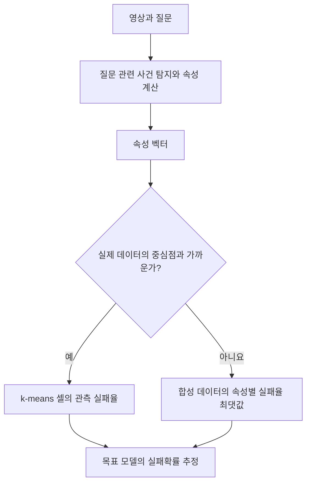

# An Attribute-Based Measure of Video Complexity

**핵심 판단:** 이 논문은 영상의 몇 가지 해석 가능한 속성으로 **특정 영상언어모델의 실패확률을 추정하는 방법**을 제안하며, 비교 실험에서 낮은 확률 보정오차를 보고합니다.  
새로운 데이터에서 실패확률을 추정하는 성과는 확인되지만, **영상언어모델 자체의 일반화 성능 향상에 관한 증거는 예비적**입니다.

본문에서는 **[저자 보고]**, **[해석]**, **[후속 검증 제안]**을 구분했습니다. 관련 연구 비교는 2026년 10월 27일까지 확인한 원문과 공식 학술 자료에 근거하며, 제안한 실험에 아직 관측되지 않은 성능 수치를 부여하지 않았습니다.

---

## 1. Executive summary — 9문장

1. 이 논문은 영상–질문 쌍의 복잡도를 **특정 영상언어모델이 해당 질문에 실패할 확률**로 정의하고, 이를 추정하는 VideoABC를 제안합니다. **[p.4, §3.1]**
2. VideoABC는 사건의 위치, 질문과 무관한 영상의 비율, 장면 복잡도, 사건 속도라는 네 가지 주요 속성으로 영상을 표현합니다. **[p.6, §3.3]**
3. 실제 영상에서 속성이 비슷한 사례들을 묶고, 각 묶음에서 목표 모델이 얼마나 자주 실패했는지를 새로운 영상의 복잡도 점수로 사용합니다. **[pp.4–5, 식 (1)–(4)]**
4. 참조 데이터와 다른 영상에도 대응하기 위해, 실제 영상 기반 군집과 속성을 통제한 합성 영상 기반 격자를 결합합니다. **[pp.5–7, Figure 2]**
5. 평가한 여섯 목표 모델 모두에서 VideoABC는 비교 방법들보다 낮은 확률 보정오차를 기록했습니다. **[p.9, Table 1]**
6. 예를 들어 Qwen-3-VL 8B의 보정오차는 Judge의 0.171에서 VideoABC의 0.087로, LLaVA-OV 7B에서는 0.148에서 0.058로 낮아졌습니다. **[p.9, Table 1]**
7. 보고된 추론 지연시간은 226 ms로 72B Judge의 1,802 ms보다 약 8배 짧지만, 이 비교에는 코드북 구축 비용이 포함되지 않습니다. **[p.9, Table 2 및 각주 3]**
8. 난도에 따라 학습 순서를 정하는 응용에서도 개선을 보고하지만, 해당 실험의 평가 데이터 설명이 본문과 표 설명 사이에서 일치하지 않아 일반화 향상의 확정적 증거로 보기는 어렵습니다. **[p.16, Appendix A, Table 4]**
9. 따라서 이 논문의 가장 확실한 성과는 **해석 가능한 속성을 이용한 실패확률 추정과 벤치마크 진단**이며, 모든 새로운 환경에 대한 일반화 보장이나 안정적인 학습 성능 향상은 추가 검증이 필요합니다. **[해석: pp.10–11, Table 3; p.16, Table 4]**

> **용어 — 확률 보정과 ECE:** 예측한 실패확률이 실제 실패빈도와 얼마나 일치하는지를 *확률 보정*이라고 하며, ECE(Expected Calibration Error)는 그 불일치를 요약한 값으로 낮을수록 좋습니다.

---

## 2. 연구 배경, 해결하려는 문제와 필요성

### 2.1 무엇을 해결하려는가?

**[저자 보고]** 연구의 중심 질문은 다음과 같습니다.

> “주어진 영상과 질문을 특정 영상언어모델이 얼마나 어려워할지, 해석 가능하고 계산 비용이 낮은 방식으로 예측할 수 있는가?”

저자들은 기존 평가에서 다음 문제를 지적합니다.

- 영상언어모델의 실행과 대규모 벤치마크 평가에는 많은 계산이 필요합니다.
- 일부 질문은 영상을 보지 않고도 답할 수 있어, 전체 정확도만으로 영상 이해 능력을 판단하기 어렵습니다.
- 다른 대형 모델에게 난도를 판단하게 하는 방식은 비용이 높고, 무엇 때문에 어려운지 설명하는 데 한계가 있습니다.
- 모델 내부 특징으로 실패를 예측하려면 목표 모델을 상당 부분 실행해야 하므로 계산 절감 효과가 제한될 수 있습니다. **[pp.1–3]**

> **용어 — 영상언어모델(video-LLM):** 영상과 자연어 질문을 함께 받아 답변을 생성하는 모델입니다.  
> **용어 — Judge:** 다른 모델 또는 동일 모델에게 입력의 난도나 답변의 적절성을 평가하게 하는 방식입니다.

### 2.2 연구 목적

이 연구의 목적은 크게 세 가지입니다.

| 목적 | 논문이 제시한 접근 | 근거 |
|---|---|---|
| 실패확률을 예측하기 | 비슷한 속성을 가진 참조 사례들의 실패율 사용 | pp.4–5, 식 (1)–(4) |
| 어려움의 원인을 설명하기 | 사건 위치·비사건 비율·장면 복잡도·사건 속도로 분해 | p.6, §3.3 |
| 작은 참조 데이터로 새로운 영상에 대응하기 | 실제 영상 기반 군집과 합성 영상 기반 격자 결합 | pp.5–7, §3.2–3.4 |

**[해석]** 여기서 복잡도는 영상에 고정된 절대적인 성질이 아닙니다. 같은 영상도 질문과 목표 모델이 바뀌면 실패확률이 달라집니다. 따라서 VideoABC 점수는 **영상·질문·목표 모델의 관계를 나타내는 점수**로 읽어야 합니다. **[근거: p.4, §3.1; p.5, 식 (3)]**

### 2.3 왜 필요한가?

**[저자 보고]** 저자들은 이 점수를 이용해 벤치마크의 난도 구성을 분석하고, 난도별 소규모 평가집합을 만들며, 쉬운 질문에서 어려운 질문으로 진행하는 학습 순서를 구성합니다. **[p.16, Appendix A]**

**[해석]** 실용적 가치는 “어려운 영상의 숫자를 세는 것”보다 **어떤 조건에서 모델이 실패하는지를 진단하는 것**에 있습니다.  
다만 이 진단을 실제 운영이나 학습 개선에 사용하려면 속성 추출 비용, 새로운 데이터에서의 보정 안정성, 모델 변경 시 재측정 비용을 함께 확인해야 합니다. **[근거: pp.6–7, §3.4; p.9, Table 2]**

---

## 3. 핵심 주장과 근거

| 핵심 주장 | 저자가 제시한 근거 | 해석 및 증거의 범위 |
|---|---|---|
| 소수의 영상 속성이 실패확률을 예측하는 데 유용하다 | 여섯 목표 모델에서 VideoABC의 ECE가 비교 방법보다 낮음 | 평가한 데이터와 모델에서의 결과이며, 모든 영상·질문 유형으로 확대할 수 없음 **[p.9, Table 1]** |
| 실제 영상 기반 군집은 참조 분포와 비슷한 데이터에 유리하다 | Eval-ID에서 k-means가 근사 격자보다 여섯 열 모두 낮은 ECE | 참조 데이터 주변의 국소적 추정이 유리하다는 경험적 근거 **[p.10, Table 3]** |
| 합성 영상 기반 격자는 참조 분포 밖의 데이터에 도움이 된다 | Eval-OOD에서 근사 격자가 k-means보다 여섯 열 모두 낮은 ECE | 격자의 공간 포괄성과 실제 데이터에서의 확률 추정 정확도는 구별해야 함 **[pp.5–6; p.10, Table 3]** |
| 두 추정기를 결합하면 비용과 성능을 절충할 수 있다 | 혼합 방식은 200개의 템플릿 계산으로 제시됨 | 혼합 방식은 ID에서 k-means보다 여섯 열 중 다섯 열의 ECE가 높아짐 **[p.10, Table 3]** |
| 대형 Judge보다 효율적이다 | 226 ms 대 1,802 ms, ECE 0.087 대 0.164 | 72B Judge와의 비교이며, 코드북 구축 비용은 제외됨 **[p.9, Table 2]** |
| 속성별로 벤치마크의 어려움을 설명할 수 있다 | 벤치마크마다 네 속성의 평균 복잡도가 다름 | 네 속성에 관한 진단이며 벤치마크 전체 능력 범위를 대표하지 않음 **[p.11, Figure 8; p.16]** |
| 난도 점수를 학습에 활용할 수 있다 | VideoABC 커리큘럼이 Table 4 오른쪽에서 가장 높은 성능 | 평가 대상 표기 불일치와 불확실성 미보고 때문에 예비 결과로 해석해야 함 **[p.16, Table 4]** |

> **용어 — k-means:** 비슷한 특징 벡터들을 묶고 각 묶음의 중심을 찾는 군집화 방법입니다.  
> **용어 — ID/OOD:** ID는 참조 데이터와 유사한 분포, OOD는 참조 데이터와 다른 분포를 뜻합니다. 이 논문은 주로 서로 다른 벤치마크를 이용해 이를 구분합니다.

---

## 4. 방법론: 데이터, 모델 구조, 수식

### 4.1 사용한 데이터와 평가 구성

**[저자 보고]**

| 용도 | 데이터 | 규모 | 근거 |
|---|---|---:|---|
| 실제 영상 참조 데이터 $\mathcal D$ | MVBench, MLVU, TempCompass, NExT-QA | 각 300개, 총 1,200개 영상–질문 쌍 | p.6, §3.4 |
| 분포 내 평가 Eval-ID | 위 네 벤치마크에서 추출 | 총 1,200개 | p.8 |
| 분포 밖 평가 Eval-OOD | EgoSchema, LongVideoBench | 합계 1,200개 | p.8 |
| 합성 데이터 VideoABC-Bench | 색깔 공·사각형의 위치, 색, 크기, 움직임 등을 통제 | 총 1,200개: 정적 사건 700개, 동적 사건 500개 | pp.17–18, Appendix B |

참조 데이터와 Eval-ID가 서로 중복되지 않도록 어떻게 분리했는지는 명확하게 설명되어 있지 않습니다. 또한 Eval-OOD의 두 데이터셋별 정확한 표본 배분은 제시되지 않습니다. **[pp.6, 8]**

평가 대상은 Qwen-3-VL 4B/8B, LLaVA-OV 0.5B/7B, LLaVA-NeXT 7B, Video-LLaVA 7B입니다. 저자들은 NVIDIA A6000 GPU 네 장을 사용했다고 보고합니다. **[p.8, Implementation details]**

### 4.2 구조: 속성 추출과 실패율 조회의 결합

VideoABC의 구조는 **속성 추출기, 실제 데이터 코드북, 합성 데이터의 속성별 실패율, 두 추정기 사이의 선택 규칙**으로 구성됩니다. **[pp.4–7, Figures 1–2]**



**준비 단계**에서는 목표 모델을 참조 영상에 실행해 정답·오답을 기록합니다. **추정 단계**에서는 새 영상의 속성을 계산하고 대응하는 실패율을 반환합니다. 따라서 실패율 표는 목표 모델의 성능에 종속됩니다. **[p.5, 식 (3)–(4)]**

> **용어 — 비모수적 추정:** 여기서는 복잡한 신경망을 별도로 학습해 점수를 출력하는 대신, 참조 사례를 묶어 얻은 통계를 이용한다는 의미입니다.  
> **용어 — 코드북(codebook):** 속성 공간을 대표하는 벡터들의 목록입니다.  
> **용어 — 양자화(quantization):** 연속적인 속성값들을 유한한 대표값이나 구간으로 묶는 과정입니다.

“비모수적”이라는 표현이 전체 시스템에 학습된 모델이 없다는 뜻은 아닙니다. 실제 속성 추출에는 DINO와 SigLIP가 사용됩니다. **[p.6, §3.4]**

---

### 4.3 입력과 속성의 정의

#### 입력 표현

**[저자 보고: p.4, §3.1]**

$$
v=[v_1,\ldots,v_N]\in\mathbb R^{N\times H\times W\times 3},
\qquad
\mathbf a=\alpha(v,q)\in\mathcal S_{\mathcal A}=[0,1]^D.
$$

**기호 설명**

- $v$: 입력 영상, $v_t$: $t$번째 RGB 프레임.
- $N$: 전체 프레임 수.
- $H,W$: 프레임의 높이와 너비.
- $q$: 질문.
- $\alpha$: 영상–질문 쌍을 속성 벡터로 변환하는 함수.
- $\mathbf a$: 추출한 속성 벡터.
- $D$: 속성의 개수.
- $\mathcal S_{\mathcal A}$: 속성값들이 놓이는 공간.

질문에 필요한 사건을 $\mathcal E(q)$, 그 밖의 프레임들을 $\overline{\mathcal E}(q)$로 둡니다. 아래에서는 사건 시작 프레임을 $j_E$로 표기합니다. 원문은 이를 $j$로 씁니다. **[p.6, §3.3]**

#### 여섯 속성

| 속성 | 수식 또는 정의 | 의미와 실제 구현 |
|---|---|---|
| 사건 위치 $a_1$ | $a_1=j_E$ | 질문에 필요한 사건이 영상 어디에서 시작하는가 |
| 비사건 비율 $a_2$ | $a_2=\lvert\overline{\mathcal E}(q)\rvert/N$ | 전체 프레임 중 질문 관련 사건 바깥의 비중 |
| 장면 복잡도 $a_3$ | 개념적으로 사건과 무관한 객체 수 | 합성 영상에서는 방해물 수, 실제 영상에서는 평균 압축률로 측정 |
| 사건 속도 $a_4$ | $a_4=\min\{\rho:u(v^\rho,q)=1\}$ | 모델이 정답을 내는 데 필요한 최소 샘플링 프레임률 |
| 픽셀 중앙값 비율 $a_5$ | $a_5=\text{median}(v)/\max(v)$ | 무관한 속성을 추가했을 때의 영향을 검사하기 위한 값 |
| 픽셀 평균 비율 $a_6$ | $a_6=\text{mean}(v)/\max(v)$ | 위와 같은 목적의 픽셀 통계 |

**기호 설명:** $\lvert\cdot\rvert$는 프레임 수, $\rho$는 초당 샘플링 프레임 수, $v^\rho$는 해당 프레임률로 재표본화한 영상, $u(v^\rho,q)$는 정답이면 1이고 오답이면 0인 함수입니다. $\text{median}$과 $\text{mean}$은 각각 픽셀값의 중앙값과 평균입니다. **[p.6, §3.3]**

> **용어 — fps:** 초당 프레임 수입니다. 여기서는 영상에서 얼마나 촘촘하게 프레임을 가져오는지도 나타냅니다.  
> **용어 — 대리 측정치(proxy):** 직접 측정하기 어려운 성질을 대신 표현하기 위해 사용하는 값입니다. 실제 영상의 압축률은 장면 복잡도의 대리 측정치입니다.

실제 영상의 장면 복잡도는 다음과 같이 계산합니다.

$$
a_3=\frac{1}{K}\sum_{t=1}^{K}r_t.
$$

여기서 $K$는 평균에 포함한 프레임 수, $r_t$는 프레임 $t$의 압축률입니다. 설명의 혼동을 피하기 위해 원문의 $c_i$를 $r_t$로 바꾸어 표기했습니다. **[p.6, §3.4]**

#### 실제 영상에서 사건을 찾는 절차

1. 영상에서 256개 프레임을 균일하게 샘플링합니다.
2. DINO 특징을 추출합니다.
3. 프레임 사이 특징 변화에 임계값을 적용하여 사건 후보를 찾습니다.
4. 각 사건의 중간 프레임과 질문 사이의 SigLIP 유사도로 질문 관련성을 추정합니다.
5. 선택한 사건을 이용해 속성을 계산합니다. **[p.6, §3.4]**

> **용어 — DINO:** 영상 프레임의 시각적 내용을 특징 벡터로 표현하는 데 사용한 모델입니다.  
> **용어 — SigLIP:** 이미지와 텍스트의 관련성을 특징 공간에서 비교하는 데 사용한 모델입니다.

#### 속성 정의에서 확인해야 할 문제

**[해석 및 재현성 점검]**

- **정규화 절차가 불명확합니다.** 속성 공간은 $[0,1]^D$로 정의하지만, 프레임 인덱스·fps·압축률을 이 범위로 바꾸는 구체적인 방법을 제시하지 않습니다. **[pp.4, 6]**
- **합성과 실제 영상의 장면 복잡도 척도가 다릅니다.** 방해물 개수와 압축률을 어떻게 대응시키는지 설명이 부족합니다. **[pp.6–7]**
- **사건 속도 계산에는 정답 여부가 필요합니다.** $a_4$를 정의대로 계산하려면 여러 프레임률에서 모델의 정답 여부를 확인해야 하는데, 이를 저렴한 사전 추정과 어떻게 연결하는지 설명하지 않습니다. **[pp.6–7]**
- **Figure 1의 비사건 비율 표기는 본문과 다릅니다.** 본문 §3.3의 $\lvert\overline{\mathcal E}(q)\rvert/N$를 기준으로 설명하는 것이 타당합니다. **[p.2, Figure 1; p.6]**

> **용어 — 정규화:** 단위가 다른 속성들을 비교 가능한 수치 범위로 바꾸는 과정입니다. 거리 기반 군집화에서는 이 선택이 결과에 영향을 줍니다.

---

### 4.4 실제 영상 기반 코드북: 원문 식 (1)–(4)

#### ① 가장 가까운 대표 벡터 찾기 — 식 (1)

```math
\mathcal Q(\mathbf a;\mathcal D)
=
\underset{j\in\{1,\ldots,J\}}{\text{arg min}}
\lVert\mathbf a-\mathbf c_j\rVert.
```

**기호:** $\mathcal D$는 참조 데이터, $\mathbf c_j$는 $j$번째 대표 벡터, $J$는 대표 벡터 수, $\mathcal Q$는 가장 가까운 대표 벡터의 인덱스를 반환하는 함수입니다.

이 식은 새 속성 벡터와 가장 비슷한 참조 군집을 선택합니다. **[p.4, 식 (1)]**

#### ② 각 대표 벡터의 영역 정의 — 식 (2)

```math
\mathcal N_j=
\left\{
\mathbf a:
\lVert\mathbf a-\mathbf c_j\rVert
\le
\lVert\mathbf a-\mathbf c_\ell\rVert,
\ \forall \ell\ne j
\right\}.
```

**기호:** $\mathcal N_j$는 대표 벡터 $\mathbf c_j$에 가장 가까운 속성 벡터들의 영역이고, $\ell$은 다른 대표 벡터의 인덱스입니다. **[p.4, 식 (2)]**

> **용어 — 보로노이 셀(Voronoi cell):** 여러 중심점 중 어느 중심점에 가장 가까운지에 따라 나눈 공간의 한 영역입니다.

#### ③ 셀마다 관측 실패율 계산 — 식 (3)

```math
\psi_j
=
1-
\frac{
\sum_{i:\alpha(v_i,q_i)\in\mathcal N_j}y(v_i,q_i)
}{
\left|\{i:\alpha(v_i,q_i)\in\mathcal N_j\}\right|
}.
```

**기호:** $i$는 참조 표본의 인덱스, $y(v_i,q_i)$는 목표 모델이 정답이면 1이고 오답이면 0인 값, $\psi_j$는 해당 셀의 평균 실패율입니다.

분자는 정답 수이고 분모는 셀의 전체 표본 수이므로, 전체 식은 **1에서 정답률을 뺀 값**입니다. 저자는 이를 EABC라고 부릅니다. **[p.5, 식 (3)]**

> **용어 — EABC(Expected Attribute-Based Complexity):** 특정 속성 영역에 속한 사례들의 평균 실패율입니다. 개별 영상 하나의 확정적 실패 여부를 뜻하지 않습니다.

#### ④ 새 영상의 복잡도 반환 — 식 (4)

```math
\gamma(v,q;\mathcal D)
=
\psi_{\mathcal Q(\alpha(v,q);\mathcal D)}.
```

**기호:** $\gamma$는 새 영상–질문 쌍의 복잡도 점수입니다. 나머지 기호는 앞에서 정의한 속성 추출, 최근접 셀 선택, 셀 실패율을 나타냅니다.

즉, **속성을 추출하고 → 가까운 셀을 찾고 → 그 셀의 실패율을 반환**합니다. **[p.5, 식 (4)]**

---

### 4.5 합성 영상 기반 격자와 표본 수 절감: 식 (5)–(6)

#### 왜 격자가 필요한가?

**[저자 보고]** k-means의 중심은 실제 참조 데이터가 많은 곳에 집중됩니다. 새로운 영상의 속성이 참조 데이터와 멀면, 넓고 드문 영역의 실패율을 그대로 적용하게 될 수 있습니다. 저자는 이를 보완하기 위해 속성 공간 전체를 균일한 격자로 나눕니다. **[p.5, Figure 2 및 §3.2]**

격자 코드북은 다음과 같습니다.

```math
\mathcal C^u
=
\mathcal C_1^u\times\cdots\times\mathcal C_D^u.
```

각 속성의 구간과 중심은 다음과 같습니다.

```math
\mathcal B_{k,j}
=
\left[\frac{j-1}{P},\frac{j}{P}\right),
\qquad
c_{k,j}=\frac{2j-1}{2P}.
```

**기호:** 위첨자 $u$는 범용 격자를 뜻하고, $k$는 속성의 인덱스, $P$는 속성마다 나누는 구간 수, $\mathcal B_{k,j}$는 속성 $k$의 $j$번째 구간, $c_{k,j}$는 그 중심입니다. 전체 조합은 $P^D$개입니다. **[p.5, §3.2; 번호 없는 식]**

> **용어 — 격자 양자화:** 각 속성 축을 일정한 간격으로 나눈 뒤 그 조합으로 공간을 구획하는 방법입니다.

#### 모든 속성 조합을 측정하면 비용이 커진다

각 셀에 $C$개의 합성 영상을 만들면 필요한 영상 수는 다음과 같습니다.

$$
\text{전체 조합 평가의 영상 수}=CP^D.
$$

속성을 하나씩 바꾸어 평가하면 다음으로 줄어듭니다.

$$
\text{속성별 평가의 영상 수}=CPD.
$$

**기호:** $C$는 셀 또는 속성 구간당 영상 수, $P$는 속성별 구간 수, $D$는 속성 수입니다. **[pp.5–7]**

> **용어 — 차원의 저주:** 속성 수가 증가할수록 가능한 조합이 급격히 늘어 각 조합을 충분한 사례로 채우기 어려워지는 문제입니다.

#### 속성별 실패율 — 식 (5)

```math
\psi^u_{k,j}
=
1-
\frac{
\sum_{i:\alpha_k(v_i,q_i)\in\mathcal B_{k,j}}y(v_i,q_i)
}{
\left|\{i:\alpha_k(v_i,q_i)\in\mathcal B_{k,j}\}\right|
}.
```

**기호:** $\alpha_k$는 속성 벡터의 $k$번째 성분이고, $\psi^u_{k,j}$는 해당 속성 구간에서 합성 영상으로 측정한 실패율입니다. **[p.6, 식 (5)]**

#### 여러 속성을 합치는 최댓값 근사 — 식 (6)

```math
\widehat{\psi}^{u}(\mathcal N)
=
\max_k\psi^u_{k,j(\mathcal N)}.
```

**기호:** $\mathcal N$은 다차원 격자의 셀, $j(\mathcal N)$은 해당 속성 축에서 이 셀이 속한 구간의 인덱스, $\widehat{\psi}^{u}$는 근사 실패율입니다. **[p.6, 식 (6)]**

**[저자 보고]** 이 식은 “사건이 빠르거나 장면이 복잡하면 어려울 수 있다”는 OR 관계를 가정합니다.

**[해석]** 정확히는 **가장 어려운 단일 속성의 실패율을 채택하는 근사**입니다. 확률들의 최댓값은 일반적인 확률적 OR의 정확한 계산식이 아니며, 여러 속성이 함께 어려워질 때의 추가 효과를 직접 학습하지 않습니다. **[근거: p.6, 식 (6)]**

> **용어 — 속성 상호작용:** 두 속성이 함께 나타났을 때의 효과가 각각의 효과만으로 설명되지 않는 현상입니다.

또한 Table 3의 “exact EABC”는 모든 조합별 셀을 직접 평가한다는 의미입니다. 유한한 표본에서 계산한 값이므로, 실제 실패확률을 오차 없이 알고 있다는 뜻은 아닙니다. **[해석: pp.5–7; p.10, Table 3]**

---

### 4.6 두 코드북을 선택하는 규칙

원문 p.7의 규칙을, 두 코드북의 셀 인덱스가 구분되도록 정리하면 다음과 같습니다.

$$
j^\ast=\mathcal Q(\alpha(v,q);\mathcal D),
$$

```math
\gamma_{\text{combined}}(v,q)
=
\begin{cases}
\psi_{j^\ast},
&
\lVert\alpha(v,q)-\mathbf c_{j^\ast}\rVert_2^2\le\tau,
\\
\widehat{\psi}^{u}_{\ell^\ast},
&
\text{otherwise}.
\end{cases}
```

**기호 설명**

- $j^\ast$: 가장 가까운 실제 데이터 코드북 중심의 인덱스.
- $\ell^\ast$: 범용 격자에서 새 표본이 속한 셀.
- $\tau$: 두 추정기를 선택하는 거리 임계값.
- $\widehat{\psi}^{u}_{\ell^\ast}$: 합성 데이터 기반 근사 실패율.

저자는 교차검증으로 $\tau=2.4$를 선택했다고 보고합니다. 위 식의 근사 표기는 최종 사용 구성을 명시한 Table 3에 맞춘 것입니다.  
원문 p.7의 분기식은 범용 실패율에 근사 기호를 생략합니다. **[p.7, Combined quantizer; p.10, Table 3 및 Figure 5]**

> **용어 — 교차검증:** 데이터를 나누어 학습과 검증을 반복하면서 설정값을 선택하는 절차입니다. 이 논문은 그 구체적인 분할 구성을 충분히 설명하지 않습니다.

---

### 4.7 합성 영상은 어떻게 만드는가?

**[저자 보고]** 합성 영상은 흰 배경 위의 색깔 공과 사각형으로 구성되며, 초록 공을 표적으로 사용합니다. **[pp.17–18, Figure 10]**

- **정적 사건:** 공의 색이 바뀌는 사건을 만들고 사건 위치와 무관한 영상 길이를 조절합니다.
- **동적 사건:** 공의 상하 이동과 크기 증감의 조합을 만들고 방해물 수와 샘플링 조건을 조절합니다.
- 정적 사건 700개, 동적 사건 500개를 구성합니다.
- 질문은 5지선다입니다. **[pp.7, 17–18]**

**문서상의 불일치:** p.7은 정적 사건의 질문을 “다섯 위치 중 선택”으로 설명하지만, Figure 3과 Appendix B는 “공이 바뀐 색 선택”으로 제시합니다. 실제 데이터 재현 시 확인이 필요한 부분입니다. **[p.5, Figure 3; pp.7, 18]**

**[해석]** 이 합성 설계의 장점은 한 속성의 영향을 분리해서 볼 수 있다는 것입니다. 동시에 단순 도형에서 얻은 실패율이 실제 영상에서도 같은 의미를 갖는지 검증해야 한다는 과제를 남깁니다.

---

## 5. 주요 결과: 저자 보고와 해석

### 5.1 실패확률의 보정 성능

아래는 원문 Table 1의 수치입니다. 모두 **ECE이며 낮을수록 좋습니다**. 본문은 특별한 언급이 없는 실험에 Eval-OOD를 사용한다고 설명합니다. **[pp.8–9]**

| 목표 모델 | Random | Judge | Direct | MLP-2L | MLP-A | **VideoABC** |
|---|---:|---:|---:|---:|---:|---:|
| Qwen-3-VL 8B | 0.293 | 0.171 | 0.194 | 0.217 | 0.197 | **0.087** |
| LLaVA-OV 7B | 0.328 | 0.148 | 0.200 | 0.285 | 0.156 | **0.058** |
| Video-LLaVA 7B | 0.346 | 0.173 | 0.189 | 0.292 | 0.192 | **0.097** |
| LLaVA-NeXT 7B | 0.329 | 0.121 | 0.203 | 0.308 | 0.146 | **0.102** |
| Qwen-3-VL 4B | 0.348 | 0.208 | 0.246 | 0.322 | 0.198 | **0.156** |
| LLaVA-OV 0.5B | 0.348 | 0.198 | 0.256 | 0.347 | 0.234 | **0.172** |

**비교 방법의 의미**

- **Judge:** LLaVA-OV 7B가 복잡도를 추정.
- **Direct:** 속성값 중 최댓값을 그대로 사용.
- **MLP-2L:** 목표 모델의 후반부 특징을 입력으로 받는 2층 분류기.
- **MLP-A:** 속성 벡터를 입력으로 받는 분류기.
- **Random:** $[0,1]$에서 무작위 점수 생성. **[p.8, Baselines]**

> **용어 — MLP:** 여러 층의 완전연결 연산으로 입력 특징을 출력값으로 바꾸는 기본적인 신경망입니다.

**[저자 보고]** VideoABC는 모든 목표 모델에서 가장 낮은 ECE를 기록합니다.

**[분석자 계산]** Judge 대비 ECE의 상대 감소율은 Qwen-3-VL 8B에서 약 **49.1%**, LLaVA-OV 7B에서 약 **60.8%**입니다.  
이는 표의 수치로 계산한 값이며 정답률 증가율이 아닙니다.

**[해석]** 이 표는 실패확률 추정의 보정이 개선되었다는 근거입니다. **ECE 0.087을 오류율 8.7%나 정답률 91.3%로 읽으면 안 됩니다.**  
또한 서로 다른 목표 모델의 ECE를 그 모델들의 영상 이해 능력 순위로 사용할 수 없습니다.

---

### 5.2 계산 효율

원문 Table 2의 대표 비교를 발췌하면 다음과 같습니다. **[p.9]**

| 방법 | 규모 | 보고된 지연시간 | ECE |
|---|---:|---:|---:|
| Judge | 0.5B | 167 ms | 0.187 |
| Judge | 7B | 656 ms | 0.171 |
| Judge | 72B | 1,802 ms | 0.164 |
| MLP-A | — | 119 ms | 0.182 |
| **VideoABC** | — | **226 ms** | **0.087** |

**[저자 보고]** VideoABC는 72B Judge보다 약 8배 빠르면서 낮은 ECE를 달성합니다.

**[해석]** 다음 범위에서 이 결과를 받아들일 수 있습니다.

- 1,802/226은 약 **7.97배**이므로 약 8배라는 표현은 표와 일치합니다.
- 0.5B Judge와 MLP-A는 VideoABC보다 빠르므로, VideoABC가 가장 빠른 방법은 아닙니다.
- 코드북을 구축하기 위한 목표 모델 실행 비용은 제외되어 있습니다.
- 사건 속도 $a_4$를 구하는 과정과 전처리 비용이 측정에 어떻게 포함되었는지 충분히 설명되지 않습니다. **[pp.6–7; p.9, 각주 3]**

따라서 **보고된 추론 조건에서의 비용–보정 성능 절충이 유리하다**고 평가할 수 있지만, 전체 운영 비용의 우월성까지 확인된 것은 아닙니다.

---

### 5.3 코드북 구성과 분포 밖 성능

아래는 Table 3의 **Eval-OOD** 결과입니다. 원문에서 모델 대응과 Table 1의 결과 연결이 충분히 명료하지 않으므로, 열 이름을 $\mathcal M_1$ – $\mathcal M_6$ 그대로 유지했습니다. **[p.10]**

| 구성 | 템플릿 계산 수¹ | $\mathcal M_1$ | $\mathcal M_2$ | $\mathcal M_3$ | $\mathcal M_4$ | $\mathcal M_5$ | $\mathcal M_6$ |
|---|---:|---:|---:|---:|---:|---:|---:|
| 실제 데이터 k-means | 20 | 0.114 | 0.117 | 0.097 | 0.097 | 0.092 | 0.089 |
| 합성 격자, 근사 실패율 | 180 | 0.082 | 0.062 | 0.058 | 0.082 | 0.067 | 0.059 |
| 합성 격자, 조합별 직접 추정 | 10,000 | 0.076 | 0.052 | 0.054 | 0.087 | 0.066 | 0.059 |
| **혼합 방식** | **200** | **0.087** | **0.058** | **0.054** | **0.082** | **0.064** | **0.059** |

¹ 원문은 이를 Templates 및 template computations로 표현합니다. 영상 수나 모델 파라미터 수가 아닙니다.

**[직접 확인되는 결과]**

- 근사 격자는 k-means보다 OOD의 여섯 열 모두에서 ECE가 낮습니다.
- 혼합 방식 역시 k-means보다 OOD의 여섯 열 모두에서 ECE가 낮습니다.
- 반대로 Eval-ID에서는 k-means가 근사 격자보다 여섯 열 모두에서 좋습니다.
- **혼합 방식은 Eval-ID의 여섯 열 중 다섯 열에서 k-means보다 ECE가 높습니다.** **[p.10, Table 3]**

**[해석]** 이 결과는 합성 격자가 참조 분포 밖의 사례를 보완한다는 주장을 지지합니다. 동시에 **혼합이 분포 내·외 성능을 모두 일방적으로 개선하지는 않는다**는 절충을 보여줍니다.

또한 10,000과 200의 비는 50이지만, 이를 곧바로 “학습 영상 50배 절감”이나 “학습시간 50배 절감”으로 바꿔 말할 수는 없습니다. 각 설정의 표본 수와 격자 해상도를 연결하는 정보가 충분하지 않습니다. **[pp.5–7; p.10, Table 3]**

---

### 5.4 커리큘럼 학습 결과

**[저자 보고]** NExT-QA 훈련 세트에서 쉬운 질문부터 어려운 질문으로 학습하는 SFT를 수행했습니다. Table 4 오른쪽의 결과는 다음과 같습니다. **[p.16]**

| 학습 순서 또는 구성 | LLaVA-OV 0.5B | Qwen-3-VL 4B |
|---|---:|---:|
| Untrained | 0.43 | 0.57 |
| Random | 0.49 | 0.59 |
| Judge | 0.53 | 0.47 |
| MLP-A | 0.49 | 0.56 |
| MLP-2L | 0.47 | 0.59 |
| Direct | 0.53 | 0.61 |
| **VideoABC** | **0.57** | **0.63** |

> **용어 — 커리큘럼 학습:** 학습 사례를 난도 등의 기준으로 정렬해 단계적으로 학습시키는 방법입니다.  
> **용어 — SFT:** 정답이 있는 입력–출력 사례를 이용해 모델을 추가 학습하는 지도 미세조정입니다.

**[분석자 계산]** Random 대비 각각 **8%p, 4%p**, Direct 대비 각각 **4%p, 2%p** 높습니다.

그러나 다음 불일치가 있습니다.

- 본문은 평가 대상을 **선별한 Level 5 데이터**라고 설명합니다.
- 표 설명은 **Eval-OOD**라고 설명합니다.
- Table 4 왼쪽의 같은 소형 모델 Level 5 성능은 0.26/0.24인데, 오른쪽 Untrained는 0.43/0.57입니다. **[p.16, Table 4]**

**[해석]** 오른쪽 표 내부의 개선은 인용할 수 있지만, 이를 **독립된 OOD 평가에서 일반화가 확증되었다는 결과로 단정할 수 없습니다.**

또한 저자들은 난도별 200개씩 다섯 수준의 평가집합을 구성합니다. 수준이 올라갈수록 성능이 전반적으로 낮아지지만, 모든 모델에서 엄밀히 단조 감소하지는 않습니다. 예를 들어 LLaVA-OV 7B는 Level 2의 0.64에서 Level 3의 0.67로 상승합니다. **[p.16, Table 4 왼쪽]**

여기서 제시한 *benchmark distillation*은 평가집합을 작은 부분집합으로 압축하는 것입니다. 교사 모델의 지식을 학생 모델에 전달하는 별도의 지식 증류 실험은 제시되지 않습니다. **[p.3; p.16, Appendix A]**

---

## 6. 일반화 성능 향상 가능성: 무엇이 검증되었는가?

일반화를 다음 세 가지로 나누어야 논문의 기여를 정확하게 이해할 수 있습니다.

| 일반화의 종류 | 논문이 제공하는 증거 | 판단 |
|---|---|---|
| **새 데이터에서 실패확률을 추정하는 능력** | EgoSchema·LongVideoBench로 구성한 Eval-OOD의 ECE | 이 논문의 가장 직접적인 일반화 근거 **[pp.8–10, Tables 1·3]** |
| **VideoABC로 학습한 영상언어모델의 정답률 향상** | 두 소형 모델의 커리큘럼 SFT | 유망한 예비 결과이나 평가 조건 불일치가 있음 **[p.16, Table 4]** |
| **한 모델에서 만든 복잡도 점수를 다른 모델에 이전하는 능력** | 별도의 미사용 모델 집합으로 점수 이전을 검증한 실험은 제시되지 않음 | 확인되지 않음 **[pp.4–5, 점수 정의; §4 실험]** |

### 6.1 왜 합성 격자가 도움이 될 수 있는가?

**[저자 보고]** 실제 참조 데이터에서 드문 속성값도 합성 영상으로 생성할 수 있으므로, 속성 공간을 더 고르게 다룰 수 있습니다. Table 3은 이러한 설계가 평가한 OOD 데이터에서 유리했음을 보여줍니다. **[pp.5–7, p.10]**

**[해석]** 다만 격자가 보장하는 것은 **정의된 속성 공간의 기하학적 포괄**입니다. 합성 공·사각형에서 측정한 실패율이 임의의 실제 영상에 정확히 이전된다는 통계적 보장이나 일반화 정리는 제시되지 않습니다.

### 6.2 일반화를 제한하는 핵심 조건

**[해석]**

1. **속성이 중요한 차이를 표현해야 합니다.** 서로 다른 질문이 같은 속성 벡터를 갖더라도 추론 난도가 다를 수 있습니다.
2. **합성·실제 속성값의 의미가 대응해야 합니다.** 방해물 개수와 압축률의 관계가 대표적인 미해결 부분입니다.
3. **단일 속성의 효과가 결합 상황에서도 유지되어야 합니다.** 현재의 최댓값 근사는 상호작용을 충분히 표현하지 못할 수 있습니다.
4. **목표 모델과 입력 설정이 바뀌면 재측정이 필요할 수 있습니다.** 실패율은 모델뿐 아니라 프레임 샘플링 등의 설정에도 영향을 받기 때문입니다. **[근거: pp.4–7, pp.17–18]**

따라서 일반화 향상의 연구 가치는 분명하지만, 그 가능성을 확인하려면 **새 데이터셋, 새 속성 조합, 새 모델, 학습 이후의 새 체크포인트**를 분리해 평가해야 합니다. 이는 후속 검증 방향이며, 논문이 이미 입증한 결과는 아닙니다.

---

## 7. 제한사항, 통계적 취약점과 비교 불가능한 수치

### 7.1 저자가 직접 인정한 한계

저자는 두 가지를 명시합니다.

- 실제 복잡도에 영향을 주는 속성은 훨씬 많을 수 있지만, 연구는 **네 가지 주요 복잡도 속성**만 다룹니다.
- 벤치마크 복잡도 분석은 **예비적인 수준**이며, 속성 확대와 더 깊은 벤치마크 분석을 후속 연구로 남깁니다. **[p.11, §5 Limitations]**

추가한 $a_5,a_6$는 의미 있는 복잡도 속성을 확장한 것이 아니라, 무관한 속성이 포함될 때의 영향을 검사하기 위한 항목입니다. **[pp.6, 9]**

### 7.2 분석자가 확인한 통계적 취약점

| 항목 | 원문에서 확인되는 상황 | 결과 해석에 미치는 영향 |
|---|---|---|
| **불확실성 미보고** | 주요 ECE·정확도에 신뢰구간, 반복 실험 변동, 유의성 검정이 제시되지 않음 | “통계적으로 유의하게 우수하다”는 표현은 피해야 함 **[Tables 1–4]** |
| **ECE 중심 평가** | 실패 사례 구별 능력을 별도로 평가한 지표가 없음 | 확률 보정과 개별 실패 탐지는 구별해야 함 **[p.8, Metrics]** |
| **상수 예측기 비교 없음** | 모든 입력에 전체 실패율 하나를 반환하는 비교법이 없음 | ECE만으로 입력별 진단 가치를 충분히 분리하기 어려움 **[p.8, Baselines]** |
| **셀별 표본 수 미보고** | 실패율을 계산한 각 셀의 표본 수와 불확실성이 없음 | 드문 셀의 추정 안정성을 판단하기 어려움 **[pp.4–7]** |
| **분할 독립성 불명확** | 참조 데이터·Eval-ID의 중복 배제 절차가 명시되지 않음 | 데이터 누수가 있었다고 단정할 수 없지만 독립 평가인지 확인하기 어려움 **[pp.6, 8]** |
| **임계값 선택 절차 불명확** | $\tau$는 교차검증으로 선택했다고 하나 별도 검증·시험 분할이 자세하지 않음 | 설정 선택이 최종 평가에 미친 영향을 분리하기 어려움 **[pp.7, 11]** |
| **강건성 검사의 범위 제한** | 무관한 픽셀 통계 두 개를 추가 | 사건 탐지 오류나 압축률 측정 오류에 대한 강건성을 입증하지는 않음 **[p.9, Figure 7]** |
| **커리큘럼 통제 정보 부족** | 반복 횟수와 학습 조건의 상세 통제가 충분히 보고되지 않음 | 개선이 학습 순서 자체에서 비롯됐는지 더 확인해야 함 **[p.16]** |

> **용어 — 신뢰구간:** 제한된 표본에서 추정한 값의 불확실성을 구간으로 나타낸 것입니다.  
> **용어 — 실패 구별 능력:** 실제로 틀릴 사례에 맞힐 사례보다 높은 위험 점수를 부여하는 능력입니다. 확률값 자체가 정확한지 평가하는 보정과는 다른 성질입니다.

### 7.3 문서 내부의 중요한 불일치

다음은 단순히 성능이 낮다는 문제가 아니라, **재현하거나 표 사이를 연결할 때 확인이 필요한 문서상의 문제**입니다.

| 위치 | 불일치 | 보고서에서의 처리 |
|---|---|---|
| Figure 1과 §3.3 | 비사건 비율의 식이 서로 다름 | 본문 §3.3 정의 사용 **[pp.2, 6]** |
| Figure 4 | 패널에는 Qwen-3.5-VL 9B/4B, 캡션·본문에는 Qwen-3-VL 8B/4B | 곡선을 특정 Table 1 모델과 확정적으로 연결하지 않음 **[p.8]** |
| Figure 6 | 본문은 ID+OOD 합본, 캡션은 두 추정기를 각각 ID/OOD에서 평가했다고 설명 | 동일 평가 조건으로 두 곡선을 직접 비교하지 않음 **[pp.10–11]** |
| Figure 7 | 본문·캡션은 회귀 가중치, 세로축은 “R2 score” | 정확한 통계량의 의미를 확정하지 않음 **[pp.9, 11]** |
| Figure 9 | 범례는 Qwen-2.5-VL 7B/3B이며, 세로축은 Performance | 본문 주요 모델과 구별하고 성능 곡선으로 해석 **[p.17]** |
| Table 4 | 본문은 Level 5 평가, 캡션은 Eval-OOD 평가 | 표 오른쪽 내부 비교만 확실한 결과로 사용 **[p.16]** |

이 불일치들이 논문의 모든 결과를 무효화한다는 뜻은 아닙니다. 다만 **모델별 비교, 재현성, 일반화 주장에 대한 확신을 제한합니다.**

### 7.4 직접 비교하면 안 되는 수치

- **ECE와 QA 정확도:** 실패확률을 잘 예측하는 것과 질문에 정답을 내는 것은 다른 목표입니다.
- **서로 다른 목표 모델의 ECE:** 해당 모델의 영상 이해 능력 순위로 해석할 수 없습니다.
- **Figure 6의 실제·합성 표본 수:** 실제 영상은 전체 표본 수, 합성 영상은 구간당 표본 수여서 같은 단위가 아닙니다. **[pp.10–11]**
- **Table 3의 템플릿 수와 영상 수:** 200개 템플릿 계산을 200개 영상 학습으로 해석하면 안 됩니다. **[p.10]**
- **Table 4 왼쪽 Level 5와 오른쪽 Untrained:** 평가 조건이 일치한다고 확인되지 않습니다. **[p.16]**
- **Table 1과 Table 2의 모든 수치:** 예를 들어 MLP-A 값이 0.197과 0.182로 다르며, Table 2의 조건을 완전히 연결하는 설명이 부족합니다. **[p.9]**

---

## 8. 가장 중요한 그림과 해석

### Figure 1 — 전체 방법의 구조  
**위치: p.2**

**[저자 보고]** 참조 영상에서 속성을 추출하고, 속성 공간을 구획한 뒤 각 셀의 실패율을 저장하는 흐름을 보여줍니다.

**[해석]** 이 그림에서 가장 중요한 것은 출력 점수가 **유사한 속성을 가진 사례들의 관측 실패율**이라는 점입니다. 다만 비사건 비율의 식에는 본문과 다른 표기가 있어 수정해서 읽어야 합니다.

### Figure 2 — 두 종류 코드북이 필요한 이유  
**위치: p.5**

**[저자 보고]** k-means는 참조 데이터 주변에서 촘촘한 구획을 만들지만, 멀리 떨어진 곳은 크게 나눌 수 있습니다. 격자는 공간을 균일하게 나눕니다.

**[해석]** 논문의 일반화 아이디어를 가장 잘 설명하는 그림입니다. 다만 “공간을 고르게 나눈다”는 사실만으로 새로운 의미·질문 유형의 실패확률까지 정확해지는 것은 아닙니다.

### Figure 4 — 복잡도 점수와 실제 정답률의 관계  
**위치: p.8, 설명 p.9**

**[저자 보고]** 점수를 열 구간으로 나누어 구간별 정답률을 표시합니다. 이상적인 관계는 다음과 같습니다.

$$
p=1-\gamma.
$$

여기서 $p$는 정답률, $\gamma$는 실패확률로 해석되는 복잡도 점수입니다.

**[해석]** VideoABC는 다른 비교법보다 점수가 높아질수록 정답률이 낮아지는 경향이 뚜렷합니다. 그러나 완벽한 직선 관계는 아니며, 구간별 표본 수와 오차막대가 없어 곡선 차이의 불확실성을 판단하기 어렵습니다. 모델명 표기 불일치도 함께 고려해야 합니다.

### Figure 5 — 혼합 임계값의 영향  
**위치: p.10**

**[저자 보고]** 임계값에 따라 ECE가 변하며, 선택한 값은 $\tau=2.4$입니다.

**[해석]** 실제 데이터 추정기와 합성 추정기의 선택 비율이 성능에 영향을 준다는 것을 보여줍니다. 따라서 $\tau$를 다른 도메인이나 다른 정규화 방식에서도 그대로 사용할 수 있다고 가정해서는 안 됩니다.

### Figure 8 — 벤치마크마다 다른 난도 구성  
**위치: p.11, 해설 p.16**

**[저자 보고]**

- MLVU는 사건 위치와 장면 복잡도에서 상대적으로 높은 복잡도를 보입니다.
- LongVideoBench는 비사건 비율에서 높습니다.
- EgoSchema는 사건 속도에서 높습니다.

**[해석]** 벤치마크를 단일 난도 순위로 줄 세우기보다 **어느 속성을 강하게 시험하는지** 보는 데 유용합니다. 이 분석은 후속 평가집합에서 빠진 조건을 찾는 데 활용할 수 있지만, 네 속성 밖의 능력까지 설명하지는 않습니다.

### Figure 9 — 속성을 바꾸면 모델 성능이 어떻게 변하는가?  
**위치: p.17**

**[저자 보고]** 다른 조건을 유지하면서 속성 하나씩을 바꾸어 성능을 측정합니다. 저자들은 특히 사건 속도와 장면 복잡도가 중요한 실패 요인이며, 모델 크기 확대만으로 사건 속도 문제가 해결되지 않는다고 해석합니다.

본문은 민감도를 다음과 같이 정의합니다.

$$
p_j=1-\psi_j^u,
\qquad
s_j=\frac{p_{j+1}-p_j}{c_{j+1}-c_j}.
$$

**기호:** $c_j$는 속성 구간 중심, $p_j$는 그 구간의 평균 정답률, $s_j$는 속성 변화에 따른 정답률 변화의 기울기입니다.

**[해석]** 실제 그림의 세로축은 $s_j$가 아니라 **Performance**이므로 성능 곡선으로 읽어야 합니다. 또한 모델 범례가 본문의 주요 모델 목록과 달라, 정확한 모델별 우열보다는 속성 변화에 따른 정성적 경향을 중심으로 해석하는 편이 안전합니다.

---

## 9. 문서가 답하지 않는 질문

다음은 원문에서 충분한 답을 확인할 수 없는 질문입니다.

1. **사건 속도 $a_4$를 정답을 모르는 새 영상에서 어떻게 구하는가?** 어떤 프레임률에서도 모델이 정답을 내지 못하는 경우의 처리도 명확하지 않습니다. **[p.6]**
2. **여러 시점에 흩어진 사건을 함께 알아야 하는 질문은 어떻게 표현하는가?** 사건을 연속 클립으로 정의한 표현의 적용 범위가 불분명합니다. **[p.6]**
3. **합성 방해물 개수와 실제 압축률은 어떻게 같은 속성 축으로 대응되는가?** 정규화와 압축 설정도 필요합니다. **[pp.6–7]**
4. **속성 추출이 틀렸을 때 실패확률은 얼마나 달라지는가?** 사건 탐지와 질문 관련성 추정의 정확도를 별도로 보고하지 않습니다. **[p.6]**
5. **표본이 적거나 없는 셀의 점수는 어떻게 안정화하는가?** 셀별 불확실성이나 보정 규칙이 제시되지 않습니다. **[pp.4–7]**
6. **새 모델·체크포인트·프레임 예산으로 바뀌면 무엇을 다시 계산해야 하는가?** 코드북과 실패율의 재사용 범위가 검증되지 않습니다. **[pp.4–7]**
7. **난도별 소규모 평가집합이 전체 벤치마크의 모델 순위를 보존하는가?** 200개씩 선별한 부분집합의 대표성을 별도로 검증하지 않습니다. **[p.16]**
8. **커리큘럼 개선은 학습 순서 때문인가, 다른 학습 조건 차이 때문인가?** 동일 학습량과 반복 실험을 포함한 통제가 필요합니다. **[p.16]**

---

## 10. 2020년 이후 관련 최신 연구 비교

아래 연구들은 VideoABC와 직접 관련된 **난도 측정, 시간 이해 진단, 평가집합 설계, 계산 효율**의 관점에서 선정했습니다. 수치적 성능 우열을 확인하는 동일 조건 실험은 첨부 논문에 제시되지 않습니다.

### 10.1 방법과 연구 목적의 비교

| 연구 | 저자가 제안하거나 보고한 내용 | VideoABC와의 차이 및 후속 연구에서 고려할 점 |
|---|---|---|
| **TempCompass — 2024** | 정적인 장면 내용은 같지만 속도·방향·사건 순서 등이 다른 영상을 구성해 시간 지각 능력을 진단합니다. 다양한 질문 형식도 평가합니다. **[해당 논문 Figures 1–2, §3]** [ACL Anthology](https://aclanthology.org/2024.findings-acl.517/?utm_source=chatgpt.com) | 속성 변화에 대한 **진단 벤치마크**입니다. **[해석]** VideoABC에서도 장면 내용을 유지한 채 시간적 속성만 바꾸는 짝지은 검증이 필요합니다. |
| **LongVideoBench — 2024** | 최대 1시간의 영상·자막 입력에서 관련 문맥을 찾아 추론하게 합니다. 3,763개 영상, 6,678개 객관식 질문, 17개 세부 범주를 보고합니다. **[해당 논문 초록·§3]** [arxiv.org](https://arxiv.org/abs/2407.15754?utm_source=chatgpt.com) | VideoABC의 OOD 평가자료입니다. **[해석]** 영상 길이뿐 아니라 자막 의존도와 질문의 참조 구조별 보정도 점검할 필요가 있습니다. |
| **Apollo — arXiv 2024 / CVPR 2025** | 영상 없이도 풀리는 질문 등을 걸러 400개 질문의 ApolloBench를 만들고, 기존 평가 대비 41배 빠른 평가를 보고합니다. 작은 모델에서의 설계 판단이 큰 모델과 일관되는 현상도 분석합니다. **[해당 논문 Figure 2, §2.3; Figure 3, §3]** [arxiv.org](https://arxiv.org/html/2412.10360v1?utm_source=chatgpt.com) | 평가집합 축소와 모델 설계 효율을 다룹니다. **[해석]** VideoABC의 난도별 부분집합도 전체 모델 순위를 보존하는지 확인해야 합니다. |
| **CodePlexity — ICML 2025** | 질문을 프로그램으로 변환하고, 프로그램 부분구조의 존재 여부를 특징으로 만들어 로지스틱 회귀로 모델 성공 가능성을 학습합니다. 학습에 사용하지 않은 모델 집합도 평가합니다. **[해당 논문 Figure 2, 식 (2)–(3), Table 1]** [arxiv.org](https://arxiv.org/html/2505.13429v1?utm_source=chatgpt.com) | 질문의 **연산·추론 구조**를 중심으로 봅니다. **[해석]** 영상 속성 중심의 VideoABC와 상보적이며, 모델 간 점수 이전 검증의 비교 기준이 됩니다. |
| **VBenchComp — 2025** | 무영상 입력과 프레임 순서 섞기를 이용해 질문을 언어만으로 답할 수 있는 유형, 정적 의미 유형, 시간 순서가 필요한 유형 등으로 나눕니다. **[해당 논문 Figure 1, §4]** [arxiv.org](https://arxiv.org/html/2505.14321v1?utm_source=chatgpt.com) | “얼마나 실패하는가”와 “어떤 능력을 사용해서 답하는가”를 구별합니다. **[해석]** VideoABC 커리큘럼이 영상·시간 정보가 필수인 질문에서도 개선되는지 확인해야 합니다. |
| **PerceptionComp — 2026년 3월 공개** | 객체 수와 프레임 간 움직임을 장면 복잡도의 대리값으로 이용하고, 여러 시점의 증거와 복수 조건의 결합을 요구합니다. 279개 영상과 1,114개 5지선다 질문을 보고합니다. **[해당 논문 Figure 2, §3.1–3.3]** [arxiv.org](https://arxiv.org/html/2603.26653v1?utm_source=chatgpt.com) | 단일 속성뿐 아니라 **여러 조건의 결합**을 강조합니다. **[해석]** VideoABC의 최댓값 근사가 복합 장면에서도 유효한지 확인할 외부 평가 후보입니다. |
| **TempCore — 최초 2025, 확인본 v3는 2026년 9월** | 관련성이 높은 프레임과 낮은 프레임을 제공했을 때의 성능 변화인 FSS와 언어 의존성을 점검하는 LIS를 결합합니다. 영상에 의존하면서 프레임 선택에 민감한 표본의 비율을 5.5–31.0%로 보고합니다. **[해당 논문 §3, Table 4]** [arxiv.org](https://arxiv.org/html/2509.01167v3?utm_source=chatgpt.com) | 실제 속성값보다 **입력 개입에 대한 모델 반응**을 측정합니다. **[해석]** VideoABC가 선별한 고난도 사례가 실제 시간적 증거를 요구하는지 교차 진단할 수 있습니다. |

> **용어 — 프로그램 부분구조·AST:** 프로그램의 문법과 연산 관계를 나무 구조로 표현한 뒤, 그 안의 작은 연산 묶음을 살펴보는 방식입니다.  
> **용어 — 로지스틱 회귀:** 여러 특징으로 성공·실패와 같은 두 결과의 확률을 예측하는 간단한 통계 모델입니다.  
> **용어 — 조합적 복잡도:** 개별 조건은 쉬워도 여러 조건을 동시에 만족하거나 순서대로 연결해야 해서 생기는 어려움입니다.  
> **용어 — FSS:** 어떤 프레임을 제공하느냐에 따라 모델 성능이 얼마나 달라지는지 나타내는 진단값입니다.  
> **용어 — LIS:** 영상 없이 답할 수 있는 언어적 단서의 영향을 구분하기 위한 점수입니다.

### 10.2 VideoABC의 차별점은 어디에 있는가?

**[해석]** CodePlexity도 프로그램 부분구조를 통해 난도의 원인을 해석합니다. 따라서 VideoABC를 “처음으로 해석 가능한 복잡도 측정을 제안한 방법”이라고 평가하는 것은 부정확합니다. VideoABC의 구체적인 차별점은 다음의 결합입니다.

- **명시적인 영상 속성**을 사용하는 표현.
- **참조 사례의 실패율을 조회하는 비모수적 추정**.
- **속성을 하나씩 조절한 합성 영상**을 통한 범위 보완.
- 실제 데이터 군집과 합성 격자의 **거리 기반 선택**. **[VideoABC pp.4–7; CodePlexity §3.2–3.3]** [arxiv.org](https://arxiv.org/html/2505.13429v1?utm_source=chatgpt.com)

### 10.3 관련 연구의 숫자를 직접 비교할 수 없는 이유

- **CodePlexity의 mPEG와 VideoABC의 ECE:** 전자는 쉬운 질문군과 어려운 질문군의 성능 격차를 이용해 난도 순위의 유용성을 평가하고, 후자는 확률 보정을 평가합니다. [arxiv.org](https://arxiv.org/html/2505.13429v1?utm_source=chatgpt.com)
- **Apollo의 41배와 VideoABC의 약 8배:** 전자는 평가집합을 줄여 얻은 전체 평가 효율이고, 후자는 복잡도 추정기의 지연시간 비교입니다. [arxiv.org](https://arxiv.org/html/2412.10360v1?utm_source=chatgpt.com)
- **다른 벤치마크의 QA 정확도와 VideoABC의 ECE:** 문제·모델·입력 프레임·평가 목표가 달라 같은 성능 축으로 비교할 수 없습니다.
- **TempCore의 시간 민감 표본 비율과 VideoABC의 고난도 표본 비율:** 시간적 증거 의존성과 실패확률은 서로 다른 정의입니다. [arxiv.org](https://arxiv.org/html/2509.01167v3?utm_source=chatgpt.com)

> **용어 — mPEG:** 복잡도 순위에서 선택한 쉬운 질문군과 어려운 질문군의 모델 성능 차이를 여러 구간 크기에 걸쳐 요약한 지표입니다.

---

## 11. 결론, 시사점과 빠른 후속 검증

### 11.1 저자가 제시한 시사점과 후속 계획

**[저자 보고]**

VideoABC는 소수의 해석 가능한 속성과 실제·합성 참조자료를 이용해 실패확률을 추정할 수 있음을 보였습니다. 저자들은 이를 벤치마크 구성 진단, 난도별 평가집합 구성, 커리큘럼 학습에 활용할 수 있다고 제시합니다. 후속 연구로는 복잡도 속성의 확대와 더 깊은 벤치마크 분석을 남깁니다. **[p.11, §5; p.16, Appendix A]**

### 11.2 학계와 실무에 주는 의미

**[해석]**

학계에서는 모델 성능을 총점으로만 비교하는 관행에 **속성별 실패 분석**을 추가한다는 가치가 있습니다. 예를 들어 긴 영상 때문에 어려운지, 사건이 빠르기 때문인지, 복잡한 배경 때문인지를 구분하는 연구 설계에 활용할 수 있습니다. **[근거: Figure 8, pp.11, 16–17]**

실무에서는 복잡한 추가 모델 없이 참조 사례의 통계를 이용하는 방식이 매력적입니다. 다만 실제 적용의 우선 조건은 **사건 속도 추출법, 속성 정규화, 합성–실제 척도 대응, 전체 비용 측정**을 명확하게 만드는 것입니다. 이 부분이 해결되어야 낮은 지연시간과 보정 성능이 실제 환경에서도 유지되는지 판단할 수 있습니다. **[근거: pp.6–7, Table 2]**

### 11.3 가장 유망한 접근과 최소 검증 실험

아래는 **후속 검증 제안**입니다. 새로운 성능 향상이 이미 확인되었다는 뜻은 아닙니다.

| 우선순위 | 유망한 핵심 아이디어 | 복잡한 모델 없이 할 수 있는 검증 | 확인할 결과 |
|---|---|---|---|
| **1** | 속성 기반 실패율 조회 | 사람이 속성을 확인한 소규모 자료로 k-means·격자·혼합과 전체 평균 실패율 예측기를 비교 | 보정 개선이 속성 정보에서 실제로 발생하는가 |
| **2** | 합성 속성 조작 | 사건 속도와 장면 복잡도 두 속성만 함께 바꾸어, 최댓값 근사와 조합별 실측 실패율 비교 | 단일 속성 근사가 상호작용을 얼마나 놓치는가 |
| **3** | 실제·합성 결합을 통한 OOD 대응 | 벤치마크 하나를 통째로 제외하고 코드북을 만든 뒤 제외한 벤치마크에서 평가 | 참조 분포 밖에서도 개선이 안정적으로 유지되는가 |
| **4** | 난도 기반 커리큘럼 | 동일 데이터·학습량에서 무작위, 쉬움→어려움, 어려움→쉬움 순서 비교 | 개선이 학습 순서 때문이며 새로운 평가자료에서도 유지되는가 |
| **5** | 속성에 따른 프레임 배분 | 총 입력 프레임 수를 고정하고 사건 주변에 더 배분하는 단순 규칙 비교 | 동일 계산 예산에서 사건 누락을 줄여 정답률을 높일 수 있는가 |

첫 세 실험은 본문의 핵심 추정 방법과 Table 3을 직접 검증하며, 네 번째는 Table 4의 예비 결과를 확인합니다. 다섯 번째는 Figure 9에서 저자들이 제기한 사건 속도와 필요한 프레임 확보 문제를 시험하는 응용입니다. **[근거: pp.5–7, Table 3; pp.16–17]**

이때 ECE만 보지 말고, **실패 사례를 구별하는 능력**, **영상 단위로 분리한 평가**, **반복 실험의 변동**, **전체 처리 비용**을 함께 확인하는 편이 좋습니다.

### 11.4 일반화 향상 연구에서 우선 고려할 사항

**[후속 검증 제안]**

- **질문의 추론 구조를 추가로 살펴보기:** CodePlexity가 다루는 연산 구조와 VideoABC의 시각 속성을 간단한 특징 수준에서 비교하거나 결합할 수 있습니다.
- **영상이 정말 필요한 질문을 구분하기:** VBenchComp·TempCore의 진단을 이용해 학습 개선이 실제 영상·시간 이해에서 나타나는지 확인할 수 있습니다.
- **속성 조합을 검증하기:** PerceptionComp처럼 여러 시점과 조건을 함께 요구하는 자료에서 현재의 최댓값 근사를 점검할 수 있습니다.
- **모델을 바꿔 검증하기:** 한 목표 모델에서 얻은 난도 순서가 다른 모델에서도 유지되는지, 확률값은 별도로 재보정해야 하는지 구분할 수 있습니다. [arxiv.org](https://arxiv.org/html/2505.13429v1?utm_source=chatgpt.com)

**최종 평가:** VideoABC는 **설명 가능한 실패 진단과 참조 데이터 밖의 속성 영역을 보완하는 합성 실험 설계**에서 연구 가치가 큽니다. 모델 자체의 일반화 성능 향상으로 연결하려면, 우선 추출 절차와 평가 분할을 명확히 하고, 속성 조합 및 동일 학습 조건의 외부 평가를 통해 그 연결고리를 검증해야 합니다.

---

## 참고자료: 직접 확인한 원문과 공식 학술 자료

1. **Sarkar, A., 외. (2026). _An Attribute-Based Measure of Video Complexity._** arXiv:2606.00640v2. 첨부 PDF를 주자료로 사용했습니다.
2. **Liu, Y., 외. (2024). _TempCompass: Do Video LLMs Really Understand Videos?_** Findings of ACL 2024. [공식 학술 페이지](https://aclanthology.org/2024.findings-acl.517/) · [원문](https://arxiv.org/html/2403.00476v1)
3. **Wu, H., 외. (2024). _LongVideoBench: A Benchmark for Long-context Interleaved Video-Language Understanding._** [원문 정보](https://arxiv.org/abs/2407.15754)
4. **Zohar, O., 외. (2024/2025). _Apollo: An Exploration of Video Understanding in Large Multimodal Models._** arXiv 2024, CVPR 2025. [원문](https://arxiv.org/html/2412.10360v1)
5. **Eyzaguirre, C., 외. (2025). _Understanding Complexity in VideoQA via Visual Program Generation._** ICML 2025, PMLR 267. [공식 학술 페이지](https://proceedings.mlr.press/v267/eyzaguirre25a.html) · [원문](https://arxiv.org/html/2505.13429v1)
6. **Feng, B., 외. (2025). _Breaking Down Video LLM Benchmarks: Knowledge, Spatial Perception, or True Temporal Understanding?_** [원문](https://arxiv.org/html/2505.14321v1)
7. **Li, S., 외. (2026). _PerceptionComp: A Video Benchmark for Complex Perception-Centric Reasoning._** [원문](https://arxiv.org/html/2603.26653v1)
8. **Ok, H., & Lee, J. (2025, 2026 개정). _TempCore: Are Video QA Benchmarks Temporally Grounded?_** 확인본: arXiv v3, 2026-09-20. [원문](https://arxiv.org/html/2509.01167v3)
