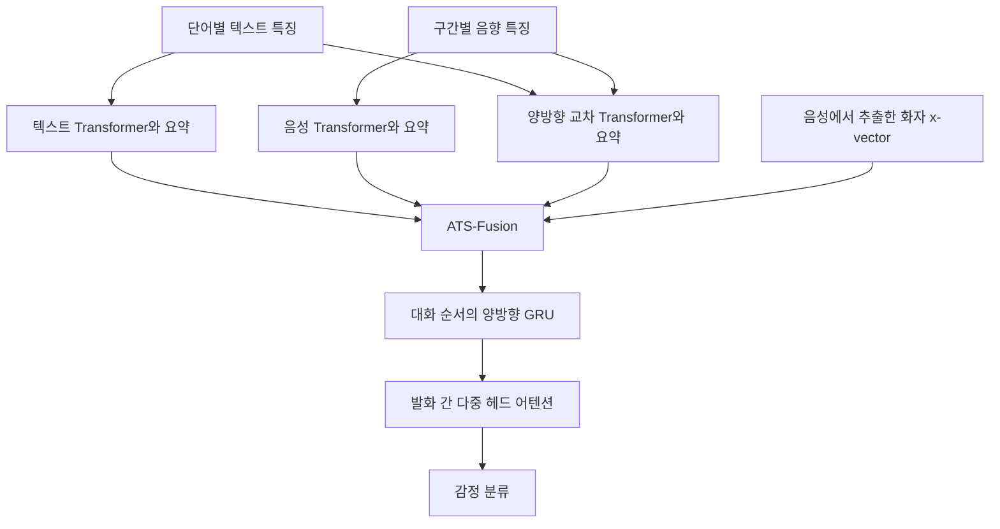

# CTNet: Conversational Transformer Network for Emotion Recognition

**핵심 판단:** CTNet의 기여는 **발화 내부의 음성·텍스트 관계, 화자 정보, 발화 사이의 대화 문맥을 하나의 계층적 모델로 결합한 것**입니다.  
두 데이터셋의 지정된 평가 조건에서 성능 개선을 보고했지만, 데이터셋·언어·녹음 환경을 넘어서는 일반화 성능은 검증하지 않았습니다. [pp.986–991, Fig.1; pp.993–998]

---

## 1. Executive summary — 9문장

1. CTNet은 대화에 포함된 각 발화의 감정을 분류하기 위해 음성·텍스트·화자 정보와 대화 문맥을 함께 사용하는 모델입니다. [pp.988–991]
2. 저자들은 발화를 처음부터 하나의 벡터로 압축하면 단어와 짧은 음성 구간에 담긴 감정 단서가 손실될 수 있다는 문제를 제기합니다. [pp.985, 989]
3. 이를 해결하기 위해 단일 모달리티 Transformer로 각 입력 내부의 관계를, 교차 모달리티 Transformer로 길이가 서로 다른 음성·텍스트 사이의 관계를 학습합니다. [pp.989–990, Figs.3–4]
4. 이후 화자 임베딩을 포함한 네 종류의 표현을 ATS-Fusion으로 결합하고, 양방향 GRU와 다중 헤드 어텐션으로 대화 문맥을 반영합니다. [pp.990–991, Fig.1]
5. 저자가 보고한 가중 F1은 IEMOCAP 4분류 **83.8**, IEMOCAP 6분류 **67.5**, MELD 7분류 **60.5**입니다. [p.995, Table VI]
6. 초록의 **2.1~6.2%p 개선**은 동일 입력 특징으로 재구현한 비교 실험에 대응하며, 기존 문헌의 MELD 최고 비교값 대비 개선은 **1.1%p**입니다. [pp.994–995, Tables V–VI]
7. 구성요소 제거 실험은 시계열 특징 처리, 화자 표현, 적응적 융합, 대화 문맥 모델링의 유용성을 뒷받침하지만, 단일·교차 Transformer 각각의 독립적인 기여는 분리하지 않습니다. [pp.995–998, Tables VII–XI]
8. IEMOCAP에서는 학습에 없던 화자를 평가하지만, 하나의 고정된 화자 분할과 두 데이터셋의 개별 평가만으로 광범위한 일반화를 입증할 수는 없습니다. [해석; pp.991–992, Table II]
9. 저자가 제시한 후속 연구는 영상 정보 추가와 다중모달 시스템의 지식을 단일모달 시스템에 전달하는 것이며, 이에 대한 실험 결과는 이 논문에 없습니다. [p.998, §VI]

> **용어 풀이**
>
> - **발화:** 대화에서 하나의 분석 단위로 나눈 말
> - **모달리티:** 텍스트·음성·영상과 같은 입력 정보의 종류
> - **임베딩:** 입력의 특성을 숫자 벡터로 표현한 것
> - **어텐션:** 여러 입력 가운데 어떤 정보를 얼마나 참고할지 계산하는 장치
> - **가중 F1:** 각 감정의 F1을 해당 감정의 표본 수에 비례해 평균한 지표

---

## 2. 연구 배경·목표·필요성

### 2.1 해결하려는 문제

**[저자 보고]** 대화 감정 인식은 개별 문장만 분류하는 문제보다 복잡합니다.  
현재 발화의 의미뿐 아니라 주변 발화, 같은 화자의 이전 상태, 상대 화자의 행동을 함께 고려해야 하기 때문입니다.  
저자들은 이를 **문맥에 따른 의존성**과 **화자에 따른 의존성**으로 설명합니다. [pp.985, 988]

> **용어 풀이**
>
> - **문맥 의존성:** 같은 발화라도 앞뒤 대화에 따라 감정 해석이 달라지는 성질
> - **자기 영향:** 한 화자의 이전 감정 상태가 다음 발화까지 이어지는 관계
> - **화자 간 영향:** 상대방의 발화나 행동이 자신의 감정 표현에 영향을 주는 관계

저자가 지적한 기존 접근의 문제는 세 가지입니다.

| 문제 | 논문의 설명 | CTNet의 대응 |
|---|---|---|
| 발화 내부 정보 손실 | 단어·음성 구간을 일찍 하나의 벡터로 압축하면 순서와 짧은 감정 단서를 잃을 수 있음 | 단어 수준 텍스트와 구간 수준 음향 시퀀스를 유지 |
| 단순한 다중모달 결합 | 특징을 이어 붙이는 방식은 모달 내부·모달 사이의 관계를 충분히 모델링하기 어려움 | 단일·교차 Transformer와 ATS-Fusion |
| 대화·화자 정보의 부족 | 독립 발화용 융합 모델은 주변 대화와 발화자를 충분히 고려하지 않음 | 화자 임베딩과 MHA-GRU |

**근거:** pp.985–988, §I–II; pp.989–991, §III.

### 2.2 연구 목적과 필요성

**[저자 보고]** 연구의 목적은 다음 네 종류의 정보를 함께 활용하는 대화 감정 분류 모델을 만드는 것입니다.

1. 음성 내부 및 텍스트 내부의 시간적 관계
2. 음성과 텍스트 사이의 상호작용
3. 발화자의 특성
4. 대화 전체의 문맥

**[해석]** 이 논문의 핵심은 개별 어텐션 연산의 발명보다는 **서로 다른 시간 단위의 정보 처리를 결합한 설계**에 있습니다.  
발화 내부에서는 단어·음성 구간의 관계를 처리하고, 발화 사이에서는 대화 흐름을 처리합니다.  
저자도 관련 연구에서 기존의 비정렬 다중모달 Transformer를 소개한 뒤, 대화 문맥·화자 모델링을 결합하는 방향으로 자신의 방법을 위치시킵니다. [pp.987–990]

---

## 3. 연구 수행 방식과 데이터

### 3.1 연구 설계

**[저자 보고]** 이 연구는 공개 데이터셋을 이용한 지도학습 분류 실험입니다. CTNet을 기존 모델과 비교하고, 특정 구성요소를 제거하거나 다른 방식으로 대체하여 성능 변화를 확인합니다. [pp.991–998]

> **용어 풀이**
>
> - **지도학습:** 입력과 정답 라벨의 쌍을 이용해 예측 모델을 학습하는 방식
> - **제거 실험·ablation:** 모델의 일부를 없애거나 바꾸어 그 구성요소의 기여를 조사하는 실험
> - **기준 모델·baseline:** 제안 방법의 효과를 판단하기 위해 비교하는 기존 모델

### 3.2 주요 데이터셋과 분할

| 항목 | IEMOCAP 4분류 | IEMOCAP 6분류 | MELD 7분류 |
|---|---|---|---|
| 대화 형태 | 배우들의 2인 대화 | 동일 | 드라마 *Friends*의 다자 대화 |
| 감정 범주 | 행복, 슬픔, 중립, 분노 | 행복, 슬픔, 중립, 분노, 흥분, 좌절 | 분노, 기쁨, 슬픔, 중립, 혐오, 두려움, 놀람 |
| 라벨 처리 | 행복과 흥분을 행복으로 통합 | 행복·흥분을 구분 | 7개 범주 유지 |
| 학습·검증 발화 | 합계 **4,290** | 합계 **5,810** | 학습 **9,989**, 검증 **1,109** |
| 시험 발화 | **1,241** | **1,623** | **2,610** |
| 시험 대화 | **31** | **31** | **280** |
| 화자 분할 | 학습·검증 8명, 시험 2명 | 동일 | 학습 260명, 검증 47명, 시험 100명으로 보고 |

**근거:** pp.991–992, §IV-A, Tables I–II.

IEMOCAP에서는 학습 측 대화의 **10%를 검증용으로 보류**합니다. 따라서 4,290과 5,810은 검증 자료까지 포함한 수이며, 검증 자료를 제외한 최종 학습 발화 수로 읽으면 안 됩니다. MELD에서는 기존에 정해진 학습·검증·시험 분할을 사용합니다. [pp.991–992]

**[해석]** IEMOCAP의 시험 화자는 학습·검증 화자와 다르므로 미관측 화자에 대한 평가 요소가 있습니다. 그러나 MELD의 화자 수만으로 세 집합의 화자가 서로 겹치지 않는다고 판단할 수는 없으며, 논문은 그 상호 배타성을 명시하지 않습니다. [p.991, Table II]

### 3.3 평가 지표와 수식

원문 식 (19)–(22)을 기호가 명확하도록 정리하면 다음과 같습니다.

```math
\text{WAA}
=
\frac{\sum_{c=1}^{C}n_c r_c}{\sum_{c=1}^{C}n_c},
\qquad
\text{UAA}
=
\frac{1}{C}\sum_{c=1}^{C}r_c
```

```math
\text{WAF1}
=
\frac{\sum_{c=1}^{C}n_c F_{1,c}}{\sum_{c=1}^{C}n_c},
\qquad
\text{UAF1}
=
\frac{1}{C}\sum_{c=1}^{C}F_{1,c}.
```

**기호 설명**

- $C$: 감정 클래스 수
- $n_c$: 클래스 $c$의 표본 수
- $r_c$: 클래스 $c$의 재현율
- $F_{1,c}$: 클래스 $c$의 F1
- WAA: 표본 수로 가중한 재현율로, 이 단일 라벨 분류에서는 전체 정확도와 같음
- UAA: 클래스별 재현율의 단순 평균
- WAF1: 표본 수로 가중한 F1
- UAF1: 클래스별 F1의 단순 평균, 즉 **macro-F1**

**근거:** p.992, §IV-C, 식 (19)–(22).

> **용어 풀이**
>
> - **정밀도:** 어떤 감정이라고 예측한 발화 중 실제로 그 감정인 비율
> - **재현율:** 실제로 어떤 감정인 발화 중 모델이 그 감정으로 맞힌 비율
> - **F1:** 정밀도와 재현율을 함께 반영하는 조화평균
> - **macro 평균:** 드문 감정과 흔한 감정에 같은 비중을 주는 평균

**[해석]** WAF1은 다수 클래스의 영향을 많이 받습니다. 따라서 불균형 데이터에서 WAF1이 높아졌다고 해서 드문 감정까지 잘 인식하게 되었다고 결론 내릴 수는 없습니다.

---

## 4. 제안 방법과 모델 구조 — 수식 중심 설명

### 4.1 전체 구조

CTNet은 두 단계로 구성됩니다. [pp.986, 988–991, Fig.1]

1. **발화별 특징 추출:** 다른 발화의 문맥을 사용하기 전에, 현재 발화의 음성·텍스트 관계를 처리합니다.
2. **대화 문맥을 반영한 특징 추출:** 발화별 표현을 화자 정보와 결합하고, 대화의 앞뒤 흐름을 반영합니다.

아래는 Fig.1을 설명용으로 다시 정리한 구조입니다.



**중요한 구분:** 여기서 “문맥 독립적”이라는 표현은 **다른 발화의 대화 문맥을 아직 사용하지 않는다**는 뜻입니다. 현재 발화 내부의 단어·음성 구간 관계까지 무시한다는 뜻은 아닙니다.

또한 ATS-Fusion의 입력은 네 종류의 **표현**입니다. 음성·텍스트·교차 표현·화자 표현을 네 개의 독립적인 모달리티로 해석하면 부정확합니다. 화자 표현도 음성에서 추출됩니다. [pp.989–990]

### 4.2 입력 표현과 특징 추출

대화를 다음과 같이 정의합니다.

$$
U=[u_1,u_2,\ldots,u_N].
$$

여기서 $u_j$는 $j$번째 발화, $N$은 대화의 발화 수입니다. 각 발화에는 다음 입력을 사용합니다. [pp.988–989]

| 입력 | 수학적 표현 | 추출 방법·데이터 |
|---|---|---|
| 음향 시퀀스 | $x_A^{(j)}\in\mathbb R^{T_A\times88}$ | openSMILE의 eGeMAPS 특징 |
| 단어 시퀀스 | $x_L^{(j)}\in\mathbb R^{T_L\times300}$ | Common Crawl·Wikipedia로 사전학습한 공개 단어 벡터 |
| 화자 표현 | $x_S^{(j)}\in\mathbb R^{512}$ | NIST SREs로 학습된 화자 검증 시스템의 x-vector, Kaldi 사용 |

**기호 설명:** $A$는 음향, $L$은 어휘·텍스트, $S$는 화자를 뜻하며, $T_A$와 $T_L$은 각각 음성 구간 수와 단어 수입니다.

음향 특징은 **25ms 프레임, 10ms 이동 간격**으로 저수준 특징을 추출한 뒤 **연속 10개 프레임의 통계량**을 계산하여 구성합니다. 음성과 텍스트의 시퀀스 길이는 일반적으로 다릅니다. [p.989, §III-B]

> **용어 풀이**
>
> - **eGeMAPS:** 감정·음성 분석에 사용할 음향 특징들을 정리한 특징 집합
> - **MFCC:** 음성의 주파수 분포를 압축해 나타내는 특징으로, 이 논문의 화자 특징 추출에도 사용
> - **화자 검증:** 두 음성 등이 같은 사람에게서 나왔는지 판별하는 과제
> - **x-vector:** 화자 검증용 신경망에서 추출한 발화 단위 벡터
> - **사전학습:** 현재 과제의 학습 전에 다른 대규모 자료나 관련 과제로 표현을 학습해 둔 것

**[해석]** CTNet은 사전 추출 특징을 입력으로 받습니다. 원시 음성과 텍스트로부터 모든 구성요소를 하나의 감정 손실로 공동 학습한다고 해석해서는 안 됩니다.

### 4.3 다중 헤드 어텐션 — 원문 식 (1)–(5)

먼저 query, key, value를 각 헤드의 공간으로 선형 변환합니다.

```math
\widehat Q
=
\text{Concat}(QW_1^Q,\ldots,QW_m^Q)
```

```math
\widehat K
=
\text{Concat}(KW_1^K,\ldots,KW_m^K)
```

```math
\widehat V
=
\text{Concat}(VW_1^V,\ldots,VW_m^V).
```

각 헤드의 출력과 최종 출력은 다음과 같습니다.

```math
\text{head}_i
=
\text{softmax}
\left(
(QW_i^Q)(KW_i^K)^\top
\right)
(VW_i^V)
```

```math
H_{\text{head}}
=
\text{Concat}
(\text{head}_1,\ldots,\text{head}_m).
```

**기호 설명**

- $Q\in\mathbb R^{T_Q\times d_Q}$: query
- $K\in\mathbb R^{T_K\times d_K}$: key
- $V\in\mathbb R^{T_V\times d_V}$: value
- $T_Q,T_K,T_V$: 각 시퀀스 길이
- $d_Q,d_K,d_V$: 각 입력의 특징 차원
- $m$: 헤드 수
- $d_m$: 헤드별 출력 차원
- $W_i^Q\in\mathbb R^{d_Q\times d_m}$, $W_i^K\in\mathbb R^{d_K\times d_m}$, $W_i^V\in\mathbb R^{d_V\times d_m}$: 학습할 변환 행렬
- $\text{head}_i\in\mathbb R^{T_Q\times d_m}$: 헤드 $i$의 출력
- $H_{\text{head}}\in\mathbb R^{T_Q\times md_m}$: 모든 헤드를 결합한 출력
- $\top$: 행렬 전치

$T_K=T_V$여야 하며, **출력 시퀀스 길이는 query의 길이 $T_Q$**입니다. [p.989, Fig.2]

> **용어 풀이**
>
> - **Query:** 필요한 정보를 찾기 위한 질의 표현
> - **Key:** 질의와의 관련성을 비교하는 표현
> - **Value:** 관련성에 따라 실제로 가져오는 정보
> - **Softmax:** 점수들을 합이 1인 양수 가중치로 바꾸는 함수
> - **다중 헤드:** 서로 다른 변환 공간에서 관련성을 병렬로 계산하는 방식
> - **Concat:** 여러 벡터나 행렬을 이어 붙이는 연산

**원문 충실성 주의:** 원문 식 (4)에는 통상적인 scaled dot-product attention의 $1/\sqrt{d_m}$ 항이 없습니다. 식 (5) 뒤의 출력 투영 $W^O$도 명시하지 않습니다. 따라서 위 식을 익숙한 표준 Transformer 식으로 임의 교정하지 않았으며, 실제 구현에서도 이 항들을 생략했는지는 논문만으로 확정할 수 없습니다.

### 4.4 단일 모달리티 Transformer — 원문 식 (6)–(10)

#### ① 주변 정보를 반영하고 특징 차원을 맞춤

```math
\widehat x_\alpha
=
\text{Conv1D}(x_\alpha)
\in\mathbb R^{T_\alpha\times d}.
```

**기호 설명:** $\alpha$는 음성 또는 텍스트 모달리티, $T_\alpha$는 시퀀스 길이, $d$는 변환 후 특징 차원입니다. 실험에서는 $d=30$을 사용합니다.

> **용어 풀이 — Conv1D:** 시퀀스의 인접한 위치들을 함께 읽어 지역적인 패턴을 추출하는 1차원 합성곱

#### ② 위치 정보를 추가

```math
PE_{(\text{pos},2i)}
=
\sin
\left(
\frac{\text{pos}}{10000^{2i/d}}
\right)
```

```math
PE_{(\text{pos},2i+1)}
=
\cos
\left(
\frac{\text{pos}}{10000^{2i/d}}
\right).
```

**기호 설명:** $\text{pos}$는 단어·프레임의 위치, $i$는 특징 차원 인덱스, $PE$는 위치 표현입니다.

$\widehat x_\alpha+PE$를 query·key·value로 사용하는 Transformer 블록을 통과시킵니다. 각 블록은 다중 헤드 어텐션과 feed-forward 층으로 구성되며, 잔차 연결과 층 정규화를 사용합니다. [p.990, Fig.3]

> **용어 풀이**
>
> - **위치 표현:** 어텐션에 입력의 순서를 알려 주는 정보
> - **Feed-forward 층:** 각 위치의 벡터를 변환하는 신경망
> - **잔차 연결:** 변환 전 정보를 출력에 더하여 정보 전달 경로를 유지하는 방식
> - **층 정규화:** 한 층의 특징 값들을 정규화하여 학습을 안정시키는 처리

#### ③ 중요한 단어·구간을 가중하여 발화 표현 생성

마지막 블록 출력 $z_\alpha$를 다음과 같이 요약합니다.

```math
a_{\text{fuse}}
=
\text{softmax}(z_\alpha W_z+b_z)
```

```math
h_\alpha
=
a_{\text{fuse}}^\top z_\alpha.
```

**기호 설명**

- $z_\alpha\in\mathbb R^{T_\alpha\times d}$: 마지막 Transformer 출력
- $W_z\in\mathbb R^{d\times1}$, $b_z\in\mathbb R$: 학습 파라미터
- $a_{\text{fuse}}\in\mathbb R^{T_\alpha\times1}$: 위치별 가중치
- $h_\alpha\in\mathbb R^d$: 발화 전체의 요약 표현

원문의 $\alpha_{\text{fuse}}$는 모달리티 기호 $\alpha$와 구분하기 위해 여기서 $a_{\text{fuse}}$로 표기했습니다. [p.990, 식 (9)–(10)]

> **용어 풀이 — 어텐션 풀링:** 모든 위치를 똑같이 평균하는 대신, 학습한 중요도에 따라 가중합하여 시퀀스를 하나의 벡터로 요약하는 방식

### 4.5 교차 모달리티 Transformer — Fig.4

교차 Transformer는 길이가 다른 두 시퀀스 사이의 관계를 학습합니다.

원문에서 $\alpha\rightarrow\beta$ 방향은 다음을 의미합니다.

$$
Q=Q_\beta,\qquad
K=K_\alpha,\qquad
V=V_\alpha.
$$

따라서 출력 길이는 $\beta$의 길이입니다.

$$
z_{\alpha\rightarrow\beta}
\in\mathbb R^{T_\beta\times d}.
$$

반대 방향도 계산합니다.

$$
z_{\beta\rightarrow\alpha}
\in\mathbb R^{T_\alpha\times d}.
$$

각 방향을 식 (9)–(10)의 방식으로 요약한 뒤 결합합니다.

```math
h_{\alpha\leftrightarrow\beta}
=
[h_{\alpha\rightarrow\beta};
h_{\beta\rightarrow\alpha}]
\in\mathbb R^{2d}.
```

**기호 설명**

- $Q_\beta$: $\beta$ 모달리티에서 만들어진 질의
- $K_\alpha,V_\alpha$: $\alpha$ 모달리티에서 조회할 정보
- $z_{\alpha\rightarrow\beta}$: $\beta$의 각 위치가 $\alpha$의 정보를 반영한 시퀀스
- $h_{\alpha\rightarrow\beta}$: 해당 방향을 요약한 발화 벡터
- $h_{\alpha\leftrightarrow\beta}$: 양방향 결과를 결합한 벡터

이 부분의 식은 원문의 설명을 정리한 것으로, 별도 번호식으로 제시된 것은 아닙니다. [p.990, §III-C.3, Fig.4]

**[해석]** 텍스트의 한 단어가 여러 음성 구간을 참고할 수 있으므로, 단어와 음성 구간을 미리 일대일로 맞출 필요가 없습니다. 다만 이 구조가 실제 단어–음성 정렬을 얼마나 정확히 복원하는지는 평가하지 않았습니다.

> **용어 풀이 — 비정렬 입력:** 음성 구간과 단어의 수가 다르고, 둘 사이의 대응 관계가 사전에 주어지지 않은 입력

### 4.6 ATS-Fusion — 원문 식 (11)–(14)

발화 $j$마다 네 표현을 얻습니다.

- 음향 표현 $h_A^{(j)}\in\mathbb R^d$
- 텍스트 표현 $h_L^{(j)}\in\mathbb R^d$
- 교차 표현 $h_{A\leftrightarrow L}^{(j)}\in\mathbb R^{2d}$
- 화자 표현 $x_S^{(j)}\in\mathbb R^{d_S}$

이를 공통 차원 $d_2$로 변환합니다. 아래 식은 원문 식 (11)의 명시된 차원 $d_2\times4$에 맞게 **열 단위 배열**로 풀어 쓴 것입니다.

```math
u_{\text{cat}}^{(j)}
=
\text{Stack}_{\text{col}}
\left(
h_A^{(j)}W_A,\,
h_L^{(j)}W_L,\,
h_{A\leftrightarrow L}^{(j)}W_{AL},\,
x_S^{(j)}W_S
\right).
```

```math
P_F
=
\tanh(W_Fu_{\text{cat}}^{(j)})
```

```math
a_{\text{att}}
=
\text{softmax}(w_F^\top P_F)
```

```math
f^{(j)}
=
u_{\text{cat}}^{(j)}a_{\text{att}}^\top.
```

**기호 설명**

- $\text{Stack}_{\text{col}}$: 네 벡터를 각각 하나의 열로 배치하는 연산
- $W_A,W_L\in\mathbb R^{d\times d_2}$: 음성·텍스트 변환 행렬
- $W_{AL}\in\mathbb R^{2d\times d_2}$: 교차 표현 변환 행렬
- $W_S\in\mathbb R^{d_S\times d_2}$: 화자 표현 변환 행렬
- $W_F\in\mathbb R^{d_2\times d_2}$, $w_F\in\mathbb R^{d_2\times1}$: 중요도를 계산하는 파라미터
- $P_F\in\mathbb R^{d_2\times4}$: 중요도 계산용 중간 표현
- $a_{\text{att}}\in\mathbb R^{1\times4}$: 네 입력의 가중치
- $f^{(j)}\in\mathbb R^{d_2}$: 최종 통합 발화 표현

실험에서는 $d=30$, $d_S=512$, $d_2=100$입니다. [pp.990, 992]

**[해석]** ATS-Fusion은 현재 발화에서 어떤 표현을 더 참고할지 학습하는 가중합입니다. 대화 이력을 직접 입력받아 가중치를 계산하는 구조는 아니며, 대화 문맥은 다음 단계에서 반영됩니다.

> **용어 풀이 — 적응적 융합:** 모든 입력에 고정된 비중을 주지 않고, 입력에 따라 결합 비중을 바꾸는 방식

### 4.7 대화 문맥 모델: MHA-GRU

모든 발화의 통합 표현을 순서대로 모읍니다.

$$
F\in\mathbb R^{N\times d_2}.
$$

원문의 서술을 간략히 수식화하면 다음과 같습니다.

```math
h^{(j)}
=
[
\overrightarrow h^{(j)};
\overleftarrow h^{(j)}
],
\qquad
H=\text{BiGRU}(F),
\qquad
R=\text{MHA}(H,H,H).
```

**기호 설명**

- $\overrightarrow h^{(j)}$: 앞에서 뒤로 읽은 GRU 상태
- $\overleftarrow h^{(j)}$: 뒤에서 앞으로 읽은 GRU 상태
- $H\in\mathbb R^{N\times d_2}$: 양방향 상태를 결합한 대화 표현
- $R\in\mathbb R^{N\times d_2}$: 발화 간 어텐션까지 반영한 표현
- $\text{MHA}$: 앞서 설명한 다중 헤드 어텐션

각 GRU 방향은 50차원이며, 결합 후 100차원입니다. 뒤의 어텐션은 4개 헤드를 사용합니다. [pp.991–992]

> **용어 풀이**
>
> - **GRU:** 현재 입력과 이전 상태 중 무엇을 기억할지 조절하는 순환 신경망
> - **양방향:** 과거와 미래 방향으로 각각 시퀀스를 읽는 방식
> - **인과적 추론 조건:** 현재 시점의 예측에 미래 입력을 사용하지 않는 조건

**[해석]** 원형 CTNet은 **미래 발화까지 이용하는 완결 대화 분류 모델**입니다. 이 성능을 실시간 대화 시스템의 성능으로 그대로 해석할 수는 없습니다. [pp.997–998, Table XI]

### 4.8 분류기와 학습 손실 — 원문 식 (15)–(18)

분류기는 잔차 연결을 포함한 변환 후 감정 확률을 계산합니다.

$$
Z=R+\text{ReLU}(RW_R+b_R)
$$

$$
P=\text{softmax}(ZW_Z+b_Z)
$$

```math
\widehat y^{(j)}
=
\text{argmax}_{c\in\{1,\ldots,C\}}
P_c^{(j)}.
```

**기호 설명**

- $W_R\in\mathbb R^{d_2\times d_2}$, $b_R\in\mathbb R^{d_2}$: 잔차 변환 파라미터
- $W_Z\in\mathbb R^{d_2\times C}$, $b_Z\in\mathbb R^C$: 분류 파라미터
- $C$: 감정 클래스 수
- $P\in\mathbb R^{N\times C}$: 발화별 감정 확률
- $\widehat y^{(j)}$: 가장 높은 확률을 가진 감정 클래스

손실은 범주형 교차엔트로피입니다.

```math
\mathcal L
=
-\frac{1}{\sum_{i=1}^{B}L_i}
\sum_{i=1}^{B}
\sum_{j=1}^{L_i}
\sum_{c=1}^{C}
y_{i,c}^{(j)}
\log_2 P_{i,c}^{(j)}.
```

**기호 설명**

- $B$: 대화 수
- $L_i$: 대화 $i$의 발화 수
- $y_{i,c}^{(j)}$: 발화의 정답이 감정 $c$이면 1, 아니면 0인 값
- $P_{i,c}^{(j)}$: 해당 발화가 감정 $c$일 예측 확률
- $\mathcal L$: 전체 발화에 대한 평균 손실

원문 식 (18)은 대화 수에 $M$, 예측 확률에 $\widehat y$를 사용하지만, 다른 절의 기호와 혼동되지 않도록 여기서는 $B$와 $P$로 바꾸었습니다. **로그 밑 2는 원문 그대로**입니다. [p.991]

> **용어 풀이**
>
> - **ReLU:** 음수를 0으로 바꾸고 양수는 유지하는 함수
> - **교차엔트로피:** 정답 감정에 낮은 확률을 줄수록 큰 벌점을 주는 손실
> - **One-hot 정답:** 정답 클래스 위치만 1이고 나머지는 0인 벡터

### 4.9 주요 학습 설정

**[저자 보고]** Adam 학습률은 **0.001**, 최대 학습은 **150 epoch**, 검증 손실이 **10 epoch** 동안 감소하지 않으면 조기 종료합니다. L2 계수는 **0.00001**, dropout은 **0.5**, 미니배치 크기는 **20**입니다. Transformer는 **30차원 상태, 5개 블록, 5개 헤드**를 사용하며, 하이퍼파라미터는 검증 자료에 대한 random search로 선택합니다. [p.992, §IV-B]

> **용어 풀이**
>
> - **Epoch:** 학습 자료를 한 차례 사용하는 학습 단위
> - **L2 규제:** 가중치가 지나치게 커지는 것을 억제하는 방법
> - **Dropout:** 학습 중 일부 신경망 출력을 무작위로 제외하는 방법
> - **조기 종료:** 검증 성능이 개선되지 않을 때 학습을 중단하는 방법
> - **Random search:** 여러 설정값을 무작위로 시도하여 검증 성능이 좋은 설정을 고르는 방법

---

## 5. 핵심 주장·근거·주요 결과

### 5.1 전체 성능: 비교 조건을 구분해야 함

#### 동일 입력 특징을 사용한 재구현 비교

다음은 **Table VI의 WAF1**입니다. [p.995]

| 모델 | IEMOCAP 4분류 | IEMOCAP 6분류 | MELD 7분류 |
|---|---:|---:|---:|
| BC-LSTM | 76.8 | 58.4 | 50.8 |
| DialogueRNN | 76.1 | 53.1 | 54.1 |
| DialogueGCN | 81.7 | 61.3 | 55.8 |
| **CTNet** | **83.8** | **67.5** | **60.5** |
| **CTNet − DialogueGCN** | **+2.1%p** | **+6.2%p** | **+4.7%p** |

CTNet의 WAA는 같은 순서로 **83.6, 68.0, 62.0**입니다. [p.995, Table VI]

**[해석]** 이 표는 입력 특징의 종류 차이를 줄인 비교라는 장점이 있습니다. 그러나 모델 구조·융합 방식·파라미터 수까지 같게 맞춘 것은 아니므로, 차이를 교차 어텐션 하나의 효과로 분해할 수는 없습니다.

#### 기존 문헌의 보고값과 비교

Tables III–V는 기존 연구에서 가져온 비교값을 포함합니다. 이 경우:

- IEMOCAP 6분류 WAF1: **ICON 63.5 → CTNet 67.5**, 차이 **4.0%p**
- MELD WAF1: **ConGCN 59.4 → CTNet 60.5**, 차이 **1.1%p**
- MELD UAF1: **39.2 → 40.6**, 차이 **1.4%p**

**근거:** p.994, Tables IV–V.

따라서 **“MELD에서 기존 문헌 최고값보다 4.7%p 높다”는 표현은 부정확**합니다. 4.7%p는 Table VI의 재구현 DialogueGCN 대비 값입니다.

### 5.2 핵심 주장과 근거

아래 증가 폭은 원문 표의 표시값을 차감한 것이며, 순서는 **IEMOCAP 4분류 / 6분류 / MELD**입니다.

| 핵심 주장 | 저자가 보고한 근거 | 위치 | 분석자의 해석·한계 |
|---|---|---|---|
| 음성·텍스트를 함께 쓰는 것이 유용함 | 텍스트 조건 대비 결합 조건 WAF1 **+3.2 / +3.8 / +2.2%p** | Table VII, p.995 | 이 실험 조건에서 상보적 정보의 이득을 지지 |
| 단일·교차 Transformer가 중요함 | 두 Transformer를 제거하고 평균 특징을 쓰면 WAF1 **11.7 / 10.3 / 7.8%p 하락** | Table VIII, p.996 | 시계열 처리와 두 모듈을 묶은 효과이며, 각각의 독립 기여는 미분리 |
| 화자 표현이 유용함 | 화자 표현 없음 대비 x-vector 사용 시 **+4.9 / +4.1 / +2.7%p** | Table IX, p.996 | 화자 정보와 풍부한 사전학습 음성 표현의 효과가 섞여 있음 |
| ATS-Fusion이 단순 연결보다 유리함 | Concatenate 대비 **+2.3 / +5.3 / +2.4%p** | Table X, p.996 | 적응적 결합의 유용성을 지지하지만 모델 용량의 영향은 완전히 통제되지 않음 |
| 문맥 어텐션이 추가 이득을 줌 | Bi-GRU 대비 MHA-GRU **+4.0 / +1.6 / +1.3%p** | Table XI, p.997 | 같은 문맥 모델 계열 안에서 어텐션 추가 효과를 보여 주는 비교 |
| 대화 문맥이 중요함 | 문맥 모델 없음 대비 MHA-GRU **+9.7 / +8.2 / +3.1%p** | Table XI, p.997 | 지정된 데이터에서 문맥 활용의 이득을 지지하며 온라인 성능 증거는 아님 |

**화자 표현에 관한 추가 주의:** 저자는 **i-vector와 x-vector 사이에 유의한 차이가 없었다**고 명시합니다. 따라서 이 논문을 근거로 x-vector가 모든 화자 표현보다 우수하다고 결론 내릴 수 없습니다. [p.996, §V-D]

또한 Table VII의 “텍스트 단일모달” 조건에서 음성 유래 화자 벡터를 유지했는지와 분기를 어떻게 재구성했는지는 충분히 설명되어 있지 않습니다. 엄밀한 의미의 **음성 없이 동작하는 텍스트 전용 모델**로 단정하지 않는 것이 안전합니다.

### 5.3 평균 성능이 가리는 실패

**[저자 보고]** MELD에서 CTNet의 감정별 F1은 다음과 같습니다. [p.994, Table V]

| 감정 | F1 |
|---|---:|
| 중립 | **77.4** |
| 기쁨 | 56.0 |
| 놀람 | 52.7 |
| 분노 | 44.6 |
| 슬픔 | 32.5 |
| 혐오 | **11.2** |
| 두려움 | **10.0** |

MELD의 WAF1은 **60.5**이지만 UAF1은 **40.6**입니다. 저자는 혐오·두려움의 낮은 성능을 적은 학습 표본과 연결하여 설명합니다. [pp.994–995]

기존 문헌과 비교한 표에서도 모든 감정이 개선되지는 않습니다.

- IEMOCAP 4분류의 분노 재현율: CMN **89.9**, CTNet **80.0**
- IEMOCAP 6분류의 좌절 F1: ICON **66.2**, CTNet **58.8**
- MELD의 분노 F1: ConGCN **46.8**, CTNet **44.6**

**근거:** p.994, Tables III–V.

**[해석]** 전체 평균의 상승과 특정 감정의 성능 하락이 공존합니다. 일반화 성능을 논의할 때도 평균 점수뿐 아니라 감정별 성능과 실패 패턴을 함께 봐야 합니다.

---

## 6. 가장 중요한 그림의 선정과 해석

### 6.1 Figure 1 — 전체 구조, p.986

**[저자 보고]** 발화별 특징 추출과 대화 문맥 처리의 두 단계를 보여 줍니다.

**[해석]** 이 그림에서 가장 중요한 것은 **처리 단위의 분리**입니다. Transformer는 주로 발화 내부의 단어·음성 구간 관계를 처리하고, Bi-GRU와 어텐션은 발화 간 관계를 처리합니다. CTNet을 대화 전체에 Transformer만 적용한 모델로 이해하면 구조를 잘못 읽게 됩니다.

### 6.2 Figures 3–4 — 단일·교차 Transformer, p.987

**[저자 보고]** Fig.3은 한 모달리티 내부의 관계를, Fig.4는 두 모달리티 사이의 양방향 관계를 처리하는 구조입니다.

**[해석]** Fig.4의 핵심은 **query가 속한 모달리티의 길이를 유지하면서 다른 모달리티에서 정보를 가져오는 것**입니다. 따라서 음성 구간 수와 단어 수가 달라도 계산할 수 있습니다.

이 그림이 보여 주는 것은 비정렬 입력을 처리하는 구조입니다. 정렬의 정확성이나 새로운 정렬 오류에 대한 견고성까지 입증하는 결과는 아닙니다.

### 6.3 Figure 5 — 혼동행렬, p.995

**[저자 보고]** IEMOCAP 4분류와 6분류의 정답·오분류 분포를 보여 줍니다.

대표적인 혼동은 다음과 같습니다.

- 4분류에서 실제 행복 발화 중 **69개가 중립**으로 분류됩니다.
- 6분류에서 실제 행복 **144개 중 53개가 흥분**으로 분류됩니다.
- 6분류에서 실제 좌절 발화 중 **110개가 중립**, **54개가 분노**로 분류됩니다.

**[해석]** 행복–흥분의 구분과 좌절의 인식이 중요한 약점입니다. 특히 좌절이 많다는 이유만으로 “다른 감정이 모두 좌절로 몰린다”고 해석하면 안 됩니다. 그림에는 **좌절이 다른 감정으로 잘못 분류되는 현상도 크게 나타납니다**.

> **용어 풀이 — 혼동행렬:** 실제 감정과 예측 감정을 교차 배치하여 어떤 감정들이 서로 혼동되는지 보여 주는 표

### 6.4 Figure 6 — 참고하는 문맥의 거리, p.997

**[저자 보고]** 목표 발화와 가장 높은 또는 두 번째로 높은 어텐션을 받은 발화 사이의 거리 분포를 보여 줍니다. 집계 대상은 **정확하게 분류한 시험 발화만**입니다. [해설: p.998, §V-G]

**관찰되는 패턴**

- 거리 0 부근에 강한 집중이 있습니다.
- 멀리 떨어진 발화에도 가중치가 배정됩니다.
- 과거와 미래 양쪽 문맥을 사용합니다.
- 두 번째로 높은 어텐션은 상대적으로 먼 문맥에도 분포합니다.

**[해석]** 모델이 실제로 먼 위치의 발화도 참고한다는 관찰입니다. 그러나 오분류 사례가 제외되어 있고, 원거리 문맥을 제거하는 개입 실험이 없으므로 **장거리 어텐션이 정확도 상승의 원인이라고 증명한 것은 아닙니다**.

---

## 7. 제한사항·통계적 취약점·비교 불가능한 수치

### 7.1 저자가 직접 다룬 미해결 문제

논문에는 별도의 *Limitations* 절이 없습니다. 다만 다음 문제를 결과 해석에서 직접 다룹니다.

- 감정 클래스 불균형에 따른 혼동과 희소 감정의 낮은 성능
- 행복과 흥분을 구별하는 어려움
- 일부 감정에서 기존 모델보다 낮은 성능
- 현재 모델에 영상 정보를 사용하지 않았다는 점과 향후 영상 추가 계획

**근거:** pp.994–995, Tables III–V, Fig.5; p.998, §VI.

### 7.2 통계적으로 취약한 부분 — 분석자의 검토

저자는 **초기 가중치를 달리한 10회 실행의 평균**을 보고하고, **McNemar 검정에서 $p<0.05$를 유의성 기준**으로 사용한다고 설명합니다. [p.993]

| 점검 항목 | 원문에서 확인되는 상황 | 해석상의 제한 |
|---|---|---|
| 실행 간 변동 | 10회 평균은 보고하지만 표준편차·신뢰구간 없음 | 작은 성능 차이가 얼마나 안정적인지 확인하기 어려움 |
| 유의성 결과 | 개별 p값, 검정 통계량, 비교 쌍별 유의성 표시가 부족 | 모든 표의 모든 개선이 통계적으로 검증되었다고 볼 수 없음 |
| 검정 대상 | McNemar 검정 사용 선언 | 분류의 정오 차이를 검정하는 방법이므로 WAF1 차이의 직접 검정과 동일하지 않음 |
| 대화 내 의존성 | 발화 간 상관을 고려한 검정·재표집 절차 미보고 | 발화를 독립 표본처럼 취급했는지 추가 확인 필요 |
| 반복의 의미 | 가중치 초기화를 바꾼 반복 | 10개 데이터 분할이나 10회 화자 교차검증이 아님 |
| 구성요소의 독립 효과 | 두 Transformer와 시퀀스 요약 방식이 함께 변경됨 | 교차 어텐션 자체의 기여를 분리하기 어려움 |
| 그림의 표본 선택 | Fig.6은 정분류 사례만 사용 | 전체 예측을 대표하는 설명으로 확대하기 어려움 |

> **용어 풀이**
>
> - **신뢰구간:** 표본 변동을 고려할 때 성능 추정값이 어느 범위에 있을지 나타내는 구간
> - **McNemar 검정:** 같은 시험 사례에서 두 분류기가 맞히고 틀리는 패턴의 차이를 평가하는 검정
> - **선택 편향:** 특정 조건을 만족하는 사례만 분석하여 전체와 다른 모습이 나타나는 문제

이 사항들은 결과가 잘못되었다는 증거가 아니라, **논문만으로 확신할 수 있는 범위의 한계**입니다.

### 7.3 직접 비교하면 안 되는 수치

| 비교 | 판정 | 이유 |
|---|---|---|
| IEMOCAP 4분류 83.8과 6분류 67.5 | **직접 비교 불가** | 라벨 수, 행복·흥분 통합 여부, 사용 발화 집합이 다름 |
| IEMOCAP과 MELD 점수 | **직접 비교 불가** | 감정 범주·도메인·대화 형태가 다름 |
| WAF1과 UAF1 | **직접 비교 불가** | 클래스 가중 방식이 다름 |
| Tables III–V의 기존 문헌값과 Table VI 재구현값 | **조건 구분 필요** | 입력 특징과 구현 조건이 다름 |
| CTNet과 미래 발화를 사용하지 않는 모델 | **동일 정보 조건 아님** | CTNet은 미래 문맥을 사용 |
| CTNet과 영상·대형 사전학습 모델을 사용하는 후속 연구 | **구조의 우열로 직접 해석 불가** | 입력 정보와 특징 추출기까지 달라짐 |

### 7.4 재현성에서 확인이 필요한 부분

**[분석자의 점검]**

- Conv1D 커널 크기와 feed-forward 내부 차원 등 일부 세부 설정이 충분히 명시되어 있지 않습니다.
- 식 (4)의 스케일링 항 생략과 실제 구현의 관계를 확인할 수 없습니다.
- 검증 대화 목록, random-search 탐색 범위·횟수, seed 목록이 제공되지 않습니다.
- Table I의 4분류 관련 감정 수 합계는 **5,584**인데, Table II의 실제 사용 발화 합계는 **5,531**으로 **53개 차이**가 납니다.
- Table IX 표시값으로 계산한 x-vector의 one-hot 대비 최대 WAF1 차이는 **3.1%p**이나 본문은 **3.2%p**라고 적습니다.

**근거:** pp.989–992, Tables I–II; p.996, Table IX.

53개 발화 차이의 원인은 원문에서 확인되지 않습니다. 마지막의 0.1%p 차이는 반올림에서 생겼을 가능성도 있으므로, 표 표시값과 본문이 약간 다르다는 수준으로 해석하는 것이 적절합니다.

---

## 8. 이 문서가 답하지 않는 질문

다음은 원문만으로 답할 수 없는 질문입니다.

1. **단일 Transformer와 교차 Transformer 중 어느 쪽이 얼마나 기여하는가?**  
   두 모듈을 따로 제거한 비교가 없습니다. [p.996, Table VIII]

2. **화자 벡터의 이득은 화자 식별 정보 때문인가, 감정·말투·음질을 포함한 사전학습 표현 때문인가?**  
   이 요인들을 분리한 실험이 없습니다. [pp.989, 996]

3. **미관측 화자에 대한 효과가 다른 IEMOCAP 세션에서도 반복되는가?**  
   다섯 세션을 번갈아 시험하는 평가를 보고하지 않습니다. [pp.991–992]

4. **전사 오류·잡음·마이크 변화·모달리티 누락에서도 성능을 유지하는가?**  
   해당 조건에 대한 견고성 시험이 없습니다. [§IV–V]

5. **대화가 진행되는 도중, 미래 발화를 보지 않고도 유용한 성능을 얻는가?**  
   Uni-GRU 비교는 있으나 원형 CTNet의 실시간 배포 성능을 제시하지 않습니다. [pp.997–998]

6. **드문 감정과 감정이 갑자기 바뀌는 구간에서도 성능이 안정적인가?**  
   구성요소 실험은 주로 WAA·WAF1을 보고하며, 감정 전환 구간별 평가는 없습니다. [Tables VII–XI]

7. **모델의 확률을 신뢰할 수 있고, 실행 비용은 실용적인가?**  
   확률 보정, 지연시간, 파라미터 수, 메모리 비용을 충분히 보고하지 않습니다. [§III–V]

8. **데이터 수 불일치와 단일모달 실험의 화자 특징 처리는 어떻게 설명되는가?**  
   Table I–II의 53개 차이와 Table VII의 세부 입력 구성이 명확하지 않습니다.

---

## 9. 2020년 이후 관련 연구 비교

### 9.1 비교 관점

아래 연구는 **확인 가능한 관련 연구**입니다. 구조가 비슷하다는 이유만으로 모두 CTNet의 직접 후속 모델이라고 부르지는 않습니다.

후속 연구를 읽을 때 중요한 개념은 그래프 모델, 지식 증류, 대조학습, 미지 감정 전이, 확률 보정입니다.

> **용어 풀이**
>
> - **GNN·GCN:** 발화를 점, 관계를 선으로 표현하고 연결된 발화에서 정보를 모으는 신경망
> - **게이트:** 어떤 정보를 얼마나 통과시킬지 학습하는 조절 장치
> - **지식 증류:** 한 모델의 예측 확률이나 중간 표현을 다른 모델의 추가 학습 신호로 사용하는 방법
> - **대조학습:** 관련된 표현은 가깝게, 구별해야 할 표현은 멀게 만드는 학습
> - **감정 원형·prototype:** 한 감정의 의미를 대표하는 벡터
> - **확률 보정:** 모델이 80% 확신한 사례들이 실제로도 대략 80% 맞도록 확신의 크기를 조정하는 것

### 9.2 방법론과 일반화 관점의 비교

| 연구 | 원논문이 제안·보고한 내용 | CTNet과 비교할 핵심 |
|---|---|---|
| **Pappagari et al., 2020 — x-vectors meet emotions** | 화자 인식에서 학습한 x-vector를 감정 인식에 재사용하고, 선형 분류 및 미세조정을 평가함. [§§2–4] | CTNet이 직접 인용한 선행 근거로, 화자 벡터가 감정 정보도 담을 수 있음을 보여 줌; 따라서 CTNet의 이득을 화자 ID 정보만의 효과로 해석하기 어려움. [arxiv.org](https://arxiv.org/pdf/2002.05039?utm_source=chatgpt.com) |
| **MMGCN, 2021** | 텍스트·음성·영상의 발화 노드를 그래프로 연결해 모달 관계와 대화 문맥을 통합함. [Fig.2, Table 2, pp.5668–5671] | CTNet의 발화 내부 처리 후 문맥 처리와 달리, 대화 수준의 관계를 그래프에서 결합; 기존 데이터 분할의 성능이 교차 도메인 일반화를 뜻하지는 않음. [aclanthology.org](https://aclanthology.org/2021.acl-long.440.pdf?utm_source=chatgpt.com) |
| **MM-DFN, 2022** | 그래프 기반 동적 융합에 게이트를 도입해 층 사이에 축적되는 중복 정보를 줄이도록 설계함. [Fig.1, Tables 1–3, 공개 PDF pp.2–4] | ATS-Fusion과 함께 “어떤 정보를 얼마나 결합할 것인가”를 비교할 수 있지만, 작동 단위와 구조가 다름. [arxiv.org](https://arxiv.org/pdf/2203.02385?utm_source=chatgpt.com) |
| **GCNet, 2023** | 화자·시간 그래프와 분류·재구성 공동 학습으로 결측 모달리티를 처리함. [Fig.1, §§3.2–4.4] | CTNet이 평가하지 않은 입력 누락을 직접 다룸; CTNet을 인용한 설계 영향도 확인 가능. [arxiv.org](https://arxiv.org/pdf/2203.02177?utm_source=chatgpt.com) |
| **MultiEMO, 2023** | 양방향 교차 어텐션과 소수·혼동 감정에 초점을 둔 SWFC 대조 손실을 사용함. [Fig.3, §3.6, Tables 1–3] | CTNet의 희소 감정 문제와 직접 연결되는 접근; 희소 클래스 개선과 새로운 도메인으로의 전이는 구분해야 함. [aclanthology.org](https://aclanthology.org/2023.acl-long.824.pdf?utm_source=chatgpt.com) |
| **SDT, 온라인 2023·권호 2024** | 모달 내부·간 Transformer, 계층적 게이트 융합, 전체 모델에서 각 모달 분기로의 자기 증류를 결합함. [Fig.2, Tables II–IV] | CTNet의 융합·지식 전달 방향과 비교할 수 있는 설계지만, CTNet의 직접 구현이나 계승으로 확인된 것은 아님. [arxiv.org](https://arxiv.org/pdf/2310.20494?utm_source=chatgpt.com) |
| **TelME, 2024** | 텍스트 교사에서 음성·영상 학생으로 지식을 전달하고, 학생 표현이 텍스트 표현을 보완하도록 융합함. [Fig.3, §§3.2–3.3] | 강한 모달리티로 약한 모달리티를 개선하는 접근이며, CTNet이 제안한 다중모달→단일모달 전달과는 전달 방향이 다름. [aclanthology.org](https://aclanthology.org/2024.naacl-long.5.pdf?utm_source=chatgpt.com) |
| **ProEmoTrans, 2025** | 학습에서 보지 못한 감정 범주를 인식하기 위해 감정 원형·설명 확장·전이 기법을 사용함. [§3.1, Fig.2, Table 2] | CTNet의 고정 감정 목록을 넘어 **새로운 감정 라벨로의 일반화**를 직접 평가; 텍스트 기반이며 미관측 감정만 평가하므로 점수 직접 비교 불가. [aclanthology.org](https://aclanthology.org/2025.emnlp-main.31.pdf?utm_source=chatgpt.com) |
| **Tu et al., 2026** | 특징·평가 절차를 표준화하고 화자·데이터셋·주제 변화 및 확률 신뢰도를 재평가함. [§§3.2–3.4, Tables 12–16] | CTNet의 다음 연구에서 필요한 평가 기준을 제공하지만, CTNet 자체를 직접 재평가한 연구는 아님. [sentic.net](https://www.sentic.net/multimodal-conversational-emotion-recognition.pdf?utm_source=chatgpt.com) |

### 9.3 후속 연구의 성능 수치 — 순위로 해석하면 안 됨

아래는 각 논문의 자체 조건에서 보고한 **가중 F1 참고값**입니다.

| 연구 | IEMOCAP 6분류 | MELD 7분류 | CTNet과 다른 주요 조건·출처 |
|---|---:|---:|---|
| CTNet | 67.5 | 60.5 | 음성·텍스트·화자 표현, 10회 평균; Table VI |
| MMGCN | 66.22 | 58.65 | 영상 포함 3모달, 다른 특징; Table 2 |
| MM-DFN | 68.18 | 59.46 | 영상 포함 3모달, 다른 특징·구조; Table 1 |
| MultiEMO | 72.84 | 66.74 | 영상 특징 추출기·텍스트 표현·손실도 변경; Tables 1–3 |
| SDT | 74.08 | 66.60 | RoBERTa 기반 텍스트와 영상 포함, 10회 평균; Tables II–III |
| TelME | 70.48 | 67.37 | RoBERTa·data2vec·TimeSformer, 본표는 seed 42; Table 2 |

**원문 근거:** MMGCN, MM-DFN, MultiEMO, SDT, TelME의 각 결과표. [aclanthology.org](https://aclanthology.org/2021.acl-long.440.pdf?utm_source=chatgpt.com)

**비교에서 반드시 구분할 세 가지**

1. **특징 추출기의 효과와 융합 구조의 효과가 섞여 있습니다.**  
   예를 들어 SDT의 Table II에서 MMGCN은 인용값 66.25, SDT의 특징으로 재구현한 값은 69.61입니다. 같은 모델 이름이어도 입력 표현에 따라 점수가 달라집니다. [SDT, Table II, 공개 PDF p.7] [arxiv.org](https://arxiv.org/pdf/2310.20494?utm_source=chatgpt.com)

2. **평균값과 단일 seed 결과도 구분해야 합니다.**  
   TelME의 본표는 seed 42 결과이고, 부록의 5개 seed 평균은 IEMOCAP **70.37**, MELD **67.35**입니다. [TelME, Table 9, p.94] [aclanthology.org](https://aclanthology.org/2024.naacl-long.5.pdf?utm_source=chatgpt.com)

3. **같은 연구 내부의 제거 실험이 구성요소 판단에 더 직접적입니다.**  
   SDT는 자기 증류를 제거하면 WAF1이 74.08→71.10, 66.60→66.26으로 바뀝니다. 이는 해당 조건에서 증류의 기여를 보여 주지만, 새로운 도메인에 대한 일반화 개선을 입증한 결과는 아닙니다. [SDT, Tables II–III] [arxiv.org](https://arxiv.org/pdf/2310.20494?utm_source=chatgpt.com)

### 9.4 확인 가능한 CTNet의 후속 영향

**[확인된 사실]** GCNet은 CTNet을 참고문헌 [51]로 인용하고, 많은 발화가 가까운 문맥에 주목한다는 관찰을 근거로 제한된 문맥 창을 사용합니다.  
문맥 창 후보는 $w\in\{1,2,3,4\}$입니다. [GCNet, §3.2.2, 공개 PDF p.4; 참고문헌 [51], p.13] [arxiv.org](https://arxiv.org/pdf/2203.02177?utm_source=chatgpt.com)

이는 **CTNet의 경험적 관찰이 후속 설계의 근거로 활용된 사례**입니다. GCNet이 CTNet의 Transformer 구조를 그대로 계승했다는 의미는 아닙니다.

또한 GCNet은 IEMOCAP에서 세션을 번갈아 제외하는 5분할 평가를 사용하며, 학습·검증·시험의 결측률을 동일하게 유지합니다. 따라서 그 성능을 CTNet의 단일 분할 결과와 직접 비교하거나, 학습에서 보지 못한 결측률에도 강하다고 확대하면 안 됩니다. [GCNet, §§4.1, 4.3] [arxiv.org](https://arxiv.org/pdf/2203.02177?utm_source=chatgpt.com)

### 9.5 최신 연구가 요구하는 일반화 평가

Tu 등은 2026년 연구에서 **새 화자, 새 데이터셋, 새 주제**를 별도 평가합니다. 교차 데이터셋 평가에서는 감정 범주를 중립·긍정·부정의 **3개로 통합**하므로, 그 수치를 CTNet의 6·7분류 점수와 비교할 수 없습니다. [§3.2, Tables 12–14] [sentic.net](https://www.sentic.net/multimodal-conversational-emotion-recognition.pdf?utm_source=chatgpt.com)

이 연구는 확률 보정이 신뢰도 추정을 개선하더라도 일반화 성능 향상을 보장하지 않는다고 보고합니다. **정확도, 분포 변화에 대한 견고성, 확률의 신뢰도는 별도 평가 항목**으로 다뤄야 합니다. [§4.3, Fig.7] [sentic.net](https://www.sentic.net/multimodal-conversational-emotion-recognition.pdf?utm_source=chatgpt.com)

**[해석]** CTNet의 다음 연구에서는 모델을 더 복잡하게 만드는 것과 평가 범위를 넓히는 것을 구분해야 합니다. 후자가 없으면 개선된 벤치마크 점수를 일반화 성능의 개선으로 해석하기 어렵습니다.

---

## 10. 결론 및 후속 연구 — 일반화 성능을 중심으로

### 10.1 학문적·실용적 시사점

**[저자 보고]** CTNet은 음성·텍스트의 내부·상호 관계와 화자·대화 문맥을 함께 고려하는 설계가 지정된 벤치마크에서 유용함을 보여 줍니다. 또한 각 구성요소를 제거·대체한 실험으로 모델의 여러 부분을 검토합니다. [pp.995–998]

**[해석 — 학문적 의미]** 가장 중요한 기여는 감정 인식에서 **발화 내부의 세밀한 단서와 대화 전체의 관계를 서로 다른 단계에서 처리할 필요성**을 구체적인 구조와 실험으로 제시했다는 점입니다. 다만 두 Transformer를 함께 제거하는 실험만으로 세부 메커니즘의 기여가 모두 규명되지는 않았습니다.

**[해석 — 실용적 의미]** 영상 없이 음성·전사문으로 대화 감정 분석을 수행하는 구조라는 점은 활용 가능성이 있습니다. 실제 적용 판단에는 미래 문맥 사용 여부, 자동 전사의 오류, 희소 감정 성능, 입력 누락 및 실행 비용의 추가 검증이 필요합니다. [현재 입력: p.989; 문맥 조건: pp.997–998; 성능 한계: Table V]

### 10.2 일반화에 관해 현재 말할 수 있는 범위

| 일반화의 종류 | CTNet에서 확인된 범위 | 아직 확인되지 않은 범위 |
|---|---|---|
| 새 발화·새 대화 | 지정된 시험 자료에서 평가 | 다른 수집 환경으로의 확대 |
| 새 화자 | IEMOCAP의 학습 8명·시험 2명 분할 | 여러 화자쌍·세션에서의 일관성 |
| 새 데이터셋 | 두 데이터셋에서 각각 학습·평가 | 한 데이터셋에서 학습 후 다른 데이터셋으로 전이 |
| 입력 품질 변화 | 기본 제공 자료에서 평가 | 전사 오류·잡음·녹음 장치 변화 |
| 입력 누락 | 단일·복합 입력 조건 비교 | 갑작스러운 모달리티 결측과 미관측 결측 패턴 |
| 새 감정·새 언어 | 고정된 감정 범주에서 평가 | 미관측 감정 라벨·다언어 전이 |

**근거와 해석 범위:** pp.989–998, §III–V.

**[해석]** 화자 임베딩, 적응적 융합, 사전 정렬을 요구하지 않는 교차 어텐션은 일반화 연구에 활용할 수 있는 후보입니다. 그러나 **이 구조들이 존재한다는 사실만으로 일반화가 개선되었다고 주장할 수는 없습니다**. 각각의 변화 조건을 명시한 시험이 필요합니다.

### 10.3 가장 유망한 아이디어와 빠른 검증 방법

다음은 **논문 결과에 근거해 선정한 실험 제안**이며, 성능 향상이 이미 확인되었다는 뜻은 아닙니다.

| 우선순위 | 아이디어 | 최소 검증 실험 | 핵심 판단 기준 |
|---|---|---|---|
| **1** | **ATS-Fusion의 선택적 결합** | 고정 특징에서 연결·동일 가중합·작은 어텐션 융합만 비교 | 출력 차원과 분류기 용량을 맞춰도 이득이 남는가 |
| **2** | **화자 표현의 재사용** | 화자 정보 없음·대화 내 화자 ID·i-vector·x-vector 비교 | 새로운 화자·세션에서도 이득이 반복되는가 |
| **3** | **문맥 어텐션** | 동일 Bi-GRU에 어텐션을 추가한 경우와 없는 경우 비교 | 짧고 긴 대화, 감정 전환 구간에서 어떤 차이가 생기는가 |
| **4** | **단일·교차 관계의 분리** | 얕은 모델로 self만·cross만·둘 다·둘 다 없음 비교 | 교차 관계가 시간축 보존이나 모델 크기와 별개로 기여하는가 |
| **5** | **다중모달 지식의 단일모달 전달** | 고정된 교사의 확률로 작은 단일모달 학생을 학습 | 추론 시 실제로 하나의 입력만으로 이득을 얻는가 |

**선정 근거:** ATS-Fusion은 Table X, 화자 표현은 Table IX, 문맥 어텐션은 Table XI, Transformer 분리는 Table VIII의 미해결 부분, 지식 전달은 p.998의 후속 연구 계획에 대응합니다.

두 가지 구현 조건은 특히 중요합니다.

- **실시간 조건을 시험하려면** Bi-GRU를 단방향 구조로 바꾸고 어텐션의 미래 접근도 함께 막아야 합니다. 어텐션에만 마스크를 적용해도 Bi-GRU에 이미 들어온 미래 정보는 제거되지 않습니다.
- **텍스트 전용 학생을 주장하려면** 음성에서 추출한 x-vector도 추론 입력에서 제외해야 합니다.

이는 새로운 성능 주장에 필요한 정보 조건을 명확히 하기 위한 실험 설계상의 판단입니다.

### 10.4 일반화 연구의 권장 검증 순서

**[제안]**

1. **평가 분할부터 고정합니다.**  
   IEMOCAP의 여러 미관측 세션, 화자 단위 분리, 대화 단위 검증 자료를 명확히 정합니다.

2. **희소 감정까지 함께 평가합니다.**  
   WAF1뿐 아니라 UAF1, UAA, 감정별 F1을 보고합니다.

3. **반복의 불확실성을 보고합니다.**  
   여러 seed의 평균·표준편차와 대화 단위 재표집에 기반한 신뢰구간을 제시합니다.

4. **변화 조건을 하나씩 추가합니다.**  
   전사 오류, 음성 잡음, 모달 누락, 새 데이터셋을 분리해서 시험합니다.

5. **전이 과제의 라벨 체계를 명시합니다.**  
   감정 범주를 통합한 평가와 원래 세부 감정 평가의 점수를 구분합니다.

> **용어 풀이 — 대화 단위 재표집:** 개별 발화를 따로 뽑는 대신 대화 전체를 하나의 묶음으로 다시 뽑아, 같은 대화 안의 발화가 서로 관련되어 있다는 점을 반영하는 방법

### 10.5 저자의 후속 연구 계획과 최종 평가

저자가 직접 제시한 후속 계획은 다음 두 가지입니다.

- **영상 정보를 추가하여 감정 분류 성능을 개선**
- **다중모달 시스템의 지식을 단일모달 시스템으로 전달**

구체적인 증류 손실이나 교사·학생 구조, 실제 개선 수치는 제시하지 않습니다. [p.998, §VI]

**최종 평가:** CTNet은 다중모달 대화 감정 인식에서 **세밀한 발화 표현과 대화 문맥을 함께 다루는 유용한 출발점**입니다. 후속 연구에서 가장 먼저 확인할 것은 더 복잡한 모델의 최고 점수보다, **작은 선택적 융합·화자 표현·문맥 어텐션의 이득이 새 화자와 변화된 입력 조건에서도 유지되는지**입니다. 그 검증을 거쳐야 벤치마크 성능 향상을 일반화 성능의 향상으로 연결할 수 있습니다.

---

## 참고자료 — 실제 분석에 사용한 원문·공식 자료

1. **Zheng Lian, Bin Liu, Jianhua Tao.** 2021.  
   *CTNet: Conversational Transformer Network for Emotion Recognition*.  
   IEEE/ACM Transactions on Audio, Speech, and Language Processing, **29**, 985–1000.  
   첨부 PDF 및 [IEEE 공식 출판 정보](https://doi.org/10.1109/TASLP.2021.3049898).

2. **Raghavendra Pappagari, Tianzi Wang, Jesus Villalba, Nanxin Chen, Najim Dehak.** 2020.  
   *X-Vectors Meet Emotions: A Study on Dependencies Between Emotion and Speaker Recognition*. ICASSP.  
   [저자 공개 원문](https://arxiv.org/abs/2002.05039).

3. **Jingwen Hu, Yuchen Liu, Jinming Zhao, Qin Jin.** 2021.  
   *MMGCN: Multimodal Fusion via Deep Graph Convolution Network for Emotion Recognition in Conversation*. ACL-IJCNLP, 5666–5675.  
   [ACL Anthology 공식 자료](https://aclanthology.org/2021.acl-long.440/).

4. **Dou Hu, Xiaolong Hou, Lingwei Wei, Lianxin Jiang, Yang Mo.** 2022.  
   *MM-DFN: Multimodal Dynamic Fusion Network for Emotion Recognition in Conversations*. ICASSP.  
   [저자 공개 원문](https://arxiv.org/abs/2203.02385).

5. **Zheng Lian, Lan Chen, Licai Sun, Bin Liu, Jianhua Tao.** 2023.  
   *GCNet: Graph Completion Network for Incomplete Multimodal Learning in Conversation*. IEEE Transactions on Pattern Analysis and Machine Intelligence, **45(7)**, 8419–8432.  
   [공식 DOI](https://doi.org/10.1109/TPAMI.2023.3234553) · [저자 공개 원문](https://arxiv.org/abs/2203.02177).

6. **Tao Shi, Shao-Lun Huang.** 2023.  
   *MultiEMO: An Attention-Based Correlation-Aware Multimodal Fusion Framework for Emotion Recognition in Conversations*. ACL, 14752–14766.  
   [ACL Anthology 공식 자료](https://aclanthology.org/2023.acl-long.824/).

7. **Hui Ma, Jian Wang, Hongfei Lin, Bo Zhang, Yijia Zhang, Bo Xu.** 2024, 온라인 공개 2023.  
   *A Transformer-Based Model With Self-Distillation for Multimodal Emotion Recognition in Conversations*. IEEE Transactions on Multimedia, **26**, 776–788.  
   [공식 DOI](https://doi.org/10.1109/TMM.2023.3271019) · [저자 공개 원문](https://arxiv.org/abs/2310.20494).

8. **Taeyang Yun, Hyunkuk Lim, Jeonghwan Lee, Min Song.** 2024.  
   *TelME: Teacher-leading Multimodal Fusion Network for Emotion Recognition in Conversation*. NAACL, 82–95.  
   [ACL Anthology 공식 자료](https://aclanthology.org/2024.naacl-long.5/).

9. **Kun Peng, Cong Cao, Hao Peng, Guanlin Wu, Zhifeng Hao, Lei Jiang, Yanbing Liu, Philip S. Yu.** 2025.  
   *Emotion Transfer with Enhanced Prototype for Unseen Emotion Recognition in Conversation*. EMNLP, 596–608.  
   [ACL Anthology 공식 자료](https://aclanthology.org/2025.emnlp-main.31/).

10. **Geng Tu, Ran Jing, Xuan Luo, Erik Cambria, Wenjie Li, Ruifeng Xu.** 2026.  
    *Is Multimodal Conversational Emotion Recognition Satisfactory? Exploring the Gaps in Performance, Generalization, and Confidence*. Pattern Recognition, **175**, 113087.  
    [공식 출판 자료](https://doi.org/10.1016/j.patcog.2026.113087) · [저자 공개 원문](https://www.sentic.net/multimodal-conversational-emotion-recognition.pdf).
