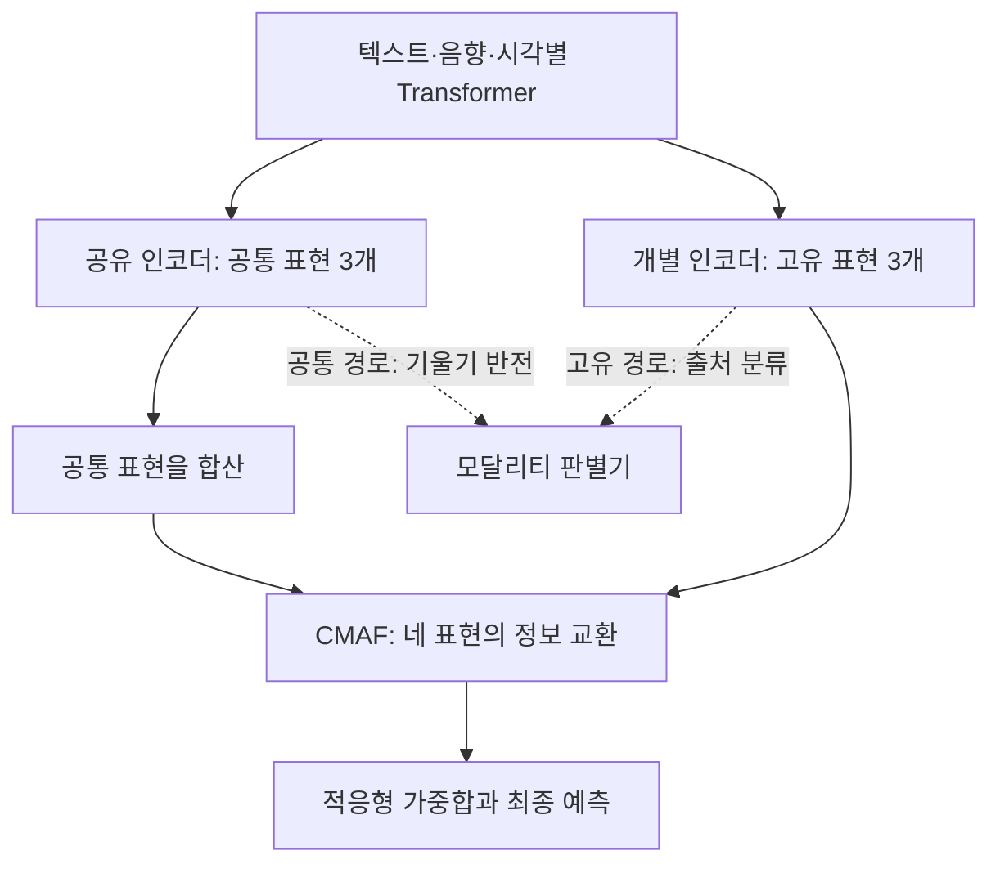

# 논문 분석 보고서  
## *Disentangled Representation Learning for Multimodal Emotion Recognition*

**분석 대상:** Dingkang Yang, Shuai Huang, Haopeng Kuang, Yangtao Du, Lihua Zhang, ACM Multimedia 2022, pp. 1642–1651, DOI: [10.1145/3503161.3547754](https://doi.org/10.1145/3503161.3547754).

**핵심 판단:** 이 논문은 공통 정보와 모달리티별 고유 정보를 분리하고 다시 융합하는 FDMER를 제안하며, 논문에 수록된 비교 방법보다 좋은 벤치마크 성능을 보고합니다.  
다만 **모달리티 간 표현 정렬이 새로운 데이터셋·언어·수집 환경에서의 일반화 향상으로 이어진다는 점까지 직접 검증하지는 않습니다.** [R1, pp. 3–8, Tables 1–4]

---

## 1. Executive summary와 연구 배경

### 1-1. Executive summary — 9문장

1. 이 연구는 텍스트·음향·시각 정보를 결합할 때 발생하는 표현 분포의 차이와 정보 중복이 감정 관련 예측을 어렵게 만든다는 문제에서 출발합니다. [R1, pp. 1–2]
2. 제안 모델 FDMER는 각 입력에서 여러 모달리티에 공통인 표현과 해당 모달리티에 고유한 표현을 각각 학습합니다. [R1, p. 3, Figure 1]
3. 공통 표현에는 일관성 제약과 모달리티 출처를 구분하기 어렵게 하는 학습을 적용하고, 고유 표현에는 중복을 줄이는 제약과 출처를 구분하게 하는 학습을 적용합니다. [R1, p. 4, 식 (4)–(11)]
4. 이후 CMAF 모듈이 표현 사이의 정보를 교환하고 입력별 가중치를 부여해 최종 예측에 사용할 표현을 만듭니다. [R1, p. 5, 식 (12)–(17)]
5. 실험은 CMU-MOSI·CMU-MOSEI의 감성 극성·강도 예측과 UR_FUNNY의 유머 여부 분류에서 수행됩니다. [R1, p. 5, §4.1]
6. BERT 기반 FDMER는 MOSI에서 MAE 0.724와 이진 정확도 84.6%, MOSEI에서 MAE 0.536과 이진 정확도 86.1%를 보고합니다. [R1, p. 6, Tables 1–2]
7. UR_FUNNY에서는 BERT 기반 정확도 71.87%를 보고하며, 구성요소 제거 실험에서는 전체 모델이 각 제거 변형보다 좋은 점추정 성능을 보입니다. [R1, pp. 6–7, Tables 3–4]
8. 그러나 반복실험 횟수·표준편차·신뢰구간·유의성 검정이 제시되지 않아 작은 성능 차이의 통계적 안정성은 판단할 수 없습니다. [R1, pp. 6–7, Tables 1–4]
9. 따라서 이 논문의 가장 확실한 기여는 공통·고유 표현을 함께 정제하고 융합하는 설계의 유용성에 있으며, 분포 변화나 입력 누락에 대한 일반화 향상은 추가 검증이 필요한 연구 질문입니다. [분석; R1, §§3–4]

### 1-2. 연구가 해결하려는 문제

**[저자 보고]** 기존 멀티모달 방법은 모달리티 사이의 관계를 학습하거나 복잡한 융합 구조를 설계하는 데 집중했지만, 각 모달리티의 표현을 하나의 덩어리로 취급하는 경우가 많았습니다. 저자는 이 접근이 다음 두 문제를 충분히 해결하지 못한다고 봅니다. [R1, pp. 1–2]

| 문제 | 논문에서의 의미 | 해결하려는 방향 |
|---|---|---|
| **모달리티 간 분포 차이** | 텍스트·음향·시각 특징이 서로 다른 통계적 특성을 지녀 결합하기 어려움 | 공통 부분공간에서 표현을 정렬 |
| **정보 중복과 고유 정보의 혼재** | 공유되는 정보와 각 모달리티의 독특한 단서가 섞여 표현이 충분히 정제되지 않음 | 공통 표현과 고유 표현을 구분해 학습 |

> **용어 설명**
>
> - **모달리티(modality):** 텍스트, 음성, 영상처럼 정보를 전달하는 형식.
> - **표현(representation):** 신경망이 입력을 처리해 만든 특징 벡터.
> - **부분공간(subspace):** 전체 표현 공간에서 특정 종류의 정보를 담도록 학습하는 공간.
> - **분포 정렬(alignment):** 서로 다른 입력에서 얻은 특징들의 통계적 형태를 비슷하게 만드는 과정.

### 1-3. 연구 목적과 필요성

**[저자 보고]** 연구 목적은 모든 모달리티의 차이를 없애는 것이 아니라, 공통 부분에서는 차이를 줄이고 고유 부분에서는 차이를 보존해 최종 예측에 활용하는 것입니다. 이를 위해 공통·고유 인코더, 모달리티 판별기, 제약 손실, CMAF를 결합합니다. [R1, pp. 2–5]

**[분석]** 이 문제 설정의 의의는 **“여러 입력이 공유하는 정보”와 “각 입력이 추가로 제공하는 정보”를 동시에 다룬다**는 데 있습니다. 다만 여기서의 *disentanglement*는 주로 공통·고유 표현의 분리를 뜻하며, 기쁨·분노·화자 정체성 등 실제 생성 요인을 각각 식별했다는 의미는 아닙니다. [R1, §3.3]

> **용어 설명 — disentangled representation learning:** 여러 종류의 정보가 뒤섞인 표현을 서로 다른 역할의 표현으로 나누어 학습하는 접근입니다. 어떤 손실로 분리했는지에 따라 그 의미가 달라지므로, 이름만으로 완전한 독립이나 인과적 분리가 성립하지는 않습니다.

**과제 범위도 구분해야 합니다.** 논문 제목은 감정 인식이지만, MOSI·MOSEI 실험에서 사용한 목표는 $-3$부터 $3$까지의 **sentiment score**, 즉 긍정·부정의 방향과 강도입니다. 이 실험을 기쁨·분노·슬픔 등 개별 감정 범주를 인식한 결과로 설명하면 부정확합니다. [R1, p. 5, §4.1]

---

## 2. 핵심 주장, 방법론, 모델 구조와 수식

### 2-1. 핵심 주장과 근거

| 핵심 주장 | 저자가 제시한 근거 | 근거 위치 |
|---|---|---|
| 공통·고유 표현을 함께 학습하면 유용한 멀티모달 표현을 얻을 수 있다 | 공통 표현 제거, 고유 표현 제거, 비분리 모델보다 전체 모델의 성능이 높음 | p. 7, Table 4 |
| 모달리티 판별을 이용한 학습이 표현 분리에 도움이 된다 | 판별 관련 손실 제거 시 성능 하락, 공통·고유 표현의 판별 확률 차이 | pp. 7–8, Table 4, Figure 4(a) |
| 공통 표현의 일관성 제약과 고유 표현의 차이 제약이 유용하다 | 각 손실을 제거하면 성능이 낮아짐 | p. 7, Table 4 |
| 각도 마진을 사용하는 판별 손실이 통상적인 교차엔트로피 변형보다 좋다 | Cross-Entropy Loss 변형보다 전체 모델의 수치가 높음 | p. 7, Table 4 |
| CMAF의 정보 교환과 적응형 가중치가 융합을 개선한다 | CMAF 전체 또는 각 단계를 제거하면 성능 하락 | p. 7, Table 4 |
| 표현의 상대적 중요도는 과제에 따라 다르다 | MOSI·MOSEI에서는 텍스트 고유 표현, UR_FUNNY에서는 공통 표현의 가중치가 가장 큼 | p. 8, Figure 4(b) |
| 제안 방법은 감성 예측 이외의 과제에도 적용할 수 있다 | UR_FUNNY 유머 분류 결과 제시 | p. 6, Table 3 |

이 표는 **저자가 제시한 주장과 증거의 연결**입니다. 통계적 유의성이나 실제 도메인 일반화까지 확인되었다는 뜻은 아닙니다.

### 2-2. 데이터 소스와 실험 설계

#### 데이터셋

**[저자 보고]** 세 데이터셋은 단어 단위로 정렬된 멀티모달 신호를 제공합니다. 데이터 수와 분할은 다음과 같습니다. [R1, p. 5, §4.1]

| 데이터셋 | 전체 표본 수 | 훈련 / 검증 / 시험 | 본 논문의 예측 대상 | 평가 지표 |
|---|---:|---:|---|---|
| CMU-MOSI | 2,199 | 1,284 / 229 / 686 | 짧은 독백 영상의 감성 점수 $[-3,3]$ | Acc7, Acc2, F1, MAE, Corr |
| CMU-MOSEI | 22,856 | 16,326 / 1,871 / 4,659 | YouTube 영상의 감성 점수 $[-3,3]$ | Acc7, Acc2, F1, MAE, Corr |
| UR_FUNNY | 16,514 | 10,598 / 2,626 / 3,290 | TED 발화의 유머/비유머 | Acc2 |

> **용어 설명**
>
> - **단어 단위 정렬(word alignment):** 텍스트의 단어 구간과 해당 시간대의 음향·시각 정보를 대응시키는 처리.
> - **Acc2:** 이진 분류 정확도. MOSI·MOSEI에서 중립 점수의 처리 방식은 이 논문에 충분히 명시되지 않습니다.
> - **Acc7:** 일곱 단계 감성 분류의 정확도이며, 일곱 종류 감정의 정확도를 뜻하지 않습니다.
> - **MAE:** 예측값과 정답값 사이 절대오차의 평균으로, 낮을수록 좋습니다.
> - **Corr:** 예측과 사람의 라벨 사이 상관계수로, 높을수록 좋습니다. 원문 설명만으로 상관계수의 세부 정의를 확정하지 않았습니다.
> - **F1:** 정밀도와 재현율을 함께 고려하는 지표입니다. 원문에는 평균 방식이 명확히 적혀 있지 않습니다.

#### 입력 특징

| 모달리티 | MOSI·MOSEI | UR_FUNNY |
|---|---|---|
| 텍스트 | GloVe 300차원 또는 BERT-base-uncased 768차원 | 동일한 두 텍스트 설정 |
| 음향 | COVAREP 특징 74차원 | COVAREP 특징 81차원 |
| 시각 | Facet 기반 얼굴 특징 35차원 | OpenFace 기반 특징 75차원 |

따라서 이 모델은 논문에서 기술한 사전 추출 특징을 입력으로 사용합니다. 원시 영상·음성 전체를 새로운 대규모 모델로 처음부터 학습한 실험으로 해석하면 안 됩니다. [R1, p. 5, §4.2]

> **용어 설명**
>
> - **임베딩(embedding):** 단어 등의 입력을 수치 벡터로 바꾼 표현.
> - **GloVe:** 단어별 벡터를 제공하는 사전 학습 임베딩.
> - **BERT:** 문맥을 반영해 텍스트 표현을 만드는 사전 학습 언어 모델.
> - **COVAREP·Facet·OpenFace:** 각각 음향 또는 얼굴 관련 특징을 추출하는 데 사용된 도구.

### 2-3. 전체 모델 구조

**[저자 보고]** 모델의 정보 흐름은 다음과 같습니다. 아래 도식은 Figure 1의 핵심 경로를 재구성한 것입니다. [R1, p. 3, Figure 1]



구조를 이해할 때 중요한 수는 다음과 같습니다.

- 인코더 직후에는 **공통 표현 3개와 고유 표현 3개**, 총 6개가 있습니다.
- 공통 표현 3개를 합친 뒤에는 **공통 가지 1개와 고유 가지 3개**, 총 4개가 CMAF에 들어갑니다.
- 모달리티 판별기는 감정이 아니라 **해당 표현이 텍스트·음향·시각 중 어디에서 왔는지** 예측합니다. [R1, pp. 3–5]

### 2-4. 특징 추출과 공통·고유 인코더 — 식 (1)–(3)

먼저 각 모달리티의 시퀀스를 별도의 Transformer로 처리합니다.

```math
Z^m
=
\text{Transformer}
\left(X^m;\theta_m^{\text{trans}}\right)
\in \mathbb{R}^{L_m\times d_m}.
```

**기호 설명:** $m\in\{t,a,v\}$는 텍스트·음향·시각, $X^m$은 입력 시퀀스, $L_m$은 시퀀스 길이, $d_m$은 특징 차원, $\theta_m^{\text{trans}}$는 해당 Transformer의 학습 파라미터입니다.

이후 완전연결층을 통해 고정 차원의 $Z^m\in\mathbb{R}^{d_k}$를 얻습니다. 다만 원문은 **시퀀스를 단일 벡터로 축약하는 구체적인 방식**을 충분히 설명하지 않습니다. 평균 풀링이나 특정 토큰 선택을 사용했다고 단정할 수 없습니다. [R1, p. 3, §3.2]

> **용어 설명**
>
> - **Transformer:** 시퀀스 안의 여러 위치가 서로 참조하도록 만들어 문맥 정보를 학습하는 신경망 구조.
> - **완전연결층:** 입력 벡터의 원소들을 학습된 가중치로 결합해 새 벡터를 만드는 층.
> - **풀링(pooling):** 여러 위치의 정보를 평균 등으로 모아 하나의 표현으로 줄이는 연산.

공통 인코더 $\mathcal I$는 세 모달리티에서 파라미터를 공유합니다.

$$
C^t=\mathcal I(Z^t;\theta_{\mathcal I}),\quad
C^a=\mathcal I(Z^a;\theta_{\mathcal I}),\quad
C^v=\mathcal I(Z^v;\theta_{\mathcal I}).
$$

고유 인코더 $\mathcal S_m$는 모달리티마다 별도의 파라미터를 사용합니다.

$$
P^t=\mathcal S_t(Z^t;\theta_t),\quad
P^a=\mathcal S_a(Z^a;\theta_a),\quad
P^v=\mathcal S_v(Z^v;\theta_v).
$$

**기호 설명:** $C^m$은 공통 표현, $P^m$은 고유 표현이며 모두 $d_k$차원입니다. $\theta_{\mathcal I}$는 공유 파라미터, $\theta_t,\theta_a,\theta_v$는 각 고유 인코더의 파라미터입니다.

두 종류의 인코더 모두 **GeLU 활성화 함수를 사용하는 2층 퍼셉트론**입니다. [R1, p. 3, §3.3]

> **용어 설명:** 인코더는 입력을 특징 벡터로 변환하는 신경망이고, 파라미터 공유는 여러 입력에 같은 변환 규칙을 적용한다는 뜻입니다. GeLU는 신경망이 비선형 관계를 학습하도록 하는 활성화 함수입니다.

### 2-5. 공통 표현의 일관성 제약 — 식 (4)–(5)

**[저자 보고]** 공통 표현들의 유사도 구조가 비슷해지도록 제약합니다. **인쇄된 식 (4)는 다음과 같습니다.**

$$
S_m=C_m\left(C_m^{\text{nor}}\right)^T.
$$

```math
\mathcal L_{\text{con}}
=
\frac{1}{3}
\sum_{(m_1,m_2)\in\mathcal P}
\left\|S_{m_1}-S_{m_2}\right\|_F^2,
\qquad
\mathcal P=\{(t,a),(t,v),(a,v)\}.
```

**기호 설명:** $C_m^{\text{nor}}$는 $L_2$ 정규화된 공통 표현, $S_m$은 유사도 행렬, $T$는 전치, $\|\cdot\|_F^2$는 행렬 원소 제곱합, $\mathcal P$는 비교하는 세 모달리티 쌍입니다. $\mathcal P$는 원문의 합산 범위를 간단히 표시하기 위해 도입한 기호입니다. [R1, pp. 3–4]

> **용어 설명**
>
> - **$L_2$ 정규화:** 벡터의 길이를 1로 맞추는 연산.
> - **전치:** 행과 열을 바꾸는 연산.
> - **Frobenius norm:** 행렬 전체의 크기나 두 행렬 사이 차이를 측정하는 방법.

**[표기상 주의]** 식 (4)의 첫 번째 $C_m$에는 정규화 표시가 없습니다. 또한 앞에서는 $C_m$을 벡터로 정의했지만 여기에서는 행렬처럼 다루므로 배치축과 정규화축이 명확하지 않습니다. 이를 임의로 양쪽이 정규화된 코사인 유사도 행렬로 고쳐서 원문 공식이라고 제시하지 않았습니다.

**[분석]** 설계 의도는 공통 표현의 관계 구조를 비슷하게 만드는 것입니다. 이 손실 자체가 공통 표현에 감정 의미만 남긴다거나, 의미적으로 유일한 분해를 보장하는 것은 아닙니다.

### 2-6. 고유 표현의 차이 제약: HSIC — 식 (6)–(7)

**[저자 보고]** 서로 다른 모달리티의 고유 표현 사이 의존성을 줄이기 위해 HSIC를 사용합니다.

```math
\text{HSIC}(P^{m_1},P^{m_2})
=
\frac{1}{(n-1)^2}
\text{Tr}\left(U K_{m_1}U K_{m_2}\right).
```

여기서

$$
U=I-\frac{1}{n}ee^T,
\qquad
[K_m]_{ij}=k_m(p_m^i,p_m^j).
$$

세 모달리티 쌍에 대한 평균이 최종 차이 손실입니다.

```math
\mathcal L_{\text{dis}}
=
\frac{1}{3}
\sum_{(m_1,m_2)\in\mathcal P}
\text{HSIC}(P^{m_1},P^{m_2}).
```

**기호 설명:** $n$은 배치의 표본 수, $p_m^i$는 모달리티 $m$의 $i$번째 고유 표현, $K_m$은 표본 간 커널 유사도를 담은 Gram 행렬, $k_m$은 커널 함수입니다. $I$는 단위행렬, $e$는 모든 원소가 1인 열벡터, $U$는 평균을 제거하는 중심화 행렬, $\text{Tr}$는 대각 원소의 합입니다. [R1, p. 4]

> **용어 설명**
>
> - **HSIC:** 두 표현 사이의 의존 정도를 커널 유사도를 이용해 측정하는 지표.
> - **커널:** 두 표본의 유사도를 계산하는 함수.
> - **Gram 행렬:** 표본들 사이의 유사도를 표 형태로 모은 행렬.
> - **중심화:** 각 값에서 평균을 빼 평균이 0이 되게 하는 처리.

**[분석: 중요한 이론적 제한]** 논문은 실제로 **내적, 즉 선형 커널**을 사용합니다. 배치의 고유 벡터를 행으로 쌓은 행렬을 $B_m\in\mathbb R^{n\times d_k}$라 하면, 위 식은 다음과 같이 전개할 수 있습니다.

```math
\text{HSIC}
=
\frac{1}{(n-1)^2}
\left\|B_{m_1}^{T}U B_{m_2}\right\|_F^2.
```

이 마지막 식은 **원문 식 (6)에 대한 수학적 재정리**입니다. 고유 표현 사이의 교차공분산 크기를 억제한다고 해석할 수 있지만, 비선형 의존성까지 제거하거나 완전한 통계적 독립을 보장했다고 해석할 수는 없습니다.

또한 식 (7)은 **고유 표현끼리**의 관계를 제약합니다. 같은 모달리티의 공통 표현 $C^m$과 고유 표현 $P^m$ 사이에 직접적인 독립·직교 제약을 둔 식은 아닙니다. [R1, 식 (5)–(7), (18)]

> **용어 설명 — 공분산:** 두 값이 함께 증가하거나 감소하는 경향을 나타냅니다. 공분산이 작다는 사실과 모든 형태의 의존성이 없다는 사실은 다릅니다.

### 2-7. 모달리티 판별과 적대적 학습 — 식 (8)–(11)

#### ① 모달리티 판별기

```math
\mathcal D(h;\theta_{\mathcal D})
=
\text{softmax}\left(W_{\mathcal D}^{T}\mathcal F(h)\right),
\qquad
\mathcal F(h)=W_{\mathcal F}h+b_{\mathcal F}.
```

**기호 설명:** $h$는 공통 또는 고유 표현이며, $\mathcal D$는 모달리티 판별기입니다. $W_{\mathcal F}\in\mathbb R^{d\times d_k}$, $b_{\mathcal F}\in\mathbb R^{d\times1}$는 내부 선형 변환의 파라미터이고, $W_{\mathcal D}\in\mathbb R^{d\times3}$는 세 모달리티의 분류 가중치입니다. $\theta_{\mathcal D}$는 판별기의 학습 파라미터입니다. [R1, p. 4]

> **용어 설명 — softmax:** 여러 점수를 합이 1인 확률 형태로 바꾸는 함수입니다. 여기에서는 텍스트·음향·시각에서 왔을 확률을 출력합니다.

#### ② 각도 마진 손실

저자는 내부 표현과 분류 가중치를 정규화한 뒤 각도에 기반한 분류 손실을 사용합니다.

```math
\mathcal L_{\text{am}}
=
-\log
\frac{
\exp\left[\alpha\cos(\theta_{y_m}+\tau)\right]
}{
\exp\left[\alpha\cos(\theta_{y_m}+\tau)\right]
+
\sum_{\substack{j=1\\j\ne y_m}}^{M}
\exp\left[\alpha\cos\theta_j\right]
}.
```

**기호 설명:**

- $M=3$: 모달리티 수.
- $y_m$: 정답 모달리티 라벨.
- $\hat h$: 정규화한 판별기 내부 표현.
- $W_j$: 정규화한 $W_{\mathcal D}$의 $j$번째 열.
- $\theta_j=\arccos(W_j^T\hat h)$: 표현과 모달리티 $j$의 가중치 방향 사이 각도.
- $\tau$: 정답 각도에 추가하는 마진.
- $\alpha$: 분류 점수의 크기를 조절하는 계수.

여기서 $\theta_j$는 **각도**이며, 앞의 인코더 파라미터 $\theta_m$과 역할이 다릅니다. 원문의 분모 합산 문자는 혼동을 피하기 위해 $j$로 바꾸었습니다. [R1, p. 4]

> **용어 설명 — 각도 마진:** 정답 클래스 방향에 충분히 가까워져야 좋은 점수를 얻도록 추가 조건을 주는 방식입니다. 벡터 길이를 정규화하므로 방향의 차이를 중심으로 분류합니다.

#### ③ 공통 경로와 고유 경로의 학습 방향

표본 번호 $i$를 명시해 쓰면 다음과 같습니다.

```math
\mathcal L_{\text{ami}}
=
\frac{1}{n}\sum_{i=1}^{n}
\sum_{m\in\{t,a,v\}}
\mathcal L_{\text{am}}(C_i^m,y_m).
```

```math
\mathcal L_{\text{ams}}
=
\frac{1}{n}\sum_{i=1}^{n}
\sum_{m\in\{t,a,v\}}
\mathcal L_{\text{am}}(P_i^m,y_m).
```

**기호 설명:** $C_i^m$과 $P_i^m$은 표본 $i$의 공통·고유 표현입니다. 원문은 이 표현의 표본 아래첨자를 생략합니다. 두 손실 모두 식 (9)를 사용하지만 인코더에 전달되는 학습 방향이 다릅니다. [R1, p. 4]

| 경로 | 해당 모달리티 분류 손실에 대한 학습 방향 | 의도 |
|---|---|---|
| 판별기 | 모달리티를 잘 맞히도록 학습 | 표현의 출처를 식별 |
| 공통 인코더 | 기울기 반전층을 통해 판별을 어렵게 하는 방향으로 학습 | 모달리티 출처 단서 감소 |
| 고유 인코더 | 모달리티 출처를 잘 구분하도록 학습 | 모달리티별 특성 유지 |

> **용어 설명 — 기울기 반전층(GRL):** 순전파에서는 입력을 그대로 통과시키고, 역전파에서는 입력 방향의 기울기에 $-1$을 곱하는 장치입니다. 여기에서는 공통 인코더와 판별기가 반대 목표를 갖도록 합니다.

**[분석]** 원문은 식 (11)을 “private adversarial loss”라고 부르지만, 모달리티 분류에 관한 고유 인코더와 판별기의 목표는 협력적입니다. 또한 판별기가 공통 표현의 출처를 알아내기 어렵다는 사실만으로 **감정에 유용한 정보가 온전히 보존되었다고 결론 내릴 수는 없습니다.**

### 2-8. CMAF 1단계: 표현 사이의 정보 교환 — 식 (12)–(14)

먼저 공통 표현을 **합산**합니다.

$$
C=C^t+C^a+C^v,
\qquad
F_{\text{so}}=[C,P^t,P^a,P^v].
$$

강화할 목표 표현은

$$
F_{\text{ta}}\in\{C,P^t,P^a,P^v\}
$$

입니다. 전체 표현은 정보 제공원인 source, 각 개별 표현은 정보를 받을 target이 됩니다. [R1, p. 5, §3.4]

다음과 같이 투영합니다.

```math
G_{\text{ta}}
=
\text{LN}(F_{\text{ta}})W_{G_{\text{ta}}},
```

```math
Q_{\text{so}}
=
\text{LN}(F_{\text{so}})W_{Q_{\text{so}}},
\qquad
U_{\text{so}}
=
\text{LN}(F_{\text{so}})W_{U_{\text{so}}}.
```

교차 주의 연산은 다음과 같습니다.

```math
F_{\text{so}\rightarrow\text{ta}}
=
\text{softmax}
\left(G_{\text{ta}}Q_{\text{so}}^T\right)
U_{\text{so}}.
```

이후 정규화·잔차 연결·피드포워드층을 적용합니다.

```math
Y_{\text{ta}}
=
\text{LN}(F_{\text{ta}})
+
F_{\text{so}\rightarrow\text{ta}}.
```

```math
Y_{\text{ta}}
=
f_\delta\left(\text{LN}(Y_{\text{ta}})\right)
+
Y_{\text{ta}}.
```

**기호 설명:** $\text{LN}$은 Layer Normalization, $W$들은 학습 가능한 투영 가중치, $f_\delta$는 파라미터 $\delta$를 갖는 피드포워드층입니다. 출력은 $Y_c,Y_t,Y_a,Y_v$입니다.

원문의 기호를 역할과 대응시키면 다음과 같습니다.

| 원문 기호 | 주의 연산에서의 역할 |
|---|---|
| $G_{\text{ta}}$ | Query: 목표 표현이 찾는 정보 |
| $Q_{\text{so}}$ | Key: 제공할 정보를 비교하는 기준 |
| $U_{\text{so}}$ | Value: 실제로 가져오는 정보 |

**주의:** 원문의 $Q_{\text{so}}$는 이름에 $Q$가 있지만 식에서는 **Key 역할**입니다.

> **용어 설명**
>
> - **교차 주의(cross-attention):** 한 표현이 다른 표현에서 필요한 정보를 선택하는 연산.
> - **Layer Normalization:** 한 표현 내부 값의 척도를 정리하는 정규화.
> - **잔차 연결:** 새로운 변환 결과에 기존 표현을 더하는 연결.
> - **피드포워드층:** 주의 연산으로 모은 정보를 추가로 변환하는 신경망 층.

**[재현성 주의]** 원문은 $F_{\text{so}}\in\mathbb R^{4d_k}$와 관련 투영 행렬의 차원을 제시하지만, 식 (12)의 행렬곱을 완전히 확정할 배치·토큰·재배열 축 설명이 충분하지 않습니다. 또한 식 (12)에 통상적인 주의 연산의 $1/\sqrt{d_k}$ 항은 표시되어 있지 않습니다. 따라서 표준 구현을 추정해 그 항을 추가하거나 텐서 모양을 확정하는 것은 원문 전사를 넘어섭니다. [R1, p. 5]

### 2-9. CMAF 2단계: 적응형 가중합 — 식 (15)–(17)

각 표현의 중요도 점수를 계산합니다.

```math
\mu_{\text{ta}}
=
q^T\tanh
\left(W_{\text{ta}}Y_{\text{ta}}+b_{\text{ta}}\right).
```

네 표현의 가중치 합이 1이 되도록 정규화합니다.

```math
\psi_{\text{ta}}
=
\frac{\exp(\mu_{\text{ta}})}
{\sum_{r\in\{c,t,a,v\}}\exp(\mu_r)}.
```

최종 표현은 가중합입니다.

```math
Y_{\text{fin}}
=
\sum_{\text{ta}\in\{c,t,a,v\}}
\psi_{\text{ta}}\odot Y_{\text{ta}}.
```

**기호 설명:** $q\in\mathbb R^{d_k\times1}$는 네 가지에 공유하는 주의 벡터, $W_{\text{ta}}\in\mathbb R^{d_k\times d_k}$와 $b_{\text{ta}}\in\mathbb R^{d_k\times1}$는 가지별 파라미터입니다. $\mu_{\text{ta}}$는 점수, $\psi_{\text{ta}}$는 정규화한 가중치, $Y_{\text{fin}}$은 최종 표현입니다. 원문의 $\odot$는 원소별 곱 기호지만, 이 식의 $\psi_{\text{ta}}$는 스칼라이므로 벡터 전체에 같은 가중치를 적용합니다. [R1, p. 5]

> **용어 설명 — 적응형 가중합:** 모든 입력에 같은 비율을 쓰지 않고, 입력별로 표현의 결합 비율을 조절하는 방식입니다.

여기서 $\psi_c$는 별도의 네 번째 모달리티가 아니라 **세 모달리티의 공통 표현을 합친 가지의 가중치**입니다.

### 2-10. 최종 학습 목표 — 식 (18)

```math
\mathcal L_{\text{all}}
=
\mathcal L_{\text{task}}
+
\beta
\left(
\mathcal L_{\text{ami}}+\mathcal L_{\text{ams}}
\right)
+
\gamma
\left(
\mathcal L_{\text{con}}+\mathcal L_{\text{dis}}
\right).
```

분류에서는 교차엔트로피, 회귀에서는 평균제곱오차를 사용합니다.

```math
\mathcal L_{\text{task}}^{\text{cls}}
=
-\frac{1}{n}
\sum_{i=1}^{n}
y_i\cdot\log\hat y_i,
```

```math
\mathcal L_{\text{task}}^{\text{reg}}
=
\frac{1}{n}
\sum_{i=1}^{n}
\|y_i-\hat y_i\|_2^2.
```

**기호 설명:** $y_i$와 $\hat y_i$는 정답과 최종 과제 예측입니다. 분류식에서는 클래스 벡터로, 회귀식에서는 감성 점수로 해석합니다. $\beta$는 판별 관련 손실, $\gamma$는 일관성·차이 제약의 비중입니다. [R1, p. 5, §3.5]

> **용어 설명**
>
> - **교차엔트로피:** 정답 클래스에 높은 확률을 주도록 학습하는 손실.
> - **평균제곱오차(MSE):** 예측 오차를 제곱해 평균한 손실. 평가에 사용한 MAE와 다릅니다.
> - **정규화 손실:** 예측 오차 외에 표현이 특정 성질을 갖도록 추가하는 학습 조건.

**핵심 해석:** 식 (18)에 모든 항이 더해져 있어도 모든 모듈이 모든 손실을 같은 방향으로 최소화하지는 않습니다. 공통 경로의 $\mathcal L_{\text{ami}}$에는 GRL이 적용되어 인코더 방향의 기울기가 반전됩니다.

### 2-11. 구현 설정

공통 설정은 Transformer 층 수 **텍스트 5·음향 4·시각 4**, 표현 차원 $d_k=256$, 판별기 내부 차원 $d=128$, 각도 마진 $\tau=0.5$, 척도 계수 $\alpha=72$입니다. [R1, pp. 5–6, §4.2]

| 설정 | MOSI | MOSEI | UR_FUNNY |
|---|---:|---:|---:|
| 배치 크기 | 64 | 16 | 32 |
| 학습 epoch | 120 | 100 | 60 |
| 초기 학습률 | $10^{-3}$ | $10^{-3}$ | $2\times10^{-3}$ |
| $\beta$ | 0.02 | 0.03 | 0.02 |
| $\gamma$ | 0.02 | 0.04 | 0.03 |

Adam 최적화 방법과 Tesla V100 GPU 4개를 사용했으며, 하이퍼파라미터는 검증 집합으로 결정했다고 명시합니다. 파라미터 수·추론 지연시간·연산량은 별도로 보고하지 않습니다. [R1, pp. 5–6]

---

## 3. 주요 결과와 중요한 데이터 포인트

### 3-1. 감성 예측 결과

아래는 원문 Tables 1–2의 주요 행입니다. Acc와 F1은 원문에 제시된 백분율 척도이고, MAE는 낮을수록, 나머지는 높을수록 좋습니다. **MISA 값도 FDMER 논문에 수록된 값**입니다. [R1, p. 6]

| 데이터셋 | 텍스트 특징 | 모델 | Acc7 ↑ | Acc2 ↑ | F1 ↑ | MAE ↓ | Corr ↑ |
|---|---|---|---:|---:|---:|---:|---:|
| MOSI | GloVe | FDMER | 42.1 | 84.2 | 83.9 | 0.845 | 0.732 |
| MOSI | BERT | MISA | 42.3 | 83.4 | 83.6 | 0.783 | 0.761 |
| MOSI | BERT | **FDMER** | **44.1** | **84.6** | **84.7** | **0.724** | **0.788** |
| MOSEI | GloVe | FDMER | 53.8 | 83.9 | 83.8 | 0.568 | 0.736 |
| MOSEI | BERT | MISA | 52.2 | 85.5 | 85.3 | 0.555 | 0.756 |
| MOSEI | BERT | **FDMER** | **54.1** | **86.1** | **85.8** | **0.536** | **0.773** |

**[분석가 계산]** BERT 기반 MISA 대비 FDMER의 차이는 다음과 같습니다.

| 데이터셋 | Acc2 차이 | MAE 차이 | MAE의 상대 감소율 |
|---|---:|---:|---:|
| MOSI | +1.2%p | −0.059 | 약 7.54% |
| MOSEI | +0.6%p | −0.019 | 약 3.42% |

상대 감소율은 $(\text{MISA MAE}-\text{FDMER MAE})/\text{MISA MAE}$로 계산했습니다. 이 계산은 효과의 크기를 나타내며 **통계적 유의성을 나타내지는 않습니다.**

### 3-2. 유머 분류 결과

| 텍스트 특징 | MISA Acc2 | FDMER Acc2 | 차이 |
|---|---:|---:|---:|
| GloVe | 68.60% | 70.55% | +1.95%p |
| BERT | 70.61% | 71.87% | +1.26%p |

두 모델은 Table 3에서 목표 발화만 사용하는 것으로 표시됩니다. 같은 표의 일부 C-MFN 결과는 주변 문맥만 쓰거나 문맥과 목표 발화를 함께 쓰므로 입력 조건이 다릅니다. [R1, p. 6, Table 3]

**[분석]** UR_FUNNY 결과는 구조를 다른 과제에 적용할 수 있다는 근거입니다. MOSI에서 학습한 모델을 재학습 없이 유머 분류에 적용했다는 결과는 아닙니다.

### 3-3. 구성요소 제거 실험

**중요한 비교 조건:** Table 4의 기준값은 Tables 1–3의 **GloVe FDMER 값과 일치**합니다. 이를 BERT 결과와 섞어 성능 하락량을 계산하면 안 됩니다.

아래는 Table 4의 주요 변형을 발췌한 것입니다. [R1, p. 7]

| 변형 | MOSI MAE ↓ | MOSEI MAE ↓ | UR_FUNNY Acc2 ↑ |
|---|---:|---:|---:|
| 전체 FDMER | **0.845** | **0.568** | **70.55** |
| 텍스트 제거 | 1.275 | 0.896 | 57.58 |
| 음향 제거 | 0.883 | 0.604 | 70.43 |
| 시각 제거 | 0.925 | 0.639 | 69.81 |
| 판별 관련 손실 두 개 제거 | 0.872 | 0.590 | 68.36 |
| 일관성 손실 $\mathcal L_{\text{con}}$ 제거 | 0.867 | 0.577 | 69.87 |
| 차이 손실 $\mathcal L_{\text{dis}}$ 제거 | 0.854 | 0.571 | 70.28 |
| Cross-Entropy Loss 변형 | 0.852 | 0.582 | 68.95 |
| 융합에서 공통 표현 제거 | 0.868 | 0.575 | 68.31 |
| 융합에서 고유 표현 제거 | 0.885 | 0.582 | 69.27 |
| 표현 분리 없이 직접 융합 | 0.862 | 0.571 | 69.68 |
| CMAF 제거: 단순 연결 | 0.871 | 0.606 | 67.33 |
| CMAF 1단계 제거 | 0.864 | 0.582 | 68.41 |
| CMAF 2단계 제거 | 0.855 | 0.570 | 69.75 |

> **용어 설명 — 제거 실험(ablation):** 전체 모델에서 특정 구성요소를 빼고 성능이 어떻게 달라지는지 확인하는 실험입니다. 제거로 계산량이나 표현 크기도 바뀐다면 그 영향까지 함께 포함될 수 있습니다.

#### 가장 중요한 관찰

**① 텍스트의 영향이 가장 큽니다.**  
텍스트 제거 시 MOSI MAE는 0.430, MOSEI MAE는 0.328 증가하고, UR_FUNNY 정확도는 12.97%p 하락합니다. 다만 Table 4에는 **텍스트만 사용하는 기준선**이 없으므로, 전체 모델이 강한 텍스트 단독 모델보다 얼마나 유리한지는 이 표만으로 알 수 없습니다. [저자 보고 및 분석가 계산; Table 4]

**② 모달리티 판별 학습과 CMAF는 후속 검증 우선순위가 높습니다.**  
판별 관련 손실 제거 시 UR_FUNNY가 2.19%p, CMAF 제거 시 3.22%p 하락합니다. MOSI·MOSEI에서도 두 제거 변형의 MAE가 증가합니다. 다만 공통·고유 판별 손실은 함께 제거했으므로 각각의 기여를 분리해 알 수는 없습니다. [Table 4]

**③ 일부 효과는 작습니다.**  
HSIC 차이 손실 제거에 따른 MOSEI MAE 차이는 0.003, UR_FUNNY 정확도 차이는 0.27%p입니다. UR_FUNNY에서 음향 제거의 차이는 0.12%p입니다. 이 차이들이 무작위 초기화에 따른 변동보다 큰지는 보고되지 않았습니다. [분석; Table 4]

**④ 표현의 필요성은 과제마다 다릅니다.**  
MOSI·MOSEI에서는 고유 표현 제거의 손실이 더 크고, UR_FUNNY에서는 공통 표현 제거의 손실이 더 큽니다. 이는 Figure 4(b)의 가중치 경향과도 부합합니다. [R1, pp. 7–8]

---

## 4. 저자의 직접 보고와 분석가 해석의 구분

| 구분 | 저자가 직접 보고한 내용 | 근거를 제한해 해석한 내용 |
|---|---|---|
| **연구 주제** | 모달리티 이질성과 중복을 줄여 멀티모달 감정 관련 예측을 개선 | 실험의 중심은 감성 극성·강도 및 유머 분류이며, 모든 종류의 감정 인식을 검증한 것은 아님 |
| **방법** | 공통·고유 부분공간, 모달리티 판별, HSIC, CMAF를 결합 | 원하는 표현 성질을 유도하는 설계이며, 의미적으로 완전하거나 유일한 분해에 대한 증명은 없음 |
| **결과** | 수록 비교 방법보다 높은 성능과 제거 실험의 성능 하락 | 해당 표의 점추정 결과를 지지하며, 통계적 유의성은 미확인 |
| **표현 분석** | 공통 표현이 겹치고 고유 표현이 분리되는 시각화 | 학습 의도와 일치하지만 고차원 분포의 완전한 분리나 모든 판별기에 대한 불변성을 입증하지 않음 |
| **적용 가능성** | 세 벤치마크와 두 종류 과제에 적용 | 여러 설정에서의 적용 가능성은 지지하지만 교차 데이터셋 전이 성능은 별도로 확인해야 함 |

근거는 각각 [R1, §1, §§3.3–3.5, Tables 1–4, Figures 2·4, §4.1–4.3]입니다.

---

## 5. 통계적으로 취약한 부분과 직접 비교가 제한되는 수치

아래 항목은 **저자가 명시적으로 인정한 한계 목록이 아니라, 보고된 증거를 검토한 분석 결과**입니다.

| 표시 | 항목 | 확인된 상태와 해석상 제한 | 위치 |
|---|---|---|---|
| **통계 판단 불가** | 반복실험과 불확실성 | 시드 수, 평균±표준편차, 신뢰구간, 유의성 검정 미보고; “significantly”를 검정된 유의성으로 번역할 수 없음 | Tables 1–4 |
| **작은 차이 주의** | HSIC·일부 모달리티의 효과 | MOSEI MAE 0.003, UR_FUNNY 음향 효과 0.12%p 등의 안정성 미확인 | Table 4 |
| **조건부 비교** | 선행 방법의 결과 | 일부 수치는 다른 논문에서 가져옴; 동일 튜닝 예산과 실행 환경을 보장하지 않음 | p. 6, §4.3 |
| **직접 비교 제한** | GloVe와 BERT | 텍스트 표현의 차이가 포함되므로 차이 전체를 FDMER 구조의 효과로 귀속할 수 없음 | Tables 1–3 |
| **혼합 금지** | 본실험과 제거 실험 | BERT 최고 결과와 GloVe 기준의 Table 4를 직접 빼면 잘못된 효과 크기가 됨 | Tables 1–4 |
| **입력 조건 차이** | UR_FUNNY 문맥 사용 | 문맥 사용 여부가 다른 모델 사이의 차이는 순수한 구조 차이가 아님 | Table 3 |
| **정의 확인 필요** | Acc2·F1·Acc7 | 중립 처리, F1 평균 방식, 연속 점수의 7단계 변환 세부가 충분히 명시되지 않음 | p. 5, §4.1 |
| **실험 목적 차이** | 모달리티 제거 | 두 모달리티 FDMER의 평가이며, 완전 입력으로 학습한 동일 모델의 시험 시 누락 평가로 볼 수 없음 | pp. 6–7, §4.4 |
| **효율 판단 불가** | 단순한 구조라는 주장 | 파라미터 수·연산량·지연시간 비교가 없어 실행 효율 우위를 확인할 수 없음 | p. 6, §4.3 |

### “당시 최고 성능” 표현의 범위

**[분석]** 정확한 표현은 **“논문에 수록된 비교 방법과 지표에서 가장 좋은 결과를 보고했다”**입니다. FDMER보다 먼저 발표된 MMIM(2021)은 FDMER 비교표에 포함되지 않습니다. MMIM은 별도의 입력·학습 조건에서 두 가지 이진 평가 방식, 5회 평균, 일부 결과에 대한 대응표본 검정을 보고하므로, 전체 분야의 우열을 판단하려면 동일 조건의 재평가가 필요합니다. [R1, Tables 1–3; R3, pp. 9186–9187, Table 2] [aclanthology.org](https://aclanthology.org/2021.emnlp-main.723.pdf?utm_source=chatgpt.com)

> **용어 설명**
>
> - **무작위 시드:** 초기 가중치와 데이터 순서 등의 무작위성을 결정하는 값.
> - **신뢰구간:** 추정한 성능이나 성능 차이의 불확실성을 구간으로 표시한 것.
> - **대응 비교:** 같은 시험 표본이나 대응되는 실행 조건에서 두 방법의 차이를 비교하는 방식.
>
> 유의성 검정이 없다는 것은 **차이가 없다는 뜻이 아니라, 차이의 통계적 안정성을 판단할 자료가 부족하다는 뜻**입니다.

---

## 6. 문서가 답하지 않는 질문

### 6-1. 구현을 재현하기 위한 질문

1. **식 (4)의 첫 번째 표현에도 정규화가 적용되는가?** 유사도 행렬의 배치축과 정규화축은 무엇인가? [p. 4, 식 (4)]
2. **Transformer 시퀀스를 고정 길이 벡터로 어떻게 축약하는가?** [p. 3, §3.2]
3. **CMAF의 실제 텐서 모양은 무엇인가?** $d_k$와 $4d_k$ 차원 사이의 투영·재배열·주의 축을 어떻게 구현하는가? [p. 5, 식 (12)]
4. **BERT의 학습 범위와 최종 평가 변환은 어떻게 설정했는가?** 미세조정 세부, 중립 처리, Acc7 변환 등을 원문만으로 충분히 확정할 수 있는가? [pp. 5–6, §4.1–4.2]

### 6-2. 표현의 의미와 일반화를 확인하기 위한 질문

5. **공통 표현에서 모달리티 정보가 줄어들면서 감성 정보까지 사라지지는 않는가?** Figure 4(a)는 모달리티 판별 결과를 보여주지만 이를 분리해서 평가하지 않습니다.
6. **고유 표현은 감성에 유용한 단서인가, 단순히 입력 출처를 구분하는 단서인가?** 모달리티 분류 성공만으로 두 경우를 구분할 수 없습니다.
7. **학습에 사용하지 않은 별도의 판별기도 공통 표현의 모달리티를 알아내기 어려운가?** 원래 판별기의 혼동만으로 잔존 정보를 모두 확인할 수 없습니다.
8. **동일 특징 추출기와 계산량을 사용하는 텍스트 단독 모델보다 얼마나 유리한가?** 해당 기준선이 제시되지 않습니다.
9. **MOSI에서 학습한 모델이 MOSEI로, 또는 그 반대로 전이되는가?** 그러한 실험은 보고되지 않습니다.
10. **잡음·시간 정렬 오류·시험 시 모달리티 누락에도 효과가 유지되는가?** Table 4의 두 모달리티 구성만으로는 답할 수 없습니다.

이 질문들은 새로운 성과를 추정한 것이 아니라, 원문에서 확인되지 않는 검증 항목입니다.

---

## 7. 가장 중요한 그림의 선정과 해석

우선순위는 **Figure 1 → Figure 4 → Figure 2**입니다. Figure 3은 학습 과정을 이해하는 보조 자료로 보는 것이 적절합니다.

| 그림 | 무엇을 보여주는가 | 저자의 해석 | 분석 시 확인할 한계 |
|---|---|---|---|
| **Figure 1, p. 3** | 공통·고유 인코더, 판별기, CMAF의 전체 연결 | 표현 분리와 융합을 결합한 구조 | 설계도이며 성능이나 일반화를 입증하는 결과 그림은 아님 |
| **Figure 4(a), p. 8** | 공통·고유 표현에 대한 모달리티 판별 확률 | 공통 표현의 세 확률은 약 0.33, 고유 표현은 정답 출처 확률이 높음 | 학습된 판별기의 행동을 보여주지만 모든 출처 정보의 제거를 입증하지 않음 |
| **Figure 4(b), p. 8** | 네 융합 가지의 가중치 분포 | MOSI·MOSEI는 텍스트 고유 표현, UR_FUNNY는 공통 표현이 가장 큰 가중치 | 가중치가 인과적 기여도나 설명의 정확성과 동일하지 않음 |
| **Figure 2, p. 7** | 제약·판별 손실 사용 전후의 표현 시각화 | 공통 표현은 섞이고 고유 표현은 모달리티별로 분리됨 | 투영 방법이 명시되지 않아 t-SNE라고 부를 수 없으며, 고차원 분포의 정량적 증명도 아님 |
| **Figure 3, p. 7** | 판별·제약·전체 손실의 학습 추세 | 제약·전체 손실은 감소하고 적대적 손실은 진동 후 안정 | 훈련손실이므로 과적합 부재나 여러 시드의 안정성을 입증하지 않음 |

### 특히 Figure 4가 중요한 이유

**[분석]** Figure 4는 모델이 실제로 설계 의도와 비슷한 행동을 하는지 확인하게 해줍니다. 공통 표현에서는 출처 판별이 어려워지고, 고유 표현에서는 출처 판별이 쉬워지며, 융합 가중치는 과제에 따라 달라집니다. 이 결과를 Table 4의 제거 실험과 함께 읽으면 설계와 예측 성능의 연결을 이해할 수 있습니다. [R1, pp. 7–8]

다만 Figure 4(b)에서 **모든 고유 표현의 가중치가 공통 표현보다 크다**고 해석하면 안 됩니다. 예를 들어 MOSI의 음향 고유 가지는 공통 가지보다 작은 가중치를 보입니다. 논문이 가장 분명하게 보여주는 경향은 **감성 과제에서 텍스트 고유 가지가 가장 크고, 유머 과제에서 공통 가지가 가장 크다**는 것입니다.

---

## 8. 결론, 일반화 가능성, 후속 연구

### 8-1. 결론 및 학술적·실용적 시사점

**[저자 보고]** 저자들은 공통·고유 부분공간, 제약 손실과 적대적 학습, CMAF의 결합이 모달리티 이질성을 다루는 데 효과적이라고 결론짓습니다. 또한 다양한 멀티모달 응용으로 확장할 수 있다고 전망합니다. [R1, p. 8, §5]

**[분석: 학술적 의미]** 핵심 기여는 공통·고유 분리 자체의 최초 제안이 아니라, **공통 표현에는 출처 정보를 줄이고 고유 표현에는 출처 정보를 드러내는 학습 신호를 부여한 뒤, 두 종류의 표현을 적응적으로 융합한 구성**에 있습니다. 공유·고유 분리는 MISA 등 선행연구에도 존재합니다. [R1, pp. 2–5; R2, §§3.3–3.5] [arxiv.org](https://arxiv.org/html/2005.03545v3?utm_source=chatgpt.com)

**[분석: 실용적 의미]** 여러 입력을 하나로 결합하는 시스템에서 “어떤 정보는 공유하고 어떤 정보는 남겨둘 것인가”를 명시적으로 설계할 수 있다는 점이 유용합니다. 그러나 실제 배포 환경의 성능·지연시간·입력 오류에 대한 검증은 별개의 과제로 남습니다. [R1, §§4–5]

### 8-2. 모델 일반화 성능 향상 가능성

#### 먼저, 일반화의 종류를 구분해야 합니다

| 일반화 또는 적용 범위 | FDMER가 제공하는 근거 | 판단 |
|---|---|---|
| 각 벤치마크의 시험 집합에 대한 예측 | 사전 지정 분할의 시험 성능 | **직접 보고됨** |
| 다른 종류 과제에 같은 구조 적용 | 감성 예측과 유머 분류 | **적용 가능성을 지지** |
| 한 데이터셋에서 학습 후 다른 데이터셋에 적용 | 교차 데이터셋 결과 없음 | **미검증** |
| 입력 모달리티의 시험 시 누락 | 해당 강건성 프로토콜 없음 | **미검증** |
| 언어·수집 환경·잡음·정렬 조건 변화 | 해당 변화의 영향을 분리한 평가 없음 | **미검증** |

근거: [R1, §§4.1–4.5, Tables 1–4].

> **용어 설명**
>
> - **도메인(domain):** 데이터의 수집 환경, 주제, 언어 등 분포를 규정하는 조건.
> - **도메인 일반화:** 학습 때와 다른 환경에서도 예측 성능을 유지하는 능력.
> - **강건성(robustness):** 입력 누락이나 잡음 등 교란에도 성능이 크게 무너지지 않는 성질.

#### 왜 일반화 연구의 출발점으로 유망한가?

**[분석: 검증할 가설]** 공통 표현이 특정 입력 형식에만 의존하는 단서를 줄이고, 고유 표현이 추가 단서를 보존한다면 새로운 조건에서도 유용한 표현을 만들 가능성을 검토할 수 있습니다. 그러나 다음 세 가지가 해결되어야 합니다.

| 검증할 가설 | 기대하는 작동 방식 | 함께 확인해야 할 위험 |
|---|---|---|
| 공통 표현 정렬이 전이에 도움이 되는가 | 입력 형식의 차이에 덜 민감한 표현 형성 | 감성 예측에 필요한 차이까지 제거할 수 있음 |
| 고유 표현이 보완 정보를 제공하는가 | 공통 표현이 놓친 단서를 보존 | 출처·환경에 특유한 불필요한 정보가 남을 수 있음 |
| 적응형 융합이 입력 품질 변화에 대응하는가 | 상황에 따라 더 유용한 가지에 큰 비중 부여 | 학습 분포에서 큰 가중치를 얻은 가지에 과도하게 의존할 수 있음 |

이 표는 원문의 설계를 바탕으로 만든 **실험 가설**입니다. FDMER가 이러한 위험을 실제로 해결했다고 보고한 것은 아닙니다.

가장 중요한 구분은 **“텍스트·음향·시각을 구별하기 어려운 공통 표현”과 “새 데이터셋에서도 감성을 잘 예측하는 표현”이 같은 조건은 아니라는 점**입니다.

### 8-3. 논문이 언급한 제한사항과 후속 계획

**원문에는 별도의 Limitations 절이 없으며, 자신의 방법의 한계를 체계적으로 열거하지 않습니다.** 구체적인 후속 실험 계획도 제시하지 않고, 다양한 멀티모달 응용으로 확장할 수 있다는 전망을 제시합니다. [R1, p. 8, §5]

따라서 다음 항목은 **분석가가 확인한 제한**으로 구분해야 합니다.

- 통계적 불확실성의 미보고.
- 일부 수식과 텐서 차원의 재현성 문제.
- 교차 데이터셋·입력 누락·잡음에 대한 직접 검증 부재.
- 공통·고유 표현의 의미적 순도에 대한 정량적 검증 부족.
- 계산량을 맞춘 비교와 실행 효율 평가 부재.

저자가 향후 다국어, 결측 모달리티, 도메인 일반화를 연구하겠다고 말했다고 서술할 근거는 없습니다.

### 8-4. 복잡한 구현 전에 검증할 유망한 아이디어

아래는 **후속 실험 제안**입니다. 목적은 FDMER 전체를 즉시 재현하는 것이 아니라, 유용한 원리가 무엇인지 분리해서 확인하는 것입니다.

| 우선순위 | 검증할 아이디어 | 최소 실험 | 판단할 지표·관찰 | 원문 근거 |
|---|---|---|---|---|
| **1** | 공통·고유 표현의 병행 사용 | 고정한 특징 위에 작은 공유·개별 MLP를 추가하고 단순 연결 모델과 비교 | 같은 계산량에서 과제 성능이 개선되는가 | Table 4의 표현 제거·비분리 비교 |
| **2** | 공통 표현의 출처 억제 | 공통 가지에 GRL을 추가하고 고유 가지에는 출처 분류 적용 | 독립 판별기의 출처 정확도와 감성 예측력을 함께 평가 | 식 (8)–(11), Figure 4(a) |
| **3** | 표현별 가중합과 정보 교환 | 먼저 작은 가중치 게이트, 이후 교차 주의 한 단계를 추가 | 단순 결합 대비 증분 성능과 비용 | Table 4의 CMAF·Phase 1·Phase 2 |
| **4** | 고유 표현의 중복 억제 | 선형 HSIC를 켜고 끈 동일 모델을 반복 비교 | 작은 개선이 시드와 데이터셋에 걸쳐 유지되는가 | 식 (6)–(7), Table 4 |

> **용어 설명**
>
> - **MLP:** 완전연결층을 여러 개 쌓은 비교적 단순한 신경망.
> - **게이트(gate):** 각 정보의 통과량이나 결합 비율을 조절하는 작은 모듈.
> - **독립 판별기 또는 probe:** 표현을 만든 모델과 별도로 학습해, 그 표현에 어떤 정보가 남아 있는지 확인하는 모델.

**실험 설계에서 먼저 고정할 조건**은 특징 추출기, 데이터 분할, 중립값 처리, 학습 예산입니다. 텍스트 단독 기준선을 포함하고, 여러 시드의 평균과 성능 차이의 불확실성을 보고하는 편이 좋습니다.

일반화를 목표로 한다면 초기 단계부터 **MOSI↔MOSEI 전이**, **시험 시 음향·시각 누락**, **입력 품질 저하**를 별도 평가해야 합니다. 목표 데이터셋의 시험 성능을 보며 설정을 고르면 일반화 평가의 의미가 흐려지므로, 설정 선택에 사용할 데이터도 미리 구분해야 합니다.

---

### 8-5. 2020년 이후 관련 최신 연구 비교

아래는 **2026년 11월 15일 기준으로 확인한 대표 원문**입니다. 공통·고유 분리의 선행연구, 직접 후속연구, 일반화 검증을 확장한 연구를 함께 선정했습니다.

#### 방법론과 평가 범위 비교

| 연구 | 저자가 제안한 핵심 접근 | FDMER와 비교할 지점 | 평가 및 근거 |
|---|---|---|---|
| **MISA, 2020** | 공통·고유 표현을 CMD, 직교 제약, 재구성 손실로 학습 | 공통·고유 분리의 직접 선행연구; FDMER는 판별 학습과 CMAF를 추가 | MOSI·MOSEI·UR_FUNNY; §§3.3–3.5, Figure 2. [arxiv.org](https://arxiv.org/html/2005.03545v3?utm_source=chatgpt.com) |
| **MMIM, 2021** | 입력 모달리티 사이와 융합 전후의 상호정보량을 최대화 | 공간 분리와 별개로, 융합 중 필요한 정보가 유지되는지 다룸 | MOSI·MOSEI; §3, Figure 1, Table 2. [aclanthology.org](https://aclanthology.org/2021.emnlp-main.723.pdf?utm_source=chatgpt.com) |
| **DMD, 2023** | 분리한 공간별로 동적 그래프 기반 지식증류 수행 | 분리 후 모달리티끼리 무엇을 얼마나 전달할지도 학습 | 정렬·비정렬 MOSI·MOSEI; Figures 1–2, Tables 1–2. [arxiv.org](https://arxiv.org/pdf/2303.13802?utm_source=chatgpt.com) |
| **FDRL, ICASSP 2024** | 전체 분포와 감정 클래스별 분포를 함께 정렬하고 표현의 라벨 정보 유지 | 전역적인 정렬만으로 충분한가를 문제 삼음 | 음성+텍스트 IEMOCAP; §2.2, Figures 1–2, Table 1. [arxiv.org](https://arxiv.org/pdf/2312.13567?utm_source=chatgpt.com) |
| **TriDiRA, 2025** | 공통·유효 고유·무효 고유 표현의 세 부분으로 분리 | 모달리티 고유 정보가 모두 과제에 유용한 것은 아니라는 문제를 다룸 | MOSI·MOSEI·UR_FUNNY·MELD; 공개 v2의 Figures 1–3, Tables 1–2. [arxiv.org](https://arxiv.org/pdf/2401.16119?utm_source=chatgpt.com) |
| **CMAD, ICCV 2025** | 완전 입력 교사와 불완전 입력 학생의 특징·상관 구조를 정렬하고 조합별 학습 난도 조절 | 시험 시 입력 누락을 직접적인 학습·평가 대상으로 확장 | 일곱 모달리티 조합, 개별 모델과 통합 모델 구분; Figure 2, §4, Table 1. [openaccess.thecvf.com](https://openaccess.thecvf.com/content/ICCV2025/papers/Zhuang_CMAD_Correlation-Aware_and_Modalities-Aware_Distillation_for_Multimodal_Sentiment_Analysis_with_ICCV_2025_paper.pdf?utm_source=chatgpt.com) |
| **TLRA, IJCAI 2026** | 완전 입력의 참조 표현과 클래스 프로토타입으로 표현·결정 두 수준을 정렬 | 누락 상황뿐 아니라 교차 데이터셋 일반화를 직접 평가 | MOSI·MOSEI; Figures 2–3, §4.4, Table 4. [ijcai.org](https://ijcai.org/proceedings/2026/0108.pdf?utm_source=chatgpt.com) |

> **표에 등장한 용어**
>
> - **CMD:** 평균과 고차 통계량의 차이를 이용해 두 분포를 가깝게 만드는 척도.
> - **직교 제약:** 두 표현이 같은 방향의 정보를 담는 정도를 줄이려는 제약.
> - **재구성 손실:** 분리된 표현으로 원래 특징을 복원하도록 해 정보 손실을 억제하는 조건.
> - **상호정보량:** 두 변수 사이의 통계적 의존 정도.
> - **지식증류:** 다른 모델이나 모달리티의 표현·예측을 학습 신호로 활용하는 방법.
> - **프로토타입:** 특정 클래스의 대표 특징으로 사용되는 벡터.

#### 비교할 수 있는 결과와 비교하면 안 되는 결과

**DMD는 비교적 가까운 후속 비교를 제공합니다.**  
DMD 논문의 BERT·정렬 조건에서는 MOSI Acc2/F1 86.0/86.0, MOSEI 86.6/86.6을 보고하며 FDMER를 같은 표에 포함합니다. 이는 DMD 논문 내부의 비교 결과로 읽을 수 있지만, 반복실험과 계산 예산까지 완전히 통제한 우월성으로 확대할 수는 없습니다. [R4, PDF p. 6, Tables 1–2] [arxiv.org](https://arxiv.org/pdf/2303.13802?utm_source=chatgpt.com)

**FDRL의 수치는 FDMER의 정확도와 직접 비교할 수 없습니다.**  
FDRL은 음성·텍스트 기반 IEMOCAP의 세션별 5분할 평가에서 WAR 78.34%, UAR 79.44%를 보고합니다. 과제, 입력, 데이터셋, 지표가 모두 다르므로 MOSI Acc2 84.6%와 숫자 크기로 순위를 매길 수 없습니다. [R5, §§3.1–3.3, Table 1] [arxiv.org](https://arxiv.org/pdf/2312.13567?utm_source=chatgpt.com)

> **용어 설명:** WAR는 클래스의 표본 수를 반영한 평균 재현율이고, UAR는 각 클래스 재현율을 같은 비중으로 평균한 값입니다.

**TriDiRA는 원문값과 재현값을 분리해서 읽어야 합니다.**  
공개 v2는 기존 논문의 결과와 자체 재구현 결과를 구분하며, MOSI·MOSEI의 음향·시각 특징도 FDMER와 다릅니다. 또한 FDMER의 MOSEI F1 재인용 값이 85.5로 적혀 있지만 첨부 원문 Table 2는 **85.8**입니다. 본 보고서는 첨부 원문을 우선했습니다. [R1, Table 2; R6, Table 1, §4.3] [arxiv.org](https://arxiv.org/pdf/2401.16119?utm_source=chatgpt.com)

**TLRA는 일반화 평가 설계의 참고 사례입니다.**

| 학습 데이터 → 시험 데이터 | TLRA Acc | TLRA F1 |
|---|---:|---:|
| MOSEI → MOSI | 82.16 | 82.08 |
| MOSI → MOSEI | 79.91 | 80.11 |

이 결과는 한 데이터셋에서 학습하고 다른 데이터셋에서 평가한 값입니다. 다만 TLRA는 negative/non-negative 이진 평가를 명시하며, FDMER는 중립 처리 방식이 불명확하고 특징 추출기도 다릅니다. Table 4에 FDMER가 없으므로 **TLRA가 FDMER보다 전이 성능이 좋다고 결론 내릴 수는 없습니다.** [R8, §4.1, §4.4, Table 4, 인쇄 p. 968] [ijcai.org](https://ijcai.org/proceedings/2026/0108.pdf?utm_source=chatgpt.com)

#### FDMER의 후속 영향과 앞으로 고려할 점

**[원문으로 확인되는 연결]** DMD·FDRL·TriDiRA는 FDMER를 직접 인용합니다. 특히 FDRL은 전역 정렬을 클래스별 정렬로 세분화하고, TriDiRA는 고유 표현 내부의 과제 관련성을 추가로 구분합니다. 이는 후속 저자들이 FDMER와 관련 접근의 어떤 부분을 확장 대상으로 보았는지 보여줍니다. [R4, §2.1; R5, p. 1; R6, §2.2] [arxiv.org](https://arxiv.org/pdf/2303.13802?utm_source=chatgpt.com)

**[후속 실험 제안]** 앞으로의 연구에서는 다음 세 질문이 특히 중요합니다.

1. **공통 표현을 얼마나 정렬할 것인가?**  
   전체 분포만 맞추는 방법과 라벨 조건부 정렬을 비교하고, 정렬 이후 감성 예측 정보가 유지되는지 함께 확인해야 합니다.

2. **고유 표현에서 무엇을 남길 것인가?**  
   출처를 잘 구분하는 특징과 과제에 유용한 특징을 구별해야 합니다. 우선 작은 보조 예측기로 고유 표현의 유용성을 평가한 뒤 복잡한 세 부분 분리를 검토할 수 있습니다.

3. **일반화 향상을 어떤 실험으로 입증할 것인가?**  
   완전 입력의 동일 데이터셋 정확도 외에 교차 데이터셋 평가, 입력 누락 조합, 잡음 조건을 독립적으로 보고해야 합니다. 서로 다른 실험의 평균 점수와 완전 입력 점수를 하나의 순위로 합치지 않는 것이 중요합니다.

이 논문에서 후속 연구로 이어갈 가장 유망한 출발점은 **공통·고유 표현을 함께 유지하면서 각 표현의 과제 유용성을 따로 검증하는 설계**입니다. 일반화 향상을 주장하려면 표현의 모달리티 불변성뿐 아니라, **새로운 조건에서 예측이 실제로 개선되는지**를 직접 측정해야 합니다.

---

## 참고자료

아래는 보고서의 사실 확인과 비교에 실제로 사용한 원문·공식 발표 자료입니다.

**[R1] Yang, D., Huang, S., Kuang, H., Du, Y., & Zhang, L. (2022).**  
*Disentangled Representation Learning for Multimodal Emotion Recognition.* ACM Multimedia 2022, pp. 1642–1651. [DOI](https://doi.org/10.1145/3503161.3547754). 분석에는 사용자가 첨부한 다음 원문을 사용했습니다.

:chatgpt-content-reference{index="15"}

**[R2] Hazarika, D., Zimmermann, R., & Poria, S. (2020).**  
*MISA: Modality-Invariant and -Specific Representations for Multimodal Sentiment Analysis.* ACM Multimedia 2020. [저자 공개 원문](https://arxiv.org/html/2005.03545v3).

**[R3] Han, W., Chen, H., & Poria, S. (2021).**  
*Improving Multimodal Fusion with Hierarchical Mutual Information Maximization for Multimodal Sentiment Analysis.* EMNLP 2021, pp. 9180–9192. [ACL Anthology 공식 페이지](https://aclanthology.org/2021.emnlp-main.723/) · [원문 PDF](https://aclanthology.org/2021.emnlp-main.723.pdf).

**[R4] Li, Y., Wang, Y., & Cui, Z. (2023).**  
*Decoupled Multimodal Distilling for Emotion Recognition.* CVPR 2023, pp. 6631–6640. [학회 공식 페이지](https://openaccess.thecvf.com/content/CVPR2023/html/Li_Decoupled_Multimodal_Distilling_for_Emotion_Recognition_CVPR_2023_paper.html) · [저자 공개 원문](https://arxiv.org/pdf/2303.13802).

**[R5] Sun, H., Zhao, S., Wang, X., Zeng, W., Chen, Y., & Qin, Y. (2024).**  
*Fine-Grained Disentangled Representation Learning for Multimodal Emotion Recognition.* ICASSP 2024. 공개 원고는 2023년 제출본입니다. [원문 PDF](https://arxiv.org/pdf/2312.13567) · [ICASSP 공식 발표 정보](https://www.cmsworkshops.com/ICASSP2024/view_paper.php?PaperNum=4855).

**[R6] Zhou, Y., Liang, X., Chen, H., Zhao, Y., Chen, X., & Yu, L. (2025).**  
*Triple Disentangled Representation Learning for Multimodal Affective Analysis.* Information Fusion, 114, 102663. 방법과 실험의 상세 비교에는 2024년 공개 v2를 사용했습니다. [출판사 페이지](https://www.sciencedirect.com/science/article/pii/S156625352400441X) · [공개 v2](https://arxiv.org/html/2401.16119v2).

**[R7] Zhuang, Y., et al. (2025).**  
*CMAD: Correlation-Aware and Modalities-Aware Distillation for Multimodal Sentiment Analysis with Missing Modalities.* ICCV 2025, pp. 4626–4636. [학회 공식 페이지](https://openaccess.thecvf.com/content/ICCV2025/html/Zhuang_CMAD_Correlation-Aware_and_Modalities-Aware_Distillation_for_Multimodal_Sentiment_Analysis_with_ICCV_2025_paper.html) · [원문 PDF](https://openaccess.thecvf.com/content/ICCV2025/papers/Zhuang_CMAD_Correlation-Aware_and_Modalities-Aware_Distillation_for_Multimodal_Sentiment_Analysis_with_ICCV_2025_paper.pdf).

**[R8] Chen, C., Cao, Y., Liu, X., Song, M., Zhang, G., & Yu, X. (2026).**  
*Controlling Decision Drift in Multimodal Sentiment Analysis with Missing Modalities.* IJCAI 2026, pp. 962–970. [학회 공식 페이지](https://ijcai.org/proceedings/2026/108) · [원문 PDF](https://ijcai.org/proceedings/2026/0108.pdf).
