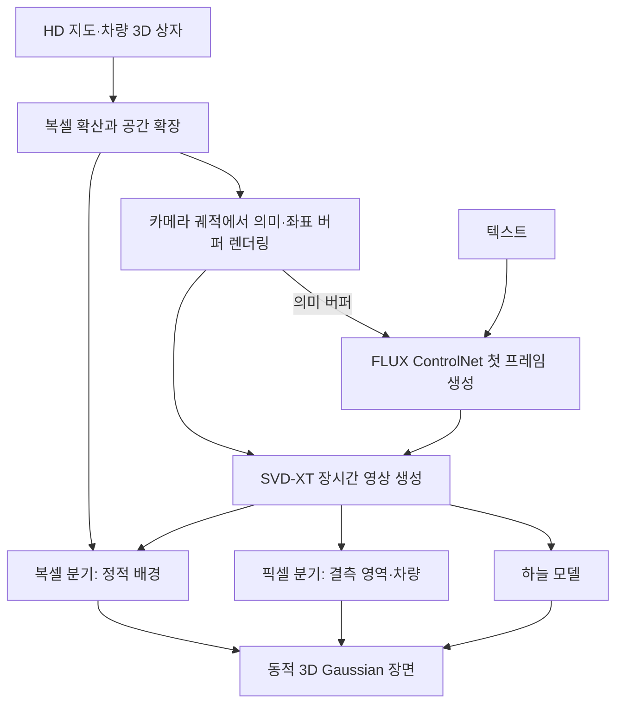

# InfiniCube: Unbounded and Controllable Dynamic 3D Driving Scene Generation with World-Guided Video Models

**핵심 판단:** InfiniCube의 기여는 **명시적인 3D 구조로 장시간 영상 생성을 유도하고, 그 결과를 차량 움직임을 제어할 수 있는 3D 장면으로 재구성하는 통합 설계**에 있습니다.  
다만, 논문이 보여 준 영상·재구성 품질 향상과 **새로운 도시·센서·데이터셋 또는 실제 자율주행 모델에 대한 일반화 성능 향상**은 구분해야 합니다.

## 분석 범위와 표기

- **기준 원문:** *InfiniCube: Unbounded and Controllable Dynamic 3D Driving Scene Generation with World-Guided Video Models*, **arXiv:2412.03934v2, 2025년 6월 26일판**.
- 아래의 **페이지 번호는 첨부 PDF의 첫 페이지를 1쪽으로 센 번호**입니다. 본문은 pp.1–8, 참고문헌은 pp.9–12, 부록은 pp.13–17입니다.
- **[저자 보고]**는 원문에 기재된 방법·결과, **[해석]**은 그 근거가 허용하는 분석, **[제안]**은 아직 검증되지 않은 후속 실험을 뜻합니다.
- 관련 연구 비교는 **2026년 10월 27일 기준 확인한 논문과 공식 자료**를 사용했습니다. 서로 다른 평가 조건의 수치는 직접적인 성능 순위로 사용하지 않았습니다.

---

## 1. Executive summary — 9문장

1. InfiniCube는 정밀 도로 지도, 차량의 3D 경계 상자, 텍스트를 입력받아 넓은 범위의 동적 3D 주행 장면을 생성하는 방법입니다. **[pp.1–2, Fig.1]**
2. 첫 단계에서는 지도 조건부 복셀 확산 모델로 장면의 구조를 생성하고, 기존 영역과 겹치는 잠재표현을 재사용하여 공간을 확장합니다. **[pp.3–4, Eq.(1), Fig.2]**
3. 두 번째 단계에서는 복셀 세계에서 렌더링한 의미·좌표 정보를 영상 모델에 제공하여, 원래 25프레임을 생성하는 SVD-XT를 반복 실행하면서 최대 200프레임의 영상을 생성합니다. **[pp.4, 6–7, Figs.8–9]**
4. 세 번째 단계에서는 복셀 기반 분기가 정적 배경을, 픽셀 기반 분기가 복셀로 충분히 표현되지 않은 영역과 움직이는 차량을 담당하여 동적 3D Gaussian 장면을 재구성합니다. **[p.5, §4.3; p.8, Fig.10]**
5. 학습·평가 자료는 Waymo Open Dataset에서 선별한 각각 618개와 90개 시퀀스이며, 기하 정보는 LiDAR와 다중 시점 영상 재구성을 결합하여 구축합니다. **[pp.5–6, §5.1]**
6. 지도 정합성 사용자 평가에서 InfiniCube의 긍정 응답률은 40·80·120번째 프레임에서 각각 84.6%·83.9%·84.8%로, 비교 대상인 Panacea 재구현의 76.8%·54.0%·53.4%보다 높습니다. **[p.7, Table 2]**
7. 실제 Waymo 입력을 사용하는 새 시점 재구성 평가에서도 InfiniCube는 Table 3의 PSNR·SSIM·LPIPS 여섯 항목 모두에서 가장 좋은 보고값을 보입니다. **[p.8, Table 3]**
8. 저자들은 약 10만 $\text{m}^2$ 규모의 생성 장면과 10초의 3D 재구성 시간을 제시하지만, 200프레임 영상 생성에는 별도로 약 8분이 필요합니다. **[pp.1–2, Fig.1; p.16, Appendix D]**
9. 일반화를 겨냥한 깊이 마스킹과 사전학습 특징 활용은 유망하지만, 다른 데이터셋으로의 전이 및 합성 데이터에 의한 실제 자율주행 성능 향상은 이 논문에서 검증되지 않았고, 저자들은 장거리 청크 간 일관성과 학습 데이터 다양성을 후속 과제로 남깁니다. **[pp.5–8, §§4.3–6]**

> **용어 풀이**
>
> - **복셀(voxel):** 3차원 공간을 나눈 작은 격자 셀
> - **잠재표현(latent representation):** 원래 데이터를 모델이 처리하기 쉽게 압축한 내부 표현
> - **3D Gaussian:** 위치·크기·방향·색·불투명도를 가진 3차원 표현 요소
> - **청크(chunk):** 넓은 세계를 나누어 생성하는 지역 단위

---

## 2. 연구 배경·문제·목표

### 2.1 해결하려는 문제

**[저자 보고]** 자율주행 시뮬레이션에 사용할 장면 생성기는 다음 세 조건을 함께 만족해야 합니다. **[p.1, §1]**

| 요구사항 | 구체적인 의미 | 기존 접근의 어려움 |
|---|---|---|
| 사실성과 일관성 | 시점·시간이 변해도 장면의 외관과 기하 구조가 유지됨 | 3D 구조 생성만으로는 풍부한 시각적 세부 묘사가 부족할 수 있음 |
| 제어 가능성 | 도로 배치, 차량 위치·움직임, 날씨·시간대를 지정할 수 있음 | 영상이 자연스러워도 주어진 지도나 궤적을 정확히 따르지 않을 수 있음 |
| 명시적인 3D 표현 | 새 시점 렌더링과 공간적인 시뮬레이션에 사용할 수 있음 | 영상만 생성하는 모델은 바로 사용할 수 있는 3D 장면을 제공하지 않음 |

저자들은 기존 연구의 문제를 크게 두 가지로 설명합니다.

첫째, **3D 표현을 직접 생성하는 방법**은 구조를 만들 수 있지만 상세한 외관의 사실성이 부족할 수 있습니다.  
둘째, **대규모 영상 사전학습 모델**은 풍부한 외관을 생성하지만, 긴 영상에서 오차가 누적되고 명시적인 3D 표현을 제공하지 않는 경우가 많습니다. **[p.2, §1]**

> **용어 풀이 — 명시적인 3D 표현:** 공간 속 물체의 위치와 형태를 직접 다룰 수 있도록 저장한 표현입니다. 특정 카메라에서 보이는 영상만 저장하는 것과 구분됩니다.

### 2.2 목적과 필요성

**[저자 보고]** 연구의 목적은 **3D 구조 생성, 영상 생성, 빠른 3D 재구성의 장점을 결합하여 넓고 동적이며 제어 가능한 주행 장면을 만드는 것**입니다.  
사용자는 HD 지도와 차량 상자로 공간 구성을 지정하고, 텍스트로 외관을 바꿀 수 있습니다. **[pp.2–5, Fig.2]**

**[해석]** 이 연구의 필요성은 “장면을 그럴듯하게 생성하는 것”에 더해, **같은 장면을 다른 시점에서 관찰하고 차량을 이동시키며 재사용할 수 있어야 한다**는 요구에서 나옵니다.  
다만, 논문에서 언급하는 시뮬레이션 활용 가능성은 **충돌 정확도나 실제 주행 정책의 안전성이 검증되었다는 뜻은 아닙니다.** **[p.8, §5.5; p.16, §C.4]**

---

## 3. 핵심 주장과 근거

아래 표의 판단은 원문의 주장과 실험이 실제로 뒷받침하는 범위를 구분한 것입니다.

| 핵심 주장 | 저자가 제시한 근거 | 근거의 성격 | 분석상 판단 |
|---|---|---|---|
| 공간을 계속 확장할 수 있다 | 중첩 잠재표현을 유지하는 outpainting과 대규모 장면 예시 | 방법 설계 및 정성 결과 — **pp.3–4, Eq.(1); p.6, Fig.5; p.14, Fig.S13** | 인접 영역의 연결과 유한 규모의 확장은 확인되지만, 무한한 공간의 전역 일관성이 입증된 것은 아님 |
| 3D 안내 정보가 긴 영상의 품질 저하를 줄인다 | 비교 영상, 프레임별 FID, 안내 정보 제거 실험 | 정량 곡선 및 정성 비교 — **p.7, Figs.8–9** | 보고된 200프레임 범위에서 지지됨 |
| 지도에 더 잘 맞는 영상을 생성한다 | 지도 투영과 생성 이미지의 정합성에 대한 사용자 평가 | 인간 평가 — **p.7, Table 2; pp.16–17, §F** | 해당 질문에 대한 긍정 응답률이 높음; 미터 단위 기하 오차를 측정한 결과는 아님 |
| 복셀·픽셀 분기를 결합하면 재구성이 개선된다 | Table 3 성능과 분기별 렌더링 예시 | 정량 비교 및 정성 분석 — **p.8, Table 3, Fig.10** | 결합 모델의 우위는 보고되지만, 각 분기의 기여량을 완전히 분리한 정량 실험은 없음 |
| 차량과 날씨를 제어할 수 있다 | 차량 이동·삽입 및 눈·맑음·안개 장면 | 정성 시연 — **p.6, Fig.6; p.8, Figs.11–12** | 편집 가능성은 확인되지만 교통 행동·기상 물리의 정확성까지 입증하지는 않음 |
| 빠르게 3D 장면을 재구성한다 | 단일 A100에서 마지막 단계 10초 | 실행 시간 보고 — **p.16, Appendix D** | 재구성 단계의 속도이며 전체 생성 시간과 구분해야 함 |

> **용어 풀이**
>
> - **Outpainting:** 이미 생성된 영역을 조건으로 바깥 공간을 이어서 생성하는 방법
> - **정성 결과:** 그림·영상 예시를 통한 관찰
> - **정량 결과:** 정의된 지표로 측정한 수치
> - **Ablation, 구성요소 제거 실험:** 특정 요소를 빼거나 바꾸어 그 역할을 확인하는 실험

---

## 4. 방법론: 데이터, 수식, 모델 구조

### 4.1 데이터와 전처리

**[저자 보고]** 주요 데이터 소스와 처리 방식은 다음과 같습니다. **[pp.5–6, §5.1]**

| 항목 | 원문에 기재된 내용 | 역할 |
|---|---|---|
| 기본 데이터 | Waymo Open Dataset | 영상, LiDAR, HD 지도, 차량 3D 상자 제공 |
| 정적 장면 기하 | 누적 LiDAR 점과 COLMAP 다중 시점 스테레오 결과 결합 | 복셀 생성의 학습용 기하 구축 |
| 동적 차량 기하 | 차량 상자 궤적이 정의하는 객체 기준 좌표계에서 LiDAR 누적 | 움직이는 차량의 형태 구성 |
| 텍스트 설명 | Llama-3.2-90B-Vision-Instruct 사용 | 날씨와 시간대 설명 생성 |
| 텍스트 모델 입력 | 8개 시점 × 3개 카메라 뷰를 합친 썸네일 | 시퀀스의 환경 정보 요약 |
| 복셀 학습 단위 | $51.2\,\text{m}\times51.2\,\text{m}$, 복셀 크기 $0.2\,\text{m}$ | 지역 장면 생성 학습 |
| 선별 후 자료 | 학습 618개, 평가 90개 시퀀스 | 모델 학습과 평가 |

낮은 품질의 복셀 격자와 자차가 대부분 정지해 있는 시퀀스는 제거합니다. 다만, **도시별 분리 여부, 제거 기준의 세부값, 날씨별 표본 분포는 충분히 제시되지 않습니다.** **[p.6, §5.1]**

> **용어 풀이**
>
> - **LiDAR:** 레이저를 이용해 주변 물체까지의 거리를 측정하는 센서
> - **다중 시점 스테레오:** 여러 위치에서 촬영한 사진을 비교해 3D 구조를 추정하는 방법
> - **객체 기준 좌표계, canonical space:** 움직이는 차량을 고정된 기준 자세에 놓고 관측을 합칠 수 있도록 정의한 좌표계
> - **자차, ego vehicle:** 센서가 장착되어 주행하는 기준 차량

### 4.2 전체 모델 구조

다음은 원문 Fig.2를 설명용으로 재구성한 흐름도입니다. **[p.4, Fig.2]**



**[해석]** 핵심적인 역할 분담은 다음과 같습니다.

- **복셀 모델:** 장면의 구조를 결정합니다.
- **영상 모델:** 구조에 맞는 풍부한 외관을 생성합니다.
- **재구성 모델:** 영상과 구조를 재사용 가능한 3D 표현으로 통합합니다.

이 전체 시스템을 하나의 손실로 공동 최적화하는 구조로 설명해서는 안 됩니다. 논문은 각 단계와 재구성 분기를 별도로 학습하는 절차를 제시합니다. **[pp.5–6, §§4.3, 5.2]**

### 4.3 1단계: 지도 조건부 복셀 세계 생성

#### 4.3.1 복셀과 잠재표현

원문의 표현을 정리하면 다음과 같습니다. **[p.3, §3]**

```math
\mathbf X^{\text{vx}}
=
\mathcal E^{\text{vx}}\!\left(\mathbf D^{\text{vx}}\right)
\in
\mathbb R^{N^3\times C}.
```

**기호 설명**

- $\mathbf D^{\text{vx}}$: 의미 범주가 저장된 희소 복셀 격자
- $\mathcal E^{\text{vx}}$: 복셀 데이터를 압축하는 인코더
- $\mathbf X^{\text{vx}}$: 압축된 잠재 특징 큐브
- $N$: 잠재 큐브 한 변의 격자 수
- $C$: 각 위치의 특징 채널 수
- 위첨자 $\text{vx}$: 복셀 관련 변수임을 나타내는 표기

희소 구조 VAE를 먼저 학습하고, 그 잠재공간에서 지도와 차량 상자를 조건으로 하는 확산 모델을 학습합니다. InfiniCube는 XCube를 기반으로 하지만, 해당 설정에서는 **계층적 업샘플링을 사용하지 않습니다.** **[p.3, §4.1; p.13, §A.1]**

> **용어 풀이**
>
> - **희소(sparse):** 필요한 공간 위치만 저장·처리하는 방식
> - **VAE:** 데이터를 압축하고 복원하도록 학습하는 확률적 인코더·디코더
> - **채널:** 한 공간 위치에 저장되는 특징값의 종류 또는 개수
> - **계층적 업샘플링:** 거친 결과에서 시작해 여러 단계에 걸쳐 해상도를 높이는 방식

#### 4.3.2 세 가지 조건

| 조건 | 구성 | 필요한 이유 |
|---|---|---|
| $\mathbf C_{\text{HD}}^{\text{vx}}$ | 도로 경계와 차선을 각각 복셀화한 2채널 | 도로의 기본 배치를 제공 |
| $\mathbf C_{\text{Road}}^{\text{vx}}$ | 도로 표면을 나타내는 1채널 | 지도 일부만 포함된 청크에서 실제 주행 가능 영역을 구분 |
| $\mathbf C_{\text{Box}}^{\text{vx}}$ | 차량 방향 $\alpha$를 $[\sin\alpha,\cos\alpha]$로 저장한 2채널 | 거친 잠재 격자에서도 차량 방향을 유지 |

차량 조건은 해당 복셀의 절반 이상을 차량 상자가 차지할 때 부여합니다. 도로 표면 조건은 도로 경계·차선에 3D 평면을 맞추어 구성합니다. **[p.3, §4.1; p.4, Fig.3]**

**기호 설명:** $\alpha$는 차량의 진행 방향 각도이며, $\sin\alpha$와 $\cos\alpha$는 이 방향을 두 값으로 표현합니다.

**원문 내부 불일치:** 논문은 위 세 조건을 연결하면서 총 채널 수를 $S=4$라고 적지만, 제시한 구성은 $2+1+2=5$입니다. 따라서 **문서의 조건 차원 표기가 일치하지 않습니다.** 실제 구현의 채널 수를 이 문서만으로 확정하거나 임의로 수정해서는 안 됩니다. **[p.3, §4.1]**

#### 4.3.3 확산 학습 손실 — 원문 Eq.(S.2)

```math
\mathcal L_{\text{Diffusion}}
=
\mathbb E_{t,\mathbf X^{\text{vx}},\epsilon\sim\mathcal N(0,I)}
\left[
\left\|
v\!\left(
\sqrt{\bar\alpha_t}\mathbf X^{\text{vx}}
+
\sqrt{1-\bar\alpha_t}\epsilon,\ t
\right)
-
\left(
\sqrt{\bar\alpha_t}\epsilon
-
\sqrt{1-\bar\alpha_t}\mathbf X^{\text{vx}}
\right)
\right\|_2^2
\right].
```

**기호 설명**

- $\mathcal L_{\text{Diffusion}}$: 복셀 확산 모델의 학습 손실
- $\mathbb E$: 학습 자료와 잡음·시간 단계에 대한 평균
- $\epsilon\sim\mathcal N(0,I)$: 평균 0, 단위 공분산의 정규분포에서 뽑은 잡음
- $I$: 단위행렬
- $t$: 무작위로 선택한 확산 시간 단계; 원문은 $[0,1000]$ 범위를 제시
- $\bar\alpha_t$: 단계별 신호·잡음 비율을 결정하는 계수
- $v(\cdot,t)$: 확산 신경망의 출력
- $\|\cdot\|_2^2$: 예측과 목표값 사이의 제곱 오차
- $\sqrt{\bar\alpha_t}\mathbf X^{\text{vx}}+\sqrt{1-\bar\alpha_t}\epsilon$: 잡음을 섞은 입력
- $\sqrt{\bar\alpha_t}\epsilon-\sqrt{1-\bar\alpha_t}\mathbf X^{\text{vx}}$: 모델이 예측하도록 학습하는 목표값

**의미:** 원래 구조와 잡음을 특정 비율로 조합한 목표를 예측하도록 학습합니다. 여기서 $v$는 **차량 속도가 아닙니다.** **[p.13, §A.1, Eq.(S.2)]**

> **용어 풀이 — 확산 모델과 $v$-parameterization:** 확산 모델은 잡음으로부터 데이터를 단계적으로 복원하는 생성 모델입니다. $v$-parameterization은 이 복원 과정에서 무엇을 예측할지 정하는 학습 방식입니다.

원문 수식은 함수 인자에 지도 조건을 표시하지 않지만, 본문은 조건 볼륨을 잡음 잠재표현과 채널 방향으로 연결한다고 설명합니다. 추론에서는 **DDIM 100단계, classifier-free guidance 가중치 2.0**을 사용합니다. **[p.3, §4.1; p.13, §A.2]**

> **용어 풀이**
>
> - **DDIM:** 학습된 확산 모델에서 결과를 생성하는 샘플링 방법
> - **Classifier-free guidance:** 생성 결과가 주어진 조건을 더 강하게 따르도록 조절하는 방식

#### 4.3.4 공간 확장 — 원문 Eq.(1)

$$
\mathbf X_{\text{new}}^{\text{vx}}
\leftarrow
(1-\mathbf M)\odot\widehat{\mathbf X}_{\text{new}}^{\text{vx}}
+
\mathbf M\odot\widehat{\mathbf X}_{\text{exist}}^{\text{vx}}.
$$

**기호 설명**

- $\mathbf X_{\text{new}}^{\text{vx}}$: 새 청크를 생성하는 과정의 잠재표현
- $\mathbf M$: 기존 청크와 겹치는 영역에서는 1, 나머지에서는 0인 마스크
- $\odot$: 위치별 곱
- $\widehat{\mathbf X}_{\text{new}}^{\text{vx}}$: 확산 모델에서 얻은 새 영역의 잠재 샘플
- $\widehat{\mathbf X}_{\text{exist}}^{\text{vx}}$: 고정된 기존 잠재표현에 잡음을 적용한 분포에서 얻은 샘플

**작동 원리:** 겹치지 않는 영역은 새로 생성하고, 겹치는 영역에는 기존 장면에 대응하는 값을 유지합니다. 이때 기존의 깨끗한 잠재표현을 그대로 복사하는 것으로 설명하면 부정확합니다. 원문은 **잡음이 추가된 기존 잠재표현**을 사용한다고 명시합니다. **[pp.3–4, §4.1]**

또한 청크마다 먼저 디코딩하지 않고, **모든 청크를 잠재공간에서 생성·결합한 뒤 디코딩**합니다. 이는 디코더 때문에 생길 수 있는 경계 불일치를 줄이기 위한 선택입니다. **[p.13, §A.2]**

**[해석]** 제목의 “unbounded”는 이 확장 절차를 반복할 수 있다는 의미로 이해하는 것이 적절합니다. 모든 거리와 규모에서 품질이 보장된다는 수학적 주장으로 해석할 근거는 없습니다.

### 4.4 2단계: 3D 세계로 유도하는 영상 생성

#### 4.4.1 영상 표현과 조건

원문은 영상과 영상 잠재표현을 다음과 같이 정의합니다. **[p.4, §4.2]**

```math
\mathbf D^{\text{vd}}\in\mathbb R^{H\times W\times T\times3},
\qquad
\mathbf X^{\text{vd}}
=
\mathcal E^{\text{vd}}(\mathbf D^{\text{vd}})
\in\mathbb R^{h\times w\times T\times4},
```

$$
h=\frac H8,\qquad w=\frac W8.
$$

**기호 설명**

- $\mathbf D^{\text{vd}}$: RGB 영상
- $H,W$: 영상의 높이와 너비
- $T$: 한 번에 처리하는 프레임 수
- $\mathcal E^{\text{vd}}$: 영상 인코더
- $\mathbf X^{\text{vd}}$: 영상 잠재표현
- $h,w$: 공간 해상도를 8배 줄인 잠재표현의 높이와 너비
- 3과 4: 각각 RGB 채널 수와 영상 잠재 채널 수
- $\text{vd}$: 영상 관련 변수임을 나타내는 표기

조건은 이미지·의미·좌표의 세 종류이며, 원문은 조건 채널의 총합을 12로 제시합니다.

| 조건 | 실제 구성 | 역할 |
|---|---|---|
| 이미지 조건 | 첫 프레임을 반복하여 인코딩 | 시작 장면의 외관을 전달 |
| 의미 버퍼 | 복셀의 의미 범주를 카메라에서 렌더링한 색상 지도 | 도로·건물·차량의 배치와 종류를 전달 |
| 좌표 버퍼 | 각 픽셀의 광선이 처음 만나는 복셀의 3D 좌표 | 프레임 사이에서 같은 공간 위치를 대응시킬 단서 제공 |

차량은 개체마다 다른 색을 사용하여 구분합니다. 좌표값은 상수로 정규화한 뒤 $[-1,1]$ 범위로 제한합니다. **[p.4, §4.2; p.14, Table S4, Fig.S14]**

> **용어 풀이**
>
> - **버퍼(buffer):** 여기서는 영상의 각 픽셀에 정렬된 보조 정보 지도
> - **의미 정보(semantic information):** 해당 영역이 도로·차량·건물 등 무엇인지 나타내는 정보
> - **렌더링:** 3D 장면을 특정 카메라에서 보이는 2D 영상으로 바꾸는 과정

**[해석]** 의미 버퍼가 “어떤 종류의 장면인가”를 알려 준다면, 좌표 버퍼는 “어느 공간 위치인가”를 알려 줍니다. 반복되는 차선이나 비슷한 건물처럼 의미 정보만으로 구분하기 어려운 상황에서 좌표 정보가 추가 단서를 제공하는 구조입니다. **[p.4, §4.2; p.7, Fig.9(b)]**

#### 4.4.2 텍스트와 긴 영상 생성의 정확한 경로

텍스트 조건은 다음 경로로 사용됩니다.

**텍스트 + 의미 버퍼 → FLUX 기반 ControlNet → 첫 RGB 이미지 → SVD-XT의 이미지 조건**

즉, 이 판본의 방법을 **SVD-XT에 텍스트를 직접 입력하는 구조**로 설명하면 부정확합니다. **[p.5, §4.2; p.13, §B.2; p.15, Fig.S15]**

긴 영상은 마지막 생성 프레임의 잠재표현을 다음 생성의 시작 조건으로 재사용하는 방식으로 만듭니다. 따라서 **200프레임을 한 번에 생성하는 모델로 바꾼 것이 아니라, 25프레임 모델을 자기회귀적으로 이어 사용하는 방식**입니다. **[pp.4, 6–7, Figs.8–9]**

> **용어 풀이**
>
> - **ControlNet:** 생성 모델이 외부 구조 조건을 따르도록 돕는 제어 네트워크
> - **자기회귀적 생성:** 앞서 생성한 결과를 다음 생성의 입력으로 사용하는 방식
> - **누적 오차:** 앞 단계의 작은 오류가 다음 단계의 입력에 포함되면서 점차 커지는 현상

SVD-XT는 $576\times1024$ 해상도로 미세조정하며, 조건 잠재특징에 Gaussian 잡음을 추가합니다. 추론은 guidance 가중치 3.0, 잡음 제거 25단계입니다. **25프레임과 25단계는 서로 다른 설정입니다.** **[p.6, §5.2]**

### 4.5 3단계: 복셀·픽셀 이중 분기를 이용한 동적 3D 재구성

#### 4.5.1 두 분기를 사용하는 이유

복셀 분기는 이미 존재하는 3D 구조를 활용하기 좋지만, 복셀이 덮지 못하는 영역을 표현하기 어렵습니다. 픽셀 분기는 영상의 세부와 동적 물체를 다루기 좋지만 깊이 추정이 필요합니다. 저자들은 두 표현을 결합합니다. **[p.5, §4.3]**

| 구성 | 주요 입력 | 담당 영역 | 구조·출력 |
|---|---|---|---|
| 복셀 분기 | 복셀 세계, 카메라 자세가 알려진 영상 특징 | 정적 배경 | 희소 3D U-Net; 복셀당 Gaussian 4개 |
| 픽셀 분기 | RGB, 복셀 깊이, Depth Anything V2 특징 | 복셀 결측 영역과 동적 차량 | 2D U-Net; 픽셀당 Gaussian 2개 |
| 하늘 모델 | 영상의 하늘 패치와 시선 방향 | 하늘 | Transformer와 방향 조건 MLP |

**[p.5, §4.3; pp.13–16, Appendix C]**

논문에서 **mid-ground**는 일반적인 중거리 영역 전체를 뜻하지 않습니다. 정확한 정의는 **투영된 복셀과 겹치지 않으면서 하늘도 아닌 픽셀 영역**입니다. **[p.5, Fig.4]**

> **용어 풀이**
>
> - **U-Net:** 해상도를 낮추며 문맥을 모으고 다시 높이며 세부를 복원하는 신경망 구조
> - **Feed-forward 재구성:** 새 장면마다 장시간 최적화하지 않고, 학습된 모델의 추론으로 3D 표현을 얻는 방식
> - **MLP:** 여러 선형 변환과 비선형 함수를 연결한 기본 신경망

#### 4.5.2 복셀 분기의 세부 구조

영상은 합성곱층을 통해 **공간 해상도를 절반으로 줄인 64채널 특징**으로 변환됩니다. 이 특징을 카메라 정보로 복셀 위치에 역투영하고, max-pooling으로 모은 뒤 3D U-Net에 입력합니다. 움직이는 물체는 영상 특징에서 제외하고 정적 배경만 사용합니다. **[p.5, §4.3; p.14, §C.1]**

3D U-Net의 기본 채널 수는 64, 단계별 배수는 $[1,2,4]$입니다. 생성된 $0.2\,\text{m}$ 복셀은 Gaussian 속성 예측 전에 $0.1\,\text{m}$ 단위로 세분화합니다. **[pp.13–14, §C.1]**

복셀 하나당 출력은 56채널입니다.

$$
56=4\times(3+4+3+1+3).
$$

이는 원문 설명을 산술적으로 정리한 식입니다. 첫 번째 4는 Gaussian 개수이며, 괄호 안은 각각 **RGB 3, 회전 4, 크기 3, 불투명도 1, 상대 위치 3**입니다. **[p.14, §C.1]**

> **용어 풀이**
>
> - **역투영:** 영상의 특징을 카메라 정보를 이용해 3D 위치로 옮기는 과정
> - **Max-pooling:** 여러 관측 특징 중 채널별 최댓값을 취해 합치는 연산
> - **회전의 4차원 표현:** 이 경우 3D 회전을 표현하는 quaternion을 의미

#### 4.5.3 픽셀 분기와 깊이 마스킹

픽셀 분기의 입력은 총 36채널입니다.

$$
36=3+1+32.
$$

각 항은 **RGB 영상 3채널, 복셀 깊이 1채널, Depth Anything V2-Large 특징 32채널**을 뜻합니다. **[p.15, §C.2]**

학습 시에는 깊이 지도의 겹치지 않는 **$16\times16$ 패치를 각각 확률 0.5로 제거**합니다. 모델은 일부 깊이가 사라진 입력을 받아 깊이를 예측하고, 마스킹 전의 복셀 깊이로 감독받습니다. 추론 시에는 전체 복셀 깊이를 입력하지만, 실제로 복셀이 없는 영역은 여전히 비어 있습니다. **[p.5, Fig.4; p.15, §C.2]**

**[저자의 의도]** 학습 중에 깊이 결측 상황을 만들어, 실제 추론에서 복셀이 없는 영역의 깊이를 예측하도록 합니다.

**[해석]** 이는 일반화와 관련해 특히 유망한 설계입니다. 다만, 논문은 마스킹 유무에 따른 **새 데이터셋의 깊이 오차 개선량**을 별도 표로 제시하지는 않습니다.

2D U-Net의 기본 채널 수는 32, 단계별 배수는 $[1,2,4,8]$입니다. 출력은 픽셀당 Gaussian 2개에 해당하는 24채널입니다.

$$
24=2\times(3+4+3+1+1).
$$

괄호 안은 **RGB, 회전, 크기, 불투명도, 깊이**의 채널 수입니다. **[pp.15–16, §C.2]**

#### 4.5.4 예측 깊이를 3D 위치로 바꾸는 식 — 원문 Eq.(S.3)

$$
\begin{aligned}
\omega^i &= \sigma\!\left(G_{\text{depth}}^i\right),\\
z^i &= (1-\omega^i)z_{\text{near}}+\omega^i z_{\text{far}},\\
t^i &=
\frac{z^i}
{\cos\!\left(\mathbf{ray}_d^i,\mathbf{ray}_d^{\text{look-at}}\right)},\\
\mathbf{xyz}^i &= \mathbf{ray}_o^i+t^i\mathbf{ray}_d^i.
\end{aligned}
\tag{S.3}
$$

**기호 설명**

- $i$: Gaussian의 인덱스
- $G_{\text{depth}}^i$: 신경망이 출력한 깊이 관련 원시값
- $\sigma$: sigmoid 함수
- $\omega^i$: 0과 1 사이로 변환한 가중치
- $z^i$: 카메라 정면 방향 기준 깊이
- $z_{\text{near}}=0.5$, $z_{\text{far}}=300$: 논문에서 사용한 깊이 범위
- $\mathbf{ray}_d^i$: 해당 픽셀의 광선 방향
- $\mathbf{ray}_d^{\text{look-at}}$: 카메라가 정면으로 바라보는 방향
- $\cos(\cdot,\cdot)$: 두 방향 사이 각도의 코사인
- $t^i$: 광선을 따라 이동하는 거리; Eq.(S.2)의 확산 단계 $t$와 다른 의미
- $\mathbf{ray}_o^i$: 광선의 시작점
- $\mathbf{xyz}^i$: Gaussian의 최종 3D 중심 위치

**쉬운 설명:** 카메라 정면으로 잰 깊이와 비스듬한 광선을 따라 잰 거리는 다르므로, 각도를 보정한 뒤 3D 위치를 계산합니다. **[p.15, §C.2, Eq.(S.3)]**

> **용어 풀이 — Sigmoid:** 임의의 실수를 0과 1 사이의 값으로 바꾸는 함수입니다.

#### 4.5.5 하늘 표현 — 원문 Eq.(S.4)

```math
\left(
\mathbf c,\{\tilde{\mathbf p}^{\,i}\}_{i=1}^{m}
\right)
=
\text{TransformerEncoder}
\left(
\mathbf c_{\text{query}},
\{\mathbf p^{\,i}\}_{i=1}^{m}
\right).
```

**기호 설명**

- $\mathbf p^i$: 입력 영상의 하늘 패치 특징
- $\tilde{\mathbf p}^{\,i}$: Transformer 처리 후의 패치 특징
- $m$: 하늘 패치 수
- $\mathbf c_{\text{query}}$: 학습 가능한 요약용 query token
- $\mathbf c\in\mathbb R^{192}$: 하늘 외관을 요약한 192차원 벡터
- $\text{TransformerEncoder}$: 패치 사이의 정보를 통합하는 신경망

하늘 패치는 $8\times8$ 크기입니다. 이후 시선 방향을 입력받는 MLP를 하늘 벡터로 조절하여 RGB를 출력합니다. 이때 AdaLN을 사용합니다. **[p.16, §C.3]**

> **용어 풀이 — AdaLN:** 조건에 따라 내부 특징의 크기와 기준값을 조절하는 정규화 방식입니다. 여기서는 같은 시선 방향도 하늘의 상태에 맞는 색을 출력하도록 돕습니다.

#### 4.5.6 학습과 동적 차량 처리

두 재구성 분기는 각각 **영상의 색을 맞추는 photometric loss**로 학습하고, 픽셀 분기에는 깊이 손실을 추가합니다. 다만, **정확한 손실 함수 형태와 가중치는 원문에 충분히 제시되지 않으므로 임의의 손실식을 추가할 수 없습니다.** **[p.5, §4.3]**

추론에서는 픽셀 분기를 매 4프레임 단위로 적용하고, mid-ground와 동적 물체에 해당하는 Gaussian을 남깁니다. 차량별 Gaussian은 의미 버퍼로 분리하고, 알려진 차량 자세로 변환·집계하며, 입력 상자 안의 Gaussian을 유지합니다. 차량의 궤적을 바꾸면 움직임을 제어할 수 있습니다. **[p.5, §4.3]**

**[해석]** 여기서 동적 제어는 **주어진 차량 궤적에 따라 객체를 움직이는 능력**입니다. 다른 차량에 반응하는 운전 행동 정책을 학습했다는 근거는 없습니다.

---

## 5. 주요 결과와 데이터 포인트

### 5.1 먼저 구분해야 하는 세 가지 실험

| 평가 | 입력 조건 | 평가 대상 |
|---|---|---|
| 장시간 영상 FID | Waymo 90개 평가 시퀀스의 **실제 첫 프레임** | 영상 생성 단계의 후반부 품질 |
| 지도 정합성 사용자 평가 | 두 방법이 공유하는 **ControlNet 생성 첫 프레임** | 생성 이미지와 지도 조건의 정합성 |
| 새 시점 3D 재구성 | 실제 Waymo의 영상·복셀, 시점 $T$의 전방 3개 뷰 | 재구성 모듈의 성능 |

**[p.7, §5.4.2; p.8, §5.4.3, Fig.10]**

**중요한 해석:** 세 실험은 같은 입력·같은 파이프라인을 평가하지 않습니다. 특히 Table 3를 **텍스트 → 생성 복셀 → 생성 영상 → 3DGS 전체 과정의 종합 성능**으로 설명해서는 안 됩니다.

### 5.2 긴 영상 생성

**[저자 보고]** Fig.9(a)에서 InfiniCube는 긴 시퀀스 동안 비교군보다 낮은 FID를 유지하며, 비교군은 약 100프레임 이후 품질 저하가 커집니다. Fig.9(b)는 의미 버퍼가 큰 역할을 하고 좌표 버퍼도 추가적인 개선에 기여함을 보여 줍니다. **[p.7, Figs.8–9]**

**정확한 수치의 한계:** 원문에는 이 FID 결과의 수치표가 없고 곡선만 있습니다. 따라서 그래프를 눈으로 읽은 값을 정확한 FID로 제시하지 않습니다.

> **용어 풀이 — FID:** 생성 이미지와 실제 이미지의 특징 분포가 얼마나 다른지를 측정하는 지표로, 낮을수록 좋습니다. 이 실험의 프레임별 FID만으로 시간적 일관성이나 실제 3D 정확도 전체를 평가할 수는 없습니다.

### 5.3 지도 정합성 — Table 2

| 프레임 | InfiniCube | Panacea 재구현 | 차이 |
|---:|---:|---:|---:|
| 40 | 84.6% | 76.8% | +7.8%p |
| 80 | 83.9% | 54.0% | +29.9%p |
| 120 | 84.8% | 53.4% | +31.4%p |

**출처:** p.7, Table 2. 차이 열은 보고값을 이용한 직접 계산입니다.

이는 “더 좋아하는 영상”을 선택한 선호도가 아니라, **지도 투영과 생성 이미지가 정합한다고 판단한 긍정 응답률**입니다. 후반 프레임에서도 InfiniCube의 응답률이 비교적 유지된다는 점이 중요한 결과입니다. **[pp.16–17, §F, Fig.S17]**

### 5.4 새 시점 렌더링 — Table 3

| 방법 | $T+5$ PSNR ↑ | $T+5$ SSIM ↑ | $T+5$ LPIPS ↓ | $T+10$ PSNR ↑ | $T+10$ SSIM ↑ | $T+10$ LPIPS ↓ |
|---|---:|---:|---:|---:|---:|---:|
| PixelNeRF | 15.21 | 0.52 | 0.64 | 14.61 | 0.49 | 0.66 |
| PixelSplat | 20.11 | 0.70 | 0.60 | 18.77 | 0.66 | 0.62 |
| DUSt3R | 17.08 | 0.62 | 0.56 | 16.08 | 0.58 | 0.60 |
| MVSplat | 20.14 | 0.71 | 0.48 | 18.78 | 0.69 | 0.52 |
| MVSGaussian | 16.49 | 0.70 | 0.60 | 16.42 | 0.60 | 0.59 |
| SCube | 19.90 | 0.72 | 0.47 | 18.78 | 0.70 | 0.49 |
| **InfiniCube** | **20.80** | **0.73** | **0.42** | **19.93** | **0.72** | **0.45** |

**출처:** p.8, Table 3. PSNR의 단위는 dB입니다.

> **용어 풀이**
>
> - **PSNR:** 픽셀 오차를 기반으로 한 영상 복원 품질 지표; 높을수록 좋음
> - **SSIM:** 밝기·대비·구조의 유사성을 측정하는 지표; 높을수록 좋음
> - **LPIPS:** 신경망 특징을 이용해 지각적인 차이를 측정하는 지표; 낮을수록 좋음
> - **새 시점 렌더링:** 입력 카메라와 다른 위치·시점에서 장면을 그리는 것

**[직접 계산]** SCube 대비 InfiniCube의 개선량은 다음과 같습니다.

- $T+5$: PSNR **+0.90 dB**, SSIM **+0.01**, LPIPS **−0.05**
- $T+10$: PSNR **+1.15 dB**, SSIM **+0.02**, LPIPS **−0.04**

**[해석]** 보고된 점 추정값은 모두 개선되지만, 신뢰구간이나 반복 실험 결과가 없어 **통계적으로 유의한 개선**이라고 단정할 수 없습니다. 또한 $T+5$와 $T+10$을 이 평가의 명시적인 간격 확인 없이 초 단위로 환산하지 않습니다.

### 5.5 생성 규모·시간·자원

| 항목 | 저자 보고값 | 적용 범위 |
|---|---:|---|
| 대규모 장면 예시 | 약 $100{,}000\,\text{m}^2$ | Fig.1의 생성 장면 |
| 지역 복셀 생성 | 30초, VRAM 20GB | 약 $50\,\text{m}\times50\,\text{m}$ |
| 복셀 세계 확장 | 약 6분 | $30{,}000\,\text{m}^2$ |
| 영상 생성 | 8분, VRAM 75GB | 200프레임 |
| 3DGS 재구성 | 10초, VRAM 45GB | 마지막 재구성 단계 |

**출처:** pp.1–2, Fig.1; p.16, Appendix D. 실행 시간은 단일 NVIDIA A100 기준입니다.

**비교 주의:** 10만 $\text{m}^2$ 장면 예시와 3만 $\text{m}^2$ 속도 측정은 서로 다른 규모입니다. 또한 위 시간을 단순 합산하여 공식적인 전체 처리 시간으로 제시하기에는 측정 설정의 연결 관계가 충분히 설명되어 있지 않습니다.

학습 비용은 복셀 모델 48 GPU-days, 영상 모델 192 GPU-days, 재구성 분기 32 GPU-days로 기재되어 있으며, 첫 프레임용 FLUX ControlNet은 별도로 48 GPU-days입니다. 재구성의 32 GPU-days가 두 분기의 합계인지 분기별 값인지는 문장이 명료하지 않으므로 총합을 확정하지 않습니다. **[p.6, §5.2; p.13, §B.2]**

> **용어 풀이 — GPU-day:** GPU 한 대를 24시간 사용하는 것에 해당하는 계산량 단위입니다.

---

## 6. 가장 중요한 그림의 선정과 해석

| 우선순위 | 그림 | 반드시 볼 부분 | 의미와 해석의 경계 |
|---|---|---|---|
| 1 | **Fig.2, p.4** | 복셀 → 안내 정보 → 영상 → 이중 분기 재구성 | 논문의 시스템 기여를 가장 명확히 보여 줌 |
| 2 | **Figs.8–9, p.7** | 후반 프레임의 변화와 FID 곡선, 버퍼 제거 실험 | 긴 영상에서 3D 조건의 역할을 보여 주는 핵심 증거; 검증 범위는 200프레임 |
| 3 | **Fig.10, p.8** | 픽셀 전용·복셀 전용·결합 결과의 오류 위치 | 두 분기의 상보성을 보여 줌; 평균 개선량을 분리한 정량표는 아님 |
| 4 | **Fig.4, p.5** | mid-ground, 마스킹 깊이, 전체 깊이 | 깊이 결측을 학습하는 일반화 아이디어를 이해하는 데 중요 |
| 5 | **Fig.S13, p.14** | 중첩 잠재표현 재사용 여부에 따른 경계 | 국소적 연결의 개선을 보여 줌; 전역 일관성의 증명은 아님 |
| 6 | **Fig.12, p.8; Fig.S15, p.15** | 같은 구조에서 날씨·시간대 변화 | 외관 제어와 다양성의 시연; 실제 악천후 일반화 평가와 구분 |
| 7 | **Fig.5, p.6** | 수백 미터 규모에서 지도와 장면의 대응 | 전체 파이프라인의 대규모 생성 가능성을 보여 줌 |

### 그림별 핵심 해석

**Fig.9:** 의미 버퍼 제거에 따른 열화가 크게 나타나므로, 이 논문에서 가장 직접적인 근거를 가진 설계는 **3D 세계에서 렌더링한 의미 정보의 지속적인 제공**입니다. 좌표 버퍼도 기여하지만, 정확한 효과 크기는 수치표가 없으므로 과장하지 않아야 합니다.

**Fig.10:** 복셀 분기는 구조가 없는 영역에 약하고, 픽셀 분기는 깊이 추정에 따른 왜곡이 나타납니다. 결합 결과는 **하나의 표현에 모든 영역을 맡기기보다 관측 조건에 따라 역할을 나누는 설계**를 지지합니다.

**Fig.12:** 동일한 복셀 세계에 서로 다른 외관을 부여한다는 점은 데이터 증강에 활용할 여지를 보여 줍니다. 그러나 이 그림 자체는 “눈·안개 환경에서 훈련하지 않은 모델이 잘 작동한다”는 실험이 아닙니다.

---

## 7. 통계적으로 취약한 부분과 비교 불가능한 수치

| 항목 | 확인된 문제 또는 미보고 사항 | 허용되는 결론 |
|---|---|---|
| 반복성과 불확실성 | 주요 지표에 반복 seed, 표준편차, 신뢰구간이 없음 | 보고값의 우위는 말할 수 있으나 통계적 유의성은 판단 불가 |
| FID 평가 | 평가 시퀀스는 90개이며 시점별 곡선만 제시 | 장시간 품질 경향은 비교 가능하나 정밀한 효과 크기·추정 변동은 불명확 |
| 사용자 연구 | 63개 영상, 프레임별 180 samples를 언급하지만 참가자 수와 표본 배분이 불명확 | 180개를 독립 판정 수로 가정해 임의의 p-value나 신뢰구간을 계산하면 안 됨 |
| Panacea 비교 | 저자들이 SVD-XT 백본으로 재구현 | 해당 재구현과의 비교이며 원래 Panacea의 공식 성능 전체를 대표하지 않음 |
| Vista 비교 | InfiniCube 실험에서는 첫 프레임만 제공하고 추가 제어를 지정하지 않음 | 동일한 풍부한 조건을 제공한 비교가 아님 |
| 재구성 결과 | 실제 영상·복셀을 사용하는 구성요소 평가 | 전체 생성 파이프라인의 종합 성능과 구분해야 함 |
| 모듈별 기여 | 이중 분기의 효과는 그림으로 제시되나 분기별 정량표가 없음 | 전체 개선량을 픽셀 분기 하나의 인과적 효과로 확정할 수 없음 |
| 기능 비교 Table 1 | 영상 길이·표현 형식 등 고수준 비교 | 동일 데이터·연산량의 정확도 벤치마크가 아님 |
| 속도 | 마지막 단계, 전체 과정, 장면 규모가 서로 다름 | “10초에 10만 $\text{m}^2$ 전체 생성”이라고 결합하면 오류 |
| 물리적 타당성 | 그림자·LiDAR·차량 이동은 주로 시각적 시연 | 광학·센서·교통 물리의 정확성이 입증된 것은 아님 |

**근거:** p.2, Table 1; p.7, §5.4.2, Table 2, Fig.9; p.8, §5.4.3; pp.16–17, Appendices C.4, D, F.

특히 Vista에 대해서는 주의가 필요합니다. InfiniCube 논문은 해당 형태의 자차 궤적 입력 문제를 이유로 첫 프레임만 사용했지만, **Vista 원문은 궤적·각도·속도 등 다양한 제어를 보고합니다.** 따라서 InfiniCube의 실험 설정을 “Vista에는 궤적 제어가 없다”는 일반적인 주장으로 바꾸어서는 안 됩니다. [proceedings.neurips.cc](https://proceedings.neurips.cc/paper_files/paper/2024/hash/a6a066fb44f2fe0d36cf740c873b8890-Abstract-Conference.html?utm_source=chatgpt.com)

> **용어 풀이**
>
> - **점 추정값:** 하나의 숫자로 보고한 추정 결과
> - **신뢰구간:** 표본의 변동성을 고려해 추정값의 불확실성을 나타내는 범위
> - **독립 표본:** 다른 관측과 통계적으로 얽혀 있지 않은 표본; 같은 영상의 여러 프레임은 독립이라고 자동으로 가정할 수 없음

---

## 8. 일반화 성능 향상 가능성: 무엇이 입증되었는가?

### 8.1 일반화의 대상을 구분해야 한다

| 일반화의 대상 | 원문 근거 | 증거 수준 |
|---|---|---|
| 평가 시퀀스의 새로운 시점 | Table 3, Fig.10 | **정량 평가 있음** |
| 복셀 깊이가 없는 영역 | 깊이 마스킹 설계와 Fig.4·10 | **방법적 근거와 정성 결과** |
| 짧은 모델을 긴 시퀀스로 사용 | 25프레임 모델로 200프레임 생성, Fig.9 | **해당 길이까지 정량 경향 확인** |
| 날씨·시간대 변경 | Fig.12, Fig.S15 | **정성 시연** |
| 새로운 도시·국가·도로 체계 | 별도 분리 평가 미제시 | **미검증** |
| 다른 카메라·LiDAR·데이터셋 | 별도 전이 평가 미제시 | **미검증** |
| 합성 데이터로 훈련한 자율주행 모델의 실환경 성능 | 다운스트림 학습 실험 미제시 | **미검증** |

**근거:** pp.5–8, §§4.3–6; p.15, §C.2, Fig.S15.

> **용어 풀이**
>
> - **분포 밖 일반화, OOD:** 학습 때와 다른 지역·기상·센서 등의 조건에서도 성능을 유지하는 능력
> - **다운스트림 과제:** 생성 결과를 활용하는 후속 작업으로, 예를 들어 차량 검출·차선 인식·주행 계획이 해당됨

### 8.2 일반화를 기대하게 하는 설계와 실제 근거

#### A. 기하 구조와 외관의 역할 분리

**[저자 보고]** 지도·상자로 복셀 세계를 만들고, 같은 세계에서 다른 날씨의 외관을 생성할 수 있습니다. **[pp.3–5; p.8, Fig.12]**

**[해석]** 구조를 유지한 채 외관만 바꾸는 설계는 조건별 데이터를 체계적으로 구성하기에 적합합니다. 다만, 생성된 외관의 다양성이 실제 인식 모델의 강건성으로 이어지는지는 별도 검증이 필요합니다.

#### B. 이미지에 정렬된 3D 안내 정보

**[저자 보고]** 의미·좌표 버퍼는 긴 영상에서 누적 오차를 줄이며, 저자들은 궤적의 물리적 규모에 덜 의존하는 제어 방식이라고 설명합니다. **[pp.4–5, §4.2; p.7, Fig.9]**

**[해석]** 모델이 장면 구조 전체를 영상의 과거 정보만으로 추측해야 하는 부담을 줄이는 설계입니다. 그러나 알려지지 않은 도로 구조에서도 조건을 정확히 따르는지에 대한 별도 정량 검증은 없습니다.

#### C. 결측을 의도적으로 만드는 깊이 학습

**[저자 보고]** 부분적으로 가린 복셀 깊이를 입력하고 원래 깊이로 감독하여 mid-ground 예측 능력을 높입니다. **[p.5; p.15, §C.2]**

**[해석]** 학습과 추론 사이의 깊이 정보 결측 차이에 대응하려는 직접적인 설계입니다. 이 아이디어는 전체 생성 파이프라인보다 작은 실험으로 검증하기 쉽다는 장점이 있습니다.

#### D. 사전학습 특징과 조건 잡음 증강

**[저자 보고]** Depth Anything V2 특징을 재사용하고, 영상 모델의 조건 잠재특징에 Gaussian 잡음을 추가합니다. **[pp.5–6; p.15]**

**[해석]** 각각 깊이에 관한 사전 지식과 조건 변동에 대한 대응을 강화하려는 선택입니다. 논문은 이 두 요소의 OOD 개선량을 독립적으로 측정하지 않았으므로, 검증된 일반화 효과와 설계 의도를 구분해야 합니다.

### 8.3 가장 중요한 결론

**InfiniCube는 일반화에 유리할 수 있는 구조를 제시하지만, 일반화 성능 개선을 광범위하게 입증한 논문으로 평가하기에는 근거가 부족합니다.**

특히 다음 두 명제는 다릅니다.

- “여러 날씨의 영상을 생성할 수 있다.”
- “그 영상으로 학습한 인식 모델이 실제 악천후에서 더 정확하다.”

원문이 직접 뒷받침하는 것은 주로 첫 번째입니다. 두 번째는 후속 연구의 핵심 검증 과제입니다.

---

## 9. 2020년 이후 관련 연구와 최신 연구 비교

### 9.1 표현 기술에서 세계 기반 생성으로의 발전

아래 비교는 **방법과 평가 대상의 비교**입니다. 서로 다른 논문의 FID·PSNR을 나열하여 우열을 정하지 않았습니다.

| 연구 | 원문이 제안한 접근 | InfiniCube와의 관계 및 일반화 관점 |
|---|---|---|
| **NeRF, 2020** | 위치와 시선 방향에서 밀도·색을 예측하여 새 시점을 렌더링 | 장면 표현·재구성의 기반 기술; 조건부 동적 주행 장면 생성과는 평가 과제가 다름 |
| **3D Gaussian Splatting, 2023** | 명시적인 Gaussian 집합과 빠른 렌더링 | InfiniCube의 최종 표현 기반; 원래 논문의 빠른 렌더링과 InfiniCube의 생성 속도를 혼동하면 안 됨 |
| **XCube, CVPR 2024 / SCube, NeurIPS 2024** | 각각 희소 복셀 계층 생성과 이미지 조건 복셀·Gaussian 재구성 | InfiniCube의 직접적인 기술 기반; InfiniCube는 공간 확장, 영상 외관 생성, 동적 객체 처리를 통합 |
| **WoVoGen, ECCV 2024** | 차량 제어로 4D 세계 볼륨을 예측하고 다중 카메라 영상을 생성 | 기하 표현으로 영상을 유도한다는 공통점; 최종 동적 3DGS 생성은 별도 차별점 |
| **Vista, NeurIPS 2024** | 과거 프레임의 잠재정보와 다양한 행동 조건을 사용한 주행 영상 생성 | 긴 영상과 제어가 비교축; InfiniCube처럼 명시적인 동적 3DGS를 만드는 동일 과제는 아님 |
| **MagicDrive3D, 2024 공개본** | 지도·객체·텍스트 조건 영상 생성 후 3D Gaussian 재구성 | 영상에서 3D로 이어지는 가까운 선행 접근; InfiniCube는 먼저 복셀 세계를 생성하여 영상과 재구성을 함께 제약 |

NeRF와 3DGS의 설명은 각 저자 공식 자료에 근거합니다. [matthewtancik.com](https://www.matthewtancik.com/nerf?utm_source=chatgpt.com)  
XCube·SCube의 기술 관계는 각 원문 초록과 InfiniCube의 §§3–4.3에 근거합니다. [research.nvidia.com](https://research.nvidia.com/labs/toronto-ai/xcube/?utm_source=chatgpt.com)  
WoVoGen·Vista·MagicDrive3D의 비교는 각 원문의 초록·방법에 근거합니다. MagicDrive3D는 InfiniCube가 등장한 시기의 맥락을 맞추기 위해 2024년 v1을 기준으로 설명했습니다. [arxiv.org](https://arxiv.org/abs/2312.02934?utm_source=chatgpt.com)

> **용어 풀이**
>
> - **NeRF, 신경 방사장:** 공간 위치와 보는 방향에 따라 빛의 색과 밀도를 출력하는 신경망 장면 표현
> - **4D 세계 볼륨:** 3차원 공간의 상태에 시간 변화를 더한 표현
> - **다중 카메라 생성:** 여러 카메라에서 동시에 관찰한 것처럼 서로 대응하는 영상을 만드는 작업

### 9.2 2025–2026년 연구에서 확인되는 발전 방향

| 연구·확인 판본 | 핵심 접근 | InfiniCube 이후 연구에서의 의미 | 비교상 주의 |
|---|---|---|---|
| **Cosmos-Drive-Dreams, 2025 v3** | 제어 가능한 합성 주행 데이터를 생성하고 인식·정책 학습에 활용 | 일반화 논의를 생성 품질에서 실제 후속 과제 성능으로 연결 | 다른 시스템의 실험이며 InfiniCube의 효용을 대신 입증하지 않음 |
| **DriveGen3D, 2026 v3** | FastDrive-DiT 영상 가속과 FastRecon3D의 시간 정보를 이용한 재구성 | 영상 생성 비용과 동적 재구성 효율을 주요 문제로 다룸 | nuScenes·다른 해상도·H20 사용; InfiniCube와 직접 비교 불가 |
| **AnyScene, 2026 v1** | BEV에서 점유 장면을 생성하고 기하 버퍼로 여러 시점의 영상 생성 | **InfiniCube의 의미·좌표 버퍼를 명시적으로 계승**하며 카메라·지도 제어를 확장 | 새로운 지도·지역 일반화의 주요 근거는 정성 예시; preprint |
| **InfiniVerse, 2026 v2** | 한 번의 다중 시점 관측으로 점유 장면을 만들고 영상과 3D를 상호 보정 | 지도 주석 의존을 줄이고 기하·외관 사이의 양방향 보정을 탐구 | ECCV SPAD 워크숍 논문; 표의 타 논문 FID를 동일 조건 순위로 사용할 수 없음 |
| **DrivingGen, ICLR 2026** | 시각 품질·궤적·객체 일관성·제어를 평가하는 벤치마크 | FID 중심 평가를 확장하는 참고 기준 | 생성 모델이 아니며 InfiniCube를 직접 평가한 결과도 아님 |

**근거 위치:** Cosmos-Drive-Dreams §§3–4; DriveGen3D §§III–IV; AnyScene §3.3, Fig.1, §5; InfiniVerse §§3.4–4; DrivingGen §§3–4. [arxiv.org](https://arxiv.org/html/2506.09042v3?utm_source=chatgpt.com)

> **용어 풀이**
>
> - **BEV:** 위에서 내려다본 도로·물체 배치 표현
> - **점유 표현, occupancy:** 공간 격자에 물체가 존재하는지와 그 종류를 저장한 표현
> - **DiT:** 확산 모델의 핵심 신경망으로 Transformer를 사용하는 구조
> - **Preprint:** 정식 출판 전 공개된 논문으로, 공개 상태와 학회 심사 상태를 구분해야 함

### 9.3 실제로 확인되는 기술적 영향: AnyScene

**[외부 논문 보고]** AnyScene §3.3은 fVDB로 기하 정보를 렌더링하는 과정에서 **InfiniCube를 따른다고 명시**하고, 의미 버퍼·좌표 버퍼에 카메라 정보를 더해 영상 생성을 유도합니다. 따라서 “비슷해 보인다”는 수준을 넘어, **InfiniCube의 구체적인 설계가 후속 연구에서 재사용되었다**는 근거가 있습니다. [arxiv.org](https://arxiv.org/html/2605.26113v1?utm_source=chatgpt.com)

다만 AnyScene도 교통 흐름과 반응형 차량 행동을 모델링하지 않는다고 한계를 밝힙니다. 이는 **기하 제어의 발전과 상호작용하는 교통 시뮬레이션의 완성은 별개 과제**임을 보여 줍니다. [arxiv.org](https://arxiv.org/html/2605.26113v1?utm_source=chatgpt.com)

### 9.4 일반화 연구에서 참고할 실제 평가 사례: Cosmos-Drive-Dreams

**[외부 논문 보고]** Cosmos-Drive-Dreams는 RDS-HQ의 2,000개 실제 클립 설정에서, 학습 epoch마다 실제·합성 클립을 1:1로 사용할 때 3D 차선 검출의 전체 F1이 **0.532에서 0.566으로 증가**했다고 보고합니다. **[해당 논문 §4.1, Table 1]** [arxiv.org](https://arxiv.org/html/2506.09042v3?utm_source=chatgpt.com)

> **용어 풀이 — F1:** 정밀도와 재현율을 함께 고려하는 지표입니다. 검출한 결과가 얼마나 정확한지와 실제 대상을 얼마나 놓치지 않았는지를 함께 반영합니다.

**[해석]** 이 결과를 InfiniCube에 적용할 수는 없습니다. 다만 InfiniCube의 후속 연구에서도 **“합성 데이터 추가 전후의 실제 평가 데이터 성능”을 측정해야 한다**는 구체적인 실험 기준을 제공합니다.

### 9.5 최신 연구의 수치를 직접 비교하지 않은 이유

DriveGen3D는 InfiniCube와 다른 데이터·하드웨어를 사용하고, 최신판의 Table I과 본문에 일부 재구성 수치 불일치도 존재합니다. 따라서 PSNR이나 생성 시간을 이용한 직접 우열 판단을 피했습니다. 또한 영상의 재생률을 생성 처리속도로 해석해서는 안 됩니다. [arxiv.org](https://arxiv.org/html/2510.15264v3?utm_source=chatgpt.com)

InfiniVerse의 비교표 역시 서로 다른 방법의 입력·출력 및 평가 설정을 충분히 통일한 재평가인지 확인하기 어려우므로, 이 보고서에서는 **양방향 2D–3D 보정이라는 방법적 차이**만 비교했습니다. [arxiv.org](https://arxiv.org/html/2606.31109v2?utm_source=chatgpt.com)

---

## 10. 논문이 답하지 않는 질문

다음은 실패가 입증된 항목이 아니라, **이 문서만으로 답을 얻을 수 없는 항목**입니다.

| 미해결 질문 | 왜 중요한가? | 관련 원문 위치 |
|---|---|---|
| 새로운 도시·국가에서도 지도 제어와 외관 품질이 유지되는가? | 지리적 일반화를 판단하는 핵심 | pp.5–6, §5.1 |
| 학습·평가가 도시나 경로 수준에서 분리되어 있는가? | 장소 중복의 영향을 판단해야 함 | p.6, §5.1 |
| 잘못된 지도·상자·카메라 보정값에 얼마나 견디는가? | 실제 입력 조건의 오류에 대한 강건성 | pp.3–5 |
| 먼 지역으로 갔다가 되돌아오면 같은 세계가 유지되는가? | 국소 연결과 전역 일관성은 다름 | p.8, §6 |
| 200프레임을 크게 넘으면 품질이 어떻게 변하는가? | 장시간 생성의 한계를 정량화해야 함 | p.7, Fig.9 |
| 생성 기하의 오류가 영상과 최종 3DGS로 어떻게 전파되는가? | 단계별 오류의 영향 분리가 필요 | Fig.2, §§4–5 |
| 가려진 차량의 뒷면·새 시점 형태는 얼마나 정확한가? | 차량 편집과 자유 시점 활용의 신뢰성 | p.5, §4.3 |
| 생성 LiDAR가 실제 센서의 잡음·반사·누락을 재현하는가? | 센서 학습 자료로 쓸 수 있는지 판단 | p.16, Fig.S16 |
| 합성 데이터가 검출·예측·계획 모델을 실제로 개선하는가? | 실용적 일반화 효용을 입증해야 함 | p.8, §5.5 |
| 좌표 정규화 상수, 청크 겹침량, 손실 가중치는 무엇인가? | 정확한 재현에 필요 | §§4.1–4.3, Appendices A–C |

---

## 11. 유망한 접근과 빠른 핵심 아이디어 검증

아래는 **[분석자의 제안]**입니다. 논문이 수행한 실험이나 확인된 성능 향상으로 읽어서는 안 됩니다.

### 11.1 우선 검증할 기술

| 우선순위 | 기술 | 작은 규모의 검증 방법 | 확인할 핵심 결과 |
|---|---|---|---|
| 1 | **깊이 패치 마스킹** | 기존 깊이 예측 모델에서 마스킹 없음과 원문 방식만 비교 | 정답 깊이가 있는 영역을 일부 숨겼을 때 숨긴 영역의 오차가 줄어드는가? |
| 2 | **중첩 잠재표현 재사용** | 기존 복셀 생성기로 소수의 인접 청크를 생성하고 재사용 여부만 변경 | 경계에서 점유·의미 정보의 불일치가 감소하는가? |
| 3 | **의미·좌표 버퍼의 조합** | 같은 장면·첫 프레임·궤적에서 의미 전용과 의미+좌표 조건을 같은 학습 예산으로 비교 | 후반 품질, 지도 정합성, 같은 위치의 외관 유지가 개선되는가? |
| 4 | **복셀·픽셀 역할 분리** | 기존 재구성 결과를 복셀의 관측 범위에 따라 결합 | 복셀 결측 영역의 품질이 나아지면서 정적 배경은 유지되는가? |

**원문상의 출발점:** Fig.4, Fig.9(b), Fig.10, Fig.S13.

추론 시 조건 하나를 갑자기 제거하는 실험은 빠른 탐색에는 쓸 수 있지만, 학습 때 보지 못한 입력을 만드는 효과가 섞일 수 있습니다. 버퍼의 기여를 확정하려면 **각 조건 조합을 동일한 학습 예산으로 비교**하는 편이 적절합니다.

### 11.2 일반화 검증의 우선순위

**첫째, 일반화 축을 하나씩 분리해야 합니다.** 도시, 날씨, 지도 형태, 카메라 설정을 한꺼번에 바꾸면 무엇 때문에 실패했는지 알기 어렵습니다. 각 축을 따로 제외한 평가 집합을 구성하는 실험을 제안합니다.

**둘째, 생성 품질과 제어 정확도를 함께 측정해야 합니다.** 영상이 자연스러워도 차량이 지정된 위치에 없거나 차선이 지도와 달라질 수 있습니다. FID와 함께 지도·상자 정합성, 궤적 준수, 객체의 비정상 소멸 등을 평가할 필요가 있습니다. DrivingGen의 평가 축은 이 설계에 참고할 수 있지만, 그 논문이 InfiniCube의 성능을 이미 검증한 것은 아닙니다. [arxiv.org](https://arxiv.org/html/2601.01528v2?utm_source=chatgpt.com)

**셋째, 합성 데이터의 실질적인 효용을 확인해야 합니다.** 같은 실제 학습 자료를 사용하는 모델에 합성 자료를 추가하고, 겹치지 않는 실제 평가 자료에서 성능을 비교해야 합니다. 전체 평균과 악천후·희귀 상황의 결과를 함께 보고하는 것이 적절합니다.

**넷째, 국소 경계와 전역 일관성을 다른 실험으로 다뤄야 합니다.** 인접 청크의 경계가 매끄러운지와 긴 경로를 돌아 원래 장소에 왔을 때 동일한 장면을 유지하는지는 별개의 질문입니다.

> **용어 풀이 — 재방문 일관성, loop consistency:** 카메라가 이동한 뒤 같은 장소로 돌아왔을 때 구조와 외관이 이전 관측과 맞는지를 뜻합니다.

---

## 12. 결론 및 시사점

### 12.1 저자들이 제시한 결론과 후속 계획

**[저자 보고]** InfiniCube는 복셀 세계 생성, 세계 기반 영상 생성, 동적 3D Gaussian 재구성을 결합하여 넓고 사실적이며 제어 가능한 주행 장면을 생성합니다. **[p.8, §6]**

저자들이 명시한 한계와 후속 계획은 다음 두 가지입니다.

1. **인접 청크의 연결과 달리, 멀리 떨어진 청크 사이의 일관성은 저하될 수 있으므로 전역 일관성을 개선해야 합니다.**
2. **더 다양한 학습 데이터를 사용하여 모델을 확장해야 합니다.**

이 두 항목은 논문이 직접 제시한 후속 방향입니다. **[p.8, §6]**

### 12.2 학계와 실용 분야에 대한 의미

**[해석 — 학술적 의미]** 가장 중요한 기여는 **3D 구조와 영상 사전학습을 연결하는 구체적인 인터페이스로 의미·좌표 버퍼를 사용한 것**입니다. 이 방식은 구조 생성 모델과 영상 모델의 역할을 분명하게 나누면서도, 두 모델이 같은 세계를 기준으로 작동하도록 합니다. AnyScene에서의 명시적 재사용은 이러한 설계의 후속 영향에 대한 실제 근거입니다. **[InfiniCube p.4, §4.2]** [arxiv.org](https://arxiv.org/html/2605.26113v1?utm_source=chatgpt.com)

**[해석 — 실용적 의미]** 지도와 차량 배치를 유지하면서 외관을 바꾸고, 생성된 장면을 다른 시점에서 렌더링할 수 있다는 점은 시뮬레이션 장면 제작과 합성 데이터 구성에 유용합니다. 다만, 높은 영상 품질과 편집 가능성만으로 실제 자율주행 성능 개선을 결론낼 수는 없습니다. **[p.8, §5.5]**

### 12.3 추가 후속 연구 방향

**[제안]** 우선순위가 높은 방향은 다음과 같습니다.

- **전역 일관성:** 반복 방문하는 위치와 장거리 청크를 함께 제약하는 방법
- **일반화 평가:** 도시·지도·날씨·센서별 분리 평가와 성능 저하 분석
- **기하·외관 상호 보정:** 생성 영상에서 발견한 불일치를 3D 구조에 다시 반영하는 방법
- **실질적인 학습 효용:** 합성 데이터가 실제 검출·차선 인식·계획 성능을 개선하는지 검증
- **반응형 교통 행동:** 외부에서 지정한 궤적 제어를 넘어 다른 차량과 자차에 반응하는 행동 모델과 결합

**최종 평가:** InfiniCube는 **장면의 구조, 외관, 동적 객체를 연결하는 설계가 강점인 연구**입니다. 일반화 연구의 출발점으로는 의미·좌표 버퍼와 깊이 마스킹이 특히 유망하며, 다음 단계의 결정적인 증거는 **새로운 환경에서의 정량 평가와 합성 데이터가 실제 후속 모델에 주는 이익**이어야 합니다.

---

## 참고자료

아래는 이 보고서의 근거로 사용한 원문과 공식 자료입니다. InfiniCube 자체의 수식과 실험 수치는 첨부된 v2를 기준으로 했습니다.

1. **Lu et al. — *InfiniCube: Unbounded and Controllable Dynamic 3D Driving Scene Generation with World-Guided Video Models*.** arXiv:2412.03934v2, 2025.  
   [공식 프로젝트 페이지](https://research.nvidia.com/labs/toronto-ai/infinicube/) · 본문 및 부록은 첨부 원문 기준.

2. **Mildenhall et al. — *NeRF: Representing Scenes as Neural Radiance Fields for View Synthesis*.** ECCV 2020.  
   [저자 공식 페이지](https://www.matthewtancik.com/nerf)

3. **Kerbl et al. — *3D Gaussian Splatting for Real-Time Radiance Field Rendering*.** ACM Transactions on Graphics / SIGGRAPH 2023.  
   [저자 공식 페이지](https://repo-sam.inria.fr/fungraph/3d-gaussian-splatting/)

4. **Ren et al. — *XCube: Large-Scale 3D Generative Modeling using Sparse Voxel Hierarchies*.** CVPR 2024.  
   [공식 프로젝트 페이지](https://research.nvidia.com/labs/toronto-ai/xcube/)

5. **Ren et al. — *SCube: Instant Large-Scale Scene Reconstruction using VoxSplats*.** NeurIPS 2024.  
   [공식 학회 자료](https://proceedings.neurips.cc/paper_files/paper/2024/hash/b111aa30ab71255946b19b6bd4e68939-Abstract-Conference.html)

6. **Lu et al. — *WoVoGen: World Volume-aware Diffusion for Controllable Multi-camera Driving Scene Generation*.** ECCV 2024.  
   [arXiv 원문](https://arxiv.org/abs/2312.02934)

7. **Gao et al. — *Vista: A Generalizable Driving World Model with High Fidelity and Versatile Controllability*.** NeurIPS 2024.  
   [공식 학회 자료](https://proceedings.neurips.cc/paper_files/paper/2024/hash/a6a066fb44f2fe0d36cf740c873b8890-Abstract-Conference.html)

8. **Gao et al. — *MagicDrive3D: Controllable 3D Generation for Any-View Rendering in Street Scenes*.** 이 보고서의 방법 비교는 2024년 공개 v1 기준.  
   [분석에 사용한 원문](https://arxiv.org/html/2405.14475v1)

9. **Ren et al. — *Cosmos-Drive-Dreams: Scalable Synthetic Driving Data Generation with World Foundation Models*.** arXiv:2506.09042v3, 2025.  
   [원문](https://arxiv.org/html/2506.09042v3)

10. **Wang et al. — *DriveGen3D: Boosting Feed-Forward Driving Scene Generation with Efficient Video Diffusion*.** arXiv:2510.15264v3, 2026년 5월 25일 수정본.  
    [원문](https://arxiv.org/html/2510.15264v3)

11. **Zhang et al. — *AnyScene: Towards Highly Controllable Driving Scene Generation at Anywhere and Beyond*.** arXiv:2605.26113v1, 2026.  
    [원문](https://arxiv.org/html/2605.26113v1)

12. **Ye et al. — *InfiniVerse: Occupancy Guided Unbounded Scene Generation for Autonomous Driving*.** arXiv:2606.31109v2, 2026; ECCV SPAD 워크숍.  
    [원문](https://arxiv.org/html/2606.31109v2)

13. **Zhou et al. — *DrivingGen: A Comprehensive Benchmark for Generative Video World Models in Autonomous Driving*.** arXiv:2601.01528v2, ICLR 2026.  
    [원문](https://arxiv.org/html/2601.01528v2)
