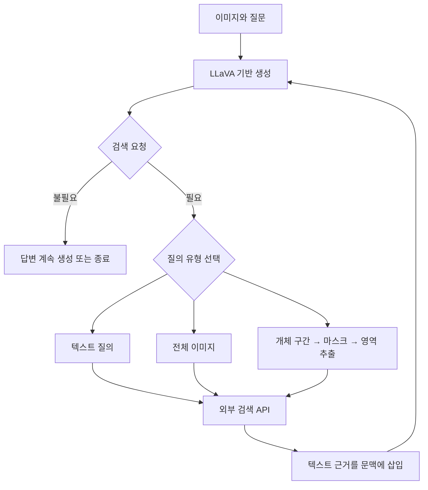

# PixSearch: Region-Grounded Retrieval for Knowledgeable Large Multimodal Models

**핵심 판단:** PixSearch의 가장 중요한 기여는 **질문과 관련된 이미지 영역을 모델 내부에서 찾아 검색 질의로 만들고, 검색 결과를 읽으며 답변 생성을 이어가는 구조**입니다.  
CRAG-MM에서 이 접근의 유용성을 보여주는 결과를 보고하지만, **광범위한 미지 환경에 대한 일반화가 입증된 것은 아니며, 일부 결과표에는 산술적 불일치가 있어 정량적 결론을 신중하게 읽어야 합니다.**〔pp. 4–5, 9–14, Tables 2, 7–8〕

분석 대상은 **2026년 10월 13일 개정된 arXiv v2**이며, 아래 페이지 번호는 첨부 PDF에 인쇄된 번호를 따릅니다.  
관련 연구는 **2026년 10월 22일까지 확인 가능한 원 논문과 공식 학회 자료**를 사용했습니다. [arxiv.org](https://arxiv.org/abs/2601.19060?utm_source=chatgpt.com)

**분석 원문:** 2601.19060v2.pdf

이 보고서에서는 **[저자 보고]**, **[분석]**, **[후속 연구 제안·미검증]**을 구분합니다. 후속 연구 제안은 요청하신 연구 방향을 제시하기 위한 것이며, 논문에서 확인된 성과로 취급하지 않습니다.

---

## 1. Executive summary — 10문장

1. PixSearch는 착용자 시점 이미지에서 작거나 주변부에 있는 물체를 정확히 식별하고, 그 물체에 관한 외부 지식을 이용해 질문에 답하는 문제를 다룹니다.〔pp. 1–2, Figure 1〕
2. 기존 방식의 전체 이미지 검색은 배경에 방해받기 쉽고, 물체를 먼저 텍스트로 설명한 뒤 검색하는 방식은 정확한 개체 정보를 잃을 수 있다는 것이 연구의 출발점입니다.〔pp. 1–3〕
3. 제안 모델은 답변 생성 중 검색 시점과 질의 형태를 결정하고, 텍스트·전체 이미지·예측한 물체 영역을 검색에 사용합니다.〔pp. 4–5, Figure 2, 식 (1)–(6)〕
4. 모델은 PLUM에서 초기화한 LLaVA-13B와 텍스트에 정렬된 마스크 생성 구조를 사용하며, 2단계 학습으로 분할 능력과 검색 기반 답변 능력을 함께 유지하려 합니다.〔pp. 5–7, Table 11〕
5. CRAG-MM 전체 정확도는 같은 PixSearch의 전체 이미지 검색 설정 대비 **31.2%에서 36.9%로 상승**했으며, 이는 **5.7%p 증가이자 18.3% 상대 향상**입니다.〔p. 9, Table 2〕
6. 착용자 시점 하위집합에서는 정확도가 **26.5%에서 32.4%로 상승**하여 **22.3% 상대 향상**을 보고합니다.〔p. 9, Table 2〕
7. 전체 환각률은 **50.5%에서 40.7%로 감소**하지만, 최종 모델의 정확률보다 환각률이 여전히 높아 사실성 문제가 해결되었다고 볼 수는 없습니다.〔pp. 8–9, Table 2〕
8. 평균 추론 시간은 캐시된 GroundedSAM–LLaVA 파이프라인의 **4.4초에서 2.8초로 36.4% 감소**하지만, 전체 이미지 검색만 사용하는 PixSearch의 2.45초보다는 느립니다.〔p. 11, Table 5〕
9. 텍스트 전용 질의응답으로의 전이 결과는 제시되지만, 추가 시각 질의응답 평가에 사용한 TextVQA·InfoSeek·OVEN은 학습 자료원에도 포함되어 있어 이를 미학습 데이터셋 일반화로 해석할 수는 없습니다.〔pp. 7–8, 10, 19, Tables 1, 4, 10〕
10. 따라서 이 논문은 영역 기반 검색과 분할 능력 유지의 유망한 결합을 보여주지만, 표 내부 불일치의 해소와 엄격한 데이터 분리·독립 평가가 추가로 필요합니다.〔pp. 9–14, Tables 2, 7–8; 분석〕

> **용어 풀이**
>
> - **마스크(mask)**: 이미지에서 특정 물체에 속하는 픽셀을 표시한 지도입니다.
> - **환각(hallucination)**: 근거와 맞지 않거나 사실이 아닌 내용을 생성하는 현상이며, 이 논문의 수치는 평가 모델이 답변을 환각 범주로 분류한 비율입니다.
> - **%p와 상대 향상률**: 31.2%에서 36.9%로 오르면 차이는 5.7%p이고, 시작값 대비 증가율은 약 18.3%입니다.
> - **전이(transfer)**: 한 종류의 학습에서 얻은 능력이 다른 과제에서도 활용되는 것을 뜻합니다.

---

## 2. 연구 배경·목표와 핵심 주장

### 2.1 해결하려는 문제

**[저자 보고]** 연구의 중심 과제는 이미지와 질문을 함께 받아 외부 지식에 근거한 답변을 만드는 **지식 기반 시각 질의응답**입니다.  
예를 들어 사진 속 자동차가 일곱 명보다 많은 사람을 태울 수 있는지 판단하려면, 자동차라는 일반 범주를 아는 것뿐 아니라 **그 자동차의 구체적인 모델과 좌석 수**를 알아야 합니다.〔pp. 1–3, Figure 1〕

웨어러블 카메라의 이미지에서는 대상이 작고, 화면 중심에서 벗어나며, 주변 물체와 섞여 있을 수 있습니다. 저자들은 이러한 조건에서 다음 문제가 발생한다고 설명합니다.〔pp. 1–3〕

| 기존 접근의 문제 | 문제가 발생하는 이유 | PixSearch가 해결하려는 목표 |
|---|---|---|
| 전체 이미지 검색의 부정확성 | 질문과 무관한 배경이나 큰 물체가 검색 표현을 지배할 수 있음 | 질문에 해당하는 영역으로 검색 범위를 좁힘 |
| 텍스트 질의의 정보 손실 | “자동차”, “식물” 같은 설명만으로 세부 개체를 특정하기 어려움 | 시각적 특징을 유지한 영역 이미지를 검색에 사용 |
| 여러 외부 모듈의 오류 전파 | 검출·분할·설명 생성 중 발생한 오류가 다음 단계로 전달됨 | 영역 생성과 검색 제어를 모델의 생성 과정에 통합 |
| 고정된 검색 절차의 비효율 | 검색이 필요 없는 질문에도 검색하거나, 한 번의 검색으로 끝냄 | 검색 필요 여부와 후속 검색을 문맥에 따라 결정 |

> **용어 풀이**
>
> - **VQA, Visual Question Answering**: 이미지에 관한 질문에 답하는 과제입니다.
> - **LMM, Large Multimodal Model**: 이미지와 텍스트처럼 여러 종류의 입력을 함께 처리하는 대규모 모델입니다.
> - **MM-RAG**: 멀티모달 모델이 외부 검색 결과를 활용해 답변을 생성하는 방식입니다.
> - **시각적 그라운딩(visual grounding)**: 문장의 표현이나 질문의 대상을 이미지의 실제 위치와 연결하는 작업입니다.
> - **롱테일 개체(long-tail entity)**: 학습 데이터에 자주 등장하지 않는 희귀하거나 세부적인 개체입니다.

### 2.2 연구 목적과 필요성

**[저자 보고]** PixSearch가 통합하려는 결정은 네 가지입니다.

1. 검색을 할 것인가?
2. 텍스트·전체 이미지·영역 중 무엇으로 검색할 것인가?
3. 구체적으로 어떤 문장이나 이미지 영역을 검색할 것인가?
4. 검색된 근거를 이용해 어떻게 답할 것인가?

이 네 결정을 하나의 검색 교차 생성 과정에 넣는 것이 연구 목표입니다.〔p. 3, §3.1〕

**[분석]** 연구의 실질적인 가치는 **개체 이름을 먼저 정확히 말해야 검색할 수 있다는 부담을 줄이는 것**에 있습니다. 모델이 정확한 차종이나 식물 이름을 바로 생성하지 못하더라도, 관련 영역을 제대로 찾고 외부 이미지 검색이 성공하면 다음 추론을 진행할 수 있습니다. 다만 이 가능성은 **영역 검출과 검색 저장소의 품질에 의존**하며, 시각 인식 문제 전체를 해결한다는 의미는 아닙니다.〔pp. 4–5, 14, Figure 2〕

### 2.3 핵심 주장과 근거

| 핵심 주장 | 저자가 제시한 근거 | 분석 및 해석 범위 | 위치 |
|---|---|---|---|
| 영역 검색이 CRAG-MM 성능의 주요 기여 요소다 | Full 정확도 36.9%, 영역 검색 금지 31.9%, 영역 검색만 사용 35.9% | 영역 질의의 유용성을 지지하지만, 모든 조건에서 복합 질의가 최선인 것은 아님 | p. 12, Table 7 |
| 다단계 검색이 답변에 도움이 된다 | 검색 1회 이하 32.1%, 2회 이하 35.8%, 3회 이하 36.4% | 보고된 정확도는 이를 지지하나 Table 8의 다른 지표에는 내부 불일치가 있음 | p. 13, Table 8 |
| 2단계 학습이 분할 능력을 더 잘 유지한다 | 공동 SFT 대비 정확도 32.6→36.9, RefCOCO gIoU 67.4→78.9 | 해당 학습 설정에서의 근거이며 모든 공동 학습이 실패한다는 뜻은 아님 | p. 11, Table 6 |
| 강화학습 대조군보다 분할 유지에 유리하다 | GRPO와 정확도는 모두 36.9%, gIoU는 71.6 대비 78.9 | **정확도 우위가 아니라 분할 능력 유지의 우위** | pp. 25, 27, Table 17 |
| 외부 모듈 파이프라인보다 빠르다 | 캐시된 파이프라인 4.4초 대비 2.8초 | 전체 이미지 검색만 사용하는 2.45초보다 빠른 것은 아님 | pp. 11, 27, Tables 5, 18 |
| 다른 과제에서도 능력을 유지하거나 활용한다 | 추가 VQA 및 텍스트 QA 결과 | VQA 학습 자료원과의 중복, 과제별 이득 차이를 고려해야 함 | pp. 10, 19, Tables 4, 10 |

> **용어 풀이**
>
> - **SFT, 지도 미세조정**: 정답 예시를 제공하여 모델을 추가 학습하는 방법입니다.
> - **절제 실험(ablation)**: 기능 하나를 제거하거나 제한해 그 기능의 기여를 확인하는 실험입니다.
> - **GRPO**: 여러 생성 결과의 상대적인 보상을 이용해 모델을 갱신하는 강화학습 방법입니다.
> - **IoU 계열 지표**: 정답 영역과 예측 영역이 얼마나 겹치는지 평가합니다. 이 논문은 분할 평가에 gIoU와 mIoU를 사용하지만, gIoU의 상세 집계식은 제시하지 않습니다.

---

## 3. 방법론: 모델 구조, 수식, 학습과 데이터

### 3.1 모델 구조

**[저자 보고]** PixSearch는 PLUM의 텍스트 정렬 분할 구조를 바탕으로 구성됩니다.〔pp. 5–6, 20, Table 11〕

| 구성요소 | 논문에 보고된 설정 | 역할 |
|---|---|---|
| 멀티모달 언어모델 | LLaVA-13B, PLUM으로 초기화 | 질문 이해, 답변 생성, 검색 제어 |
| 시각 인코더 | CLIP ViT-L/14 | 입력 이미지를 언어모델이 사용할 시각 표현으로 변환 |
| 개체 구간 추출기 | BIO 태깅, 양방향 인코더 | 생성 문장에서 분할 대상 표현을 찾음 |
| 마스크 구성요소 | SAM ViT-H 계열, prompt encoder와 decoder 학습 | 텍스트 표현에 대응하는 픽셀 마스크 생성 |
| 언어모델 적응 | q·v에 LoRA, rank 8 | 제한된 추가 파라미터로 모델을 미세조정 |
| 외부 검색 | 이미지·텍스트 검색 API | 질의에 관련된 텍스트 근거 반환 |

> **용어 풀이**
>
> - **인코더**: 이미지나 문장을 모델이 처리할 수 있는 숫자 표현으로 바꿉니다.
> - **디코더**: 내부 표현을 바탕으로 텍스트나 마스크 같은 출력을 만듭니다.
> - **LoRA**: 원래 모델의 큰 가중치 전체를 수정하는 대신 작은 추가 행렬을 학습하는 방법입니다.
> - **rank**: LoRA의 추가 행렬이 표현할 수 있는 변화의 차원을 정하는 값입니다.

아래는 Figure 2와 Algorithm 1을 바탕으로 정리한 작동 흐름입니다.〔pp. 4, 21〕



**[분석: ‘종단 간’의 정확한 의미]** 여기서 통합되는 것은 **언어 생성, 마스크 생성, 검색 실행 제어**입니다. 검색 인덱스와 검색용 인코더까지 답변 손실로 공동 최적화했다는 근거는 제시되지 않습니다. 또한 모델 내부에 SAM 계열 구성요소가 있으므로, “SAM을 사용하지 않는다”는 설명은 부정확합니다. 추론 시 별도의 GroundedSAM 파이프라인을 호출하지 않는다는 의미로 이해해야 합니다.〔pp. 5, 8, 20, Table 11〕

---

### 3.2 검색과 생성을 교차하는 과정

#### A. 다음 토큰 생성 — 원문 식 (2)

$$
x_t \sim p_\theta(x_t \mid x_{ < t}, Q, I).
$$

- $I$: 입력 이미지.
- $Q$: 질문.
- $x_t$: 현재 생성할 토큰.
- $x_{ < t}$: 이전까지 생성된 문맥.
- $\theta$: 모델 파라미터.
- $p_\theta$: 다음 토큰의 조건부 확률분포.

모델이 일반적인 단어를 생성하면 답변을 이어가고, `<search>`를 생성하면 검색 요청을 구성합니다. 검색 결과가 삽입된 뒤에는 그 결과도 이후 생성의 문맥이 됩니다.〔p. 4, §3.3〕

> **용어 풀이 — 자기회귀 생성:** 앞서 나온 단어와 입력을 보고 다음 단어를 하나씩 생성하는 방식입니다.

#### B. 검색 질의 선택 — 원문 식 (1), (3)

$$
\hat M = f_\theta(I,x_{ < t}),
$$

$$
S=
\begin{cases}
I, & \text{전체 이미지 질의},\\
\text{crop}(I,\hat M), & \text{영역 질의},\\
T, & \text{텍스트 질의}.
\end{cases}
$$

- $\hat M$: 예측한 이진 분할 마스크.
- $f_\theta$: 이미지와 생성 문맥을 이용해 마스크를 만드는 함수.
- $S$: 검색 API에 전달할 질의.
- $\text{crop}(I,\hat M)$: 마스크에 따라 입력 이미지에서 추출한 영역.
- $T$: 모델이 생성한 텍스트 검색문.

전체 이미지 검색은 `<image>`, 영역 검색은 `<region>`으로 선택합니다. 텍스트 검색은 본문 각주에 따르면 별도의 `<text>` 토큰을 출력하는 대신 **텍스트 질의를 직접 생성**합니다.〔p. 4, 식 (1), (3), 각주 1〕

**정확성 주의:** 검색하는 것은 **마스크로 추출한 이미지 영역의 표현**입니다. 이진 마스크 자체를 지식 문서와 직접 비교하는 방식으로 설명하면 안 됩니다. 또한 배경 제거, 사각형 자르기, 여백 추가 등 `crop`의 정확한 구현 규칙은 문서에 충분히 명시되지 않습니다.〔p. 27, Appendix G〕

#### C. 검색 요청과 근거 삽입 — 원문 식 (4)–(6)

$$
x_{1:t}
\leftarrow
[x_{1:t-1},\text{<search>},S,\text{</search>}],
$$

$$
E=\text{search api}(S,k),
$$

$$
x_{1:t+1}
\leftarrow
[x_{1:t},\text{<info>},E,\text{</info>}].
$$

- $E$: 검색으로 얻은 텍스트 근거.
- $k$: 반환할 상위 검색 결과의 수.
- $[\cdot]$: 기존 문맥에 내용을 이어 붙이는 표현.
- `<info>`: `<information>`의 축약 표기.

실제 호출은 검색 블록이 닫힌 뒤 이루어지며, 모델은 반환된 근거를 읽고 다시 생성합니다. 필요한 경우 새로운 검색 블록을 생성하므로 **영역으로 개체를 식별한 뒤 텍스트로 그 개체의 속성을 검색하는 과정**이 가능합니다.〔pp. 4–5, 20–21, Algorithm 1〕

**표기상의 주의:** 식 (4), (6)은 여러 토큰으로 된 블록 추가를 한 단계처럼 나타낸 개념적 표현입니다. 이미지의 원시 픽셀을 그대로 텍스트 토큰에 붙인다는 뜻은 아닙니다.

---

### 3.3 텍스트의 개체 표현을 픽셀 마스크로 연결하기

모델은 언어모델 마지막 층의 토큰 표현에서 개체 구간을 찾습니다. 원문의 구간 집합 기호 $S$는 검색 질의 $S$와 중복되므로, 여기서는 구별을 위해 $\mathcal S$로 표기합니다.〔p. 5, §4.2〕

$$
h_i^L \in \mathbb R^d,
\qquad
\mathcal S=\{(i_s,j_s)\}_{s=1}^{N_+},
\qquad
q_k=g(h_k^L)\in\mathbb R^m.
$$

- $h_i^L$: 언어모델 마지막 층에서 얻은 $i$번째 토큰의 표현.
- $L$: 여기서는 마지막 층을 나타내는 표기.
- $d$: 언어모델 토큰 표현의 차원.
- $(i_s,j_s)$: $s$번째 개체 구간의 시작과 끝.
- $N_+$: 개체 구간 수.
- $g$: 학습 가능한 투영 함수.
- $q_k$: 마스크 디코더에 전달되는 질의 벡터.
- $m$: 마스크 질의 벡터의 차원.
- 여기서 $k$는 토큰 위치이며, 앞 절의 검색 결과 개수 $k$와는 별개입니다.

개체 구간 추출기는 토큰에 **B·I·O** 태그를 붙이고, 연속된 B–I 구간을 분할할 개체 표현으로 사용합니다. 그 표현을 마스크 디코더가 사용할 벡터로 변환합니다.〔p. 5〕

> **용어 풀이**
>
> - **BIO 태깅**: B는 개체 표현의 시작, I는 그 내부, O는 개체 표현 밖을 뜻합니다.
> - **임베딩(embedding)**: 단어나 이미지의 특징을 숫자 벡터로 나타낸 것입니다.
> - **투영(projection)**: 한 모듈의 표현을 다른 모듈이 사용할 차원과 형태로 변환하는 연산입니다.

---

### 3.4 학습 목적함수

#### A. 전체 손실 — 원문 식 (7)

```math
\mathcal L
=
\mathcal L_{\text{LM}}
+\lambda_1\mathcal L_{\text{span}}
+\lambda_2\mathcal L_{\text{seg}}
+\lambda_3\mathcal L_{\text{BCE}}
+\lambda_4\mathcal L_{\text{KL}}.
```

| 기호 | 의미 |
|---|---|
| $\mathcal L_{\text{LM}}$ | 검색 근거 토큰을 제외하고 계산하는 언어모델 손실 |
| $\mathcal L_{\text{span}}$ | BIO 개체 구간 태깅의 교차엔트로피 손실 |
| $\mathcal L_{\text{seg}}$ | Focal-Tversky 기반 마스크 손실 |
| $\mathcal L_{\text{BCE}}$ | 픽셀별 이진 교차엔트로피 손실 |
| $\mathcal L_{\text{KL}}$ | 기존 교사 모델의 표현과 정렬을 유지하는 규제 |
| $\lambda_1,\ldots,\lambda_4$ | 각 손실의 상대적 가중치 |

이 목적함수는 답변 생성만 학습하지 않고 **개체 표현 추출, 마스크 예측, 기존 표현 유지**에도 학습 신호를 부여합니다.〔p. 5, 식 (7)〕

> **용어 풀이**
>
> - **손실함수**: 모델이 얼마나 틀렸는지를 숫자로 표현하여 학습 방향을 정합니다.
> - **교차엔트로피**: 정답에 높은 확률을 주도록 유도하는 손실입니다.
> - **이진 교차엔트로피(BCE)**: 각 픽셀이 대상인지 아닌지처럼 두 선택지의 예측에 사용하는 손실입니다.
> - **규제(regularization)**: 학습 중 표현이나 파라미터가 바람직하지 않은 방향으로 과도하게 변하는 것을 억제합니다.

Table 11에는 $\lambda_{\text{CE}}=1$, $\lambda_{\text{seg}}=8$, $\lambda_{\text{BCE}}=2$, $\lambda_{\text{KL}}=0.1$, $\lambda_{\text{cls}}=2$가 기재되어 있습니다. 다만 **식 (7)과 Table 11의 이름 대응이 완전히 명시적이지 않으므로**, 예를 들어 $\lambda_{\text{cls}}$를 곧바로 $\lambda_1$이라고 확정하지는 않겠습니다.〔p. 20, Table 11〕

#### B. 분할 손실 — 원문 식 (8)

```math
\mathcal L_{\text{seg}}
=
\frac{1}{N_+}
\sum_{y_i\neq O}
\mathcal L_{\text{FT}}(M_i,\hat M_i).
```

- $M_i$: 정답 마스크.
- $\hat M_i$: 예측 마스크.
- $y_i$: 이 식에서는 BIO 태그.
- $O$: 개체 구간 바깥을 나타내는 태그.
- $\mathcal L_{\text{FT}}$: Focal-Tversky 손실.
- $N_+$: 앞 문맥에서 정의한 개체 구간 수.

> **용어 풀이 — Focal-Tversky 손실:** 정답과 예측 영역의 겹침을 이용하면서, 놓친 영역과 잘못 포함한 영역의 영향을 조절하고 어려운 사례에 더 집중하도록 설계된 분할 손실입니다.

**원문에 없는 부분:** 논문은 $\mathcal L_{\text{FT}}$의 전개식과 세부 계수를 제시하지 않습니다. 또한 구간 수 $N_+$로 정규화하면서 BIO 토큰을 기준으로 합산하는 표기의 구체적인 집계 방식도 충분히 설명하지 않습니다. 따라서 일반적인 Focal-Tversky 공식을 가져와 **PixSearch의 실제 구현 설정인 것처럼 보충하지 않습니다.**〔p. 5〕

#### C. 기존 표현과의 정렬 유지 — 원문 식 (9)

```math
\mathcal L_{\text{KL}}
=
\frac{1}{N_+}
\sum_{s=1}^{N_+}
\frac{
\left\|h_{i_s:j_s}^{L}-t_{i_s:j_s}^{L}\right\|_2^2
}{
2\sigma^2
}.
```

- $h_{i_s:j_s}^{L}$: 현재 모델의 해당 개체 구간 표현.
- $t_{i_s:j_s}^{L}$: 고정된 교사 모델의 대응 표현.
- $\sigma^2$: 가우시안 정렬 제약의 분산 척도.
- $\|\cdot\|_2^2$: 두 표현 차이의 제곱 크기.

**[저자 보고]** 이 항은 고정된 교사 표현과의 정렬을 유지하기 위한 가우시안 KL 제약입니다.〔p. 5〕

**[분석]** 수식상으로는 현재 표현이 교사 표현에서 멀어질수록 벌점이 커집니다. 새 검색 능력을 학습하면서 기존 개체 표현이 크게 흔들리는 것을 억제하려는 장치로 해석할 수 있습니다. 다만 교사의 정확한 체크포인트, $\sigma$의 값, 여러 토큰의 집계 방식은 명확히 제시되지 않습니다.

> **용어 풀이 — KL 제약:** 두 확률분포가 지나치게 달라지지 않도록 제한하는 방식입니다. 이 논문에 제시된 형태는 표현 간 제곱거리로 계산됩니다.

#### D. 검색 근거 토큰의 손실 제외 — 원문 식 (10), (11)

$$
m_i=
\begin{cases}
0, & \text{토큰 }x_i\text{가 information 구간에 속할 때},\\
1, & \text{그 외}.
\end{cases}
$$

```math
\mathcal L_{\text{LM}}
=
-\frac{1}{\sum_i m_i}
\sum_{i=1}^{L}
m_i\log p_\theta(y_i\mid y_{ < i},I).
```

- $m_i$: 해당 토큰을 손실 계산에 포함할지 나타내는 값.
- $L$: 이 식에서는 시퀀스 길이로, 앞의 마지막 층 표기 $L$과 의미가 다릅니다.
- $y_i$: 학습 대상 정답 토큰이며, 식 (8)의 BIO 태그와 의미가 다릅니다.
- $y_{<i}$: 정답 시퀀스의 앞선 문맥.
- $\sum_i m_i$: 실제로 손실을 계산하는 토큰 수.

**핵심은 검색 결과를 문맥에서 삭제하지 않는다는 점입니다.** 모델은 검색 결과를 읽을 수 있지만, 검색 결과 자체를 다음 토큰으로 재현하도록 학습 점수를 받지는 않습니다. 대신 검색 요청과 검색 후 답변 생성을 학습합니다.〔p. 6〕

구현에서는 검색 근거의 문자 구간과 토큰의 문자 구간이 겹치는지 검사합니다.

$$
\exists(s_k,e_k)\in\mathcal S_c:
\quad
(s_i < e_k)\land(e_i > s_k).
$$

- $\mathcal S_c$: 대화 $c$에 포함된 근거 블록의 문자 구간 집합.
- $(s_k,e_k)$: 한 근거 블록의 시작·끝 문자 위치.
- $(s_i,e_i)$: 토큰 $i$의 시작·끝 문자 위치.

두 구간이 조금이라도 겹치면 해당 토큰의 손실을 제외합니다.〔p. 6, §4.2.1〕

> **용어 풀이 — 손실 마스킹:** 입력은 그대로 읽게 하되, 특정 위치에 대해서는 정답 예측 점수를 계산하지 않는 방법입니다. 이미지 분할 마스크와는 다른 개념입니다.

---

### 3.5 2단계 학습과 자료 생성

#### Stage 1: 분할과 일반 시각 이해 유지

**[저자 보고]** 다음 자료를 사용합니다.〔p. 6〕

- 분할 자료: ADE20K, Pascal Parts, PartImageNet, PACO-LVIS, COCO-Stuff.
- 지시 표현 기반 분할 자료: RefCOCO 변형 데이터셋.
- 일반 시각 명령 학습 자료: LLaVA의 이미지 조건부 응답·캡션 **665,000건**.

목적은 검색 중심의 추가 학습 때문에 기존 시각적 그라운딩과 마스크 생성 능력이 사라지는 것을 방지하는 것입니다.〔pp. 5–6〕

> **용어 풀이**
>
> - **지시 표현 기반 분할**: “왼쪽에서 두 번째 사람”처럼 문장이 가리키는 대상을 분할합니다.
> - **파국적 망각(catastrophic forgetting)**: 새로운 과제를 학습하면서 이전에 잘하던 능력이 크게 저하되는 현상입니다.

#### Stage 2: 검색 시점·유형·근거 활용 학습

Figure 3의 자료 생성은 세 단계입니다.〔p. 7〕

1. **질문 선택:** GPT-4.1이 예시를 보고 검색 필요 여부와 질문 유형을 판단합니다.
2. **질문 분해 및 응답 생성:** 원 질문을 하위 질문으로 나누고, 정답을 제공하여 검색 토큰이 포함된 응답 후보 **5개**를 만든 뒤 자기 검토로 선택합니다.
3. **질의 생성 및 유형 부여:** 각 검색 위치에 영역·전체 이미지·텍스트 질의를 배정합니다.

영역 학습자료를 만드는 과정에는 Figure 3에 표시된 **Ground DINO2와 SAM 기반 외부 영역 추출 절차**가 사용됩니다. 따라서 외부 시각 도구 의존을 줄였다는 주장은 **주로 추론 경로에 관한 것**이며, 학습자료 제작까지 외부 도구가 없는 것은 아닙니다.〔p. 7, Figure 3〕

> **용어 풀이**
>
> - **ICL, 문맥 내 학습**: 모델 파라미터를 바꾸지 않고 프롬프트에 예시를 보여주어 수행 방식을 유도합니다.
> - **합성 지도 데이터**: 다른 모델이 생성한 답변·라벨을 학습 정답으로 사용하는 자료입니다.
> - **준정답(pseudo-gold)**: 사람이 직접 검증한 정답 대신 모델 등이 생성한 정답 후보입니다.

#### 실제 Stage 2 자료 규모

| 데이터셋 | 생성 레코드 | 데이터셋 내부 고유 ID | 해당 실행에 사용 |
|---|---:|---:|---|
| OVEN | 7,000 | 5,277 | 예 |
| InfoSeek | 7,000 | 6,045 | 예 |
| A-OKVQA | 7,000 | 6,841 | 예 |
| OKVQA | 7,000 | 6,078 | 예 |
| TextVQA | 7,000 | 6,937 | 예 |
| **선택된 합계** | **35,000** | **31,178** | 예 |
| WebQA | 7,000 | 6,064 | 아니오 |

〔p. 8, Table 1〕

세 가지 구분이 필요합니다.

- **35,000건은 검색 교차 생성 자료의 규모**이며 전체 분할·명령 학습 혼합 자료의 총규모가 아닙니다.
- **31,178개는 데이터셋별 고유 ID의 합**으로, 데이터셋 사이까지 중복을 제거한 수가 아닙니다.
- CRAG-MM 주석 **1,230건**과 ICL 예시는 따로 준비되었지만, 저자는 보존된 자료에서 대응하는 최종 검색 교차 학습 파일을 찾지 못했다고 명시합니다. 따라서 이를 실제 학습량에 더하면 안 됩니다.〔pp. 7–8〕

#### 학습 자원과 설정

보고된 한 번의 Stage 2 실행은 **H100 80GB 8대**, 유효 배치 크기 **480**, **10,000회 갱신**, 최대 텍스트 길이 **512**를 사용했습니다. 소요 시간은 약 **61.5시간, 492 GPU-hours**이며, 백본 학습·다른 실험·합성자료 생성 비용은 제외됩니다.〔p. 19, Appendix B〕

Stage 2의 자료 유형별 혼합비는 의미 분할 : 지시 표현 분할 : 시각 명령 학습 : 추론 분할 : 검색 교차 생성 = **3:3:5:1:9**입니다. Table 3의 최선 설정인 **7:9** 표기만으로 전체 자료 혼합비를 설명해서는 안 됩니다.〔pp. 10, 19〕

---

### 3.6 검색 인프라와 평가 자료

**[저자 보고]** 일반 VQA 실험에는 **2022년 10월 1일 Wikipedia 덤프에서 얻은 600만 문서와 대응 이미지**를 사용하는 자체 검색 API를 구축합니다. 이미지 검색 표현은 **DINOv3**, 텍스트 검색 표현은 **all-mpnet-base-v2**로 만듭니다. 이미지 검색 결과는 연결된 Wikipedia 문서를 반환합니다.〔p. 8〕

**CRAG-MM에는 해당 벤치마크가 제공하는 검색 API를 따로 사용합니다.** 따라서 다른 데이터셋의 결과를 동일한 검색 저장소에서 얻은 결과처럼 비교하면 안 됩니다.〔p. 8〕

또한 영역 추출은 **질의 이미지 측에서 수행**하므로, 검색 문서의 모든 가능한 영역과 마스크를 미리 저장할 필요는 없습니다.〔p. 27〕

---

## 4. 주요 결과와 그 의미

### 4.1 평가 지표

CRAG-MM에서는 GPT-4.1이 답변을 정확·누락·환각으로 분류합니다. 논문의 설명을 수식으로 정리하면 다음과 같습니다.〔p. 8; 아래는 평가 정의의 재표현〕

$$
r_j=
\begin{cases}
1,&\text{정확한 답변},\\
0,&\text{누락된 답변},\\
-1,&\text{환각 답변},
\end{cases}
\qquad
\tau=\frac{1}{n}\sum_{j=1}^{n}r_j,
\qquad
\text{Truthfulness}=100\tau.
$$

- $n$: 평가 답변 수.
- $r_j$: $j$번째 답변의 평가 점수.
- $\tau$: 평균 점수로 범위는 $[-1,1]$.
- 표에 표시된 Truthfulness 범위는 $[-100,100]$입니다.

따라서 같은 표본과 분모를 사용한다면 다음 관계가 성립해야 합니다.

```math
\text{Truthfulness}
=
\text{Accuracy(\%)}-\text{Hallucination(\%)}.
```

다른 QA 평가에는 relaxed EM과 F1을 사용합니다.〔p. 8〕

> **용어 풀이**
>
> - **EM, Exact Match**: 생성 답변이 정답과 일치하는지를 평가합니다. 이 논문은 완화된 일치 기준을 사용합니다.
> - **F1**: 답변과 정답에 공통으로 포함된 내용의 정확성과 포괄성을 함께 평가합니다.
> - **LLM-as-Judge**: 언어모델이 다른 모델의 답변을 채점하는 방식입니다.

### 4.2 CRAG-MM: 전체 이미지 검색 대비 개선

아래 숫자는 **원문에 기재된 보고값**이며, 표 내부 일관성 문제는 6절에서 따로 설명합니다.

| 지표 | PixSearch Whole Image | PixSearch Full | 차이 |
|---|---:|---:|---:|
| 전체 정확도 | 31.2% | 36.9% | **+5.7%p**, 상대 +18.3% |
| 착용자 시점 정확도 | 26.5% | 32.4% | **+5.9%p**, 상대 +22.3% |
| 비착용자 시점 정확도 | 44.2% | 45.6% | +1.4%p |
| 전체 환각률 | 50.5% | 40.7% | **−9.8%p**, 상대 −19.4% |
| 전체 누락률 | 18.1% | 21.6% | +3.5%p |
| 전체 Truthfulness | −19.3 | −3.8 | +15.5점 |

〔p. 9, Table 2; 차이는 보고값으로 재계산〕

**[분석]**

- 영역 검색의 추가 가치는 비착용자 시점보다 착용자 시점에서 크게 나타납니다.
- 환각 감소와 동시에 누락이 증가하므로, 답변 범위와 사실성 사이의 절충을 고려해야 합니다.
- 저자는 증거가 부족할 때 답변을 보류하는 경향을 가능한 설명으로 제시하지만, 이를 별도 실험으로 확증하지는 않습니다.
- Full의 Truthfulness가 여전히 음수이므로, 결과를 “신뢰성 문제가 해결되었다”라고 설명할 수 없습니다.〔p. 9〕

모든 하위집합에서 최고 성능인 것도 아닙니다. 비착용자 시점에서 Llama-3.2-11B의 전체 이미지 검색은 정확도 **46.6%**, Truthfulness **11.5**로, PixSearch Full의 **45.6%**, **10.2**보다 높습니다.〔p. 9, Table 2〕

### 4.3 영역 검색과 검색 횟수

**[저자 보고]** 전체 정확도는 Full **36.9%**, 영역 검색만 사용 **35.9%**, 영역 검색 금지 **31.9%**, 텍스트 검색만 사용 **18.3%**입니다.〔p. 12, Table 7〕

**[분석]** 이 결과는 영역 검색이 주요 성능 기여 요소임을 지지합니다. 그러나 착용자 시점에서는 영역 검색만 사용한 **32.6%**, 텍스트 검색을 금지한 **32.8%**가 Full의 **32.4%**보다 약간 높습니다. 따라서 세 질의 유형의 결합이 항상 이기는 것은 아닙니다.〔p. 12, Table 7〕

검색 횟수 제한 실험의 전체 정확도는 다음과 같습니다.〔p. 13, Table 8〕

| 허용 검색 횟수 | 0회 | 1회 이하 | 2회 이하 | 3회 이하 | 4회 이하 | 횟수 제약 없음 |
|---|---:|---:|---:|---:|---:|---:|
| 정확도 | 19.8% | 32.1% | 35.8% | 36.4% | 36.5% | 36.9% |

보고된 정확도만 보면 2–3회에서 많은 이득을 얻습니다. 다만 **Table 8의 Truthfulness와 범주 비율에는 불일치가 있으므로 정확한 최적 검색 횟수를 확정하는 근거로 사용하기 어렵습니다.**

### 4.4 2단계 학습과 분할 유지

| 학습 방법 | CRAG-MM 정확도 | RefCOCO gIoU | ADE20K mIoU |
|---|---:|---:|---:|
| Stage 2 SFT만 수행 | 18.5 | 14.8 | 10.2 |
| 한 단계 공동 SFT | 32.6 | 67.4 | 46.8 |
| **2단계 SFT** | **36.9** | **78.9** | **55.98** |
| Search-R1 방식 GRPO 대조군 | 36.9 | 71.6 | 50.3 |

단위: %.〔pp. 11, 27, Tables 6, 17〕

**[분석]** 이 표가 지지하는 결론은 “2단계 SFT가 이 설정에서 답변 능력과 분할 능력을 더 잘 함께 유지했다”입니다. **SFT가 강화학습보다 정답률이 높다거나, 강화학습은 본질적으로 분할 능력을 손상시킨다는 결론은 지지하지 않습니다.** 저자도 Appendix F에서 이 범위를 명시합니다.〔p. 25〕

또한 분할 성능은 자료 혼합비에 민감합니다. Table 3에서 RefCOCO val gIoU는 1:9 설정의 **15.3**에서 7:9 설정의 **78.9**로, ADE20K mIoU는 **9.85에서 55.98**로 달라집니다. 분할 능력 유지가 통합 구조만으로 자동 보장되는 것은 아닙니다.〔p. 10, Table 3〕

### 4.5 추론 시간

| 방법 | 평균 ± 표준편차 |
|---|---:|
| PixSearch Full | 2.8 ± 0.9초 |
| PixSearch Whole Image | 2.45 ± 0.72초 |
| 캐시된 GroundedSAM–LLaVA | 4.4 ± 1.3초 |
| GPT-4.1 개체 추출 포함 파이프라인 | 5.0 ± 3.4초 |

다섯 번 실행에 대한 보고값입니다.〔p. 11, Table 5〕

마스크 예측·영역 추출에 해당하는 시간은 PixSearch가 **0.23초**, 별도 파이프라인이 **1.60초**입니다. 저자들은 이를 통합 구조의 효율성 근거로 제시합니다. 다만 **2.8초라는 결과만으로 기기 내 실시간 구동 가능성이 입증되지는 않습니다.**〔pp. 14, 27, Table 18〕

---

## 5. 모델의 일반화 성능: 확인된 결과와 아직 확인되지 않은 부분

### 5.1 추가 VQA 결과

아래는 EM / F1이며, PixSearch 변형은 세 개 학습 seed의 평균입니다.〔p. 10, Table 4〕

| 벤치마크 | No Search | Whole Image | Full |
|---|---:|---:|---:|
| TextVQA | 33.0 / 34.9 | 32.6 / 34.5 | 32.8 / 35.5 |
| InfoSeek | 18.6 / 19.7 | 24.6 / 26.4 | 24.9 / 27.0 |
| OVEN | 4.0 / 5.6 | 15.6 / 17.3 | 16.2 / 17.4 |

**[저자 보고]** 지식 의존도가 높은 InfoSeek와 OVEN에서 검색이 도움이 되며, 개체가 중심적으로 나타나는 이미지에서는 전체 이미지 검색도 충분할 수 있다고 설명합니다.〔p. 10〕

**[분석]**

- Full이 Whole Image보다 높은 EM 차이는 각각 **0.2, 0.3, 0.6%p**로 작습니다.
- TextVQA에서는 No Search의 EM **33.0**이 Full **32.8**보다 높고, F1은 Full이 높아 지표에 따라 순위가 달라집니다.
- 세 데이터셋 모두 Stage 2 자료원에 포함되므로, 이 표는 **완전히 새로운 데이터셋에 대한 일반화의 증거가 아닙니다.**
- 학습·평가의 개체 및 이미지 중복을 어떻게 제거했는지 충분히 보고되지 않았으므로, 미지 개체 일반화도 확정할 수 없습니다.〔pp. 7–8, 10, Tables 1, 4〕

> **용어 풀이**
>
> - **seed**: 학습의 무작위성을 결정하는 초기값입니다. 여러 seed로 반복하면 결과가 초기 조건에 얼마나 민감한지 볼 수 있습니다.
> - **분포 밖 일반화, OOD generalization**: 학습할 때와 다른 종류나 조건의 데이터에서도 성능을 유지하는 능력입니다.
> - **개체 분리 평가(entity-disjoint evaluation)**: 학습에 등장한 개체가 평가에 다시 나오지 않도록 구성한 평가입니다.

### 5.2 텍스트 전용 QA 전이

저자들은 **텍스트 전용 QA 데이터로 학습하지 않은 상태**에서 다음 결과를 보고합니다. 숫자는 세 학습 seed의 평균 ± 표준편차입니다.〔p. 19, Appendix A, Table 10〕

| 벤치마크 | No Search EM | Full EM | No Search F1 | Full F1 |
|---|---:|---:|---:|---:|
| HotpotQA | 23.7 ± 1.2 | 26.5 ± 1.0 | 27.1 ± 1.0 | 28.2 ± 1.3 |
| NQ | 30.3 ± 1.0 | 31.2 ± 1.1 | 33.2 ± 1.1 | 33.7 ± 1.2 |
| PopQA | 17.4 ± 0.8 | 31.9 ± 1.2 | 17.9 ± 0.8 | 32.6 ± 1.2 |
| MuSiQue | 10.0 ± 0.6 | 11.7 ± 0.7 | 12.9 ± 0.7 | 13.0 ± 0.7 |

**[분석]** 이 결과는 시각 QA에서 학습한 검색 활용이 텍스트 QA에도 적용될 수 있다는 **과제 전이의 직접적인 근거**입니다. 특히 PopQA의 검색 이득이 큽니다. 반면 NQ F1의 0.5%p, MuSiQue F1의 0.1%p 차이는 통계적 검정 없이 의미 있는 개선이라고 단정하기 어렵습니다.

또한 “텍스트 전용 QA 데이터로 학습하지 않았다”는 진술을 **텍스트 학습이 전혀 없었다거나, 사전학습에서 관련 지식을 접하지 않았다는 뜻으로 확대하면 안 됩니다.**〔pp. 6–7, 19〕

### 5.3 일반화에 대한 종합 평가

| 일반화의 종류 | 이 논문이 제공하는 근거 | 결론 |
|---|---|---|
| 착용자 시점에서의 성능 | CRAG-MM 착용자 시점 결과 | 영역 검색의 유용성을 지지 |
| 학습 자료원과 같은 VQA 벤치마크 | TextVQA·InfoSeek·OVEN | 성능 유지·개선은 확인되지만 새로운 데이터셋 전이는 아님 |
| 텍스트 QA로의 과제 전이 | 별도 텍스트 QA 학습 없이 네 벤치마크 평가 | 제한된 범위의 전이 근거가 있음 |
| 미지 개체·미지 도메인 | 엄격한 분리 평가 설명 부족 | 확정할 수 없음 |
| 최신 지식으로의 적응 | 저장소 갱신을 이용한 시간 분리 실험 없음 | 구조적 가능성과 실증을 구분해야 함 |
| 다국어·실제 웨어러블 환경 | 저자가 검증되지 않았다고 명시 | 입증되지 않음 |

〔pp. 7–10, 14, 19〕

**[분석]** 일반화 향상을 기대하게 하는 핵심 설계는 **이미지 속 개체의 위치를 찾는 능력과 그 개체의 사실 정보를 얻는 능력을 연결한 것**입니다. 그러나 현재 결과만으로는 향상의 원인이 영역 선택, 검색 저장소의 지식, 합성 학습자료, 검색 횟수 중 어디에서 얼마나 발생했는지 완전히 분리되지 않습니다.

---

## 6. 통계적으로 취약한 부분과 비교 불가능한 수치

### 6.1 반복 실험과 불확실성 보고

| 항목 | 확인된 보고 방식 | 해석상 제한 |
|---|---|---|
| CRAG-MM 주요 결과 | Tables 2, 7–8에 단일 집계값 | seed별 변동·신뢰구간·유의성 검정이 제시되지 않음 |
| 추가 VQA | 세 seed 평균 | Table 4에는 표준편차가 없음 |
| 텍스트 QA | 세 seed 평균 ± 표준편차 | 표준편차 보고만으로 통계적 유의성이 입증되지는 않음 |
| 추론 시간 | 다섯 번 실행의 평균 ± 표준편차 | 표본·출력 길이·동시성 등 세부 조건의 추가 공개가 필요 |
| SFT·GRPO 비교 | 자료 및 최적화 예산을 맞춤 | 실제 GPU 사용시간이 같다는 뜻은 아님 |

〔pp. 9–13, 19, 25〕

> **용어 풀이**
>
> - **표준편차**: 반복 결과가 평균 주변에 얼마나 퍼져 있는지 나타냅니다.
> - **신뢰구간**: 추정값의 불확실성을 구간으로 표현합니다.
> - **통계적 유의성**: 관측된 차이를 우연한 변동만으로 설명하기 어려운지를 검정하는 개념입니다.

논문의 “significantly better” 같은 표현을 곧바로 **통계적으로 유의함**으로 번역해서는 안 됩니다.

### 6.2 원본 표에서 확인되는 내부 불일치

다음은 텍스트 추출 오류가 아니라 **첨부 PDF의 표 자체에 기재된 숫자**입니다.

| 위치 | 원문 보고값 | 정의에 따른 점검 | 문제 |
|---|---|---|---|
| Table 2, Full 전체 | 정확 36.9, 누락 21.6, 환각 40.7 | 합계 **99.2%** | 세 범주 분류라면 합계가 100%여야 함 |
| Table 2, Text Query 착용자 시점 | Truthfulness −52.5 | $12.2-67.7=-55.5$ | 지표 정의와 불일치 |
| Table 8, 검색 1회 이하 전체 | Truthfulness −7.9 | $32.1-43.3=-11.2$ | 지표 정의와 불일치 |
| Table 8, 검색 1회 이하 비착용자 시점 | 정확 43.0, 누락 18.9, 환각 28.0 | 합계 **89.9%** | 단순 반올림으로 설명되지 않음 |

〔pp. 8–9, 13; 분석〕

추가로 Table 2 Full의 전체 결과를 착용자·비착용자 두 하위집합의 가중평균으로 계산한다고 가정하면, **정확도로 역산한 착용자 비중은 약 65.9%**, **환각률로 역산한 비중은 약 57.0%**입니다. 같은 표본과 집계 규칙이라면 일치해야 하므로, 별도 분모나 집계 방식이 있었다면 설명이 필요합니다.〔p. 9, Table 2; 조건부 산술 점검〕

**판단:** 이 불일치만으로 모든 실험을 부정할 수는 없습니다. 그러나 원자료나 정정표 없이 독자가 올바른 값을 결정할 수도 없으므로, **보고값은 그대로 인용하되 정밀한 효과 크기와 우열 판단에는 제한을 두어야 합니다.**

### 6.3 정성 사례와 합성 예시에서도 확인되는 문제

**첫째, 최종 답이 맞아도 중간 근거는 틀릴 수 있습니다.** Table 9의 자동차 사례에서 최종 “아니다”는 정답과 같지만, 모델은 영화 *Pretty Woman*의 개봉연도를 **1989년**이라고 생성하고 같은 표의 정답 설명은 **1990년**이라고 제시합니다. 이는 최종 정답률만으로 설명의 사실성을 보장할 수 없다는 원문 내부 사례입니다.〔p. 13, Table 9〕

**둘째, 합성 예시가 모두 정확하거나 일관적인 것은 아닙니다.** Table 15의 식물 학명 관련 예시는 생성 답변이 `Cupressus lawsoniana`인 반면, 같은 행의 정답은 `Brassica rapa / Brassica rapa var. rosularis`입니다. 또한 동일한 소파 질문이 Table 13에서는 검색 불필요로 표시되지만 Tables 15–16에서는 검색을 사용합니다.〔pp. 23–26〕

**[분석]** 이러한 사례를 전체 35,000건의 오류율로 확대할 수는 없습니다. 다만 합성자료의 사람 검수 비율과 오류율을 확인해야 할 이유는 됩니다.

### 6.4 직접 비교하면 안 되는 경우

- **서로 다른 백본·크기의 모델:** 7B·8B·11B·13B 모델 차이를 영역 검색 하나의 효과로 해석할 수 없습니다.〔p. 9, Table 2〕
- **추가 분할 데이터가 다른 모델:** Table 3의 GLaMM에는 추가 분할 데이터 표시가 있고 LISA는 7B이므로, 구조만의 우열 비교가 아닙니다.〔p. 10〕
- **다른 검색 저장소:** CRAG-MM API와 자체 Wikipedia 인덱스를 사용한 실험은 검색 환경이 다릅니다.〔p. 8〕
- **다른 평가 척도:** GPT-4.1 판정 정확도·Truthfulness와 relaxed EM·F1은 같은 점수가 아닙니다.〔p. 8〕
- **다른 연산 예산:** SFT와 GRPO의 갱신 예산이 같아도 강화학습의 응답 생성 비용까지 같지는 않습니다.〔p. 25〕
- **다른 지연시간 기준선:** 36.4% 감소는 캐시된 파이프라인 대비이고, 44% 감소는 GPT-4.1 단계까지 포함한 파이프라인 대비입니다.〔pp. 11, 27〕
- **다른 실험의 No Search:** Table 2는 전체 정확도 19.6%, Table 8은 19.8%로 보고하며, 차이의 원인이 충분히 설명되지 않습니다.〔pp. 9, 13〕

---

## 7. 가장 중요한 그림 선정과 해석

### 7.1 Figure 2 — 모델의 핵심 동작

**선정 이유:** 논문의 기술적 기여를 가장 직접적으로 보여줍니다.〔p. 4〕

그림은 자동차 영역을 먼저 검색해 차종 정보를 얻고, 그 뒤 좌석 수에 관한 텍스트 검색을 수행하는 과정을 보여줍니다. 중요한 점은 **개체 식별에 적합한 시각 질의와 사실 조회에 적합한 텍스트 질의를 서로 다른 단계에 사용**한다는 것입니다.

**해석 범위:** 이 그림은 작동 방식의 설명이며, 그림 속 예시가 전체 데이터에서 항상 성공한다는 증거는 아닙니다.

### 7.2 Figure 3 — 검색 행동의 학습자료가 만들어지는 과정

**선정 이유:** 성능이 어떤 지도 신호에서 학습되는지 보여줍니다.〔p. 7〕

검색 필요성 판단, 질문 분해, 검색 위치 선택, 질의 유형 부여가 GPT-4.1 기반 자료 생성 과정으로 제공됩니다. 따라서 결과를 **모델 구조만의 성과로 분리해서 이해하기 어렵고, 교사 모델과 합성자료의 품질도 포함한 시스템 효과**로 읽어야 합니다.

또한 영역 자료 제작에 외부 분할 도구가 사용된다는 사실을 확인할 수 있습니다.

### 7.3 Figure 5 — 영역 검색이 실제 검색 단계에 주는 이득

**선정 이유:** 최종 답변 정확도뿐 아니라 검색 자체의 성능을 보여줍니다.〔p. 11〕

영역 검색과 Full은 전체 이미지·텍스트 질의보다 높은 Recall@K를 보이며, 특히 작은 $K$에서 차이가 큽니다. 이는 **관련 개체가 상위 검색 결과에 더 빨리 등장하는 경향**을 지지합니다.

> **용어 풀이 — Recall@K:** 상위 $K$개 검색 결과 안에서 정답과 관련된 결과를 찾는 정도를 나타내는 지표입니다.

**해석 범위:** 그림에는 신뢰구간이 없고, 곡선만으로 읽은 값을 정밀한 수치처럼 인용해서는 안 됩니다. 수치가 필요한 경우 Table 17의 2단계 학습 결과인 R@1 **0.22**, R@10 **0.41**을 사용할 수 있습니다.〔p. 27〕

### 7.4 Figure 4 — 검색 행동 분석

**[저자 보고]** 착용자 시점에서는 대체로 3–4회, 비착용자 시점에서는 2–3회의 검색이 나타난다고 설명합니다.〔pp. 10–11〕

**[분석]** 더 어려운 장면에서 검색이 늘어난다는 관찰은 흥미롭지만, 어려움이 검색 증가의 원인이라는 인과관계까지 검증한 것은 아닙니다. 또한 아래 막대그래프는 “샘플당 평균 횟수”로 표시되어 있으나 값의 합이 위의 검색 횟수와 어떻게 연결되는지 정규화 설명이 부족합니다.

**Figure 1의 주의점:** 오른쪽의 36.9 대 31.2는 **CRAG-MM 전체 정확도**입니다. 그림이 착용자 시점 장면을 보여준다고 해서 이 숫자를 착용자 시점 하위집합 결과로 읽으면 안 됩니다.〔p. 2, Figure 1; p. 9, Table 2〕

---

## 8. 문서가 답하지 않는 질문

| 질문 | 왜 중요한가 | 관련 위치 |
|---|---|---|
| 각 평가의 정확한 표본 수와 분할은 무엇인가? | 신뢰구간 계산과 결과 재현에 필요 | §5.1, pp. 8–10 |
| 학습·평가의 이미지·질문·개체 중복은 어떻게 제거했는가? | 미지 개체 일반화를 판단해야 함 | Tables 1, 4, Appendix A |
| 마스크에서 검색 영역을 만드는 정확한 규칙은 무엇인가? | 정밀 분할이 필요한지, 사각형 자르기로 충분한지 달라짐 | 식 (1), Appendix G |
| 검색 결과 수 $k$, 문서 조각 길이, 재정렬·절단 규칙은 무엇인가? | 검색 성공과 생성 성능에 직접 영향을 줌 | §3.1–3.3, §5.1 |
| 최대 길이 512에서 다단계 검색 근거를 어떻게 보존하는가? | 잘리는 위치에 따라 학습 신호와 근거가 달라짐 | Appendix B, Table 11 |
| 교사 체크포인트, $\sigma$, Focal-Tversky 계수는 무엇인가? | 학습 목적함수의 정확한 재현에 필요 | 식 (8)–(9), Table 11 |
| 검색 필요성 판단과 모달리티 선택 자체의 정확도는 얼마인가? | 최종 정답률만으로 제어 정책을 평가하기 어려움 | Figure 3, Figure 4 |
| 오류의 주원인은 영역 선택·검색·근거 해석·생성 중 어디인가? | 다음 연구의 개선 대상을 결정해야 함 | Figures 2, 5, Table 9 |
| 합성자료의 사람 검수 비율과 오류율은 얼마인가? | 잘못된 검색 행동과 사실을 학습할 위험을 평가해야 함 | Tables 13–16 |
| 다른 지식 저장소·언어·실제 착용 환경에서도 이득이 유지되는가? | 실용적 일반화의 핵심 | p. 14, Limitations |

이 질문들은 문제가 실제로 발생했다는 단정이 아니라, **논문만으로 답을 확정할 수 없는 항목**입니다.

---

## 9. 2020년 이후 관련 연구 비교

비교는 검색 제어, 영역 이해, 근거 활용이라는 메커니즘을 중심으로 수행했습니다. **서로 다른 원 논문의 정확도 숫자를 하나의 순위로 합치지 않았습니다.** 모델·검색 저장소·평가 분할·검색 예산이 일치하지 않기 때문입니다.

| 연구 | 원 논문에서 확인되는 핵심 방법 | PixSearch와의 관계 및 일반화 관점 |
|---|---|---|
| **RAG, 2020** | 생성 모델과 Wikipedia 밀집 검색 인덱스를 결합하고, 출력 전체 또는 토큰별 검색 문서 조건화를 비교 | 외부 지식 활용의 기반이며, PixSearch는 질의를 이미지와 영역으로 확장함. [arxiv.org](https://arxiv.org/abs/2005.11401?utm_source=chatgpt.com) |
| **Self-RAG, 2023 공개·2024 학회** | 특수 토큰으로 검색 필요성과 검색·생성 결과의 평가를 학습 | 검색 시점 학습은 선행 아이디어임; PixSearch의 추가 기여는 영역 생성과 질의 유형 선택의 통합. [arxiv.org](https://arxiv.org/abs/2310.11511?utm_source=chatgpt.com) |
| **LISA, 2023 공개·2024 학회** | `<SEG>` 토큰의 표현을 마스크 생성으로 연결하여 추론이 필요한 분할 수행 | 언어 추론을 픽셀에 연결하는 계열이며, PixSearch는 생성 영역을 외부 검색에 사용함. [arxiv.org](https://arxiv.org/abs/2308.00692?utm_source=chatgpt.com) |
| **LLM-RA, 2024** | LLM이 핵심 시각 개체를 선택하고 개체별 표현을 독립적으로 인코딩하여 검색 | 관련 영역에 집중하는 검색은 이미 존재함; PixSearch는 이를 내부 마스크 생성과 검색 교차 생성으로 통합. [aclanthology.org](https://aclanthology.org/2024.emnlp-main.613.pdf?utm_source=chatgpt.com) |
| **EchoSight, 2024** | 시각 정보로 Wikipedia 문서를 먼저 검색한 뒤 이미지·질문을 함께 사용해 후보를 재정렬 | 검색 후보의 순위 개선에 초점을 두며, PixSearch는 검색 질의의 영역과 검색 시점을 강조. [ACL Anthology](https://aclanthology.org/2024.findings-emnlp.83/?utm_source=chatgpt.com) |
| **ReflectiVA, 2024 공개·2025 학회** | 검색 필요성과 검색 문서의 관련성을 reflective token으로 예측하며 두 단계·두 모델로 학습 | 멀티모달 검색 제어와 기존 능력 유지의 선행 연구; PixSearch는 분할 능력과 영역 질의 생성을 추가로 다룸.〔해당 논문 Figure 1〕 [arxiv.org](https://arxiv.org/html/2411.16863v2?utm_source=chatgpt.com) |
| **PLUM / PARTONOMY, 2025** | 특수 분할 토큰 대신 구간 태깅을 사용하고 이전 분할 결과를 후속 예측에 반영 | PixSearch의 직접적인 구조적 기반이며, 구간 태깅 자체를 PixSearch의 새 발명으로 설명하면 안 됨. [arxiv.org](https://arxiv.org/abs/2505.20759?utm_source=chatgpt.com) |
| **Search-R1, 2025** | 강화학습으로 추론 중 다회 검색을 학습하고 검색 결과 토큰을 손실에서 제외 | PixSearch의 손실 마스킹 및 GRPO 대조군과 연결되지만, 원 연구는 시각 마스크 유지 문제를 평가하지 않음. [arxiv.org](https://arxiv.org/abs/2503.09516?utm_source=chatgpt.com) |
| **VLM-PRF / Wiki-PRF, 2025** | 처리·검색·필터링의 세 단계에서 외부 시각 도구와 강화학습을 활용 | 근접한 도구 기반 접근이며, 내부 영역 생성과 외부 도구 사용의 효과를 같은 조건에서 비교할 필요가 있음.〔해당 논문 Figure 2〕 [arxiv.org](https://arxiv.org/html/2510.14605v2?utm_source=chatgpt.com) |
| **Neos, 2026년 10월** | 학습 가능한 증거 인터페이스가 검색 결과를 다음 행동에 유용한 관측으로 변환하고, 정책 강화학습과 인터페이스 SFT를 교대로 수행 | PixSearch가 영역 질의 형성을 강조한다면 Neos는 긴 검색 과정의 증거 활용을 강조함; 직접적인 후속 관계는 확인되지 않음. [arxiv.org](https://arxiv.org/abs/2610.17043?utm_source=chatgpt.com) |

> **용어 풀이**
>
> - **밀집 검색 인덱스**: 문서나 이미지를 벡터로 저장하고 의미가 가까운 항목을 찾는 구조입니다.
> - **재정렬(reranking)**: 1차 검색 후보를 더 정교한 기준으로 다시 정렬합니다.
> - **reflective token**: “검색이 필요한가”, “근거가 관련 있는가” 같은 판단을 나타내도록 학습한 특수 기호입니다.
> - **정책(policy)**: 현재 문맥에서 어떤 행동을 선택할지 정하는 규칙 또는 모델입니다.

### 9.1 신규성에 대한 평가

**[분석]** 외부 검색, 적응형 검색, 관련 영역 선택, 언어 기반 분할은 각각 선행 연구에 존재합니다. 따라서 PixSearch의 신규성은 **분할 가능한 LMM 안에서 검색 시점·질의 유형·영역 생성·근거 기반 답변을 결합하고, 그 과정에서 분할 능력 유지를 다룬 구성**에 있습니다. “최초의 RAG”나 “최초의 멀티모달 검색 제어”로 확대해서는 안 됩니다.〔PixSearch pp. 2–5; 위 비교 문헌〕

### 9.2 일반화 연구에서 참고할 점

LLM-RA는 InfoSeek 결과를 **보지 못한 질문과 보지 못한 개체**로 구분합니다. 이는 PixSearch가 향후 일반화를 평가할 때 유용한 설계입니다.〔LLM-RA p. 10945, Table 2〕 [aclanthology.org](https://aclanthology.org/2024.emnlp-main.613.pdf?utm_source=chatgpt.com)

ReflectiVA는 학습에 사용한 주요 벤치마크 외에 다른 VQA 데이터셋으로의 추가 학습 없는 전이도 평가합니다. PixSearch의 일반화 주장을 강화하려면 이처럼 **자료원 자체가 달라지는 평가와 기존 능력 유지 평가를 분리**하는 것이 도움이 됩니다.〔ReflectiVA Table 9〕 [arxiv.org](https://arxiv.org/html/2411.16863v2?utm_source=chatgpt.com)

> **용어 풀이 — 추가 학습 없는 평가(zero-shot):** 해당 평가 과제에 맞춘 별도 학습 없이 모델을 적용하는 평가입니다. 사전학습에서 유사 지식을 전혀 보지 않았다는 뜻은 아닙니다.

**서지 주의:** PixSearch 참고문헌은 VLM-PRF를 2026년으로 표기하지만, 공식 학회 기록은 **NeurIPS 2025**입니다. 위 표에는 공식 기록의 연도를 사용했습니다. [proceedings.neurips.cc](https://proceedings.neurips.cc/paper_files/paper/2025/hash/ad060c652cd5dc60a737560e4832a3da-Abstract-Conference.html?utm_source=chatgpt.com)

---

## 10. 결론·시사점·한계와 후속 연구

### 10.1 저자들이 제시한 시사점

**[저자 보고]** 멀티모달 검색 기반 추론에서는 필요한 지식을 찾는 문제와 함께 **그 지식이 이미지의 어느 부분에 해당하는지**를 다루어야 합니다. PixSearch는 이 연결을 검색과 생성의 반복 과정에 포함시킨 접근입니다.〔p. 14〕

학술적으로는 **픽셀 수준의 그라운딩을 외부 지식 획득의 인터페이스로 사용**한다는 점이 중요합니다. 실용적으로는 착용자 시점에서 특정 물체에 관해 질문하는 상황을 연구 대상으로 삼습니다. 다만 이 논문은 실제 기기 배치의 성공 사례를 보고하지는 않습니다.〔pp. 1, 14〕

### 10.2 저자가 직접 명시한 한계

논문의 Limitations에서 명시한 한계는 다음과 같습니다.〔p. 14〕

- 영역 위치를 잘못 찾거나 시각 속성을 놓치면 오답이 발생할 수 있습니다.
- 검색 저장소의 범위와 검색 근거의 품질에 의존합니다.
- GPT-4.1이 생성한 지도 데이터와 모델 기반 평가에 편향·오류가 있을 수 있습니다.
- 다국어 및 실제 웨어러블 환경의 강건성은 입증되지 않았습니다.
- 파이프라인 대비 지연 감소가 기기 내 배치 가능성을 입증하지는 않습니다.

### 10.3 저자가 제시한 후속 연구 방향

저자들은 외부 사실 검색만으로 **이미지에 실제로 보이는 속성과 공간관계의 관찰**을 대체할 수 없다고 지적합니다. 이에 따라 시각 인식, 마스크 정렬, 검색을 함께 개선하고, **외부 지식을 고정한 상태에서 이미지의 시각적 속성만 바꾸는 평가**를 제안합니다.〔p. 14〕

구체적인 관련 방향으로 다음 두 연구를 언급합니다.

- **Mixture of Layers:** 질문에 따라 시각 인코더의 서로 다른 층에서 필요한 표현을 선택하는 접근입니다. [arxiv.org](https://arxiv.org/abs/2610.09440?utm_source=chatgpt.com)
- **DeepStack:** 시각 토큰을 모델의 여러 층에 주입하여 시각 정보의 통합을 강화하는 접근입니다. [arxiv.org](https://arxiv.org/abs/2406.04334?utm_source=chatgpt.com)

이는 **후속 연구의 동기**이며, 해당 방법을 PixSearch와 결합해 성능 향상을 확인했다는 결과는 아닙니다.

### 10.4 가장 유망한 아이디어와 빠른 검증 방법

아래는 **[후속 연구 제안·미검증]**입니다. 복잡한 전체 모델을 즉시 재구현하기보다 핵심 가설을 분리하는 데 초점을 둡니다.

| 우선 검증할 아이디어 | 최소 실험 | 확인할 지표 | 출발 근거 |
|---|---|---|---|
| **영역 질의의 순수 효과** | 같은 검색기·답변 모델·검색 결과 수를 고정하고 전체 이미지, 예측 영역, 정답 영역을 비교 | Recall@1·5, 답변 정확도, 객체 크기별 성능 | Figure 5, Table 7 |
| **영역 검색 뒤 텍스트 검색** | 영역 검색 1회와 영역→텍스트의 2단계 절차를 비교 | 추가 정답 수, 검색 비용, 중간 사실 오류 | Figure 2, Table 8 |
| **검색 근거 토큰 손실 제외** | 같은 소규모 자료로 손실 마스킹 사용·미사용을 비교 | 답변 근거 충실성, 검색문 생성, 근거 문구 복사 | 식 (10)–(11) |
| **분할 자료의 재학습 비중** | 동일한 학습 갱신 예산에서 분할 자료 혼합비만 변경 | QA 정확도와 분할 성능을 함께 측정 | Tables 3, 6 |
| **시각 변화에 대한 실제 반응** | 외부 문서를 고정하고 색·개수·공간관계만 바꾼 질문을 평가 | 답변이 바뀐 시각 근거를 따르는지 | p. 14 |

이 중 첫 번째가 가장 빠르게 핵심 아이디어를 검증할 수 있습니다. **정답 영역을 사용해도 이득이 작다면 영역 질의 자체의 효과가 제한적일 수 있고, 정답 영역에서는 이득이 크지만 예측 영역에서는 작다면 위치 찾기가 병목일 수 있습니다.** 이는 제안 실험의 판별 논리이며, 논문이 이미 확인한 결과는 아닙니다.

> **용어 풀이 — 반사실적 시각 평가:** 다른 조건은 유지하고 특정 시각 요소만 바꾸어, 모델이 실제로 그 요소를 이용하는지 확인하는 평가입니다.

### 10.5 일반화 성능 향상을 위해 우선 고려할 연구

**[후속 연구 제안·미검증]**

1. **새 개체·새 배경·새 질문을 분리해서 평가해야 합니다.**  
   학습 개체를 다른 배경에서 보는 능력과 처음 보는 개체를 검색으로 알아내는 능력은 다른 일반화입니다. 이를 구분하면 영역 검색의 이득이 어디에서 발생하는지 명확해집니다.

2. **지식 저장소 교체와 시각 분포 변화를 따로 시험해야 합니다.**  
   동일 이미지에서 문서만 최신화하는 실험과, 동일 지식에서 이미지의 촬영 조건만 바꾸는 실험을 분리해야 지식 적응과 시각 강건성을 구별할 수 있습니다.

3. **최종 정답과 중간 설명의 정확성을 따로 평가해야 합니다.**  
   Table 9처럼 결론이 맞아도 중간 사실이 틀릴 수 있으므로, 검색 결과가 개별 주장들을 실제로 뒷받침하는지 확인해야 합니다.

4. **정답률 외에 검색 비용과 분할 능력을 함께 최적화해야 합니다.**  
   SFT와 강화학습 비교는 답변 보상, 마스크 보존, 검색 횟수, 실제 계산시간을 통제해야 의미가 있습니다.

5. **평가 독립성을 강화해야 합니다.**  
   합성자료 생성 모델과 다른 평가 모델, 사람 검수, 질문별 반복 비교를 함께 사용하면 특정 교사·평가 모델에 대한 의존을 줄여 검증할 수 있습니다.

**최종 평가:** PixSearch에서 우선 재사용할 가치가 높은 것은 **질문에 맞는 영역을 검색 질의로 바꾸는 방식**, **영역 식별 뒤 사실 검색을 이어가는 방식**, **검색 학습 중 분할 능력을 유지하는 학습 설계**입니다. 현재 근거는 이 설계들이 특정 평가 조건에서 유용함을 지지합니다. 광범위한 일반화나 실용 배치를 주장하려면 **표의 정합성 확인, 엄격한 데이터 분리, 단계별 오류 분석, 실제 환경 평가**가 다음 연구의 우선 과제입니다.〔pp. 9–14, 19, 25–27; 분석〕

---

## 11. 참고자료 전체 목록

첨부 논문의 방법·데이터·수치 설명은 **[1]**을 기준으로 했으며, 아래 나머지 자료는 관련 연구 비교와 후속 방향 확인에 사용한 원 논문 또는 공식 학회 자료입니다.

1. **Kim et al. (2026). _PixSearch: Region-Grounded Retrieval for Knowledgeable Large Multimodal Models._** arXiv:2601.19060v2.  
   [arXiv 원문](https://arxiv.org/abs/2601.19060)

2. **Lewis et al. (2020). _Retrieval-Augmented Generation for Knowledge-Intensive NLP Tasks._** NeurIPS 2020.  
   [원문](https://arxiv.org/abs/2005.11401)

3. **Asai et al. (2024; 사전공개 2023). _Self-RAG: Learning to Retrieve, Generate, and Critique through Self-Reflection._**  
   [원문](https://arxiv.org/abs/2310.11511)

4. **Lai et al. (2024; 사전공개 2023). _LISA: Reasoning Segmentation via Large Language Model._**  
   [원문](https://arxiv.org/abs/2308.00692)

5. **Jian, Yu, and Zhang (2024). _Large Language Models Know What is Key Visual Entity: An LLM-assisted Multimodal Retrieval for VQA._** EMNLP 2024.  
   [ACL Anthology](https://aclanthology.org/2024.emnlp-main.613/)

6. **Yan and Xie (2024). _EchoSight: Advancing Visual-Language Models with Wiki Knowledge._** Findings of EMNLP 2024.  
   [ACL Anthology](https://aclanthology.org/2024.findings-emnlp.83/)

7. **Cocchi et al. (2025; 사전공개 2024). _Augmenting Multimodal LLMs with Self-Reflective Tokens for Knowledge-based Visual Question Answering._** CVPR 2025; ReflectiVA.  
   [원문](https://arxiv.org/abs/2411.16863)

8. **Blume et al. (2025). _PARTONOMY: Large Multimodal Models with Part-Level Visual Understanding._** PLUM 모델을 포함한 연구.  
   [원문](https://arxiv.org/abs/2505.20759)

9. **Jin et al. (2025). _Search-R1: Training LLMs to Reason and Leverage Search Engines with Reinforcement Learning._**  
   [원문](https://arxiv.org/abs/2503.09516)

10. **Hong et al. (2025). _Knowledge-based Visual Question Answer with Multimodal Processing, Retrieval and Filtering._** NeurIPS 2025; VLM-PRF / Wiki-PRF.  
    [공식 학회 자료](https://proceedings.neurips.cc/paper_files/paper/2025/hash/ad060c652cd5dc60a737560e4832a3da-Abstract-Conference.html) · [원문](https://arxiv.org/html/2510.14605v2)

11. **He et al. (2026). _Neos: Learning to Interleave Search and Visual Reasoning._**  
    [원문](https://arxiv.org/abs/2610.17043)

12. **Kim et al. (2026). _Mixture of Layers: Dynamic Layer Routing for Visual Reasoning._**  
    [원문](https://arxiv.org/abs/2610.09440)

13. **Meng et al. (2024). _DeepStack: Deeply Stacking Visual Tokens is Surprisingly Simple and Effective for LMMs._**  
    [원문](https://arxiv.org/abs/2406.04334)
