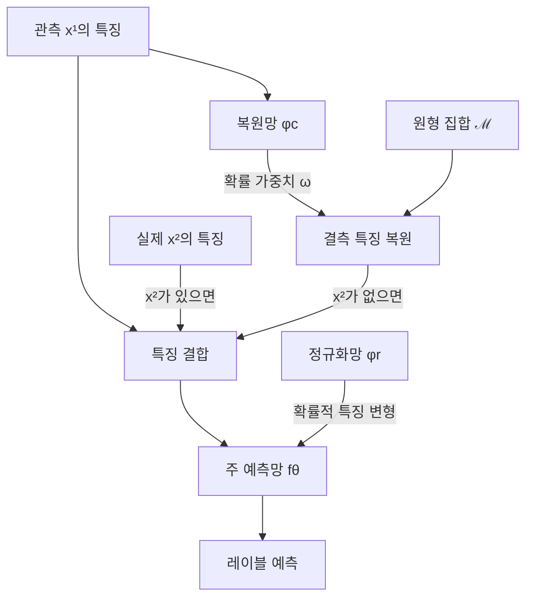

# SMIL: Multimodal Learning with Severely Missing Modality

**핵심 판단:** SMIL의 중요한 기여는 **소수의 완전한 모달리티 표본을 이용해, 불완전한 표본에서 이루어지는 학습을 교정한다는 설계**입니다.  
제시된 실험은 이 접근법의 유용성을 뒷받침하지만, 완전한 데이터로 학습한 모델과의 동등한 성능이나 새로운 도메인에서의 일반화까지 입증하지는 않습니다. [SMIL, pp.3–7, 식 (4), Tables 1–3, Figure 4]

---

## 1. Executive summary — 10문장

1. SMIL은 학습 표본의 상당수에서 특정 모달리티가 없는 상황, 특히 주요 실험에서 텍스트의 90%가 결측인 상황에서도 멀티모달 모델을 학습하는 문제를 다룹니다. [p.1; p.5]
2. 연구 목표는 학습과 테스트의 모달리티 결측을 같은 구조로 처리하는 유연성과, 소수의 완전한 표본을 효과적으로 활용하는 데이터 효율성을 확보하는 것입니다. [pp.1–3, Figure 1]
3. 제안 모델은 관측된 모달리티를 이용해, 완전한 학습 표본에서 얻은 대표 특징들의 확률적 가중합으로 결측 모달리티의 특징을 근사합니다. [p.3, 식 (2)]
4. 별도의 네트워크는 특징에 가할 확률적 변형을 학습하여, 부정확한 복원 특징 때문에 예측 모델이 과도하게 편향되는 문제를 줄이도록 설계됩니다. [pp.3–4, 식 (3)]
5. 두 보조 네트워크와 주 예측 모델은 불완전 표본에서 안쪽 학습을 수행하고 완전 표본에서 그 결과를 평가하는 메타학습 구조로 함께 최적화됩니다. [p.4, 식 (4), Algorithm 1]
6. 실험에는 MM-IMDb, CMU-MOSI, avMNIST가 사용되며, 모두 이미지 모달리티가 유지되고 다른 한 모달리티가 부족한 조건을 중심으로 평가합니다. [pp.4–7]
7. CMU-MOSI의 텍스트 보유율 10% 조건에서 SMIL의 정확도는 60.7%로, GAN의 56.5%보다 **4.2%p 높습니다**. [p.5, Table 1; 차이는 재계산]
8. MM-IMDb의 텍스트 보유율 20% 조건에서는 SMIL의 F1 Micro가 54.6으로, GAN의 51.0보다 **3.6점 높습니다**. [p.5, Table 2; 차이는 재계산]
9. 구성요소 제거 실험에서는 원형 기반 복원, 학습된 특징 정규화, 확률적 구성을 포함한 전체 모델이 비교 변형들보다 높은 점수를 기록합니다. [p.7, Table 3]
10. 다만 완전 데이터 기준 모델과의 성능 차이, 제한된 결측 패턴, 통계적 보고 부족, 일부 수식·그림 표기의 불명확성 때문에 결과를 보편적인 일반화 성능 향상으로 확대해서 해석할 수는 없습니다. [pp.4–7, Tables 1–3, Figures 4–5]

> **용어 설명**
>
> - **모달리티:** 이미지·텍스트·음성처럼 서로 다른 형태의 정보.
> - **특징:** 신경망이 입력을 처리해 만든 수치 표현.
> - **메타학습:** 한 데이터에서 학습한 결과가 다른 데이터에서도 잘 작동하도록 학습 방식 자체를 조정하는 방법.
> - **%p:** 두 백분율의 절대 차이로, 60.7%와 56.5%의 차이는 4.2%p.

---

## 2. 연구 배경, 목적과 필요성

### 2.1 해결하려는 문제

**저자 보고:** 기존 멀티모달 학습은 이미지와 텍스트처럼 서로 대응하는 여러 모달리티가 학습 데이터에 모두 존재한다고 가정하는 경우가 많습니다. 하지만 개인정보 보호, 수집 비용, 장비 접근성 등의 이유로 일부 모달리티를 확보하기 어려울 수 있습니다. 저자는 카메라 영상과 LiDAR 데이터의 수집 비용 차이 등을 동기로 제시합니다. [p.1]

이 논문이 강조하는 문제는 **테스트에서만 입력이 사라지는 경우뿐 아니라, 학습 단계부터 완전한 모달리티 쌍이 부족한 경우**입니다. 완전한 표본이 적으면 결측 특징을 복원하는 모델 자체도 충분히 학습하기 어렵습니다. [pp.1–3]

> **용어 설명 — 완전한 모달리티 쌍:** 동일한 대상에 대한 이미지와 텍스트가 함께 있는 표본처럼, 필요한 입력들이 모두 대응되어 존재하는 데이터.

### 2.2 연구 목적

| 목적 | 저자가 의미하는 바 | 근거 |
|---|---|---|
| **유연성** | 학습 시 결측, 테스트 시 결측, 양쪽 모두 결측인 상황을 같은 모델 구조로 처리 | pp.1–3, Figures 1–2 |
| **효율성** | 완전한 모달리티 표본이 적어도 불완전 표본을 함께 활용해 좋은 예측 성능을 학습 | pp.1–3; Tables 1–2 |
| **복원 편향 완화** | 적은 완전 표본으로 학습한 복원 특징의 오류가 주 모델에 미치는 영향을 줄임 | p.3 |
| **일반화 개선** | 학습된 확률적 특징 변형으로 불완전 데이터에 대한 예측을 더 안정적으로 만듦 | pp.3–4; Table 3 |

**분석:** 실험으로 가장 명확하게 뒷받침되는 효율성은 **데이터 효율성**입니다. 학습 시간, 메모리, 연산량을 동일 조건에서 비교한 결과가 없으므로 “계산 비용도 더 낮다”고 결론 내리기는 어렵습니다. [pp.5–7]

> **용어 설명**
>
> - **일반화:** 학습에 사용하지 않은 표본에서도 잘 예측하는 능력.
> - **복원 편향:** 결측 정보를 추정할 때 특정 방향으로 일관되게 생기는 오류.
> - **데이터 효율성:** 적은 관측 데이터로도 유용한 성능을 얻는 정도.

---

## 3. 방법론: 데이터, 모델 구조와 수식

### 3.1 문제의 수학적 설정

저자는 두 모달리티를 가진 학습 데이터를 다음과 같이 구분합니다. [p.2]

$$
\mathcal D=\{\mathcal D^f,\mathcal D^m\},
\qquad
\mathcal D^f=\{(x_i^1,x_i^2,y_i)\}_i,
\qquad
\mathcal D^m=\{(x_j^1,y_j)\}_j.
$$

**기호 설명**

- $\mathcal D$: 전체 학습 데이터.
- $\mathcal D^f$: 두 모달리티가 모두 존재하는 학습 부분집합.
- $\mathcal D^m$: 두 번째 모달리티가 없는 학습 부분집합.
- $x^1$: 관측 가능한 첫 번째 모달리티.
- $x^2$: 일부 표본에서 결측인 두 번째 모달리티.
- $y$: 정답 레이블.
- $i,j$: 각각 완전 표본과 불완전 표본의 인덱스.

실험의 텍스트 보유율을, 원문의 다른 기호와 혼동하지 않도록 다시 쓰면 다음과 같습니다. [p.5의 정의를 재표기]

$$
\eta=\frac{n_{\text{text available}}}{n_{\text{all samples}}}.
$$

여기서 $n_{\text{text available}}$은 텍스트가 있는 표본 수이고, $n_{\text{all samples}}$은 전체 표본 수입니다. 따라서 **$\eta=0.1$은 텍스트 10% 보유, 90% 결측**을 뜻합니다.

**범위에 대한 주의:** 이 설정에서는 $x^1$이 유지됩니다. 어떤 표본에서는 이미지만, 다른 표본에서는 텍스트만 남는 일반적인 혼합 결측 조건까지 동일하게 검증한 것은 아닙니다. [pp.2, 5–7]

### 3.2 모델의 세 구성요소

| 구성요소 | 기호 | 역할 |
|---|---|---|
| 주 예측 네트워크 | $f_\theta$ | 두 모달리티의 특징을 결합하여 레이블 예측 |
| 결측 특징 복원 네트워크 | $f_{\phi_c}$ | 관측 입력을 이용해 원형 조합의 가중치 분포를 예측 |
| 특징 정규화 네트워크 | $f_{\phi_r}$ | 입력 특징에 따라 확률적 변형의 분포를 예측 |

**근거:** p.3, Figure 2.

복원 대상은 원본 텍스트나 이미지 자체보다 **잠재 특징 공간의 표현**입니다. 두 번째 모달리티가 있으면 실제 특징을 사용하고, 없으면 복원한 특징을 사용합니다. [p.3, Figure 2]

> **용어 설명**
>
> - **잠재 특징·임베딩:** 원본 데이터를 신경망 내부의 벡터로 표현한 것.
> - **원형, prototype:** 여러 표본을 대표하는 특징 벡터.
> - **정규화, regularization:** 모델이 학습 데이터의 세부에 과도하게 맞추는 것을 줄이기 위한 장치.

아래는 Figure 2의 데이터 흐름을 설명용으로 단순화한 것입니다.



정규화는 여러 층의 특징에 적용됩니다. 또한 원문의 Figure 2에서는 정규화 네트워크가 테스트 구조에도 남아 있으므로, 이를 “학습에서만 사용하고 테스트에서는 제거한다”고 설명할 근거는 없습니다. [pp.3–4, Figure 2, 식 (3)]

---

### 3.3 결측 모달리티 복원: 식 (1)–(2)

#### 식 (1): 복원 네트워크의 목적

다음은 **인쇄된 원문 표기를 유지한 식**입니다. [p.3]

```math
\phi_c^\ast
=
\underset{\phi_c}{\text{arg min}}\;
\mathbb E_{p(\hat{x}^{1},x^{2})}
\left[
-\log p(\hat{x}^{2}\mid x^{1};\phi_c)
\right].
```

**기호 설명**

- $\phi_c$: 복원 네트워크의 학습 파라미터.
- $\phi_c^\ast$: 목적함수를 최소화하는 파라미터.
- $\hat{x}^2$: 복원된 두 번째 모달리티 특징.
- $p(\hat{x}^{2}\mid x^{1};\phi_c)$: 첫 번째 모달리티에 조건부인 복원 분포.
- $\mathbb E$: 분포에 대해 평균을 계산하는 기대값.
- $-\log p$: 음의 로그우도이며, 작은 값일수록 해당 결과를 높은 확률로 설명한다는 의미.

**확인된 불명확성:** 기대값 아래의 $\hat{x}^{1}$은 해당 절에서 정의되지 않습니다. 문맥상 오기일 가능성은 있지만, 이를 $x^1$로 임의 수정해 저자의 의도라고 확정할 수는 없습니다.

> **용어 설명 — 조건부 분포:** 어떤 정보를 알고 있을 때 다른 값이 어떻게 나타날지를 나타내는 확률분포.

#### 식 (2): 원형들의 확률적 가중합

SMIL은 결측 특징을 처음부터 직접 생성하는 대신, 완전한 표본에서 얻은 대표 특징들을 조합합니다. [p.3]

```math
\hat{x}^{2}
=
\langle\omega,\mathcal M\rangle,
\qquad
\omega\sim\mathcal N(I,\sigma),
\qquad
\sigma=f_{\phi_c}(x^{1}).
```

**기호 설명**

- $\mathcal M$: 완전 모달리티 표본에서 얻은 대표 특징 집합.
- $\omega$: 대표 특징 각각에 부여하는 확률적 가중치.
- $\langle\omega,\mathcal M\rangle$: 대표 특징의 가중합.
- $\mathcal N$: 다변량 정규분포.
- $I$: 원문이 고정 평균으로 사용하는 기호.
- $\sigma$: 복원 네트워크가 예측하는 분산 관련 값으로, 원문은 이를 “variances”라고 설명.
- $f_{\phi_c}(x^1)$: 관측 입력으로부터 분산을 예측하는 복원망.

원형이 $C$개이고 각각 $m_c$라면, 가중합의 의미는 다음처럼 풀어 쓸 수 있습니다.

$$
\hat{x}^{2}=\sum_{c=1}^{C}\omega_c m_c.
$$

여기서 $C$는 원형 개수, $m_c$는 $c$번째 원형, $\omega_c$는 그 원형에 적용하는 가중치입니다. 이 식은 **식 (2)의 설명용 전개**입니다.

저자는 원형을 얻는 방법으로 **K-means 또는 PCA**를 제시하고, 구성요소 제거 실험에서는 K-means 기반 설계를 평가합니다. [pp.3, 7, Table 3]

> **용어 설명**
>
> - **K-means:** 비슷한 특징들을 여러 묶음으로 나누고 각 묶음의 중심을 찾는 방법.
> - **PCA:** 데이터의 변동을 잘 설명하는 소수의 축으로 특징을 요약하는 방법.
> - **가우시안·정규분포:** 평균 주변에 값이 모이고, 분산이 퍼짐의 정도를 나타내는 확률분포.
> - 여기서 **modality prior**는 대표 특징 집합이며, 뒤의 확률적 사전분포 $p(z)$와는 구분됩니다.

**정확한 이해를 위한 주의점**

- 복원 가중치의 **평균은 고정이고 분산이 입력에 따라 달라집니다**.
- 원문에는 가중치가 양수이거나 합이 1이어야 한다는 제약이 없습니다.
- $I$의 정확한 차원·정의와 $\sigma$의 공분산 표현 방식은 본문만으로 충분히 명확하지 않습니다.

**분석:** 고차원 특징 전체를 직접 생성하는 대신 대표 특징의 조합을 학습한다는 점에서, 제한된 완전 표본으로 풀어야 할 문제를 단순화하는 설계로 이해할 수 있습니다. 다만 파라미터 수나 계산량 감소를 정량적으로 입증한 결과는 없습니다. [p.3; p.7, Table 3]

---

### 3.4 불확실성에 따른 특징 정규화: 식 (3)

정규화 네트워크는 이전 층의 특징을 받아 현재 층에 가할 확률적 변형의 분포를 예측합니다. [pp.3–4]

$$
h^{l}
\leftarrow
h^{l}\circ\text{Softplus}(r),
\qquad
r\sim\mathcal N(\mu,\sigma),
\qquad
(\mu,\sigma)=f_{\phi_r}(h^{l-1}).
$$

**기호 설명**

- $h^l$: $l$번째 층의 특징.
- $h^{l-1}$: 이전 층의 특징.
- $r$: 특징에 적용하는 확률적 변형.
- $\mu,\sigma$: 정규화 네트워크가 예측하는 평균과 분산 관련 값.
- $\phi_r$: 정규화 네트워크 파라미터.
- $\circ$: 원문에서 지정한 덧셈 또는 곱셈 연산.
- $\text{Softplus}$: 부드럽게 양의 값을 만드는 활성화 함수.

Softplus의 표준 정의는 다음과 같습니다.

$$
\text{Softplus}(t)=\log(1+\exp(t)).
$$

$t$는 함수에 입력되는 실수이며, 벡터에는 원소별로 적용할 수 있습니다.

**저자 보고:** 특징에 직접 정규화를 적용하면 정규화 네트워크가 수렴하지 않는 현상이 관찰되어 Softplus를 사용했다고 설명합니다. [p.4]

**분석:** 이 설계는 모든 표본에 같은 잡음을 넣는 대신, 입력 특징에 맞는 변형을 학습한다는 의미가 있습니다. 그러나 Softplus가 모든 입력에서 변형의 크기를 줄여 준다는 수학적 보장이 있는 것은 아니며, 예측된 분산이 실제 오류 확률을 정확히 나타내는지도 별도 검증되지 않았습니다. [식 (3); Table 3]

> **용어 설명**
>
> - **특징 교란:** 특징에 변형을 가해 모델이 특정 표현에 지나치게 의존하지 않도록 학습하는 방법.
> - **수렴:** 반복 학습 중 목적함수나 파라미터가 안정되는 상태.
> - **불확실성 보정:** 모델이 표시한 자신감과 실제 정답률이 얼마나 잘 맞는지 확인하는 것.

---

### 3.5 메타학습의 핵심: 식 (4)

두 보조 네트워크의 파라미터를 $\psi=\{\phi_c,\phi_r\}$로 묶으면, 메타학습 목적은 다음과 같습니다. [p.4]

```math
\begin{aligned}
\min_{\theta,\psi}\quad&
\mathcal L(\mathcal D^f;\theta^\ast,\psi),\\
\text{where}\quad&
\theta^\ast
=
\theta-\alpha\nabla_\theta
\mathcal L(\mathcal D^m;\psi).
\end{aligned}
```

**기호 설명**

- $\theta$: 주 예측망의 파라미터.
- $\psi$: 복원망과 정규화망의 파라미터.
- $\theta^\ast$: 불완전 표본으로 안쪽 학습을 수행한 후의 파라미터.
- $\mathcal L$: 교차엔트로피 등 예측 손실.
- $\mathcal D^m$: 안쪽 학습에 사용하는 불완전 학습 표본.
- $\mathcal D^f$: 바깥쪽 평가에 사용하는 완전 학습 표본.
- $\alpha$: 안쪽 학습률.
- $\nabla_\theta$: $\theta$에 대한 기울기.

원문은 안쪽 손실에서 $\theta$ 의존성을 생략한 채 $\mathcal L(\mathcal D^m;\psi)$로 표기합니다. Algorithm 1을 보면 실제로는 주 모델 파라미터에 대해 미분하여 업데이트하는 절차입니다.

**핵심 의미:** 불완전 데이터로 학습했을 때 얻은 모델이 완전 데이터에서도 잘 예측하도록, 복원 방식과 특징 변형 방식까지 조정합니다.

> **용어 설명**
>
> - **손실:** 예측이 정답에서 얼마나 벗어났는지를 나타내는 값.
> - **기울기:** 파라미터를 어느 방향으로 바꾸면 손실이 변하는지를 나타내는 정보.
> - **안쪽·바깥쪽 학습:** 먼저 모델을 학습하고, 그 학습 결과를 평가하여 원래 모델과 보조 모델을 다시 조정하는 두 단계.

**중요한 구분:** 여기서 *meta-test*는 최종 성능 평가용 테스트셋을 뜻하지 않습니다. **학습 데이터 안의 완전 표본**으로 바깥쪽 학습 신호를 만드는 단계입니다. [p.4, Algorithm 1]

**분석:** 이 목적은 복원 특징과 실제 특징 사이의 거리를 직접 최소화하는 방식과 다릅니다. 원문에는 별도의 명시적인 특징 거리 손실이 제시되지 않으며, 완전 표본의 예측 손실을 통해 좋은 복원과 정규화를 간접적으로 유도합니다. [식 (4), Algorithm 1]

---

### 3.6 베이지안 구성과 변분 목적: 식 (5)–(7)

#### 식 (5): 완전·불완전 표본의 결합 가능도

```math
p(Y,z\mid X;\theta)
=
p(z)
\prod_{i=1}^{N}
p(y_i\mid x_i^1,x_i^2,z;\theta)
\prod_{j=1}^{M}
p(y_j\mid x_j^1,z;\theta).
```

**기호 설명**

- $X,Y$: 전체 학습 입력과 레이블.
- $z=\{\omega,r\}$: 복원 가중치와 특징 변형을 묶은 잠재 확률변수.
- $p(z)$: 잠재변수의 사전분포.
- $N,M$: 이 식에서 각각 완전 표본과 불완전 표본의 개수.
- 첫 번째 곱: 완전 표본들의 레이블 가능도.
- 두 번째 곱: 불완전 표본들의 레이블 가능도.
- $\theta$: 주 예측망의 파라미터.

원문은 뒤의 실험 절에서 $N,M$을 다른 의미로 재사용하므로, 식 (5)의 개수를 텍스트 보유율 정의에 그대로 대입하면 안 됩니다. [pp.4–5]

> **용어 설명**
>
> - **사전분포:** 관측 정보를 반영하기 전에 확률변수에 부여하는 분포.
> - **사후분포:** 관측 정보를 반영한 후의 분포.
> - **잠재변수:** 직접 관측되지 않지만 모델 내부에서 도입하는 변수.

#### 식 (6): 근사 분포를 이용한 목적함수

저자는 계산하기 어려운 분포를 신경망으로 표현한 근사 분포 $q$로 다루며, 다음 값을 최대화한다고 제안합니다. [p.4]

$$
\begin{aligned}
\mathcal L_{\theta,\psi}
={}&
\mathbb E_{q(z\mid X;\theta,\psi)}
\left[
\log p(Y\mid X,z;\theta)
\right]\\
&-
\text{KL}
\left[
q(z\mid X;\psi)\,\|\,p(z\mid X)
\right].
\end{aligned}
$$

**기호 설명**

- $q(z\mid X;\theta,\psi)$: 학습하는 근사 분포.
- $\mathbb E_q$: 해당 분포에서 평균을 계산하는 연산.
- $\log p(Y\mid X,z;\theta)$: 잠재변수와 입력을 이용한 레이블 로그가능도.
- $\text{KL}[q\|p]$: 두 확률분포의 차이를 나타내는 KL 발산.
- $\mathcal L_{\theta,\psi}$: 저자가 근사 하한으로 제시한 목적.
- $p(z\mid X)$: 원문에서 추론 대상으로 설명하는 분포.
- $\theta,\psi$: 각각 주 모델과 보조 모델의 파라미터.

> **용어 설명**
>
> - **변분 추론:** 계산하기 어려운 분포를 다루기 쉬운 분포로 근사하는 방법.
> - **KL 발산:** 두 분포가 얼마나 다른지를 측정하는 양으로, 두 분포의 순서를 바꾸면 값이 달라질 수 있음.
> - **하한:** 어떤 값보다 작거나 같은 값으로, 직접 계산하기 어려운 목적 대신 최적화에 활용할 수 있음.

#### 식 (7): 무작위 표본 평균으로 계산하는 목적

$$
\begin{aligned}
\min_{\theta,\psi}\quad&
\frac{1}{L}\sum_{\ell=1}^{L}
-\log p(y_j\mid x_j^1,x_j^2,z_\ell;\theta)\\
&+
\text{KL}
\left[
q(z\mid X;\psi)\,\|\,p(z\mid X)
\right],\\
&z_\ell\sim q(z\mid X;\psi).
\end{aligned}
$$

**기호 설명**

- $L$: 무작위로 뽑는 표본의 개수.
- $z_\ell$: 근사 분포에서 뽑은 $\ell$번째 잠재변수 표본.
- $x_j^1,x_j^2,y_j$: 해당 항의 입력과 레이블.
- $\theta,\psi$: 주 모델 및 보조 모델 파라미터.
- 첫 항: 표본 평균으로 근사한 음의 로그가능도.
- 둘째 항: 근사 분포와 기준 분포의 차이에 대한 항.

> **용어 설명 — Monte Carlo 근사:** 모든 가능한 값을 적분하는 대신, 무작위 표본을 여러 번 뽑아 평균으로 계산하는 방법.

**수식 해석의 한계**

다음 부분은 첨부 본문만으로 확정하기 어렵습니다. [p.4, 식 (5)–(7), Algorithm 1]

| 항목 | 불명확한 점 |
|---|---|
| 사전·조건부 분포 | 식 (5)는 $p(z)$를 사용하지만 식 (6)–(7)의 KL 기준은 $p(z\mid X)$로 바뀜 |
| 근사 분포의 의존성 | 식 (6)의 기대값에서는 $q$에 $\theta,\psi$가 모두 있으나 KL 항에는 $\psi$만 표시 |
| 결측 입력 표기 | 앞에서 불완전 표본을 나타내던 $j$에 대해 식 (7)에는 $x_j^2$가 등장하지만 복원값인지 명시되지 않음 |
| 목적과 알고리즘 | 식 (7)의 KL 항이 Algorithm 1의 업데이트 식에는 표시되지 않음 |
| 실행 설정 | 실제 표본 수 $L$, 안쪽 반복 수 $K$, 테스트 시 표본 평균 방식 등이 본문에 충분히 명세되지 않음 |

이 때문에 “모든 세부가 명확하게 명세된 베이지안 추론 절차”라고 평가하기는 어렵습니다. 또한 확률적으로 모델링하는 핵심 대상은 $\omega,r$이므로, **주 모델의 모든 가중치 $\theta$에 대한 사후분포를 학습한다고 설명하면 부정확합니다**.

### 3.7 Algorithm 1의 학습 흐름

원문 알고리즘을 절차로 풀면 다음과 같습니다. [p.4]

1. 불완전 학습 표본과 완전 학습 표본을 각각 뽑습니다.
2. 현재 주 모델을 $\theta_0=\theta$로 복사합니다.
3. 복원·정규화 관련 확률변수를 뽑고, 불완전 표본의 예측 손실로 주 모델을 $K$회 업데이트합니다.
4. 업데이트된 모델 $\theta^\ast=\theta_K$를 완전 표본에서 평가합니다.
5. 완전 표본의 손실을 이용하여 원래의 $\theta$와 보조 파라미터 $\psi$를 학습률 $\beta$로 업데이트합니다.

여기서 $K$는 안쪽 업데이트 횟수, $\beta$는 바깥쪽 학습률입니다. 실제 구현이 안쪽 업데이트를 통한 전체 미분을 사용하는지, 계산을 줄이는 근사를 사용하는지는 본문만으로 확정할 수 없습니다.

---

## 4. 실험은 어떻게 수행되었는가?

### 4.1 주요 데이터 소스와 평가 조건

| 데이터셋 | 데이터와 과제 | 사용 모달리티·결측 조건 | 분할과 지표 | 근거 |
|---|---|---|---|---|
| **MM-IMDb** | 원문 기준 영화 25,956편, 장르 23개, 다중 레이블 분류 | 이미지 유지, 텍스트 10% 또는 20% 보유 | 기존 연구의 분할 사용; F1 Samples, F1 Micro | pp.4–6, Table 2 |
| **CMU-MOSI** | 의견 영상 클립 2,199개, 긍정·부정 분류 | 원 데이터는 영상·텍스트·음성이지만 본 실험은 **영상과 텍스트만 사용**; 텍스트 10%·20% 보유 | 학습 1,284 / 검증 229 / 테스트 686; 정확도, F1 | pp.4–5, Table 1 |
| **avMNIST** | 숫자 이미지와 음성 1,500쌍, 숫자 분류 | 이미지 유지; 학습 음성 5·10·15·20%; 테스트는 이미지 단독 또는 이미지+음성 | 무작위 70% 학습, 30% 검증; 정확도 | pp.5–7, Figure 4 |

> **용어 설명**
>
> - **다중 레이블 분류:** 한 영화가 드라마이면서 로맨스일 수 있듯, 하나의 표본에 여러 정답을 부여하는 과제.
> - **F1:** 정밀도와 재현율을 함께 반영하는 지표.
> - **F1 Samples:** 표본별 F1을 구한 뒤 평균.
> - **F1 Micro:** 전체 표본·레이블의 정답 및 오류 개수를 합쳐 F1 계산.

**설정상 주의:** Table 1–2는 학습 데이터의 텍스트 보유율을 설명하지만, 각 표의 **테스트 입력 결측 패턴은 avMNIST처럼 명확하게 구분하여 제시하지 않습니다**. 따라서 두 표를 임의로 “이미지 단독 테스트 결과” 또는 “완전 모달리티 테스트 결과”라고 확정하지 않았습니다. [pp.5–7]

### 4.2 네트워크와 학습 설정

| 데이터셋 | 특징 추출·융합 구조 | 학습 설정 |
|---|---|---|
| CMU-MOSI | 영상: 차원 16의 FC 3층; 텍스트: LSTM 1층; 특징 연결 후 FC 분류 | Adam, 배치 32, 5,000회; 안쪽·바깥쪽 학습률 $10^{-4}$ |
| MM-IMDb | 기존 특징 추출기의 출력을 FC로 정렬한 뒤 결합·분류 | Adam, 배치 128, 10,000회; 안쪽 $10^{-4}$, 바깥쪽 $10^{-3}$; 양성 레이블 가중치 2.0 |
| avMNIST | 이미지 LeNet-5, 음성 수정 LeNet-5; 특징 연결 후 FC 분류 | Adam, 배치 64, 15,000회; 안쪽·바깥쪽 $10^{-3}$ |

**근거:** pp.5–6.

> **용어 설명**
>
> - **FC:** 입력 특징을 다음 층의 모든 출력과 연결하는 완전연결층.
> - **LSTM:** 순서가 있는 데이터에서 앞선 정보를 유지하도록 설계한 순환 신경망.
> - **Adam:** 기울기 정보를 이용해 학습률을 조정하는 최적화 방법.
> - **배치:** 한 번의 업데이트에 사용하는 표본 묶음.

---

## 5. 핵심 주장과 근거

| 핵심 주장 | 저자가 제시한 근거 | 분석 및 적용 범위 | 위치 |
|---|---|---|---|
| 심각한 학습 결측에서도 유용한 모델을 학습할 수 있음 | 텍스트 10%·20% 조건에서 AE·GAN보다 높은 점수 | 해당 데이터셋·결측 조건에서 지지됨 | p.5, Tables 1–2 |
| 원형 조합이 직접 특징 생성보다 유리함 | K-means를 제거한 변형보다 전체 모델이 높음 | 원형 설계의 유용성을 지지하나 모든 복원 방법에 대한 우월성 증명은 아님 | p.7, Table 3 |
| 학습된 특징 정규화가 필요함 | 정규화 제거 시 성능 하락 | 전체 구성에서 정규화가 기여한다는 근거 | p.7, Table 3 |
| 확률적 설계가 도움이 됨 | 결정론적 변형·고정 Gaussian보다 전체 모델이 높음 | 실제 불확실성의 정확한 보정 여부까지 입증하지는 않음 | p.7, Table 3 |
| 테스트 모달리티가 달라도 대응 가능 | avMNIST에서 단일·완전 모달리티 테스트 비교 | 하나의 소규모 데이터셋과 특정 제거 방향에서 확인 | pp.6–7, Figure 4 |
| 표현의 구분이 개선됨 | 세 장르의 t-SNE 시각화 | 정성적 보조 근거이며 일반화 성능의 증명은 아님 | pp.6–7, Figure 5 |
| 완전 데이터 모델에 가까워짐 | Upper-Bound와 결과 비교 | 성능 간격이 남으므로 동등한 성능 달성으로 해석할 수 없음 | p.5, Tables 1–2 |

> **용어 설명**
>
> - **AE, Autoencoder:** 입력 정보를 압축하고 복원하도록 학습하는 모델.
> - **GAN:** 생성기와 판별기를 경쟁적으로 학습하는 생성 모델.
> - **결정론적 모델:** 같은 입력에 대해 확률 표본 추출 없이 정해진 출력을 내는 모델.
> - **구성요소 제거 실험, ablation:** 모델 일부를 제거하거나 바꾸어 해당 요소의 기여를 확인하는 실험.

---

## 6. 주요 결과와 정확한 수치 해석

### 6.1 CMU-MOSI — Table 1

아래 F1은 원문과 같이 0–100 척도로 표시했습니다.

| 방법 | 학습 텍스트 보유율 | 정확도(%) | F1 |
|---|---:|---:|---:|
| Lower-Bound | 이미지 단독 | 44.8 | 27.7 |
| Upper-Bound | 100% | 71.0 | 70.5 |
| MVAE | 100% | 58.5 | 58.1 |
| AE | 10% | 56.4 | 54.4 |
| GAN | 10% | 56.5 | 54.6 |
| **SMIL** | **10%** | **60.7** | **58.0** |
| AE | 20% | 60.4 | 59.0 |
| GAN | 20% | 60.6 | 59.1 |
| **SMIL** | **20%** | **63.3** | **62.5** |

**출처:** p.5, Table 1.

> **용어 설명 — MVAE:** 여러 모달리티의 확률적 표현을 학습하는 Multimodal Variational Autoencoder. 이 논문에서는 학습한 표현을 고정하고 선형 분류기를 학습하여 평가합니다.  
> **주의:** Upper-Bound와 Lower-Bound는 비교모델의 명칭이며, 수학적으로 증명된 성능 상·하한이 아닙니다.

**재계산**

- 텍스트 10%: SMIL은 GAN보다 정확도 **4.2%p**, F1 **3.4점** 높습니다.
- 텍스트 20%: SMIL은 GAN보다 정확도 **2.7%p**, F1 **3.4점** 높습니다.
- Upper-Bound와의 정확도 차이는 각각 **10.3%p**, **7.7%p**입니다.

저자가 10% 조건에서 GAN 대비 “7.4% 개선”이라고 표현한 값은 다음 **상대 개선율**과 일치합니다. [p.6]

$$
\frac{60.7-56.5}{56.5}\times100
\approx7.43\%.
$$

분자는 정확도 차이, 분모는 GAN의 정확도입니다. 따라서 이를 **7.4%p 개선으로 옮기면 잘못된 해석**입니다.

또한 텍스트 10%의 SMIL F1은 58.0이고, 텍스트 100%의 MVAE F1은 58.1입니다. 학습 조건도 다르므로, “SMIL이 모든 지표에서 모든 비교모델을 이겼다”는 표현은 적절하지 않습니다.

### 6.2 MM-IMDb — Table 2

| 방법 | 학습 텍스트 보유율 | F1 Samples | F1 Micro |
|---|---:|---:|---:|
| Lower-Bound | 이미지 단독 | 47.6 | 48.2 |
| Upper-Bound | 100% | 61.7 | 62.0 |
| MVAE | 100% | 48.4 | 48.6 |
| AE | 10% | 44.5 | 44.8 |
| GAN | 10% | 45.0 | 44.6 |
| **SMIL** | **10%** | **49.2** | **49.5** |
| AE | 20% | 50.9 | 50.7 |
| GAN | 20% | 51.1 | 51.0 |
| **SMIL** | **20%** | **54.1** | **54.6** |

**출처:** p.5, Table 2.

**재계산 및 분석**

- 10% 조건에서 SMIL의 F1 Micro는 가장 좋은 생성형 기준모델인 AE보다 **4.7점** 높습니다.
- 그러나 이미지 단독 모델 대비 이득은 **1.3점**입니다.
- 20% 조건에서는 이미지 단독 모델보다 F1 Micro가 **6.4점** 높습니다.
- 20%에서도 Upper-Bound와는 F1 Samples **7.6점**, F1 Micro **7.4점**의 차이가 있습니다.

특히 10% 조건에서는 AE·GAN이 이미지 단독 모델보다 낮습니다. 이는 **추가로 만든 결측 특징이 항상 도움이 되는 것은 아니다**라는 문제의식을 뒷받침합니다. 다만 이 표만으로 성능 저하의 원인이 복원 편향 하나라고 확정할 수는 없습니다. [Table 2; pp.3, 7]

### 6.3 구성요소 제거 — Table 3

Table 3은 앞의 Table 2와 달리 **0–1 척도**입니다. 예를 들어 0.541은 앞 표의 54.1과 같습니다.

| 변형 | Samples 10% | Samples 20% | Micro 10% | Micro 20% |
|---|---:|---:|---:|---:|
| K-means 제거 | 0.482 | 0.535 | 0.485 | 0.530 |
| 특징 정규화 제거 | 0.469 | 0.521 | 0.472 | 0.530 |
| 정규화 분포를 고정 Gaussian으로 변경 | 0.475 | 0.495 | 0.479 | 0.502 |
| 결정론적 구성 | 0.474 | 0.527 | 0.477 | 0.533 |
| **전체 SMIL** | **0.492** | **0.541** | **0.495** | **0.546** |

**출처:** p.7, Table 3.

**저자 보고:** 모든 비교 변형보다 전체 모델의 점수가 높으며, 이를 복원·정규화·베이지안 구성의 유효성으로 해석합니다.

**분석:** 특히 텍스트 20%에서 학습된 정규화 분포를 고정 Gaussian으로 바꾸면 F1 Samples가 **0.541에서 0.495로 감소**합니다. 이는 입력에 적응하는 정규화의 중요성을 시사하지만, “베이지안 방법이 일반적으로 우월하다”는 결론까지 뒷받침하지는 않습니다. 고정 분포 비교에서는 확률성뿐 아니라 **분포를 학습하는 능력**도 달라지기 때문입니다.

---

## 7. 가장 중요한 그림 선정과 해석

### 7.1 Figure 2 — 모델을 이해하는 핵심 그림

**위치:** p.3.

**저자 보고:** 학습, 단일 모달리티 테스트, 완전 모달리티 테스트를 하나의 구조 안에서 설명합니다.

**해석:** 중요한 부분은 복원 네트워크의 사용 여부입니다. 두 번째 모달리티가 없으면 복원 특징을 넣고, 있으면 실제 특징을 넣습니다. 이 그림은 SMIL이 서로 다른 테스트 상황마다 전혀 다른 모델을 만드는 방식이 아니라는 점을 보여 줍니다.

**한계:** 그림만으로는 샘플링 횟수, 원형 수, 테스트 시 평균 처리 등의 구현 세부를 알 수 없습니다.

### 7.2 Figure 4 — 결측 변화에 대한 가장 직접적인 실험

**위치:** p.6의 그림, p.7의 설명.

- **왼쪽:** 학습 음성 보유율을 5·10·15·20%로 바꾸고, 이미지 단독으로 평가.
- **오른쪽:** 본문에 따르면 학습 음성 보유율 20%에서 이미지와 음성을 모두 사용하여 평가.

**저자 보고:** 두 모달리티 테스트에서 이미지 단독 테스트로 바꾸었을 때, AE·GAN은 “5.6%”, SMIL은 “1.0%” 성능이 하락한다고 서술합니다. [p.7]

**분석:** 테스트에서 입력 모달리티가 달라져도 성능 하락을 줄일 수 있다는 근거입니다. 다만 정확한 원시값 표가 없고 본문의 `%`가 절대 차이인지 상대 변화율인지 명확하지 않으므로, 이를 임의로 `%p`로 바꾸지 않았습니다.

**통계적 주의:** 오른쪽 막대에는 **오차막대가 실제로 존재**합니다. 그러나 그것이 표준편차·표준오차·신뢰구간 중 무엇인지, 몇 회 반복한 결과인지는 본문에서 확인되지 않습니다.

### 7.3 Figure 3 — 평균 개선과 하위 집단의 손해

**위치:** p.6.

**저자 보고:** 텍스트 20%를 활용한 SMIL은 Sport, Film-Noir처럼 표본이 적은 장르에서 이미지 단독 모델보다 개선됩니다. 반면 **Family와 Animation에서는 성능이 감소**합니다.

저자는 두 장르의 중복이 공유 표현 학습을 유도해 구분을 어렵게 만들 수 있다고 설명하지만, 이는 원인을 확정한 실험 결과가 아니라 **저자의 추정**입니다.

**분석:** 일반화 성능을 평가할 때 전체 평균만 보면 일부 장르의 손해를 놓칠 수 있습니다. 이 그림은 추가 모달리티가 모든 집단에 균일하게 도움이 되지 않는다는 점을 보여 줍니다.

> **용어 설명 — 음의 전이:** 다른 정보나 과제를 함께 학습한 결과, 특정 과제·집단의 성능이 오히려 낮아지는 현상.

### 7.4 Figure 5 — 표현 공간의 정성적 근거

**위치:** p.7의 그림, p.6의 설명.

Sport, Film-Noir, Western의 특징을 t-SNE로 시각화했으며, SMIL에서 세 장르가 더 분리되는 모습을 제시합니다.

> **용어 설명 — t-SNE:** 고차원 특징을 2차원으로 줄여 주변 관계를 시각적으로 살펴보는 방법.

**중요한 표기 불일치:** 그림의 SMIL 조건은 **20% Text**, 이를 설명하는 본문은 **10% text modality**라고 되어 있습니다. 실제 사용 비율을 이 자료만으로 확정할 수 없습니다.

**분석:** 이 그림은 표현이 개선되었을 가능성을 보여 주는 보조 자료입니다. 시각적으로 군집이 분리된다는 사실만으로 고차원 표현의 품질, 완전 데이터 모델과의 동등성, 새로운 데이터에서의 일반화가 증명되지는 않습니다.

---

## 8. 통계적 취약점, 비교 불가능한 수치와 연구 한계

### 8.1 통계·비교상의 취약점

| 표시 | 항목 | 확인된 사실과 해석상의 제한 | 근거 |
|---|---|---|---|
| **통계 근거 부족** | 반복 실험 | Tables 1–3에 표준편차·신뢰구간·반복 횟수가 없음 | pp.5, 7 |
| **통계 근거 부족** | “significantly” 표현 | 검정 방법과 p값이 없어 통계적 유의성을 확인했다는 뜻으로 번역하기 어려움 | pp.6–7 |
| **정의 불명확** | Figure 4 오차막대 | 오차막대는 있으나 종류와 반복 횟수 미기재 | p.6 |
| **직접 비교 제한** | SMIL 대 MVAE | 학습 데이터 보유율이 다르고, MVAE는 표현을 고정한 선형 평가를 사용 | pp.5–6 |
| **원인 분리 제한** | SMIL 대 AE·GAN | AE·GAN은 복원 후 분류하는 단계식 절차이고 SMIL은 메타학습으로 결합 | pp.4–5 |
| **척도 주의** | Tables 2와 3 | 같은 F1을 각각 0–100과 0–1 척도로 표시 | pp.5, 7 |
| **평가 범위 제한** | avMNIST | 1,500쌍의 70% 학습·30% 검증이며 별도 테스트 분할은 명시되지 않음 | p.5 |
| **계산 효율 미검증** | 효율성 주장 | 시간·메모리·동일 연산 예산 비교가 없음 | pp.5–7 |
| **외부 일반화 미검증** | 실제 환경 변화 | 새로운 도메인·센서·기관에 대한 외부 검증 없음 | 실험 전체 |
| **이론 근거 제한** | “unbiased” 복원 | 통계적 불편성 증명이나 복원 편향이 0인지 확인한 검정 없음 | p.7 |

> **용어 설명**
>
> - **표준편차:** 반복 결과가 얼마나 퍼져 있는지 나타내는 값.
> - **신뢰구간:** 추정값의 불확실성을 일정한 절차로 나타낸 범위.
> - **통계적 유의성:** 관측된 차이가 우연한 변동만으로 설명되는지 검토한 결과.
> - **불편성:** 추정값의 평균이 목표값과 일치한다는 통계적 성질.

### 8.2 저자가 직접 언급한 한계와 분석자가 도출한 한계

**저자가 직접 보고한 부정적 관찰**

- Family·Animation에서 텍스트를 활용한 모델의 성능이 감소합니다. [p.6, Figure 3]
- 특징에 정규화를 직접 적용했을 때 정규화망이 수렴하지 않는 현상을 설명합니다. [p.4]

**저자가 별도의 한계 목록으로 정리하지 않은 사항**

첨부 논문에는 독립적인 *Limitations* 절이 없습니다. 따라서 다음은 **실험 범위에 대한 분석**으로 구분해야 합니다.

- 항상 관측되는 모달리티가 존재하는 두 모달리티 조건에 집중합니다.
- 세 개 이상의 모달리티와 임의의 결측 부분집합은 검증되지 않았습니다.
- 결측이 특정 클래스·사용자·환경에 집중되는 상황은 검증되지 않았습니다.
- 불확실성의 정확성, 외부 도메인 일반화, 재현에 필요한 일부 설정이 충분히 보고되지 않았습니다. [pp.2–7]

정보누수에 대해서도 신중해야 합니다. 원형이 완전한 학습 표본에서 만들어진다는 데이터 정의는 있으나 분할별 구축 세부가 충분하지 않습니다. **누수가 있었다고 주장할 근거도 없습니다.**

---

## 9. 일반화 성능 향상 가능성: 무엇이 지지되고 무엇이 남아 있는가?

### 9.1 일반화의 종류를 구분해야 합니다

| 일반화의 의미 | SMIL에서 확인된 근거 | 판단 |
|---|---|---|
| 같은 벤치마크의 보지 못한 표본에 대한 예측 | Tables 1–2의 평가 점수 | 해당 평가 조건에서 성능 개선 근거 |
| 테스트 입력 모달리티 변화에 대한 대응 | avMNIST Figure 4 | 특정 결측 전환에서 근거 존재 |
| 학습과 다른 광범위한 결측 패턴 | 제한된 조건만 평가 | 충분한 검증 없음 |
| 새로운 데이터셋·기관·장비·도메인 | 외부 검증 실험 없음 | 입증되지 않음 |
| 예측 불확실성의 신뢰성 | 확률적 구성의 제거 실험만 있음 | 보정 성능은 미검증 |

> **용어 설명 — 도메인 변화:** 학습 데이터와 평가 데이터의 환경·대상·수집 방식이 달라지는 것. 예를 들어 영화 포스터에서 학습한 모델을 다른 종류의 이미지에 적용하는 경우.

### 9.2 일반화 측면에서 유망한 설계

**첫째, 완전한 표본이 학습 방향을 교정합니다.**  
식 (4)는 불완전 데이터에서의 학습이 완전 데이터의 예측에 도움이 되도록 설계되어 있습니다. **분석상 가장 중요한 아이디어**는 완전 표본을 단순한 복원 정답으로 쓰는 것을 넘어, 학습 업데이트의 유용성을 판단하는 신호로 사용한다는 점입니다. [p.4]

**둘째, 원형을 사용해 복원 문제를 제한합니다.**  
대표 특징의 조합을 사용하면 적은 완전 표본에서 복원해야 하는 구조를 제한할 수 있습니다. Table 3은 이 설계의 유용성을 지지하지만, 얼마나 많은 원형이 적절한지와 새로운 분포에서도 유효한지는 답하지 않습니다. [pp.3, 7]

**셋째, 특징 변형을 입력에 맞게 학습합니다.**  
고정 Gaussian보다 학습된 정규화 분포가 좋은 결과를 보입니다. 이는 단순히 잡음을 추가하는 것보다 **어떤 변형이 예측에 도움이 되는지 학습하는 방식**이 유망하다는 근거입니다. [p.7, Table 3]

이 세 가지는 일반화를 개선하기 위한 타당한 설계 방향이지만, 원문에는 일반화 오류에 대한 이론적 상한이나 모든 결측 조건에서의 보장은 없습니다.

---

## 10. 문서가 답하지 않는 질문

다음 질문은 논문의 결과를 부정하기 위한 것이 아니라, 독립 재현과 후속 실험에 필요한 항목입니다.

1. **완전한 모달리티 쌍이 0개인 경우에도 학습할 수 있는가?**  
   원형 구축과 바깥쪽 학습에 완전 표본을 사용하는 구조가 제시되어 있습니다. [pp.3–4]

2. **항상 관측되는 모달리티가 없는 경우에는 어떻게 되는가?**  
   표본마다 서로 다른 모달리티가 누락되는 조건이 충분히 평가되지 않았습니다. [pp.5–7]

3. **원형 개수와 원형 갱신 방식은 무엇인가?**  
   K-means/PCA는 언급되지만 관련 설정과 민감도 분석이 부족합니다. [pp.3, 7]

4. **식 (1)의 복원 목적과 식 (4)·(7)의 예측 목적은 실제로 어떻게 결합되는가?**  
   최종 학습 절차와 각 목적의 적용 관계가 완전히 명세되어 있지 않습니다. [pp.3–4]

5. **KL 항은 알고리즘의 어느 단계에서 계산되는가?**  
   수식에는 있으나 Algorithm 1에는 표시되지 않습니다. [p.4]

6. **테스트 때 몇 번 샘플링하고 어떻게 예측을 평균하는가?**  
   정확도·추론 시간·실행 간 변동을 판단하는 데 필요한 정보입니다. [pp.3–4]

7. **복원 분산이 실제 복원 오류나 분류 오류와 대응하는가?**  
   불확실성 보정 실험이 없습니다. [p.7, Table 3]

8. **같은 모델 크기와 계산 예산에서 단순한 결측 대응법보다 여전히 유리한가?**  
   단순 모달리티 제거 학습이나 강한 단일 모달리티 모델과의 통제 비교가 충분하지 않습니다. [pp.5–7]

9. **일부 장르에서 발생하는 성능 저하를 감지하고 줄일 수 있는가?**  
   Figure 3의 부정적 관찰에 대한 해결 실험은 없습니다. [p.6]

---

## 11. 2020년 이후 관련 연구 비교

아래 비교는 **연구 문제와 설계 방향을 비교한 것**입니다. 모델, 사전학습 자료, 결측 패턴, 평가 지표가 다른 논문들의 숫자를 하나의 순위표로 합치지 않았습니다.

### 11.1 연구 흐름과 SMIL의 위치

| 연구 | 저자가 제안·보고한 내용 | SMIL과의 관계 및 비교 제한 |
|---|---|---|
| **[R1] Meta Dropout, ICLR 2020** | 입력에 따른 확률적 특징 변형을 메타학습하여 새로운 과제의 예측 성능을 개선 | SMIL이 특징 정규화 설계에서 참조한 선행 접근이며, 그 자체는 심각한 모달리티 결측을 평가한 연구가 아님. [SMIL p.2; R1 Abstract·§1] [openreview.net](https://openreview.net/references/pdf?id=cyf3dI77M\&utm_source=chatgpt.com) |
| **[R2] Transformer 강건성 연구, CVPR 2022** | 결측에 대한 Transformer의 민감성과 데이터셋별 융합 전략 차이를 분석하고 다중 과제 학습·융합 구조 탐색을 제안 | 복원망 외에도 융합 구조가 중요함을 보여 줌. 주요 실험은 완전 학습·결측 테스트이며, 학습 결측을 다룬 Table 7도 존재. Macro-F1을 SMIL의 Samples/Micro-F1과 직접 비교할 수 없음. [Tables 1–2, 7–9] [openaccess.thecvf.com](https://openaccess.thecvf.com/content/CVPR2022/papers/Ma_Are_Multimodal_Transformers_Robust_to_Missing_Modality_CVPR_2022_paper.pdf?utm_source=chatgpt.com) |
| **[R3] 결측 인식 프롬프트, CVPR 2023** | 사전학습 ViLT를 고정하고 결측 상태에 따른 작은 학습 벡터를 삽입하여 학습·테스트 결측에 대응 | 모델 전체를 조정하는 대신 작은 추가 파라미터로 적응. 큰 사전학습 모델의 지식이 포함되므로 SMIL과 데이터 자원이 동일하지 않음. [Figure 1, Table 1, §4.2] [openaccess.thecvf.com](https://openaccess.thecvf.com/content/CVPR2023/papers/Lee_Multimodal_Prompting_With_Missing_Modalities_for_Visual_Recognition_CVPR_2023_paper.pdf?utm_source=chatgpt.com) |
| **[R4] DCP, NeurIPS 2024** | 층 사이 관계, 입력별 변화, 모달리티 공통 정보를 반영한 프롬프트를 결합하고 결측 종류·비율 변화 실험 수행 | 학습과 다른 결측 조건 평가가 참고할 만함. 두 모달리티 중심이며, 체크리스트에서 계산 비용 때문에 오차막대를 보고하지 않았다고 명시. [Figure 4, Table 4, Checklist §7] [proceedings.neurips.cc](https://proceedings.neurips.cc/paper_files/paper/2024/file/7ca55c8276acf1f0aa996cd3622d1df4-Paper-Conference.pdf?utm_source=chatgpt.com) |
| **[R5] Knowledge Bridger, CVPR 2025** | 대형 멀티모달 모델로 지식 그래프를 만들고 결측 후보를 생성·순위화하며, 별도 도메인 평가를 수행 | 외부 사전학습 지식을 활용하는 방향. “Training-free”는 보완 프레임워크의 추가 학습에 관한 표현이며, 전체 지식 획득 비용이 없다는 뜻은 아님. 데이터 설명·분할·지표도 SMIL과 다름. [§§3–4, Tables 1–2] [openaccess.thecvf.com](https://openaccess.thecvf.com/content/CVPR2025/papers/Ke_Knowledge_Bridger_Towards_Training-Free_Missing_Modality_Completion_CVPR_2025_paper.pdf?utm_source=chatgpt.com) |
| **[R6] DPL, CVPR 2026** | 결측 유형에 맞는 클래스 원형을 선택하고 이미지·텍스트 성분으로 분리하는 예측 헤드를 제안 | SMIL의 원형은 특징 복원용이고 DPL의 원형은 분류 결정용. 복원망을 확장하지 않고 결정 단계만 조정하는 연구 방향. [Figures 1–2, Tables 1–2] [openaccess.thecvf.com](https://openaccess.thecvf.com/content/CVPR2026/papers/Lu_DPL_Decoupled_Prototype_Learning_for_Enhancing_Robustness_of_Vision-Language_Transformers_CVPR_2026_paper.pdf?utm_source=chatgpt.com) |
| **[R7] CalMRL, ICML 2026** | 결측 때문에 표현 정렬의 기준이 이동하는 현상을 분석하고, 확률적 잠재모형을 이용해 표현 수준의 보완을 수행 | 표현 정렬에 관한 이론을 제공하지만 특정 모형 가정에 의존. 완전 모달리티 VAST-150K로 1 epoch 준비 학습을 수행하며, 주된 검색 평가의 테스트 입력은 완전 모달리티. SMIL과 같은 조건이 아님. [§3, Appendix C.1·C.4] [proceedings.mlr.press](https://proceedings.mlr.press/v306/liu26ex.html?utm_source=chatgpt.com) |
| **[R8] 3WML-SMM, Information 2026** | SMIL과 밀접한 복원·정규화 구조에서 불확실성에 따라 수용·추가 처리·거부를 선택 | 불확실성을 실제 처리 결정에 활용하는 직접적인 후속 방향. 두 벤치마크와 이미지 완전·텍스트 결측 조건에 한정된다고 저자도 명시. [§3, Tables 3–5, §6] [mdpi.com](https://www.mdpi.com/2078-2489/17/4/384?utm_source=chatgpt.com) |

> **용어 설명**
>
> - **프롬프트 학습:** 이미 학습된 모델에 작은 학습 벡터를 추가해 현재 과제나 입력 상태에 적응시키는 방법.
> - **백본:** 주요 특징을 추출하는 기본 신경망.
> - **고정, frozen:** 해당 모델의 파라미터를 추가 학습에서 변경하지 않는 것.
> - **예측 헤드:** 추출된 특징을 최종 클래스 점수로 바꾸는 부분.
> - **Macro-F1:** 클래스별 F1을 동일한 비중으로 평균한 값.
> - **표현 정렬:** 서로 다른 모달리티가 같은 대상을 나타내도록 특징 공간에서 관계를 맞추는 것.
> - **Anchor shift:** 일부 모달리티가 없어지면서 표현을 맞추는 기준 방향이 달라지는 현상.
> - **Epoch:** 학습 데이터를 한 차례 사용하는 단위.

### 11.2 비교 가능한 최신 수치는 논문 내부 조건으로 한정해야 합니다

**프롬프트 학습의 효율성과 성능 교환 관계**

2023년 연구는 프롬프트 파라미터 221K가 ViLT의 113M 대비 약 0.2%라고 보고하지만, 이 계산에는 분류기 파라미터가 제외됩니다. MM-IMDb의 해당 혼합 결측 조건에서 프롬프트 방식의 Macro-F1은 **42.66**, 전체 미세조정은 **46.45**입니다. 따라서 “적은 파라미터로 개선 가능”은 지지되지만, “전체 미세조정보다 항상 우수”는 지지되지 않습니다. [R3, §4.2, Table 1] [openaccess.thecvf.com](https://openaccess.thecvf.com/content/CVPR2023/papers/Lee_Multimodal_Prompting_With_Missing_Modalities_for_Visual_Recognition_CVPR_2023_paper.pdf?utm_source=chatgpt.com)

**예측 헤드만 바꾸는 효과**

DPL 논문의 MM-IMDb, 이미지 100%·텍스트 50%, DCP 프롬프트 조건에서 일반 FC 헤드의 Macro-F1은 **53.62**, DPL 헤드는 **56.94**입니다. **+3.32점**은 동일 논문 안에서 헤드를 바꾼 비교이며, SMIL의 F1 Micro와 직접 비교할 수 없습니다. [R6, Table 1] [openaccess.thecvf.com](https://openaccess.thecvf.com/content/CVPR2026/papers/Lu_DPL_Decoupled_Prototype_Learning_for_Enhancing_Robustness_of_Vision-Language_Transformers_CVPR_2026_paper.pdf?utm_source=chatgpt.com)

**SMIL에 직접 연결되는 후속 비교**

3WML-SMM 논문 내부에서는 CMU-MOSI 텍스트 10%의 정확도가 SMIL **60.7% → 62.5%**, MM-IMDb 텍스트 20%의 F1 Micro가 **54.6 → 56.2**로 보고됩니다. 저자는 10개 무작위 시드의 대응표본 검정에서 $p<0.05$를 보고합니다. 다만 표에 표준편차가 함께 제시되지 않고 테스트 결측 조건도 세분화되어 있지 않으므로, 이를 **후속 논문의 내부 보고값**으로 한정하는 것이 정확합니다. [R8, Tables 3–5, §5.2] [mdpi.com](https://www.mdpi.com/2078-2489/17/4/384?utm_source=chatgpt.com)

> **용어 설명**
>
> - **무작위 시드:** 데이터 선택·초기화 등 무작위 과정을 재현하기 위한 시작값.
> - **대응표본 검정:** 같은 실험 조건에서 얻은 두 방법의 결과를 짝지어 차이를 분석하는 방법.

### 11.3 앞으로의 연구에 주는 시사점

**분석:** 확인한 후속 연구는 결측 대응을 여러 위치에서 다룹니다. 복원 특징을 개선하는 방법뿐 아니라 **융합 구조, 프롬프트, 예측 헤드, 표현 정렬**을 조정하는 방법도 있습니다. 따라서 후속 연구에서는 어떤 구성요소가 실제 성능 개선을 만드는지 분리해서 실험하는 것이 중요합니다. [R2–R7]

SMIL을 후속 연구가 계속 참조한다는 사실은 확인되지만, 이 모든 기법이 SMIL에서 직접 파생되었다고 단정할 근거는 없습니다. 확인 가능한 영향은 **학습 데이터 자체의 심각한 결측을 중요한 연구 조건으로 제시한 선행 연구로 활용된다는 점**입니다. [R2·R4·R6의 Related Work] [openaccess.thecvf.com](https://openaccess.thecvf.com/content/CVPR2022/papers/Ma_Are_Multimodal_Transformers_Robust_to_Missing_Modality_CVPR_2022_paper.pdf?utm_source=chatgpt.com)

---

## 12. 빠르게 검증할 유망한 접근법

다음은 **제안하는 실험**입니다. SMIL의 보고된 성능이나 저자의 후속 계획이 아닙니다.

| 우선순위 | 검증할 아이디어 | 최소 실험 구성 | 확인할 질문 |
|---|---|---|---|
| **1** | 원형 기반 결측 특징 복원 | 특징 추출기를 고정하고, 0 채우기·평균 채우기·작은 직접 복원망·원형 가중합 비교 | 적은 완전 표본에서 원형 제약 자체가 이득을 주는가? |
| **2** | 학습된 특징 변형 | 같은 분류기에서 변형 없음·고정 Gaussian·입력 의존 변형망 비교 | 확률성 때문인가, 입력별 적응 때문인가? |
| **3** | 한 단계 메타학습 | 작은 모델에서 안쪽 업데이트를 1회로 제한하고 일반 공동 학습과 비교 | 완전 표본으로 학습 방향을 교정하는 효과가 있는가? |
| **4** | 결측 인식 예측 헤드 | 같은 고정 특징에서 일반 FC 헤드와 결측 상태별 원형·헤드 비교 | 복원 복잡도를 늘리지 않고 결정 단계에서 개선할 수 있는가? |

**근거가 된 아이디어:** SMIL 식 (2)–(4), Table 3; DPL의 결측 인식 헤드 설계. 마지막 행은 DPL 전체 모델의 재현이 아닌 간소화된 아이디어 검증입니다. [openaccess.thecvf.com](https://openaccess.thecvf.com/content/CVPR2026/papers/Lu_DPL_Decoupled_Prototype_Learning_for_Enhancing_Robustness_of_Vision-Language_Transformers_CVPR_2026_paper.pdf?utm_source=chatgpt.com)

빠른 검증에서도 다음 조건은 맞추는 편이 좋습니다.

- 같은 데이터 분할, 같은 결측 마스크, 같은 무작위 시드로 방법을 비교합니다.
- 원형 생성과 메타 업데이트에는 학습 데이터만 사용합니다.
- 완전 입력 테스트와 결측 입력 테스트를 분리하여 보고합니다.
- 평균 점수뿐 아니라 반복 변동과 장르별 성능을 확인합니다.
- 학습 시간·추론 시간·학습 파라미터 수를 함께 기록합니다.

> **용어 설명 — 결측 마스크:** 각 표본에서 어떤 모달리티를 숨길지 지정한 표시.

일반화 검증을 확장할 때는 **학습과 테스트의 결측률 차이**, **특정 클래스에 집중되는 결측**, **새로운 데이터 분포**를 서로 별개의 실험으로 두는 것이 좋습니다. 불확실성을 이용해 복원을 선택적으로 사용하려면, 먼저 그 불확실성이 실제 오류와 대응하는지도 확인해야 합니다. 이는 SMIL의 미검증 항목과 후속 연구의 설계를 연결한 제안입니다.

---

## 13. 결론 및 시사점

### 저자들이 제시한 결론

저자들은 결측 특징 복원과 특징 정규화를 베이지안 메타학습으로 결합하여, 완전한 모달리티 표본이 부족한 상황에서도 세 벤치마크에서 생성형 기준모델보다 좋은 성능을 얻었다고 결론 내립니다. 수집하기 어렵거나 일부만 제공되는 모달리티를 활용하는 실제 응용을 향한 진전이라는 시사점도 제시합니다. [p.7, Conclusion]

**첨부 논문의 결론에는 구체적인 후속 실험이나 확장 계획이 제시되어 있지 않습니다.** 세 개 이상의 모달리티 확장이나 특정 응용 적용을 저자의 예정된 계획으로 서술해서는 안 됩니다.

### 학술적·실용적 의미에 대한 분석

학술적으로는 **완전 표본이 적은 조건에서 복원과 예측 학습을 어떻게 함께 조정할 것인가**를 명확한 문제로 제시한 점이 중요합니다. 특히 불완전 표본에서 얻은 업데이트를 완전 표본으로 평가하는 구조는, 단순 복원 정확도와 최종 예측 성능 사이의 차이를 고려한다는 점에서 연구 가치가 있습니다. [pp.3–4]

실용적으로는 일부 모달리티를 확보하지 못한 표본도 학습에 활용할 수 있는 설계를 제시합니다. 다만 이 논문만으로 실제 서비스 환경의 선택 편향, 센서 변화, 새로운 도메인까지 견딘다고 판단할 수는 없습니다. [pp.5–7]

**가장 유망한 후속 방향은 원형 기반 복원, 입력에 적응하는 특징 정규화, 완전 표본을 통한 학습 교정을 각각 작게 검증하는 것입니다.** 그 뒤 결측 패턴 변화와 외부 도메인에서 효과가 유지되는지 확인하면, 어느 요소가 일반화 향상에 기여하는지 더 명확하게 판단할 수 있습니다.

---

## 참고자료

아래는 이 보고서의 분석과 비교에 실제 사용한 자료입니다.

**[S]** Ma, M., Ren, J., Zhao, L., Tulyakov, S., Wu, C., & Peng, X.  
**“SMIL: Multimodal Learning with Severely Missing Modality.”** AAAI 2021, 35(3), 2302–2310. 첨부 PDF 및 [AAAI 공식 논문 페이지](https://ojs.aaai.org/index.php/AAAI/article/view/16330).

**[R1]** Lee, H. B., Nam, T., Yang, E., & Hwang, S. J.  
**“Meta Dropout: Learning to Perturb Latent Features for Generalization.”** ICLR 2020. [OpenReview](https://openreview.net/forum?id=BJgd81SYwr).

**[R2]** Ma, M., Ren, J., Zhao, L., Testuggine, D., & Peng, X.  
**“Are Multimodal Transformers Robust to Missing Modality?”** CVPR 2022. [CVF 공식 원문](https://openaccess.thecvf.com/content/CVPR2022/papers/Ma_Are_Multimodal_Transformers_Robust_to_Missing_Modality_CVPR_2022_paper.pdf).

**[R3]** Lee, Y.-L., Tsai, Y.-H., Chiu, W.-C., & Lee, C.-Y.  
**“Multimodal Prompting With Missing Modalities for Visual Recognition.”** CVPR 2023. [CVF 공식 원문](https://openaccess.thecvf.com/content/CVPR2023/papers/Lee_Multimodal_Prompting_With_Missing_Modalities_for_Visual_Recognition_CVPR_2023_paper.pdf).

**[R4]** Hu, L., Shi, T., Feng, W., Shang, F., & Wan, L.  
**“Deep Correlated Prompting for Visual Recognition with Missing Modalities.”** NeurIPS 2024. [NeurIPS 공식 원문](https://proceedings.neurips.cc/paper_files/paper/2024/file/7ca55c8276acf1f0aa996cd3622d1df4-Paper-Conference.pdf).

**[R5]** Ke, G. 외.  
**“Knowledge Bridger: Towards Training-Free Missing Modality Completion.”** CVPR 2025. [CVF 공식 원문](https://openaccess.thecvf.com/content/CVPR2025/papers/Ke_Knowledge_Bridger_Towards_Training-Free_Missing_Modality_Completion_CVPR_2025_paper.pdf).

**[R6]** Lu, J. 외.  
**“DPL: Decoupled Prototype Learning for Enhancing Robustness of Vision-Language Transformers to Missing Modalities.”** CVPR 2026. [CVF 공식 원문](https://openaccess.thecvf.com/content/CVPR2026/papers/Lu_DPL_Decoupled_Prototype_Learning_for_Enhancing_Robustness_of_Vision-Language_Transformers_CVPR_2026_paper.pdf).

**[R7]** Liu, X., Xia, X., Wei, J., Yang, S., Su, X., Ng, S.-K., & Chua, T.-S.  
**“Calibrated Multimodal Representation Learning with Missing Modalities.”** ICML 2026, PMLR 306. [공식 발표 페이지](https://proceedings.mlr.press/v306/liu26ex.html), [세부 설정 확인에 사용한 저자 원문 v2](https://arxiv.org/html/2511.12034v2).

**[R8]** Wang, H., Fang, Y., Wang, X., & Min, F.  
**“Three-Way Multimodal Learning with Severely Missing Modalities.”** *Information*, 17(4), 384, 2026. [출판사 공식 원문](https://www.mdpi.com/2078-2489/17/4/384).
