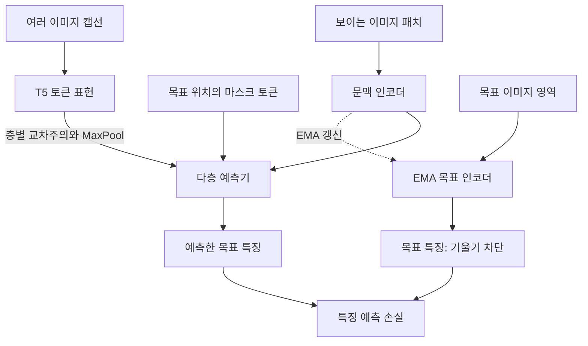

# Text-Conditional JEPA for Learning Semantically Rich Visual Representations

**분석 대상:** Chen Huang, Xianhang Li, Vimal Thilak, Etai Littwin, Josh Susskind의 2026년 논문, arXiv:2605.03245v1.

**분석 원문:** 2605.03245v1.pdf

아래 페이지 번호는 **첨부 PDF에 인쇄된 페이지 번호**입니다. **[저자 보고]**는 논문의 주장·실험 결과, **[해석]**은 그 근거에 대한 제 판단, **[제안]**은 아직 검증되지 않은 후속 실험 계획을 뜻합니다. 관련 연구 비교에는 별도로 확인한 원 논문을 사용했으며, 미래 성능을 예상한 수치는 제시하지 않습니다.

---

## 1. Executive summary — 9문장

1. 이 논문은 I-JEPA가 이미지의 보이는 영역만으로 가려진 영역의 특징을 예측할 때 발생하는 **정보 부족과 예측의 모호성**을 해결하려는 연구입니다. **[pp.1–3]**
2. 제안한 TC-JEPA는 이미지 설명문인 캡션을 예측기에 제공하여, 가려진 영역의 특징을 학습하기 위한 추가 단서를 활용합니다. **[p.3, §3.2]**
3. 핵심 설계는 예측기의 여러 층에서 이미지 패치와 개별 텍스트 토큰의 대응을 계산하여, 패치마다 관련된 언어 정보를 반영하는 것입니다. **[pp.3–4, Fig.2]**
4. 여기에 패치–단어 대응의 희소성과 층간 일관성을 유도하는 정규화를 적용하고, 여러 캡션으로 각각 조건화한 특징을 MaxPool로 통합합니다. **[pp.4–5, 식 (3)–(4)]**
5. 텍스트 조건화는 사전학습에 사용되며, 학습된 시각 인코더로 특징을 추출할 때에는 예측기와 텍스트 조건화 모듈을 제거할 수 있습니다. **[p.15, 부록 D]**
6. ImageNet-1k에서 같은 ViT-L/16과 600에포크 조건의 선형평가 정확도는 I-JEPA의 **77.5%에서 79.6%로 2.1%p 상승**했습니다. **[p.5, Table 1]**
7. 다른 데이터셋으로의 전이에서는 ViT-H/14 기준 iNat18 분류가 **47.6%에서 54.8%로 상승**하는 등, 세밀한 분류와 검출·분할 과제에서 개선이 나타났습니다. **[p.6, Table 2]**
8. 같은 합성 캡션을 사용하는 SPARC와의 비교에서도 우수한 결과를 보고하여, 캡션 추가뿐 아니라 이를 활용하는 학습 방식의 유용성을 뒷받침합니다. **[p.7, Tables 4–5]**
9. 다만 **명시적인 분포 밖 일반화, 반복 실험의 통계적 유의성, 캡션 생성까지 포함한 전체 비용 효율성**은 확인되지 않았으므로, 가장 확실한 결론은 “평가된 여러 과제에서 시각 표현의 전이 성능을 개선했다”는 것입니다. **[해석: Tables 1–6, 부록 C–E]**

> **용어 설명**
>
> - **시각 표현·특징:** 이미지의 물체, 질감, 배치 등을 담는 숫자 벡터.
> - **패치:** 이미지를 나눈 작은 영역.
> - **선형평가·linear probing:** 학습된 이미지 인코더를 고정하고, 그 위에 단순한 선형 예측기만 학습하여 표현의 유용성을 평가하는 방법.
> - **전이 성능:** 한 데이터로 학습한 표현을 다른 데이터셋이나 과제에 활용했을 때의 성능.

---

## 2. 연구 배경·목표·필요성

### 2.1. 무엇이 문제인가?

**[저자 보고]** 시각 자기지도학습의 대표적인 접근은 크게 두 가지입니다. **[pp.1–2]**

| 접근 | 학습 방식 | 논문이 지적하는 문제 |
|---|---|---|
| **불변성 기반 학습** | 같은 이미지에 서로 다른 변형을 적용해도 비슷한 표현을 만들도록 학습 | 특정 변형에 대한 불변성을 강조하면, 그 변형이 보존하지 않는 정보가 필요한 다른 과제에 불리할 수 있음 |
| **마스킹 이미지 모델링, MIM** | 이미지 일부를 가리고, 가려진 픽셀이나 특징을 예측 | 보이는 부분만으로 가려진 내용을 특정하기 어려우며, 의미 있는 특징 학습이 마스킹 방식에 민감해질 수 있음 |

> **용어 설명**
>
> - **자기지도학습, SSL:** 데이터 자체에서 학습 문제와 목표를 만들어 표현을 학습하는 방식.
> - **불변성:** 입력에 특정 변화가 생겨도 표현이나 예측이 유지되는 성질.
> - **데이터 증강:** 자르기, 색 변화 등으로 학습 입력의 변형을 만드는 것.
> - **MIM:** Masked Image Modeling의 약자로, 가려진 이미지 정보를 복원하거나 예측하는 학습 방식.

I-JEPA는 가려진 픽셀을 복원하는 대신 **가려진 영역의 특징 벡터**를 예측합니다. 그러나 예측 대상이 특징 벡터라고 해도, 입력에 충분한 정보가 없으면 모호성은 남습니다.

논문의 예에서는 강아지가 보이는 이미지에서 배경 일부를 가렸을 때, 그곳이 **책장인지 빈 벽인지** 문맥만으로 알기 어렵습니다. 저자들은 문맥과 목표 영역이 공유하는 정보가 적으면 예측이 어려워지고, 의미 없는 표현으로 붕괴할 위험도 있다고 설명합니다. **[pp.1–2, Fig.2]**

> **용어 설명**
>
> - **JEPA:** 입력과 목표를 각각 특징 공간에 표현한 뒤, 입력 특징으로 목표 특징을 예측하는 구조.
> - **표현 붕괴:** 서로 다른 입력들이 거의 같은 특징 벡터로 표현되어 구별에 필요한 정보가 사라지는 현상.
> - **상호정보량:** 한 정보를 알았을 때 다른 정보의 불확실성이 얼마나 줄어드는지를 나타내는 개념; 이 논문에서는 주로 문제를 설명하는 직관으로 사용됩니다.

### 2.2. 연구 목적은 무엇인가?

**[저자 보고]** 목표는 다음 세 가지입니다. **[p.2, 기여 요약]**

1. 캡션을 이용해 JEPA의 특징 예측을 돕고, **의미가 풍부한 시각 표현**을 학습합니다.
2. 여러 후속 과제에서 성능을 높이고, 마스킹 설정에 대한 민감도를 낮추며, 모델·데이터 확대 시의 성능을 평가합니다.
3. 이미지–텍스트 대조학습에 의존하지 않는 **예측 기반 시각·언어 사전학습 방식**을 제시합니다.

### 2.3. 왜 필요한가?

**[해석]** 이 연구의 실용적인 질문은 다음과 같습니다.

> “학습할 때 이용할 수 있는 언어 정보를 활용해, 배포 시에는 이미지 입력만으로 더 유용한 특징을 얻을 수 있는가?”

이 접근은 이미지 전체의 범주 정보와 함께 **국소 영역의 의미·위치 정보**가 필요한 검출·분할 과제에서 특히 의미가 있습니다. 실제로 논문은 분류뿐 아니라 검출, 분할, 이미지 설명 생성, 시각 질의응답을 함께 평가합니다. **[pp.6–8, Tables 2–5]**

다만 TC-JEPA 전체를 **텍스트 감독 없는 순수 시각 자기지도학습**으로 이해하면 부정확합니다. 이미지 캡션, 사전학습된 T5, 캡션 생성 모델을 사용하며, 저자들도 이를 약한 텍스트 감독을 사용하는 방법으로 설명합니다. 별도의 위치 정답 없이 학습하는 것은 **패치–단어 대응 관계**입니다. **[pp.2, 4–6]**

> **용어 설명**
>
> - **약지도:** 정밀한 위치·영역 정답 대신 이미지 설명문처럼 간접적인 감독 정보를 사용하는 방식.
> - **대조학습:** 대응하는 표현은 가깝게, 대응하지 않는 표현은 구별되도록 학습하는 방식.
> - **시각적 grounding:** 텍스트의 단어나 표현이 이미지의 어느 물체·영역을 가리키는지 연결하는 것.

---

## 3. 핵심 주장과 근거

| 핵심 주장 | 저자가 제시한 근거 | 근거에 대한 해석·주의점 | 위치 |
|---|---|---|---|
| 텍스트 조건화가 의미 있는 시각 표현을 개선한다 | I-JEPA 대비 세 모델 규모의 IN-1k 선형평가 개선 | 같은 이미지·모델·에포크 비교이지만 TC-JEPA에는 추가 언어 정보가 있음 | p.5, Table 1 |
| 다른 데이터셋과 과제로의 전이가 개선된다 | CIFAR100·Places205·iNat18 분류, COCO 검출, ADE20k·VOC 분할 개선 | 여러 과제의 전이 성능을 지지하지만, 명시적인 분포 변화 강건성 실험과는 구분해야 함 | p.6, Table 2 |
| 단어 수준·다층 조건화와 정규화가 중요하다 | 같은 캡션을 사용한 구성요소 제거 실험에서 성능 하락 | 설계의 기여를 지지하나, 일부 비교군에서는 조건화 단위와 정규화가 함께 바뀜 | p.8, Fig.4; p.12, 부록 A |
| 대조적 시각·언어 학습과 경쟁력 있는 표현을 만든다 | 동일 합성 캡션을 사용하는 SPARC·DreamLIP와 비교 | 비교 정보량을 일부 통제한 중요한 결과지만, 모든 데이터 규모·지표에서 우수하지는 않음 | p.7, Tables 4–5 |
| 텍스트가 특징 예측의 불확실성을 줄인다 | 패치–단어 대응과 예측 오차 시각화, 마스킹 설정 변화 실험 | 불확실성 자체를 확률·엔트로피 등으로 정량 측정한 결과는 없음 | p.8, Fig.5; p.16, Fig.9 |
| 모델·데이터 확대에 유리하다 | 모델 크기 증가와 데이터 확대 실험 | 분할은 개선되지만 데이터 확대에 따른 분류 정확도는 단조 증가하지 않음 | p.6, Fig.3 |
| 추가 학습 연산량이 작다 | I-JEPA 대비 FLOPs 증가율 0.49–1.79% | 캡션 생성과 T5 처리 비용까지 포함한 전체 비용인지 명시되지 않음 | p.15, Fig.8·부록 D |

> **용어 설명**
>
> - **구성요소 제거 실험·ablation:** 일부 설계를 제거하거나 바꾸어 그 요소의 기여를 살펴보는 실험.
> - **분포 밖 일반화·OOD generalization:** 학습 때와 다른 형태·환경·통계적 특성을 가진 입력에서의 성능.
> - **FLOPs:** 부동소수점 연산의 양을 나타내는 지표로, 실제 실행 시간이나 전체 개발 비용과 동일하지 않습니다.

---

## 4. 제안 방법과 모델 구조: 수식 중심 설명

### 4.1. 전체 구조

**[저자 보고]** TC-JEPA는 I-JEPA의 시각 인코더와 목표 인코더를 유지하면서, **경량 예측기 내부에 텍스트 조건화**를 추가합니다. **[pp.3–5, Fig.2]**



*Fig.2를 바탕으로 재구성한 개념도입니다. 희소성·일관성 정규화는 예측기 내부의 패치–단어 유사도에 추가됩니다.*

구현상 주요 설정은 다음과 같습니다. **[pp.13–14, 부록 C.1–C.2]**

| 구성 요소 | 논문의 설정 |
|---|---|
| ImageNet용 이미지 인코더 | ViT-B/16, ViT-L/16, ViT-H/14 |
| 이미지–텍스트 데이터 실험의 주요 인코더 | ViT-B/16, ViT-L/14 |
| 예측기 | 특징 차원 384인 좁은 ViT |
| 예측기 깊이 | B 모델은 6층, L/H 모델은 12층 |
| 텍스트 조건화 | 예측기의 모든 층에 residual cross-attention 적용 |
| 조건화 이후 연산 | 2층 MLP와 LayerNorm |
| 마스킹 | 문맥 블록 1개와 목표 블록 4개 |
| 기본 캡션 수 | $N=8$, 이용 가능한 캡션 수로 상한 제한 |
| 기본 정규화 계수 | $\lambda=0.1,\;\beta=0.5$ |

> **용어 설명**
>
> - **ViT:** 이미지를 패치로 나누어 Transformer로 처리하는 모델; B/L/H는 크기 구분이고 `/16`, `/14`는 패치 한 변의 픽셀 수입니다.
> - **인코더:** 입력을 특징 벡터로 변환하는 신경망.
> - **조건화:** 예측 과정에서 추가 정보를 참고하도록 만드는 것.
> - **Cross-attention, 교차주의:** 이미지 패치가 여러 텍스트 토큰 중 어떤 정보를 참고할지 계산하는 연산.
> - **MLP:** 선형변환과 비선형 함수를 쌓은 작은 신경망.
> - **LayerNorm:** 토큰 특징값의 크기를 정규화하는 연산.

### 4.2. 기본 예측 문제와 손실 — 원문 식 (1)

문맥 패치와 목표 패치를 다음과 같이 둡니다.

$$
x=\{x_i\mid i\in B_x\},
\qquad
y=\{y_j\mid j\in B_y\}.
$$

각 위치의 특징과 마스크 토큰은 다음과 같습니다.

$$
z_{x_i}=f_\theta(x_i),
\qquad
z_{y_j}=f_{\bar\theta}(y_j),
\qquad
m_j=p_j+\tilde m.
$$

I-JEPA의 기본 예측은 다음과 같습니다.

$$
\hat z_y=g_\phi(z_x,m).
$$

**기호 설명**

- $B_x,\;B_y$: 문맥과 목표 패치의 위치 인덱스 집합.
- $x_i,\;y_j$: 해당 위치의 이미지 패치.
- $f_\theta$: 학습하는 문맥 인코더.
- $f_{\bar\theta}$: 문맥 인코더 가중치의 지수이동평균으로 갱신하는 목표 인코더.
- $z_{x_i},\;z_{y_j}$: 문맥 특징과 목표 특징.
- $p_j$: 목표 위치 $j$의 위치 임베딩.
- $\tilde m$: 모든 목표 위치가 공유하는 학습 가능한 마스크 벡터.
- $m_j$: 위치 정보를 포함한 마스크 토큰.
- $g_\phi$: 예측기.
- $\hat z_y$: 예측한 목표 특징의 집합.

위 표기는 각 위치의 출력을 간략히 나타낸 것으로, ViT가 각 패치를 서로 독립적으로 처리한다는 뜻은 아닙니다. **[p.3, §3.1]**

> **용어 설명**
>
> - **위치 임베딩:** 이미지 안에서 패치가 어디에 있는지를 나타내는 벡터.
> - **마스크 토큰:** 가려진 패치의 실제 내용 대신 예측 위치를 표시하는 학습 가능한 벡터.
> - **지수이동평균·EMA:** 최근 모델 가중치를 조금씩 반영해 목표 모델이 천천히 변하도록 하는 방법.

예측 손실은 다음과 같습니다.

```math
\mathcal L_{\text{predict}}
=
\frac{1}{|B_y|}
\sum_{j\in B_y}
\left\|
\hat z_{y_j}-z_{y_j}
\right\|_2.
```

- $\mathcal L_{\text{predict}}$: 목표 패치들의 평균 특징 예측 오차.
- $|B_y|$: 목표 패치 수.
- $\|\cdot\|_2$: 유클리드 노름.
- 목표 특징 $z_{y_j}$에는 **stop-gradient**가 적용됩니다.

**정확성 주의:** 원문 식 (1)은 **제곱하지 않은 L2 노름**입니다. 이를 $\|\cdot\|_2^2$ 또는 평균제곱오차로 바꾸면 원문의 수식과 달라집니다. **[p.3, 식 (1)]**

> **용어 설명**
>
> - **유클리드 노름:** 두 특징 벡터 사이의 직선거리 크기.
> - **Stop-gradient:** 목표 특징 쪽으로는 오차 역전파가 흐르지 않도록 하는 처리; 저자는 EMA와 함께 표현 붕괴를 방지하기 위해 사용한다고 설명합니다.

### 4.3. 캡션을 토큰 특징으로 변환

캡션 $c$를 사전학습된 T5로 처리해 텍스트 토큰 시퀀스를 얻습니다.

$$
t=[t_1,\ldots,t_S]\in\mathbb R^{d_t\times S}.
$$

- $t_s$: $s$번째 텍스트 토큰의 특징 벡터.
- $S$: 토큰 시퀀스 길이.
- $d_t$: 텍스트 특징 차원.

TC-JEPA의 예측기는 이제 다음 정보를 함께 사용합니다.

$$
\hat z_y=g_\phi(z_x,m,t).
$$

**[저자 보고]** 저자들은 자연어의 조합과 순서 정보를 표현하는 데 유리하다는 선행연구의 논거를 들어 T5를 선택합니다. **[p.3, §3.2]**

**[해석]** 다만 이 논문 자체에는 T5와 CLIP 텍스트 인코더를 직접 교체하여 비교한 실험이 없습니다. 따라서 T5 선택의 우월성이 이 논문에서 독립적으로 검증되었다고 말할 수는 없습니다.

> **용어 설명**
>
> - **T5:** 텍스트를 문맥을 반영한 벡터로 표현할 수 있는 사전학습 언어 모델.
> - **토큰:** 모델이 처리하는 텍스트 단위로, 반드시 완전한 단어 하나와 일치하지는 않습니다.
> - **조합 정보:** 단어의 존재뿐 아니라 순서·관계가 만드는 의미; 예를 들어 누가 누구를 쫓는지를 구분하는 정보입니다.

### 4.4. 단어 수준의 다층 교차주의 — 원문 식 (2)

예측기의 $l$번째 층에 있는 패치 특징을 $q$라고 하면, query·key·value는 다음과 같습니다.

$$
q^{(l)}=W_Q^{(l)}q,
\qquad
K^{(l)}=W_K^{(l)}t,
\qquad
V^{(l)}=W_V^{(l)}t.
$$

원문 식 (2)의 softmax를 토큰 전체에 대한 정규화로 풀어 쓰면 다음과 같습니다.

```math
\alpha_s^{(l)}
=
\frac{
\exp\!\left((q^{(l)})^\top K_{:,s}^{(l)}\right)
}{
\sum_{r=1}^{S}
\exp\!\left((q^{(l)})^\top K_{:,r}^{(l)}\right)
}.
```

```math
\text{Attention}\!\left(q^{(l)},K^{(l)},V^{(l)}\right)
=
\sum_{s=1}^{S}
\alpha_s^{(l)}V_{:,s}^{(l)}.
```

$$
q
\leftarrow
q+
\text{Attention}\!\left(q^{(l)},K^{(l)},V^{(l)}\right).
$$

**기호 설명**

- $l\in\{1,\ldots,L\}$: 예측기 층 번호.
- $L$: 예측기 전체 층수.
- $q$: 해당 층의 문맥 또는 목표 패치 특징.
- $q^{(l)}$: 선형변환한 패치 query.
- $K^{(l)},V^{(l)}$: 텍스트 토큰의 key·value 행렬.
- $W_Q^{(l)}\in\mathbb R^{d\times d}$: query 변환 행렬.
- $W_K^{(l)},W_V^{(l)}\in\mathbb R^{d\times d_t}$: 텍스트 특징 변환 행렬.
- $d$: 이 식에서 사용하는 패치·주의 특징의 차원.
- $K_{:,s}^{(l)},V_{:,s}^{(l)}$: $s$번째 텍스트 토큰에 해당하는 열벡터.
- $\alpha_s^{(l)}$: 현재 패치가 토큰 $s$를 참고하는 비중.
- $r$: softmax 분모에서 전체 토큰을 순회하는 인덱스.

**중요한 구조적 특징은 세 가지입니다.** **[p.3, 식 (2); p.4, Fig.2]**

1. 텍스트가 **이미지 인코더에 직접 입력되는 것이 아니라 예측기를 조건화**합니다.
2. 목표 패치뿐 아니라 예측기 안의 **문맥 패치 특징도 조건화**합니다.
3. 한 번의 입력 결합에 그치지 않고 **여러 층에서 반복적으로 언어 정보를 사용**합니다.

원문 식에는 일반적인 scaled dot-product attention의 $1/\sqrt d$ 항이 기재되어 있지 않으므로, 위 식에도 추가하지 않았습니다.

> **용어 설명**
>
> - **Query:** 현재 패치가 찾는 정보를 나타내는 벡터.
> - **Key:** 각 텍스트 토큰이 어떤 정보를 제공하는지 나타내는 벡터.
> - **Value:** 선택된 토큰으로부터 실제로 가져오는 정보.
> - **Softmax:** 여러 점수를 합이 1인 가중치로 바꾸는 함수.
> - **잔차 연결·residual connection:** 원래 특징에 새 정보를 더하는 연결; 위 식의 $q+\text{Attention}$에 해당합니다.

### 4.5. 희소성·층간 일관성 정규화 — 원문 식 (3)

각 패치와 단어의 **양의 코사인 유사도**만 남깁니다.

```math
O_{i,s}^{(l)}
=
\max\!\left(
\cos\!\left(q_i^{(l)},K_{:,s}^{(l)}\right),
0
\right).
```

$$
O_i^{(l)}\in\mathbb R^S,
\qquad
\bar O_i=
\frac1L\sum_{l=1}^{L}O_i^{(l)}.
$$

- $O_{i,s}^{(l)}$: 층 $l$에서 패치 $i$와 토큰 $s$ 사이의 음수를 제거한 코사인 유사도.
- $O_i^{(l)}$: 해당 패치와 모든 텍스트 토큰의 유사도를 모은 벡터.
- $q_i^{(l)}$: 패치 $i$의 변환된 query.
- $\bar O_i$: 같은 패치의 유사도 벡터를 층 전체에서 평균한 값.

희소성 손실은 다음과 같습니다.

```math
\mathcal L_{\text{sparse}}
=
\frac{1}{|B_x|+|B_y|}
\sum_{i\in B_x\cup B_y}
\frac1L
\sum_{l=1}^{L}
\left\|O_i^{(l)}\right\|_1.
```

층간 일관성 손실은 다음과 같습니다.

```math
\mathcal L_{\text{consistency}}
=
\frac{1}{|B_x|+|B_y|}
\sum_{i\in B_x\cup B_y}
\frac1L
\sum_{l=1}^{L}
\left\|O_i^{(l)}-\bar O_i\right\|_1.
```

단일 캡션에 대한 전체 목적함수는 다음과 같습니다.

```math
\mathcal L
=
\mathcal L_{\text{predict}}
+
\lambda\mathcal L_{\text{sparse}}
+
\beta\mathcal L_{\text{consistency}}.
```

**기호 설명**

- $\|\cdot\|_1$: 벡터 원소들의 절댓값 합.
- $\lambda$: 희소성 손실의 가중치.
- $\beta$: 층간 일관성 손실의 가중치.
- $B_x\cup B_y$: 문맥과 목표 패치를 모두 포함하는 집합.
- $\mathcal L$: 최종 학습 손실.

위 합집합 표기는 원문의 $i\in\{B_x,B_y\}$를 의미가 분명하도록 풀어 쓴 것입니다. **[p.4, 식 (3)]**

> **용어 설명**
>
> - **코사인 유사도:** 벡터의 크기보다 방향이 얼마나 비슷한지를 측정하는 값.
> - **희소성:** 많은 단어에 두루 반응하기보다 일부 관련 단어에 선택적으로 대응하는 성질.
> - **층간 일관성:** 같은 패치가 예측기 깊이에 따라 지나치게 다른 단어에 대응하지 않도록 하는 제약.
> - **정규화:** 주된 예측 오차 외에, 학습 결과가 특정 성질을 갖도록 추가하는 제약.

**[해석: 수식에서 확인할 수 있는 범위]**

- 희소성 제약은 **softmax attention 확률이 아니라 $O_i^{(l)}$에 적용**됩니다.
- 희소성 손실만 최소화하면 모든 양의 유사도를 줄이는 해도 가능하므로, 의미 있는 대응이 수학적으로 보장되는 것은 아닙니다.
- 유용한 대응이 형성된다는 주장은 **특징 예측 손실과의 결합 및 실험 결과**에 근거합니다.
- 여기서 희소성은 대응을 선택적으로 만드는 정규화이며, 하드 attention 마스킹이나 희소 행렬 연산에 의한 계산 절감 보장을 뜻하지 않습니다.

### 4.6. 여러 캡션의 독립 조건화와 MaxPool — 원문 식 (4)

여러 캡션 $c^1,\ldots,c^N$이 있을 때, 각 캡션의 토큰 특징 $t^n$을 사용하여 같은 패치를 **독립적으로 조건화**합니다.

이후 캡션 축으로 MaxPool합니다. 본문 설명을 원소 단위 수식으로 나타내면 다음과 같습니다.

```math
\hat z_i^{(l)}[k]
=
\max_{1\le n\le N}
\hat z_{i,n}^{(l)}[k].
```

- $n$: 캡션 인덱스.
- $N$: 사용하는 캡션 수.
- $k$: 특징 벡터의 좌표.
- $\hat z_{i,n}^{(l)}$: 캡션 $n$으로 조건화한 패치 $i$의 층 $l$ 특징.
- $\hat z_i^{(l)}$: 통합 후 다음 층에 전달하는 특징.

이 MaxPool 식은 **p.5의 설명을 풀어 쓴 식**이며, 원문에 별도 번호가 붙은 수식은 아닙니다.

**MaxPool은 가장 좋은 캡션 하나를 통째로 고르는 방식이 아닙니다.** 특징의 좌표마다 서로 다른 캡션에서 나온 값을 선택할 수 있습니다. **[pp.4–5, Fig.2]**

여러 캡션을 사용할 때 전체 손실은 다음과 같습니다.

```math
\mathcal L
=
\mathcal L_{\text{predict}}
+
\frac{\lambda}{N}
\sum_{n=1}^{N}\mathcal L_{\text{sparse}}^n
+
\frac{\beta}{N}
\sum_{n=1}^{N}\mathcal L_{\text{consistency}}^n.
```

- $\mathcal L_{\text{sparse}}^n$: 캡션 $n$에 대한 희소성 손실.
- $\mathcal L_{\text{consistency}}^n$: 캡션 $n$에 대한 층간 일관성 손실.
- 기본값: $N=8,\;\lambda=0.1,\;\beta=0.5$.

**[p.5, 식 (4), §4.1]**

> **용어 설명**
>
> - **Pooling:** 여러 값을 하나의 표현으로 통합하는 연산.
> - **MaxPool:** 각 좌표의 최댓값을 선택하는 통합 방식.
> - **AvgPool:** 각 좌표의 평균을 사용하는 방식.

### 4.7. 다른 조건화 방식과 무엇이 다른가?

부록 A는 개별 토큰 대신 문장 전체의 평균 벡터 $\bar t$를 사용하는 비교군을 정의합니다. **[p.12, 부록 A]**

문장 수준 cross-attention은 다음과 같습니다.

$$
q^{(l)}=W_Q^{(l)}q,
\qquad
K^{(l)}=W_K^{(l)}\bar t,
\qquad
V^{(l)}=W_V^{(l)}\bar t.
$$

- $\bar t\in\mathbb R^{d_t}$: 텍스트 토큰을 평균한 문장 전체의 특징.
- 나머지 기호는 식 (2)와 같습니다.

**[해석]** 캡션 하나가 key 하나로 표현되는 경우 softmax 가중치는 1이므로, attention으로 더하는 값 자체는 $W_V^{(l)}\bar t$가 됩니다. 따라서 그 추가량은 패치 query에 따라 단어를 선택할 수 없습니다. 이것이 단어 시퀀스 조건화와의 중요한 차이입니다.

입력 단계에서만 문장 벡터를 결합하는 feature conditioning 비교군은 다음과 같습니다.

$$
z_{x_i}
\leftarrow
z_{x_i}
+
\text{MLP}\!\left(
\text{LayerNorm}([z_{x_i},\bar t])
\right),
$$

$$
m_j
\leftarrow
m_j
+
\text{MLP}\!\left(
\text{LayerNorm}([m_j,\bar t])
\right).
\tag{6}
$$

- $[\cdot,\cdot]$: 특징 차원 방향으로 이어 붙이는 연산.
- $\text{MLP}$: 결합한 특징을 변환하는 신경망.
- $\text{LayerNorm}$: 특징 정규화 연산.

또 다른 비교군인 **AdaLN**은 문장 벡터로 크기 조절·이동 계수를 만들어 각 층을 조건화합니다. Fig.4에서는 제안한 단어 수준 다층 조건화가 이러한 비교군보다 좋은 결과를 보입니다. 다만 문장 수준 비교군에는 패치–단어 정규화도 적용하지 않으므로, 이 비교를 **토큰 수준만 바꾼 완전한 단일요인 실험**으로 해석해서는 안 됩니다. **[p.8, Fig.4; p.12, 부록 A]**

> **용어 설명**
>
> - **AdaLN:** Adaptive Layer Normalization의 약자로, 조건 입력에 따라 정규화된 특징의 크기와 위치를 조절하는 방법.

### 4.8. 학습과 추론의 구분

**[저자 보고]** 학습에서는 이미지 인코더, 예측기, 텍스트 조건화 모듈을 함께 최적화하지만, 시각 특징 추출 시에는 예측기와 조건화 모듈을 제거합니다. **[pp.14–15]**

다만 문서에는 인코더 선택에 관한 서술 차이가 있습니다.

- **p.14, 부록 C.3:** 선형평가에 목표 인코더를 사용한다고 명시.
- **p.15, 부록 D:** 테스트 시 $f_\theta$만 사용한다고 서술.

따라서 확실하게 말할 수 있는 것은 **“시각 특징 추출에 캡션과 텍스트 조건화 모듈이 필요하지 않다”**는 점입니다. 실제 재현에서는 평가에 사용할 인코더를 확인해야 합니다.

또한 VQA 전체 시스템에서는 질문 텍스트와 별도의 디코더가 사용되므로, 이를 “모든 후속 과제가 텍스트 없이 수행된다”는 뜻으로 확대하면 안 됩니다. **[p.14, 부록 C.3]**

---

## 5. 연구 수행 방법과 데이터 소스

### 5.1. 사전학습 데이터

| 데이터 | 사용 방식 | 캡션 구성 | 출처 |
|---|---|---|---|
| ImageNet-1k | 기존 시각 자기지도학습 방법과 비교 | ShareGPT4V 생성 캡션, 이미지당 평균 8.3문장 | p.5, §4.1 |
| ImageNet-21k | 이미지 데이터 규모 확대 | ShareGPT4V 생성 캡션, 이미지당 평균 8.7문장; 본문에서 약 13M 이미지로 기술 | pp.5–6 |
| YFCC15M | 이미지–텍스트 사전학습 비교 | 원래 캡션과 합성 캡션 결합 | p.5, §4.2 |
| CC12M 및 CC27M | 더 큰 이미지–텍스트 데이터 실험 | CC27M은 CC12M+YFCC15M의 결합이며 원래 캡션과 합성 캡션 사용 | pp.5–7 |

캡션 생성에는 짧은 설명과 자세한 설명을 요청하는 두 종류의 프롬프트를 사용합니다. 생성된 문장들을 캡션 집합으로 취급하고, 학습 때 기본적으로 최대 8개를 표본화합니다. 캡션은 일정 길이로 자르거나 패딩하지만, **정확한 토큰 길이는 제시하지 않습니다.** **[p.12, 부록 B]**

### 5.2. 학습 설정

**[저자 보고]** 주요 설정은 다음과 같습니다. **[pp.13–14, 부록 C]**

- 사전학습 해상도: $224\times224$.
- 최적화: AdamW, 배치 크기 2048.
- 최대 학습률: $10^{-3}$.
- 가중치 감쇠: 0.04에서 0.4로 증가.
- IN-1k: B/L 모델 600에포크, H 모델 300에포크.
- IN-21k: L 모델은 **IN-1k 1200에포크 상당**, H 모델은 **IN-1k 900에포크 상당**의 학습량.
- 이미지–텍스트 데이터: 부록 C.2에 명시된 B/16·L/14 모델은 50에포크.

**IN-21k를 1200번 반복 학습했다는 뜻은 아닙니다.** 논문은 IN-1k 기준의 등가 학습량으로 기술합니다.

> **용어 설명**
>
> - **에포크:** 데이터셋 전체를 한 번 학습에 사용하는 단위.
> - **배치:** 한 번의 모델 갱신에 함께 사용하는 샘플 묶음.
> - **가중치 감쇠:** 모델 가중치가 과도하게 커지는 것을 억제하는 학습 기법.

### 5.3. 평가 방식

| 평가 종류 | 데이터셋 | 무엇을 학습하는가? |
|---|---|---|
| 선형 분류 | IN-1k, CIFAR100, Places205, iNat18 | 인코더 고정, 선형 분류기 학습 |
| 객체 검출 | COCO | FPN·Mask R-CNN을 사용해 미세조정 |
| 선형 분할 | ADE20k, Pascal VOC | 인코더 고정, 패치별 선형 분류기 학습 |
| 전체 미세조정 분할 | ADE20k, Pascal VOC | UperNet과 인코더를 함께 학습 |
| 이미지 설명 생성·VQA | COCO, GQA, VQAv2 | 시각 인코더 고정, 12층 LiT-Decoder를 다중작업 학습 |

**[p.14, 부록 C.3]**

> **용어 설명**
>
> - **미세조정·fine-tuning, FT:** 후속 과제 데이터로 기존 모델 가중치까지 추가 학습하는 것.
> - **의미 분할:** 이미지의 각 픽셀 또는 영역에 물체·배경 범주를 부여하는 과제.
> - **FPN:** 서로 다른 크기의 특징 지도를 결합해 다양한 크기의 물체를 찾는 구조.
> - **VQA:** 이미지에 관한 질문에 답하는 과제.
> - **디코더:** 특징을 이용해 단어나 답변 등 최종 출력을 만드는 모델.

---

## 6. 주요 결과와 일반화 성능에 대한 판단

### 6.1. 동일 모델·이미지 데이터·에포크에서의 개선

모두 IN-1k 사전학습 후 IN-1k 선형평가 결과입니다. **[p.5, Table 1]**

| 모델 | 에포크 | I-JEPA | TC-JEPA | 차이 |
|---|---:|---:|---:|---:|
| ViT-B/16 | 600 | 72.9% | **75.8%** | **+2.9%p** |
| ViT-L/16 | 600 | 77.5% | **79.6%** | **+2.1%p** |
| ViT-H/14 | 300 | 79.3% | **80.4%** | **+1.1%p** |

**[해석]** I-JEPA 대비 개선을 보여주는 가장 명확한 비교입니다. 다만 TC-JEPA에만 언어 정보가 추가되므로, 개선 전체를 조건화 구조만의 효과로 분리할 수는 없습니다.

또한 이것은 **같은 ImageNet 분포에서의 표현 품질 평가**입니다. 이 결과만으로 새로운 환경에 대한 일반화가 입증되는 것은 아닙니다.

### 6.2. 다른 데이터셋·과제로의 전이

IN-1k로 사전학습한 ViT-H/14를 비교합니다. **[p.6, Table 2]**

| 후속 평가 | I-JEPA | TC-JEPA | 차이 |
|---|---:|---:|---:|
| CIFAR100 선형 분류 | 87.5 | **88.5** | +1.0%p |
| Places205 선형 분류 | 58.4 | **59.1** | +0.7%p |
| iNat18 선형 분류 | 47.6 | **54.8** | **+7.2%p** |
| COCO 검출 APᵇ | 53.7 | **55.2** | +1.5 AP |
| ADE20k 선형 분할 | 36.9 | **39.5** | +2.6 mIoU |
| ADE20k 전체 미세조정 분할 | 51.2 | **55.7** | **+4.5 mIoU** |
| VOC 선형 분할 | 64.6 | **70.4** | **+5.8 mIoU** |
| VOC 전체 미세조정 분할 | 81.4 | **83.8** | +2.4 mIoU |

> **지표 설명**
>
> - **Top-1 정확도:** 가장 높은 점수를 받은 예측 하나가 정답인 비율.
> - **APᵇ:** 검출한 경계상자의 정확성을 종합하는 평균 정밀도.
> - **IoU:** 예측 영역과 정답 영역의 교집합을 합집합으로 나눈 값.
> - **mIoU:** 범주별 IoU의 평균.
> - 위 차이는 상대 변화율이 아니라 **정확도는 %p, AP·mIoU는 점수 차이**입니다.

**[해석]** 이 논문에서 **일반화 개선을 가장 직접적으로 뒷받침하는 부분**입니다. 특히 iNat18과 선형 분할의 개선은, 기존 인코더를 고정한 상태에서도 다른 데이터셋에서 유용한 정보가 더 많이 드러난다는 근거입니다.

다만 TC-JEPA가 모든 비교 방법보다 모든 전이 분류에서 우수한 것은 아닙니다. 같은 ViT-B/16 비교에서 CIFAR100은 TC-JEPA 84.5, iBOT 85.5이며, iNat18은 TC-JEPA 49.3, iBOT 50.0입니다. **[p.6, Table 2]**

### 6.3. 같은 합성 캡션을 사용하는 방법과의 비교

아래는 YFCC15M·ViT-B/16 조건의 결과입니다. SPARC와 DreamLIP는 TC-JEPA와 같은 추가 합성 캡션을 사용한다고 표에 명시되어 있습니다. **[p.7, Table 4]**

| 방법 | IN-1k 선형 분류 | COCO 검출 APᵇ | ADE20k **미세조정** mIoU |
|---|---:|---:|---:|
| CLIP | 66.5 | 43.6 | 47.8 |
| SPARC | 73.4 | 52.0 | 52.3 |
| DreamLIP | 75.2 | 47.2 | 49.6 |
| **TC-JEPA** | **77.1** | **54.5** | **55.2** |

TC-JEPA와 SPARC의 차이는 각각 **+3.7%p, +2.5 AP, +2.9 mIoU**입니다.

**[해석]** 캡션이 없는 I-JEPA와의 비교보다, **같은 언어 자료를 어떻게 활용하는가**를 평가하는 데 더 적절한 근거입니다.  
다만 SPARC는 저자 구현이며, 총 연산량과 하이퍼파라미터 탐색 예산까지 완전히 동일하다고 보고되지는 않았습니다.

확대 실험에는 예외도 있습니다. TC-JEPA의 CC27M 분류 정확도는 **77.3%**, DreamLIP의 CC30M 결과는 **78.6%**입니다.  
검출·분할에서는 TC-JEPA가 높지만, 이를 모든 지표의 우위로 요약해서는 안 됩니다. **[p.7, Table 4]**

### 6.4. 데이터 규모 확대: 분할과 분류의 추세가 다르다

ViT-L/16의 데이터 확대 결과는 다음과 같습니다. **[p.6, Fig.3]**

| 사전학습 데이터 | IN-1k 선형 분류 | ADE20k 선형 분할 |
|---|---:|---:|
| IN-1k | 79.6 | 38.8 |
| IN-21k | **82.1** | 41.2 |
| CC27M | 81.4 | **42.1** |

**[저자 보고]** 저자들은 모델·데이터 확대에서 유망한 성능 추세를 보고합니다.

**[해석]**

- 분할에서는 **38.8 → 41.2 → 42.1**로 개선됩니다.
- 분류에서는 **79.6 → 82.1 → 81.4**로, 데이터가 커져도 항상 좋아지지 않습니다.
- 데이터의 크기뿐 아니라 구성·분포·학습량도 달라지므로, 이 결과를 데이터 수만의 효과나 일반적인 scaling law로 해석하기 어렵습니다.

> **용어 설명**
>
> - **Scaling law:** 모델 크기, 데이터 양, 연산량과 성능의 관계를 체계적으로 기술하는 법칙 또는 경험적 관계; 몇 개의 서로 다른 데이터셋 비교만으로 확립되는 것은 아닙니다.

### 6.5. 이미지 설명 생성과 VQA

모두 YFCC15M·ViT-B/16 조건이며, 시각 인코더를 고정한 뒤 같은 종류의 디코더를 학습한 결과입니다. **[p.7, Table 5; p.14, 부록 C.3]**

| 시각 인코더 | COCO CIDEr | GQA 정확도 | VQAv2 정확도 |
|---|---:|---:|---:|
| CLIP | 108.3 | 44.6 | 55.2 |
| SPARC | 109.7 | 45.4 | 56.2 |
| **TC-JEPA** | **111.6** | **46.3** | **57.8** |

**[해석]** 이 결과는 TC-JEPA의 시각 특징이 **학습된 언어 디코더에 더 유용한 입력**이 될 수 있음을 보여줍니다.

그러나 TC-JEPA 자체의 문장 생성 능력이나 zero-shot 추론 성능을 측정한 결과는 아닙니다. 논문은 VQA를 exact string match로 평가한다고 설명하므로, 외부 VQAv2 점수와 비교할 때도 평가 방식 확인이 필요합니다.

> **용어 설명**
>
> - **CIDEr:** 생성한 이미지 설명이 참조 설명들과 얼마나 잘 일치하는지 평가하는 지표.
> - **Zero-shot:** 해당 후속 과제의 학습 예시로 별도 학습하지 않고 평가하는 설정.
> - **Exact string match:** 출력 문자열이 정답 문자열과 정확히 일치하는지를 기준으로 평가하는 방식.

### 6.6. 일반화에 관한 결론을 어디까지 내릴 수 있는가?

| 일반화·강건성의 종류 | 이 논문에서의 확인 상태 |
|---|---|
| 다른 분류 데이터셋으로의 전이 | **확인됨:** Table 2 |
| 분류에서 검출·분할 등 다른 과제로의 전이 | **확인됨:** Tables 2–4 |
| 고정된 시각 특징의 언어 과제 활용 | **확인됨:** Table 5 |
| 마스킹 설정 변화에 대한 상대적 강건성 | **확인됨:** Fig.9 |
| 학습과 크게 다른 환경·스타일·왜곡에 대한 강건성 | **직접 평가되지 않음** |
| 보지 못한 객체·관계 조합의 일반화 | **독립적인 조합 일반화 실험 없음** |
| 잘못된 캡션의 종류·비율을 통제한 강건성 | **직접 평가되지 않음** |
| 다국어·문화별 일반화 | **평가되지 않음** |
| zero-shot 이미지–텍스트 검색·분류 | **이 논문의 주요 평가에 없음** |

**[해석]** 따라서 “일반화 가능성이 높다”는 평가의 중심 근거는 **과제·데이터셋 전이**입니다. 이를 분포 변화 전반에 대한 강건성이나 추상적인 추론 능력으로 확대할 근거는 아직 부족합니다.

---

## 7. 가장 중요한 그림의 선정과 해석

| 그림 | 무엇을 보여주는가? | 읽어야 할 핵심 | 해석의 한계 |
|---|---|---|---|
| **Fig.2, p.4** | TC-JEPA 전체 구조 | 텍스트는 예측기의 여러 층을 조건화하며, 캡션별 결과를 MaxPool | 구조를 설명하는 그림으로 성능 증거 자체는 아님 |
| **Fig.3, p.6** | 모델·데이터 확대 | 모델 확대 시 개선, 데이터 확대 시 분할 개선 | 분류는 데이터 확대에 따라 단조 증가하지 않음 |
| **Fig.4, p.8** | 핵심 구성요소 제거 실험 | 희소성·일관성, 다층 조건화, 단어 수준 정보의 기여 | 일부 비교는 여러 요소가 함께 바뀌며 오차막대가 없음 |
| **Fig.5, p.8** | 패치–단어 대응과 특징 예측 오차 지도 | 정답 영역과 관련된 단어에 높은 유사도가 나타나는 사례 | 두 예시의 정성적 증거이며 전체 grounding 정확도·불확실성 통계는 없음 |
| **Fig.8, p.15** | 학습 효율 | 예측기에 조건화를 추가한 연산 부담이 보고 범위에서 작음 | 전체 캡션 생성·텍스트 처리 비용 포함 여부가 불명확 |
| **Fig.9, p.16** | 문맥·목표 블록 크기 변화 | TC-JEPA가 I-JEPA보다 마스킹 설정 변화에 상대적으로 덜 민감 | 실행별 분산이나 학습 발산률을 측정한 실험은 아님 |
| **Figs.11–12, pp.16–17** | 캡션 수·생성 모델 변화 | 약 8개 부근에서 성능 포화, 캡션 수 증가 시 생성 모델 간 차이 축소 | 다양성·수량·정확성의 효과가 완전히 분리되지는 않음 |

### Fig.5에서 특히 주의할 점

**[저자 보고]** 저자들은 의미 있는 패치–단어 대응과 더 낮은 예측 오차가 불확실성 감소를 뒷받침한다고 해석합니다. **[p.8]**

**[해석]** 하지만 다음 두 이유로 이를 엄밀한 정량 증명으로 읽기는 어렵습니다.

1. 전체 데이터에 대한 예측 불확실성 지표나 오차 분포가 제시되지 않습니다.
2. 두 모델은 각자 학습한 목표 특징 공간을 사용하므로, 서로 다른 특징 공간의 오차 크기를 직접 비교하려면 추가적인 통제가 필요합니다.

따라서 이 그림은 **제안한 메커니즘과 일치하는 사례**로 보는 것이 적절합니다.

### Fig.8의 효율 수치

보고된 I-JEPA 대비 FLOPs 증가율은 다음과 같습니다. **[p.15, Fig.8(c)]**

- ViT-B/16: **+1.79%**
- ViT-L/16: **+1.04%**
- ViT-H/14: **+0.49%**

이 수치로 **전체 파이프라인 비용 증가가 2% 미만**이라고 결론 내릴 수는 없습니다. ShareGPT4V 캡션 생성 및 T5 처리 비용이 포함되는지 문서에 명시되지 않았기 때문입니다.

또한 MAE 대비 “약 5배 적은 에포크”라는 설명은 1600 대 300에포크 비교에는 맞지만, 1600 대 600에포크 비교는 약 2.7배입니다. **모든 모델 규모에서 5배 빠르다는 의미는 아닙니다.** **[p.5, Table 1; p.15, 부록 D]**

---

## 8. 통계적으로 취약한 부분과 직접 비교하기 어려운 수치

### 8.1. 통계적 취약성

**[해석: 문서의 보고 범위에 대한 평가]**

| 항목 | 문서에서 확인되는 상태 | 결과를 읽는 방법 |
|---|---|---|
| 반복 실험 수·random seed | 보고되지 않음 | 단일 실행이라고 단정할 수도 없지만, 재현 변동성을 판단할 수 없음 |
| 표준편차·신뢰구간·유의성 검정 | 제시되지 않음 | “significant”를 통계적으로 유의하다고 번역하면 안 됨 |
| 그림의 오차막대 | 제시되지 않음 | 작은 성능 차이의 신뢰도를 판단하기 어려움 |
| 선형 분할의 하이퍼파라미터 탐색 | 학습률·가중치 감쇠 탐색을 수행한다고 설명 | 탐색 범위와 비교 모델 간 동일한 탐색 예산은 확인되지 않음 |
| 학습 안정성 | 마스킹 범위별 최종 성능으로 평가 | 최적화 발산률·실행 간 분산을 직접 측정한 결과와 구분 필요 |

**[근거: Tables 1–6, Figs.3–12; p.14, 부록 C.3; p.15, 부록 E]**

> **용어 설명**
>
> - **Random seed:** 초기화와 표본추출 등의 난수 발생을 결정하는 값.
> - **신뢰구간:** 반복 표본 또는 실험의 불확실성을 반영해 추정값의 범위를 나타내는 방법.
> - **통계적 유의성:** 관측된 차이를 우연한 변동으로 설명하기 어려운지 평가한 결과; 차이가 커 보인다는 의미와 다릅니다.

### 8.2. 비교 조건을 반드시 표시해야 하는 사례

| 수치 또는 주장 | 표시 | 정확한 해석 |
|---|---|---|
| TC-JEPA ADE20k 42.1 대 DINOv2 41.8 | **[조건 상이·통계 미확인]** | 차이는 0.3점이며 학습 데이터, 패치 크기, 증류 조건이 다름; 방법 자체의 인과적 우위를 확정할 수 없음 |
| TC-JEPA 42.1 대 58.8 | **[직접비교 불가]** | Table 3은 L/16의 선형평가, Table 4는 L/14의 전체 미세조정 |
| TC-JEPA IN-21k 82.1 대 SigLIP2 82.5 | **[지표별 판단 필요]** | IN-1k 분류에서는 TC-JEPA가 낮음; CIFAR100에서는 91.6 대 91.2로 높음 |
| TC-JEPA CC27M 77.3 대 DreamLIP CC30M 78.6 | **[조건 상이·분류 열세]** | TC-JEPA의 검출·분할 우위를 모든 지표의 우위로 확대하면 안 됨 |
| MaxPool 79.6/38.8 대 AttentionPool 79.5/39.0 | **[과제별 우열 다름·통계 미확인]** | 분류는 MaxPool, 분할은 AttentionPool이 높음; MaxPool은 비용 대비 성능으로 선택 |
| “5배·75배 적은 데이터” | **[이미지 수 비율]** | 외부 캡션 생성기·T5의 사전학습 정보량과 전체 연산 비용까지 통제한 데이터 효율성 수치는 아님 |
| 원래 캡션 1개 대 합성 캡션 여러 개 | **[여러 요인 동시 변화]** | 생성 방식, 정보량, 다양성, 수량이 함께 달라짐 |

**[근거: p.6, Table 3; p.7, Table 4; p.15, Table 6; p.17, Fig.12]**

이러한 비교는 **서로 다른 완성된 시스템의 성능 비교**로는 의미가 있습니다. 다만 관측된 차이의 원인을 특정 목적함수나 구조 하나로 귀속하는 데에는 제약이 있습니다.

---

## 9. 저자가 명시한 한계와 문서가 답하지 않는 질문

### 9.1. 저자가 명시한 한계·위험

**첫째, 합성 캡션에는 환각이 포함될 수 있습니다.** 저자들은 attention이 이미지와 무관하거나 잡음이 있는 정보를 걸러내는 데 도움을 준다고 설명합니다. **[p.13, 부록 B; p.17, 부록 E]**

**둘째, 이미지와 텍스트에 포함된 편향이 표현에 전이될 수 있습니다.** 이는 불공정하거나 차별적인 결과로 이어질 가능성이 있다고 Impact Statement에서 언급합니다. **[p.9]**

> **용어 설명**
>
> - **환각:** 이미지에 실제로 존재하지 않거나 사실과 다른 내용을 캡션 생성 모델이 서술하는 현상.
> - **편향의 전이:** 학습 데이터의 불균형이나 고정관념이 모델 표현과 예측에도 반영되는 현상.

**논문에는 별도의 Limitations 절이나 구체적인 후속 연구 실행 계획이 없습니다.** 아래 질문과 제안은 저자의 계획이 아니라 분석자가 확인한 미해결 항목입니다.

### 9.2. 문서가 답하지 않는 질문

| 미해결 질문 | 왜 중요한가? |
|---|---|
| 캡션 정보량, 외부 모델의 지식, 조건화 구조, 정규화 각각의 기여는 얼마인가? | 개선의 원인을 분리해야 다른 조건에서도 재사용할 수 있음 |
| 예측의 “불확실성”은 실제로 얼마나 감소하는가? | 낮은 특징 오차와 확률적 불확실성 감소는 동일한 개념이 아님 |
| 잘못된 객체명·위치 관계·수량·부정 표현을 넣어도 견고한가? | 실제 캡션 잡음에 대한 일반화 범위를 확인해야 함 |
| 새로운 객체·관계 조합이나 크게 다른 시각 환경에서도 개선이 유지되는가? | 현재 전이 실험에서 확인하지 않은 일반화 유형임 |
| 캡션 생성기·T5의 학습 데이터와 평가 데이터의 중복 여부는 무엇인가? | 외부 사전학습 지식과 데이터 중복의 영향을 판단하는 데 필요 |
| 전체 캡션 생성·T5 처리·저장까지 포함한 비용은 얼마인가? | 실제 학습 비용과 데이터 효율성을 평가하는 데 필요 |
| 정확한 T5 모델, 동결 여부, 토큰 길이, EMA 설정은 무엇인가? | 재현에 필요한 일부 설정이 명시되지 않음 |
| 목표 인코더와 문맥 인코더 중 어느 것을 배포·평가해야 하는가? | 부록 C.3과 D의 서술 차이를 해소해야 함 |

추가로 이미지–텍스트 학습 세부 설정은 부록 C.2에서 B/16·L/14를 중심으로 설명하지만, Table 3과 일부 그림에는 L/16 실험도 등장합니다. 이 설정의 정확한 재현에는 추가 정보가 필요합니다. **[pp.6, 14, 16–17]**

---

## 10. 2020년 이후 관련 연구 비교 분석

아래는 이 논문을 이해하는 데 직접 관련된 대표 연구입니다. **외부 논문의 성능 수치를 TC-JEPA의 표와 섞어 순위화하지 않고, 학습 목표와 일반화 평가 관점에서 비교**했습니다.

| 연구 | 원 논문에서 확인한 접근 | TC-JEPA와의 차이 및 연구 시 고려점 **[해석]** |
|---|---|---|
| **BYOL, 2020** | 서로 다른 증강 이미지의 특징을 예측하며, 느리게 갱신되는 목표 네트워크와 음성 쌍 없는 학습 사용. [arxiv.org](https://arxiv.org/abs/2006.07733?utm_source=chatgpt.com) | 비대조적 특징 예측 자체는 이미 존재; TC-JEPA의 기여는 가려진 시각 패치 예측에 세밀한 텍스트 조건화를 통합하는 데 있음 |
| **CLIP, 2021 / SigLIP, 2023** | CLIP은 이미지–텍스트 정렬을 통해 자연어 기반 zero-shot 전이를 평가하며, SigLIP은 이미지–텍스트 쌍별 sigmoid 손실을 제안. [proceedings.mlr.press](https://proceedings.mlr.press/v139/radford21a.html?utm_source=chatgpt.com) | TC-JEPA의 텍스트는 시각 목표 특징을 예측하는 조건; CLIP류의 zero-shot 정확도와 TC-JEPA의 지도 선형평가 정확도를 직접 비교하면 안 됨 |
| **I-JEPA, 2023** | 한 이미지의 문맥 블록으로 여러 목표 블록의 특징을 예측하며, 의미 있는 마스킹 설계를 강조. [arxiv.org](https://arxiv.org/abs/2301.08243?utm_source=chatgpt.com) | 가장 직접적인 기반 방법; TC-JEPA는 예측에 사용할 정보를 언어로 확장하지만 추가 감독 정보를 사용함 |
| **DINOv2, 2023/2024** | 큐레이션된 대규모 시각 데이터와 안정적인 자기지도학습을 통해 여러 과제에 사용할 표현을 학습. [arxiv.org](https://arxiv.org/abs/2304.07193?utm_source=chatgpt.com) | 범용 표현을 만드는 또 다른 경로; 본 논문의 비교에서는 데이터와 증류 조건을 함께 확인해야 함 |
| **SPARC, 2024** | 희소한 패치–단어 유사도로 단어에 대응하는 시각 패치를 묶고, 국소·전역 대조 손실을 결합. [proceedings.mlr.press](https://proceedings.mlr.press/v235/bica24a.html?utm_source=chatgpt.com) | 세밀한 패치–단어 대응 자체가 TC-JEPA만의 새로운 아이디어는 아님; 대응을 특징 예측의 조건으로 활용하는 방식이 차이 |
| **DreamLIP, 2024** | 긴 합성 설명에서 부분 캡션을 표본화해 여러 양성 쌍을 구성하고, 부분 캡션과 국소 패치를 정렬. [arxiv.org](https://arxiv.org/abs/2403.17007?utm_source=chatgpt.com) | 풍부한 합성 캡션 활용이라는 공통점; TC-JEPA는 캡션별 조건화 특징을 통합하여 시각 특징을 예측 |
| **CAPI, 2025** | 잠재 패치의 군집화 결과를 예측하는 MIM 방식으로 목표 표현·손실·구조를 개선. [arxiv.org](https://arxiv.org/abs/2502.08769?utm_source=chatgpt.com) | CAPI는 예측 목표의 형식을, TC-JEPA는 예측에 사용할 관측 정보를 바꿈; 두 방향의 기여를 분리·결합하는 비교가 의미 있음 |
| **SigLIP 2, 2025** | 기존 이미지–텍스트 손실에 캡션 기반 학습, 자기증류, 마스킹 예측, 데이터 큐레이션을 결합. [arxiv.org](https://arxiv.org/html/2502.14786v1?utm_source=chatgpt.com) | 최신 언어 감독 모델을 모두 단순한 전역 대조학습으로 묶으면 부정확; 본 논문 Table 3 비교도 시스템 조건 차이를 고려해야 함 |
| **DINOv3, 2025** | 장기 학습에서 국소 특징이 나빠지는 문제를 Gram anchoring으로 완화하고 대규모 시각 학습을 확장. [arxiv.org](https://arxiv.org/html/2508.10104v1?utm_source=chatgpt.com) | 국소 표현의 품질을 언어 없이 강화하는 중요한 비교 방향; TC-JEPA의 DINOv2 대비 결과만으로 최신 모델 전반의 우위를 말할 수 없음 |
| **VL-JEPA, 2025 / v2 2026** | 시각 입력과 질문으로 **답변 텍스트의 임베딩**을 예측하며, v2는 양방향 InfoNCE로 학습. [arxiv.org](https://arxiv.org/html/2512.10942v2?utm_source=chatgpt.com) | TC-JEPA는 **텍스트를 조건으로 시각 특징을 예측**하므로 예측 대상과 목적이 다름; 이름에 JEPA가 들어간다는 이유로 모두 비대조 손실이라고 분류하면 안 됨 |

> **용어 설명**
>
> - **음성 쌍·negative pair:** 서로 대응하지 않는 두 샘플의 조합.
> - **자기증류:** 모델의 다른 상태나 목표 모델이 제공하는 출력을 학습 신호로 사용하는 방식.
> - **군집화:** 비슷한 특징들을 묶어 그룹을 만드는 것.
> - **데이터 큐레이션:** 학습에 유용한 데이터를 선별·정리하는 과정.
> - **Gram anchoring:** 패치 특징 사이의 유사도 구조를 기준 모델과 맞춰 국소 특징의 품질을 유지하는 정규화.
> - **InfoNCE:** 올바른 대응의 점수를 다른 대응보다 높이도록 학습하는 대표적인 대조 목적함수.

### 10.1. 이 비교에서 드러나는 TC-JEPA의 위치

**[해석]** TC-JEPA의 구체적인 기여는 다음 조합에 있습니다.

> **시각 패치 예측을 중심으로, 단어 수준의 다층 조건화와 패치–단어 정규화, 여러 캡션의 특징 통합을 함께 사용하는 것.**

“비대조학습”, “세밀한 패치–단어 대응”, “합성 캡션 활용”을 각각 별도로 보면 선행연구가 있습니다. 따라서 독창성은 이 요소들이 **JEPA의 시각 목표 예측 문제에 통합된 방식**으로 설명하는 것이 정확합니다. **[TC-JEPA pp.3–5; 위 BYOL·SPARC·DreamLIP 비교]**

### 10.2. 앞으로의 연구에 미치는 의미

**[해석]** 이 연구는 후속 연구에서 다음 질문을 명확히 만듭니다.

1. **언어를 예측의 보조 정보로 사용할 때 어떤 시각 정보가 실제로 더 잘 학습되는가?**
2. **언어 조건화의 효과와 시각 목표 자체를 안정시키는 효과는 서로 보완적인가?**
3. **국소 의미 표현 개선이 분류·분할 전이를 넘어 분포 변화와 새로운 조합에도 유지되는가?**

이는 앞으로 검증할 연구 질문입니다. 이 논문이 특정 후속 모델의 성능 향상을 이미 유발했다거나, 다른 방법을 대체할 것이라는 주장은 현재 근거로 제시하지 않습니다.

---

## 11. 가장 유망한 접근과 빠른 검증 계획

아래는 **[제안]**입니다. 복잡한 확장 모델을 바로 구성하기보다, 논문의 핵심 메커니즘을 작은 비교 실험으로 확인하는 데 초점을 둡니다.

| 우선 검증할 접근 | 작은 실험 설계 | 확인할 질문 | 원문 근거 |
|---|---|---|---|
| **단어 수준 다층 조건화** | 같은 ViT-B/16에서 문장 평균 벡터, 단어 토큰, 다른 이미지의 캡션으로 바꾼 조건을 비교 | 올바른 패치–단어 정보가 실제로 중요한가? | Fig.2·Fig.4 |
| **희소성·일관성 정규화** | 둘 다 없음, 희소성만, 일관성만, 둘 다의 네 조건 비교 | 각 항의 기여와 결합 효과가 재현되는가? | 식 (3)–(4), Fig.4 |
| **여러 캡션과 단순 통합** | $N=1,2,4,8$에서 MaxPool·AvgPool 비교, 중복 문장과 다양한 문장을 구분 | 캡션 수 증가보다 정보 다양성이 중요한가? | Table 6, Fig.11 |
| **캡션 오류에 대한 강건성** | 객체명·위치 관계·수량을 일부 바꾼 캡션을 일정 비율로 주입 | 조건화가 어떤 오류를 견디고 어떤 오류에 취약한가? | Fig.12의 미해결 부분 |
| **분포 변화에서의 전이** | 사전학습과 분리된 스타일·환경·관계 조합으로 평가 세트를 구성 | 기존 전이 이득이 새로운 조건에서도 유지되는가? | Table 2의 확장 검증 |

### 검증 결과를 판단할 기준

**[제안]**

- 비교군의 이미지, 캡션, 해상도, 학습 업데이트 수를 맞춥니다.
- 예측 손실 감소와 함께 **고정된 시각 인코더의 분류·분할 성능**을 확인합니다.
- 유망한 조건은 반복 실행하여 평균과 변동성을 보고합니다.
- 캡션 생성·텍스트 처리·본 학습 비용을 구분해 기록합니다.
- 일반화 개선은 별도의 평가 데이터에서 확인하며, 캡션이 평가 시 필요 없는지 유지합니다.

특히 **희소성 정규화와 단어 수준 조건화**는 Fig.4에서 기여가 드러나고, **MaxPool**은 추가 학습 파라미터 없이 검증하기 쉬워 우선순위가 높습니다. 다만 Table 6에서 AttentionPool이 분할 성능은 더 높으므로, MaxPool을 모든 상황의 최적 방식으로 전제할 필요는 없습니다. **[pp.8, 15]**

---

## 12. 결론 및 시사점

### 12.1. 저자가 제시한 결론

**[저자 보고]** 저자들은 세밀한 텍스트 조건화를 JEPA 예측에 도입하여, 의미가 풍부한 시각 표현과 개선된 후속 과제 성능, 마스킹 설정에 대한 안정성, 유망한 확장 특성을 얻었다고 결론 내립니다. 또한 특징 예측을 중심으로 하는 시각·언어 사전학습이 검출·분할과 언어 관련 과제에서도 경쟁력 있음을 강조합니다. **[p.9, Conclusion]**

**구체적인 후속 연구 계획은 제시하지 않습니다.**

### 12.2. 학문적·실용적 시사점

**[해석]**

- **학문적 의미:** 가려진 시각 정보를 예측하는 문제에서, 언어가 제공하는 추가 관측 정보를 활용하는 구체적인 학습 설계를 제시했습니다. 다층 패치–단어 조건화와 정규화의 결합이 핵심입니다. **[pp.3–5]**
- **표현 학습의 의미:** 동일 인코더를 고정한 평가에서도 분류·분할 전이가 개선되어, 일부 이득이 후속 모델의 복잡한 미세조정에만 의존하지 않음을 보여줍니다. **[p.6, Table 2]**
- **실용적 의미:** 텍스트 조건화 모듈을 추론 시 제거할 수 있어, 학습 단계의 언어 정보를 이미지 전용 인코더에 반영하려는 용도에 적합한 설계입니다. 전체 학습 비용의 이점은 추가 측정이 필요합니다. **[p.15, 부록 D]**
- **일반화에 관한 판단:** 현재 가장 잘 뒷받침되는 것은 **여러 데이터셋과 과제로의 전이 개선**입니다. 새로운 시각 환경, 잘못된 설명, 새로운 객체 관계에 대한 강건성은 별도의 검증 대상입니다. **[Tables 2–5, Figs.9·12]**

이 논문을 바탕으로 다음에 확인할 핵심은 **캡션 정보량과 학습 예산을 맞춘 상태에서, 국소 의미 표현의 개선이 실제 분포 변화와 새로운 개념 조합에서도 유지되는가**입니다.

---

## 참고자료

아래는 본 보고서에서 직접 확인하고 사용한 원문 자료입니다. 대상 논문의 상세 수식·수치·그림 해석은 첨부 PDF에 근거합니다.

1. Huang, C. et al. (2026). **[Text-Conditional JEPA for Learning Semantically Rich Visual Representations](https://arxiv.org/abs/2605.03245v1)**. arXiv:2605.03245v1. [arxiv.org](https://arxiv.org/abs/2605.03245v1?utm_source=chatgpt.com)
2. Grill, J.-B. et al. (2020). **[Bootstrap Your Own Latent: A New Approach to Self-Supervised Learning](https://arxiv.org/abs/2006.07733)**. [arxiv.org](https://arxiv.org/abs/2006.07733?utm_source=chatgpt.com)
3. Radford, A. et al. (2021). **[Learning Transferable Visual Models From Natural Language Supervision](https://proceedings.mlr.press/v139/radford21a.html)**. ICML, PMLR 139. [proceedings.mlr.press](https://proceedings.mlr.press/v139/radford21a.html?utm_source=chatgpt.com)
4. Zhai, X. et al. (2023). **[Sigmoid Loss for Language Image Pre-Training](https://arxiv.org/abs/2303.15343)**. [arxiv.org](https://arxiv.org/abs/2303.15343?utm_source=chatgpt.com)
5. Assran, M. et al. (2023). **[Self-Supervised Learning from Images with a Joint-Embedding Predictive Architecture](https://arxiv.org/abs/2301.08243)**. [arxiv.org](https://arxiv.org/abs/2301.08243?utm_source=chatgpt.com)
6. Oquab, M. et al. (2023; 개정 2024). **[DINOv2: Learning Robust Visual Features without Supervision](https://arxiv.org/abs/2304.07193)**. [arxiv.org](https://arxiv.org/abs/2304.07193?utm_source=chatgpt.com)
7. Bica, I. et al. (2024). **[Improving Fine-Grained Understanding in Image-Text Pre-Training](https://proceedings.mlr.press/v235/bica24a.html)**. SPARC, ICML, PMLR 235. [proceedings.mlr.press](https://proceedings.mlr.press/v235/bica24a.html?utm_source=chatgpt.com)
8. Zheng, K. et al. (2024). **[DreamLIP: Language-Image Pre-training with Long Captions](https://arxiv.org/abs/2403.17007)**. [arxiv.org](https://arxiv.org/abs/2403.17007?utm_source=chatgpt.com)
9. Darcet, T. et al. (2025). **[Cluster and Predict Latent Patches for Improved Masked Image Modeling](https://arxiv.org/abs/2502.08769)**. CAPI. [arxiv.org](https://arxiv.org/abs/2502.08769?utm_source=chatgpt.com)
10. Tschannen, M. et al. (2025). **[SigLIP 2: Multilingual Vision-Language Encoders with Improved Semantic Understanding, Localization, and Dense Features](https://arxiv.org/html/2502.14786v1)**. [arxiv.org](https://arxiv.org/html/2502.14786v1?utm_source=chatgpt.com)
11. Siméoni, O. et al. (2025). **[DINOv3](https://arxiv.org/html/2508.10104v1)**. [arxiv.org](https://arxiv.org/html/2508.10104v1?utm_source=chatgpt.com)
12. Chen, D. et al. (2025; v2 2026). **[VL-JEPA: Joint Embedding Predictive Architecture for Vision-language](https://arxiv.org/html/2512.10942v2)**. [arxiv.org](https://arxiv.org/html/2512.10942v2?utm_source=chatgpt.com)
