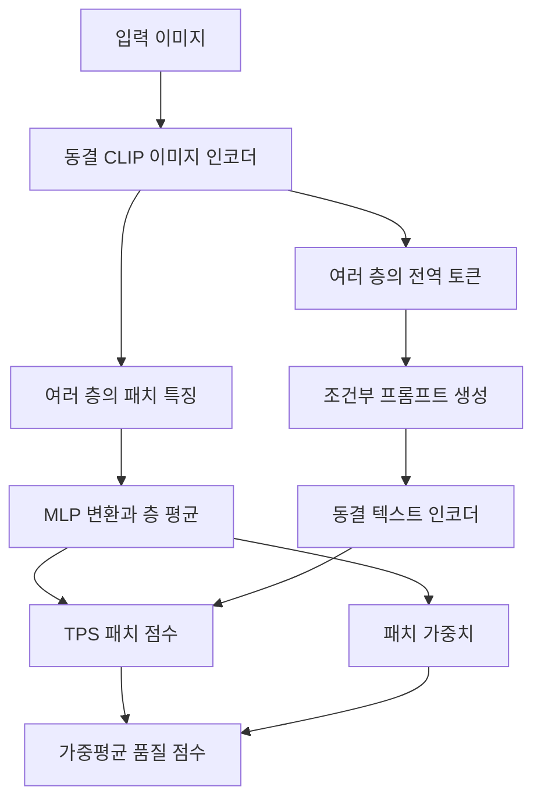

# Text-Guided Patch Scoring and Local Distortion Guidance for Image Quality Assessment

**핵심 판단:** 이 논문의 가장 설득력 있는 성과는 **동결된 시각–언어 모델의 여러 층을 활용하고, 텍스트로 패치 점수를 계산하여 일부 교차 데이터셋 성능을 개선한 것**입니다.  
LDG는 국소 변형에 대한 민감도를 높이지만, 그 개선을 측정한 핵심 평가 기준이 **사람의 평가가 아닌 CW-SSIM 기반 의사 정답**이라는 점을 함께 읽어야 합니다. [본문 pp.792–797, Tables 2–4, Figures 4–5]

### 분석 범위와 표기

- **대상 논문:** Juyong Park, Jihun Song, Gyewan Kim, Yoonsuk Hyun, **CVPR Workshops 2025**, pp.790–799. [openaccess.thecvf.com](https://openaccess.thecvf.com/content/CVPR2025W/NTIRE/html/Park_Text-Guided_Patch_Scoring_and_Local_Distortion_Guidance_for_Image_Quality_CVPRW_2025_paper.html?utm_source=chatgpt.com)
- 아래의 **페이지는 첨부 PDF에 인쇄된 페이지 번호**입니다. 예를 들어 p.793은 PDF의 4번째 페이지입니다.
- **[저자 보고]**는 논문에 제시된 주장·방법·수치, **[분석]**은 그 근거에 대한 제 해석, **[연구 제안]**은 아직 검증되지 않은 후속 실험입니다.
- 본문을 분석의 중심으로 삼고, 공식 보충자료에서 확인한 실험 설정과 2020년 이후 관련 원 논문을 별도로 인용했습니다. 관련 연구는 **2026년 11월 15일 기준 확인한 선별 비교군**이며, 전체 문헌을 망라한 목록은 아닙니다.

---

## 1. Executive summary — 10문장

1. 이 논문은 기준 이미지 없이 품질을 평가하는 모델이 개별 영역의 화질에 집중한 나머지 이미지 전체의 구조적 부자연스러움을 충분히 감점하지 못하는 문제를 다룹니다. [pp.790–791, Figure 1]
2. 저자는 동결된 CLIP-ViT의 여러 층에서 추출한 이미지 특징을 활용하는 **TeMu-IQA**를 제안합니다. [pp.792–793, Figure 3]
3. 핵심 구성요소인 **Text-guided Patch Scoring, TPS**는 각 패치가 “좋은 사진”과 “나쁜 사진”이라는 텍스트 기준에 얼마나 가까운지 계산하고, 패치별 가중평균으로 전체 품질을 예측합니다. [pp.793–794, Eqs.4–6]
4. 층별 변환기를 공유하는 TeMu-IQA-S와 독립적으로 사용하는 TeMu-IQA-I의 학습 가능한 파라미터 수는 각각 **0.7M과 11.2M**입니다. [pp.794–795, Table 1]
5. 데이터셋 내부 평가에서 TeMu-IQA-I는 논문에 수록된 비교 대상 중 KADID-10k·KonIQ-10k·CLIVE·FLIVE에서 최고 수치를 보였지만, SPAQ와 AVA에서는 최고가 아니었습니다. [p.795, Table 1]
6. KonIQ-10k에서 학습한 모델의 교차 데이터셋 평가에서는 TPS가 시각 특징만 사용하는 MLP 점수화보다 특히 KADID-10k·CSIQ·LIVE의 합성 왜곡 데이터에서 좋은 결과를 보였습니다. [p.795, Table 2]
7. 추가 학습 기법인 **Local Distortion Guidance, LDG**는 이미지 일부를 변형하고 원래 품질 점수와 영상 충실도의 곱을 의사 정답으로 사용합니다. [p.794, Eqs.8–11]
8. 생성한 KonIQ-10k 시험 이미지에서 LDG를 추가한 TPS의 SRCC는 **0.8606→0.9204**, PLCC는 **0.8851→0.9332**로 높아졌습니다. [p.796, Figure 5]
9. 다만 이 결과는 CW-SSIM으로 생성한 의사 정답과의 상관 개선이므로, 인간의 구조적 자연스러움 판단을 같은 정도로 개선했다고 해석할 수는 없습니다. **[분석]** [pp.794, 796–797, Eq.10, Figures 4–5]
10. 저자는 느린 추론을 명시적 한계로 인정하며, 더 큰 백본이 교차 데이터셋 성능 향상을 보장하지 않는다는 결과도 보고합니다. [p.797, Table 4, §5]

> **용어 풀이**
>
> - **IQA:** 사람이 느끼는 이미지 품질을 수치로 예측하는 과제입니다.
> - **NR-IQA:** 비교할 고품질 기준 이미지 없이 입력 이미지 하나로 품질을 평가합니다.
> - **CLIP / VLM:** 이미지와 문장의 관계를 학습한 시각–언어 모델입니다.
> - **패치:** 이미지를 나눈 작은 영역입니다.
> - **동결:** 사전학습 모델의 가중치를 추가 학습 중 변경하지 않는다는 뜻입니다.
> - **MLP:** 여러 선형 변환과 비선형 함수를 연결한 기본적인 신경망입니다.
> - **SRCC:** 예측한 품질의 **순서**가 사람의 평가 순서와 얼마나 일치하는지 나타냅니다.
> - **PLCC:** 예측 점수와 정답 점수의 **선형적인 관계**를 나타냅니다.
> - **의사 정답:** 사람이 직접 평가한 값 대신 계산 규칙이나 다른 모델로 만든 학습 목표입니다.

---

## 2. 연구 배경·문제·목표

### 2.1 연구가 해결하려는 문제

**[저자 보고] 첫 번째 문제는 CLIP의 표현을 IQA에 충분히 활용하지 못한다는 점입니다.** 저자는 CLIP-ViT의 마지막 층 전역 토큰이 사물의 의미를 텍스트와 맞추는 데 집중하면서, 왜곡이나 밝기처럼 품질 평가에 필요한 정보를 충분히 반영하지 못할 수 있다고 가정합니다. 이에 중간 층을 포함한 여러 층의 특징이 더 유용한지 조사합니다. [p.792, §3.1]

**[저자 보고] 두 번째 문제는 기존 패치 기반 품질 예측이 시각 정보에 주로 의존한다는 점입니다.** 저자는 VLM이 가진 언어 정보를 패치 점수 계산에 직접 활용하는 구조가 필요하다고 주장합니다. [p.791, Figure 2]

**[저자 보고] 세 번째 문제는 ‘over-localized problem’입니다.** 이미지 일부를 회전하거나 서로 바꾸면 개별 영역의 선명도는 유지될 수 있지만, 사물의 배치나 형태는 부자연스러워집니다. 그럼에도 패치 점수의 집계만으로 품질을 계산하는 모델은 변형된 이미지에 원본과 비슷한 점수를 줄 수 있습니다. [pp.790–791, Figures 1–2]

> **용어 풀이**
>
> - **전역 토큰, $[\text{cls}]$ 토큰:** 이미지 전체 정보를 요약하도록 사용하는 대표 벡터입니다.
> - **다층 특징, multi-level features:** 서로 다른 깊이의 신경망 층에서 얻은 특징입니다. 이미지 해상도를 여러 크기로 바꾸는 *다중 스케일*과는 구별됩니다.
> - **과도한 국소 의존, over-localized problem:** 작은 영역의 품질은 잘 보지만 전체 배치의 이상을 충분히 반영하지 못하는 현상입니다.

**[분석] 이 문제를 “모델이 전역 정보를 전혀 보지 못한다”라고 설명하면 부정확합니다.** ViT의 패치 특징은 다른 패치의 영향을 받을 수 있고, TeMu-IQA는 전역 토큰으로 텍스트 기준도 조절합니다. 논문이 관찰한 문제는 **전역 정보를 사용할 통로가 있어도 최종 품질 점수가 구조적 이상에 충분히 반응하지 않는다는 것**입니다. [Figure 3, Eqs.1–6]

### 2.2 목적과 필요성

연구 목적은 다음 세 가지로 정리할 수 있습니다.

| 목적 | 논문의 대응 방법 | 필요성 |
|---|---|---|
| 품질 평가에 적합한 사전학습 정보 활용 | 마지막 층뿐 아니라 여러 층의 특징 통합 | 의미 중심 표현에 품질 관련 정보를 보완 |
| VLM에 적합한 패치 점수화 | TPS와 이미지 조건부 프롬프트 | 이미지–텍스트 지식을 패치 품질 판단에 사용 |
| 국소 변형에 대한 취약성 완화 | LDG로 변형 이미지의 품질 점수를 추가 지도 | 비용이 큰 패치별 인간 주석 없이 구조 변형 사례를 학습 |

**근거:** pp.791–794, §§3.1–3.3, Figures 2–3.

실용적 배경으로 저자는 이미지 압축·복원·생성에서 자동 품질 평가가 필요하다고 설명합니다. 다만 이 논문이 해당 응용 시스템의 실제 운영 성능까지 검증한 것은 아니며, 실험은 주로 IQA 데이터셋에서 이루어집니다. [p.790, §1; pp.794–797, §4]

---

## 3. 핵심 주장과 근거

| 핵심 주장 | 저자가 제시한 근거 | 근거의 해석 범위 |
|---|---|---|
| 여러 층의 CLIP 특징이 마지막 층만 사용하는 것보다 유용하다 | CLIP-ViT-L/14에서 모든 층의 전역 토큰을 쓰면 SPAQ의 SRCC·PLCC가 각각 **103.9%·106.1% 상대 증가**했다고 보고 [p.792, §3.1] | 해당 설정에서의 상대 증가율이다. 전체 IQA 성능이 보편적으로 두 배라는 의미는 아니다. |
| 적은 학습 파라미터로 높은 성능을 얻는다 | S: **0.7M**, I: **11.2M**; I는 Table 1의 6개 데이터셋 중 4개에서 최고 [pp.794–795, Table 1] | 전체 모델 크기나 추론 비용을 의미하지 않는다. |
| TPS가 일반화에 기여한다 | I 모델에서 MLP→TPS 변경 시 KonIQ→LIVE의 SRCC **0.885→0.920**, PLCC **0.873→0.910** [p.795, Table 2] | 합성 왜곡 데이터로의 전이에서 근거가 강하다. 모든 대상 데이터셋에서 우세하지는 않다. |
| LDG가 국소 변형에 대한 민감도를 높인다 | 생성 KonIQ에서 TPS의 SRCC **0.8606→0.9204** [p.796, Figure 5] | CW-SSIM 의사 정답과의 일치도 개선이다. |
| LDG가 기존 벤치마크 성능을 대체로 유지한다 | TPS에 LDG 추가 시 SPAQ는 동일하고, KonIQ·CLIVE는 소폭 상승, KADID SRCC는 0.001 하락 [p.796, Table 3] | 수치상 유지에 가깝다. 통계적 동등성을 검증한 것은 아니다. |
| 여러 VLM에서도 구조가 작동한다 | OpenAI CLIP·OpenCLIP·CoCa·BEIT-3·EVA-CLIP 비교 [p.797, Table 4] | 여러 백본에서 재사용 가능성을 보이지만 예외가 존재한다. |
| 큰 백본이 일반화를 보장하지 않는다 | OpenCLIP-H/14는 KonIQ에서 높지만 CLIVE·SPAQ에서는 OpenAI-L/14보다 낮음 [p.797, Table 4] | 모델 크기·사전학습 조건·목표 도메인을 함께 평가해야 한다는 근거다. |

> **용어 풀이**
>
> - **백본:** 모델에서 주요 특징을 추출하는 중심 신경망입니다.
> - **일반화:** 학습에 사용하지 않은 데이터에서도 유효한 예측을 하는 능력입니다.
> - **교차 데이터셋 평가:** 한 데이터셋에서 학습하고 다른 데이터셋에서 평가하는 방식입니다.
> - **상대 증가율:** 기존 값에 비해 얼마나 증가했는지를 나타냅니다. 상관계수 자체의 차이, 정확도 증가율, 오류 감소율과는 서로 다릅니다.

---

## 4. 연구 수행 방식과 주요 데이터 소스

### 4.1 데이터와 평가 목적

| 데이터·자료 | 성격 | 논문에서의 용도 |
|---|---|---|
| KonIQ-10k, SPAQ, CLIVE, FLIVE | 실제 촬영 이미지의 품질 평가 | 데이터셋 내부 학습·평가 및 일부 교차 평가 |
| KADID-10k | 인위적으로 왜곡한 이미지 | 내부 평가와 실제→합성 왜곡 전이 평가 |
| CSIQ, LIVE | 합성 왜곡 품질 평가 데이터 | 교차 데이터셋 일반화 평가 |
| AGIQA-3K | AI 생성 이미지 품질 평가 | 생성 이미지로의 전이 평가 |
| AVA | 이미지의 미적 품질 평가 | 미학적 평가 과제에서의 성능 확인 |
| 기존 시험 이미지에 국소 변형을 적용한 자료 | 회전·영역 교환 등으로 생성 | LDG와 과도한 국소 의존 문제 평가 |

**근거:** pp.794–796, Tables 1–2, §4.3; 공식 보충자료 §6. [openaccess.thecvf.com](https://openaccess.thecvf.com/content/CVPR2025W/NTIRE/supplemental/Park_Text-Guided_Patch_Scoring_CVPRW_2025_supplemental.pdf?utm_source=chatgpt.com)

> **용어 풀이**
>
> - **합성 왜곡:** 잡음·흐림·압축 등을 인위적으로 적용해 만든 열화입니다.
> - **미적 품질:** 선명도나 잡음뿐 아니라 구도·색감 등 이미지의 미적 선호와 관련된 평가입니다.
> - **MOS, Mean Opinion Score:** 여러 사람이 평가한 주관적 점수의 평균입니다.

### 4.2 학습·시험 분할

**[저자 보고]**

- KonIQ-10k·FLIVE·AVA는 공식 학습–시험 분할을 사용합니다.
- 나머지 내부 평가 데이터셋은 학습 80%, 시험 20%로 무작위 분할합니다.
- 공식 분할이 없는 경우 **10개 무작위 분할 결과의 평균**을 보고합니다.
- Table 2는 KonIQ-10k에서 학습하고 다른 데이터셋에서 추가 학습 없이 평가합니다. [pp.794–795, §§4.1–4.2]

여기서 논문의 **zero-shot** 표현은 주로 **대상 데이터셋에서 추가 학습하지 않았다는 의미**입니다. TeMu-IQA 자체는 원천 데이터셋의 MOS로 학습한 모델입니다. [Tables 2, 4]

### 4.3 확인된 구현 설정

보충자료 §6에 따르면, 기본 백본은 OpenAI CLIP-ViT-L/14이며 A6000 한 대에서 Adam, 배치 크기 32, 학습률 0.002와 cosine-annealing을 사용합니다. 일반적으로 30 epoch, FLIVE·AVA는 5 epoch를 학습합니다. 입력은 보통 $448\times448$이며 KADID-10k는 원 해상도를 유지하고, MOS는 손실 계산을 위해 $[0,1]$로 정규화합니다. [openaccess.thecvf.com](https://openaccess.thecvf.com/content/CVPR2025W/NTIRE/supplemental/Park_Text-Guided_Patch_Scoring_CVPRW_2025_supplemental.pdf?utm_source=chatgpt.com)

> **용어 풀이**
>
> - **Epoch:** 학습 데이터를 한 번씩 처리하는 단위입니다.
> - **Cosine-annealing:** 학습이 진행되면서 학습률을 코사인 곡선 형태로 조절하는 방식입니다.

---

## 5. 제안 방법과 모델 구조 — 수식 중심 설명

### 5.1 전체 구조

TeMu-IQA에는 두 특징 처리 경로가 있습니다. 하나는 **패치별 이미지 특징**을 만들고, 다른 하나는 **입력 이미지에 맞게 조건화된 텍스트 특징**을 만듭니다. 이후 패치 점수와 패치 가중치를 계산합니다. [p.793, Figure 3]



*Figure 3의 흐름을 재구성한 도식입니다.*

**동결되는 구성:** 이미지 인코더, 텍스트 인코더, 원 CLIP의 LayerNorm·projection.  
**학습되는 구성:** 패치 변환 MLP, 가중치 MLP, MetaNet, 학습 프롬프트. [Figure 3]

**중요한 구분:** 텍스트 기준은 이미지마다 달라질 수 있지만, 한 이미지 안에서는 모든 패치가 동일한 두 텍스트 특징을 사용합니다. 패치마다 별도의 문장을 생성하는 모델은 아닙니다. [Eq.2, Eq.4]

### 5.2 입력과 다층 특징 추출 — 원문 식 (1)

입력 이미지는 $I\in\mathbb{R}^{3\times H\times W}$입니다.

$$
\text{PE}'=\text{Resize}(\text{PE}),
\qquad
F_0=[C_0,P_0]+\text{PE}'
$$

$$
F_l=B_l(F_{l-1}),
\qquad l\in\{1,\dots,N\}.
$$

**기호 설명**

- $H,W$: 이미지 높이와 너비.
- $h,w$: 패치 격자의 높이와 너비.
- $D$: 이미지 인코더 내부 특징 차원.
- $P_0\in\mathbb{R}^{hw\times D}$: 초기 패치 특징.
- $C_0\in\mathbb{R}^{D}$: 초기 전역 토큰.
- $\text{PE}$: 원래 위치 임베딩.
- $\text{PE}'$: 현재 토큰 수에 맞게 크기를 조정한 위치 임베딩.
- $[\cdot,\cdot]$: 토큰들을 이어 붙이는 연산.
- $B_l$: $l$번째 이미지 인코더 블록.
- $F_l$: $l$번째 층의 전체 토큰.
- $N$: 이미지 인코더의 층 수.

각 $F_l$에서 전역 토큰 $C_l$과 패치 특징 $P_l$을 분리하여 다음 단계에 사용합니다. [pp.792–793, Eq.1]

> **쉽게 이해하기:** 마지막 층의 결과만 꺼내는 대신, 신경망이 이미지를 처리하는 여러 단계의 정보를 모두 꺼냅니다.
>
> **위치 임베딩:** 각 패치가 이미지의 어디에 있는지를 알려주는 벡터입니다.

### 5.3 이미지 조건부 텍스트 특징 — 원문 식 (2)

```math
\widetilde C_l
=
\text{Proj}\bigl(\text{LayerNorm}(C_l)\bigr)
```

```math
C_{\text{mean}}
=
\text{mean}(\widetilde C_1,\dots,\widetilde C_N)
```

```math
\widetilde L_p
=
L_p+\text{MetaNet}(C_{\text{mean}})
```

```math
t_1,t_2
=
E_T(\widetilde L_p\oplus T).
```

**기호 설명**

- $C_l$: $l$번째 층의 전역 토큰.
- $\text{LayerNorm}$: 특징의 분포를 정규화하는 연산.
- $\text{Proj}$: 원 CLIP의 projection으로, $D$차원 특징을 $C$차원으로 변환.
- $C_{\text{mean}}$: 변환된 전역 토큰들을 층 방향으로 평균한 특징.
- $L_p$: 학습 가능한 프롬프트 벡터.
- $\text{MetaNet}$: 입력 이미지에 맞는 조건부 벡터를 생성하는 Linear–ReLU–Linear 네트워크.
- $\widetilde L_p$: 이미지 정보가 반영된 프롬프트.
- $T$: “Good photo.”와 “Bad photo.”의 텍스트 임베딩.
- $\oplus$: CoCoOp 방식으로 프롬프트와 텍스트 임베딩을 결합하는 연산.
- $E_T$: 동결된 텍스트 인코더.
- $t_1,t_2\in\mathbb{R}^{C}$: 각각 좋은 사진과 나쁜 사진에 대응하는 텍스트 특징.

**의미:** 고정된 두 문장을 그대로 비교 기준으로 쓰는 데서 더 나아가, 현재 이미지의 전역 정보를 이용해 그 기준을 조절합니다. [p.793, Eq.2]

> **용어 풀이**
>
> - **프롬프트 학습:** 사람이 문장을 계속 바꾸는 대신, 입력에 붙는 벡터를 학습해 모델을 과제에 맞추는 방식입니다.
> - **CoCoOp:** 입력 이미지의 특징에 따라 프롬프트를 조정하는 조건부 프롬프트 학습 방식입니다.
> - **ReLU:** 음수 입력은 0으로, 양수 입력은 그대로 통과시키는 비선형 함수입니다.

### 5.4 다층 패치 특징 통합 — 원문 식 (3)

```math
\widetilde P_l
=
\text{MLP}_p\bigl(\text{L2Norm}(P_l)\bigr)
```

```math
P_{\text{mean}}
=
\text{mean}(\widetilde P_1,\dots,\widetilde P_N)
```

```math
\text{IF}
=
\text{L2Norm}(P_{\text{mean}}).
```

**기호 설명**

- $P_l\in\mathbb{R}^{hw\times D}$: $l$번째 층의 패치 특징.
- $\text{MLP}_p$: 패치 특징을 $D$차원에서 $C$차원으로 변환하는 MLP.
- $\widetilde P_l\in\mathbb{R}^{hw\times C}$: 변환된 패치 특징.
- $P_{\text{mean}}$: 같은 공간 위치에 해당하는 패치의 층별 특징 평균.
- $\text{IF}\in\mathbb{R}^{hw\times C}$: 최종 패치별 이미지 특징.
- $\text{L2Norm}$: 벡터를 자신의 길이로 나누는 정규화.

여기서 평균은 **층 사이에서 수행**됩니다. 모든 공간 패치를 하나의 벡터로 합치는 것이 아니므로, 패치별 품질 평가가 가능합니다. [p.793, Eq.3]

| 모델 | 패치 변환 방식 | 학습 가능한 파라미터 |
|---|---|---:|
| TeMu-IQA-S | 모든 층이 하나의 $\text{MLP}_p$ 공유 | 0.7M |
| TeMu-IQA-I | 층마다 독립적인 $\text{MLP}_p$ 사용 | 11.2M |

**근거:** pp.794–795, §4.1, Table 1.

> **쉽게 이해하기:** S는 모든 층의 특징을 같은 변환기로 처리하고, I는 층마다 전용 변환기를 둡니다.

### 5.5 텍스트 유도 패치 점수 — 원문 식 (4)

```math
s_{ij}
=
\frac{\text{IF}_i\odot t_j}
{\|\text{IF}_i\|\,\|t_j\|}
```

```math
s_i
=
\frac{e^{s_{i1}}}
{e^{s_{i1}}+e^{s_{i2}}}.
```

**기호 설명**

- $i\in\{1,\dots,hw\}$: 패치 번호.
- $j\in\{1,2\}$: 좋은 사진·나쁜 사진 텍스트의 번호.
- $\text{IF}_i$: $i$번째 패치의 이미지 특징.
- $t_j$: 해당 텍스트 특징.
- $s_{ij}$: 패치와 텍스트의 코사인 유사도.
- $s_i$: 두 텍스트 중 좋은 사진 쪽에 대응하는 점수.
- $\|\cdot\|$: 벡터의 L2 길이.
- **$\odot$는 이 논문에서 내적을 뜻합니다.**

원문 표기상 $\odot$를 원소별 곱으로 해석하면 안 됩니다. [p.793, Eq.4]

> **용어 풀이**
>
> - **코사인 유사도:** 두 벡터가 얼마나 비슷한 방향을 가리키는지 측정합니다.
> - **Softmax:** 여러 값을 합이 1이 되는 상대적 점수로 변환합니다.
> - 여기의 $s_i$는 학습된 품질 점수이며, 사람이 해당 패치를 “좋다”고 판단할 확률로 보정되었다는 증거는 제시되지 않습니다.

### 5.6 패치 가중치와 이미지 점수 — 원문 식 (5), (6)

```math
w_i
=
\sigma\bigl(\text{MLP}_w(\text{IF}_i)\bigr).
```

```math
\bar s
=
\frac{\sum_{i=1}^{hw}w_i s_i}
{\sum_{k=1}^{hw}w_k}.
```

**기호 설명**

- $\text{MLP}_w$: 패치 특징에서 가중치를 추출하는 MLP.
- $\sigma$: sigmoid 함수.
- $w_i$: 패치의 기여도.
- $s_i$: TPS로 계산한 패치 품질 점수.
- $\bar s$: 이미지 전체 품질 점수.
- $i,k$: 패치 인덱스.

즉, **각 패치가 얼마나 좋은가**와 **그 패치를 얼마나 반영할 것인가**를 별도로 계산합니다. [pp.793–794, Eqs.5–6]

> **Sigmoid:** 입력을 0과 1 사이로 바꾸는 함수입니다.
>
> **해석 주의:** 학습된 가중치가 실제 인간의 시선이나 지각적 중요도와 일치한다는 검증은 제시되지 않습니다.

### 5.7 기본 품질 학습 손실 — 원문 식 (7)

저자는 MSE와 PLCC 기반 손실을 사용합니다.

```math
\mathcal L_{\text{mse}}
=
\frac{1}{m}
\sum_{i=1}^{m}(t_i-\bar s_i)^2
```

```math
\mathcal L_{\text{plcc}}
=
\frac{1}{2}
\left(
1-
\frac{
\sum_{i=1}^{m}(t_i-\widetilde t)(\bar s_i-\widetilde s)
}{
\sqrt{
\sum_{i=1}^{m}(t_i-\widetilde t)^2
\sum_{i=1}^{m}(\bar s_i-\widetilde s)^2
}
}
\right).
```

**기호 설명**

- $m$: 배치의 이미지 수.
- $t_i$: $i$번째 이미지의 정답 품질 점수.
- $\bar s_i$: 해당 이미지의 예측 점수.
- $\widetilde t,\widetilde s$: 정답 및 예측 점수의 배치 평균.
- $\mathcal L_{\text{mse}}$: 점수 차이의 제곱 평균.
- $\mathcal L_{\text{plcc}}$: 정답과 예측의 선형 상관이 커지도록 하는 손실.

**원문 표기 주의:** 식 (7)의 분모 두 번째 합에는 상한이 $N$으로 인쇄되어 있지만, 설명에서는 배치 크기를 $m$으로 정의합니다. 위 식은 이를 **$m$으로 통일한 문맥상 정리식**이므로 $(7*)$로 표시했습니다. 또한 여기의 $t_i$는 식 (2)의 텍스트 특징과 다른 의미로 사용됩니다. [p.794, Eq.7]

> **쉽게 이해하기:** MSE는 “점수를 얼마나 틀렸는가”를 줄이고, PLCC 손실은 “점수들이 정답과 함께 증가·감소하는가”를 맞춥니다.

### 5.8 LDG: 변형 영역 선택 — 원문 식 (8)

$$
B_w\sim U(w_{\min},w_{\max}),
\qquad
B_h\sim U(h_{\min},h_{\max})
$$

$$
x_{\max}=W-B_w,
\qquad
y_{\max}=H-B_h
$$

$$
x_0\sim U(1,x_{\max}),
\qquad
y_0\sim U(1,y_{\max})
$$

$$
x_1=x_0+B_w,
\qquad
y_1=y_0+B_h.
$$

**기호 설명**

- $B=(x_0,y_0,x_1,y_1)$: 변형할 직사각형 영역.
- $B_w,B_h$: 영역의 너비와 높이.
- $U$: 균등분포.
- $w_{\min},w_{\max},h_{\min},h_{\max}$: 영역 크기의 최소·최대 설정값.
- $W,H$: 전체 이미지 크기.

이미지 내부에서 크기와 위치가 무작위인 영역을 선택합니다. [p.794, Eq.8]

### 5.9 국소 변형 이미지 생성 — 원문 식 (9)

```math
\widetilde I
=
M_B\circ\text{RandAugment}(I)
+
(1-M_B)\circ I.
```

**기호 설명**

- $I$: 변형 전 이미지.
- $\widetilde I$: 국소 변형 이미지.
- $M_B\in\{0,1\}^{H\times W}$: 선택 영역 안은 1, 밖은 0인 마스크.
- $\circ$: 원소별 곱.
- $\text{RandAugment}$: 여러 영상 변형을 적용하는 데이터 증강 방법.

선택 영역에는 변형 결과를 넣고, 나머지 영역은 원본으로 유지합니다. [p.794, Eq.9]

### 5.10 의사 정답과 추가 손실 — 원문 식 (10), (11)

```math
\widetilde q
=
q\cdot f(I,\widetilde I).
```

```math
\mathcal L_d
=
\frac{1}{d}
\sum_{i=1}^{d}
(\widetilde s_i-\widetilde q_i)^2.
```

**기호 설명**

- $q$: 변형 전 이미지의 정답 품질.
- $f(I,\widetilde I)$: 변형 전후 이미지 사이의 충실도.
- $\widetilde q$: 변형 이미지의 의사 정답.
- $d$: 변형 이미지 수.
- $\widetilde s_i$: 변형 이미지의 예측 품질.
- $\mathcal L_d$: 예측과 의사 정답의 MSE.

저자는 $f$에 **CW-SSIM**을 사용합니다. 따라서 실제 LDG는 **패치별 인간 정답으로 지도하는 방식이 아니라, 변형 이미지 전체에 부여한 의사 점수를 학습하는 방식**입니다. [p.794, Eqs.10–11]

> **용어 풀이**
>
> - **FR-IQA:** 두 이미지를 비교해 품질이나 충실도를 평가하는 방식입니다.
> - **CW-SSIM:** 복소 웨이블릿 기반 구조 유사도를 이용하는 영상 비교 지표입니다.
> - 이 연구에서 비교 기준은 변형 전 이미지이며, 반드시 완벽한 무왜곡 이미지일 필요는 없습니다.
> - FR-IQA는 의사 정답 생성에 사용됩니다. 완성된 TeMu-IQA의 추론에는 기준 이미지가 필요하지 않습니다.

**[분석] 식 (10)에 포함된 가정도 중요합니다.**

```math
q-\widetilde q
=
q\bigl(1-f(I,\widetilde I)\bigr).
```

같은 충실도 감소가 있어도 원래 점수 $q$가 낮으면 감점 폭은 작아집니다. 이는 식에서 직접 도출되는 성질이며, **인간의 품질 판단이 이 곱셈 관계를 따른다는 검증은 제시되지 않습니다.**

또한 본문은 세 손실을 정의하지만, $\mathcal L_{\text{mse}}$, $\mathcal L_{\text{plcc}}$, $\mathcal L_d$를 어떤 계수로 결합하는지에 대한 완전한 전체 목적함수는 명시하지 않습니다. 임의의 가중합을 저자의 수식으로 보완해서는 안 됩니다. [p.794]

---

## 6. 주요 결과와 일반화 성능

아래 수치는 모두 **SRCC / PLCC** 순서입니다.

### 6.1 데이터셋 내부 성능

**[저자 보고] Table 1, p.795**

| 데이터셋 | TeMu-IQA-S | TeMu-IQA-I | 논문 내 비교 결과 |
|---|---:|---:|---|
| KADID-10k | 0.940 / 0.942 | **0.943 / 0.944** | I가 두 지표 최고 |
| KonIQ-10k | 0.943 / 0.954 | **0.946 / 0.957** | I가 두 지표 최고 |
| SPAQ | 0.929 / 0.932 | 0.930 / 0.933 | ONEALIGN: **0.932 / 0.935** |
| CLIVE | 0.902 / 0.926 | **0.911 / 0.932** | I가 두 지표 최고 |
| FLIVE | 0.766 / 0.797 | **0.770 / 0.798** | I가 두 지표 최고 |
| AVA | 0.808 / 0.807 | 0.811 / 0.811 | ONEALIGN: **0.823 / 0.819** |

**[분석]**

- “여러 데이터셋에서 경쟁력이 높다”는 주장은 표가 뒷받침합니다.
- “모든 데이터셋에서 최고”라는 주장은 맞지 않습니다.
- FLIVE에서는 비교표의 MANIQA 0.731/0.753보다 I의 수치가 상당히 높습니다.
- 반면 KADID-10k의 기존 최고 0.941/0.942 대비 차이는 0.002/0.002로 작습니다. 작은 차이의 통계적 의미는 별도로 확인해야 합니다. [Table 1]

### 6.2 일반화의 핵심: TPS와 MLP의 직접 비교

**[저자 보고] KonIQ-10k에서 학습한 교차 평가, Table 2, p.795**

| 대상 데이터셋 | TeMu-IQA-S | TeMu-IQA-I: TPS | MLP Scoring-I |
|---|---:|---:|---:|
| SPAQ | 0.896 / 0.897 | 0.900 / 0.901 | 0.899 / 0.901 |
| CLIVE | 0.885 / 0.907 | 0.889 / 0.909 | 0.888 / 0.910 |
| AGIQA-3K | 0.715 / 0.776 | 0.715 / 0.772 | 0.715 / **0.788** |
| KADID-10k | 0.693 / 0.694 | **0.689 / 0.694** | 0.662 / 0.671 |
| CSIQ | 0.816 / 0.841 | **0.812 / 0.842** | 0.791 / 0.821 |
| LIVE | 0.929 / 0.922 | **0.920 / 0.910** | 0.885 / 0.873 |

*굵은 표시는 TPS-I와 MLP-I의 비교에서 주목할 값이며, 전체 표의 최고값을 뜻하지 않습니다.*

**[분석] 일반화에 관한 가장 강한 결론은 다음과 같습니다.**

1. **실제 촬영 데이터에서 학습한 뒤 합성 왜곡 데이터로 옮길 때 TPS의 이점이 뚜렷합니다.** I 모델끼리 비교하면 SRCC 개선은 KADID +0.027, CSIQ +0.021, LIVE +0.035입니다. [Table 2]
2. **실제 촬영 데이터 사이의 전이에서는 차이가 작습니다.** SPAQ·CLIVE에서 TPS와 MLP의 차이는 약 0.001 수준이거나 동률입니다. [Table 2]
3. **생성 이미지 일반화는 해결되지 않았습니다.** AGIQA-3K에서 TPS-I의 PLCC는 MLP-I보다 낮으며, Q-ALIGN의 SRCC 0.735도 TeMu의 0.715보다 높습니다. [Table 2]
4. **큰 학습 모듈이 더 잘 일반화한다고 볼 수 없습니다.** S는 I보다 작은데도 KADID·CSIQ·LIVE의 SRCC가 높습니다. 다만 이를 곧바로 “I의 과적합 때문”이라고 단정할 실험은 없습니다. [Table 2]

### 6.3 LDG가 기존 벤치마크에 미친 영향

**[저자 보고] Table 3, p.796**

| 데이터셋 | TPS | TPS + LDG | 절대 변화 |
|---|---:|---:|---:|
| KonIQ-10k | 0.946 / 0.957 | 0.949 / 0.959 | +0.003 / +0.002 |
| SPAQ | 0.930 / 0.933 | 0.930 / 0.933 | 0 / 0 |
| CLIVE | 0.911 / 0.932 | 0.912 / 0.933 | +0.001 / +0.001 |
| KADID-10k | 0.943 / 0.944 | 0.942 / 0.944 | −0.001 / 0 |

**[분석]** LDG의 주된 성과는 기존 벤치마크의 큰 점수 상승보다 **국소 변형에 대한 취약성을 완화하면서 기존 성능을 대체로 유지한 것**입니다. 또한 Table 2는 LDG 유무를 직접 비교한 실험이 아니므로, 그 교차 데이터셋 성능을 LDG의 효과로 귀속하면 안 됩니다. [Tables 2–3]

### 6.4 LDG의 국소 변형 평가

**[저자 보고] 생성 KonIQ-10k, Figure 5, p.796**

| 점수화 방식 | LDG 없음 | LDG 적용 |
|---|---:|---:|
| TPS | 0.8606 / 0.8851 | **0.9204 / 0.9332** |
| MLP Scoring | 0.8566 / 0.8762 | **0.9217 / 0.9337** |

TPS의 개선은 SRCC 절대 **+0.0598**, PLCC 절대 **+0.0481**이며, 저자가 제시한 상대 증가율은 각각 **6.95%, 5.44%**입니다. [Figure 5]

**[분석]**

- MLP에도 비슷한 개선이 나타나므로, LDG는 TPS에만 종속된 아이디어가 아닙니다.
- 이 평가에서는 MLP+LDG가 TPS+LDG보다 수치상 조금 높습니다.
- 학습은 직사각형 영역과 RandAugment를 사용하지만, 시험은 회전·영역 교환 및 다양한 모양을 사용합니다. 따라서 **학습 때와 다른 국소 변형으로의 전이**를 보여준다는 장점이 있습니다.
- 동시에 시험 정답도 CW-SSIM으로 만들어집니다. 따라서 **인간 지각에 대한 타당성은 별도 검증 과제**입니다. [p.796, §4.3, Figure 5]

### 6.5 백본 변경 결과

저자는 5개 VLM 계열의 6개 설정을 비교합니다. 대부분의 설정에서 TeMu-IQA-I가 해당 백본의 CLIP-IQA+보다 높지만, OpenAI CLIP-ViT-L/14의 KADID-10k에서는 SRCC가 **0.703→0.689**로 낮아지고 PLCC는 **0.687→0.694**로 높아집니다. [p.797, Table 4]

또한 OpenCLIP-H/14의 KonIQ 성능은 **0.951/0.962**로 OpenAI-L/14의 **0.946/0.957**보다 높지만, CLIVE에서는 각각 **0.883/0.905**, **0.889/0.909**로 순서가 뒤집힙니다. [Table 4]

**[분석]** 백본 선택은 학습 데이터셋 점수와 목표 도메인 점수를 함께 보고 결정해야 합니다. 다만 백본 크기와 사전학습 조건이 함께 달라지는 비교이므로, 이를 모델 크기만의 인과적 효과로 해석할 수는 없습니다.

---

## 7. 가장 중요한 그림과 해석

| 우선순위·그림 | 무엇을 보여주는가 | 읽을 때 주의할 점 |
|---|---|---|
| **1순위: Figure 3, p.793** | 다층 패치 특징, 전역 토큰 기반 조건부 프롬프트, TPS, 패치 가중합의 연결 | 모델의 실질적 기여를 이해하는 핵심 그림이다. 동결·학습 구성요소를 구분해야 한다. |
| **2순위: Figure 4, p.796** | 원본과 국소 변형 이미지 8개 사례에서 LDG 전후 점수 변화 | TPS 자체만으로 구조 이상이 해결되지 않으며, MLP에도 LDG가 유효함을 보여준다. |
| **3순위: Figure 5, p.796** | 생성 이미지의 의사 정답과 예측 점수 산점도 | 축의 정답은 인간 MOS가 아니라 pseudo-GT다. |
| Figure 2, p.791 | CLIP-IQA+·MANIQA·TeMu-IQA·LDG의 개념적 관계 | FR-IQA는 LDG 데이터 생성에 쓰이며, 추론 시 기준 이미지를 요구하는 것은 아니다. |
| Figure 1, p.790 | 과도한 국소 의존을 설명하는 대표 사례 | Figure 4에도 포함되는 예시이므로 별개의 독립 검증으로 세면 안 된다. |

### Figure 4에서 가장 중요한 두 사례

**침실 사례:** 원본 정답과 변형 의사 정답은 **0.344/0.268**입니다. TPS만 사용하면 예측이 **0.359/0.354**로 거의 변하지 않지만, LDG를 적용하면 **0.355/0.265**로 변형 이미지가 감점됩니다. [Figure 4]

**새의 목이 부자연스럽게 변형된 사례:** 원본 정답은 **0.655**, CW-SSIM은 **0.919**, 의사 정답은 **0.602**입니다. 저자는 구조적 부자연스러움을 고려하면 충실도 0.919가 너무 높다고 볼 여지가 있음을 인정합니다. [pp.796–797, Figure 4]

**[분석]** 두 번째 사례는 LDG의 장점과 한계를 동시에 드러냅니다. 학습 목표를 자동 생성할 수 있지만, 그 목표가 의미적 오류의 심각성을 적절히 반영하지 못하면 모델도 잘못된 기준을 배울 수 있습니다.

---

## 8. 제한사항·통계적 취약성·직접 비교하기 어려운 수치

### 8.1 저자가 직접 언급한 한계

**느린 추론.** 배치 크기 32의 1회 처리에서 이미지 인코더에 약 **1.7초**, TeMu-IQA-I의 추가 모듈에 약 **0.3초**가 필요하다고 보고합니다. 저자는 주요 병목을 CLIP-ViT 인코더로 설명합니다. [p.797, §5]

**백본 확장의 제한.** 더 큰 백본이 대상 데이터셋에서의 성능을 자동으로 높이지 않습니다. [p.797, §4.4]

**충실도 함수의 제한.** CW-SSIM이 구조적으로 부자연스러운 변형을 충분히 감점하지 않을 수 있습니다. 저자는 다른 함수나 상수 함수로 변경할 수 있다고 설명합니다. [pp.796–797]

### 8.2 분석자가 지적하는 통계·비교상의 취약점

| 표시 | 항목 | 무엇이 취약하거나 비교 조건이 다른가 |
|---|---|---|
| **통계적 불확실성** | 작은 성능 차이 | 본문은 표준편차·신뢰구간·유의성 검정을 제시하지 않는다. 특히 0.001–0.004 차이는 수치상 우위와 통계적 우위를 구분해야 한다. [Tables 1–4] |
| **통계적 불확실성** | 반복 분할 | 10개 분할의 평균은 있지만 개별 결과와 변동 범위가 본문에 없다. [p.794] |
| **통제 비교 제한** | 기준 모델 수치 | 원 논문 값, 다른 논문에서 가져온 값, 저자 재현 값이 섞여 있다. 동일 코드·전처리·학습 예산의 비교로 보기 어렵다. [pp.794–795] |
| **학습 조건 상이** | ONEALIGN | 여러 데이터셋을 공동 학습한다. 단일 데이터셋 TeMu-IQA와 학습 데이터 예산이 같지 않다. [p.795] |
| **모델 조건 상이** | CLIP-IQA+ | Tables 1–2의 ResNet 기반 비교와 Table 4의 여러 ViT 기반 비교는 같은 실험 설정이 아니다. [pp.794, 797] |
| **지표 해석 제한** | 학습 파라미터 수 | 동결된 인코더 실행 비용이 제외된다. S의 0.7M을 전체 모델 크기나 실시간 추론의 근거로 사용할 수 없다. [Table 1, §5] |
| **평가 대상 상이** | AVA와 왜곡 중심 데이터셋 | 미적 평가와 왜곡 품질 평가를 동일한 과제로 취급하거나 상관계수를 단순 평균해 포괄적 순위를 만들기 어렵다. [Table 1] |
| **인간 타당성 미검증** | LDG 의사 정답 | 학습과 생성 시험의 목표 모두 CW-SSIM 기반이다. 인간 판단 개선과 평가 함수 모사의 효과를 분리하기 어렵다. [Eq.10, Figure 5] |
| **분할 확인 필요** | 합성 데이터의 원본 공유 | 같은 원본에서 나온 여러 왜곡본이 원본 ID 단위로 분리되었는지 본문 설명만으로 명확하지 않다. 실제 누수가 있었다고 단정할 수는 없다. [p.794] |
| **기제 미확인** | 구조적 일관성 이해 | 의미적 부자연스러움을 이해한 것인지, 변형 경계나 배치 변화의 단서를 감지한 것인지 분리하는 실험은 제시되지 않는다. [Figures 4–5] |

보충자료는 가장 좋은 epoch의 가중치를 사용한다고 설명하지만, 확인된 설명에서는 독립 검증셋으로 선택했는지가 명확하지 않습니다. 따라서 모델 선택 기준도 재현 시 확인할 사항입니다. [openaccess.thecvf.com](https://openaccess.thecvf.com/content/CVPR2025W/NTIRE/supplemental/Park_Text-Guided_Patch_Scoring_CVPRW_2025_supplemental.pdf?utm_source=chatgpt.com)

> **용어 풀이**
>
> - **신뢰구간:** 반복적으로 데이터를 얻는 상황을 고려하여 추정값의 불확실성을 표현하는 구간입니다.
> - **데이터 누수:** 시험에 사용될 정보가 학습이나 모델 선택 과정에 들어가 평가를 낙관적으로 만드는 문제입니다.
> - **통제 비교:** 비교하려는 요소 외의 조건을 가능한 한 동일하게 유지하는 실험입니다.

### 8.3 수식에서 확인해야 할 재현 문제

앞서 언급한 식 (7)의 $N/m$ 불일치 외에, **식 (4)에는 temperature나 logit scale이 표기되어 있지 않습니다.** [p.793]

**[분석: 수학적 점검]** 식을 그대로 적용하면 코사인 유사도는 $[-1,1]$ 범위이므로,

```math
s_i
=
\sigma(s_{i1}-s_{i2})
\in
[\sigma(-2),\sigma(2)]
\approx
[0.119,0.881].
```

양의 가중평균인 식 (6)의 출력도 같은 범위에 있습니다. 반면 p.797에는 $f=0$으로 학습하면 변형 이미지 점수가 0에 매우 가까워진다는 설명이 있습니다.

따라서 **실제 구현의 점수 스케일과 출력 범위를 확인할 필요가 있습니다.** 이것만으로 구현 오류가 확정된 것은 아니며, CLIP에서 흔히 사용한다는 이유로 임의의 스케일을 원문 수식에 추가해서도 안 됩니다.

---

## 9. 문서가 충분히 답하지 않는 질문

1. **LDG가 사람의 구조적 부자연스러움 판단도 개선하는가?**  
   생성 변형에 대한 핵심 평가는 의사 정답에 기반하므로 독립 인간 평가가 필요합니다. [Figure 5]

2. **왜 $q\times f$가 적절한 품질 모델인가?**  
   곱셈 규칙의 지각적 타당성, 원래 MOS 수준에 따른 감점 차이, 다른 충실도 함수에 대한 민감도가 충분히 규명되어 있지 않습니다. [Eq.10, pp.796–797]

3. **TPS의 이점은 언어 의미 때문인가, 추가된 학습 구조 때문인가?**  
   MLP와의 비교는 있으나 프롬프트 조건화·헤드 용량·학습 방식의 영향을 더 세밀하게 분리할 여지가 있습니다. [Figure 3, Tables 2–3]

4. **패치 점수와 가중치는 실제 국소 품질을 설명하는가?**  
   이미지 단위 점수와의 상관이 높다는 것만으로 패치 지도가 인간의 국소 평가와 일치한다고 볼 수는 없습니다. [Eqs.4–6]

5. **왜 생성 이미지에서는 TPS의 우위가 약한가?**  
   AGIQA-3K에서의 결과는 확인되지만, 어떤 생성 오류 유형에서 성능이 낮은지 세분한 분석은 본문에 없습니다. [Table 2]

6. **재현에 필요한 세부 선택은 무엇인가?**  
   전체 손실 가중치, 원본·변형 이미지의 학습 혼합 비율, 식 (4)의 점수 스케일, 모델 선택 기준을 명확히 확인해야 합니다. [Eqs.4, 7, 11]

7. **실제 서비스 비용은 어느 정도인가?**  
   배치 32의 시간은 있지만 배치 1 지연시간, 메모리, 처리량 등으로 확장된 배포 평가가 제시되지 않습니다. [p.797, §5]

---

## 10. 2020년 이후 관련 연구 비교

아래 비교는 각 연구의 방법과 감독 신호를 중심으로 합니다. **학습 데이터·백본·평가 분할이 다른 논문들의 상관계수로 직접적인 통합 순위를 만들지는 않았습니다.**

| 연구·발표 | 해당 연구가 직접 제안·보고한 내용 | TeMu-IQA와의 차이 및 연구상 시사점 — 분석 |
|---|---|---|
| **PaQ-2-PiQ, CVPR 2020** | 이미지와 패치에 대한 인간 품질 평가를 수집하고, 전역·국소 품질을 연결하는 지역 기반 모델을 학습한다. [초록, p.3575] | 국소 품질을 인간에게 직접 평가받는 접근이다. TeMu-IQA의 이미지 단위 MOS·자동 의사 정답과 감독 비용 및 국소 타당성을 비교할 수 있다. [openaccess.thecvf.com](https://openaccess.thecvf.com/content_CVPR_2020/html/Ying_From_Patches_to_Pictures_PaQ-2-PiQ_Mapping_the_Perceptual_Space_of_CVPR_2020_paper.html?utm_source=chatgpt.com) |
| **MANIQA, CVPR Workshops 2022** | ViT 특징에 채널·공간 주의 모듈을 적용하고, 패치 점수와 가중치를 별도로 예측한다. [초록, p.1191] | TeMu-IQA의 가중 패치 집계와 직접 연결되는 선행 연구다. 같은 특징에서 MLP 점수화와 TPS만 바꾸는 비교가 유용하다. [openaccess.thecvf.com](https://openaccess.thecvf.com/content/CVPR2022W/NTIRE/html/Yang_MANIQA_Multi-Dimension_Attention_Network_for_No-Reference_Image_Quality_Assessment_CVPRW_2022_paper.html?utm_source=chatgpt.com) |
| **CLIP-IQA / CLIP-IQA+, AAAI 2023** | 반대 의미의 텍스트 프롬프트 쌍으로 품질·추상적 지각 속성을 평가한다. 기본형은 과제별 학습 없이 사용한다. [초록, p.2555] | TeMu-IQA는 다층 특징과 패치 점수화, 이미지 조건부 프롬프트를 결합한다. 무학습 CLIP-IQA와 MOS 감독학습 TeMu-IQA는 감독 조건이 다르다. [ojs.aaai.org](https://ojs.aaai.org/index.php/AAAI/article/view/25353?utm_source=chatgpt.com) |
| **LIQE, CVPR 2023** | 품질·장면·왜곡의 조합을 텍스트로 표현하고 이미지–텍스트 대응에서 공동 예측을 수행한다. [초록, p.14071] | 추가 장면·왜곡 지식을 활용하는 다중 과제 접근이다. TeMu-IQA와 비교할 때 추가 주석과 공동 학습의 기여를 분리해야 한다. [openaccess.thecvf.com](https://openaccess.thecvf.com/content/CVPR2023/html/Zhang_Blind_Image_Quality_Assessment_via_Vision-Language_Correspondence_A_Multitask_Learning_CVPR_2023_paper.html?utm_source=chatgpt.com) |
| **LoDa, CVPR 2024** | 사전학습 CNN에서 얻은 다중 스케일 국소 특징을 추출·주입하는 모듈로 ViT를 보완한다. [초록, p.2662] | LoDa는 별도 CNN으로 국소 정보를 보강하고, TeMu-IQA는 VLM 내부의 여러 층과 언어 기준을 사용한다. 두 접근 모두 학습 파라미터와 전체 실행 비용을 구분해야 한다. [openaccess.thecvf.com](https://openaccess.thecvf.com/content/CVPR2024/html/Xu_Boosting_Image_Quality_Assessment_through_Efficient_Transformer_Adaptation_with_Local_CVPR_2024_paper.html?utm_source=chatgpt.com) |
| **QualiCLIP, arXiv 2024·개정 2025** | 인간 MOS 없이 합성 왜곡 강도의 순서를 이용해 품질 관련 텍스트와의 정렬을 학습하며, 비슷한 내용·왜곡의 표현 일관성을 제약한다. [초록] | LDG의 수치 의사 정답과 달리 왜곡 순서 자체를 활용한다. $qf$의 절댓값 지도가 필요한지, 순위 정보만으로 충분한지 비교할 수 있다. [arxiv.org](https://arxiv.org/abs/2403.11176?utm_source=chatgpt.com) |
| **Q-Align, ICML 2024** | 대형 멀티모달 모델에 숫자 대신 텍스트로 정의된 품질 등급을 학습시킨다. OneAlign은 품질·미학·영상 평가를 통합한다. [초록, p.54015] | 언어를 품질 예측에 사용하는 방식이 다르다. 모델 크기뿐 아니라 다중 데이터셋·다중 과제의 학습 예산도 통제해야 한다. [proceedings.mlr.press](https://proceedings.mlr.press/v235/wu24ah.html?utm_source=chatgpt.com) |
| **DeQA-Score, CVPR 2025** | 평균 점수 하나를 등급화하는 대신 평가 점수 분포를 soft label로 표현하고, 데이터셋 내 상대 관계를 반영하는 손실을 사용한다. [p.14483, Figure 1] | LDG의 단일 의사 점수와 비교하여 인간 평가의 변동성·불확실성을 어떻게 표현할지 검토할 수 있다. TeMu-IQA의 직접 후속이라는 근거는 확인하지 않았다. [openaccess.thecvf.com](https://openaccess.thecvf.com/content/CVPR2025/papers/You_Teaching_Large_Language_Models_to_Regress_Accurate_Image_Quality_Scores_CVPR_2025_paper.pdf?utm_source=chatgpt.com) |
| **Revisiting Vision-Language Foundations…, WACV 2026** | 여러 사전학습 시각·시각언어 백본에 공통 MLP를 적용하고, 백본과 활성화 함수가 성능·일반화에 미치는 영향을 조사한다. [초록, p.5416] | 복잡한 모듈을 만들기 전에 강한 백본·단순 헤드·활성화 함수 조합을 기준선으로 검증할 근거를 제공한다. 해당 효과가 TeMu-IQA에서도 재현되는지는 별도 문제다. [openaccess.thecvf.com](https://openaccess.thecvf.com/content/WACV2026/html/Yadav_Revisiting_Vision-Language_Foundations_for_No-Reference_Image_Quality_Assessment_WACV_2026_paper.html?utm_source=chatgpt.com) |

> **용어 풀이**
>
> - **다중 과제 학습:** 품질·장면·왜곡처럼 관련된 여러 문제를 함께 학습하는 방식입니다.
> - **정렬, alignment:** 이미지와 텍스트 등의 표현이 의미상 대응하도록 학습하는 과정입니다.
> - **Soft label:** 정답을 한 범주로 고정하지 않고 여러 범주에 확률을 분배하는 표현입니다.
> - **활성화 함수:** 신경망에 비선형성을 부여하는 함수입니다.
> - **헤드:** 추출된 특징을 최종 점수나 분류 결과로 바꾸는 마지막 예측 모듈입니다.

### 확인된 후속 영향의 사례

2026년의 **RDC-IQA** 논문은 §2.5와 참고문헌 35에서 TeMu-IQA를 직접 인용합니다. 이 논문은 TeMu-IQA의 **이미지 전체에 대한 FR-IQA 의사 점수 지도**와, 자신의 **변형 영역의 품질 감소 및 비변형 영역의 안정성 제약**을 구분합니다. 확인된 영향 범위는 **국소 왜곡 지도의 위치와 형태를 설계하는 후속 연구에서 비교 대상으로 사용되었다는 것**입니다. [mdpi.com](https://www.mdpi.com/2076-3417/16/20/10374?utm_source=chatgpt.com)

### 앞으로 연구할 때 고려할 점

**[분석]** 관련 연구를 함께 보면, 일반화 향상의 원인을 최소한 다음 네 축으로 나누어 검증해야 합니다.

- **표현:** 어떤 백본과 어떤 층을 사용하는가.
- **점수화:** MLP, 텍스트 유사도, 등급 분포 중 무엇을 사용하는가.
- **감독 신호:** 인간 MOS, 추가 장면·왜곡 주석, 합성 왜곡 순위, FR-IQA 의사 점수 중 무엇을 사용하는가.
- **평가:** 새로운 데이터셋, 새로운 왜곡 연산, 생성 이미지, 인간 판단 중 무엇에 대한 일반화인가.

TeMu-IQA의 결과는 이 네 축 전체를 한 번에 해결했다고 보기보다, **다층 표현·텍스트 점수화·국소 변형 지도라는 설계 선택을 검증할 출발점**으로 읽는 것이 타당합니다. [본문 Tables 2–4, Figures 4–5 및 위 비교 연구]

---

## 11. 결론·시사점과 빠른 후속 검증 방향

### 11.1 저자가 제시한 시사점과 후속 방향

**[저자 보고]**

- CLIP-ViT의 중간 층을 포함한 여러 층의 특징은 IQA에 유용합니다.
- TPS를 이용하면 비교적 적은 학습 파라미터로 여러 데이터셋에서 높은 성능을 얻을 수 있습니다.
- LDG는 기존 품질 예측 성능을 대체로 유지하면서 국소 변형에 대한 취약성을 완화합니다.
- 비슷한 정확도를 유지하는 더 빠른 이미지 인코더가 있으면 학습·추론 속도를 개선할 수 있습니다. [p.797, §5]

마지막 항목은 저자가 제시한 후속 방향이며, 특정 경량 인코더로 개선을 완료한 결과는 아닙니다.

### 11.2 학술적·실용적 의미

**[분석 — 학술적 의미]** 이 연구의 중요한 기여는 사전학습 모델의 마지막 출력만 사용하는 관행을 재검토하고, **어느 층의 정보를 어떤 방식으로 점수화하는가**를 IQA 설계의 핵심 문제로 드러낸 데 있습니다. 특히 TPS와 MLP의 비교는 언어 기준의 이점이 모든 도메인에 동일하지 않음을 보여줍니다. [§3.1, Table 2]

**[분석 — 실용적 의미]** S 모델의 적은 학습 파라미터는 기존 대형 표현을 유지한 채 품질 평가에 적응시키는 데 유리한 출발점입니다. 그러나 실제 배포를 판단하려면 전체 인코더 비용을 포함한 지연시간·메모리를 측정해야 합니다. [Table 1, §5]

**[분석 — 일반화에 관한 판단]** 현재 근거가 가장 분명한 부분은 **KonIQ에서 합성 왜곡 데이터로의 전이에서 TPS가 도움이 된다는 것**과, **LDG가 학습과 다른 국소 변형에도 반응하도록 만든다는 것**입니다. 생성 이미지의 다양한 의미적 오류나 인간이 판단하는 구조적 자연스러움 전반에 대한 개선은 추가 검증이 필요합니다. [Table 2, Figure 5]

### 11.3 가장 유망한 접근과 최소 검증 실험

아래는 **논문의 보고 결과가 아니라 연구 제안**입니다. 복잡한 전체 모델을 먼저 구현하기보다 각 아이디어의 효과를 분리하는 순서입니다.

| 우선순위 | 검증할 아이디어 | 최소 실험 | 확인할 판단 기준 |
|---|---|---|---|
| **1** | 다층 특징 재사용 | 같은 동결 CLIP에서 마지막 층·중간 층·여러 층 평균을 같은 예측기로 비교 | 품질 개선이 특정 데이터셋에만 나타나는지, 여러 전이 대상에서 유지되는지 |
| **2** | 기존 MLP에 LDG 추가 | 기존 패치 평가기의 구조를 유지하고 LDG 유무만 비교 | 국소 변형 민감도가 높아지면서 원래 평가 성능이 유지되는지 |
| **3** | TPS의 독립적 기여 | 같은 패치 특징·분할·학습 예산에서 MLP 점수화와 TPS 비교 | KADID·CSIQ·LIVE의 이득과 AGIQA의 한계가 재현되는지 |
| **4** | 의사 정답의 지각적 타당성 | 소규모 국소 변형 집합에 인간의 원본–변형 선호를 수집 | CW-SSIM 의사 점수의 순서·감점 크기가 사람 판단과 맞는지 |
| **5** | 작은 모델과 강한 단순 기준선 | S와 I, 그리고 단순 헤드 기반 백본 대안을 같은 조건에서 비교 | 학습 데이터셋 성능 외에 전이 성능·배치 1 지연시간·메모리의 균형 |

**제안의 근거:** 다층 특징은 §3.1, MLP에도 유효한 LDG는 Figure 5, TPS의 전이 효과는 Table 2, 의사 정답의 문제는 Figure 4와 pp.796–797, 효율 문제는 Table 1과 §5에 근거합니다. 단순 기준선의 중요성은 WACV 2026 연구에서도 확인됩니다. [openaccess.thecvf.com](https://openaccess.thecvf.com/content/WACV2026/html/Yadav_Revisiting_Vision-Language_Foundations_for_No-Reference_Image_Quality_Assessment_WACV_2026_paper.html?utm_source=chatgpt.com)

실험 설계에서는 동일한 분할과 전처리를 유지하고, 여러 실행의 변동 범위를 보고하며, **사람 정답과의 성능**과 **의사 정답과의 성능**을 분리해 제시하는 것이 중요합니다. 합성 데이터는 동일 원본에서 파생된 이미지들을 함께 묶어 분할·재표집하면 내용 공유로 인한 낙관적 평가 가능성을 줄일 수 있습니다. **[연구 제안]**

---

## 12. 참고자료 — 실제 분석에 사용한 원문·공식 출처

### 대상 논문과 보충자료

1. **Park, J., Song, J., Kim, G., & Hyun, Y. (2025). _Text-Guided Patch Scoring and Local Distortion Guidance for Image Quality Assessment._ CVPR Workshops, 790–799.**  
   [CVF 공식 논문 페이지](https://openaccess.thecvf.com/content/CVPR2025W/NTIRE/html/Park_Text-Guided_Patch_Scoring_and_Local_Distortion_Guidance_for_Image_Quality_CVPRW_2025_paper.html)

2. **_Text-Guided Patch Scoring and Local Distortion Guidance for Image Quality Assessment — Supplementary Material._**  
   [CVF 공식 보충자료](https://openaccess.thecvf.com/content/CVPR2025W/NTIRE/supplemental/Park_Text-Guided_Patch_Scoring_CVPRW_2025_supplemental.pdf)  
   이 보고서에서는 확인한 §6의 실험 설정을 사용했습니다.

### 관련 연구

3. **Ying et al. (2020). _From Patches to Pictures (PaQ-2-PiQ): Mapping the Perceptual Space of Picture Quality._ CVPR.**  
   [CVF 공식 출처](https://openaccess.thecvf.com/content_CVPR_2020/html/Ying_From_Patches_to_Pictures_PaQ-2-PiQ_Mapping_the_Perceptual_Space_of_CVPR_2020_paper.html)

4. **Yang et al. (2022). _MANIQA: Multi-Dimension Attention Network for No-Reference Image Quality Assessment._ CVPR Workshops.**  
   [CVF 공식 출처](https://openaccess.thecvf.com/content/CVPR2022W/NTIRE/html/Yang_MANIQA_Multi-Dimension_Attention_Network_for_No-Reference_Image_Quality_Assessment_CVPRW_2022_paper.html)

5. **Wang, J., Chan, K. C. K., & Loy, C. C. (2023). _Exploring CLIP for Assessing the Look and Feel of Images._ AAAI.**  
   [AAAI 공식 출처](https://ojs.aaai.org/index.php/AAAI/article/view/25353)

6. **Zhang et al. (2023). _Blind Image Quality Assessment via Vision-Language Correspondence: A Multitask Learning Perspective._ CVPR.**  
   [CVF 공식 출처](https://openaccess.thecvf.com/content/CVPR2023/html/Zhang_Blind_Image_Quality_Assessment_via_Vision-Language_Correspondence_A_Multitask_Learning_CVPR_2023_paper.html)

7. **Xu et al. (2024). _Boosting Image Quality Assessment through Efficient Transformer Adaptation with Local Feature Enhancement._ CVPR.**  
   [CVF 공식 출처](https://openaccess.thecvf.com/content/CVPR2024/html/Xu_Boosting_Image_Quality_Assessment_through_Efficient_Transformer_Adaptation_with_Local_CVPR_2024_paper.html)  
   TeMu-IQA 참고문헌에는 LoDa의 이전 제목인 *Local Distortion Aware Efficient Transformer Adaptation for Image Quality Assessment*로 인용되어 있습니다.

8. **Agnolucci, L., Galteri, L., & Bertini, M. (2024; revised 2025). _Quality-Aware Image-Text Alignment for Opinion-Unaware Image Quality Assessment._ arXiv:2403.11176.**  
   [저자 공개 원고](https://arxiv.org/abs/2403.11176)

9. **Wu et al. (2024). _Q-Align: Teaching LMMs for Visual Scoring via Discrete Text-Defined Levels._ ICML, PMLR 235.**  
   [PMLR 공식 출처](https://proceedings.mlr.press/v235/wu24ah.html)

10. **You et al. (2025). _Teaching Large Language Models to Regress Accurate Image Quality Scores Using Score Distribution._ CVPR.**  
    [CVF 공식 출처](https://openaccess.thecvf.com/content/CVPR2025/html/You_Teaching_Large_Language_Models_to_Regress_Accurate_Image_Quality_Scores_CVPR_2025_paper.html)

11. **Yadav, A., Huy, T. D., & Liu, L. (2026). _Revisiting Vision-Language Foundations for No-Reference Image Quality Assessment._ WACV, 5416–5425.**  
    [저자 공개 원고 및 출판 정보](https://arxiv.org/abs/2509.17374)

12. **Meng et al. (2026). _Region-Aware Degradation-Conditioned Vision-Language Learning for Blind Image-Quality Assessment of Power Field-Operation Imagery._ Applied Sciences, 16(20), 10374.**  
    [출판사 공식 원문](https://www.mdpi.com/2076-3417/16/20/10374)
