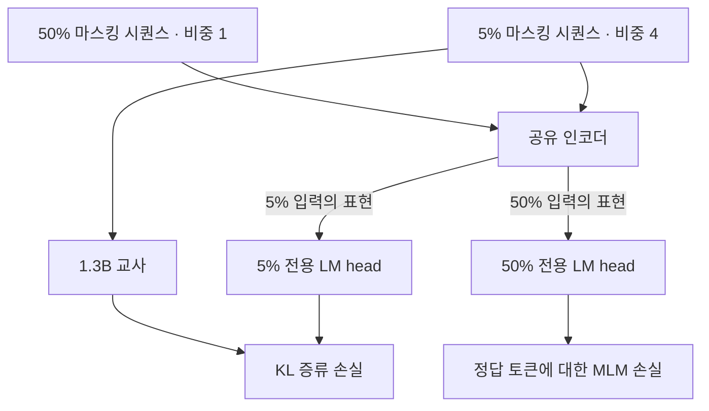

# UltraBERT: Beyond the Limit of BERT Pre-Training

**핵심 평가:** 이 논문의 가장 중요한 기여는 **분류와 검색에 유리한 서로 다른 사전학습 조건을, 마스킹 비율별 출력 헤드와 선택적 지식 증류로 하나의 공통 인코더에 결합했다는 점**입니다. 다만 결과는 과제별 미세조정을 거친 성능이며, 모든 미지의 과제로 일반화하거나 인코더의 보편적인 성능 한계를 규명했다는 증거로 확대해서는 안 됩니다.〔pp.3–9, Tables 1–3〕

**분석 대상:** Jungwoo Park, Taewhoo Lee, Jaewoo Kang의 *UltraBERT: Beyond the Limit of BERT Pre-Training*, arXiv v1, 2026년 10월 10일 공개본입니다. 첨부본에는 “Preprint. Under review.”라고 표기되어 있습니다. [arxiv.org](https://arxiv.org/abs/2610.15028?utm_source=chatgpt.com)

:chatgpt-content-reference{index="11"}

**읽기 기준**

- 아래의 페이지·Figure·Table 번호는 첨부 PDF의 인쇄 번호를 따릅니다.
- **[저자 보고]**는 논문에 제시된 결과·설명, **[분석]**은 그 결과에 대한 제 해석, **[후속 제안]**은 아직 검증되지 않은 실험 제안입니다.
- 제안 방법의 목적함수는 원문에 완전한 수식으로 제시되어 있지 않습니다. 따라서 **설명용으로 재표현한 수식과 원문에 실제로 있는 수식을 구분**합니다.
- 관련 연구 비교는 2026년 10월 22일을 기준으로 확인한 원 논문·공식 학술 자료에 근거합니다.

---

## 1. Executive summary — 10문장

1. UltraBERT는 BERT 계열 인코더가 분류와 검색에서 서로 다른 강점을 보이는 이유를 사전학습 토큰 수, 마스킹 비율, 지식 증류의 관점에서 재검토한 연구입니다.〔pp.1–3〕
2. 저자들은 30% 마스킹으로 학습한 150M·1.3B 모델에서 사전학습 손실이 계속 감소해도 미세조정 후 성능은 대체로 1–2T 토큰 부근에서 포화한다고 보고합니다.〔p.3, Fig.2〕
3. 충분히 학습한 조건에서는 모델 크기와 관계없이 낮은 마스킹 비율이 분류에 유리했고, 검색에서는 시험한 비율 중 50%가 가장 좋았습니다.〔p.4, Fig.4; p.6, Fig.6〕
4. 서로 다른 마스킹 비율로 학습한 모델의 출력 헤드가 다른 기하학적 특성을 보이자, 저자들은 하나의 헤드를 공유하는 것이 두 학습 조건 사이의 간섭을 일으킬 수 있다고 가정했습니다.〔pp.6–7, Figs.7–9〕
5. 제안 모델은 5%·50% 마스킹 시퀀스를 4:1로 혼합하고, 공통 인코더 위에 마스킹 비율별 LM head를 둡니다.〔p.8, Fig.10〕
6. 1.3B 교사를 단계적으로 축소해 380M·150M 학생을 만들며, 교사의 예측을 따라 배우는 지식 증류는 5% 마스킹 분기에만 적용합니다.〔pp.8, 22–23〕
7. 최종 학생 모델은 2T 토큰으로 학습하고 마지막 100B 토큰에서 문맥 길이를 32K로 확장합니다.〔p.22, Appendix A.1〕
8. UltraBERT-380M은 논문의 비교 조건에서 GLUE 개발 세트 평균 91.0, BEIR 평균 47.7을 기록했습니다.〔p.9, Table 3; pp.24–25〕
9. 일반화와 관련해서는 자연어 검색으로 미세조정한 모델을 코드·수학 검색에 추가 학습 없이 적용한 RAR-b 결과가 특히 주목할 만합니다.〔p.25; p.9, Table 3〕
10. 다만 작은 성능 차이의 통계적 유의성, 평가 세트를 이용한 모델 선택, 사전학습 데이터와 평가 데이터의 중복 여부가 충분히 해소되지 않았으므로, 성과는 **여러 과제에 적응하기 좋은 공통 사전학습 모델의 개선**으로 해석하는 것이 타당합니다.〔pp.24–25, 28; 분석〕

> **용어 설명**
>
> - **인코더:** 입력 문장의 앞뒤 문맥을 함께 읽고, 토큰이나 문장을 수치 벡터로 표현하는 모델입니다.
> - **마스킹:** 입력 토큰 일부를 가리고, 주변 문맥으로 원래 토큰을 예측하게 하는 학습 방식입니다.
> - **LM head:** 인코더가 만든 표현을 어휘별 예측 점수로 바꾸는 출력부입니다.
> - **미세조정:** 사전학습 모델을 분류·검색 등 특정 과제의 데이터로 추가 학습하는 과정입니다.
> - **M/B/T:** 각각 백만/십억/조를 뜻합니다. 모델 크기의 M·B는 파라미터 수, 학습량의 B·T는 토큰 수를 나타냅니다.

---

## 2. 연구 배경·목표·필요성

### 2.1 해결하려는 문제

**[저자 보고]** 최근 인코더는 위치 표현, 어텐션, 학습 데이터 규모 등에서 발전했지만, 핵심 사전학습 과제인 **MLM의 설정은 비교적 작은 학습 예산에서 얻은 관행을 상당 부분 유지**하고 있습니다. 저자들은 이러한 설정이 인코더를 분류 또는 검색에 편향시키는 원인이라고 봅니다.〔pp.1–3〕

> **MLM, Masked Language Modeling:** 가려진 토큰을 복원하는 사전학습 과제입니다. 예를 들어 “서울은 한국의 `[MASK]`이다”에서 “수도”를 예측합니다.

논문이 제기하는 문제는 세 가지입니다.

| 문제 | 연구 질문 | 원문 근거 |
|---|---|---|
| 학습량 증가의 효과가 불명확함 | 토큰을 계속 늘리면 실제 활용 과제의 성능도 계속 좋아지는가? | §3.1, pp.3–4 |
| 분류와 검색의 최적 조건이 다름 | 하나의 마스킹 비율로 두 과제군을 모두 잘 지원할 수 있는가? | §§3.2–3.4, pp.4–7 |
| 큰 교사의 지식 이전이 항상 유리하지 않음 | 증류의 효과가 마스킹 비율과 과제에 따라 달라지는가? | §3.5, p.8 |

### 2.2 연구 목적

**[저자 보고]** 목적은 단순히 더 큰 모델을 만드는 것이 아니라, 다음 설계 요소를 재검토해 작은 인코더의 활용 범위를 넓히는 것입니다.

1. 사전학습 토큰을 얼마나 배정해야 하는지 확인합니다.
2. 마스킹 비율이 분류와 검색에 미치는 영향을 분리합니다.
3. 두 마스킹 조건의 장점을 함께 학습하도록 출력부를 설계합니다.
4. 증류가 도움이 되는 조건에만 지식 이전을 적용합니다.〔pp.2–8〕

**[분석]** 이 연구의 필요성은 **학습 손실의 개선과 최종 활용 성능의 개선이 일치하지 않을 수 있다**는 데 있습니다. Fig.2에서 손실은 감소하지만 과제 점수는 거의 오르지 않으므로, 사전학습 손실 하나만 보고 추가 학습의 가치를 판단하기 어렵습니다.〔p.3, Fig.2〕

단, 이것은 해당 데이터·모델·평가 조건에서의 관찰입니다. 모든 인코더에 “2T 이상의 학습은 무의미하다”는 법칙을 세운 것은 아닙니다.

---

## 3. 핵심 주장과 근거

| 핵심 주장 | 저자가 제시한 근거 | 분석 및 해석 범위 | 위치 |
|---|---|---|---|
| 토큰을 늘려도 미세조정 후 성능은 포화할 수 있음 | 150M·1.3B를 최대 8.8T까지 학습했지만 주요 과제는 대체로 1–2T 부근에서 정체 | 30% 마스킹의 특정 실험 결과이며 보편적 상한은 아님 | p.3, Fig.2 |
| 낮은 마스킹은 분류에 유리함 | 세 모델 크기에서 낮은 마스킹 비율일수록 GLUE·SQuAD가 대체로 높음 | 낮은 비율에 더 많은 학습 토큰을 배정했으므로 동일 계산량 비교는 아님 | p.4, Fig.4·각주 1 |
| 높은 마스킹은 검색에 유리함 | 시험한 비율 중 50%가 세 크기 모두에서 BEIR 최고 | 모든 중간 비율에서 단조롭게 증가한 것은 아님 | pp.5–6, Fig.6(a) |
| 표현의 유효 랭크를 높이는 것만으로는 상충관계를 해결하지 못함 | KoLeo 추가 시 BEIR는 개선되지만 GLUE는 악화 | “표현을 더 넓게 펼치면 모든 과제가 좋아진다”는 설명은 지지되지 않음 | p.6, Fig.6(c,d) |
| 마스킹 비율별 LM head 분리가 유리함 | 혼합·공유 헤드의 88.9/44.7이 분리 후 89.4/45.1로 개선 | 두 점수의 동시 개선은 관찰됐지만 경사 간섭이라는 원인은 직접 측정하지 않음 | p.7, Table 1 |
| 증류 효과는 마스킹 조건에 따라 다름 | 15%에서 GLUE 90.2→90.8, 50%에서 BEIR 47.2→46.5 | 가지치기와 증류가 결합된 실험이며, 최종 5% 분기의 효과를 직접 분리한 실험은 아님 | p.8, Table 2 |
| 최종 모델은 다양한 과제에서 높은 성능을 보임 | 380M의 GLUE 91.0, BEIR 47.7 및 여러 검색 지표 개선 | 공통 사전학습 모델의 과제별 적응 결과이며, 하나의 미세조정 체크포인트가 모든 점수를 동시에 낸 것은 아님 | p.9, Table 3 |

> **용어 설명**
>
> - **유효 랭크, effective rank:** 표현 벡터가 실제로 얼마나 다양한 방향을 사용하는지 나타내는 수치입니다.
> - **KoLeo:** 표현들이 지나치게 몰리지 않도록 분포를 넓게 퍼뜨리는 정규화 방법입니다.
> - **경사 간섭, gradient interference:** 서로 다른 학습 목표가 공유 파라미터를 상충하는 방향으로 바꾸려는 현상입니다.
> - **체크포인트:** 특정 학습 시점에 저장한 모델의 파라미터입니다.

---

## 4. 연구 방법과 주요 데이터

### 4.1 실험 설계

**[저자 보고]** 핵심 통제 실험에서는 150M·380M·1.3B 크기의 인코더를 사용하며, 데이터 혼합과 토크나이저를 동일하게 유지합니다. 분류 측면은 GLUE·SQuAD 2.0, 검색 측면은 MS MARCO 미세조정 후 BEIR로 평가합니다.〔p.3, §3〕

논문은 SQuAD 독해, 개체명 인식, 선호 판별까지 넓게 “classification” 범주에 포함합니다. 따라서 여기서 분류 성능은 단순한 문서 분류만을 뜻하지 않습니다.〔p.9, §4.1〕

**마스킹 비율별 학습량은 다릅니다.**

| 마스킹 비율 | 학습 토큰 |
|---|---:|
| 30%, 50% | 1T |
| 15% | 2T |
| 3%, 6% | 5T |

저자들은 낮은 마스킹에서 수렴이 느리므로 이처럼 배정했다고 설명하며, 3%·6%는 약 2–3T에서 포화했다고 보고합니다.〔p.4, 각주 1〕

> **수렴·포화:** 수렴은 학습 과정이 안정되는 것을, 여기서 포화는 추가 학습에도 평가 성능의 개선이 작아지는 상태를 뜻합니다.

**[분석]** 이 설계는 “충분히 학습한 뒤 어느 비율이 좋은가?”에 답하는 데 적합합니다. “같은 비용으로 어느 비율이 가장 좋은가?”에는 별도 실험이 필요합니다.

### 4.2 사전학습 데이터

최종 UltraBERT의 학습량은 2T 토큰이며, Table 4의 고유 토큰 총량은 약 1.228T입니다. 반복 노출을 포함해 2T를 구성합니다.〔p.23, Table 4〕

| 범주 | 데이터 소스 | 학습 비중 |
|---|---|---:|
| 웹 | DCLM, FineWeb-Edu | 66.9% |
| 코드 | Stack-Edu | 14.0% |
| 학술 | peS2o | 7.1% |
| 수학 | MegaMath, FineMath, InfiWebMath | 5.8% |
| 참고·설명 자료 | Cosmopedia v2, Wikipedia | 3.7% |
| 지시문 자료 | FLAN, StackExchange, Natural Reasoning | 2.5% |

비율은 원문의 범주별 수치이며, 개별 데이터셋의 반올림 값 합계와 차이가 날 수 있습니다.

**[분석]** 코드와 수학 데이터가 이미 사전학습에 포함되어 있다는 점은 RAR-b 해석에 중요합니다. 이후의 코드·수학 검색 결과는 **자연어 검색 미세조정에서 다른 검색 과제로의 전이**를 보여주지만, 코드·수학을 전혀 접하지 않은 모델의 성능은 아닙니다.

### 4.3 최적화와 평가 절차

**학습 설정.** AdamW, 약 4M 토큰 배치, 초기 10B 토큰의 학습률 증가 구간과 마지막 10% 예산의 감소 구간을 사용합니다. 최종 UltraBERT의 최대 학습률은 $10^{-4}$이며, 2T 중 마지막 100B에서 문맥을 32K로 확장합니다. 중간 체크포인트도 학습률 감소 단계를 별도로 거쳐 평가합니다.〔p.22, Appendix A.1〕

**평가 설정.**

| 과제군 | 학습·선택·평가 절차 | 의미 |
|---|---|---|
| GLUE·SQuAD | 과제별 미세조정 후 개발 세트로 설정·체크포인트를 선택하고 개발 점수 보고 | 독립 비공개 테스트 점수와 구분 필요 |
| NER | 개발 세트로 선택 후 테스트 세트 평가 | 별도 테스트 평가 포함 |
| BEIR | MS MARCO 1.25M 검색 삼중항으로 미세조정 후, BEIR가 가장 높은 학습률 선택 | BEIR 기반 모델 선택 포함 |
| RAR-b | 선택된 검색 모델을 코드·수학에 그대로 평가 | 추가 RAR-b 학습 없는 전이 평가 |
| MLDR·LongEmbed | 선택된 모델을 MLDR로 추가 미세조정 후 평가 | 장문 검색 학습을 거친 평가 |

〔pp.24–25, Appendix B〕

> **용어 설명**
>
> - **개발 세트, dev set:** 학습 설정과 모델을 선택하는 데 사용하는 데이터입니다.
> - **NER:** 문장에서 사람·기관·장소 등의 이름을 찾아 유형을 구분하는 과제입니다.
> - **검색 삼중항:** 질의, 관련 문서, 비관련 문서로 구성된 학습 예제입니다.
> - **AdamW:** 모델 파라미터를 갱신하는 최적화 알고리즘의 하나입니다.

---

## 5. 제안 방법과 모델 구조 — 수식 중심 설명

### 5.1 전체 구조

**[저자 보고]** UltraBERT는 공통 인코더, 마스킹 비율별 LM head 두 개, 낮은 마스킹 분기에만 적용하는 증류로 구성됩니다. 아래는 Fig.10의 학습 경로를 재구성한 설명도입니다.〔p.8, Fig.10〕



**두 LM head는 분류용·검색용 최종 출력기가 아닙니다.** 서로 다른 마스킹 조건에서 토큰을 예측하는 사전학습 출력부입니다. 실제 분류·검색 성능은 이후 과제별 미세조정으로 평가합니다.〔pp.8–9, 24–25〕

### 5.2 인코더 구조

| 구성 | UltraBERT-150M | UltraBERT-380M | 교사 |
|---|---:|---:|---:|
| 평가표의 파라미터 수 | 152M | 380M | 약 1.3B |
| Transformer 층 수 | 24 | 24 | 24 |
| 은닉 차원 | 768 | 1,024 | 2,048 |
| SwiGLU 중간 차원 | 1,024 | 3,072 | 5,632 |
| 어텐션 헤드 수 | 6 | 8 | 8 |
| 헤드당 차원 | 128 | 128 | 256 |
| 어휘 수 | 49,152 | 49,152 | 49,152 |

〔p.22, Appendix A.1; p.9, Table 3〕

공통적으로 RoPE와 SwiGLU를 사용하며, **매 세 번째 층은 전역 어텐션, 나머지는 지역 어텐션**을 사용합니다. 입력 임베딩과 LM head의 가중치는 공유하지 않습니다. 지역 어텐션의 RoPE base는 10K, 전역은 640K이며, 32K 확장에서 전역 base를 2.56M으로 늘립니다.〔p.22〕

> **용어 설명**
>
> - **은닉 차원:** 각 토큰의 내부 표현 벡터 길이입니다.
> - **어텐션:** 다른 토큰의 정보를 얼마나 참고할지 결정하는 연산입니다.
> - **지역/전역 어텐션:** 각각 가까운 범위 또는 전체 입력을 참고하는 방식입니다.
> - **RoPE:** 위치에 따라 벡터를 회전시켜 토큰 간 위치 정보를 표현하는 기법입니다.
> - **SwiGLU:** 정보가 통과하는 양을 조절하는 게이트를 사용하는 신경망 변환입니다.
> - **입력 임베딩:** 토큰을 모델 내부의 벡터로 바꾸는 첫 표현입니다.

**주의:** Table 3의 파라미터 수는 LM head를 제외합니다. 또한 지역 어텐션의 정확한 윈도 크기와 LM head 내부 구성은 본문의 설명만으로 완전히 확인할 수 없습니다.

### 5.3 마스킹 비율별 출력 헤드

다음은 **원문의 서술을 수학적으로 재표현한 설명식**입니다. 논문에 제시된 번호 있는 공식이나 공개 구현의 정확한 복제식은 아닙니다.

```math
h_i^{(r)}
=
f_\theta\!\left(\widetilde{x}^{(r)}\right)_i,
\qquad
p_{S,r}(\cdot\mid\widetilde{x}^{(r)},i)
=
\text{softmax}\!\left(g_{\phi_r}(h_i^{(r)})\right),
\quad
r\in\{0.05,0.50\}.
```

**기호 설명**

- $x$: 원래 토큰 시퀀스.
- $\widetilde{x}^{(r)}$: 비율 $r$로 마스킹한 입력.
- $i$: 토큰 위치.
- $f_\theta$: 파라미터 $\theta$를 갖는 공유 인코더.
- $h_i^{(r)}$: 해당 입력에서 위치 $i$의 문맥 표현.
- $g_{\phi_r}$: 마스킹 비율별 파라미터 $\phi_r$를 갖는 LM head.
- $p_{S,r}$: 학생 모델의 어휘 예측 분포.
- $\text{softmax}$: 어휘별 점수를 확률분포로 바꾸는 함수.

핵심은 **$\theta$는 공유하고 $\phi_{0.05}$와 $\phi_{0.50}$는 분리한다**는 것입니다. 저자들은 서로 다른 마스킹 조건이 요구하는 출력 표현을 각 헤드가 담당하도록 합니다.〔pp.6–8〕

배치 구성은 다음과 같습니다.

$$
|\mathcal B_{0.05}|:|\mathcal B_{0.50}|=4:1.
$$

- $\mathcal B_{0.05}$: 5% 마스킹 시퀀스 집합.
- $\mathcal B_{0.50}$: 50% 마스킹 시퀀스 집합.
- $|\mathcal B|$: 해당 집합의 시퀀스 수.

**이 비율은 시퀀스 개수의 비율입니다. 손실 가중치가 4:1이라는 뜻은 아닙니다.**〔p.7; p.8, Fig.10〕

### 5.4 높은 마스킹 분기: 표준 MLM

표준 MLM의 개념을 평균 손실로 쓰면 다음과 같습니다.

```math
\mathcal L_{\text{MLM}}^{(r)}
=
-\frac{1}{|M_r|}
\sum_{i\in M_r}
\log p_{S,r}(x_i\mid\widetilde{x}^{(r)},i).
```

**기호 설명**

- $M_r$: 예측 대상인 마스킹 위치의 집합.
- $|M_r|$: 예측 대상 위치 수.
- $x_i$: 위치 $i$의 실제 정답 토큰.
- $p_{S,r}(x_i\mid\cdot)$: 정답 토큰에 부여한 확률.
- $\mathcal L_{\text{MLM}}^{(r)}$: 해당 마스킹 조건의 토큰 복원 손실.

정답 토큰에 높은 확률을 줄수록 손실이 작아집니다. 최종 UltraBERT는 이 유형의 목표를 **50% 분기**에 적용합니다. 다만 위 평균 방식이 실제 구현의 정규화 방식과 동일한지는 원문에 명시되지 않습니다.〔p.8, Fig.10; pp.22–23〕

### 5.5 낮은 마스킹 분기: KL 지식 증류

KL 발산의 일반적인 정의는 다음과 같습니다.

```math
\text{KL}(p\Vert q)
=
\sum_{v\in V}
p(v)\log\frac{p(v)}{q(v)}.
```

**기호 설명**

- $V$: 어휘 집합.
- $v$: 어휘 항목.
- $p,q$: 같은 어휘에 대한 두 확률분포.
- $\text{KL}(p\Vert q)$: $q$가 $p$와 얼마나 다른지 나타내는 비대칭적 값.

> **지식 증류:** 교사가 정답 하나뿐 아니라 여러 후보에 부여한 확률을 학생의 학습 신호로 사용하는 방법입니다.
>
> **로짓, logit:** 확률로 변환하기 전 모델이 출력하는 점수입니다.

**[저자 보고]** 5% 분기에서는 1.3B 교사와 학생 사이의 로짓 기반 KL 증류를 사용합니다.〔p.8; pp.22–23〕

**원문에서 확인되지 않는 사항은 다음과 같습니다.**

- $\text{KL}(p_T\Vert p_S)$인지, 반대 방향인지.
- 확률분포를 만들 때 사용하는 온도.
- 증류를 집계하는 정확한 토큰 위치.
- 두 분기의 손실 가중치와 정규화 방식.

따라서 교사·학생의 KL 방향이나 전체 목적함수의 계수를 임의로 확정할 수 없습니다.

> **온도:** 예측 확률을 더 평평하거나 더 뾰족하게 만드는 조절값입니다. 증류 결과에 영향을 줄 수 있습니다.

### 5.6 가지치기와 단계적 증류

**[저자 보고]** 모델 축소 경로는 **1.3B → 380M → 150M**입니다. 그러나 **두 학생 모두 최종적으로 1.3B 교사에서 증류**합니다. 150M의 초기 가중치는 증류된 380M에서 가져오지만, 교사는 380M이 아닙니다.〔pp.22–23, Appendix A.2〕

깊이 24층은 유지하고 너비만 줄입니다.

- 사전학습 자료의 2,000문서를 교정 자료로 사용합니다.
- 활성값을 이용해 은닉 채널, 어텐션 헤드, FFN 뉴런의 중요도를 계산합니다.
- 중요도가 높은 요소를 남깁니다.
- 헤드 차원을 256에서 128로 줄일 때 RoPE의 주파수 쌍 구조를 보존합니다.
- 축소된 query에는 다음 조정을 적용합니다.〔p.22〕

$$
q'\leftarrow \frac{q'}{\sqrt{2}}.
$$

- $q'$: 차원이 축소된 query 벡터.
- $1/\sqrt{2}$: 저자가 어텐션 로짓의 크기를 유지하기 위해 사용하는 배율.

> **가지치기, pruning:** 일부 채널·뉴런·헤드를 제거해 모델을 줄이는 방법입니다.
>
> **FFN:** 각 토큰의 표현을 변환하는 Transformer 내부 신경망입니다.
>
> **교정 자료:** 모델을 줄일 때 어떤 구성요소가 중요한지 추정하는 소규모 데이터입니다.

저자들이 로짓 기반 증류에 집중한 이유는 어텐션 행렬 기반 증류가 길이 $L$에 대해 $O(L^2)$ 규모의 부담을 갖기 때문입니다. 여기서 $L$은 입력 토큰 수이며, 논문은 장문 처리 비용과 FlashAttention 호환성을 연구 범위 제한의 이유로 듭니다.〔p.8, §3.5〕

### 5.7 유효 랭크와 KoLeo: 무엇을 설명하고 무엇을 설명하지 못하는가?

유효 랭크의 표준적인 정의는 다음과 같습니다. 이는 **용어 이해를 위한 정의**이며, UltraBERT의 구체적인 측정 코드 설정까지 의미하지는 않습니다.

```math
\pi_k=\frac{\sigma_k}{\sum_j\sigma_j},
\qquad
r_{\text{eff}}(Z)
=
\exp\!\left(-\sum_k\pi_k\log\pi_k\right).
```

**기호 설명**

- $Z$: 표현 벡터를 행으로 쌓은 행렬.
- $\sigma_k$: $Z$의 $k$번째 특이값.
- $\pi_k$: 전체 특이값 합에서 해당 특이값이 차지하는 비중.
- $r_{\text{eff}}(Z)$: 유효 랭크.
- $\log$: 자연로그.

한두 방향에 표현이 몰리면 작아지고, 여러 방향을 고르게 사용하면 커집니다. 이 정의는 논문이 인용하는 *RankMe*의 설명과 연결됩니다. [proceedings.mlr.press](https://proceedings.mlr.press/v202/garrido23a/garrido23a.pdf?utm_source=chatgpt.com)

> **특이값:** 행렬이 각 주요 방향으로 얼마나 강하게 작용하는지 나타내는 값입니다.
>
> **엔트로피:** 분포가 얼마나 고르게 퍼져 있는지 나타내는 척도입니다. 위 식은 특이값 비중의 엔트로피를 사용합니다.

**원문 Appendix D의 실제 수학적 주장**은 정규화된 표현의 분포가 균등분포에 가까우면 방향별 편중도 줄어든다는 것입니다. Proposition 1·2를 합치면 다음과 같이 쓸 수 있습니다.

$$
\Sigma=\mathbb E_{z\sim P}[zz^\top],
\qquad
\|z\|_2=1,
$$

```math
\left\|\Sigma-\frac{1}{d}I_d\right\|_2
=
\max_k\left|\lambda_k-\frac{1}{d}\right|
\le
\sqrt{\frac{\text{KL}(P\Vert U)}{2}}.
```

**기호 설명**

- $z$: 길이가 1로 정규화된 $d$차원 표현.
- $P$: 표현이 따르는 분포.
- $U$: 단위 구면 위 균등분포.
- $\Sigma$: 평균을 빼지 않은 **2차 모멘트 행렬**.
- $I_d$: $d$차원 항등행렬.
- $\lambda_k$: $\Sigma$의 고유값.
- $\|\cdot\|_2$: 행렬의 스펙트럴 노름, 즉 가장 크게 작용하는 방향의 크기.
- $\mathbb E$: 분포에 대한 평균.

〔pp.26–28, Appendix D; 원문 수식 번호 없음〕

> **등방성, isotropy:** 특정 방향에 치우치지 않고 방향별 성질이 비슷한 상태입니다.
>
> **2차 모멘트:** 벡터 성분의 곱을 평균한 통계량입니다. 평균을 제거하지 않았으므로 여기서는 곧바로 공분산이라고 부르면 부정확합니다.

**[분석]** 이 수학적 논의는 표현을 넓게 퍼뜨리는 압력을 설명합니다. 그러나 **유효 랭크가 커지면 검색이 반드시 좋아진다거나, 분류와 검색이 동시에 개선된다는 보장은 없습니다.** 실제 KoLeo 실험에서도 검색 개선과 분류 악화가 함께 나타났습니다.〔p.6, Fig.6(c,d)〕

---

## 6. 주요 결과와 데이터 포인트

### 6.1 최종 성능

아래는 Table 3의 수치입니다. “이전 최고”는 **동일 크기군에 실린 비교 모델 중 최고값**을 뜻합니다. 모든 공개 모델에 대한 절대 최고를 의미하지 않습니다.〔p.9〕

| 지표 | UltraBERT-152M | Base 비교군 이전 최고 | UltraBERT-380M | Medium 비교군 이전 최고 |
|---|---:|---|---:|---|
| GLUE | **89.5** | Ettin 88.9 | **91.0** | Ettin 90.8 |
| SQuAD 2.0 F1 | **89.2** | Ettin 87.4 | **90.9** | Ettin 90.4 |
| MultiCoNER v2 | 57.9 | **NomicBERT 60.1** | **63.5** | GTE-en-MLM 63.0 |
| Few-NERD | **67.4** | RoBERTa 67.1 | **68.3** | RoBERTa 68.1 |
| RewardBench | **73.0** | Ettin 70.3 | **78.8** | Ettin 76.7 |
| BEIR | **45.2** | ModernBERT 42.6 | **47.7** | LFM2.5-355M 47.3 |
| RAR-b Code | **39.1** | Ettin 31.8 | **47.0** | LFM2.5-355M 38.6 |
| RAR-b Math | **55.4** | Ettin 47.1 | **61.7** | Ettin 54.0 |
| MLDR | **43.5** | ModernBERT 37.7 | 44.1 | **LFM2.5-355M 44.5** |
| LongEmbed | **72.0** | ModernBERT 63.2 | **74.9** | LFM2.5-355M 71.7 |

> **지표 설명**
>
> - **F1:** 정답으로 찾은 비율과 실제 정답을 놓치지 않은 비율을 함께 반영합니다.
> - **nDCG@10:** 관련성이 높은 문서를 상위 10개 결과의 앞쪽에 배치할수록 높아지는 검색 지표입니다.
> - **Recall@1:** 정답을 첫 번째 결과로 찾은 비율입니다.
> - **GLUE 평균:** 여러 언어 이해 과제 점수의 평균으로, 하나의 정답률은 아닙니다.
> - **RewardBench:** 두 응답 중 더 선호되는 응답을 구별하는 능력을 평가합니다.

특히 주목할 결과는 다음과 같습니다.

- **코드·수학 검색:** RAR-b에서 이전 최고 대비 Base는 **+7.3/+8.3점**, Medium은 **+8.4/+7.7점**입니다.〔p.9, §4.2〕
- **작은 차이는 신중한 해석 필요:** Medium GLUE의 +0.2점, BEIR의 +0.4점에는 유의성 검정이나 신뢰구간이 제시되지 않습니다.〔Table 3; 분석〕
- **모든 과제 최고는 아님:** Base MultiCoNER와 Medium MLDR에서는 다른 모델이 더 높습니다.〔Table 3〕
- **장문 성능은 조건 차이 포함:** LongEmbed 비교 모델의 문맥 길이는 512부터 32,768까지 다릅니다.〔p.31, Table 11〕

### 6.2 헤드 분리의 직접적인 효과

| 150M 설정 | GLUE | BEIR |
|---|---:|---:|
| 6% 단독 | 89.5 | 43.5 |
| 50% 단독 | 87.5 | 45.0 |
| 5%·50% 혼합, 헤드 공유 | 88.9 | 44.7 |
| 5%·50% 혼합, 헤드 분리 | **89.4** | **45.1** |

〔p.7, Table 1〕

**[분석]** 가장 직접적인 비교는 마지막 두 행입니다. 헤드 분리 후 GLUE는 0.5점, BEIR는 0.4점 상승합니다. 다만 분리 모델의 GLUE 89.4는 6% 단독의 89.5보다 0.1 낮으므로, **두 단독 모델의 장점에 근접했다**고 표현하는 것이 정확합니다.

### 6.3 증류의 비대칭 효과

| 마스킹 | 380M 학습 방식 | GLUE | BEIR |
|---|---|---:|---:|
| 15% | 처음부터 학습 | 90.2 | 46.0 |
| 15% | 가지치기 후 증류 | **90.8** | 46.0 |
| 50% | 처음부터 학습 | 89.6 | **47.2** |
| 50% | 가지치기 후 증류 | 89.6 | 46.5 |

〔p.8, Table 2〕

**[저자 보고]** 저마스킹 증류는 분류에 도움이 되지만, 고마스킹 증류는 검색을 저하시킵니다.

**[분석]** 이 결과가 보여주는 것은 해당 **가지치기·로짓 증류 조합의 효과**입니다. 가지치기와 증류의 기여를 따로 분리하지 않았으므로, 검색 저하의 원인을 증류만으로 확정할 수는 없습니다.

---

## 7. 가장 중요한 그림 선정과 해석

| 선정 그림 | 어떻게 읽어야 하는가? | 핵심 해석과 주의점 |
|---|---|---|
| **Fig.10, p.8** | 두 입력 조건, 공통 인코더, 두 출력 헤드, 선택적 증류의 경로를 확인 | 제안 방법 전체를 가장 잘 요약합니다. 헤드 두 개는 사전학습용입니다. |
| **Fig.2, p.3** | 왼쪽 손실 감소와 오른쪽 GLUE·SQuAD·BEIR의 정체를 대조 | 학습 손실을 개선하는 것과 최종 과제 성능을 개선하는 것이 다를 수 있음을 보여줍니다. |
| **Fig.4, p.4 + Fig.6(a), p.6** | 마스킹 비율에 따른 분류와 검색의 서로 다른 경향을 함께 확인 | 단일 마스킹 비율의 상충관계를 보여주는 핵심 근거입니다. 검색의 모든 중간 구간이 단조 증가하지는 않습니다. |
| **Figs.7–9, pp.6–7** | 입력 임베딩과 LM head의 모양, 특이값 분포를 비교 | 마스킹에 따른 차이가 출력부에서 두드러집니다. 그러나 경사 간섭을 직접 측정한 결과는 아닙니다. |
| **Fig.6(b–d), p.6** | 마스킹–유효 랭크 관계와 KoLeo 개입 결과를 연결 | 랭크 증가만으로 분류·검색의 상충관계를 해소할 수 없음을 보여주는 중요한 음성 결과입니다. |
| **Fig.11, p.29** | 문서 길이가 길어질 때 Passkey 검색이 유지되는지 확인 | 32K 처리 능력을 보여주지만, 길이별 질의가 50개인 합성 과제이며 모든 장문 이해 능력을 대표하지 않습니다. |

**Figs.7–9의 해석에서 특히 주의할 점**은 두 가지입니다.

첫째, Fig.7·9는 PCA의 첫 세 성분으로 시각화한 결과입니다. 고차원 표현의 일부를 보여주므로 그림 모양만으로 전체 공간의 차이를 확정할 수 없습니다. 둘째, Fig.8의 특이값은 각 행렬의 가장 큰 특이값으로 나누어 정규화했으므로 **절대 크기보다 상대적인 집중도**를 비교하는 그림입니다.〔pp.6–7〕

> **PCA, 주성분 분석:** 데이터 변화가 큰 방향부터 골라 고차원 자료를 적은 차원으로 표현하는 방법입니다.
>
> **음성 결과:** 시도한 방법이 기대한 문제를 해결하지 못했다는 결과입니다. 어떤 설명이 충분하지 않은지 알려주는 근거가 됩니다.

**Fig.6(b)의 $r=0.91$은 마스킹 비율과 유효 랭크 사이의 관계를 나타냅니다. 이를 유효 랭크와 검색 성능 사이의 상관계수로 인용하면 부정확합니다.**

---

## 8. 일반화 성능 향상 가능성: 보고된 결과와 해석의 구분

### 8.1 가장 직접적인 근거는 RAR-b 전이

**[저자 보고]** MS MARCO로 미세조정한 검색 모델을 코드·수학 RAR-b에 추가 학습 없이 적용합니다. 코드에서는 약 301K, 수학에서는 약 389K 후보 중 정답을 검색합니다.〔p.25, Appendix B.2〕

**[분석]** 이는 특정 자연어 검색 데이터로 학습한 표현이 다른 형태의 검색 문제에도 전이됨을 보여줍니다. 이 논문에서 일반화 주장을 가장 직접적으로 뒷받침하는 결과입니다.

다만 다음 경계가 있습니다.

- 사전학습에 코드 14.0%, 수학 5.8%가 포함됩니다.
- RAR-b 점수는 정답 문서·해답의 **검색 품질**을 측정합니다.
- 사전학습 자료와 평가 자료의 중복 제거 검증은 보고되지 않습니다. 중복이 실제로 있었다고 단정할 수는 없지만, 완전히 배제됐다고도 확인할 수 없습니다.〔pp.23, 25; 분석〕

### 8.2 여러 과제에 적응하기 좋은 공통 모델이라는 근거

**[저자 보고]** 분류, 독해, 개체명 인식, 선호 판별, 검색에서 폭넓은 개선을 보입니다.〔p.9, Table 3〕

**[분석]** 이는 사전학습 표현의 활용 범위가 넓어졌다는 근거입니다. 다만 각 과제는 별도 미세조정을 거치므로, 평가 결과의 정확한 의미는 **“공통 초기 모델의 적응 가능성”**입니다.

### 8.3 장문 전이의 성과와 경계

UltraBERT의 LongEmbed 평균은 72.0/74.9이며, Passkey의 길이 평균은 99.2/99.8입니다. 그러나 MLDR 추가 학습을 거친 결과이고, 비교 모델별 문맥 길이가 다릅니다.〔pp.25, 31, Table 11〕

또한 Medium의 Needle에서는 LFM2.5-230M이 78.2, UltraBERT가 68.2입니다. 따라서 높은 종합점수와 개별 과제의 우위를 구분해야 합니다.〔p.31〕

### 8.4 일반화 개선의 원인에 대한 현재 증거

**[저자 가설]** 서로 다른 마스킹 조건이 출력 헤드에서 충돌하므로, 헤드를 분리하면 공유 인코더가 두 조건의 장점을 함께 학습할 수 있습니다.〔pp.6–7〕

**[분석]** Table 1은 이 설계의 실용적 효과를 지지합니다. 그러나 다음 연결고리는 아직 확정되지 않았습니다.

> 헤드 분리 → 실제 경사 충돌 감소 → 표현 개선 → 독립적인 새로운 영역의 성능 개선

논문은 이 연결의 일부를 실험으로 뒷받침하지만, 전체 인과 경로를 검증하지는 않습니다.

---

## 9. 통계적 취약점과 직접 비교하기 어려운 수치

### 9.1 주요 평가상의 제한

| 항목 | 원문에서 확인되는 사실 | 해석상 제한 |
|---|---|---|
| **작은 성능 차이** | 주요 표에 신뢰구간·유의성 검정 없음 | +0.2·+0.4점을 통계적으로 확정된 우위로 표현할 수 없음 |
| **GLUE·SQuAD의 선택과 보고** | 개발 세트에서 선택하고 개발 점수를 보고 | 독립 테스트 성능과 구분해야 함 |
| **BEIR를 통한 모델 선택** | 10개 학습률 중 BEIR 최고값 선택 | 완전히 독립적인 미지 영역 평가로 볼 수 없음 |
| **BEIR 평균의 구성** | 학습에 사용한 MS MARCO의 개발 세트도 포함 | 평균 전체를 순수한 영역 외 평가라고 부를 수 없음 |
| **기준선의 출처 혼합** | GLUE와 일부 SQuAD는 문헌값, 나머지는 재평가 | 모든 점수가 완전히 동일한 실행 절차에서 나온 것은 아님 |
| **마스킹별 다른 예산** | 1T·2T·5T로 차등 배정 | 동일 비용 효율의 우위는 입증하지 않음 |
| **인코더–디코더 비교** | 자체 1.3B 인코더와 SmolLM2 1.7B 비교 | 구조 외 크기·데이터·학습 방식의 차이가 남음 |
| **장문 비교** | 문맥 길이가 512–32K로 다름 | 헤드 설계 효과와 입력을 더 읽는 효과가 분리되지 않음 |
| **총 학습 비용** | 학생의 2T는 제시하지만 교사·중간 단계 포함 총비용은 미제시 | 전체 비용 절감을 정량화할 수 없음 |

〔pp.4, 22, 24–25, 28, 31〕

> **신뢰구간:** 반복 표본이나 실험에서 예상되는 결과의 불확실성 범위입니다.
>
> **영역 외 평가, OOD:** 학습하거나 설정 선택에 사용한 데이터와 분포가 다른 자료에서의 평가입니다.
>
> **선택 편향:** 여러 설정 중 가장 높은 점수를 고르면 우연히 좋은 결과가 선택될 수 있는 현상입니다.

**반복 실험이 전혀 없는 것은 아닙니다.** 작은 GLUE 과제 네 개는 4개 시드에서 설정 탐색 후 중앙값을 보고하며, MultiCoNER는 설정별 3개 시드의 개발 점수 평균으로 선택합니다. 다만 주요 결과 전체의 분산이나 신뢰구간은 제공하지 않습니다.〔p.24〕

> **시드, seed:** 무작위 초기화·데이터 순서 등을 결정하는 값입니다. 시드를 바꾸면 학습 결과가 달라질 수 있습니다.

또한 Ettin-395M은 문헌 GLUE 90.8과 재평가 90.6 사이에 0.2점 차이가 있습니다. 이는 UltraBERT와 문헌 Ettin 사이의 0.2점 차이와 같은 규모입니다. 이 사실이 UltraBERT의 개선을 부정하지는 않지만, 작은 격차의 해석에는 중요합니다.〔p.28, Table 7〕

### 9.2 종합평균과 크기 절감 주장의 의미

Fig.1의 분류 평균은 다섯 벤치마크의 평균이며, 검색 평균은 BEIR·RAR-b 코드/수학 평균·MLDR의 평균입니다. **LongEmbed는 포함되지 않습니다.**〔p.2, Fig.1〕

따라서 다음을 구분해야 합니다.

- “150M이 RoBERTa-large와 비슷한 분류 성능”은 종합평균에 관한 주장입니다.
- “150M이 Ettin-400M보다 검색이 좋다”도 종합평균에 관한 주장입니다.
- **BEIR만 보면 UltraBERT-152M의 45.2는 Ettin-395M의 45.9보다 낮습니다.**
- 파라미터 수의 2.3배·2.6배 차이를 실제 추론 속도나 운영 비용의 같은 배수로 바꿔 말할 근거는 없습니다.〔pp.2, 9; 분석〕

### 9.3 저자가 직접 인정한 한계

논문에는 독립된 **Limitations 절이 없습니다.** 다만 다음 불확실성을 직접 명시합니다.

1. 유효 랭크 증가가 검색 개선의 원인인지는 알 수 없습니다.〔p.5〕
2. 고마스킹에서 증류가 악화되는 이유는 확정되지 않았고, 교사 신호가 덜 유용해질 가능성을 제시합니다.〔p.8〕
3. 어텐션 기반 증류는 장문 비용과 구현 제약 때문에 연구 범위에서 제외합니다.〔p.8〕
4. 웹 규모 데이터에 존재하는 편향을 상속할 수 있습니다.〔p.10, Ethics Statement〕

위 표의 평가 선택·비용·통계 문제는 이러한 저자 명시 사항과 구분되는 **분석자가 확인한 보고 범위의 한계**입니다.

---

## 10. 2020년 이후 관련 연구 비교 분석

아래는 직접 관련성이 높은 연구들을 목적함수, 마스킹, 구조, 압축의 관점에서 비교한 것입니다. 다른 논문의 점수를 동일한 순위표로 합치지 않고, **무엇을 통제했고 어떤 질문에 답했는지**를 중심으로 정리했습니다.

| 연구 | 선행 연구의 핵심 | UltraBERT와의 차이·연결 |
|---|---|---|
| **ELECTRA, 2020 / DeBERTaV3, 2021 공개·2023 학회** | ELECTRA는 바뀐 토큰을 판별하는 RTD를 사용하고, DeBERTaV3는 생성기·판별기의 임베딩 공유에서 생기는 경사 충돌을 분리합니다. | UltraBERT는 MLM을 유지하면서 마스킹 조건을 분리합니다. 공유 파라미터의 충돌을 줄인다는 문제의식은 연결되지만, 분리 대상은 **마스킹 비율별 출력 헤드**입니다. [arxiv.org](https://arxiv.org/abs/2003.10555?utm_source=chatgpt.com) |
| **Should You Mask 15% in Masked Language Modeling?, 2023** | 큰 모델에서 15%보다 높은 마스킹이 유리하며, 문맥 훼손과 예측 대상 증가의 상반된 효과를 분석합니다. | UltraBERT는 충분히 학습한 뒤의 분류 성능에서는 낮은 비율이 좋다고 보고합니다. **제한 예산에서의 최적화 효율과 수렴 후 성능**을 구분해야 하므로, 선행 연구가 단순히 틀렸다고 볼 수 없습니다. [ACL Anthology](https://aclanthology.org/2023.eacl-main.217/?utm_source=chatgpt.com) |
| **Dynamic Masking Rate Schedules, 2024 / R²MAE, 2025** | 전자는 학습 중 마스킹을 감소시키고, 후자는 비율을 무작위화해 여러 규모의 특징을 학습합니다. | UltraBERT는 비율 변화 자체에 더해, 양 극단의 조건을 같은 배치에 넣고 출력부를 분리합니다. Table 1의 결과는 해당 인코더 설정에 대한 비교이며, R²MAE의 다른 모달리티 결과 전체를 반박하지 않습니다. [ACL Anthology](https://aclanthology.org/2024.eacl-short.42/?utm_source=chatgpt.com) |
| **Compact Language Models via Pruning and Knowledge Distillation, 2024** | 깊이·너비·어텐션·MLP 가지치기와 증류 재학습을 결합해 작은 언어 모델을 만듭니다. | UltraBERT는 압축·증류 자체를 새로 발명한 것이 아니라, **마스킹 조건별 증류의 이익과 손해를 구분해 적용**합니다. 디코더의 압축 성과와 인코더의 검색 점수를 직접 비교할 수는 없습니다. [proceedings.neurips.cc](https://proceedings.neurips.cc/paper_files/paper/2024/hash/4822991365c962105b1b95b1107d30e5-Abstract-Conference.html?utm_source=chatgpt.com) |
| **ModernBERT, ACL 2025** | 2T 토큰, 8,192토큰 문맥, 현대적인 인코더 구현과 실행 효율을 강조합니다. | UltraBERT는 이러한 현대화 흐름 위에서 사전학습 목표의 구성을 재검토합니다. 최종 성능 차이를 헤드 분리 하나에 귀속하려면 데이터·증류·문맥 길이를 통제해야 합니다. [ACL Anthology](https://aclanthology.org/2025.acl-long.127/?utm_source=chatgpt.com) |
| **NeoBERT, 2025** | 깊이와 너비의 비율, 현대적 데이터, 4,096토큰 문맥을 결합하고 동일 미세조정 조건의 MTEB 평가를 강조합니다. | 사전학습 모델의 우수성은 평가 절차에 따라 달라질 수 있음을 보여주는 비교 대상입니다. 원 NeoBERT의 MTEB 점수와 UltraBERT의 BEIR 평균은 직접 같은 지표로 비교할 수 없습니다. [arxiv.org](https://arxiv.org/abs/2502.19587?utm_source=chatgpt.com) |
| **Ettin — Seq vs Seq, 2025 공개·ICLR 2026** | 같은 학습 방식으로 인코더·디코더를 쌍으로 만들고 비교합니다. | UltraBERT의 포화 주장을 구조 자체의 차이로 강화하려면, Ettin처럼 데이터·크기·학습 조건을 맞춘 비교가 유용합니다. UltraBERT Fig.3에는 이러한 통제가 충분하지 않습니다. [arxiv.org](https://arxiv.org/abs/2507.11412?utm_source=chatgpt.com) |
| **Should We Still Pretrain Encoders with Masked Language Modeling?, ICLR 2026** | 38개 모델과 15,000회 이상의 미세조정·평가로 MLM·CLM을 비교하고, 고정 계산 예산에서 CLM→MLM 두 단계 학습의 이점을 보고합니다. | UltraBERT의 수렴 후 마스킹 설계와 상보적입니다. 동일 예산에서 CLM→일반 MLM과 CLM→분리 헤드 MLM을 비교할 수 있지만, 결합의 이득은 아직 검증되지 않았습니다. [proceedings.iclr.cc](https://proceedings.iclr.cc/paper_files/paper/2026/hash/5b0c0b2c2efdd736a53688ebfdc3bcdb-Abstract-Conference.html?utm_source=chatgpt.com) |

> **용어 설명**
>
> - **RTD, Replaced Token Detection:** 각 토큰이 원래 토큰인지 생성기가 바꾼 토큰인지 판별하는 학습 과제입니다.
> - **CLM, Causal Language Modeling:** 앞의 토큰을 보고 다음 토큰을 예측하는 학습 방식입니다.
> - **MTEB:** 검색·분류·유사도 등 여러 문장 임베딩 과제를 모은 평가 체계입니다.
> - **모달리티:** 텍스트·이미지·생물학적 서열 등 데이터의 형태입니다.

**[분석] 향후 연구에 주는 영향은 세 가지로 정리할 수 있습니다.**

첫째, 마스킹 비율의 최적값은 모델 크기뿐 아니라 **학습 예산과 최종 과제**를 함께 조건으로 삼아야 합니다. 둘째, 공유 인코더의 범용성을 높이는 방법으로 **사전학습 출력부의 분리**를 검토할 근거가 생겼습니다. 셋째, 증류는 모든 입력 조건에 동일하게 적용하기보다 **어느 조건에서 유용한지 먼저 검증해야 할 설계 요소**입니다.〔UltraBERT pp.4–8; 위 관련 연구에 대한 분석〕

---

## 11. 문서가 답하지 않는 질문

1. **왜 정확히 5%·50%와 4:1인가?** 다른 혼합 비율이나 데이터 분포에서의 최적성은 충분히 탐색되었는가?
2. **증류의 정확한 구현은 무엇인가?** KL 방향·온도·집계 위치·손실 가중치는 어떻게 정했는가?
3. **최종 교사 체크포인트는 무엇인가?** Appendix A.2의 “가장 좋은 1.3B”가 사용한 정확한 마스킹 조건은 무엇인가?
4. **헤드 분리는 실제 경사 충돌을 줄이는가?** 출력부와 인코더 층별로 이를 측정하면 같은 설명이 성립하는가?
5. **각 구성요소의 독립 기여는 얼마인가?** 헤드 분리, 가지치기, 증류, 데이터 혼합, 32K 확장을 분리하면 어떤 결과가 나오는가?
6. **독립적인 평가에서도 격차가 유지되는가?** BEIR를 설정 선택에 사용하지 않고 평가하면 작은 개선 폭이 재현되는가?
7. **언어·영역을 바꾸면 유지되는가?** 한국어·다국어·다른 전문 영역에서도 같은 마스킹 상충관계가 나타나는가?
8. **데이터 중복을 통제하면 어떠한가?** 사전학습·지시문 자료와 평가 데이터의 중복을 제거한 결과는 무엇인가?
9. **동일 문맥 길이에서 장문 이점은 얼마인가?** 비교 모델 모두를 같은 입력 길이로 평가하면 차이가 유지되는가?
10. **전체 비용 대비 이득은 얼마인가?** 교사 학습·교사 추론·중간 학생 학습을 포함한 계산량, 시간, 실제 추론 지연은 얼마인가?

이 질문들은 논문의 결과를 부정하는 항목이 아니라, **일반화와 인과적 설명의 강도를 높이기 위해 필요한 미확인 사항**입니다.〔pp.5–8, 22–25, 31에 대한 분석〕

---

## 12. 결론·시사점·빠른 후속 검증 방향

### 12.1 저자들이 제시한 결론

**[저자 보고]** 인코더의 분류·검색 특화는 모델 구조에 필연적으로 고정된 성질이라기보다, 사전학습 방식에 의해 형성될 수 있습니다. 저자들은 마스킹 혼합, LM head 분리, 저마스킹 증류의 결합으로 두 과제군을 함께 개선할 수 있다고 결론 내립니다.〔p.10, §5〕

다만 논문은 **구체적인 후속 연구 계획이나 일정은 제시하지 않습니다.** 평가 코드·가중치·사전학습 데이터 혼합을 공개한다고 명시하지만, 이를 새로운 실험 계획으로 해석해서는 안 됩니다.〔p.10, Reproducibility Statement〕

### 12.2 학계와 실용 분야의 시사점

**학술적 시사점.** 사전학습 손실, 수렴 속도, 미세조정 후 성능을 분리해 평가할 필요성을 보여줍니다. 또한 유효 랭크 같은 하나의 표현 통계량만으로 여러 과제의 성능을 설명하기 어렵다는 음성 결과를 제공합니다.〔Figs.2, 6; 분석〕

**실용적 시사점.** 하나의 공통 사전학습 모델을 여러 분류·검색 과제에 재사용할 수 있다는 가능성을 뒷받침합니다. 다만 실제 도입 판단에는 과제별 미세조정 비용, 처리 지연, 메모리, 독립적인 업무 데이터 평가가 추가로 필요하며, 논문은 이 운영상의 비용을 정량화하지 않습니다.〔Table 3; 분석〕

### 12.3 가장 유망한 접근과 최소 검증 실험

아래는 **논문에 보고된 결과가 아닌 후속 실험 제안**입니다. 복잡한 전체 시스템을 즉시 재현하기보다, 핵심 아이디어를 분리해 확인하는 순서입니다.

| 우선순위 | 유망한 접근 | 최소 검증 실험 | 확인할 기준 |
|---|---|---|---|
| **1** | **마스킹 혼합과 헤드 분리** | 같은 작은 인코더에서 저비율 단독·고비율 단독·혼합 공유·혼합 분리의 네 조건 비교 | 분류와 검색의 성능을 함께 유지하거나 개선하는지 |
| **2** | **저마스킹에만 증류** | 같은 학생 초기값으로 증류 없음·저마스킹만·두 분기 모두 비교 | 검색을 해치지 않으면서 분류에 이득이 있는지 |
| **3** | **손실과 활용 성능을 함께 보는 학습량 선택** | 기존 중간 체크포인트의 사전학습 손실과 과제 점수를 함께 측정 | 추가 학습의 이득이 실제 과제에서도 나타나는지 |
| **4** | **경사 충돌의 직접 측정** | 저·고 마스킹 손실의 경사 방향을 출력부와 인코더에서 비교 | 헤드 분리가 가정한 충돌을 실제로 줄이는지 |

첫 실험은 교사·가지치기·32K 확장을 모두 도입하지 않고도 시작할 수 있습니다. 동일 초기 가중치와 데이터 순서를 사용하고, 가능하면 복수 시드로 반복하며, 설정 선택에 사용하지 않은 검색·분류 데이터를 따로 유지하는 것이 좋습니다.

단, **짧은 파일럿에서 저마스킹이 좋지 않게 나왔다고 곧바로 논문의 결론을 반증할 수는 없습니다.** 이 논문의 핵심 전제는 저마스킹의 수렴이 느리다는 것이기 때문입니다. 동일 예산 비교와 충분히 수렴시킨 비교를 구분해야 합니다.〔p.4, 각주 1에 근거한 후속 제안〕

### 12.4 일반화 연구에서 우선 확인할 방향

**[후속 제안]** 가장 가치 있는 다음 단계는 **헤드 분리만의 효과를 독립적인 전이 평가에서 재현하는 것**입니다. 이를 위해 데이터·모델·입력 길이를 고정하고, 평가 자료의 중복을 점검한 뒤, 설정 선택에 사용하지 않은 영역에서 분류와 검색을 함께 측정할 수 있습니다.

작은 차이는 시드 반복과 질의별 재표본 추출을 통한 신뢰구간으로 확인하고, 긴 문맥의 효과는 모든 모델에 동일 길이를 적용한 평가와 각 모델의 최대 길이 평가를 나누어 확인하는 것이 적절합니다.

> **재표본 추출, bootstrap:** 관측한 평가 사례를 반복해서 다시 뽑아 점수 차이의 불확실성을 추정하는 방법입니다.

**종합 판단:** UltraBERT는 **서로 다른 과제에 유리한 학습 조건을 하나의 사전학습 모델에 공존시키는 설계**에 설득력 있는 실험 근거를 제시합니다. 가장 유망한 핵심은 마스킹 비율별 출력 헤드 분리이며, 가장 먼저 보강해야 할 근거는 독립 평가에서의 재현성, 작은 개선 폭의 불확실성, 그리고 제안한 작동 원인의 직접 검증입니다.

---

## 참고문헌 및 확인한 원문 출처

아래는 이 보고서의 논문 분석·비교·수식 설명에 직접 사용한 자료입니다. 데이터셋 구성과 UltraBERT 실험 수치는 첨부 논문의 본문·부록을 근거로 했습니다.

1. **Park, J., Lee, T., & Kang, J. (2026).** [*UltraBERT: Beyond the Limit of BERT Pre-Training*](https://arxiv.org/abs/2610.15028). arXiv:2610.15028v1. 분석의 주 자료는 첨부 PDF입니다.

2. **Clark, K., et al. (2020).** [*ELECTRA: Pre-training Text Encoders as Discriminators Rather Than Generators*](https://arxiv.org/abs/2003.10555). ICLR 2020.

3. **He, P., Gao, J., & Chen, W. (2021/2023).** [*DeBERTaV3: Improving DeBERTa using ELECTRA-Style Pre-Training with Gradient-Disentangled Embedding Sharing*](https://arxiv.org/abs/2111.09543). ICLR 2023.

4. **Wettig, A., Gao, T., Zhong, Z., & Chen, D. (2023).** [*Should You Mask 15% in Masked Language Modeling?*](https://aclanthology.org/2023.eacl-main.217/). EACL 2023.

5. **Ankner, Z., et al. (2024).** [*Dynamic Masking Rate Schedules for MLM Pretraining*](https://aclanthology.org/2024.eacl-short.42/). EACL 2024.

6. **Dong, M., Wang, L., & Kluger, Y. (2025).** [*Understanding and Enhancing Mask-Based Pretraining towards Universal Representations*](https://proceedings.neurips.cc/paper_files/paper/2025/hash/d202099e9d671859246a0a78b66117d7-Abstract-Conference.html). NeurIPS 2025.

7. **Muralidharan, S., et al. (2024).** [*Compact Language Models via Pruning and Knowledge Distillation*](https://proceedings.neurips.cc/paper_files/paper/2024/hash/4822991365c962105b1b95b1107d30e5-Abstract-Conference.html). NeurIPS 2024.

8. **Warner, B., et al. (2025).** [*Smarter, Better, Faster, Longer: A Modern Bidirectional Encoder for Fast, Memory Efficient, and Long Context Finetuning and Inference*](https://aclanthology.org/2025.acl-long.127/). ACL 2025. ModernBERT 논문.

9. **Le Breton, L., et al. (2025).** [*NeoBERT: A Next-Generation BERT*](https://arxiv.org/abs/2502.19587).

10. **Weller, O., et al. (2025/2026).** [*Seq vs Seq: An Open Suite of Paired Encoders and Decoders*](https://arxiv.org/abs/2507.11412). ICLR 2026. Ettin 논문.

11. **Gisserot-Boukhlef, H., et al. (2026).** [*Should We Still Pretrain Encoders with Masked Language Modeling?*](https://proceedings.iclr.cc/paper_files/paper/2026/hash/5b0c0b2c2efdd736a53688ebfdc3bcdb-Abstract-Conference.html). ICLR 2026.

12. **Garrido, Q., Balestriero, R., Najman, L., & LeCun, Y. (2023).** [*RankMe: Assessing the Downstream Performance of Pretrained Self-Supervised Representations by Their Rank*](https://proceedings.mlr.press/v202/garrido23a.html). ICML 2023. 유효 랭크 정의 설명에 사용했습니다.
